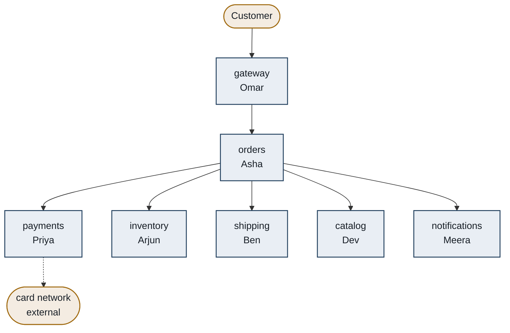
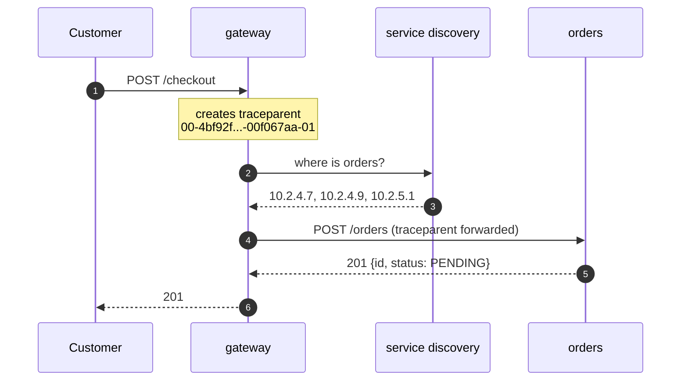

# Microservices — what actually happens when you cut a system apart

> **Tell a friend:** Asha's bakery, Riverbend, grew from four staff to forty,
> and everybody now waits for the one weekly moment when the shop's single
> binder may be changed. So Asha gives each counter its own binder — and keeps
> one shared storeroom, so a shelf renamed by the bread counter still breaks
> the gift-box counter at 3am. The only split that works is a split of the
> **data**: one counter owns a shelf, and everyone else has to ask. That buys
> exactly one thing, the right to change your part today without asking anyone,
> and the bill arrives immediately as arithmetic. The cruellest line on the
> bill is that a **slow** neighbour destroys you faster than a dead one.

The trainer is [`visualization.html`](visualization.html), published as
[The Checkout Cascade](https://claude.ai/code/artifact/ec33c164-a395-4748-bdac-513db3cbf96e). [Section 17](#17-about-this-lab) says what else is here.

---

# BEGINNER MODEL

## 1. Why would anyone cut a working program apart?

> **In one breath:** One program means one turn. Forty people cannot share one
> turn. Microservices are an attempt to buy more turns.

A company writes one program. The company grows. More and more people need to
change that one program, and there is only one of it.

One place to edit. One thing to test. One moment when it goes live.

So everyone has to take turns. And everyone's mistakes land on everyone else.

A person who wants to change the colour of a button has to wait for a release.
That release also contains somebody else's half-finished database change. If
that database change is wrong, the button change is cancelled too.

Eventually the company spends more time coordinating who may change the program
than actually changing it. **Microservices are an attempt to buy that
coordination back.** You cut the one program into many programs. Each one can
then be changed and released on its own.

What does it look like when nobody solves this? Releases slow from daily to
weekly to monthly. A one-line fix waits three weeks behind an unrelated
feature. Every release needs a meeting. One team's bad afternoon takes the
whole product offline.

That is the pain. Hold on to it. Everything in this lab is either that pain, or
the bill for curing it.

## 2. What happens when forty people share one turn?

> **In one breath:** Riverbend is one bakery with one binder behind the counter.
> Forty people now write into it, but it can only be changed once a week, so
> one person's mistake cancels everybody else's week.

*No jargon in this section. A ten-year-old could follow it.*

**Riverbend** starts as one small bakery with one counter. Asha runs it.

Everything the shop knows lives in **one binder** behind that counter: the
recipes, the prices, the list of who has paid, the list of what is in the
storeroom. Everyone works from that binder. Four people work there.

It is wonderful. If you want to know anything, you look in the binder. If you
want to change anything, you write in the binder.

Ten years later Riverbend has **forty** staff. It sells bread, cakes,
sandwiches, coffee, gift boxes and wedding catering. The binder is now four
thousand pages long.

Here is the problem, and it is not the size of the binder.

There is still only **one** binder. And Riverbend has a rule: you cannot change
a page while people are using the binder. So once a week, at 6am on Tuesday,
the shop closes. The binder is taken away. Every change everybody wrote that
week is copied in at once. Then the binder comes back.

Watch what that rule does to two of Asha's staff.

**Sana** wants to change the price of a croissant. One number. She has to wait
until Tuesday.

**Marcus** is halfway through rewriting the wedding-catering section. His new
pages have a mistake in them.

On Tuesday morning the new binder comes back with Marcus's mistake in it. The
shop is chaos. So Asha reverses the whole Tuesday change — **including Sana's
croissant price**, which was fine.

Sana waits another week. For one number.

Now multiply that. Forty people, each writing into the same binder. Each one
able to spoil everyone else's Tuesday.

So Asha adds a rule: before Tuesday, every change must be read and approved in
a meeting. The meeting takes three hours. Then it takes a day. Then Tuesdays
become fortnightly, because a fortnight of changes is too risky to do weekly.

**Riverbend has not run out of talent, money, or ideas. It has run out of
*turns*.** Forty people are sharing one turn.

> **🔮 Predict:** Asha is about to try the obvious fix. What do you think it is,
> and what do you think will go wrong with it?
>
> <details><summary>Reveal</summary>
>
> The obvious fix is: **give each counter its own binder.** Split the four
> thousand pages into a bread binder, a cake binder, a coffee binder, a
> catering binder — one per counter, each counter free to rewrite its own pages
> whenever it likes.
>
> If you guessed "hire more staff" or "make the meeting shorter", you are
> treating this as a people problem. It is not. Forty people are already there,
> and the meeting exists *because* of the single binder, not the other way
> round.
>
> What goes wrong with the split is the part almost every real company gets
> wrong too, so it deserves its own section. Keep reading — but notice now that
> we have said nothing at all about the **storeroom**.
>
> </details>

**Where this lab takes you.** Stop at any checkpoint and you still have
something whole.

| Layer | Sections | After it you can… |
|---|---|---|
| Beginner | 1–9 | tell Riverbend's story, and say what a split really is |
| Intermediate | 10 | derive every mitigation from one multiplication |
| Engineering | 11–12 | reason about nine failures and argue both sides honestly |
| Production | 13 | say what the real thing adds, and read a 3am dashboard |

## 3. Why not just give every counter its own binder?

> **In one breath:** Riverbend splits one binder into six. For about six weeks
> it is magnificent.

Asha splits.

The four thousand pages become six binders — Bread, Cake, Coffee, Catering,
Gift Boxes, Deliveries. One per counter, each owned by a small team. Each
counter may rewrite its own binder any morning it likes. No Tuesday. No
meeting.

Sometimes one counter needs something from another. The cake counter needs
today's coffee prices for the "cake and coffee" deal. So a runner carries a
note between counters and brings the answer back.

In software terms, and this is exactly what most companies do first: **the one
program was split into six programs.** Each gets its own repository, its own
build, its own deploy button, and network calls between them.

For about six weeks, this is magnificent. Then it starts going wrong. It goes
wrong in a way that is genuinely surprising the first time you see it.

## 4. What did Riverbend forget to split?

> **In one breath:** Riverbend split the binders and kept one storeroom. Every
> counter still writes on the same stock cards, so every counter is still
> holding on to every other counter.

Here is what Asha did **not** split: the **storeroom**.

All six counters still walk into the same storeroom. They take flour off the
same shelf. And here is the part that matters. All six counters still write on
the same stock cards that live in that storeroom.

> **🔮 Predict:** Six binders, six teams, one storeroom. Which of Riverbend's
> two original problems has actually gone away — the waiting, or the
> breaking-each-other?
>
> <details><summary>Reveal</summary>
>
> **Neither.** That is the surprise. If you said "the waiting is gone, they can
> each write their own binder now", you have been fooled by the binders. The
> stock cards are also a thing every counter writes, and nothing about them
> changed. Riverbend now has six deploy buttons and the same single turn.
>
> Three things happen next, in this order.
>
> </details>

### 4a. How does a change that touches nobody break somebody?

Dev's bread counter decides its stock cards are badly designed. On its own
morning it **renames the column "Qty" to "OnHand"** on the flour cards. Nobody's
permission was needed. That is the whole point of having its own binder.

At 3am the gift-box counter's automatic reorder stops working. Nobody at the
bread counter knew gift boxes read the flour cards. There was no meeting to
miss. No approval to skip. No rule broken. Dev genuinely believed that shelf
was his.

This is the single most important sentence in this section:

> **A shared storeroom is an interface that nobody agreed to, nobody versioned,
> and nobody can see.** Every column any other counter reads is a promise you
> made without knowing you made it.

Notice what is missing here that would have caught it in the old world. When it
was one program, renaming a field was safe **because the compiler found every
place that used it**. Split into six programs sharing one storeroom, you kept
every dependency and deleted the only thing that could see them.

### 4b. Why can nobody release alone any more?

The cake counter needs a new column on the stock cards. Adding it changes the
cards. The other five counters read those cards. So the change has to be
coordinated with five teams.

They are back in a meeting. It is the same Tuesday meeting, wearing a different
hat.

### 4c. Why does every job still need every counter?

The split was made by **kind of thing** rather than by **kind of work** — a
"recipes" binder, a "prices" binder, a "stock" binder. So almost every real
task now needs three or four counters to change together.

Selling a new seasonal cake touches the recipe binder, the price binder, and
the stock binder. Three teams. Three deploys. In a fixed order.

Riverbend now has six programs and **still** one turn. It has all the
coordination cost of the old system, plus runners, plus notes that get lost.

This has a name, and it is the thing this lab exists to help you avoid:

> A **distributed monolith** is a system that has been split into many
> separately deployed pieces but *not* separated. The pieces still have to
> change together. So you pay every cost of being distributed and receive none
> of the benefit.

It is strictly worse than the **monolith** it replaced. A monolith is one
program, one deployable, one database — Riverbend's original single binder. The
monolith at least had a compiler.

So what did the naive fix actually reveal? The thing that binds two pieces of
software together is not that they sit in the same file, the same repository or
the same process. It is that they **share knowledge of the same data**. You can
move code anywhere you like. If two pieces still read the same table, they are
one thing, wherever they live.

## 5. What did Asha actually want?

> **In one breath:** Not smaller programs. She wanted to change her part today
> without asking anyone, and without breaking anyone.

Say plainly what Riverbend actually wanted. Not "smaller programs" — it never
wanted that. It wanted this:

> **I can change my part and put it live, today, without asking anyone — and
> without breaking anyone.**

Both halves are load-bearing, and each is a separate obligation.

*Without asking anyone* means no shared release train. No cross-team approval.
No ordering constraint with somebody else's deploy.

*Without breaking anyone* means no hidden reader of my data. And no change I
can make that silently violates a promise somebody is relying on.

There is a sharp test for whether you have this. Keep it for the rest of your
career:

> **Can you rename a column, at 4pm on a Friday, without telling anybody?**

If the answer is no, the thing you are looking at is not separate. It does not
matter how many repositories, containers or teams it has.

Everything from here on is the pursuit of that one requirement — and then the
bill that arrives for having got it.

## 6. Where does the cut really go?

> **In one breath:** Cut where the data is owned, not where the code is. Then
> the only thing crossing the line is a promise you chose to make.

Two sentences.

> **Cut the system where the *data ownership* falls, not where the code falls:
> exactly one piece of software may write and read a given piece of data, and
> everybody else must ask it.**
>
> **Then the only thing crossing the boundary is a promise you chose to make
> and can version — so you can change everything behind it whenever you like.**

That is the whole idea.

Riverbend's version: each counter gets its own binder **and its own storeroom,
with a locked door**. If the cake counter needs to know how much flour there
is, it asks Dev's bread counter and accepts whatever answer comes back. It may
never walk in and look.

The locked door converts an accidental, invisible dependency into a deliberate,
visible one. And only deliberate dependencies can be managed.

Everything else in this lab is one of two things. Either it is how to decide
where the doors go. Or it is what it costs to have runners instead of shelves.

## 7. What do engineers call all of this?

> **In one breath:** Now the professional vocabulary, and only now. Every word
> below names something you have already watched happen at Riverbend.

Each group of words below is a short story first, then a small table that points
back at the moment you met the thing. The full one-line definitions all live in
the glossary at section 16.

Riverbend's counters are about to become programs, so meet the people who run
them. Asha keeps the order desk. Priya runs the till and the card machine.
Arjun keeps the storeroom. Dev owns the recipes and the prices. Ben runs
deliveries. Meera sends the receipts and the emails. Omar looks after the front
door and everything under the floor.

### 7a. What is a service, and when is it "micro"?

A **service** is a program that runs on its own and does one area of the
business. Precisely: an independently deployable unit of software that owns its
data and exposes its capability only through a network interface.

Why does the word exist at all? To separate a *deployment* unit from a *code*
unit. A library, a module and a package are code units. They are compiled into
somebody else's process. A service has its own process, its own memory and its
own lifecycle. It can be restarted without restarting you. The word marks the
line where the compiler stops helping.

Priya's till is now a service called `payments`. It runs as its own process, owns
the `payments` table, and is reached only at `POST /payments`. That process
boundary is why everything you know about
[communication-protocols](../02-communication-protocols/) suddenly applies to
what used to be a method call.

A **microservice** is a service kept small enough that one team owns all of it.
There is no size definition. Anyone who gives you one is guessing, whether it is
lines of code, "two pizzas", or "fits in your head". The only definition that survives
contact with production is behavioural. **A service is microservice-sized when
the team that owns it can release it without coordinating with another team.**
Size is a consequence of that, not a target.

The "micro" exists to mark this style off from the earlier SOA style, where
services were large, shared, and coordinated by a central bus. It is not about
lines of code. It is about *who has to be in the room for a release*.

Ben's `shipping` is 4,000 lines and one team. That is micro enough. Splitting it
into `shipping-labels` and `shipping-rates`, still both owned by Ben, would add
network calls and buy nothing. *(known)* The arch-patterns lab warned that
microservices are "not an upgrade, a tradeoff". This is the sentence that makes
that tradeoff checkable.

**Independent deployability** is the plain sentence "I can ship my thing today
without you". Precisely: a new version of one service can be released to
production without requiring a simultaneous or ordered release of any other
service, and without any other service changing.

This is the word that matters most in the whole lab. It is the *only* real
benefit of the style, and naming it lets you check whether you have it. Every
other claimed benefit is either obtainable without splitting, or has to be bought
separately. That covers scalability, technology choice and fault isolation. This one is
the thing you cannot get from a monolith.

The true test is the release log. Look at the last twenty production releases.
If `orders` and `inventory` went out together seventeen times, you have one
service living in two repositories. That is the Friday-column-rename test from
section 5, with the jargon taken out.

| Word | The one line that decides it | Where you met it |
|---|---|---|
| **Service** | own process, own data, reached only over the network | Priya's till, section 3 |
| **Microservice** | one team can release it alone; size is a result, not a goal | Ben's shipping, this section |
| **Independent deployability** | I ship mine today without ordering yours | Asha's real requirement, section 5 |

### 7b. Why is coupling not about who calls whom?

*(known)* From arch-patterns: **coupling** is how much one thing has to know
about another. This lab adds one piece of precision. Coupling is measured by
**what forces a simultaneous change**, not by what calls what.

Read that again with Riverbend in mind. Two counters whose runners visit each
other all day, but which have never had to change on the same morning, are
*less* coupled than two counters that never speak and share one stock card.

A **distributed monolith** is what Riverbend became in section 4. Split into
many pieces that still have to move together: all the cost, none of the benefit.
Precisely: a system of separately deployed services whose changes still require
cross-service coordination, because they share data, share a release train, or
are cut along technical layers rather than business capabilities.

Why does that need a name of its own? Because "we have microservices" is a
statement about the deployment diagram. This term is the statement about
reality. It exists so you can say the diagnosis out loud. Riverbend after
section 4 is the example: six deployables, one storeroom, three teams needed for
a new cake.

It has a symptom you can measure. Take the last ten features you shipped and
count how many services each one had to change. If most features touch three or
more, you have this.

*(known)* **Blast radius**, also from arch-patterns, is how much of the system a
single failure or a single change can damage. This lab's contribution is
uncomfortable. The blast radius of a microservice system is **not** automatically
smaller than a monolith's. Sections 10 and 11 show it starting out *larger*, and
show exactly what you must buy to shrink it.

| Word | The one line that decides it | Where you met it |
|---|---|---|
| **Coupling** *(known)* | what forces you to change on the same morning | Dev's rename, section 4a |
| **Distributed monolith** | many deployables, one turn | Riverbend after section 4 |
| **Blast radius** *(known)* | how far one failure or one change reaches | the 3am reorder, section 4a |

### 7c. What is the locked door actually made of?

A **bounded context** is the area within which one particular meaning of a word
is true. Precisely, from Domain-Driven Design: a boundary inside which a model
and its vocabulary are consistent and unambiguous. Across the boundary the same
word may legitimately mean something different, and translation is explicit.

Why does anybody need this term? Because the biggest mistake in boundary-drawing
is believing there is one true "Customer" in your business. There is not.

To `billing`, a Customer is a legal entity with a tax ID and a payment method.
To `shipping`, a Customer is an address and a delivery-window preference. To
`support`, a Customer is a person with a history of complaints. Forcing those
into one shared model creates an object nobody can change, because every field
belongs to somebody else. The term exists to give you permission to have three
Customers.

Asha's `orders` says "order" and means the customer's intention to buy. Ben's
`shipping` says "order" and means a box with a label on it. They exchange an ID
and translate. They do not share a class. This is the answer to "where do I put
the door?", which section 10i turns into five concrete rules.

*(known by name from arch-patterns.)* **Database-per-service** is what section 4
just bought you. **Exactly one service may read or write a given table.** Others
must go through that service's interface.

Here is the precision that is usually missed. This rule is not about the *number
of database servers*. Two services can share one Postgres instance and still obey
it, if they use separate schemas and separate credentials and neither can see the
other's tables. It is about **who is permitted to know the shape of the data**,
because the shape is what a rename breaks. Enforce it with database permissions,
not with a wiki page. A rule that is only written down is not a rule.

A **contract** is the promise a service makes about what it will accept and
return. Precisely: the observable surface of a service — endpoint paths, request
and response shapes, event schemas, error codes, and the behaviour behind them,
which means ordering, idempotency and timing. Everything else about the service
is private and may change freely.

The word separates *what I promised* from *how I do it*. Once that line is drawn,
"can I change this?" has a mechanical answer instead of an argument. The contract
is the only thing the outside world is entitled to depend on.

Priya's contract is
`POST /payments {orderId, amountMinor, currency, idempotencyKey}` answered by
`201 {paymentId, status}`. That she stores it in Postgres, retries the card
network twice, and writes it in Kotlin is not part of the contract. The
idempotency key in that request *is* part of it, because the caller's retry
behaviour depends on it. That makes it a promise rather than a detail. See
[idempotency](../49-idempotency/).

| Word | The one line that decides it | Where you met it |
|---|---|---|
| **Bounded context** | inside here, this word means exactly one thing | Dev's binder, section 3 |
| **Database-per-service** *(known)* | one writer per table, enforced by grants | the locked door, section 6 |
| **Contract** | the promise; everything behind it is yours to change | the sign on the door, section 6 |

### 7d. What is the name for one shop taking down the street?

A **cascading failure** is one thing breaking, and its breaking breaking the
things that were only talking to it — and then their breaking breaking the next
ring out.

Precisely: a failure propagates from a dependency to a caller because the
caller's finite resources are consumed waiting on that dependency. Those
resources are threads, connections, memory or file descriptors. The caller then
fails at work that had nothing to do with the dependency.

The term exists to name a difference people keep collapsing. "Payments is down,
so you cannot pay" is expected and contained. "Payments is down, so you cannot
view your order history" is a cascade: the failure crossed into unrelated
functionality. Without the term, people report the second as if it were the
first, and the real bug is never found. The worked example is the whole of
section 11, with numbers.

You have seen exactly one instance of this already. Failure mode F2 in the
[distributed-rate-limiting](../60-distributed-rate-limiting/) lab, where a slow
counter store exhausted request threads while every dashboard stayed green. That
was not a rate-limiting quirk. It is the general law of every synchronous call,
and this lab derives it.

*(known from distributed-rate-limiting)* A **circuit breaker** wraps the calls to
one dependency. It counts recent failures. Once they cross a threshold it stops
making the calls at all for a while, failing instantly instead of slowly. It has
three states. **Closed** means calls pass. **Open** means calls fail immediately
without being made. **Half-open** means a trickle is let through to test
recovery. Section 10f adds the two things usually got wrong. The first is what
the breaker actually protects: the *caller's* threads, not the dependency. The
second is why you need a breaker per dependency rather than one per service.

*(known from distributed-rate-limiting)* A **bulkhead** caps how much of a shared
resource any one dependency may consume. A dependency going bad can then use up
its own quota and no more. It is named after ship compartments: a hull breach
floods one compartment, not the vessel. Section 10f deepens this one too.

| Word | The one line that decides it | Where you met it |
|---|---|---|
| **Cascading failure** | your resources die waiting on somebody else's problem | three runners stuck next door, section 8a |
| **Circuit breaker** *(known)* | stop calling a thing that is known to be broken | the quartet, section 10f |
| **Bulkhead** *(known)* | one dependency may hold this much of you and no more | the quartet, section 10f |

### 7e. Which two sums does nobody do correctly in their head?

**Availability, serially composed**, in plain words: if you need five things to
work, and each works 99.9% of the time, you are not at 99.9%.

Here is that sum as a thing at Riverbend. A customer's order needs the price
desk, the storeroom, the till, and the front door. If any one of them is shut,
there is no sale. So the chance of a sale is the chance all four are open at
once, which is each chance multiplied together.

In words: multiply every required service's availability together to get the
chain's. In symbols, writing one service's availability as `A_i` and the whole
chain's as `A_total`: `A_total = ∏ A_i`. Unavailability adds up, roughly, until
the numbers get large.

The term exists because the intuition is wrong in one specific direction.
Everybody's gut says "they're all 99.9%, so we're about 99.9%". The arithmetic
says 99.5%, which is five times more downtime. The term exists to force the
multiplication, and section 10a does it in hours per year.

**Tail latency amplification**, in plain words: if you have to wait for many
things, you wait for the slowest one — and rare slowness stops being rare.

The Riverbend version: Asha sends six runners at once and cannot answer the
customer until the last one is back. Each counter is occasionally slow. The
chance that Asha waits is the chance that *at least one* of the six was slow,
which is much larger than the chance that any particular one was.

In words: one minus the chance that every single service was fast. In symbols,
writing the number of services as `N` and the chance one of them is slow as `p`:
`1 − (1−p)^N`.

Why is that worth a name? Because a service's own p99 stops being the number
that matters once it has callers who fan out. Dean and Barroso named this in
*The Tail at Scale* (CACM, 2013). A server that is 1 ms on average but 1 s at
p99, touched by a request that fans out to 100 such servers, makes **63% of
requests take over a second.** A p99 that looks fine locally is a catastrophe
globally.

| Sum | In words | In symbols | The number that shocks people |
|---|---|---|---|
| **Serial availability** | multiply every required service's uptime together | `A = ∏ A_i` | five services at 99.9% give 99.5% |
| **Tail amplification** | one minus the chance every service was fast | `1 − (1−p)^N` | 100 servers at p99 = 1 s make 63% of requests slow |

### 7f. What replaces the phone book and the stack trace?

**Service discovery** is how one service finds where another one is right now.
Precisely: the mechanism that maps a stable logical name such as `payments` to
the current set of healthy network addresses, kept current as instances start,
stop, move and fail health checks.

In a monolith the answer was "it is a method, it is at this memory address". Once
instances are created and destroyed constantly by an orchestrator, addresses are
not something a human can put in a config file. The term names the machine that
replaces the config file.

Concretely, `payments.riverbend.svc.cluster.local` resolves to six pod IPs. A pod
is killed, and discovery removes it within about ten seconds. That ten-second
window is why callers sometimes get *connection refused*, which is why retries
are legitimate, which brings in [idempotency](../49-idempotency/). Section 10e
has the precise rule.

**Distributed tracing** is a shared ID stapled to a request so you can see its
whole journey across every service it touched. Precisely: a trace identifier is
created at the system edge and propagated on every outbound call. The W3C
standard header is `traceparent`. Each service records timed **spans** tagged
with that trace ID, and a collector reassembles them into one waterfall.

In a monolith, the answer to "why was this slow?" was a stack trace and a
profiler. Both stop at the process boundary. Tracing is the replacement, and it
is not optional — it is the thing you traded the stack trace for. One Riverbend
checkout is 14 spans across 6 services, and section 10h shows that waterfall.

**Consumer-driven contract testing** is each caller writing down what it actually
depends on, so the callee runs those checks before every release. Precisely:
consumers publish executable expectations about the provider's contract, called a
"pact". The provider's build verifies every published expectation and fails if
one is broken. No shared test environment, no end-to-end suite.

This one exists to replace what Dev destroyed in section 4a. In a monolith the
compiler told you who you broke. In a distributed system nothing does, unless you
build this. The term names the compiler's successor.

| Word | The one line that decides it | Where you met it |
|---|---|---|
| **Service discovery** | a name resolves to whoever is healthy right now | Omar's front door, section 10h |
| **Distributed tracing** | one ID on one request, across every hop | the 14-span waterfall, section 10h |
| **Consumer-driven contract testing** | your callers' expectations run in your build | the missing compiler, section 4a |

### 7g. Which words arrive later, and where?

Some vocabulary is deliberately introduced later, in the section that earns it.

Section 10 will add **fan-out**, **critical path**, **thread pool exhaustion**,
**retry storm**, **fail fast**, **expand/contract migration**, **event-carried
state transfer**, **API gateway** *(known)* and **service mesh** *(known)*.
Section 13 will add **SLO** and **error budget**. All of them are in the
glossary at section 16, and every one of them will be a thing that happens to
Riverbend before it is a word.

Terms you already met in the
[software-architecture-patterns](../06-software-architecture-patterns/) lab got a
one-line refresher above, marked *(known)*.

## 8. What two pictures should you carry?

> **In one breath:** Riverbend is now a row of separate shops on one street.
> That picture gets the layout right and the behaviour badly wrong, so you need
> a second picture beside it.

### 8a. What does the market street look like?

Carry this picture around.

**Riverbend is no longer one shop. It is a row of separate shops on one
street.** Each shop has its own staff, its own locked storeroom, its own opening
hours, and its own sign on the door saying what it will sell you.

When Dev's cake shop needs to know the price of coffee, it sends a runner next
door. The runner might get lost. The coffee shop might be closed. The runner
might have to queue.

And here is the sentence to remember. Dev's shop has only three runners. While
all three are waiting at the coffee shop's counter, nobody is left to serve
cake.

That last sentence is the entire failure section of this lab, in advance.

### 8b. What does the same street look like to an engineer?

Precisely, and with the story still on stage.

Each service is a **process** with private memory and a private data store. That
is a shop with a locked storeroom.

The only thing crossing a boundary is a **message** over a network. It may be
delayed, lost, duplicated, or answered by a machine that has since died. That is
the runner.

Every service has a **finite pool of workers** — threads, or connections, or
goroutines, some countable thing. A request occupies one worker for its whole
duration, *including the time it spends waiting for a downstream reply.* Those
are Dev's three runners.

Now the one piece of arithmetic that generates the rest of the lab. Meet it
first as a thing on the street.

Dev sends a runner next door every so often. Each trip takes a while. How many
runners are standing at the coffee counter at any given moment? However often he
sends one, multiplied by how long a trip lasts. Send one every second, let each
trip last three seconds, and three runners are permanently away.

In words: **the number of workers busy at any moment equals how many requests
arrive each second, multiplied by how long each one takes.**

In symbols, and engineers call this **Little's Law**:
`workers in use = arrival rate × time each call takes`.

That one equation generates every failure in section 11. It is the reason
timeouts, retries, bulkheads and breakers exist at all, and you will watch it
produce each of them in turn.

The last piece is the sign on the door. A service's **contract** is a versioned
promise. Everything behind it is free to change. Nothing in front of it may
change without a migration.

### 8c. Which shop part is which engineering part?

Three small tables, because the mapping falls into three groups. Read the left
column as the street and the right column as the system.

The places and the rhythms:

| Market street | Engineering model |
|---|---|
| A shop | A service (a process with private state) |
| The shop's locked storeroom | Its private database — nobody else may open it |
| The sign on the door | Its contract (endpoints, event schemas, error codes) |
| Each shop repainting whenever it likes | Independent deployability |
| Whole street shares one storeroom | A distributed monolith |

The runners, which is where the trouble lives:

| Market street | Engineering model |
|---|---|
| A runner sent next door | A synchronous network call |
| The shop's three runners | The caller's thread / connection pool |
| Runner queueing at a busy counter | A slow downstream call holding a thread |
| All three runners stuck next door | **Thread pool exhaustion** — the cascade |

The defences, every one of which you build in section 10:

| Market street | Engineering model |
|---|---|
| Shop closed, runner comes straight back | Fast failure (connection refused) |
| Runner gives up after five minutes | A timeout |
| "Don't bother, they're shut" note on the wall | A circuit breaker, open |
| At most one runner may go to the coffee shop | A bulkhead |
| A note left in the postbox instead of waiting | An asynchronous event |

### 8d. Where does the story lie to you?

Every analogy is a loan. Here is what you owe. Read this part, do not skip it.

**1. Real shops do not take each other down; services do.**
On a real street, the coffee shop being slow does not close the cake shop. In
software it does. The runners are not people who can be reassigned. They are a
hard-capped pool, and a blocked call holds one until it returns or times out.
**The cascade has no equivalent on the street**, and it is the single most
important behaviour in this lab. If your intuition is coming from the street
picture, you will be surprised by section 11. That is the point.

**2. A shop being "slow" is mildly annoying; a service being slow is worse than
it being dead.**
A closed shop sends the runner straight back, and one second is wasted. A shop
with a huge queue keeps the runner for five minutes. Dead is cheap. Sick is
expensive. This inverts most people's intuition, and you will see the arithmetic
in 10c.

**3. Runners do not multiply. Retries do.**
If a shop is slow, a real street does not respond by sending three times as many
runners. Software does exactly that, by default, because retrying is the standard
reaction to a failed call. So the response to overload is *more* load, aimed
precisely at the thing that is already dying. That is 10d.

**4. There is no such thing as a partly-completed purchase on the street.**
If the cake shop takes your money and the box shop has no boxes, a human sorts it
out. Across services there is no shared transaction to roll back. You learned
that in [two-phase-commit](../45-two-phase-commit/) and its answer in
[saga](../47-saga/). The street picture quietly implies an atomicity that does not
exist.

**5. The street is not a picture of correctness, only of shape.**
Everything about ordering, duplication, staleness and partial failure has to come
from the engineering model. Use the street to remember the *layout*. Use Little's
Law and the availability product to reason about *behaviour*.

## 9. What can you watch instead of imagine?

> **In one breath:** Every number in this lab moves on a screen. Open the
> simulator now, because the next section is written to be read beside it.

Open [`visualization.html`](visualization.html) in this folder, or the published
version, **[The Checkout Cascade](https://claude.ai/code/artifact/ec33c164-a395-4748-bdac-513db3cbf96e)**.
It has five tabs, and each one exists to make a single number visible.

| Tab | The one thing it teaches |
|---|---|
| **1 · The Split** | Coupling lives in the data, not the code. Rename a column and watch who breaks, with a shared store and then with private stores. |
| **2 · The Arithmetic** | Serial availability multiplies. Move the sliders and watch hours-of-downtime-per-year climb as you add services. |
| **3 · The Cascade** | Little's Law in motion: watch Asha's thread pool fill because Priya got slow, and then fix it four different ways. **This is the heart of the lab.** |
| **4 · The Tail** | Fan-out amplification: a p99 that is fine alone is a disaster at width. |
| **5 · Boundaries** | Your cut is measurable: ten real features, and how many services each has to touch. |

How should you use it with this document? Read section 10 with tab 3 open. Every
subsection from 10c onward has a matching scenario button on that tab, and each
scenario asks you to predict before it runs. Predicting badly is the point. It
is where the learning is.

Start with **tab 3, scenario S2 ("Payments gets slow")**. If you can explain
after that scenario why *slow* is worse than *down*, the rest of the lab is
downhill.

---

> ## ✅ CHECKPOINT — end of the BEGINNER MODEL
>
> You can now explain, without jargon, **why microservices exist** — forty
> people sharing one turn. You can say **what a split actually is**: a data
> boundary, not a code boundary. And you can name **the failure mode of a bad
> split**, the distributed monolith, which is all cost and no benefit. You could
> defend the Friday-column-rename test in a design review.
>
> **What the next layer adds:** the mechanism, with numbers. How a request
> physically travels. Why splitting *lowers* your availability before it raises
> it. And the exact sequence in which real systems discovered every mitigation
> you already know the name of. That sequence runs: slow dependency, thread
> pool, cascade, timeout, retry storm, bulkhead, breaker, async.

> **Say it back.** Without using the words *service*, *deploy*, *database* or
> *API*, tell a friend why Riverbend was no better off after Asha gave every
> counter its own binder.
>
> <details><summary>A good answer sounds like</summary>
>
> "They all still wrote on the same stock cards in the same storeroom. So the
> bread counter could change a card any morning it liked and knock over the
> gift-box counter, and nobody could add a card without asking the other five.
> They had six sets of paperwork and still only one turn."
>
> </details>

---

# INTERMEDIATE MODEL

## 10. What actually happens when one checkout runs?

> **In one breath:** Riverbend goes online, and Asha builds checkout the way a
> good engineer builds it first. Then we let it break, and every fix you already
> know falls out of one multiplication.

### Who owns what in Riverbend's checkout?

Riverbend now sells online. Seven services. Each owns its own tables and nothing
else's, and each has a person whose morning it is.

| Service | Run by | Owns | Job |
|---|---|---|---|
| `gateway` | Omar | — | Public entry point, authentication, routing |
| `orders` | Asha | `orders`, `order_lines` | Create and track orders |
| `payments` | Priya | `payments`, `refunds` | Charge cards via an external provider |
| `inventory` | Arjun | `stock_levels`, `reservations` | Reserve and release stock |
| `shipping` | Ben | `shipments` | Book a courier, print labels |
| `catalog` | Dev | `products`, `prices` | Product names, descriptions, prices |
| `notifications` | Meera | `messages` | Send email and SMS |

Read the diagram below as the market street seen from above. Every arrow is a
runner.



Four numbers run through the rest of this section. They were chosen to be
realistic, and each one is a fact about Riverbend before it is a number.

| The number | Value | What it means |
|---|---|---|
| Availability of one service | 99.9% | each runs behind a load balancer; about 8.8 hours of downtime a year |
| Checkout traffic | 100 requests per second | how often a customer arrives at Omar's front door |
| Asha's request-handling threads | 200 | the Tomcat default, and therefore the number in an enormous number of real Java systems |
| A healthy call to Priya's till | 20 ms | how long a runner is away when nothing is wrong |

### 10a. What is the first bill for splitting?

Version one is what everybody builds. `POST /checkout` arrives at Omar's
`gateway`, which calls Asha's `orders`. Asha then calls Dev's `catalog` for
prices, Arjun's `inventory` to reserve stock, Priya's `payments` to charge the
card, Ben's `shipping` to book a courier, and Meera's `notifications` to send
the receipt.

Each of those is a blocking HTTP call. Each one is required to succeed before
checkout returns `201 Created`.

It works. It is easy to reason about. It is also the most fragile thing you will
ever ship, and here is the first reason.

For checkout to succeed, **every** service in the chain must be up. So
availability multiplies. The table below is the whole argument of this
subsection. Look at the right-hand column, and compare the first row with the
last.

| Services required | Availability | Downtime per year |
|---|---|---|
| 1 (the old monolith) | 99.900% | **8.8 hours** |
| 2 (gateway, orders) | 99.800% | 17.5 hours |
| 3 | 99.700% | 26.3 hours |
| 4 | 99.601% | 35.0 hours |
| 5 (gateway, orders, catalog, inventory, payments) | 99.501% | **43.7 hours** |
| 7 (all of them) | 99.302% | 61.1 hours |

Where does 43.7 come from? Three steps, in words first and symbols second.

| Step | In words | The sum |
|---|---|---|
| 1 | five services, each up 99.9% of the time, all needed at once | `0.999^5 = 0.995010` |
| 2 | so the chain is *down* for the leftover share of the time | `0.004990` |
| 3 | multiply that share by the hours in a year | `0.004990 × 8760 hours = 43.7 hours` |

Read that as a sentence. **You took a system that was down 8.8 hours a year,
split it into five equally reliable pieces, changed nothing else, and are now
down 43.7 hours a year.** A five-fold increase in outage, bought with a large
amount of work.

> **🔮 Predict:** Someone proposes fixing this by running three replicas of
> every service. Does that get you back to 8.8 hours a year?
>
> <details><summary>Reveal</summary>
>
> **No, and the reason matters more than the answer.**
>
> If you said yes, you are treating that 99.9% as if it were made of one thing.
> It is not. Split it into causes:
>
> - **Machine and network failure** — a node dies, a disk fills, an availability
>   zone blips. Replication genuinely fixes this: three replicas across three
>   zones make simultaneous loss very unlikely.
> - **Bad deploys** — a release with a bug. Replicas do *not* help; every
>   replica runs the same bad code. Only canary or blue/green deploys help, and
>   they reduce it, not remove it.
> - **Dependency failure** — the service is up but its database or its
>   downstream is not. Replicas do not help at all.
> - **Overload** — replicas help only if the bottleneck is CPU, and not at all
>   if it is a shared database or a shared downstream.
>
> In most real services, deploys and dependencies dominate. So redundancy
> lowers the number, and cannot take it to zero. The honest conclusion of this
> whole subsection is uncomfortable and worth memorising:
>
> > **Splitting a system multiplies the number of independent things that must
> > be working. You can pay some of that back with redundancy and canaries — you
> > cannot pay all of it back. If you want availability, you must remove
> > services from the required set, not just make each one better.**
>
> "Remove services from the required set" is 10g, and it is the real answer.
>
> </details>

**Go and move the sliders.** Open visualization tab **2 · The Arithmetic**. Set
the chain length to 5 and per-service availability to 99.9%. Then find, by
moving the sliders, what per-service availability you would need across five
services to match a single 99.9% monolith. It is 99.98%, which is a materially
harder engineering problem per service.

### 10b. Which of these calls must really succeed?

The first refinement arrives before any code changes. Look again at Asha's chain. Ask, for each call, one question. **If this fails,
must the customer's checkout fail?**

- Dev's `catalog` gives the price. Yes, required. You cannot charge an unknown
  amount.
- Arjun's `inventory` reserves the stock. Yes, required, if you promise not to
  oversell.
- Priya's `payments` charges the card. Arguably required, though see 10g.
- Ben's `shipping` books a courier. **No.** You can book the courier in the next
  five minutes. The customer does not need it to have happened before the page
  says "thank you".
- Meera's `notifications` sends the receipt email. **Obviously no.**

The set of services that genuinely must succeed before you answer the customer
is called the **critical path**. Everything not on it is a candidate to be moved
off — done later, asynchronously, by a message.

This is the first and biggest availability lever, and we apply it properly in
10g. Note now what it costs. Once shipping happens after the response, there is
a window in which the order exists and no courier is booked. That window is a
[consistency window](../51-cqrs/), and you already know its shape.

### 10c. Why is a slow counter worse than a closed one?

This is the most important subsection in the lab.

Priya's `payments` is not down. It is *sick*. Its card-network provider is
degraded, and calls that took 20 ms now take **5 seconds** and eventually
succeed.

Every dashboard is green. `payments` is returning `200 OK`. Its error rate is
zero.

> **🔮 Predict:** Asha's `orders` has 200 threads and takes 100 requests per
> second. Priya's `payments` has gone from 20 ms to 5 s. What happens to
> `orders`? Pick one before revealing.
>
> **(a)** Checkout gets slower, about 5 seconds instead of instant, but works.
> **(b)** Checkout fails, but the rest of `orders` (order history, order
> lookup) keeps working.
> **(c)** The whole of `orders` stops responding, including endpoints that never
> touch `payments`.
>
> <details><summary>Reveal</summary>
>
> **(c).** And it takes two seconds to happen.
>
> If you said (a), you are imagining runners who can be borrowed back. If you
> said (b), you are imagining a separate pool per endpoint. There is one pool,
> and it is shared by every endpoint on the service.
>
> Use Little's Law. In words: workers busy at any moment equals how many
> requests arrive each second, multiplied by how long each one takes.
>
> Healthy, a hundred arrivals a second each holding a thread for two hundredths
> of a second needs two threads. Asha is nearly idle. Sick, a hundred arrivals a
> second each holding a thread for five seconds needs five hundred threads. Asha
> has two hundred.
>
> Threads fill at 100 per second, so the pool is full **two seconds** after
> `payments` gets sick. From that moment, every new request waits for a free
> thread and gets none. That includes `GET /orders/123`, the health check, and
> the order history page.
>
> Requests queue. The queue grows without bound, because arrivals exceed
> completions. Latency goes to infinity. The load balancer's health check times
> out and takes `orders` out of rotation, which sends its traffic to the other
> `orders` replicas — **which then die the same way, faster.**
>
> The blast radius is one degraded external card network taking out Asha's
> entire order service, including read-only pages that touch nothing but their
> own database.
>
> That is a **cascading failure**, and the mechanism is not mysterious. The
> thread pool is a resource shared by all endpoints, and one dependency was
> allowed to consume all of it.
>
> </details>

Here is the same arithmetic laid out. The third column is the reveal's words
turned into the symbol.

| Priya's till | In words | The sum | Threads needed | Asha has |
|---|---|---|---|---|
| Healthy, 20 ms | 100 arrivals a second, each holding a thread 0.02 s | `100/s × 0.02 s = 2 threads` | 2 | 200 |
| Sick, 5 s | 100 arrivals a second, each holding a thread 5 s | `100/s × 5 s = 500 threads` | 500 | 200 |

Now compare a dead till with a sick one. This is the table to remember.

| | `payments` is **dead** | `payments` is **slow (5 s)** |
|---|---|---|
| Call outcome | connection refused, ~1 ms | 200 OK, 5000 ms |
| Threads consumed (Little's Law) | `100 × 0.001 = 0.1` | `100 × 5 = 500` |
| Effect on `orders` | checkout fails instantly, everything else fine | **whole service down** |
| Visible on dashboards | yes — error rate spikes | **no — error rate is zero** |

A dead dependency is a *fast* failure, and it is contained. A slow dependency is
a resource leak wearing a green status light.

You have met this exact shape once before. It is failure mode F2 in the
[distributed-rate-limiting](../60-distributed-rate-limiting/) lab, where a slow
counter store exhausted request threads while every dashboard stayed green. That
was not a rate-limiting quirk. It is the general law of synchronous calls, and
this is its derivation.

**Watch it happen.** Tab **3 · The Cascade**, scenario **S1 (Payments DOWN)**
then **S2 (Payments SLOW)**. Watch the thread-pool gauge on `orders`. In S1 it
barely moves. In S2 it is full in two simulated seconds, and the "order history"
request starts failing. That request never calls payments.

### 10d. Does a timeout fix it, and does a retry help?

Refinement one is a timeout. Cap the call at 1 second. Little's Law again, in words: a hundred arrivals a
second, each holding a thread for at most one second, needs a hundred threads.
That is under the 200 Asha has.

| Setting | In words | The sum | Threads needed | Asha has |
|---|---|---|---|---|
| 1-second timeout, no retries | 100 arrivals a second, each capped at 1 s | `100/s × 1 s = 100 threads` | 100 | 200 |
| 1-second timeout, 3 attempts | each checkout may now hold a thread for `3 × 1 s = 3 s` | `100/s × 3 s = 300 threads` | 300 | 200 |

Read the first row. `orders` survives. Order history keeps working. Checkout
fails, which is correct, because payments really is broken.

A timeout is not an error-handling nicety. **A timeout is the thing that
converts an unbounded resource consumption into a bounded one.** That is why a
call without a timeout is a bug, always, even in code that looks fine.

> **Rule worth keeping:** every synchronous call needs a timeout, and the
> timeout must be chosen from the *caller's* thread budget, not from the
> callee's normal latency. The question is not "how long does payments usually
> take?" but "how many threads am I willing to have stuck here?" — which
> Little's Law turns into a number.

Now refinement two, the retry, and this is the trap. Checkout is failing, so the obvious next
step is to retry: three attempts before giving up.

> **🔮 Predict:** the timeout is 1 s and retries are 3 attempts. Priya's
> `payments` is still sick at 5 s. Is `orders` still safe?
>
> <details><summary>Reveal</summary>
>
> **No. You have re-created the original failure, and you have made `payments`
> worse at the same time.**
>
> Read the second row of the table above. Each checkout now occupies a thread
> for up to three seconds. A hundred arrivals a second, each holding a thread
> three seconds, needs three hundred threads. Asha has two hundred. The pool
> saturates again, in about four seconds instead of two.
>
> If you guessed "safe, because the timeout is still one second", you were
> budgeting per attempt. The thread does not care how many attempts there were.
> It cares about total time held.
>
> And look at what happened on the other side. Priya was receiving 100 requests
> per second. Now she receives **300**. You have tripled the load on a service
> that is failing *because* it is overloaded. This is a **retry storm**, and it
> is how a recoverable five-minute degradation becomes a two-hour outage. The
> moment `payments` starts to recover, the backlog of retrying callers
> immediately knocks it over again.
>
> The fixes, all of which you need:
>
> - **Budget the retries in the caller's time, not in attempts.** The timeout
>   that matters is the total one: 1 second for the whole operation including
>   retries, not 1 second per attempt.
> - **Exponential backoff with jitter.** Without jitter, all failed callers
>   retry at the same instant, and you have built a synchroniser. It is the
>   same thundering herd you met in [distributed-rate-limiting](../60-distributed-rate-limiting/),
>   where a dishonest `Retry-After` header made your own response the clock
>   everyone retried on.
> - **Retry only what is safe to retry** — see 10e.
> - **A retry budget**: cap retries at a small fraction, say 10%, of total
>   traffic, so retries can never multiply load. This is what Google's SRE book
>   recommends and what service meshes implement.
>
> </details>

**Run both scenarios.** Tab 3, **S3 (timeout)** then **S4 (timeout + retries)**.
S4 shows both gauges: the caller's pool refilling *and* the load arriving at
`payments` tripling.

### 10e. When is a retry actually safe?

The rule is precise, and it comes straight from
[idempotency](../49-idempotency/):

> **You may retry freely when you know the request was never received. You must
> have an idempotency key when you do not know.**

| What you observed | Was it received? | Safe to retry? |
|---|---|---|
| Connection refused / DNS failure | Certainly not | **Yes**, always |
| TCP reset before request sent | Certainly not | **Yes** |
| `503 Service Unavailable` from the server | Received, not processed | Yes (the server is telling you so) |
| `429 Too Many Requests` | Received, rejected | Yes, after `Retry-After` |
| **Timeout** | **Unknown** | **Only with an idempotency key** |
| `500 Internal Server Error` | **Unknown** — it may have charged the card and then failed | **Only with an idempotency key** |

The timeout row is the dangerous one, and it is the whole reason the idempotency
lab exists. A timed-out `POST /payments` may have charged the customer. Retrying
it without a key charges them twice.

The key is minted by the caller before the first attempt and reused verbatim on
every retry. That is what makes the ambiguity harmless: Priya's service claims
the key atomically with the effect, and replays the stored response.

Service discovery makes the top row common rather than exotic. When an instance
is killed, discovery takes several seconds to notice, and during that window
callers get connection refused. Those retries are free and correct. Do not let
the danger of the timeout row scare you out of the safety of the first row.

### 10f. What do a bulkhead and a breaker each protect?

Refinement three is a pair of tools. The timeout bounded the damage. It did not *contain* it. With a 1-second timeout
and no retries, 100 of Asha's 200 threads are still tied up in `payments`. That
is half her capacity spent on a call that is going to fail.

**A bulkhead** caps how many threads any one dependency may hold. Give Priya's
`payments` a quota of 40. Now three things are true. At most 40 threads can ever
be inside a `payments` call. The other 160 threads remain for everything else,
and they keep working perfectly: order history, order lookup, health checks. And
calls beyond the quota are rejected immediately rather than queued.

The bulkhead's job is **isolation**. It makes "payments is broken" mean
"payments is broken" instead of "orders is down".

**A circuit breaker** goes further. After enough consecutive failures it stops
making the calls at all.

- **Closed** — normal. Calls pass through; failures are counted.
- **Open** — after, say, 20 consecutive failures or a 50% failure rate over a
  rolling window, the breaker trips. Every call now returns an error
  **immediately, in microseconds, without touching the network.**
- **Half-open** — after a cooldown, say 30 s, let a small number of probe calls
  through. If they succeed, close. If not, open again.

Little's Law once more, with the breaker open. In words: a hundred arrivals a
second, each held for twenty microseconds, needs no threads worth counting.

| Breaker state | In words | The sum | Threads held |
|---|---|---|---|
| Open | 100 arrivals a second, each returning in about 0.00002 s | `100/s × 0.00002 s ≈ 0 threads` | none worth counting |

The dependency is now free.

Two things about breakers are commonly got wrong, and they are the reason this
term needed re-teaching rather than a refresher.

**First, the breaker protects the caller, not the callee.** People describe it
as "protecting payments from load". That is a side effect. Its purpose is to
stop Asha spending her own finite capacity on calls that are going to fail. It
is a resource-management device wearing an error-handling costume.

**Second, there must be one breaker per dependency, not one per service.** If
Asha has a single breaker covering all outbound calls, Priya failing opens the
breaker on Dev's `catalog` too. You have then manufactured a cascade with the
tool you bought to prevent one. The state is per-dependency — and in the real
world, per dependency *and* endpoint, because `POST /payments` failing does not
mean `GET /payments/{id}` is failing.

Why do you need all four tools? Because each does one job, and none substitutes
for another.

| Tool | Bounds | Without it |
|---|---|---|
| **Timeout** | how long one call may hold a thread | unbounded occupancy → pool exhausted |
| **Retry (budgeted, jittered)** | recovery from transient loss | avoidable failures; unbudgeted → retry storm |
| **Bulkhead** | how much of the pool one dependency may hold | one sick dependency starves all endpoints |
| **Circuit breaker** | how long you keep paying for a known-broken dependency | you keep paying the timeout on every request, forever |

You met exactly this quartet in the rate-limiting lab, as the four siblings its
design "needed to survive". Now you have the derivation of *why* it is exactly
these four, and Little's Law is the derivation.

**Watch the gauge split.** Tab 3, scenarios **S5 (bulkhead)** and **S6
(breaker)**. In S5 the pool gauge splits into a payments compartment and
everything else. In S6 the latency of a failing checkout drops from 1000 ms to
about 0.02 ms when the breaker opens. The load arriving at `payments` then
collapses to the probe trickle, which is what lets Priya recover.

### 10g. How do you take work off the critical path?

Refinement four is the last one. Everything so far has been damage control. This is the actual cure, and it uses
three patterns you already own.

Rewrite checkout so that Asha does the minimum that must be true before
answering the customer, and nothing else.

1. In **one local database transaction**, `orders` writes the order row *and* an
   outbox row saying `OrderPlaced`. That is the
   [transactional-outbox](../48-transactional-outbox/) pattern. It exists
   precisely because writing the row and telling the world are two physical acts
   that can be interrupted between.
2. `orders` returns `201 Created` to the customer with status `PENDING`.
3. A relay drains the outbox to the broker, at-least-once.
4. Priya, Arjun, Ben and Meera consume the event and do their work. Each is an
   **idempotent consumer** — mandatory, because at-least-once means duplicates
   are certain, not possible.
5. If payment fails, a compensating action cancels the order and releases the
   reservation. That is a [saga](../47-saga/): a sequence of local transactions,
   each with a business-level undo, replacing a distributed commit you cannot
   have.

What does that buy, in the same arithmetic as before? The critical path is now
Omar's `gateway` plus Asha's `orders`, and nothing else.

| Design | Required services | Availability | Downtime/year |
|---|---|---|---|
| Monolith | 1 | 99.900% | 8.8 h |
| v1 — everything synchronous | 5 | 99.501% | 43.7 h |
| v4 — async off the critical path | 2 | 99.800% | **17.5 h** |

And here is the honest part. 17.5 hours is still twice the monolith's 8.8. You
cannot get back to the monolith's number by cleverness. You have genuinely added
a required component, Omar's gateway, and a network.

What you *can* do is three things. Shrink the required set to its true minimum,
which is what you just did. Make each required member more reliable than 99.9%
with replication and canaries, remembering the ceiling that 10a's prediction box
explained. And accept that the remaining gap is part of the price you agreed to
pay for independent deployability.

If nobody ever tells you that last sentence, you will spend years believing you
have implemented microservices wrong.

There is also a part that is not free. Moving work off the critical path moves
it. It does not delete it.

- The customer sees `PENDING`, so the interface must be honest about it. "Order
  placed, payment confirming" is a product decision, not an engineering detail.
- Payment can now fail *after* the customer was told the order was placed. The
  compensation is visible to a human: an email from Meera saying the order was
  cancelled. You traded a synchronous rejection for an asynchronous apology.
- Stock can be oversold in the window between order and reservation, unless you
  reserve synchronously. That is why Arjun's `inventory` is often the one call
  that legitimately stays on the critical path even when everything else moves
  off.

That last bullet is the general rule. **Whatever must be exactly true at the
moment you answer the customer stays synchronous. Everything else goes async.**

**Kill it and see.** Tab 3, scenario **S7 (async)**. Kill `payments` entirely
and watch checkout keep returning 201.

### 10h. How does a request physically travel now?

This is the plumbing you did not have in a monolith. Read it once to know what
exists. You will meet each piece again in section 13.

The first half of the journey is the front door finding Asha:



The second half is Asha doing the minimum, then telling the world:

```mermaid
sequenceDiagram
  autonumber
  participant O as orders
  participant I as inventory
  participant DB as orders DB
  participant B as broker

  O->>I: POST /reservations (traceparent forwarded)
  I-->>O: 201 reserved
  O->>DB: BEGIN; insert order; insert outbox; COMMIT
  Note over O,B: relay drains outbox
  O->>B: publish OrderPlaced
  B->>B: payments / shipping / notifications consume
```

Three pieces of that are new, and each replaces something the monolith gave you
free.

**The gateway** *(known from arch-patterns)* replaces "the front door of the
program". It is one place for TLS, authentication, and routing, so seven
services do not each implement login. Omar owns it.

**Service discovery** replaces the method address. Look at steps 2 and 3 of the
first diagram: the caller asks for a *name* and gets a *current* set of
addresses. Nothing is hard-coded, because nothing is stable.

**The trace ID** replaces the stack trace. Omar's `gateway` creates it, and
**every service must forward it on every outbound call.** One service that drops
the header breaks the trace for everything below it. That is why this is usually
done by a shared library or by the service mesh, rather than by hand.

Here is what one checkout looks like in a tracing tool. Fourteen spans, and the
answer to "why is checkout slow" is visible in one glance.

```
POST /checkout                                    ████████████████████ 812ms  gateway
  POST /orders                                    ███████████████████  798ms  orders
    GET /products?ids=…                           ██                    41ms  catalog
    POST /reservations                            ███                   63ms  inventory
      SELECT … FROM stock_levels FOR UPDATE       ██                    48ms  inventory-db
    POST /payments                                ████████████████     640ms  payments
      POST https://psp.example/charge             ███████████████      612ms  (external)
    INSERT orders + outbox                        █                     19ms  orders-db
```

Without the trace, "checkout is slow" is a week of guessing across six teams.
With it, it is one look: the card network is 612 of the 812 ms.

### 10i. Where do the boundaries actually go?

Everything above assumed the cut was already made in a sensible place. Making it
is the hardest and least mechanical part of this topic. Here are the five rules
that survive contact with production, each with the failure it prevents.

**Rule 1 — Cut around things that change together.**
If two services are almost always released together, they are one service that
you have made harder to work on. This is measurable: read your last twenty
production releases and count co-deployments.

**Rule 2 — Cut around data ownership: exactly one writer.**
Every table has exactly one service that may write it. By default only that
service may read it. This is the rule from section 6, and it is the one that
prevents the distributed monolith. Enforce it with database grants; a rule that
lives only in a wiki is not a rule.

**Rule 3 — Never cut through an invariant that must hold exactly.**
Suppose Riverbend requires "stock never goes negative" to be true at every
instant. Then reserving stock cannot be split across two services, because there
is no distributed transaction to make it atomic.
[Two-phase-commit](../45-two-phase-commit/) is the option you rejected, and a
[saga](../47-saga/)'s compensations are undo rather than rollback, so
intermediate states are visible. So: **anything that must be atomically
consistent must live inside one service.** That is the same reasoning as a DDD
aggregate boundary, one level up.
This rule is also the honest escape hatch. If two candidate services would share
a strict invariant, do not split them. The invariant wins.

**Rule 4 — Cut around teams (Conway's law) *(known)*.**
A service with two owning teams has none. If your organisation chart cannot be
laid over your service diagram, one of them will bend, and it will not be the
organisation chart.

**Rule 5 — Never cut along technical layers.**
A "validation service", a "database service", a "business logic service" — these
guarantee that every single feature touches every single service, which is rule
1 violated by construction. The cut is by **business capability** (*ordering*,
*paying*, *shipping*), never by **technical role**.

#### How do you measure whether your cut is good?

Take your last ten shipped features and build this matrix. Count how many
services each one had to change.

| Feature | Services touched (good cut) | Services touched (layer cut) |
|---|---|---|
| Add gift-wrap option | orders | orders-api, orders-logic, orders-data, ui |
| Support Apple Pay | payments | payments-api, payments-logic, payments-data |
| Show delivery estimate | shipping, orders | 5 services |
| Change refund window | payments | 4 services |

**If the median feature touches more than one service, your boundaries are
wrong**, and no amount of tooling will rescue it. This number is the single most
useful architectural metric you can collect, and almost nobody collects it.

**Compare the two cuts.** Tab **5 · Boundaries** puts ten real Riverbend
features against two different cuts of the same system and shows the fan-out for
each. Switch between "cut by layer" and "cut by capability" and watch the matrix
light up.

#### What is the chatty-boundary trap?

A correct boundary can still be badly *shaped*.

Asha's order-history page shows 50 orders. Each one carries a product name owned
by Dev's `catalog`.

> **🔮 Predict:** the obvious implementation asks Dev once per order. Fifty
> calls at 5 ms each. What is the real cost — the 250 ms, or something else?
>
> <details><summary>Reveal</summary>
>
> **Both, and the something else is worse.** Fifty round trips at 5 ms each is
> 250 ms of pure waiting. But it is also fifty chances to fail, and by Little's
> Law it is fifty times the thread-occupancy per page view.
>
> If you said "250 ms, and that is acceptable", you priced the latency and
> ignored the availability. A page that needs fifty successful calls is far more
> fragile than a page that needs one.
>
> This is the N+1 problem you know from
> [communication-protocols](../02-communication-protocols/), now with a network
> in each iteration.
>
> </details>

There are three real fixes, in increasing order of commitment.

1. **Batch the call**: `GET /products?ids=1,2,3,…` in one round trip. Cheapest,
   and usually enough.
2. **Cache locally** with a TTL, accepting a [consistency window](../11-caching/).
3. **Event-carried state transfer**: Dev publishes `ProductRenamed` events, and
   Asha keeps her own small read-model copy of the product names she needs. Now
   the order-history page makes **zero** cross-service calls, and Dev being down
   does not affect it at all. This is [cqrs](../51-cqrs/)'s projection idea
   applied across a service boundary, and it is how you take a service off the
   critical path for *reads* rather than writes.

Option 3 is powerful and it is not free. Asha now holds a copy of Dev's data,
which will be stale, and she owns a projector that can fall behind or break.

The rule is the one from your
[eventual-consistency](../28-eventual-consistency/) lab. **A copy like this is
for display, never for a decision.** Pricing an order from a cached catalog copy
is how you sell things at last month's price.

---

> ## ✅ CHECKPOINT — end of the INTERMEDIATE MODEL
>
> You can now derive, from `workers = rate × duration`, why a slow dependency
> takes out an entire service; why a retry is the wrong first instinct; and what
> each of timeout, retry, bulkhead and breaker bounds. You can compute the
> availability of a call chain and argue for moving a service off the critical
> path with a number rather than a preference. You have five rules for where to
> put a boundary. You also have a measurable test for whether the one you have
> is any good: features per service.
>
> **What the next layer adds:** the failures you have not met yet, the ones that
> are not about latency at all. Contract breakage, schema evolution, stale reads
> that reach a customer, and the ones that only appear at 3am. Then the honest
> accounting: what this architecture actually guarantees, what it explicitly
> does not, and what you permanently gave up.

> **Say it back.** Priya's till got slow, not dead, and Asha's whole order
> service stopped answering. Explain why to a friend, using one multiplication
> and no jargon at all.
>
> <details><summary>A good answer sounds like</summary>
>
> "Asha has two hundred people who can serve a customer. A hundred customers
> arrive every second, and each one now has to stand at Priya's till for five
> seconds. A hundred times five is five hundred, and Asha only has two hundred
> people. So two seconds later every single one of them is standing at Priya's
> till, and nobody is left to answer anything at all — not even the questions
> that never needed Priya."
>
> </details>

---

# ENGINEERING MODEL

## 11. What are the nine ways this system fails?

> **In one breath:** Nine things go wrong at Riverbend. Two are about time, two
> are about promises, three are about copies and blindness, and the last one is
> about people. Only the first two have anything to do with speed.

Each failure below is a short story: what Asha does to cause it, what happens
and why, what the system does about it, and what a real on-call engineer sees.
The table at the end lines all nine up side by side.

### F1 — Why does a slow dependency take out the whole caller?

Asha turns Priya's latency from 20 ms up to 5 s and leaves traffic at 100
requests a second. She watches the `orders` thread gauge on tab 3, scenario S2.

A hundred arrivals a second, each holding a thread for five seconds, needs five
hundred threads. Two hundred exist. The pool is full in two seconds. Every
endpoint on `orders` dies, including ones that never call `payments`, because
the thread pool is shared across all endpoints.

What does the system do about it? Nothing, by default. That is exactly why the
mitigations in 10f exist.

Data correctness survives — nothing is written wrongly. What is lost is the
availability of Asha's entire order service, not just checkout.

In production the alert fires on `orders`, not on `payments`, so the wrong team
is paged. The tell is `orders` p99 climbing while its own database sits idle,
and the trace showing all the time inside one downstream span. Prevented by
timeout plus bulkhead; recovered by the breaker.

### F2 — How does a retry turn a blip into an outage?

Asha enables 3 retries with no backoff while Priya is degraded. She watches two
gauges on tab 3, scenario S4: her own pool, and the arrival rate at `payments`.

Caller occupancy triples, because `100 × 3 s = 300 > 200`. And Priya now
receives 300 requests a second instead of 100. The service that was struggling
is now being overloaded by its own callers.

By default nothing responds. With a retry budget, the amplification is capped.

Nothing structural survives here. What is lost is the *recovery itself*: every
time `payments` comes back, the retry backlog knocks it over again, turning a
five-minute degradation into hours.

In production the signature is unmistakable once you know it. The load graph on
the failing service *rises* during its own outage, and the recovery oscillates.
Prevented by total-operation timeouts, exponential backoff **with jitter**, and a
retry budget capping retries at about 10% of traffic. Service meshes implement
all three, which is a large part of why they exist.

### F3 — What happens when you rename a field somebody depended on?

Asha renames the event field `status` to `state` and adds a new value
`AWAITING_FULFILMENT`. She watches tab 1, "rename a field", with private stores
selected — the consumers that break are now *visible*, which is the whole point.

Consumers deserialize into a fixed shape. A removed field becomes a `null`. An
unknown enum value is an exception, or a silent default. Neither is caught at
compile time, in either service.

So the consumer crashes. Or, worse, silently mis-handles.

The producer survives, which is fine, and Asha has no idea anything happened.
What is lost is the consumer's correctness, possibly quietly.

In production this is handled by **expand/contract migration**, also called
parallel change. It is always three deploys and never one:

1. **Expand** — add `state`, keep writing `status` too. Deploy. Nothing breaks.
2. **Migrate** — every consumer moves to `state`, one at a time, on its own
   schedule. This step is only possible if you can *enumerate* your consumers,
   which is exactly what a private database buys you and a shared one destroys.
3. **Contract** — once no consumer reads `status`, stop writing it. Deploy.

Three other things help. **Consumer-driven contract tests** run in the provider's
CI, and they are the compiler's replacement. A **schema registry** *(known)*
enforces compatibility rules on every event schema. And the receiver practises
**tolerant reading**: ignore unknown fields, never fail on an added one. The rule
underneath all of it: **additive changes are free, removals and renames are never
free.**

### F4 — Why is a shared database an invisible dependency?

Two services read the same table, and one of them alters it. Asha watches tab 1
in "shared store" mode, where the breakage list fills up with services she did
not know were readers.

A shared table is an interface with no version, no owner and no consumer list.
There is no artefact anywhere that records who reads it.

The breakage happens at runtime. Usually in a batch job at 3am. Usually in the
service least likely to be looked at.

Nothing you can rely on survives. What is lost is independent deployability
itself — this failure *is* the distributed monolith of section 4.

In production the only real fix is structural: separate schemas, separate
credentials, and a hard rule enforced by grants. The migration path off a shared
database is the **strangler fig** *(known)*. Put the new owning service in front
of the table, move readers to its API one at a time, then revoke their database
access. The revoke is the step that actually completes the migration. Without
it, you have added a service and kept the coupling.

### F5 — What happens when the money leaves and the courier does not?

Asha kills Ben's `shipping` after Priya's `payments` has succeeded. She watches
the saga trace: the compensation running backwards.

> **🔮 Predict:** the customer has been charged and no courier is booked. What
> does the system roll back?
>
> <details><summary>Reveal</summary>
>
> **Nothing, because there is no "back".** If you expected a rollback, you are
> still carrying the monolith's transaction with you. The payment is a fact in
> another company's system. It cannot be un-happened.
>
> What runs instead is a compensation, which is a *new* forward action that
> undoes the business effect: refund issued, reservation released, order
> cancelled, customer emailed by Meera. That is a [saga](../47-saga/).
>
> </details>

Eventual consistency of the business outcome survives — the system ends in a
valid state. What is lost is atomicity and isolation. The intermediate state,
paid but not shipped, was real and was visible to anyone looking.

In production, compensations must themselves be idempotent and retried forever,
which means you need a durable saga log. A compensation that fails is an
operational incident with a human at the end of it, not a silent retry. The
refund is also visibly slower than the charge, so this is a customer-facing
design decision rather than an implementation detail.

### F6 — How does a stale read reach a decision?

Asha prices an item from her locally cached copy of Dev's `catalog`. To watch
this one you re-read the consistency-window discussion in
[cqrs](../51-cqrs/) and [eventual-consistency](../28-eventual-consistency/).

Every cross-service read is a read of a copy, and every copy is behind. Usually
by milliseconds. During a projector outage, by hours.

Nothing responds, because nothing detects it. A stale value is a perfectly valid
value.

Availability survives — that is what the copy bought Asha. What is lost is the
correctness of anything computed from it.

In production the rule is the one you already know from the eventual-consistency
lab, stated exactly: **a replicated or projected read is for display, never for a
decision.** Prices, balances, entitlements and stock levels used in a *write*
path must be read from their owner, or guarded by a conditional write. And
staleness must be monitored by **age**, not by lag count — a projector that has
died produces no events at all, so a queue-depth alarm stays silent forever.

### F7 — What does an incident look like with no trace ID?

One service forgets to forward `traceparent` on an outbound call. To watch it,
look at the waterfall in 10h, then imagine it without the IDs.

Each service's logs are individually correct and mutually unrelatable. "Checkout
was slow at 14:32" cannot be turned into a single request's story.

There is no response, because this is a missing capability rather than a fault.

The system survives perfectly. What is lost is your ability to diagnose it,
which during an incident is the same thing.

In production, propagation is done by shared instrumentation or by the service
mesh's sidecar, never by hand — precisely because one service forgetting breaks
everything below it. The operational rule: **trace-ID propagation is a platform
responsibility, and its coverage should itself be monitored.**

### F8 — Why is the shared low-level counter the most dangerous one?

Dev's `catalog` is used by Asha's `orders`, by `search`, by the website and by
the mobile app. Asha makes `catalog` slow rather than `payments` on tab 3, with
bulkheads off.

A dependency shared by many callers converts one failure into many simultaneous
ones. Worse, all of those callers retry at once, so Dev receives a synchronised
surge exactly when he is weakest.

The response is each caller's own breaker and bulkhead, acting independently.

Callers that isolated the dependency survive. Everything that did not, is lost.

In production the shared low-level service is the highest-risk node in your
architecture. It needs the highest availability target of anything you own. It
should be more replicated, more cached, and more aggressively load-shed than its
callers. Its callers should each hold a local cache that can serve stale data
when it is unreachable — the control-plane rule from
[distributed-rate-limiting](../60-distributed-rate-limiting/) and
[http-caching](../12-http-caching/). And it should be the first place you look
when several unrelated services alert at once.

### F9 — What breaks when a service has no owner?

A team reorganises, and a service it owned is not reassigned. You watch your
incident channel, in about six months.

Dependencies keep being added to it. Its libraries age. Its alerts go to a rota
nobody reads. Eventually it fails in a way nobody present understands.

There is no response. This failure mode is not technical and has no technical
mitigation.

The code survives, and runs fine. What is lost is the *whole premise*.
Independent deployability was bought to give teams autonomy. An unowned service
has no team, so it has no autonomy to give, and it is now strictly worse than a
module in the monolith — which at least had the codebase's owners.

In production you need a service registry with a named owning team, checked in
CI. And you need a genuine willingness to **re-merge** services whose owners have
gone. This is the least-discussed and most common failure of microservice
architectures. It is why the arch-patterns lab's line, *microservices are not an
upgrade*, was aimed at organisations rather than at code.

### The nine side by side — which ones share a cause?

Read the second column as "how to make it happen on purpose" and the last as
"where to look".

| # | Make it happen by | What survives | What is lost | Where to watch |
|---|---|---|---|---|
| **F1** | Priya's latency 20 ms → 5 s | data correctness | all of `orders`, not just checkout | tab 3, S2 |
| **F2** | 3 retries, no backoff, during F1 | nothing structural | the recovery itself | tab 3, S4 |
| **F3** | rename `status` to `state` | the producer | the consumer's correctness, quietly | tab 1, private stores |
| **F4** | two services read one table; one alters it | nothing you can rely on | independent deployability itself | tab 1, shared store |
| **F5** | kill `shipping` after `payments` succeeds | eventual consistency of the outcome | atomicity and isolation | the saga trace |
| **F6** | price an item from a cached `catalog` copy | availability | correctness of anything computed from it | the consistency window |
| **F7** | drop `traceparent` on one outbound call | the system | your ability to diagnose it | the 10h waterfall |
| **F8** | make Dev's `catalog` slow, bulkheads off | callers that isolated the dependency | everything that did not | tab 3, catalog slow |
| **F9** | reorganise a team, reassign nothing | the code | the whole premise | the incident channel |

Two families are hiding in that table. F1, F2 and F8 are all Little's Law:
somebody's finite pool being consumed by somebody else's problem. F3, F4 and F6
are all one broken promise about data: a shape changed, an owner missing, a copy
behind. F5, F7 and F9 are each their own thing — the lost transaction, the lost
stack trace, and the lost owner.

## 12. What do you get, what do you not, and what did you give up?

> **In one breath:** Everything below has been earned by a section above.
> Nothing is listed for completeness. One benefit is unobtainable any other way;
> almost everything else on the list is a cost.

### What does this architecture guarantee, if you do the work?

**Independent deployability.** Each service can be released alone. This requires
rules 1 to 5 in 10i, a private database, and versioned contracts. It is the only
benefit you cannot obtain any other way, and it is the reason to do this.

**Independent scalability.** The service under load can be scaled without
scaling the rest. Real, and genuinely useful when one component's resource
profile is wildly different from the others'. That is the fact that made Dev's
`catalog`, which is read-heavy and cacheable, worth separating from Priya's
`payments`, which is write-heavy, latency-bound and compliance-bound.

**Fault isolation.** *Purchasable, not automatic.* Section 11 is entirely about
the fact that the default is the opposite. You get it once you have timeouts,
bulkheads, breakers, and an async critical path. Not before.

**Technology heterogeneity.** Each service picks its own language and store.
Real, and a mixed blessing: every added runtime multiplies your operational
surface. Treat it as an escape hatch for genuine mismatches, not a policy.

**Team autonomy.** The organisational payoff, and the actual goal. Only real
when every service has exactly one owning team, which is F9.

### What does it explicitly not guarantee?

**Atomicity across services.** Gone, permanently. There is no distributed
transaction. There is a [saga](../47-saga/) with business-level compensations,
and intermediate states are visible to users. This is a product decision.

**Isolation across services.** Gone. Another request can observe your saga
half-done. If you need to prevent that, you need a semantic lock: a status field
that means "do not touch". Building one is application-level work.

**Read consistency.** Every cross-service read is stale. The window is usually
milliseconds and occasionally hours.

**Higher availability.** *Lower*, by default, by exactly the product in 10a. You
buy some back by shrinking the critical path and adding redundancy. You do not
get all of it back.

**Lower latency.** Strictly higher. You replaced method calls with network round
trips and added serialisation at every hop. The 812 ms trace in 10h contains
real network time that a monolith would not have spent.

**Lower cost.** Higher, on every axis: more machines, more observability, more
platform engineers, more time per feature that spans services.

**A correct decomposition.** Nothing in the architecture prevents a bad cut. A
bad cut gives you a distributed monolith, which is worse than what you had.

**Simplicity.** Complexity is *moved*, not removed. It leaves the codebase,
where a compiler and a debugger could see it, and enters the network and the
operations layer, where they cannot.

### What did you permanently give up?

This is the part people discover too late, and it is worth stating starkly.

| You had | You now have | Replacement you must build |
|---|---|---|
| A compiler that found every caller of a renamed field | Runtime `null`s and enum failures | Consumer-driven contract tests, schema registry, expand/contract migrations |
| A stack trace across the whole request | A stack trace that stops at your process | Distributed tracing with propagated trace context |
| Database transactions across your data | Local transactions only | Sagas, outbox, idempotent consumers |
| Reading the code to understand behaviour | Behaviour that only exists at runtime, in the interactions | Tracing, service catalogue, architecture decision records |
| "It works on my machine" for the whole system | You cannot run the whole system | Contract tests, ephemeral environments, testing in production with canaries |
| A function call that cannot fail halfway | A network call with three outcomes: success, failure, and **unknown** | Timeouts, retries with idempotency keys, breakers, bulkheads |

The bottom row is the deepest one. **A method call has two outcomes; a network
call has three.** The third one is *I do not know whether that happened*, and it
is where all of distributed systems lives.

That third outcome is why [idempotency](../49-idempotency/) exists, why
[two-phase-commit](../45-two-phase-commit/) blocks, why
[flp-impossibility](../33-flp-impossibility/) holds, and why
[saga](../47-saga/)'s compensations must be idempotent too. Splitting a monolith
is the act of introducing that third outcome into places where it did not exist.

### Which promises are safety, and which are liveness?

Use the frame from [flp-impossibility](../33-flp-impossibility/) and
[eventual-consistency](../28-eventual-consistency/).

**Safety** means "nothing wrong ever happens". At Riverbend that is: no service
ever reads or writes another's data; no order is charged twice, thanks to
idempotency keys; no saga ends in an invalid business state, thanks to
compensations. These hold at every instant. A single observation can falsify
them, so they can be tested.

**Liveness** means "something good eventually happens". At Riverbend that is:
every outbox row is eventually published; every saga eventually reaches a
terminal state; every projection eventually catches up. None of these can be
falsified by any finite observation, because the answer is always "wait longer".
That is precisely why they must be monitored by **age**, never by a count. The
three ages to watch are the oldest unpublished outbox row, the oldest
non-terminal saga, and the projector's time-since-last-progress.

That distinction is not decoration. A queue-depth alarm on an outbox is a
liveness alarm implemented as a safety check, and it goes silent exactly when
the relay dies. Alarm on the age of the oldest row.

---

> ## ✅ CHECKPOINT — end of the ENGINEERING MODEL
>
> You can now argue both sides honestly. You can name what microservices
> guarantee, what they cost, and the six things you permanently gave up along
> with the machinery that replaces each. You can classify a microservice
> system's properties into safety and liveness, and say what each one's alarm
> should measure.
>
> **What the next layer adds:** what the real thing looks like, with Kubernetes,
> meshes, brokers and SLOs. Also what this lab left out, and what an on-call
> engineer actually stares at during an incident.

> **Say it back.** A colleague says "we'll alarm on the outbox queue depth, and
> page if it goes over a thousand". Explain, without using the words *safety* or
> *liveness*, why that alarm will one day stay quiet through the worst outage
> you ever have.
>
> <details><summary>A good answer sounds like</summary>
>
> "The alarm watches how many rows are waiting. If the thing that drains the
> rows dies, rows pile up and the alarm fires — fine. But if the thing that
> *writes* the rows dies too, or the relay dies in a way that stops new work
> arriving, the pile never grows. Zero waiting rows looks exactly like healthy.
> Watch how *old* the oldest waiting row is instead. Age always grows when
> nothing is moving."
>
> </details>

---

# PRODUCTION MODEL

## 13. What does the real thing look like?

> **In one breath:** This lab's model is seven boxes, a thread pool and some
> arithmetic. A real Riverbend adds a platform underneath all of it, and the
> on-call engineer at 3am reads that platform in a fixed order.

### What does a real implementation add?

Take the chain from this lab to a real system. Every row below is a concern this
lab has already explained, plus the thing production uses to do it.

| Concern | What it is in production |
|---|---|
| Running the processes | **Kubernetes** (or ECS / Nomad): scheduling, restarts, rolling deploys, health probes, autoscaling |
| Finding each other | **Discovery** via the platform's DNS + endpoints, kept current by health checks |
| The front door | **API gateway** *(known)* — Envoy, Kong, an ALB: TLS termination, authentication, routing, edge rate limiting |
| Per-call resilience | **Service mesh** *(known)* — Istio, Linkerd: a sidecar proxy per pod doing mTLS, timeouts, retries with budgets, breakers, and trace-header propagation, **outside your application code**, so seven languages do not each reimplement it |
| Async messaging | **Kafka** or a cloud broker; a **schema registry** *(known)* enforcing compatibility rules on every event schema |
| Getting events out of a database | The outbox relay, or **CDC/Debezium** *(known — see [change-data-capture](../52-change-data-capture/))* reading the write-ahead log |
| Seeing what happened | **OpenTelemetry** instrumentation → traces (Jaeger/Tempo), metrics (Prometheus), logs, all joined by trace ID |
| Knowing if it is healthy | **SLOs** and **error budgets** (below) |
| Releasing safely | Canary or blue/green deploys, feature flags, automated rollback on SLO burn |
| Knowing who owns what | A service catalogue (Backstage or equivalent) with an owning team per service, enforced in CI (F9) |

### What is an SLO, and what is an error budget?

An **SLO**, a *service level objective*, is a target for a measurable property of
the service, over a window. Riverbend's is: "99.9% of checkout requests succeed
in under 500 ms, measured over 28 days".

An **error budget** is the complement of that. 0.1% of 28 days is about 40
minutes of allowed failure.

The budget is what makes availability a *decision* rather than an aspiration.
While budget remains, ship faster. When it is exhausted, stop shipping features
and fix reliability.

In a microservice system every service has its own SLO. The arithmetic of 10a is
exactly how you derive what each one must be, from what the customer-facing SLO
promises.

### What does the on-call engineer actually see at 3am?

At 03:00 Omar's phone says `orders p99 > 2s`. Here is the sequence a competent
responder follows. Every step of it is something this lab explained.

1. **Open the trace, not the logs.** Find a slow checkout and look at the
   waterfall from 10h. The time is in one span, and that names the culprit
   service in seconds rather than hours.
2. **Check whether the culprit is slow or failing.** Green error rate plus
   climbing latency is F1 — a sick dependency, not a dead one. Green dashboards
   are the *signature*, not evidence of health.
3. **Check the breaker states.** An open breaker means the system already
   contained it, and the alert is about degraded functionality rather than an
   outage. A closed breaker on a failing dependency means the thresholds are
   wrong.
4. **Check the caller's saturation, not just the callee's.** Thread pool
   utilisation, connection pool utilisation, queue depth. This is the number
   that predicts a cascade, and it is the one most teams do not graph.
5. **Check whether load is rising during the outage.** If it is, you are in F2,
   a retry storm. The correct action is to **shed load**, not to add capacity.
   Shedding load means rejecting a fraction of incoming requests immediately, so
   that the rest can succeed.
6. **Check liveness by age**, not by count: oldest unpublished outbox row,
   oldest non-terminal saga, projector lag age.

Four graphs are worth having on the wall for every service, and none of them is
CPU: **request rate, error rate, latency distribution (p50/p99), and resource
saturation (thread/connection pool utilisation)**. Saturation is the leading
indicator. The other three tell you it has already happened.

### What did this lab deliberately leave out?

Stated plainly, so you know the shape of what you do not yet know.

- **Security between services.** Who is allowed to call whom, service identity,
  mTLS, propagating the *user's* authorisation across six hops without letting
  any service forge it. This is a large topic and this lab has none of it.
- **Data migration at scale.** Extracting a table from a monolith while it is
  serving traffic — dual writes, backfills, verification, cutover. The strangler
  fig in F4 is one paragraph where reality is one to two quarters.
- **Testing strategy.** The test pyramid inverts: end-to-end tests across a
  system you cannot run locally are the wrong tool. Contract tests, component
  tests with stubbed dependencies, and testing in production with canaries
  replace them.
- **Local development.** "Run the system on my laptop" stops being possible at
  around a dozen services. What replaces it is a real cost nobody budgets for:
  remote dev environments, stub services, telepresence-style proxying.
- **Multi-region.** Everything in this lab assumes one region. Cross-region
  brings back [cap-theorem](../24-cap-theorem/) and [pacelc](../25-pacelc/) at
  every boundary.
- **Cost.** Both infrastructure and the platform team required to operate all of
  the above. A rough rule from practice: you need dedicated platform capacity
  before you need microservices, which is why the honest advice for a ten-person
  company is a modular monolith.

### What did the industry actually do, including the retreats?

Real, dated, and worth knowing — because the retreats are the more useful half.

- **Amazon, ~2002.** The internal mandate that all teams expose data and
  functionality only through service interfaces, with no back doors. Widely
  repeated, most famously in Steve Yegge's 2011 public post, and *anecdotal* —
  it is not a published Amazon document. But it is a precise statement of this
  lab's section 6, twenty years early.
- **Netflix, 2010s.** The public reference implementation of the style, and the
  origin of Hystrix, whose entire job was the breaker, bulkhead and timeout
  quartet of 10f. Hystrix was later put into maintenance mode in favour of
  Resilience4j and mesh-level implementations. The pattern moved from library to
  platform.
- **Segment, 2018.** Publicly documented the re-merge of a system of over a
  hundred services back into a monolith, in "Goodbye Microservices", because the
  per-service operational overhead exceeded the benefit at their team size.
- **Uber, 2020.** Published *Domain-Oriented Microservice Architecture*, a
  deliberate move from roughly 2,200 fine-grained services toward coarser
  domains with defined gateways. A retreat from over-splitting, by the company
  usually cited as the extreme of splitting.
- **Amazon Prime Video, 2023.** Published that moving one component from
  distributed serverless components to a single process cut costs by about 90%.
  The component was the audio/video quality monitoring service. Widely mis-reported as
  "Amazon abandons microservices". It was one team and one component, and the
  actual lesson is exactly rule 1 in 10i.

The pattern across all five: **the split is right when the coordination pain
exceeds the distribution bill, and wrong the rest of the time — and it is
reversible.** Re-merging two services that always deploy together is a normal,
healthy engineering act, not an admission of defeat.

---

> ## ✅ CHECKPOINT — end of the PRODUCTION MODEL
>
> You can read the real material now: the Hystrix and Resilience4j
> documentation, the Istio and Envoy resilience configuration, the Google SRE
> book's chapters on cascading failure and load shedding, Sam Newman's
> *Building Microservices*, and the Segment / Uber / Prime Video write-ups. You
> will recognise the mechanism behind every recommendation rather than
> memorising a list.

> **Say it back.** Leadership has read one article and wants microservices by
> the end of the quarter. In four sentences, and without sounding like you are
> refusing, tell them what they would be buying and what the invoice says.
>
> <details><summary>A good answer sounds like</summary>
>
> "The one thing it buys is that each team can ship its own part on its own day,
> without a joint release. That is worth a lot once teams are stepping on each
> other, which is where we are. The invoice is real though: more downtime per
> customer request on day one, higher latency, more machines, and a platform
> team to run it. So the honest plan is to draw the boundaries inside the
> program we already have, prove a feature can be built inside one boundary, and
> only then pay to separate the first one."
>
> </details>

## 14. Where do you practise?

> **In one breath:** Eight rungs of exercises, all pencil-and-paper or
> simulator work, with worked answers. Attempt the first five before you open
> the answers.

They live in **[EXERCISES.md](EXERCISES.md)**, with worked answers in
**[SOLUTIONS.md](SOLUTIONS.md)**. Eight rungs, all pencil-and-paper or
visualization work:

1. **Explain** — say the whole thing back without notation.
2. **Identify** — read state off the simulator.
3. **Predict** — commit to an outcome before running the scenario.
4. **Modify** — change one setting and name what breaks.
5. **Trace** — run Little's Law by hand across a five-second incident.
6. **Spot the flaw** — three described designs, each with a planted mistake.
7. **Handle failure** — extend a design to survive something it currently does not.
8. **Design** — a full decomposition brief with real constraints.

Attempt rungs 1–5 before opening the solutions. The prediction is where the
learning happens.

## 15. Where does this sit, and what comes next?

> **In one breath:** Every pattern lab you have already done was a scar from
> this one wound. The map below shows which ones came before, which ones now
> make sense, and which ones you have not met yet.

### What comes before and after this lab?


### Which pairs are commonly confused, and how do you tell them apart?

One sentence each.

- **Microservices vs SOA** — the same "services" idea; SOA put the coordination
  logic in a central smart bus, microservices keep the pipes dumb and the
  endpoints smart. *(Also in the arch-patterns lab.)*
- **Microservices vs modular monolith** — identical boundaries, different
  deployment: a modular monolith enforces the same module lines inside one
  process, so you get local reasoning without the network. It is where you
  should start, and it is where you rehearse the boundaries before paying for
  them.
- **Microservices vs a distributed monolith** — the deployment diagram is the
  same; the difference is whether a feature can be shipped by one team alone.
  Only the release log can tell them apart.
- **Microservices vs serverless** — orthogonal. Serverless is a way to run a
  unit of code; microservices is a way to draw boundaries. A microservice can be
  a container or a function; a monolith can run in a function too.
- **Circuit breaker vs bulkhead vs rate limiter** — the breaker stops calling a
  broken dependency. The bulkhead caps how much of *your* capacity one dependency
  may hold. The rate limiter caps how much of *your* capacity one *caller* may
  consume. Inbound, outbound, and outbound-quota respectively.
- **API gateway vs service mesh** — the gateway handles north–south traffic
  (outside → in: TLS, auth, routing); the mesh handles east–west traffic
  (service → service: mTLS, retries, breakers, tracing). Different directions,
  often the same underlying proxy.
- **Orchestration vs choreography** *(known from [saga](../47-saga/))* — a central
  coordinator that tells each service what to do, versus services reacting to
  each other's events with no coordinator. Orchestration is easier to debug;
  choreography couples less.

### What should you learn next?

Three labs change what you can do next more than the others. They are ready to
type.

- **`/learn domain-driven-design`** — section 10i gives five rules for where the
  boundary goes; DDD is the discipline those rules were extracted from
  (bounded contexts, aggregates, context maps, anti-corruption layers). This is
  the missing half of this lab, and the arch-patterns lab suggested it too.
- **`/learn distributed-tracing`** — F7 says the trace replaces your stack
  trace, and this lab shows one waterfall. The mechanics (span context,
  sampling, W3C propagation, tail-based sampling) are their own topic.
- **`/learn queueing-theory`** — Little's Law generated every failure in section
  11 and you have now used it four times. Together with Kingman's formula and
  the `ρ/(1−ρ)` collapse you already measured in
  [work-pressure-and-deadlines](../61-work-pressure-and-deadlines/), this is the
  quantitative backbone of capacity and latency work.

Also worth having:

- **`/learn kubernetes`** — the substrate every production microservice runs on.
- **`/learn service-mesh`** — where the 10f quartet moved from library to
  platform.
- **`/learn kafka`** — the async spine of 10g, suggested by five prior labs now.
- **`/learn api-versioning`** — F3's expand/contract at full depth.
- **`/learn load-shedding`** — the fifth sibling of 10f's quartet.
- **`/learn observability-slos`** — SLOs, error budgets, and the four graphs.

## 16. Glossary — what does every word mean?

> **In one breath:** Every term used in this lab, grouped by what it is for, and
> each one pointing back at where you met it. *(known)* marks a term carried
> over from an earlier lab.

### Which words name the units?

| Term | One line | Where you met it |
|---|---|---|
| **Monolith** | One program, one deployable, one database — everything in one process. | Riverbend's single binder, section 2 |
| **Distributed monolith** | Split into many deployables that still must change together: every cost of distribution, none of the benefit. | six binders, one storeroom, section 4 |
| **Service** | An independently deployable program that owns its data and is reached only over the network. | Priya's till, section 7a |
| **Microservice** | A service small enough that one team can release it without coordinating with another team. Size is a consequence, not a target. | Ben's shipping, section 7a |
| **Independent deployability** | The ability to release your service without requiring or ordering anyone else's release. The only benefit unobtainable any other way. | Asha's requirement, section 5 |
| **Coupling** *(known)* | How much one thing must know about another; measured by what forces a simultaneous change, not by what calls what. | Dev's rename, section 4a |

### Which words name the boundary?

| Term | One line | Where you met it |
|---|---|---|
| **Bounded context** | The boundary inside which one meaning of a word is consistent; across it, the same word may mean something different and translation is explicit. | three Customers, section 7c |
| **Database-per-service** *(known)* | Exactly one service may read or write a given table; enforced with database grants, not documentation. | the locked door, section 6 |
| **Contract** | The versioned public promise of a service — endpoints, schemas, error codes, behaviour. Everything else is private and free to change. | the sign on the door, section 7c |
| **Blast radius** *(known)* | How much of the system one failure or one change can damage. | the 3am reorder, section 4a |
| **Chatty boundary** | A boundary crossed once per item instead of once per request — the N+1 problem with a network in the loop. | fifty calls to Dev, section 10i |
| **Aggregate** *(known)* | The unit inside which an invariant is kept exactly consistent — and therefore a boundary you may never split across services. | rule 3, section 10i |

### Which words name the damage?

| Term | One line | Where you met it |
|---|---|---|
| **Cascading failure** | A dependency's failure consuming the caller's finite resources, so the caller fails at work unrelated to that dependency. | F1, section 11 |
| **Little's Law** | `workers in use = arrival rate × time per call`. The equation that generates every resource failure in this lab. | Dev's runners, section 8b |
| **Thread pool exhaustion** | Every worker occupied waiting on downstream calls, so the service can serve nothing at all, including endpoints with no dependencies. | the two-second death, section 10c |
| **Retry storm** | Retries multiplying load onto a service that is failing because it is overloaded, preventing its recovery. | F2, section 11 |
| **Serial availability** | For a request needing several services, multiply their availabilities: `A = ∏ A_i`. Five 99.9% services give 99.5%, which is five times the downtime. | the first bill, section 10a |
| **Tail latency amplification** | With fan-out `N` and per-call slow-probability `p`, the caller is slow with probability `1 − (1−p)^N`; rare slowness stops being rare. | Asha's six runners, section 7e |

### Which words name the defences?

| Term | One line | Where you met it |
|---|---|---|
| **Timeout** | A cap on how long one call may hold a worker — the thing that converts unbounded resource consumption into bounded. | refinement one, section 10d |
| **Exponential backoff with jitter** | Waiting longer after each failure, by a randomised amount, so retrying callers do not synchronise into a herd. | the retry trap, section 10d |
| **Retry budget** | A cap on retries as a fraction of total traffic, so retries can never multiply load beyond a known factor. | the retry trap, section 10d |
| **Fail fast** | Returning an error immediately rather than waiting, so the caller's resources are released instead of consumed. | dead versus slow, section 10c |
| **Bulkhead** *(known)* | A cap on how much of a shared resource one dependency may consume, so its failure cannot starve the rest. | Priya's quota of 40, section 10f |
| **Circuit breaker** *(known)* | Per-dependency state that stops calls entirely after repeated failure. **Closed** = calls pass; **open** = calls fail instantly, untried; **half-open** = probes test recovery. | the open breaker, section 10f |

### Which words name the shape of the work?

| Term | One line | Where you met it |
|---|---|---|
| **Critical path** | The set of services that must succeed before the customer gets an answer. Shrinking it is the largest availability lever there is. | section 10b |
| **Fan-out** | One request producing calls to many services, in parallel or in sequence. | Asha's seven calls, section 10a |
| **Load shedding** | Rejecting a fraction of incoming requests immediately so the remainder can succeed — the correct response to overload. | step 5 at 3am, section 13 |
| **Canary deploy** | Releasing to a small fraction of traffic first and rolling back automatically on error, to bound the damage of a bad release. | the replica prediction, section 10a |
| **Event-carried state transfer** *(known)* | Publishing enough state in an event that consumers keep their own local copy and stop calling you. Powerful; the copy is for display, never for a decision. | fix 3, section 10i |
| **Consistency window** *(known)* | The interval during which a copy is behind its source; every cross-service read has one. | shipping moved off, section 10b |

### Which words name promises over time?

| Term | One line | Where you met it |
|---|---|---|
| **Consumer-driven contract testing** | Consumers publish executable expectations; the provider's build verifies them all. The replacement for the compiler. | section 7f |
| **Expand/contract migration** | Changing a contract in three deploys — add the new form, migrate every consumer, remove the old form. Never one deploy. | F3, section 11 |
| **Tolerant reading** | Ignoring unknown fields and never failing on an added one, so additive producer changes stay free. | F3, section 11 |
| **Schema registry** *(known)* | A central store of event schemas with enforced compatibility rules, so an incompatible event cannot be published. | F3, section 11 |
| **Strangler fig** *(known)* | Migrating off a system by routing traffic to a replacement one path at a time. The migration completes only when the old access is revoked. | F4, section 11 |
| **Semantic lock** *(known)* | An application-level status meaning "a saga is in progress here, do not touch", replacing the isolation you lost. | isolation gone, section 12 |

### Which words name the async machinery?

| Term | One line | Where you met it |
|---|---|---|
| **Saga** *(known)* | A business transaction as a sequence of local transactions with compensating actions, replacing a distributed commit you cannot have. | step 5, section 10g |
| **Compensation** *(known)* | A business-level undo. Not a rollback: intermediate states were real and were visible. | F5, section 11 |
| **Transactional outbox** *(known)* | Writing the state change and the outgoing event in one local transaction; a relay drains it to the broker at-least-once. | step 1, section 10g |
| **Idempotent consumer** *(known)* | A consumer that produces one effect from repeated deliveries — mandatory under at-least-once. | step 4, section 10g |
| **Idempotency key** *(known)* | A caller-minted identifier reused verbatim on every retry, so a repeated request produces one effect and replays one response. | the timeout row, section 10e |

### Which words name the plumbing?

| Term | One line | Where you met it |
|---|---|---|
| **Service discovery** | Mapping a stable logical name to the current set of healthy addresses, kept current by health checks. | steps 2–3, section 10h |
| **Distributed tracing** | A trace ID created at the edge and propagated on every call, with timed **spans** reassembled into one waterfall. The replacement for the stack trace. | the 812 ms waterfall, section 10h |
| **Span** | One timed operation within a trace, tagged with the trace ID and its parent. | the 14-span checkout, section 10h |
| **API gateway** *(known)* | The single public entry point: TLS, authentication, routing, edge rate limiting. North–south traffic. | Omar's front door, section 10h |
| **Service mesh** *(known)* | A sidecar proxy beside every service doing mTLS, timeouts, retries, breakers and trace propagation outside application code. East–west traffic. | the platform, section 13 |

### Which words name how you run and own it?

| Term | One line | Where you met it |
|---|---|---|
| **SLO** | A measurable target for a service's behaviour over a window — "99.9% of checkouts under 500 ms over 28 days". | section 13 |
| **Error budget** | The complement of the SLO, spent as permission to ship: 0.1% of 28 days ≈ 40 minutes of allowed failure. | section 13 |
| **Conway's law** *(known)* | A system's structure mirrors the communication structure of the organisation that built it. | rule 4, section 10i |
| **Safety property** *(known)* | "Nothing wrong ever happens" — falsifiable by a single observation, therefore testable. | section 12 |
| **Liveness property** *(known)* | "Something good eventually happens" — never falsifiable by a finite observation, therefore monitored by **age**, never by count. | section 12 |

## 17. About this lab

Everything about the lab itself lives here, so the story above could stay a
story.

### What is in this folder?

| File | What it is |
|---|---|
| `README.md` | this document, 16 sections plus this appendix |
| `visualization.html` | the five-tab simulator, also published as [The Checkout Cascade](https://claude.ai/code/artifact/ec33c164-a395-4748-bdac-513db3cbf96e) |
| `EXERCISES.md`, `SOLUTIONS.md` | eight rungs and their worked answers |

This is **a no-code lab**: documents, diagrams, an interactive simulator, and
exercises. The document climbs four labelled depth layers:
**BEGINNER MODEL** (sections 1–9) → **INTERMEDIATE MODEL** (section 10) →
**ENGINEERING MODEL** (sections 11–12) → **PRODUCTION MODEL** (section 13). There
is a checkpoint at each transition, telling you what you can now do and what
comes next.

### What is this lab *not*?

You have already met the word "microservices" once, in the
[software-architecture-patterns](../06-software-architecture-patterns/) lab.
There it was one entry in a catalogue of seven families, described in a single
paragraph. Here is that paragraph: *independently deployable, team-owned services
with private data, communicating over a network — not an upgrade, a tradeoff you
buy when team-scaling pain exceeds the distributed-systems bill.*

That paragraph is correct, and this lab does not repeat it.

What that paragraph does **not** tell you is the thing that actually decides
whether your split succeeds or ruins your year:

- what physically breaks the moment two pieces of code stop sharing a process,
- the arithmetic that turns five reliable services into one unreliable checkout,
- why a **slow** dependency destroys a system harder than a **dead** one,
- and why the fix that every engineer reaches for first, a retry, makes it
  worse.

That is this lab. It is the mechanics, with numbers.

You also arrive holding most of the parts already. You know
[saga](../47-saga/), [transactional-outbox](../48-transactional-outbox/),
[cqrs](../51-cqrs/), [event-sourcing](../50-event-sourcing/),
[two-phase-commit](../45-two-phase-commit/), [idempotency](../49-idempotency/),
[eventual-consistency](../28-eventual-consistency/) and
[communication-protocols](../02-communication-protocols/). Every one of those is
a **scar**: a fix invented because splitting a system broke something specific.
Until now you learned the fixes one at a time, each in its own lab, without
seeing the single wound they all belong to.

This lab is the wound.

### Where do the numbers come from?

Nothing in this lab is run. Everything quantitative is one of three things:
arithmetic you can check by hand, a scenario you can play in
`visualization.html`, or a measured result cited from one of your earlier labs.

The four running figures were chosen to be realistic rather than observed: 99.9%
per service, 100 requests per second, 200 threads, and 20 ms per healthy call. The 200 is the Tomcat default. The published studies are named where
they are used: Dean and Barroso's *The Tail at Scale* (CACM, 2013) for the
63% figure, and the five industry write-ups in section 13 for the dated events.

### Can you say the whole lab in three sentences?

The three-sentence version, for when somebody asks you in a corridor:

Microservices buy exactly one thing — **independent deployability**, the ability
for a team to release its own part without asking or breaking anyone — and the
only way to get it is to make the boundary a **data** boundary, where one
service alone may touch a given table and everything else must ask. The bill
arrives immediately and is arithmetic, not opinion: availability multiplies
downward (five 99.9% services give 99.5%, five times the downtime), a **slow**
dependency destroys a caller faster than a dead one because
`workers = rate × duration` fills a finite pool in seconds, and every fix you
already know — timeout, bulkhead, breaker, outbox, saga, idempotency key — is
the scar of one of those failures. What you permanently give up is the
compiler, the stack trace and the transaction; what you must build to replace
them is contract testing, distributed tracing and sagas — which is why the
honest default is a modular monolith, and why re-merging two services that
always deploy together is a healthy engineering act rather than a defeat.
