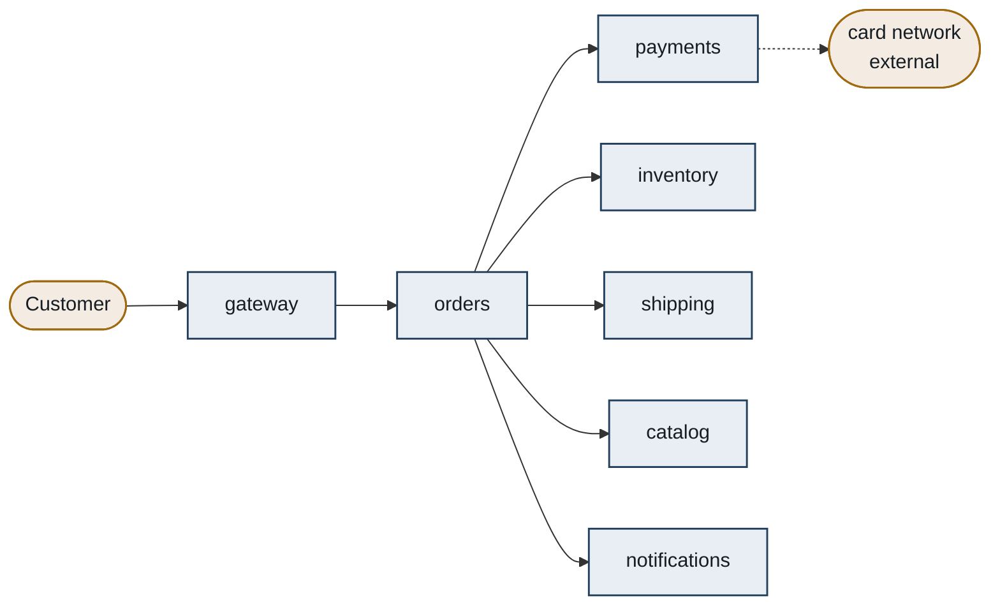
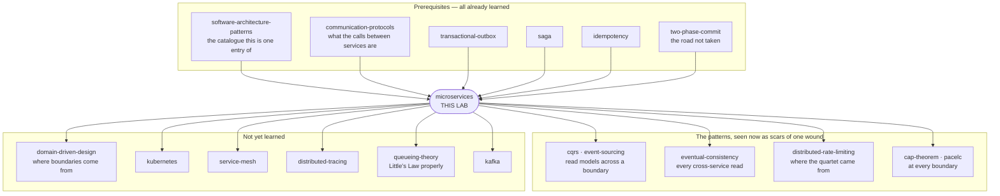

# Microservices — what actually happens when you cut a system apart

> **A no-code lab.** Documents, diagrams, an interactive simulator, and exercises.
> Nothing here is run; everything quantitative is either arithmetic you can check
> by hand, a scenario you can play in `visualization.html`, or a measured result
> cited from one of your earlier labs.

---

## Before we start: what this lab is *not*

You have already met the word "microservices" once, in the
[software-architecture-patterns](../06-software-architecture-patterns/) lab. There
it was one entry in a catalogue of seven families, described in a paragraph:
*independently deployable, team-owned services with private data, communicating
over a network — not an upgrade, a tradeoff you buy when team-scaling pain
exceeds the distributed-systems bill.*

That paragraph is correct and this lab will not repeat it.

What that paragraph does **not** tell you is the thing that actually decides
whether your split succeeds or ruins your year:

- what physically breaks the moment two pieces of code stop sharing a process,
- the arithmetic that turns five reliable services into one unreliable checkout,
- why a **slow** dependency destroys a system harder than a **dead** one,
- and why the fix that every engineer reaches for first — a retry — makes it
  worse.

That is this lab. It is the mechanics, with numbers.

You also arrive holding most of the parts already. You know
[saga](../47-saga/), [transactional-outbox](../48-transactional-outbox/),
[cqrs](../51-cqrs/), [event-sourcing](../50-event-sourcing/),
[two-phase-commit](../45-two-phase-commit/), [idempotency](../49-idempotency/),
[eventual-consistency](../28-eventual-consistency/) and
[communication-protocols](../02-communication-protocols/). Every one of those is a
**scar**: a fix invented because splitting a system broke something specific.
Until now you learned the fixes one at a time, each in its own lab, without
seeing the single wound they all belong to.

This lab is the wound.

---

## Where you are going

The document climbs four labelled layers. There is a checkpoint at each
transition telling you what you can now do and what comes next.

> **BEGINNER MODEL** (stages 1–9) → **INTERMEDIATE MODEL** (stage 10) →
> **ENGINEERING MODEL** (stages 11–12) → **PRODUCTION MODEL** (stage 13)

---

# Stage 1 — WHY: the problem in one paragraph

A company writes one program. As the company grows, more and more people need
to change that one program, and there is only one of it — one place to edit,
one thing to test, one moment when it goes live. So everyone has to take turns,
and everyone's mistakes land on everyone else. A person who wants to change the
colour of a button has to wait for a release that also contains someone else's
half-finished database change, and if that database change is wrong, the button
change is cancelled too. Eventually the company spends more time coordinating
who may change the program than actually changing it. **Microservices are an
attempt to buy that coordination back** — by cutting the one program into many
programs that can each be changed and released on their own.

Concretely, if nobody solves this: releases slow from daily to weekly to
monthly; a one-line fix waits three weeks behind an unrelated feature; every
release needs a meeting; and one team's bad afternoon takes the whole product
offline. That is the pain. Hold on to it, because everything in this lab is
either that pain or the bill for curing it.

---

# Stage 2 — PROBLEM: the Riverbend story

*(No jargon in this stage. A ten-year-old could follow it.)*

**Riverbend** starts as one small bakery with one counter.

Everything the shop knows lives in **one binder** behind the counter: the
recipes, the prices, the list of who has paid, the list of what is in the
storeroom. Everyone works from that binder. Four people work there. It is
wonderful. If you want to know anything, you look in the binder. If you want to
change anything, you write in the binder.

Ten years later Riverbend has **forty** staff and sells bread, cakes,
sandwiches, coffee, gift boxes and wedding catering. The binder is now four
thousand pages long.

Here is the problem, and it is not the size of the binder.

There is still only **one** binder, and Riverbend has a rule: you cannot change
a page while people are using the binder. So once a week, at 6am on Tuesday,
the shop closes, the binder is taken away, every change everybody wrote that
week is copied in at once, and the binder comes back.

Watch what that rule does:

- **Sana** wants to change the price of a croissant. One number. She has to
  wait until Tuesday.
- **Marcus** is halfway through rewriting the wedding-catering section. His new
  pages have a mistake in them.
- On Tuesday morning the new binder comes back with Marcus's mistake in it. The
  shop is chaos. So the manager reverses the whole Tuesday change — **including
  Sana's croissant price**, which was fine.
- Sana waits another week. For one number.

Now multiply that. Forty people, each writing into the same binder, each able
to spoil everyone else's Tuesday. So Riverbend adds a rule: before Tuesday,
every change must be read and approved in a meeting. The meeting takes three
hours. Then it takes a day. Then Tuesdays become fortnightly, because a
fortnight's worth of changes is too risky to do weekly.

**Riverbend has not run out of talent, money, or ideas. It has run out of
*turns*.** Forty people are sharing one turn.

> **🔮 Predict:** Riverbend's owner is about to try the obvious fix. What do you
> think it is — and what do you think will go wrong with it?
>
> <details><summary>Reveal</summary>
>
> The obvious fix is: **give each counter its own binder.** Split the four
> thousand pages into a bread binder, a cake binder, a coffee binder, a
> catering binder — one per counter, each counter free to rewrite its own pages
> whenever it likes.
>
> What goes wrong is the part almost every real company gets wrong too, so it
> deserves its own stage. Keep reading — but notice now that we have said
> nothing at all about the **storeroom**.
>
> </details>

---

# Stage 3 — NAIVE SOLUTION: give everyone their own binder

Riverbend splits.

The four thousand pages become six binders — Bread, Cake, Coffee, Catering,
Gift Boxes, Deliveries — one per counter, each owned by a small team. Each
counter may rewrite its own binder any morning it likes. No Tuesday. No
meeting.

When one counter needs something from another (the Cake counter needs to know
today's coffee prices for the "cake and coffee" deal), a runner carries a note
between counters and brings the answer back.

In software terms, and this is exactly what most companies do first: **the one
program was split into six programs, each with its own repository, its own
build, its own deploy button, and network calls between them.**

For about six weeks, this is magnificent. Then it starts going wrong, and it
goes wrong in a way that is genuinely surprising the first time you see it.

---

# Stage 4 — FAILURE: they split the binders and kept one storeroom

Here is what Riverbend did **not** split: the **storeroom**.

All six counters still walk into the same storeroom and take flour off the same
shelf, and — crucially — all six counters still write on the same stock cards
that live in that storeroom.

Three things now happen, in this order.

### 4a. A change that touches nobody breaks somebody

The Bread counter decides its stock cards are badly designed. On its own
morning, with nobody's permission — which is the whole point of having its own
binder — it **renames the column "Qty" to "OnHand"** on the flour cards.

At 3am the Gift Box counter's automatic reorder stops working. Nobody at the
Bread counter knew Gift Boxes read the flour cards. There was no meeting to
miss, no approval to skip, no rule broken. The Bread counter genuinely believed
that shelf was theirs.

This is the single most important sentence in this stage:

> **A shared storeroom is an interface that nobody agreed to, nobody versioned,
> and nobody can see.** Every column any other counter reads is a promise you
> made without knowing you made it.

Notice what is missing that would have caught this in the old single-binder
world. When it was one program, renaming a field was safe **because the
compiler found every place that used it**. The moment you split into six
programs sharing one storeroom, you kept every dependency and deleted the only
thing that could see them.

### 4b. Nobody can actually release alone

The Cake counter needs a new column on the stock cards. Adding it changes the
cards, which the other five counters read. So the change has to be coordinated
with five teams.

They are back in a meeting. It is the same Tuesday meeting, wearing a different
hat.

### 4c. Every job needs every counter

Because the split was made by **kind of thing** rather than by **kind of work**
— a "recipes" binder, a "prices" binder, a "stock" binder — almost every real
task now needs three or four counters to change together. Selling a new
seasonal cake touches the recipe binder, the price binder, and the stock
binder. Three teams. Three deploys. In a fixed order.

Riverbend now has six programs and **still** one turn. It has all the
coordination cost of the old system, plus runners, plus notes that get lost.

This has a name, and it is the thing this lab exists to help you avoid:

> A **distributed monolith** is a system that has been split into many
> separately deployed pieces but *not* separated — the pieces still have to
> change together, so you pay every cost of being distributed and receive none
> of the benefit.

It is strictly worse than the **monolith** it replaced — one program, one
deployable, one database, Riverbend's original single binder. The monolith at
least had a compiler.

**The deeper problem the naive fix revealed:** the thing that binds two pieces
of software together is not that they are in the same file, the same repository
or the same process. It is that they **share knowledge of the same data**. You
can move code anywhere you like; if two pieces still read the same table, they
are one thing, wherever they live.

---

# Stage 5 — THE REAL REQUIREMENT

Say plainly what Riverbend actually wanted. Not "smaller programs" — it never
wanted that. It wanted:

> **I can change my part and put it live, today, without asking anyone — and
> without breaking anyone.**

Both halves are load-bearing and each is a separate obligation.

- *Without asking anyone* means no shared release train, no cross-team
  approval, no ordering constraint with someone else's deploy.
- *Without breaking anyone* means no hidden reader of my data, and no change I
  can make that silently violates a promise someone is relying on.

There is a sharp test for whether you have this, and you should keep it for the
rest of your career:

> **Can you rename a column, at 4pm on a Friday, without telling anybody?**

If the answer is no, the thing you are looking at is not separate. It does not
matter how many repositories, containers or teams it has.

Everything from here on is the pursuit of that one requirement, and then the
bill that arrives for having got it.

---

# Stage 6 — KEY IDEA

Two sentences.

> **Cut the system where the *data ownership* falls, not where the code falls:
> exactly one piece of software may write and read a given piece of data, and
> everybody else must ask it.**
>
> **Then the only thing crossing the boundary is a promise you chose to make
> and can version — so you can change everything behind it whenever you like.**

That is the whole idea. Riverbend's version: each counter gets its own binder
**and its own storeroom, with a locked door**. If the Cake counter needs to
know how much flour there is, it asks the Bread counter and accepts whatever
answer comes back. It may never walk in and look.

The locked door is what converts an accidental, invisible dependency into a
deliberate, visible one — and only deliberate dependencies can be managed.

Everything else in this lab is either (a) how to decide where the doors go, or
(b) what it costs to have runners instead of shelves.

---

# Stage 7 — TERMINOLOGY

Now the professional vocabulary, and only now. Each load-bearing term gets: what
it means in plain English, what it means precisely, *why the term exists* (what
distinction someone needed to make), a concrete example, and how it connects to
things you already know.

Terms you already met in the [software-architecture-patterns](../06-software-architecture-patterns/)
lab get a one-line refresher instead, marked *(known)*.

### 1. Service

**Plain:** a program that runs on its own and does one area of the business.

**Precise:** an independently deployable unit of software that owns its data
and exposes its capability only through a network interface.

**Why the term exists:** to distinguish a *deployment* unit from a *code* unit.
A library, a module and a package are code units — they are compiled into
somebody else's process. A service has its own process, its own memory, its own
lifecycle, and can be restarted without restarting you. The word marks the line
where the compiler stops helping.

**Example:** Riverbend's `payments` runs as its own process, owns the
`payments` table, and is reached only at `POST /payments`.

**Connects to:** the process boundary is why everything you know about
[communication-protocols](../02-communication-protocols/) suddenly applies to what
used to be a method call.

### 2. Microservice

**Plain:** a service kept small enough that one team owns all of it.

**Precise:** there is no size definition, and anyone who gives you one (lines of
code, "two pizzas", "fits in your head") is guessing. The only definition that
survives contact with production is behavioural: **a service is
microservice-sized when the team that owns it can release it without
coordinating with another team.** Size is a consequence of that, not a target.

**Why the term exists:** to distinguish this style from the earlier SOA style,
where services were large, shared, and coordinated by a central bus. The
"micro" is not about lines of code; it is about *who has to be in the room for a
release*.

**Example:** Riverbend's `shipping` is 4,000 lines and one team; that is
micro enough. Splitting it into `shipping-labels` and `shipping-rates` owned by
the same team would add network calls and buy nothing.

**Connects to:** *(known)* the arch-patterns lab's warning that microservices
are "not an upgrade, a tradeoff" — this is the sentence that makes the tradeoff
checkable.

### 3. Independent deployability

**Plain:** I can ship my thing today without you.

**Precise:** service A is independently deployable if a new version of A can be
released to production without requiring a simultaneous or ordered release of
any other service, and without any other service changing.

**Why the term exists:** because it is the *only* real benefit of the whole
style, and naming it lets you check whether you have it. Every other claimed
benefit (scalability, technology choice, fault isolation) is either obtainable
without splitting or has to be bought separately. This one is the thing you
cannot get from a monolith.

**Example:** the true test is the release log. If you look at the last twenty
production releases and find `orders` and `inventory` were released together
seventeen times, you have one service in two repositories.

**Connects to:** the Friday-column-rename test from stage 5. That test is just
this term with the jargon removed.

### 4. Coupling *(known — refresher)*

*(known)* From arch-patterns: how much one thing has to know about another. The
new precision this lab adds: coupling is measured by **what forces a
simultaneous change**, not by what calls what. Two services that call each
other constantly but have never had to be released together are less coupled
than two services that never speak but share a database table.

### 5. Distributed monolith

**Plain:** split into many pieces that still have to move together — all the
cost, none of the benefit.

**Precise:** a system of separately deployed services whose changes still
require cross-service coordination, because they share data, share a release
train, or are cut along technical layers rather than business capabilities.

**Why the term exists:** because "we have microservices" is a statement about
the deployment diagram, and this term is the statement about reality. It exists
so you can say the diagnosis out loud.

**Example:** Riverbend after stage 4 — six deployables, one storeroom, three
teams needed for a new cake.

**Measurable symptom:** take the last ten features you shipped and count how
many services each one had to change. If most features touch three or more, you
have this.

### 6. Bounded context

**Plain:** the area within which one particular meaning of a word is true.

**Precise:** from Domain-Driven Design — a boundary inside which a model and its
vocabulary are consistent and unambiguous. Across the boundary, the same word
may legitimately mean something different, and translation is explicit.

**Why the term exists:** because the biggest mistake in boundary-drawing is
believing there is one true "Customer" in your business. There is not. To
`billing`, a Customer is a legal entity with a tax ID and a payment method. To
`shipping`, a Customer is an address and a delivery-window preference. To
`support`, a Customer is a person with a history of complaints. Forcing those
into one shared model creates an object nobody can change, because every field
belongs to somebody else. The term exists to give you permission to have three
Customers.

**Example:** Riverbend's `orders` says "order" and means the customer's
intention to buy. `shipping` says "order" and means a box with a label on it.
They exchange an ID and translate; they do not share a class.

**Connects to:** this is the answer to "where do I put the door?", which stage
10 turns into five concrete rules.

### 7. Database-per-service *(known — now earned)*

*(known by name from arch-patterns.)* What stage 4 just bought you: **exactly
one service may read or write a given table.** Others must go through that
service's interface.

The new precision: this rule is not about the *number of database servers*.
Two services can share one Postgres instance and still obey the rule, if they
use separate schemas and separate credentials and neither can see the other's
tables. It is about **who is permitted to know the shape of the data**, because
that is what a rename breaks. Enforce it with database permissions, not with a
wiki page — a rule that is only written down is not a rule.

### 8. Contract

**Plain:** the promise a service makes about what it will accept and return.

**Precise:** the observable surface of a service — endpoint paths, request and
response shapes, event schemas, error codes, and the behaviour behind them
(ordering, idempotency, timing). Everything else about the service is private
and may change freely.

**Why the term exists:** to separate *what I promised* from *how I do it*. Once
that line is drawn, "can I change this?" has a mechanical answer instead of an
argument. The contract is the only thing the outside world is entitled to
depend on.

**Example:** `POST /payments {orderId, amountMinor, currency, idempotencyKey}`
→ `201 {paymentId, status}` is the contract. That the service stores it in
Postgres, retries the card network twice, and is written in Kotlin is not.

**Connects to:** [idempotency](../49-idempotency/) — the idempotency key in that
request is part of the contract, not an implementation detail, because the
caller's retry behaviour depends on it.

### 9. Blast radius *(known — refresher)*

*(known)* From arch-patterns: how much of the system a single failure or a
single change can damage. This lab's contribution is that the blast radius of a
microservice system is **not** automatically smaller than a monolith's — stages
10 and 11 show it starting out *larger*, and show exactly what you have to buy
to shrink it.

### 10. Cascading failure

**Plain:** one thing breaks, and its breaking breaks the things that were only
talking to it — and then their breaking breaks the next ring out.

**Precise:** a failure that propagates from a dependency to a caller because the
caller's finite resources (threads, connections, memory, file descriptors) are
consumed waiting on that dependency, so the caller fails at work that had
nothing to do with it.

**Why the term exists:** to name the difference between "payments is down, so
you cannot pay" (expected, contained) and "payments is down, so you cannot view
your order history" (a cascade — the failure crossed into unrelated
functionality). Without the term, people report the second as if it were the
first, and the real bug is never found.

**Example:** the whole of stage 11, with numbers.

**Connects to:** you saw exactly one instance of this already — failure mode F2
in the [distributed-rate-limiting](../60-distributed-rate-limiting/) lab, where a
slow counter store exhausted request threads while every dashboard stayed
green. That was not a rate-limiting quirk. It is the general law of every
synchronous call, and this lab derives it.

### 11. Circuit breaker *(known — refresher, deepened in stage 10)*

*(known from distributed-rate-limiting)* A wrapper around calls to one
dependency that counts recent failures, and once they cross a threshold stops
making the calls at all for a while — failing instantly instead of slowly.
Three states: **closed** (calls pass), **open** (calls fail immediately without
being made), **half-open** (a trickle is let through to test recovery).

Stage 10 adds the two things that are usually got wrong: what the breaker is
actually protecting (the *caller's* threads, not the dependency), and why a
breaker per dependency is required rather than one per service.

### 12. Bulkhead *(known — refresher, deepened in stage 10)*

*(known from distributed-rate-limiting)* A cap on how much of a shared resource
any one dependency may consume — so that a dependency going bad can use up its
own quota and no more. Named after ship compartments: a hull breach floods one
compartment, not the vessel.

### 13. Availability, serially composed

**Plain:** if you need five things to work, and each works 99.9% of the time,
you are not at 99.9%.

**Precise:** for a request that requires N independent services to all succeed,
availability is the product of theirs: `A_total = ∏ A_i`. Unavailability adds
up, roughly, until the numbers get large.

**Why the term exists:** because the intuition is wrong in a specific
direction. Everybody's gut says "they're all 99.9%, so we're about 99.9%". The
arithmetic says 99.5%, which is five times more downtime. The term exists to
force the multiplication.

**Example:** stage 10a, with hours per year.

### 14. Tail latency amplification

**Plain:** if you have to wait for many things, you wait for the slowest one —
and rare slowness stops being rare.

**Precise:** if a request fans out to N independent services, each of which
exceeds latency L with probability p, the request exceeds L with probability
`1 − (1−p)^N`.

**Why the term exists:** because a service's own p99 is not the number that
matters once it has callers who fan out. Dean and Barroso named this in *The
Tail at Scale* (CACM, 2013): a server that is 1 ms on average but 1 s at p99,
touched by a request that fans out to 100 such servers, makes **63% of requests
take over a second.** The term exists because a p99 that looks fine locally is
a catastrophe globally.

### 15. Service discovery

**Plain:** how one service finds where another one is right now.

**Precise:** the mechanism that maps a stable logical name (`payments`) to the
current set of healthy network addresses, kept current as instances start,
stop, move and fail health checks.

**Why the term exists:** because in a monolith the answer was "it is a method,
it is at this memory address". Once instances are created and destroyed
constantly by an orchestrator, addresses are not something a human can put in a
config file. The term names the machine that replaces the config file.

**Example:** `payments.riverbend.svc.cluster.local` resolves to six pod IPs; a
pod is killed, and discovery removes it within about ten seconds.

**Connects to:** that ten-second window is why callers get *connection refused*
sometimes, which is why retries are legitimate, which brings in
[idempotency](../49-idempotency/) — see stage 10e for the precise rule.

### 16. Distributed tracing

**Plain:** a shared ID stapled to a request so you can see its whole journey
across every service it touched.

**Precise:** a trace identifier is created at the system edge and propagated on
every outbound call (the W3C standard header is `traceparent`); each service
records timed **spans** tagged with that trace ID; a collector reassembles them
into one waterfall.

**Why the term exists:** because in a monolith the answer to "why was this
slow?" was a stack trace and a profiler, and both stop at the process boundary.
Tracing is the replacement, and it is not optional — it is the thing you traded
the stack trace for.

**Example:** one Riverbend checkout is 14 spans across 6 services. Stage 10f
shows the waterfall.

### 17. Consumer-driven contract testing

**Plain:** each caller writes down what it actually depends on, and the callee
runs those checks before every release.

**Precise:** consumers publish executable expectations about the provider's
contract (a "pact"); the provider's build verifies all published expectations
and fails if any is broken. No shared test environment, no end-to-end suite.

**Why the term exists:** to replace the thing you lost. In a monolith the
compiler told you who you broke. In a distributed system nothing does — unless
you build this. The term exists to name the compiler's successor.

---

## Terms introduced later, in the stage that earns them

Stage 10 will add: **fan-out**, **critical path**, **thread pool exhaustion**,
**retry storm**, **fail fast**, **expand/contract migration**, **event-carried
state transfer**, **API gateway** *(known)*, **service mesh** *(known)*.
Stage 13 will add **SLO** and **error budget**. All of them are in the glossary
at stage 16.

---

# Stage 8 — MENTAL MODELS: two of them, and where the nice one lies to you

## 8a. The simple model — the market street

Carry this picture around:

**Riverbend is no longer one shop. It is a row of separate shops on one
street.** Each shop has its own staff, its own locked storeroom, its own
opening hours, and its own sign on the door saying what it will sell you. When
the cake shop needs to know the price of coffee, it sends a runner next door.
The runner might get lost. The coffee shop might be closed. The runner might
have to queue. The cake shop has only three runners, and while all three are
waiting at the coffee shop's counter, nobody is left to serve cake.

That last sentence is the entire failure section of this lab, in advance.

## 8b. The engineering model — processes, contracts, and a finite pool

Precisely:

- Each service is a **process** with private memory and a private data store.
- The only thing crossing a boundary is a **message** over a network, which may
  be delayed, lost, duplicated, or answered by a machine that has since died.
- Every service has a **finite pool of workers** (threads, or connections, or
  goroutines — some countable thing) and a request occupies one for its whole
  duration, *including the time it spends waiting for a downstream reply.*
- Therefore the number of workers a dependency consumes is governed by
  **Little's Law**: `workers in use = arrival rate × time each call takes`.
  This one equation generates every failure in stage 11.
- A service's **contract** is a versioned promise; everything behind it is free
  to change; nothing in front of it may change without a migration.

## 8c. The mapping

| Market street | Engineering model |
|---|---|
| A shop | A service (a process with private state) |
| The shop's locked storeroom | Its private database — nobody else may open it |
| The sign on the door | Its contract (endpoints, event schemas, error codes) |
| A runner sent next door | A synchronous network call |
| The shop's three runners | The caller's thread / connection pool |
| Runner queueing at a busy counter | A slow downstream call holding a thread |
| All three runners stuck next door | **Thread pool exhaustion** — the cascade |
| Shop closed, runner comes straight back | Fast failure (connection refused) |
| Runner gives up after five minutes | A timeout |
| "Don't bother, they're shut" note on the wall | A circuit breaker, open |
| At most one runner may go to the coffee shop | A bulkhead |
| A note left in the postbox instead of waiting | An asynchronous event |
| Each shop repainting whenever it likes | Independent deployability |
| Whole street shares one storeroom | A distributed monolith |

## 8d. Where the analogy breaks — read this, do not skip it

Every analogy is a loan. Here is what you owe:

**1. Real shops do not take each other down; services do.**
On a real street, the coffee shop being slow does not close the cake shop. In
software it does, because the runners are not people who can be reassigned —
they are a hard-capped pool, and a blocked call holds one until it returns or
times out. **The cascade has no equivalent on the street**, and it is the single
most important behaviour in this lab. If your intuition is coming from the
street picture, you will be surprised by stage 11, which is the point.

**2. A shop being "slow" is mildly annoying; a service being slow is worse than
it being dead.**
A closed shop sends the runner straight back — one second wasted. A shop with a
huge queue keeps the runner for five minutes. Dead is cheap; sick is expensive.
This inverts most people's intuition and you will see the arithmetic in 10c.

**3. Runners do not multiply. Retries do.**
If a shop is slow, a real street does not respond by sending three times as many
runners. Software does exactly that, by default, because retrying is the
standard reaction to a failed call. So the response to overload is *more* load,
aimed precisely at the thing that is already dying. Stage 10d.

**4. There is no such thing as a partially-completed purchase on the street.**
If the cake shop takes your money and the box shop has no boxes, a human sorts
it out. Across services there is no shared transaction to roll back — you
learned that in [two-phase-commit](../45-two-phase-commit/) and its answer in
[saga](../47-saga/). The street picture quietly implies an atomicity that does not
exist.

**5. The street is not a picture of correctness, only of shape.**
Everything about ordering, duplication, staleness and partial failure has to
come from the engineering model. Use the street to remember the *layout*; use
Little's Law and the availability product to reason about *behaviour*.

---

# Stage 9 — VISUALIZATION

Open **`visualization.html`** in this folder, or the published version —
**[The Checkout Cascade](https://claude.ai/code/artifact/ec33c164-a395-4748-bdac-513db3cbf96e)**.
It has five tabs, and each one exists to make a single number visible:

| Tab | The one thing it teaches |
|---|---|
| **1 · The Split** | Coupling lives in the data, not the code. Rename a column and watch who breaks, with a shared store and then with private stores. |
| **2 · The Arithmetic** | Serial availability multiplies. Move the sliders and watch hours-of-downtime-per-year climb as you add services. |
| **3 · The Cascade** | Little's Law in motion: watch Orders' thread pool fill because Payments got slow, and then fix it four different ways. **This is the heart of the lab.** |
| **4 · The Tail** | Fan-out amplification: a p99 that is fine alone is a disaster at width. |
| **5 · Boundaries** | Your cut is measurable: ten real features, and how many services each has to touch. |

**How to use it with this document.** Read stage 10 with tab 3 open. Every
subsection from 10c onward corresponds to a scenario button on that tab, and
each scenario asks you to predict before it runs. Predicting badly is the point
— it is where the learning is.

Start with **tab 3, scenario S2 ("Payments gets slow")**. If you can explain
after that scenario why *slow* is worse than *down*, the rest of the lab is
downhill.

---

> ## ✅ CHECKPOINT — end of the BEGINNER MODEL
>
> You can now explain, without jargon, **why microservices exist** (forty people
> sharing one turn), **what a split actually is** (a data boundary, not a code
> boundary), and **the failure mode of a bad split** (the distributed monolith:
> all cost, no benefit). You could defend the Friday-column-rename test in a
> design review.
>
> **What the next layer adds:** the mechanism, with numbers. How a request
> physically travels, why splitting *lowers* your availability before it raises
> it, and the exact sequence — slow dependency → thread pool → cascade →
> timeout → retry storm → bulkhead → breaker → async — in which real systems
> discovered every mitigation you already know the names of.

---

# Stage 10 — THE ACTUAL MECHANISM

We now build Riverbend's checkout for real, starting with the version a good
engineer builds first, and letting it break.

## The system, concretely

Seven services. Each owns its own tables and nothing else's.

| Service | Owns | Job |
|---|---|---|
| `gateway` | — | Public entry point, authentication, routing |
| `orders` | `orders`, `order_lines` | Create and track orders |
| `payments` | `payments`, `refunds` | Charge cards via an external provider |
| `inventory` | `stock_levels`, `reservations` | Reserve and release stock |
| `shipping` | `shipments` | Book a courier, print labels |
| `catalog` | `products`, `prices` | Product names, descriptions, prices |
| `notifications` | `messages` | Send email and SMS |



**Numbers we will use throughout, chosen to be realistic:**

- Each service runs behind a load balancer and is **99.9% available** on its
  own (about 8.8 hours of downtime a year).
- Checkout traffic is **100 requests per second**.
- `orders` has **200 request-handling threads** (the Tomcat default, and
  therefore the number in an enormous number of real Java systems).
- A healthy call to `payments` takes **20 ms**.

## 10a — Mechanism v1: everything synchronous. And the first bill.

Version one is what everybody builds. `POST /checkout` arrives at `gateway`,
which calls `orders`, which calls `catalog` for prices, `inventory` to reserve
stock, `payments` to charge the card, `shipping` to book a courier, and
`notifications` to send the receipt — each one a blocking HTTP call, each one
required to succeed before checkout returns `201 Created`.

It works. It is easy to reason about. It is also the most fragile thing you will
ever ship, and here is the first reason.

**Signpost:** the table below is the whole argument for this subsection. Look at
the right-hand column, and compare the first row with the last.

For checkout to succeed, **every** service in the chain must be up. Availability
multiplies:

| Services required | Availability | Downtime per year |
|---|---|---|
| 1 (the old monolith) | 99.900% | **8.8 hours** |
| 2 (gateway, orders) | 99.800% | 17.5 hours |
| 3 | 99.700% | 26.3 hours |
| 4 | 99.601% | 35.0 hours |
| 5 (gateway, orders, catalog, inventory, payments) | 99.501% | **43.7 hours** |
| 7 (all of them) | 99.302% | 61.1 hours |

`0.999^5 = 0.995010`, so unavailability is `0.004990`, and
`0.004990 × 8760 hours = 43.7 hours`.

Read that as: **you took a system that was down 8.8 hours a year, split it into
five equally reliable pieces, changed nothing else, and are now down 43.7 hours
a year.** A five-fold increase in outage, bought with a large amount of work.

> **🔮 Predict:** Someone proposes fixing this by running three replicas of
> every service. Does that get you back to 8.8 hours a year?
>
> <details><summary>Reveal</summary>
>
> **No, and the reason matters more than the answer.**
>
> That 99.9% is not made of one thing. Split it into causes:
>
> - **Machine and network failure** — a node dies, a disk fills, an availability
>   zone blips. Replication genuinely fixes this: three replicas across three
>   zones make simultaneous loss very unlikely.
> - **Bad deploys** — a release with a bug. Replicas do *not* help; every
>   replica runs the same bad code. Only canary or blue/green deploys help, and
>   they reduce it, not remove it.
> - **Dependency failure** — the service is up but its database or its
>   downstream is not. Replicas do not help at all.
> - **Overload** — replicas help only if the bottleneck is CPU, and not at all
>   if it is a shared database or a shared downstream.
>
> In most real services, deploys and dependencies dominate. So redundancy
> lowers the number, and cannot take it to zero. The honest conclusion of this
> whole stage is uncomfortable and worth memorising:
>
> > **Splitting a system multiplies the number of independent things that must
> > be working. You can pay some of that back with redundancy and canaries — you
> > cannot pay all of it back. If you want availability, you must remove
> > services from the required set, not just make each one better.**
>
> "Remove services from the required set" is 10g, and it is the real answer.
>
> </details>

**Try it:** visualization tab **2 · The Arithmetic**. Set the chain length to 5
and per-service availability to 99.9%. Then find, by moving the sliders, what
per-service availability you would need across five services to match a single
99.9% monolith. (It is 99.98%, which is a materially harder engineering problem
per service.)

## 10b — The refinement that arrives first: not everything is required

Look again at that chain. Ask, for each call, one question: **if this fails, must
the customer's checkout fail?**

- `catalog` — the price. Yes, required. You cannot charge an unknown amount.
- `inventory` — the stock reservation. Yes, required, if you promise not to
  oversell.
- `payments` — the charge. Arguably required, though see 10g.
- `shipping` — booking a courier. **No.** You can book the courier in the next
  five minutes. The customer does not need it to have happened before the page
  says "thank you".
- `notifications` — the receipt email. **Obviously no.**

The set of services that genuinely must succeed before you answer the customer
is called the **critical path**. Everything not on it is a candidate to be moved
off — done later, asynchronously, by a message.

This is the first and biggest availability lever, and we will apply it properly
in 10g. Note now what it costs: once shipping happens after the response, there
is a window in which the order exists and no courier is booked. That window is a
[consistency window](../51-cqrs/), and you already know its shape.

## 10c — Mechanism v1 breaks: `payments` gets slow

This is the most important subsection in the lab.

`payments` is not down. It is *sick* — its card-network provider is degraded,
and calls that took 20 ms now take **5 seconds** and eventually succeed.

Every dashboard is green. `payments` is returning `200 OK`. Its error rate is
zero.

> **🔮 Predict:** `orders` has 200 threads and takes 100 requests per second.
> `payments` has gone from 20 ms to 5 s. What happens to `orders`?
> Pick one before revealing.
>
> **(a)** Checkout gets slower — about 5 seconds instead of instant — but works.
> **(b)** Checkout fails, but the rest of `orders` (order history, order
> lookup) keeps working.
> **(c)** The whole of `orders` stops responding, including endpoints that never
> touch `payments`.
>
> <details><summary>Reveal</summary>
>
> **(c).** And it takes two seconds to happen.
>
> Little's Law: `workers in use = arrival rate × time per call`.
>
> - Healthy: `100/s × 0.02 s = 2 threads` busy. `orders` is nearly idle.
> - Sick: `100/s × 5 s = 500 threads` needed. `orders` has **200**.
>
> Threads fill at 100 per second, so the pool is full **two seconds** after
> `payments` gets sick. From that moment, every new request — `GET /orders/123`,
> the health check, the order history page — waits for a free thread and gets
> none. Requests queue; the queue grows without bound because arrivals exceed
> completions; latency goes to infinity; the load balancer's health check times
> out and takes `orders` out of rotation, which sends its traffic to the other
> `orders` replicas, **which then die the same way, faster.**
>
> The blast radius is: one degraded external card network → the entire order
> service, including read-only pages that touch nothing but their own database.
>
> That is a **cascading failure**, and the mechanism is not mysterious: the
> thread pool is a resource shared by all endpoints, and one dependency was
> allowed to consume all of it.
>
> </details>

**Why slow is worse than dead.** Compare the two:

| | `payments` is **dead** | `payments` is **slow (5 s)** |
|---|---|---|
| Call outcome | connection refused, ~1 ms | 200 OK, 5000 ms |
| Threads consumed (Little's Law) | `100 × 0.001 = 0.1` | `100 × 5 = 500` |
| Effect on `orders` | checkout fails instantly, everything else fine | **whole service down** |
| Visible on dashboards | yes — error rate spikes | **no — error rate is zero** |

A dead dependency is a *fast* failure and it is contained. A slow dependency is
a resource leak wearing a green status light. You have met this exact shape once
before: **failure mode F2 in the [distributed-rate-limiting](../60-distributed-rate-limiting/)
lab**, where a slow counter store exhausted request threads while every
dashboard stayed green. That was not a rate-limiting quirk — it is the general
law of synchronous calls, and this is its derivation.

**Try it:** tab **3 · The Cascade**, scenario **S1 (Payments DOWN)** then
**S2 (Payments SLOW)**. Watch the thread-pool gauge on `orders`. In S1 it barely
moves; in S2 it is full in two simulated seconds and the "order history"
request — which never calls payments — starts failing.

## 10d — Refinement 1: a timeout. Then refinement 2 makes it worse.

**The timeout.** Cap the call at 1 second. Little's Law:
`100/s × 1 s = 100 threads` — under the 200 available. `orders` survives.
Order history keeps working. Checkout fails, which is correct: payments really
is broken.

A timeout is not an error-handling nicety. **A timeout is the thing that
converts an unbounded resource consumption into a bounded one**, and that is
why a call without a timeout is a bug, always, even in code that looks fine.

> **Rule worth keeping:** every synchronous call needs a timeout, and the
> timeout must be chosen from the *caller's* thread budget, not from the
> callee's normal latency. The question is not "how long does payments usually
> take?" but "how many threads am I willing to have stuck here?" — which
> Little's Law turns into a number.

**Now the retry, and this is the trap.** Checkout is now failing, so the obvious
next step is to retry: three attempts before giving up.

> **🔮 Predict:** timeout is 1 s, retries are 3 attempts. `payments` is still
> sick at 5 s. Is `orders` still safe?
>
> <details><summary>Reveal</summary>
>
> **No. You have re-created the original failure, and you have made `payments`
> worse at the same time.**
>
> Each checkout now occupies a thread for up to `3 × 1 s = 3 s`.
> Little's Law: `100/s × 3 s = 300 threads` needed, 200 available. The pool
> saturates again, in about four seconds instead of two.
>
> And look at what happened on the other side. `payments` was receiving 100
> requests per second. Now it receives **300**. You have tripled the load on a
> service that is failing *because* it is overloaded. This is a **retry storm**,
> and it is how a recoverable five-minute degradation becomes a two-hour outage:
> the moment `payments` starts to recover, the backlog of retrying callers
> immediately knocks it over again.
>
> The fixes, all of which you need:
>
> - **Budget the retries in the caller's time, not in attempts.** The timeout
>   that matters is the total one: 1 second for the whole operation including
>   retries, not 1 second per attempt.
> - **Exponential backoff with jitter.** Without jitter, all failed callers
>   retry at the same instant and you have built a synchroniser — the same
>   thundering herd you met in [distributed-rate-limiting](../60-distributed-rate-limiting/),
>   where a dishonest `Retry-After` header made your own response the clock
>   everyone retried on.
> - **Retry only what is safe to retry** — see 10e.
> - **A retry budget**: cap retries at a small fraction (say 10%) of total
>   traffic, so retries can never multiply load. This is what Google's SRE book
>   recommends and what service meshes implement.
>
> </details>

**Try it:** tab 3, scenario **S3 (timeout)** then **S4 (timeout + retries)**.
S4 shows both gauges: the caller's pool refilling *and* the load arriving at
`payments` tripling.

## 10e — When is a retry actually safe?

The rule is precise and it comes straight from [idempotency](../49-idempotency/):

> **You may retry freely when you know the request was never received. You must
> have an idempotency key when you do not know.**

| What you observed | Was it received? | Safe to retry? |
|---|---|---|
| Connection refused / DNS failure | Certainly not | **Yes**, always |
| TCP reset before request sent | Certainly not | **Yes** |
| `503 Service Unavailable` from the server | Received, not processed | Yes (the server is telling you so) |
| `429 Too Many Requests` | Received, rejected | Yes, after `Retry-After` |
| **Timeout** | **Unknown** | **Only with an idempotency key** |
| `500 Internal Server Error` | **Unknown** — it may have charged the card and then failed | **Only with an idempotency key** |

The timeout row is the dangerous one, and it is the whole reason the
idempotency lab exists. A timed-out `POST /payments` may have charged the
customer. Retrying it without a key charges them twice. The key, minted by the
caller before the first attempt and reused verbatim on every retry, is what
makes the ambiguity harmless — the server claims the key atomically with the
effect and replays the stored response.

Service discovery makes the top row common rather than exotic: when an instance
is killed, discovery takes several seconds to notice, and during that window
callers get connection refused. Those retries are free and correct. Do not let
the danger of the timeout row scare you out of the safety of the first row.

## 10f — Refinement 3: bulkheads and breakers, and what each actually protects

The timeout bounded the damage. It did not *contain* it: with a 1-second
timeout and no retries, 100 of `orders`' 200 threads are still tied up in
`payments`, which is half the service's capacity spent on a call that is going
to fail.

**A bulkhead** caps how many threads any one dependency may hold. Give
`payments` a quota of 40. Now:

- At most 40 threads can ever be inside a `payments` call.
- 160 threads remain for everything else — order history, order lookup, health
  checks — which keep working perfectly.
- Calls beyond the quota are rejected immediately rather than queued.

The bulkhead's job is **isolation**: it makes "payments is broken" mean
"payments is broken" instead of "orders is down".

**A circuit breaker** goes further: after enough consecutive failures it stops
making the calls at all.

- **Closed** — normal. Calls pass through; failures are counted.
- **Open** — after (say) 20 consecutive failures or a 50% failure rate over a
  rolling window, the breaker trips. Every call now returns an error
  **immediately, in microseconds, without touching the network.**
- **Half-open** — after a cooldown (say 30 s), let a small number of probe
  calls through. If they succeed, close. If not, open again.

Little's Law once more, with the breaker open:
`100/s × 0.00002 s ≈ 0 threads`. The dependency is now free.

Two things about breakers that are commonly got wrong, and are the reason this
term needed re-teaching rather than just a refresher:

**1. The breaker protects the caller, not the callee.** People describe it as
"protecting payments from load". That is a side effect. Its purpose is to stop
`orders` from spending its own finite capacity on calls that are going to fail.
It is a resource-management device wearing an error-handling costume.

**2. There must be one breaker per dependency, not one per service.** If
`orders` has a single breaker covering all outbound calls, `payments` failing
opens the breaker on `catalog` too, and you have manufactured a cascade with
the tool you bought to prevent one. The state is per-dependency — and in the
real world, per (dependency, endpoint), because `POST /payments` failing does
not mean `GET /payments/{id}` is failing.

**The combination, and why you need all four.** Each of these does one job and
none substitutes for another:

| Tool | Bounds | Without it |
|---|---|---|
| **Timeout** | how long one call may hold a thread | unbounded occupancy → pool exhausted |
| **Retry (budgeted, jittered)** | recovery from transient loss | avoidable failures; unbudgeted → retry storm |
| **Bulkhead** | how much of the pool one dependency may hold | one sick dependency starves all endpoints |
| **Circuit breaker** | how long you keep paying for a known-broken dependency | you keep paying the timeout on every request, forever |

You met exactly this quartet in the rate-limiting lab as the four siblings its
design "needed to survive". Now you have the derivation of *why* it is exactly
these four, and Little's Law is the derivation.

**Try it:** tab 3, scenarios **S5 (bulkhead)** and **S6 (breaker)**. In S5 watch
the pool gauge split into a payments compartment and everything else. In S6
watch the latency of a failing checkout drop from 1000 ms to about 0.02 ms when
the breaker opens — and watch the load arriving at `payments` collapse to the
probe trickle, which is what lets it recover.

## 10g — Refinement 4: take services off the critical path

Everything so far has been damage control. This is the actual cure, and it uses
three patterns you already own.

Rewrite checkout so that `orders` does the minimum that must be true before
answering the customer, and nothing else:

1. In **one local database transaction**, `orders` writes the order row *and*
   an outbox row saying `OrderPlaced`. That is the
   [transactional-outbox](../48-transactional-outbox/) pattern, and it exists
   precisely because writing the row and telling the world are two physical
   acts that can be interrupted between.
2. `orders` returns `201 Created` to the customer with status `PENDING`.
3. A relay drains the outbox to the broker, at-least-once.
4. `payments`, `inventory`, `shipping` and `notifications` consume the event and
   do their work. Each is an **idempotent consumer** — mandatory, because
   at-least-once means duplicates are certain, not possible.
5. If payment fails, a compensating action cancels the order and releases the
   reservation. That is a [saga](../47-saga/): a sequence of local transactions,
   each with a business-level undo, replacing a distributed commit you cannot
   have.

**What that buys, in the same arithmetic as before.** The critical path is now
`gateway` + `orders` only:

| Design | Required services | Availability | Downtime/year |
|---|---|---|---|
| Monolith | 1 | 99.900% | 8.8 h |
| v1 — everything synchronous | 5 | 99.501% | 43.7 h |
| v4 — async off the critical path | 2 | 99.800% | **17.5 h** |

**And here is the honest part.** 17.5 hours is still twice the monolith's 8.8.
You cannot get back to the monolith's number by cleverness, because you have
genuinely added a required component (the gateway) and a network. What you can
do is:

- shrink the required set to its true minimum (done above),
- make each required member more reliable than 99.9% with replication and
  canaries (10a's prediction box explains the ceiling),
- and accept that the remaining gap is part of the price you agreed to pay for
  independent deployability.

If nobody ever tells you that last sentence, you will spend years believing you
have implemented microservices wrong.

**And the part that is not free.** Moving work off the critical path moves it,
it does not delete it:

- The customer sees `PENDING`, so the UI must be honest about it. "Order
  placed, payment confirming" is a product decision, not an engineering detail.
- Payment can now fail *after* the customer was told the order was placed. The
  compensation is visible to a human: an email saying the order was cancelled.
  You traded a synchronous rejection for an asynchronous apology.
- Stock can be oversold in the window between order and reservation, unless you
  reserve synchronously — which is why `inventory` is often the one call that
  legitimately stays on the critical path even when everything else moves off.

That last bullet is the general rule: **whatever must be exactly true at the
moment you answer the customer stays synchronous. Everything else goes async.**

**Try it:** tab 3, scenario **S7 (async)**. Kill `payments` entirely and watch
checkout keep returning 201.

## 10h — How a request physically travels now

*(Signpost: this is the plumbing you did not have in a monolith. Read it once
to know what exists; you will meet each piece again in stage 13.)*

```mermaid
sequenceDiagram
  autonumber
  participant C as Customer
  participant G as gateway
  participant D as service discovery
  participant O as orders
  participant I as inventory
  participant DB as orders DB
  participant B as broker

  C->>G: POST /checkout
  Note over G: creates traceparent<br/>00-4bf92f...-00f067aa-01
  G->>D: where is orders?
  D-->>G: 10.2.4.7, 10.2.4.9, 10.2.5.1
  G->>O: POST /orders (traceparent forwarded)
  O->>I: POST /reservations (traceparent forwarded)
  I-->>O: 201 reserved
  O->>DB: BEGIN; insert order; insert outbox; COMMIT
  O-->>G: 201 {id, status: PENDING}
  G-->>C: 201
  Note over O,B: relay drains outbox
  O->>B: publish OrderPlaced
  B->>B: payments / shipping / notifications consume
```

Three pieces of that are new and each replaces something the monolith gave you
free:

- **The gateway** *(known from arch-patterns)* replaces "the front door of the
  program": one place for TLS, authentication, and routing, so seven services do
  not each implement login.
- **Service discovery** replaces the method address. Note step 2–3: the caller
  asks for a *name* and gets a *current* set of addresses. Nothing is
  hard-coded, because nothing is stable.
- **The trace ID** replaces the stack trace. `gateway` creates it; **every
  service must forward it on every outbound call.** One service that drops the
  header breaks the trace for everything below it, which is why this is usually
  done by a shared library or by the service mesh rather than by hand.

Here is what one checkout looks like in a tracing tool — 14 spans, and the
answer to "why is checkout slow" is visible in one glance:

```
POST /checkout                                    ████████████████████ 812ms  gateway
  POST /orders                                    ███████████████████  798ms  orders
    GET /products?ids=…                           ██                    41ms  catalog
    POST /reservations                            ███                   63ms  inventory
      SELECT … FROM stock_levels FOR UPDATE       ██                    48ms  inventory-db
    POST /payments                                ████████████████     640ms  payments
      POST https://psp.example/charge             ███████████████      612ms  (external)
    INSERT orders + outbox                        █                     19ms  orders-db
```

Without the trace, "checkout is slow" is a week of guessing across six teams.
With it, it is one look: the card network is 612 of the 812 ms.

---

## 10i — Where the boundaries actually go

Everything above assumed the cut was already made in a sensible place. Making
it is the hardest and least mechanical part of this topic, so here are the five
rules that survive contact with production, each with the failure it prevents.

**Rule 1 — Cut around things that change together.**
If two services are almost always released together, they are one service that
you have made harder to work on. This is measurable: read your last twenty
production releases and count co-deployments.

**Rule 2 — Cut around data ownership: exactly one writer.**
Every table has exactly one service that may write it, and by default only that
service may read it. This is the rule from stage 6, and it is the one that
prevents the distributed monolith. Enforce it with database grants; a rule that
lives only in a wiki is not a rule.

**Rule 3 — Never cut through an invariant that must hold exactly.**
If your business requires "stock never goes negative" to be true at every
instant, then reserving stock cannot be split across two services, because
there is no distributed transaction to make it atomic —
[two-phase-commit](../45-two-phase-commit/) is the option you rejected, and a
[saga](../47-saga/)'s compensations are undo, not rollback, so intermediate states
are visible. So: **anything that must be atomically consistent must live inside
one service.** That is the same reasoning as a DDD aggregate boundary, one
level up.
This rule is also the honest escape hatch: if two candidate services would
share a strict invariant, do not split them. The invariant wins.

**Rule 4 — Cut around teams (Conway's law) *(known)*.**
A service with two owning teams has none. If your organisation chart cannot be
laid over your service diagram, one of them will bend, and it will not be the
organisation chart.

**Rule 5 — Never cut along technical layers.**
A "validation service", a "database service", a "business logic service" — these
guarantee that every single feature touches every single service, which is
rule 1 violated by construction. The cut is by **business capability**
(*ordering*, *paying*, *shipping*), never by **technical role**.

### The measurable test for whether your cut is good

Take your last ten shipped features and build this matrix — how many services
each one had to change:

| Feature | Services touched (good cut) | Services touched (layer cut) |
|---|---|---|
| Add gift-wrap option | orders | orders-api, orders-logic, orders-data, ui |
| Support Apple Pay | payments | payments-api, payments-logic, payments-data |
| Show delivery estimate | shipping, orders | 5 services |
| Change refund window | payments | 4 services |

**If the median feature touches more than one service, your boundaries are
wrong**, and no amount of tooling will rescue it. This number is the single most
useful architectural metric you can collect, and almost nobody collects it.

**Try it:** tab **5 · Boundaries** puts ten real Riverbend features against two
different cuts of the same system and shows the fan-out for each. Switch between
"cut by layer" and "cut by capability" and watch the matrix light up.

### The chatty-boundary trap

A correct boundary can still be badly *shaped*. The order-history page shows 50
orders, each with a product name owned by `catalog`. The obvious implementation
makes 50 calls to `catalog` — the N+1 problem you know from
[communication-protocols](../02-communication-protocols/), now with a network in
each iteration. Fifty round trips at 5 ms each is 250 ms of pure waiting, and
fifty chances to fail.

Three real fixes, in increasing order of commitment:

1. **Batch the call**: `GET /products?ids=1,2,3,…` — one round trip. Cheapest,
   and usually enough.
2. **Cache locally** with a TTL, accepting a [consistency window](../11-caching/).
3. **Event-carried state transfer**: `catalog` publishes `ProductRenamed`
   events, and `orders` keeps its own small read-model copy of the product
   names it needs. Now the order-history page makes **zero** cross-service
   calls, and `catalog` being down does not affect it at all. This is
   [cqrs](../51-cqrs/)'s projection idea applied across a service boundary, and it
   is how you take a service off the critical path for *reads* rather than
   writes.

Option 3 is powerful and it is not free: you now have a copy of somebody else's
data, which will be stale, and you own a projector that can fall behind or
break. The rule is the one from your [eventual-consistency](../28-eventual-consistency/)
lab — **a copy like this is for display, never for a decision.** Pricing an
order from a cached catalog copy is how you sell things at last month's price.

---

> ## ✅ CHECKPOINT — end of the INTERMEDIATE MODEL
>
> You can now derive, from `workers = rate × duration`, why a slow dependency
> takes out an entire service; why a retry is the wrong first instinct; and what
> each of timeout, retry, bulkhead and breaker bounds. You can compute the
> availability of a call chain and argue for moving a service off the critical
> path with a number rather than a preference. You have five rules for where to
> put a boundary, and a measurable test (features-per-service) for whether the
> one you have is any good.
>
> **What the next layer adds:** the failures you have not met yet — the ones
> that are not about latency at all. Contract breakage, schema evolution,
> stale reads that reach a customer, and the ones that only appear at 3am.
> Then the honest accounting: what this architecture actually guarantees, what
> it explicitly does not, and what you permanently gave up.

---

# Stage 11 — FAILURE SCENARIOS

Nine failures. For each: how to create it, where to watch it, what happened and
why, how the system responds, which guarantee survives, which is temporarily
lost, and how it shows up in production.

### F1 — Slow dependency exhausts the caller (the cascade)

**Create:** `payments` latency 20 ms → 5 s, traffic unchanged at 100/s.
**Watch:** tab 3, scenario S2 — the `orders` thread gauge.
**What & why:** `100/s × 5 s = 500` threads needed, 200 exist; pool full in two
seconds. Every endpoint on `orders` dies, including ones that never call
`payments`, because the thread pool is shared across all endpoints.
**Response:** none, by default. This is why the mitigations exist.
**Survives:** data correctness — nothing is written wrongly. **Lost:**
availability of the entire `orders` service, not just checkout.
**In production:** the alert fires on `orders`, not on `payments`, so the wrong
team is paged. The tell is `orders` p99 climbing while its own database is idle;
the trace shows all the time inside one downstream span. Prevented by timeout +
bulkhead; recovered by the breaker.

### F2 — Retry storm turns a blip into an outage

**Create:** enable 3 retries with no backoff while `payments` is degraded.
**Watch:** tab 3, scenario S4 — both the caller's pool and the arrival-rate
gauge on `payments`.
**What & why:** caller occupancy triples (`100 × 3 s = 300 > 200`); `payments`
receives 300/s instead of 100/s. The service that was struggling is now
overloaded by its own callers.
**Response:** none by default; with a retry budget the amplification is capped.
**Survives:** nothing structural. **Lost:** the recovery itself — every time
`payments` comes back, the retry backlog knocks it over again, turning a
five-minute degradation into hours.
**In production:** the signature is a load graph on the failing service that
*rises* during its own outage, and a recovery that oscillates. Prevented by
total-operation timeouts, exponential backoff **with jitter**, and a retry budget
(cap retries at ~10% of traffic). Service meshes implement all three, which is a
large part of why they exist.

### F3 — Contract break: a field that somebody depended on

**Create:** `orders` renames the event field `status` to `state` and adds a new
value `AWAITING_FULFILMENT`.
**Watch:** tab 1, "rename a field" with private stores selected — the consumers
that break are now *visible*, which is the whole point.
**What & why:** consumers deserialize into a fixed shape. A removed field is a
`null`; an unknown enum value is an exception or a silent default. Neither is
caught at compile time in either service.
**Response:** the consumer crashes, or worse, silently mis-handles.
**Survives:** the producer, which is fine and has no idea. **Lost:** the
consumer's correctness, possibly quietly.
**In production:** handled by **expand/contract migration** (also called
parallel change), which is always three deploys and never one:
1. **Expand** — add `state`, keep writing `status` too. Deploy. Nothing breaks.
2. **Migrate** — every consumer moves to `state`, one at a time, on its own
   schedule. This step is only possible if you can *enumerate* your consumers,
   which is exactly what a private database buys you and a shared one destroys.
3. **Contract** — once no consumer reads `status`, stop writing it. Deploy.

Also handled by: **consumer-driven contract tests** in the provider's CI (the
compiler's replacement), a **schema registry** with compatibility rules for
events *(known)*, and the receiver-side discipline of **tolerant reading** —
ignore unknown fields, never fail on an added one. The rule underneath all of
it: **additive changes are free, removals and renames are never free.**

### F4 — Shared database: the invisible dependency

**Create:** two services read the same table; one alters it.
**Watch:** tab 1, "shared store" mode — the breakage list is populated by
services you did not know were readers.
**What & why:** a shared table is an interface with no version, no owner and no
consumer list. There is no artefact anywhere that records who reads it.
**Response:** breakage at runtime, usually in a batch job at 3am, usually in the
service least likely to be looked at.
**Survives:** nothing you can rely on. **Lost:** independent deployability
itself — this failure *is* the distributed monolith.
**In production:** the only real fix is structural: separate schemas, separate
credentials, and a hard rule enforced by grants. The migration path off a shared
database is the **strangler fig** *(known)*: put the new owning service in front
of the table, move readers to its API one at a time, then revoke their database
access. The revoke is the step that actually completes the migration; without it
you have added a service and kept the coupling.

### F5 — Partial failure mid-transaction

**Create:** kill `shipping` after `payments` has succeeded.
**Watch:** the saga trace — the compensation running backwards.
**What & why:** there is no distributed transaction. The customer's money is
taken and the courier is not booked. Nothing rolls back, because there is no
"back" — the payment is a fact in another company's system.
**Response:** the [saga](../47-saga/) compensates: refund issued, reservation
released, order cancelled, customer emailed.
**Survives:** eventual consistency of the business outcome — the system ends in
a valid state. **Lost:** atomicity and isolation. The intermediate state (paid,
not shipped) was real and was visible.
**In production:** compensations must themselves be idempotent and retried
forever, which means a durable saga log; a compensation that fails is an
operational incident with a human at the end of it, not a silent retry. The
refund is also visibly slower than the charge, so this is a customer-facing
design decision, not an implementation detail.

### F6 — Stale read reaches a decision

**Create:** `orders` prices an item from its locally cached copy of `catalog`.
**Watch:** the consistency-window discussion in [cqrs](../51-cqrs/) and
[eventual-consistency](../28-eventual-consistency/).
**What & why:** every cross-service read is a read of a copy, and every copy is
behind. Usually by milliseconds; during a projector outage, by hours.
**Response:** none — nothing detects it, because a stale value is a perfectly
valid value.
**Survives:** availability, which is what the copy bought you. **Lost:**
correctness of anything computed from it.
**In production:** the F7 rule you already know from the eventual-consistency
lab, stated exactly: **a replicated or projected read is for display, never for
a decision.** Prices, balances, entitlements and stock levels used in a *write*
path must be read from their owner or guarded by a conditional write. And
staleness must be monitored by **age**, not by lag count — a projector that has
died produces no events at all, so a queue-depth alarm stays silent forever.

### F7 — No trace ID: the six-team debugging session

**Create:** one service forgets to forward `traceparent` on an outbound call.
**Watch:** the waterfall in 10h, then imagine it without the IDs.
**What & why:** each service's logs are individually correct and mutually
unrelatable. "Checkout was slow at 14:32" cannot be turned into a single
request's story.
**Response:** none; this is a missing capability, not a fault.
**Survives:** the system. **Lost:** your ability to diagnose it — which in an
incident is the same thing.
**In production:** propagation is done by shared instrumentation or by the
service mesh's sidecar, never by hand, precisely because one service forgetting
breaks everything below it. The operational rule: **trace-ID propagation is a
platform responsibility, and its coverage should itself be monitored.**

### F8 — Cascading failure through a shared low-level service

**Create:** `catalog` — used by `orders`, `search`, the website and the mobile
app — gets slow.
**Watch:** tab 3, make `catalog` slow rather than `payments`, with bulkheads
off.
**What & why:** a dependency shared by many callers converts one failure into
many simultaneous ones. Worse, all of those callers retry at once, so `catalog`
receives a synchronised surge exactly when it is weakest.
**Response:** each caller's own breaker and bulkhead, independently.
**Survives:** callers that isolated the dependency. **Lost:** everything that
did not.
**In production:** the shared low-level service is the highest-risk node in your
architecture and needs the highest availability target of anything you own — it
should be more replicated, more cached, and more aggressively load-shed than its
callers. Its callers should each hold a local cache that can serve stale data
when it is unreachable (the control-plane rule from
[distributed-rate-limiting](../60-distributed-rate-limiting/) and
[http-caching](../12-http-caching/)). And it should be the first place you look
when several unrelated services alert at once.

### F9 — The organisational failure: a service with no owner

**Create:** a team reorganises; a service it owned is not reassigned.
**Watch:** your incident channel, in about six months.
**What & why:** dependencies keep being added to it, its libraries age, its
alerts go to a rota nobody reads, and eventually it fails in a way nobody
present understands.
**Response:** none — this failure mode is not technical and has no technical
mitigation.
**Survives:** the code, which runs fine. **Lost:** the *whole premise*.
Independent deployability was bought to give teams autonomy; an unowned service
has no team, so it has no autonomy to give, and it is now strictly worse than a
module in the monolith (which at least had the codebase's owners).
**In production:** a service registry with a named owning team, checked in CI;
and a genuine willingness to **re-merge** services whose owners have gone. This
is the least-discussed and most common failure of microservice architectures,
and it is why the arch-patterns lab's line — *microservices are not an upgrade*
— was aimed at organisations rather than at code.

---

# Stage 12 — CORRECTNESS: what you get, what you do not, what you gave up

Everything below has been earned by a stage above. Nothing is listed for
completeness.

## What this architecture guarantees — *if you do the work*

- **Independent deployability.** Each service can be released alone. Requires
  rules 1–5 in 10i, a private database, and versioned contracts. This is the
  only benefit you cannot obtain any other way, and it is the reason to do this.
- **Independent scalability.** The service under load can be scaled without
  scaling the rest. Real, and genuinely useful when one component's resource
  profile is wildly different from the others' — which is the fact that made
  Riverbend's `catalog` (read-heavy, cacheable) worth separating from `payments`
  (write-heavy, latency-bound, compliance-bound).
- **Fault isolation.** *Purchasable, not automatic.* Stage 11 is entirely about
  the fact that the default is the opposite. You get it once you have timeouts,
  bulkheads, breakers, and an async critical path — not before.
- **Technology heterogeneity.** Each service picks its own language and store.
  Real, and a mixed blessing: every added runtime multiplies your operational
  surface. Treat it as an escape hatch for genuine mismatches, not a policy.
- **Team autonomy.** The organisational payoff, and the actual goal. Only real
  when every service has exactly one owning team (F9).

## What it explicitly does NOT guarantee

- **Atomicity across services.** Gone, permanently. There is no distributed
  transaction; there is a [saga](../47-saga/) with business-level compensations,
  and intermediate states are visible to users. This is a product decision.
- **Isolation across services.** Gone. Another request can observe your saga
  half-done. If you need to prevent that, you need a semantic lock — a
  status field that means "do not touch" — which is application-level work.
- **Read consistency.** Every cross-service read is stale. The window is usually
  milliseconds and occasionally hours.
- **Higher availability.** *Lower*, by default, by exactly the product in 10a.
  You buy some back by shrinking the critical path and adding redundancy, and
  you do not get all of it back.
- **Lower latency.** Strictly higher — you replaced method calls with network
  round trips and added serialisation at every hop. The 812 ms trace in 10h
  contains real network time that a monolith would not have spent.
- **Lower cost.** Higher, on every axis: more machines, more observability, more
  platform engineers, more time per feature that spans services.
- **A correct decomposition.** Nothing in the architecture prevents a bad cut.
  A bad cut gives you a distributed monolith, which is worse than what you had.
- **Simplicity.** Complexity is *moved*, not removed: out of the codebase, where
  a compiler and a debugger could see it, and into the network and the
  operations layer, where they cannot.

## What you permanently gave up

This is the part people discover too late, and it is worth stating starkly.

| You had | You now have | Replacement you must build |
|---|---|---|
| A compiler that found every caller of a renamed field | Runtime `null`s and enum failures | Consumer-driven contract tests, schema registry, expand/contract migrations |
| A stack trace across the whole request | A stack trace that stops at your process | Distributed tracing with propagated trace context |
| Database transactions across your data | Local transactions only | Sagas, outbox, idempotent consumers |
| Reading the code to understand behaviour | Behaviour that only exists at runtime, in the interactions | Tracing, service catalogue, architecture decision records |
| "It works on my machine" for the whole system | You cannot run the whole system | Contract tests, ephemeral environments, testing in production with canaries |
| A function call that cannot fail halfway | A network call with three outcomes: success, failure, and **unknown** | Timeouts, retries with idempotency keys, breakers, bulkheads |

The bottom row is the deepest one. **A method call has two outcomes; a network
call has three**, and the third — *I do not know whether that happened* — is
where all of distributed systems lives. That third outcome is why
[idempotency](../49-idempotency/) exists, why [two-phase-commit](../45-two-phase-commit/)
blocks, why [flp-impossibility](../33-flp-impossibility/) holds, and why
[saga](../47-saga/)'s compensations must be idempotent too. Splitting a monolith is
the act of introducing that third outcome into places where it did not exist.

## Safety and liveness, in this lab's terms

Using the frame from [flp-impossibility](../33-flp-impossibility/) and
[eventual-consistency](../28-eventual-consistency/):

- **Safety** ("nothing wrong ever happens"): no service ever reads or writes
  another's data; no order is charged twice (idempotency keys); no saga ends in
  an invalid business state (compensations). These hold at every instant, and a
  single observation can falsify them — so they can be tested.
- **Liveness** ("something good eventually happens"): every outbox row is
  eventually published; every saga eventually reaches a terminal state; every
  projection eventually catches up. None of these can be falsified by any finite
  observation ("wait longer"), which is precisely why they must be monitored by
  **age** — oldest unpublished outbox row, oldest non-terminal saga, projector
  time-since-last-progress — and never by a count.

That distinction is not decoration. A queue-depth alarm on an outbox is a
liveness alarm implemented as a safety check, and it goes silent exactly when
the relay dies. Alarm on the age of the oldest row.

---

> ## ✅ CHECKPOINT — end of the ENGINEERING MODEL
>
> You can now argue both sides honestly. You can name what microservices
> guarantee, what they cost, and the six things you permanently gave up along
> with the machinery that replaces each. You can classify a microservice
> system's properties into safety and liveness and say what each one's alarm
> should measure.
>
> **What the next layer adds:** what the real thing looks like — Kubernetes,
> meshes, brokers, SLOs — what this lab left out, and what an on-call engineer
> actually stares at during an incident.

---

# Stage 13 — PRODUCTION

## The chain: from this lab to a real system

**This lab's model** → seven boxes and arrows, a thread pool, and some
arithmetic.

**A real implementation** adds, at minimum:

| Concern | What it is in production |
|---|---|
| Running the processes | **Kubernetes** (or ECS / Nomad): scheduling, restarts, rolling deploys, health probes, autoscaling |
| Finding each other | **Discovery** via the platform's DNS + endpoints, kept current by health checks |
| The front door | **API gateway** *(known)* — Envoy, Kong, an ALB: TLS termination, authentication, routing, edge rate limiting |
| Per-call resilience | **Service mesh** *(known)* — Istio, Linkerd: a sidecar proxy per pod doing mTLS, timeouts, retries with budgets, breakers, and trace-header propagation, **outside your application code**, so seven languages do not each reimplement it |
| Async messaging | **Kafka** or a cloud broker; a **schema registry** *(known)* enforcing compatibility rules on every event schema |
| Getting events out of a database | The outbox relay, or **CDC/Debezium** *(known — see [change-data-capture](../52-change-data-capture/))* reading the write-ahead log |
| Seeing what happened | **OpenTelemetry** instrumentation → traces (Jaeger/Tempo), metrics (Prometheus), logs, all joined by trace ID |
| Knowing if it is healthy | **SLOs** and **error budgets** (below) |
| Releasing safely | Canary or blue/green deploys, feature flags, automated rollback on SLO burn |
| Knowing who owns what | A service catalogue (Backstage or equivalent) with an owning team per service, enforced in CI (F9) |

**SLO** — a *service level objective* is a target for a measurable property of
the service, over a window: "99.9% of checkout requests succeed in under 500 ms,
measured over 28 days". **Error budget** — the complement: 0.1% of 28 days is
about 40 minutes of allowed failure. The budget is what makes availability a
*decision* rather than an aspiration: while budget remains, ship faster; when it
is exhausted, stop shipping features and fix reliability. In a microservice
system every service has its own SLO, and the arithmetic of 10a is exactly how
you derive what each one must be from what the customer-facing SLO promises.

## Operational concerns — what an on-call engineer actually sees

At 03:00 the page says `orders p99 > 2s`. The sequence a competent responder
follows, and every step of it is something this lab explained:

1. **Open the trace, not the logs.** Find a slow checkout and look at the
   waterfall (10h). The time is in one span, and that names the culprit service
   in seconds rather than hours.
2. **Check whether the culprit is slow or failing.** Green error rate plus
   climbing latency is F1 — a sick dependency, not a dead one. Green dashboards
   are the *signature*, not evidence of health.
3. **Check the breaker states.** An open breaker means the system already
   contained it and the alert is about degraded functionality, not an outage. A
   closed breaker on a failing dependency means the thresholds are wrong.
4. **Check the caller's saturation, not just the callee's.** Thread pool
   utilisation, connection pool utilisation, queue depth. This is the number
   that predicts a cascade, and it is the one most teams do not graph.
5. **Check whether load is rising during the outage.** If it is, you are in F2 —
   a retry storm — and the correct action is to **shed load** (reject a fraction of
   incoming requests immediately so the rest can succeed), not to add capacity.
6. **Check liveness by age**, not by count: oldest unpublished outbox row,
   oldest non-terminal saga, projector lag age.

The four graphs worth having on the wall for every service, and none of them is
CPU: **request rate, error rate, latency distribution (p50/p99), and resource
saturation (thread/connection pool utilisation)**. Saturation is the leading
indicator; the other three tell you it has already happened.

## What this lab deliberately left out

Stated plainly so you know the shape of what you do not yet know:

- **Security between services.** Who is allowed to call whom, service identity,
  mTLS, propagating the *user's* authorisation across six hops without letting
  any service forge it. This is a large topic and this lab has none of it.
- **Data migration at scale.** Extracting a table from a monolith while it is
  serving traffic — dual writes, backfills, verification, cutover. The strangler
  fig in F4 is one paragraph where reality is one to two quarters.
- **Testing strategy.** The test pyramid inverts: end-to-end tests across a
  system you cannot run locally are the wrong tool. Contract tests, component
  tests with stubbed dependencies, and testing in production with canaries
  replace them.
- **Local development.** "Run the system on my laptop" stops being possible at
  around a dozen services, and what replaces it (remote dev environments, stub
  services, telepresence-style proxying) is a real cost nobody budgets for.
- **Multi-region.** Everything in this lab assumes one region. Cross-region
  brings back [cap-theorem](../24-cap-theorem/) and [pacelc](../25-pacelc/) at every
  boundary.
- **Cost.** Both infrastructure and the platform team required to operate all of
  the above. A rough rule from practice: you need dedicated platform capacity
  before you need microservices, which is why the honest advice for a
  ten-person company is a modular monolith.

## What the industry actually did — including the retreats

Real, dated, and worth knowing because the retreats are the more useful half:

- **Amazon, ~2002.** The internal mandate that all teams expose data and
  functionality only through service interfaces, with no back doors. Widely
  repeated (most famously in Steve Yegge's 2011 public post) and *anecdotal* —
  it is not a published Amazon document — but it is a precise statement of this
  lab's stage 6, twenty years early.
- **Netflix, 2010s.** The public reference implementation of the style, and the
  origin of Hystrix, whose entire job was the breaker/bulkhead/timeout quartet
  of 10f. Hystrix was later put into maintenance mode in favour of Resilience4j
  and mesh-level implementations — the pattern moved from library to platform.
- **Segment, 2018.** Publicly documented the re-merge of a system of over a
  hundred services back into a monolith ("Goodbye Microservices"), because the
  per-service operational overhead exceeded the benefit at their team size.
- **Uber, 2020.** Published *Domain-Oriented Microservice Architecture*, a
  deliberate move from roughly 2,200 fine-grained services toward coarser
  domains with defined gateways — a retreat from over-splitting, by the company
  usually cited as the extreme of splitting.
- **Amazon Prime Video, 2023.** Published that moving one component — the
  audio/video quality monitoring service — from distributed serverless
  components to a single process cut costs by about 90%. Widely mis-reported as
  "Amazon abandons microservices"; it was one team, one component, and the
  actual lesson is exactly rule 1 in 10i.

The pattern across all five: **the split is right when the coordination pain
exceeds the distribution bill, and wrong the rest of the time — and it is
reversible.** Re-merging two services that always deploy together is a normal,
healthy engineering act, not an admission of defeat.

---

> ## ✅ CHECKPOINT — end of the PRODUCTION MODEL
>
> You can read the real material now: the Hystrix and Resilience4j
> documentation, the Istio and Envoy resilience configuration, the Google SRE
> book's chapters on cascading failure and load shedding, Sam Newman's
> *Building Microservices*, and the Segment / Uber / Prime Video write-ups —
> and you will recognise the mechanism behind every recommendation rather than
> memorising a list.

---

# Stage 14 — EXERCISES

They live in **[EXERCISES.md](EXERCISES.md)**, with worked answers in
**[SOLUTIONS.md](SOLUTIONS.md)**. Eight rungs, all pencil-and-paper or
visualization work:

1. **Explain** — say the whole thing back without notation.
2. **Identify** — read state off the simulator.
3. **Predict** — commit to an outcome before running the scenario.
4. **Modify** — change one setting and name what breaks.
5. **Trace** — run Little's Law by hand across a five-second incident.
6. **Spot the flaw** — three described designs, each with a planted mistake.
7. **Handle failure** — extend a design to survive something it currently does not.
8. **Design** — a full decomposition brief with real constraints.

Attempt rungs 1–5 before opening the solutions; the prediction is where the
learning happens.

---

# Stage 15 — KNOWLEDGE MAP & NEXT STEPS

## Where this sits



## Commonly confused — one sentence each

- **Microservices vs SOA** — the same "services" idea; SOA put the coordination
  logic in a central smart bus, microservices keep the pipes dumb and the
  endpoints smart. *(Also in the arch-patterns lab.)*
- **Microservices vs modular monolith** — identical boundaries, different
  deployment: a modular monolith enforces the same module lines inside one
  process, so you get local reasoning without the network. It is where you
  should start, and it is where you rehearse the boundaries before paying for
  them.
- **Microservices vs a distributed monolith** — the deployment diagram is the
  same; the difference is whether a feature can be shipped by one team alone.
  Only the release log can tell them apart.
- **Microservices vs serverless** — orthogonal. Serverless is a way to run a
  unit of code; microservices is a way to draw boundaries. A microservice can be
  a container or a function; a monolith can run in a function too.
- **Circuit breaker vs bulkhead vs rate limiter** — the breaker stops calling a
  broken dependency; the bulkhead caps how much of *your* capacity one
  dependency may hold; the rate limiter caps how much of *your* capacity one
  *caller* may consume. Inbound, outbound, and outbound-quota respectively.
- **API gateway vs service mesh** — the gateway handles north–south traffic
  (outside → in: TLS, auth, routing); the mesh handles east–west traffic
  (service → service: mTLS, retries, breakers, tracing). Different directions,
  often the same underlying proxy.
- **Orchestration vs choreography** *(known from [saga](../47-saga/))* — a central
  coordinator that tells each service what to do, versus services reacting to
  each other's events with no coordinator. Orchestration is easier to debug;
  choreography couples less.

## Next steps — ready to type

The three that most change what you can do next, in order:

- **`/learn domain-driven-design`** — stage 10i gives five rules for where the
  boundary goes; DDD is the discipline those rules were extracted from
  (bounded contexts, aggregates, context maps, anti-corruption layers). This is
  the missing half of this lab, and the arch-patterns lab suggested it too.
- **`/learn distributed-tracing`** — F7 says the trace replaces your stack
  trace, and this lab shows one waterfall. The mechanics (span context,
  sampling, W3C propagation, tail-based sampling) are their own topic.
- **`/learn queueing-theory`** — Little's Law generated every failure in stage
  11 and you have now used it four times. Together with Kingman's formula and
  the `ρ/(1−ρ)` collapse you already measured in
  [work-pressure-and-deadlines](../61-work-pressure-and-deadlines/), this is the
  quantitative backbone of capacity and latency work.

Also worth having:

- **`/learn kubernetes`** — the substrate every production microservice runs on.
- **`/learn service-mesh`** — where the 10f quartet moved from library to
  platform.
- **`/learn kafka`** — the async spine of 10g, suggested by five prior labs now.
- **`/learn api-versioning`** — F3's expand/contract at full depth.
- **`/learn load-shedding`** — the fifth sibling of 10f's quartet.
- **`/learn observability-slos`** — SLOs, error budgets, and the four graphs.

---

# Stage 16 — GLOSSARY

Every term used in this lab, in order of appearance. *(known)* marks a term
carried over from an earlier lab.

| Term | One line |
|---|---|
| **Monolith** | One program, one deployable, one database — everything in one process. |
| **Distributed monolith** | Split into many deployables that still must change together: every cost of distribution, none of the benefit. |
| **Service** | An independently deployable program that owns its data and is reached only over the network. |
| **Microservice** | A service small enough that one team can release it without coordinating with another team. Size is a consequence, not a target. |
| **Independent deployability** | The ability to release your service without requiring or ordering anyone else's release. The only benefit unobtainable any other way. |
| **Coupling** *(known)* | How much one thing must know about another; measured by what forces a simultaneous change, not by what calls what. |
| **Bounded context** | The boundary inside which one meaning of a word is consistent; across it, the same word may mean something different and translation is explicit. |
| **Database-per-service** *(known)* | Exactly one service may read or write a given table; enforced with database grants, not documentation. |
| **Contract** | The versioned public promise of a service — endpoints, schemas, error codes, behaviour. Everything else is private and free to change. |
| **Blast radius** *(known)* | How much of the system one failure or one change can damage. |
| **Cascading failure** | A dependency's failure consuming the caller's finite resources, so the caller fails at work unrelated to that dependency. |
| **Little's Law** | `workers in use = arrival rate × time per call`. The equation that generates every resource failure in this lab. |
| **Thread pool exhaustion** | Every worker occupied waiting on downstream calls, so the service can serve nothing at all, including endpoints with no dependencies. |
| **Timeout** | A cap on how long one call may hold a worker — the thing that converts unbounded resource consumption into bounded. |
| **Retry storm** | Retries multiplying load onto a service that is failing because it is overloaded, preventing its recovery. |
| **Exponential backoff with jitter** | Waiting longer after each failure, by a randomised amount, so retrying callers do not synchronise into a herd. |
| **Retry budget** | A cap on retries as a fraction of total traffic, so retries can never multiply load beyond a known factor. |
| **Idempotency key** *(known)* | A caller-minted identifier reused verbatim on every retry, so a repeated request produces one effect and replays one response. |
| **Fail fast** | Returning an error immediately rather than waiting, so the caller's resources are released instead of consumed. |
| **Bulkhead** *(known)* | A cap on how much of a shared resource one dependency may consume, so its failure cannot starve the rest. |
| **Circuit breaker** *(known)* | Per-dependency state that stops calls entirely after repeated failure. **Closed** = calls pass; **open** = calls fail instantly, untried; **half-open** = probes test recovery. |
| **Serial availability** | For a request needing N services, `A = ∏ A_i` — five 99.9% services give 99.5%, which is five times the downtime. |
| **Critical path** | The set of services that must succeed before the customer gets an answer. Shrinking it is the largest availability lever there is. |
| **Fan-out** | One request producing calls to many services, in parallel or in sequence. |
| **Tail latency amplification** | With fan-out N and per-call slow-probability p, the caller is slow with probability `1 − (1−p)^N`; rare slowness stops being rare. |
| **Service discovery** | Mapping a stable logical name to the current set of healthy addresses, kept current by health checks. |
| **Distributed tracing** | A trace ID created at the edge and propagated on every call, with timed **spans** reassembled into one waterfall. The replacement for the stack trace. |
| **Span** | One timed operation within a trace, tagged with the trace ID and its parent. |
| **Consumer-driven contract testing** | Consumers publish executable expectations; the provider's build verifies them all. The replacement for the compiler. |
| **Expand/contract migration** | Changing a contract in three deploys — add the new form, migrate every consumer, remove the old form. Never one deploy. |
| **Tolerant reading** | Ignoring unknown fields and never failing on an added one, so additive producer changes stay free. |
| **Schema registry** *(known)* | A central store of event schemas with enforced compatibility rules, so an incompatible event cannot be published. |
| **Chatty boundary** | A boundary crossed once per item instead of once per request — the N+1 problem with a network in the loop. |
| **Event-carried state transfer** *(known)* | Publishing enough state in an event that consumers keep their own local copy and stop calling you. Powerful; the copy is for display, never for a decision. |
| **Consistency window** *(known)* | The interval during which a copy is behind its source; every cross-service read has one. |
| **Strangler fig** *(known)* | Migrating off a system by routing traffic to a replacement one path at a time. The migration completes only when the old access is revoked. |
| **Saga** *(known)* | A business transaction as a sequence of local transactions with compensating actions, replacing a distributed commit you cannot have. |
| **Compensation** *(known)* | A business-level undo. Not a rollback: intermediate states were real and were visible. |
| **Transactional outbox** *(known)* | Writing the state change and the outgoing event in one local transaction; a relay drains it to the broker at-least-once. |
| **Idempotent consumer** *(known)* | A consumer that produces one effect from repeated deliveries — mandatory under at-least-once. |
| **Semantic lock** *(known)* | An application-level status meaning "a saga is in progress here, do not touch", replacing the isolation you lost. |
| **API gateway** *(known)* | The single public entry point: TLS, authentication, routing, edge rate limiting. North–south traffic. |
| **Service mesh** *(known)* | A sidecar proxy beside every service doing mTLS, timeouts, retries, breakers and trace propagation outside application code. East–west traffic. |
| **Load shedding** | Rejecting a fraction of incoming requests immediately so the remainder can succeed — the correct response to overload. |
| **Canary deploy** | Releasing to a small fraction of traffic first and rolling back automatically on error, to bound the damage of a bad release. |
| **Conway's law** *(known)* | A system's structure mirrors the communication structure of the organisation that built it. |
| **SLO** | A measurable target for a service's behaviour over a window — "99.9% of checkouts under 500 ms over 28 days". |
| **Error budget** | The complement of the SLO, spent as permission to ship: 0.1% of 28 days ≈ 40 minutes of allowed failure. |
| **Safety property** *(known)* | "Nothing wrong ever happens" — falsifiable by a single observation, therefore testable. |
| **Liveness property** *(known)* | "Something good eventually happens" — never falsifiable by a finite observation, therefore monitored by **age**, never by count. |
| **Aggregate** *(known)* | The unit inside which an invariant is kept exactly consistent — and therefore a boundary you may never split across services. |

---

## The three-sentence version

Microservices buy exactly one thing — **independent deployability**, the ability
for a team to release its own part without asking or breaking anyone — and the
only way to get it is to make the boundary a **data** boundary, where one
service alone may touch a given table and everything else must ask. The bill
arrives immediately and is arithmetic, not opinion: availability multiplies
downward (five 99.9% services give 99.5%, five times the downtime), a **slow**
dependency destroys a caller faster than a dead one because
`workers = rate × duration` fills a finite pool in seconds, and every fix you
already know — timeout, bulkhead, breaker, outbox, saga, idempotency key — is
the scar of one of those failures. What you permanently give up is the
compiler, the stack trace and the transaction; what you must build to replace
them is contract testing, distributed tracing and sagas — which is why the
honest default is a modular monolith, and why re-merging two services that
always deploy together is a healthy engineering act rather than a defeat.
