```mermaid
graph TD
    subgraph prereq["Prerequisites — you have these"]
        WP["work-pressure-and-deadlines<br/>ρ/(1−ρ) quoted, not derived"]
        IO["io-multiplexing<br/>waiting is the server's real job"]
        RL["distributed-rate-limiting<br/>keeping λ below capacity"]
        CA["caching<br/>thundering herd = F8"]
    end

    QT["<b>QUEUEING THEORY</b><br/>Little's Law · Kingman · the cliff"]

    subgraph rel["Closely related"]
        BP["backpressure?<br/>propagating 'I am full' upstream"]
        LS["load-shedding-and-admission-control?<br/>F6 and F7 as a discipline"]
        TS["tail-at-scale?<br/>fan-out, hedging, p99 of p99s"]
    end

    subgraph conf["Commonly confused with"]
        TP["<i>throughput tuning</i><br/>raises μ, does nothing for c²"]
        CB["<i>circuit breakers</i><br/>stops a retry storm, does not size a queue"]
    end

    subgraph adv["Advanced follow-ons"]
        USL["universal-scalability-law?<br/>why adding servers stops helping"]
        CT["control-theory-for-systems?<br/>autoscaling as a lagged feedback loop"]
        PERF["performance-modelling?<br/>USE method, queueing networks"]
    end

    subgraph real["Real systems built on this"]
        ENV["Envoy adaptive concurrency"]
        NF["Netflix concurrency-limits"]
        TCP["TCP congestion control / CoDel"]
        K8["Kubernetes HPA on queue depth"]
    end

    WP --> QT
    IO --> QT
    RL --> QT
    CA --> QT
    QT --> BP
    QT --> LS
    QT --> TS
    QT --> USL
    QT --> CT
    QT --> PERF
    QT -.-> TP
    QT -.-> CB
    QT ==> ENV
    QT ==> NF
    QT ==> TCP
    QT ==> K8
```

# Queueing theory — why waiting is not proportional to load

> **Tell a friend:** Dana runs the only desk at a passport office. Each
> application takes her 80 seconds, and 36 people an hour walk in, so she has a
> fifth of every hour spare. Yet the average person still waits more than five
> minutes, because people arrive in clumps and a quiet minute cannot be saved up
> for the next clump. Push Dana from 80% busy to 90% and the wait doubles again.
> Push her past 100% and the line grows forever and never comes back on its own.
> Every server you own is Dana's desk, and this lab gives you the arithmetic to
> say how long its line will be *before* the traffic arrives.

Break the desk yourself in [`visualization.html`](visualization.html), also
published as [The Desk](https://claude.ai/code/artifact/a660c0b4-e331-4ee3-b641-b727397d994d).
What this lab is made of, and where every number came from, is section 17.

---

# BEGINNER MODEL — sections 1 to 9

## 1. Why does the pager go off when nothing is broken?

> **In one breath:** Traffic went up by a quarter. The box never reached 100%.
> The slow requests still got nearly three times slower, and not one component
> failed.

Your service runs on one box. It is healthy. CPU sits around 72%, memory is
flat, no errors, no restarts, no bad deploys.

Meera is on call. She looks at that 72% and says the sentence every capacity
spreadsheet encodes:

> "We're at 80% CPU, so we have 20% headroom."

Then marketing runs a campaign and traffic goes up by **25%**. Nothing breaks.
CPU climbs to 90%. Still not 100%, still "fine". But the 99th-percentile latency
that customers actually feel goes from **1.3 seconds to 3.7 seconds**, and
support starts getting calls.

Here is what Meera saw, before and after. Read each row across.

| What she watched | before | after (+25% traffic) | What the change means |
|---|---|---|---|
| requests per second | 9.0 | 11.25 | a quarter more work arrived |
| how busy the box is | 72% | 90% | still not full, still "fine" |
| median response | 198 ms | 563 ms | the typical request got 2.8× slower |
| 99th percentile | 1,326 ms | **3,735 ms** | the slow tail got **2.8× worse** |
| worst 1 in 1,000 | 1,939 ms | **5,750 ms** | the very worst got nearly 3× worse |

Traffic rose 25%. Busy-ness rose 18 percentage points. The slow tail got 2.8×
worse. There is no proportionality anywhere in that table. No component failed
in order to produce it.

Now look at Meera's sentence again. You do not have 20% headroom at 80% busy. At
80% busy the average request already spends **5× its own work time** inside your
service. Taking it to 90%, a change your dashboard draws as a small step,
**doubles** that again. Headroom is not counted in leftover capacity. It is
counted in how far you are from the cliff, and the cliff is not where the graph
looks like it is.

What goes wrong if you do not know this? You spend the incident hunting a bug
that does not exist. You add logging, you profile, you suspect the database, you
roll back a deploy that was innocent. Eventually someone adds a box and it goes
away. The postmortem says "increased load", which explains nothing and teaches
nothing, so it happens again next quarter at a different service.

The alternative is to be able to say, *before* the campaign: "at 90% we will see
about 3.7 s at the 99th percentile, and here is how busy we must never let it
get." This lab builds that sentence from the ground up.

## 2. What happens at Dana's desk on one ordinary morning?

> **In one breath:** One clerk, one desk, people walking in at their own pace.
> Dana has a fifth of the morning spare. Guess how long people wait, then find
> out.

Forget servers for a while. There is a passport office with **one desk** and one
clerk, **Dana**. She is fast, she is consistent, and she never takes a break.
Each application takes her exactly the same time, every time.

A first draft of this story gave Dana **4 minutes** per application. That is
**15 per hour**, and the draft sent **45 people** through the door in the hour
the office is open. Three times what she can do teaches nothing, so let us make
the numbers honest instead.

Dana takes **80 seconds** per application, so she can serve **45 per hour**
exactly. And **36 people** arrive in the hour. Capacity 45 an hour, demand 36 an
hour. Dana is busy **80%** of the morning and idle 20%. There is a fifth of an
hour of slack sitting there, unused.

Arjun manages the office. He wrote those two numbers on the whiteboard and
thinks the morning looks comfortable. Here is the question the rest of this lab
answers.

> **How long does the average person wait before Dana calls them up?**

The reasonable answer, the one almost everyone gives, is **zero, or nearly
zero**. There is spare capacity. Nobody should have to wait.

> **🔮 Predict:** *Dana is only 80% busy. Guess the average wait before you read
> on: seconds? about as long as one application takes? several times that?*
> <details><summary>Reveal</summary>
>
> **About 320 seconds, four whole applications' worth of waiting**, when people
> turn up at random times. The simulator's figure, converted into Dana's units,
> is **326 seconds of waiting for 80 seconds of service**. Each person spends
> **5× their own service time** in the building.
>
> If you said "seconds", you read an average as if it were a timetable. If you
> said "one application's worth", you pictured one person ahead of you in the
> line. There are four. That gap between intuition and reality is the whole
> subject, and section 4 shows where it comes from.
> </details>

**Where this lab takes you.** Stop at any checkpoint and you still have
something whole.

| Layer | Sections | After it you can… |
|---|---|---|
| Beginner | 1–9 | say why a line forms with capacity to spare, and why the wait explodes near full |
| Intermediate | 10 | put a number on the wait, find the cliff, and say why one shared line beats four |
| Engineering | 11–12 | name eight failures with their production tells, and say which formula is a law |
| Production | 13 | find every queue in your stack, size a pool, and choose what to shed |

## 3. Why not just plan with averages?

> **In one breath:** Arjun's capacity plan is four lines of arithmetic. Three of
> them are true. The fourth is where it dies.

The instinct is right and the arithmetic is right, so let us write it down
properly. It is exactly what a capacity plan looks like. Here is Arjun's
whiteboard:

1. One application takes 80 seconds. So Dana's **capacity** is 45 an hour.
2. **36** people arrive per hour.
3. 36 ÷ 45 = **0.8**. In words: arrivals per hour, divided by how many Dana can
   serve per hour. Dana is busy 80% of the time.
4. 0.8 is less than 1, so demand fits inside capacity. **Nobody needs to wait.**

Steps 1 to 3 are all true. Step 4 is where it dies.

Hold on to the number in step 3. It is the most important number in the subject,
and section 7 gives it a name.

## 4. Why can't Dana save idle time for later?

> **In one breath:** A quiet minute cannot be put in a drawer and spent on the
> next busy one. Every clump of arrivals leaves a backlog, and the backlog is
> paid off only out of future quiet minutes.

Stop reasoning about the whole hour and watch one actual morning, minute by
minute. People do not arrive on a metronome. They arrive when they arrive. Here
are the first eight, and the times they walked in:

`0:00, 0:30, 0:55, 4:10, 9:00, 9:20, 9:35, 9:50`

Priya is the eighth. She walks in at 9:50.

> **🔮 Predict:** *Person 5 walks in at 9:00 to an empty office, and Dana has
> been idle for three and a half minutes. Three more people follow in the next
> 50 seconds. How long will Priya wait when she arrives at 9:50: nothing, about
> one application's worth, or more than two?*
> <details><summary>Reveal</summary>
>
> **190 seconds, which is more than two full applications.** If you said
> "nothing, the office was empty at 9:00", you spent Dana's idle minutes on
> people who had not walked in yet. By the time Priya arrives, Dana is serving
> person 6, person 7 is standing in line, and the three and a half idle minutes
> are already gone. If you said "one application's worth", you counted only the
> person at the desk and forgot the two behind. Trace it below.
> </details>

Every number in this table is worked by hand from two rules. Dana serves one
person at a time, in arrival order, for 80 seconds each. Read the "Dana free at"
column downward: that is the moment she becomes available.

| # | walks in | Dana free at | served from → to | **waits** |
|---|---|---|---|---|
| 1 | 0:00 | 0:00 | 0:00 → 1:20 | **0 s** |
| 2 | 0:30 | 1:20 | 1:20 → 2:40 | **50 s** |
| 3 | 0:55 | 2:40 | 2:40 → 4:00 | **105 s** |
| 4 | 4:10 | 4:00 | 4:10 → 5:30 | **0 s** |
| 5 | 9:00 | 5:30 | 9:00 → 10:20 | **0 s** |
| 6 | 9:20 | 10:20 | 10:20 → 11:40 | **60 s** |
| 7 | 9:35 | 11:40 | 11:40 → 13:00 | **125 s** |
| 8 (Priya) | 9:50 | 13:00 | 13:00 → 14:20 | **190 s** |

Between person 4 leaving at 5:30 and person 5 walking in at 9:00, Dana sits
doing nothing for **3 minutes 30 seconds**. That idle time is real, it is paid
for, and it is *gone*. When four people show up in the 50 seconds after 9:00,
Dana cannot spend those saved minutes on them. She can only work at 80 seconds
per person, starting now.

That is the whole mechanism, and it is worth its own line:

> **Idle capacity is perishable. Demand is not.**
> A quiet minute cannot be banked. A busy minute's overflow *is* banked, in the
> line, and it is paid off out of future quiet minutes that may not come soon.

So the line is not caused by too much work. Over the full hour there is
genuinely enough capacity. The line is caused by **work not arriving evenly**,
together with **an inability to save the slack**.

And now the second, nastier half. Look at Priya. She waited 190 seconds because
of a clump that started 50 seconds before she arrived. A line is a **memory**. A
burst that happened in the past is still being charged to people who arrive in
the future.

The busier Dana is, the longer that memory lasts, because there is less idle
time available to erase it. That is why the wait explodes near full capacity
instead of rising smoothly. At 50% busy a burst is erased quickly. At 95% busy
there is almost no idle time to erase it with, so the memory of one bad minute
persists for many minutes and lands on hundreds of people.

## 5. What do we actually need to be able to say?

> **In one breath:** "Does the work fit?" is the wrong question. We need to
> predict the wait, know where the cliff is, connect the three things we can
> count, and know what happens past the edge.

Arjun's plan answered *"does the work fit?"*. That question is necessary and
useless on its own. The real requirement is to be able to do four things.

1. **Predict waiting**, not just how much work gets through. The inputs are how
   fast work arrives, how long it takes, and *how irregular* both of those are.
2. **Know where the cliff is.** That is the point past which small increases in
   load produce large increases in delay. Then we can choose an operating point
   instead of discovering one.
3. **Connect the three things we can actually count**: how fast work arrives,
   how long each item spends inside, and how many are inside at once. Knowing
   two should give us the third for free.
4. **Know what happens when demand exceeds capacity**, and what to do about it,
   given that the line will not fix itself.

Everything from here is the pursuit of those four.

## 6. Which two sentences generate the whole subject?

> **In one breath:** One sentence counts what is inside the building. The other
> says how long the wait is. Every formula in this lab is one of those two, made
> precise.

**Sentence one, the accounting identity.**

> The average number of people inside the office equals how fast they arrive,
> multiplied by how long each one stays.

Engineers call that *Little's Law*. It is not a model and not an approximation.
It is a statement about areas, true for any line whatsoever: any arrival
pattern, any service order, any number of desks. It is the reason you never need
to guess two of those three quantities.

**Sentence two, the shape of waiting.**

> Waiting time = (a **busy-ness** factor that blows up near full capacity)
> × (an **irregularity** factor) × (the **time one item takes**).

That is *Kingman's formula*. The first factor is the cliff. It grows like
`1/(1 − busy)`. As Dana's idle fifth shrinks towards nothing, the wait grows
towards infinity, so the last few percent of a machine's capacity cost more
delay than the first eighty percent put together.

The second factor says that two offices at identical busy-ness can differ by 30×
purely in how irregular their arrivals and their work are. The third says a line
of slow things is worse than a line of fast things at the same busy-ness. That
is why making each request faster helps you twice over.

The two sentences side by side. No symbols yet; section 7 earns each one.

| Sentence | What it says in words | Engineers call it | Made precise in |
|---|---|---|---|
| people inside = rate in × time inside | count what is inside; it equals how fast they arrive times how long each stays | Little's Law | section 7, checked in section 10 |
| wait = busy-ness × irregularity × time per item | the busy-ness factor is "how busy, divided by how idle", and it blows up near full | Kingman's formula | section 10, model v3 |

Everything else in this lab is these two sentences, made precise and then broken
on purpose.

## 7. What are the engineer's names for the things in Dana's morning?

> **In one breath:** Every symbol in this subject is something you have already
> watched happen at Dana's desk. Here each one is named in the order you met it,
> with its words riding alongside.

These are the load-bearing terms. You have felt the need for each of them
already, so each gets the same treatment: the thing at Dana's desk, then the
sentence in words, then the symbol engineers write. After each group of terms, a
small table maps them back to the section where they happened. Minor terms are
defined inline where they first appear, and the full precise definitions are in
the glossary, section 16.

### How fast do people walk in? The arrival rate

Thirty-six people walked into Dana's office in an hour. That number is **how
fast work shows up**: the long-run average number of arrivals per unit time.
Engineers write it with the Greek letter **λ**, said "lambda", and call it the
**arrival rate**. For Dana, λ (the arrival rate) is 36 per hour, which is 0.01
per second.

Notice what λ (arrivals per unit time) does *not* say. It says nothing about
*when* they arrive. Thirty-six an hour is thirty-six an hour whether they
trickle in one by one or come in a single clump of 36.

The word exists to separate *how much* work arrives from *how it is spread out*.
Those two are independent. They have completely different effects on waiting,
and mixing them up is the single most common error in capacity planning. The
rate limit in `distributed-rate-limiting` is a hard cap placed on λ, the arrival
rate. Rate limiting exists because λ is the one input you do not control.

### How long does one application take, and how many can Dana finish?

Dana takes 80 seconds per application. That is the **service time**: the stretch
from a server picking an item up to putting it down, **excluding** all waiting.
Engineers write it **S**.

Turn the service time upside down and you get how many she can finish per unit
time when she never idles. One application per 80 s is 45 an hour. That is the
**service rate**, written **μ**, said "mu". So μ (the service rate) is one
divided by S (the service time).

Why keep two words for one desk? Because "how long a request took" in your logs
is usually *not* S. It is S plus waiting. Keeping them apart is what lets you
tell "my code got slower" from "my line got longer", and those are two problems
with opposite fixes. Arjun's stopwatch measures S, the service time. The latency
dashboard shows S plus waiting, and cannot tell you which of the two moved.

### How busy is Dana? Utilisation

In section 3 Arjun divided 36 by 45 and got 0.8. That fraction is **how busy
Dana is**: arrivals per hour, divided by how many the desk can serve per hour.
Equivalently, it is the long-run fraction of time the desk is not idle.
Engineers call it **utilisation** and write it **ρ**, said "rho".

Dana's ρ (utilisation) is 0.8. Meera's box at 72% CPU has a ρ (utilisation) of
about 0.72.

With more than one desk, divide by the number of desks as well. Engineers write
the number of desks as **c**. So utilisation is arrivals per unit time, divided
by desks times finishes per desk per unit time. The formula sits in the table
below, with its words next to it.

Why does the word exist? Because it is the single number that positions you on
the cliff. Two systems with wildly different arrival rates and service times but
the same ρ (utilisation) have the same *shape* of behaviour. This is the "80%
allocated" of `work-pressure-and-deadlines`. It is also, near enough, the CPU
utilisation on your dashboard, which is exactly why that dashboard is more
dangerous than it looks.

### Does the line ever settle down? Stability

What if 47 people an hour came to Dana's 45-an-hour desk? The line would grow all
morning and never shrink.

Engineers say a line is **stable** when it settles down, meaning its length has a
long-run average. It does that when utilisation is below 1. When utilisation
reaches 1 or more, the line grows without bound, linearly in time, and no amount
of waiting fixes it.

The word exists because ρ = 0.99 and ρ = 1.01 are not "nearly the same". They are
*categorically different systems*. One has an answer; the other has no answer.
Every formula in this lab silently assumes ρ < 1 and returns nonsense otherwise.

Dana at 0.8 is stable. At ρ = 1.05 the line reached 27 people after 1 minute, 385
after 5, and **1,619 after 30**, with no sign of turning. That is failure F2 in
section 11, the single most expensive failure mode in the lab.

Here are those first four ideas mapped back to Dana's morning. The formula
column is the first place you see them bare, and the words ride alongside.

| Thing at Dana's desk | In words | Symbol and formula | Dana | Where it happened |
|---|---|---|---|---|
| how fast people walk in | average arrivals per unit time | λ, the arrival rate | 36/hour = 0.01/s | section 2 |
| how long one application takes | pick-up to put-down, no waiting | S, the service time | 80 s | section 2 |
| how many Dana finishes per hour | one divided by the service time: μ = 1/S | μ, the service rate | 45/hour | section 2 |
| how busy Dana is | arrivals ÷ (desks × finishes per desk): ρ = λ / (c·μ) | ρ, utilisation | 36/45 = 0.8 | section 3 |
| whether the line settles | busy fraction under one: ρ < 1 | stability | stable at 0.8; 1,619 in line at 1.05 | section 4, and F2 |

### How many are inside, and for how long? The four counts

Look back at the trace in section 4. There are two things you can count and two
you can time. People *standing in the line* are one count. People *in the
building*, the line plus the one at the desk, are another. Time spent *waiting*
before Dana calls your name is one duration. Time *from walking in to walking
out* is the other.

Engineers keep four names for those, and the difference between them matters.

- **Lq** is the average number *waiting in line*.
- **L** is the average number *in the system*: waiting plus being served.
- **Wq** is the average time *waiting*.
- **W** is the average time *in the system*, which is waiting plus its own
  service. So W (time in the system) = Wq (time waiting) + S (service time).

Why four words? Your queue-depth metric measures Lq, the number waiting. Your
latency metric measures W, the time in the system. Little's Law relates L to W,
and Lq to Wq. Pair them the wrong way round and the arithmetic quietly breaks. L
is what a "queue depth" alert fires on. W is what customers feel.

### How does Little's Law read in symbols?

Sentence one of section 6 was "people inside = rate in × time inside". In symbols
that is **L = λW**: the number in the system equals the arrival rate times the
time in the system.

For any system in steady state where nothing is created or destroyed, the
time-average number inside equals the arrival rate times the average time each
one spends inside. **It assumes nothing** about arrival pattern, service
distribution, service order, or number of servers.

Why does it exist? It converts a quantity you can count cheaply into one you
cannot. You can always count what is inside. You often cannot instrument how
long each item stayed. Thread-pool sizing is Little's Law read backwards, and
section 13 does exactly that.

Check it on Dana. At 80% busy her wait comes out at 326 s and her total time at
406 s. Little's Law says people inside = 0.01 arrivals per second × 406 s = 4.06.
The simulator counted 4.07. ✅

| Thing at Dana's office | In words | Symbol | Dana at 80% busy | Where it happened |
|---|---|---|---|---|
| people standing in the line | average number waiting | Lq | 3.27 | the "waits" column, section 4 |
| people in the building | waiting plus at the desk | L | 4.07 | section 4 |
| minutes before Dana calls you | average time waiting | Wq | 326 s | the Predict, section 2 |
| minutes from door to door | waiting plus own service: W = Wq + S | W | 406 s | section 2 |
| inside = rate in × time inside | Little's Law: L = λW | L = λW | 0.01 × 406 = 4.06, counted 4.07 | section 6 |

### How irregular is it? The coefficient of variation

In section 4 people did not arrive on a metronome, and that irregularity needs a
number of its own.

Engineers use a scale where 0 is a metronome and 1 is "completely
unpredictable". They call it the **coefficient of variation** and write it
**c²**. In words: the variance divided by the square of the mean. It is
deliberately **unitless**, because it describes the *shape* of a distribution
rather than its size. A stream of 5 ms requests and a stream of 5 s requests can
have exactly the same c² (irregularity).

Three landmarks on that scale:

- c² = 0 is perfectly regular. Clockwork.
- c² = 1 is exponential, also called "memoryless". This is the classic
  no-pattern-at-all stream. How long you have waited tells you nothing about how
  much longer you will wait.
- c² = 4 or 16 is clumpy, spiky, bursty.

Every line has two of them, one for arrivals and one for service. Engineers
write the arrivals one **c²ₐ** and the service one **c²ₛ**. People arriving at
Dana's desk at random gives c²ₐ (arrival irregularity) = 1. If 3% of
applications need Omar the supervisor and take 16× as long, then c²ₛ (service
irregularity) is about 16.

Why does the word exist? Because "the average request takes 80 ms" is two
systems' worth of behaviour hiding under one number. The difference between them
is 30× in latency, and the table in section 10 shows it. Every "the 99th
percentile is bad but the median is fine" conversation is a c²ₛ conversation.

### What is a queue called? Kendall notation

Papers name a queue with three slots: *arrival pattern* / *service pattern* /
*number of servers*. Engineers call it **Kendall notation** and write it
**A/B/c**.

The letters are a shorthand for irregularity. **M** means memoryless, which is
c² = 1, the random case. **D** means deterministic, which is c² = 0, clockwork.
**G** means general, meaning any shape at all.

So **M/M/1** is random arrivals, random service, one server. **M/D/1** is random
arrivals with a fixed service time. **G/G/c** is the real world. Dana's desk, with
random arrivals and a fixed 80 s procedure, is **M/D/1**. Your web service is
**G/G/c** and always was.

Why does the notation exist? Every formula is valid for exactly one of these
shapes, and papers quote their results by this name. It is the vocabulary you
need in order to read anything. Section 12 shows that the M's are precisely
where the assumptions live.

| Shape | In words | Letter and c² | Example | Where it happened |
|---|---|---|---|---|
| clockwork | every gap identical | D, c² = 0 | one job every 100 ms, exactly | section 10, v1 |
| no pattern at all | memoryless, exponential | M, c² = 1 | people walking in at random | section 4 |
| clumpy | bursts and lulls | G, c² = 4 | the "bursty" rows | section 10, v3 |
| spiky | a few enormous items | G, c² = 16 | 3% need Omar, at 16× | section 11, F5 |
| a queue's name | arrivals / service / servers | A/B/c: M/D/1, M/M/1, G/G/c | Dana's desk is M/D/1 | this section |

### What comes out of the door? Offered load, throughput, goodput

Imagine 47 people an hour trying to get into Dana's 45-an-hour office.
Forty-seven is what people asked for. Forty-five is what the desk delivered.

Engineers call the first **offered load**, which is λ (the arrival rate), and the
second **throughput**, the completion rate. Below saturation the two are equal.
Above it, throughput sticks at capacity while offered load keeps climbing, and
the difference becomes queue growth, rejections, or timeouts.

Why the two words? Because a saturated system's throughput graph looks *flat and
healthy*. Flat throughput under rising load is the signature of a system that is
failing. On a dashboard it is indistinguishable from a system that is fine.

Now the nastier one. Some of those 45 people got their stamped passport after
they had already given up and gone home. The work Dana did for them counted as
throughput and was worth nothing.

Engineers call the work you did *that somebody still wanted* **goodput**:
completions that arrive before the client's deadline. Throughput minus wasted
work.

The simulator makes this brutal. At ρ (utilisation) = 1.2 for ten minutes, 9,122
requests were offered and 7,711 completed, which is exactly capacity. **0** were
rejected. Of those completions, **7,647 were delivered after the client had
already given up**. Throughput: excellent. Customers served: 64. Across every
queue size in that run, throughput was identically 7,711 while goodput ranged
from **64 to 7,033**. That is failure F6, and the whole argument for bounded
queues.

### What can you do at the door? Backpressure and load shedding

Two more words, both about the door.

**Backpressure** is any mechanism that propagates "I am full" upstream, so the
source stops producing. Picture Dana's reception telling the street to slow down.

**Load shedding** is rejecting work quickly, a fast 503, instead of queueing it.
Picture turning people away at the door with an apology. Shedding is what you do
when you have no way to apply backpressure.

Why do the words exist? Because the alternative, an unbounded line, is not a
neutral default. It is an active decision to convert a throughput problem into a
latency problem, and then into a goodput problem. `io-multiplexing` named
backpressure; `distributed-rate-limiting` is shedding with a policy. This lab
supplies the reason both exist.

| Thing at Dana's door | In words | Engineers say | In this lab | Where it happens |
|---|---|---|---|---|
| how many try to come in | the rate work is presented, wanted or not | offered load | 9,122 in ten minutes at ρ = 1.2 | section 11, F6 |
| how many leave stamped | completion rate, capped at capacity | throughput | 7,711, identical at every queue size | section 11, F6 |
| how many leave stamped and still want it | completions before the client's deadline | goodput | 64 to 7,033 | section 11, F6 |
| "stop sending people" | propagate "I am full" upstream | backpressure | `CallerRunsPolicy` | section 13 |
| turning people away fast | reject quickly instead of queueing | load shedding | a fast 503 | section 11, F6 |

## 8. What two pictures should you carry, and where do they lie?

> **In one breath:** Keep Dana's desk for thinking fast. Keep a single counter
> that goes up and down for thinking precisely. Then learn the four places the
> desk lies to you.

There are two mental models here. Carry both, and know where each one lies.

### What is the simple picture? Dana's desk

A line of people, one clerk, work that takes as long as it takes. When you are
reasoning quickly, this is the picture. A burst arrives, the line grows, the line
drains during quiet spells, and how fast it drains depends on how much quiet
there is.

### What is the engineer's picture? A counter that goes up and down

Precisely, a queue is a **single integer**: the number of people in Dana's
office. Call it `n`. Add two rules for changing it. Someone walks in, and `n`
goes up by one. Dana finishes someone, and `n` goes down by one, but only if
there was somebody to finish.

Here is that counter drawn as a chain. Read each arrow as "how often this step
happens". The up-arrows happen at the arrival rate, λ. The down-arrows happen at
the service rate, μ, but only when there is someone at the desk.

```
        λ          λ          λ          λ
   n=0 ───▶  n=1 ───▶  n=2 ───▶  n=3 ───▶  ...
       ◀───      ◀───      ◀───      ◀───
        μ          μ          μ          μ
    (only when n ≥ 1: an idle server cannot finish anything)
```

Arrivals push `n` up at rate λ (arrivals per unit time) whatever its value.
Departures pull it down at rate μ (finishes per unit time), but **only when n ≥
1**. That asymmetry, the down-arrow vanishing at zero while the up-arrow never
does, is the entire reason queues behave the way they do. It is the state-machine
spelling of "idle time cannot be banked".

From it, everything follows. Call the long-run chance of finding exactly `n`
people in the office **P(n)**, said "the probability of n". In the long run the
flow up across any boundary between two neighbouring states must equal the flow
down across it. Solve that and you get the whole distribution, and from the
distribution the average.

Here is the derivation, one line at a time, words first and symbol last.

| Step | In words | The line in symbols |
|---|---|---|
| balance across a boundary | as often as the count steps up from n, it steps down from n+1 | `λ·P(n) = μ·P(n+1)` |
| solve it | the chance of finding exactly n inside falls off geometrically | `P(n) = (1−ρ)ρⁿ` |
| add up n × P(n) | the average number inside is busy divided by idle | `L = ρ/(1−ρ)` |
| read the denominator | one minus busy is the chance Dana is idle | `1−ρ` = `P(0)` |

The `1−ρ` in the denominator is `P(0)`, **the probability that the server is
idle**. As idleness goes to zero, the number in the system goes to infinity. Same
sentence as section 4, now with a proof under it.

### How does the desk map onto your service?

Three columns: what happens at Dana's desk, what the counter does, and what the
same thing is called in your own service.

| Dana's desk | Engineering model | Your service |
|---|---|---|
| a person walking in | `n` increases by 1 | a request accepted by the socket |
| Dana calling a name | service starts; item leaves the line | a worker thread picks up the request |
| how often people arrive | λ | requests/second |
| 80 seconds per application | S = 1/μ | time spent in your handler |
| fraction of the morning Dana is working | ρ | CPU busy fraction, or pool occupancy |
| people standing in line | Lq | queue depth / pending count |
| minutes between walking in and being called | Wq | time-in-queue (usually **not** logged) |
| minutes between walking in and walking out | W | the latency you report |
| Dana having a quiet 3½ minutes | `n = 0`, probability `1−ρ` | idle CPU |

### Where does the story lie to you?

Four places, and every one of them matters.

**1. Real people leave. Dana's don't.** In this lab's basic model an item waits
forever, however long forever is. Real clients time out at 1 second and give up.
Crucially, **your server usually does not find out**. It keeps working on a
request nobody is listening to. That single mismatch is failure F6, and it is the
reason goodput needed a separate word.

**2. Real people who leave come *back*.** Priya gives up, walks out, and rejoins
the line an hour later. Every give-up adds to λ, the arrival rate. λ going up
pushes ρ (utilisation) up, which pushes waiting up, which causes more give-ups,
which pushes λ up again. Dana's model has no such loop. Your system does, and it
can hold itself in a failed state long after the original cause is gone. That is
F3, the most dramatic result in this lab.

**3. The line has a wall.** Dana's corridor is infinitely long. Your queue is a
fixed-size array, a socket backlog with a specific integer limit, or a connection
pool with a `maxPoolSize`. That is *good news*. Section 11's F6 shows the bounded
queue outperforming the unbounded one by a factor of 100 on useful work.

**4. Some "people" are worth more.** Dana serves in arrival order because it is
fair. A production system serving in arrival order under overload delivers
**almost nothing on time**. The same system serving newest-first delivers 73% on
time, which is F7 and a 104× difference. Fairness is a policy choice with a price
you can count, not a law of nature.

Everything the story gets right lives in sections 1 to 10. Everything it gets
wrong is section 11.

## 9. Where can you break the desk yourself?

> **In one breath:** The page is Dana's desk with the invisible numbers drawn on
> top. Overload it, pool it, bound it, and watch the dot walk off the cliff.

Open [`visualization.html`](visualization.html), or the published artifact at
<https://claude.ai/code/artifact/a660c0b4-e331-4ee3-b641-b727397d994d>.

It is the same simulator that produced every number in this document. The
left-hand side is Dana's desk drawn as boxes: jobs waiting, servers working, jobs
leaving. The right-hand side is the state you cannot see in production. It draws
utilisation, queue length and the live waiting-time distribution. It also draws a
curve of "wait versus how busy", with a dot showing exactly where you are
standing on it.

What to look at first, in this order:

1. Press **Run scenario ▸ 1. The invisible cliff.** Watch only the dot on the
   curve. It walks right along a line that looks flat, and then stops being flat.
2. Press **2. Same busy-ness, different world.** Two runs at identical
   utilisation. Watch the queue box, not the numbers.
3. Press **6. The retry storm.** Predict first; the page will ask you. This one
   surprises nearly everyone, including people who know the rest of the lab.

The page asks you to commit to a prediction before each scenario runs, then tells
you whether you were right and *why*. Every event is narrated in a full sentence.
You can step backwards.

---

> ## ✅ CHECKPOINT — end of the beginner model
>
> You can now explain **why a line forms even when there is spare capacity**,
> because idle time is perishable and arrivals are irregular. You can explain
> **why the wait explodes near full capacity**, because the drain rate depends on
> idleness and idleness is vanishing. You have the vocabulary to read a queueing
> paper's first page.
>
> What you cannot yet do is put a **number** on any of it, or say which of two
> systems at the same utilisation will be worse. That is next: the same story
> told with arithmetic, one variable at a time.
>
> **Say it back.** Without using the words *utilisation*, *variability* or
> *queue*, explain to a friend why Priya waited more than three minutes at a desk
> that had a fifth of the morning free.
> <details><summary>A good answer sounds like</summary>
>
> "Dana had nothing to do for three and a half minutes, and then four people
> walked in within a minute of each other. She could not use the empty minutes
> she already had, because they were gone. So the four had to be served one after
> another at 80 seconds each, and Priya was last in the group. The busier Dana
> is, the fewer empty minutes there are to soak up the next clump, so the same
> clump hurts more."
> </details>

---

# INTERMEDIATE MODEL — section 10

## 10. What number does the wait actually come out at?

> **In one breath:** We build the model of Dana's line three times. The first
> two are what a careful engineer would honestly write down, and each of them is
> then broken by a run of the simulator. The third one survives.

Dana (the one server) is still at her desk. What changes now is that we stop
describing her morning and start predicting it.

### Model v1 — what if the world were clockwork?

The simplest honest model: arrivals are perfectly evenly spaced, and every job
takes exactly the same time.

Concretely, **one job every 100 ms**, each taking **exactly 80 ms**. In the
words of section 7, that is an arrival rate of 10 per second, a service time of
80 ms, and a utilisation of 0.8. In symbols, λ = 10/s, S = 80 ms, ρ = 0.8. It is
the same 80% busy as Dana's morning.

Nothing here is random, so we can simply write it out:

```
job 1 arrives   0 ms   starts   0 ms   done   80 ms   waited 0
job 2 arrives 100 ms   starts 100 ms   done  180 ms   waited 0
job 3 arrives 200 ms   starts 200 ms   done  280 ms   waited 0
job 4 arrives 300 ms   starts 300 ms   done  380 ms   waited 0
...forever...
```

Every job finds the server free, because the server always finishes 20 ms before
the next one arrives. The wait is **0**. The line is empty. Utilisation is
exactly 80%.

Run it for an hour with clockwork arrivals and clockwork work, which section 7
called `D/D/1`, and the simulator agrees: **Wq = 0.00 ms, W = 80 ms, L = 0.8.**
The model is not approximately right. It is exactly right.

So at 80% utilisation a line can genuinely have zero waiting. Arjun's plan from
section 3 is **correct** in this world.

> **🔮 Predict:** *Now change exactly one thing. Arrivals still average one per
> 100 ms, but they come at random times instead of evenly spaced. Every job still
> takes exactly 80 ms. What happens to the average wait?*
> <details><summary>Reveal</summary>
>
> It goes from **0 ms to 161 ms**. Two full service times of waiting appear out
> of nowhere. Nothing about the workload got bigger. The server is still busy
> exactly 80% of the time. The only thing that changed is *when* jobs arrive.
>
> If you said "a little, maybe 10 or 20 ms", you were treating irregularity as
> noise sitting on top of the model. It is an input to the model. This is the
> moment Arjun's plan dies, and it dies for a reason with a name.
> </details>

### What breaks model v1? Randomness alone creates a line

Take random arrivals, a fixed 80 ms of work, and ρ = 0.8, which section 7 named
`M/D/1`, and run it for an hour. The wait comes out at **Wq = 161 ms**, against
the exact theoretical value `ρS/(2(1−ρ))` of 160 ms.

Where did that come from? From the trace in section 4. Randomly-timed arrivals
produce clumps, a clump creates a line, and the line drains during the gaps.

But the drain is slow. The server can only work off the backlog at 20 ms of
progress per 100 ms of wall clock, because the other 80 ms go to the jobs that
are still arriving. So the *memory* of a clump lasts a long time, and everyone
who arrives during that memory pays for it.

The fix to v1 is not a fix. It is an admission: **irregularity is an input to the
model, not noise on top of it.**

### Model v2 — what if everything is random?

Second pass: make service times random too. A real handler takes 40 ms when the
cache hits and 300 ms when it does not. It is not a constant, any more than Omar
the supervisor takes the same time as Dana.

Use the "no pattern at all" distribution for both, the one section 7 called
exponential with c² = 1. That is **M/M/1**, the canonical queue, and the one
every closed-form result is written for.

Now the arithmetic works out, and it is short. Words first:

| Quantity | What it means in words | The formula |
|---|---|---|
| how busy | arrivals divided by finishes per unit time | `ρ = λ / μ` |
| number in the system | busy divided by idle | `L = ρ / (1 − ρ)` |
| time in the system | one divided by the *gap* between capacity and load | `W = 1 / (μ − λ)` |
| time waiting | the time in the system, scaled by how busy you are | `Wq = ρ / (μ − λ) = ρ·W` |
| number waiting in line | busy squared, divided by idle | `Lq = ρ² / (1 − ρ)` |

And the same five, written the way a paper writes them:

```
  ρ  = λ / μ                       how busy
  L  = ρ / (1 − ρ)                 average number in the system
  W  = 1 / (μ − λ)                 average time in the system
  Wq = ρ / (μ − λ)  =  ρ·W         average time waiting
  Lq = ρ² / (1 − ρ)
```

The one worth memorising is the second. The one worth *understanding* is
`W = 1/(μ − λ)`, the time in the system.

Look at what sits in that denominator. It is **not** capacity, and it is **not**
load. It is **the gap between them**. Your latency is set by your spare capacity,
and it is set by the *reciprocal* of it. Halve the spare capacity and you double
the latency, wherever you started from.

That reciprocal is the vertical asymptote in the waiting-time formula. As load
climbs towards capacity, the gap between them shrinks towards zero, and one
divided by something shrinking to zero grows without limit. The curve does not
bend upward gently. It goes up a wall.

Worked with Dana's numbers, scaled to milliseconds. Dana finishes 12.5 a second,
10 a second walk in, so the gap is 2.5 a second. One divided by 2.5 is 0.4
seconds, which is **400 ms**. Of that, 80 ms is real work and **320 ms is pure
waiting**. Over 6 simulated hours across 8 seeds the run gave **W = 403 ms,
Wq = 323 ms, L = 4.03.**

Check Little's Law on the spot. It says the number in the system should be the
arrival rate times the time in the system: 10 × 0.403 = 4.03. The simulator's
independently-counted time-average number in the system is **4.03**. That is not
an approximation. It is the same quantity counted two different ways.

#### Where is the cliff, in numbers?

Same box, same 80 ms of work per request, and only the arrival rate changes.
Four simulated hours across four seeds at each point, next to what the theory
says. First, the waiting time on its own, theory beside run:

| how busy (ρ) | req/s | Wq theory | **Wq from the run** |
|---|---|---|---|
| 0.50 | 6.25 | 80 ms | 80 ms |
| 0.60 | 7.50 | 120 ms | 120 ms |
| 0.70 | 8.75 | 187 ms | 187 ms |
| 0.75 | 9.38 | 240 ms | 243 ms |
| 0.80 | 10.0 | 320 ms | 326 ms |
| 0.85 | 10.63 | 453 ms | 466 ms |
| 0.90 | 11.25 | 720 ms | 744 ms |
| 0.95 | 11.88 | 1,520 ms | 1,630 ms |

Now the same eight runs, seen from the customer's side. The last column is the
one that costs money: it is the total time in the system divided by the job's own
work.

| how busy (ρ) | W from the run | **99th pct of W** | in system (L) | W as × its own work |
|---|---|---|---|---|
| 0.50 | 160 ms | 734 ms | 1.00 | **2.0×** |
| 0.60 | 200 ms | 918 ms | 1.50 | 2.5× |
| 0.70 | 267 ms | 1,238 ms | 2.34 | 3.3× |
| 0.75 | 323 ms | 1,497 ms | 3.03 | 4.0× |
| 0.80 | 406 ms | 1,886 ms | 4.07 | **5.1×** |
| 0.85 | 546 ms | 2,551 ms | 5.81 | 6.8× |
| 0.90 | 824 ms | 3,735 ms | 9.28 | **10.3×** |
| 0.95 | 1,709 ms | 8,017 ms | 20.32 | **21.4×** |

Three things to take from those two tables, in order of how much money they are
worth.

**One, the last column is the whole subject.** In words: the total time divided
by the work time is one divided by the idle fraction. In symbols,
`W/S = 1/(1−ρ)`. At 50% busy a request takes twice as long as its own work. At
90%, ten times. At 95%, twenty. Your code did not get slower once.

**Two, the two steps cost wildly different amounts.** Going from 0.5 to 0.8 costs
246 ms of extra wait. Going from 0.8 to 0.95 costs 1,304 ms. Those are
identical-looking steps of 0.15 and 0.30 on the utilisation axis, and the second
does five times the damage. This is why "we still have 20% headroom" is not a
sentence about safety.

**Three, the 99th-percentile column moves faster than the average.** From ρ = 0.5
to ρ = 0.95 the *average* wait went up 20×, and the *99th percentile* went up
11×. In absolute terms that is 0.7 s to 8 s. Averages under-report what customers
experience, always, and the gap widens with load.

> **A correction to a previous lab.** `work-pressure-and-deadlines` quoted "at
> 80% busy a request takes 5× its own work time" next to the formula `ρ/(1−ρ)`.
> The *number* is right. The *formula printed beside it* is the wrong one of the
> pair. `ρ/(1−ρ)` is 4 at ρ = 0.8, and it is the **queue** multiplier, `Wq/S`.
> The 5× figure is `1/(1−ρ)`, the **sojourn** multiplier, `W/S`. They differ by
> exactly one job's own work. In this lab's runs, Wq/S = 4.07 and W/S = 5.08.

### What breaks model v2? Two systems, same busy-ness, 30× apart

M/M/1 says the wait at ρ = 0.8 is 320 ms. Now take a real service at ρ = 0.8
where 3% of requests are a slow tenant taking 16× the average. M/M/1 still says
320 ms. Reality says **2,730 ms**.

The model is missing the thing section 4 discovered and v1 already proved
matters: **how irregular the streams are**. The value c² = 1 is baked into both
of those M's, and neither of your real streams has c² = 1.

### Model v3 — Kingman's formula: which three levers exist?

For a **general** queue, meaning any arrival pattern, any service distribution
and one server, the average wait is approximately three things multiplied
together. In words, before any symbol:

| Factor | What it means in words | Dana at 80% busy, random both |
|---|---|---|
| busy-ness | how busy, divided by how idle | 0.8 ÷ 0.2 = 4 |
| irregularity | the two irregularity numbers, averaged | (1 + 1) ÷ 2 = 1 |
| time per item | how long one application actually takes | 80 ms |
| the product | multiply the three together | 4 × 1 × 80 ms = 320 ms |

And here it is the way a paper draws it:

```
        ⎛   ρ   ⎞   ⎛ c²ₐ + c²ₛ ⎞
  Wq ≈  ⎜ ───── ⎟ × ⎜ ───────── ⎟ × S
        ⎝ 1 − ρ ⎠   ⎝     2     ⎠

        utilisation   variability   service
          factor        factor        time
```

Three independent multipliers. This is the most useful formula in the lab,
because it names exactly which three levers exist and lets you price each one.

Now hold the arrival rate at 10 per second, the utilisation at 0.8, and the
average service time at 80 ms. Change only the *shapes* of the two streams. Two
simulated hours across five seeds each:

| arrivals | service | c²ₐ | c²ₛ | **Wq from the run** |
|---|---|---|---|---|
| clockwork | clockwork | 0 | 0 | **0 ms** |
| random | clockwork | 1 | 0 | 161 ms |
| clockwork | random | 0 | 1 | 135 ms |
| random | random | 1 | 1 | 326 ms |
| random | bursty | 1 | 4 | 787 ms |
| bursty | random | 4 | 1 | 797 ms |
| bursty | bursty | 4 | 4 | 1,286 ms |
| random | **spiky** | 1 | 16 | **2,730 ms** |

Now the same eight rows against what the formula predicted, with the tail
alongside:

| arrivals / service | **Wq from the run** | Kingman says | 99th pct of W |
|---|---|---|---|
| clockwork / clockwork | **0 ms** | 0 ms | 80 ms |
| random / clockwork | 161 ms | 160 ms | 924 ms |
| clockwork / random | 135 ms | 160 ms | 1,007 ms |
| random / random | 326 ms | 320 ms | 1,890 ms |
| random / bursty | 787 ms | 800 ms | 4,627 ms |
| bursty / random | 797 ms | 800 ms | 4,080 ms |
| bursty / bursty | 1,286 ms | 1,280 ms | 6,450 ms |
| random / **spiky** | **2,730 ms** | 2,720 ms | 15,738 ms |

Kingman lands within 5% everywhere. The one 16% miss, row 3, is the known
conservative direction of the approximation at low irregularity.

**Read the first row against the last.** Same load. Same average work per
request. Same utilisation on every dashboard you own. And **0 ms against 2,730
ms**. Utilisation cannot tell those two systems apart, and neither can average
service time. Only c² can.

**Read rows 2 and 3 against each other.** Irregular arrivals and irregular
service do almost the same damage. The formula adds them symmetrically, and the
runs agree. It does not matter *whose* irregularity it is.

Three practical consequences fall straight out of the three factors.

*Reducing the service time helps twice.* It appears as a multiplier, and it also
lowers utilisation. Making a handler 2× faster at fixed traffic takes ρ from 0.8
to 0.4, and the wait from 326 ms to about 27 ms. That is a **12× latency
improvement from a 2× code improvement**.

*Smoothing arrivals is free capacity.* Anything that turns a burst into a
trickle moves c²ₐ down: a small client-side buffer, jittered cron times, a
shaper. It buys you exactly as much as buying hardware would.

*Cutting the tail of service times beats cutting the mean.* The service
irregularity c²ₛ is driven by the *slow* requests. Fixing the 3% that take 16×
removes more waiting than making the other 97% faster. That is where "one bad
query" comes from.

### Why is one shared line better than four separate ones?

So far Dana has worked alone. Now give her three colleagues, so there are four
desks. There are two ways to arrange them, and the arrangement matters more than
anything else in this section.

```
  SEPARATE LINES  (4 x M/M/1)            ONE SHARED LINE  (M/M/4)

     ####  ->  [S1 busy]                                 ,-> [S1 busy]
     ##    ->  [S2 busy]                                 |-> [S2 busy]
     ####### ->[S3 busy]   <- 7 waiting     ############ +-> [S3 busy]
           ->  [S4 IDLE]   <- and S4        (one line)   `-> [S4 busy]
                              is idle!
     S4's idle time cannot reach            every idle server is reachable
     S3's queue. It is wasted.              by every waiting job.
```

> **🔮 Predict:** *Four desks, 80% busy, the same jobs. Arrange them as four
> separate lines, or as one shared line feeding all four. Same staff, same
> traffic. How much can the arrangement possibly be worth?*
> <details><summary>Reveal</summary>
>
> **Five times less waiting**, and eleven times less at low load. Nothing about
> the servers or the work changed. What changed is whether a clerk sitting idle
> can be reached by somebody who is waiting, and in the separate-lines
> arrangement she cannot.
>
> If you said "nothing, it is the same capacity", you were counting capacity and
> not reachability. Idle time was already perishable. Separate lines make it
> *unreachable as well*.
> </details>

Four servers of 80 ms each, 45 simulated minutes across 3 seeds:

| how busy | 4 separate lines (Wq) | 1 shared line (Wq) | ratio |
|---|---|---|---|
| 0.5 | 79 ms | **7 ms** | 11.3× |
| 0.7 | 185 ms | **29 ms** | 6.4× |
| 0.8 | 320 ms | **61 ms** | 5.2× |
| 0.9 | 747 ms | **162 ms** | 4.6× |

The tails move the same way, and further:

| how busy | separate 99th | shared 99th |
|---|---|---|
| 0.5 | 733 ms | 381 ms |
| 0.7 | 1,198 ms | 442 ms |
| 0.8 | 1,863 ms | 561 ms |
| 0.9 | 4,051 ms | 980 ms |

Same staff. Same load. Same utilisation. **Five times less waiting**, purely from
not letting a clerk sit idle while somebody waits in a different line.

The reason is section 4 again, wearing a new costume. In the separate-lines
arrangement, idle capacity is not merely perishable. It is *invisible*: the
second clerk's idleness cannot reach the third clerk's queue at all. Pooling
makes it reachable.

### Why are bigger pools gentler at the same busy-ness?

The closely related result: at **fixed** utilisation, bigger pools are better.

| servers | req/s | Wq | W | 99th pct of W |
|---|---|---|---|---|
| 1 | 10 | 316 ms | 395 ms | 1,932 ms |
| 2 | 20 | 147 ms | 227 ms | 1,029 ms |
| 4 | 40 | 61 ms | 141 ms | 561 ms |
| 8 | 80 | 24 ms | 104 ms | 415 ms |
| 16 | 160 | 8 ms | 88 ms | 380 ms |
| 32 | 320 | **2 ms** | 82 ms | 371 ms |

Every row is 80% busy. Thirty-two servers at 80% behave *better than one server
at 50%*.

This is a genuine economy of scale. It is why one big cluster beats four small
ones, why a shared thread pool beats per-tenant pools, and why sharding a queue
by customer ID is usually a latency regression dressed up as isolation.

The cost side, so this is not one-sided: pooling shares failures, and it shares
head-of-line blocking too. Section 11's F5 is the case where you should split
anyway.

### Why is the mean a lie? What percentiles do

Every table above quotes an average and a 99th percentile, and the 99th is
always several times the average. That is not noise. It is structural.

> **🔮 Predict:** *At ρ = 0.8 the average total time is 406 ms. You now push to
> ρ = 0.9, where the average total time is 824 ms, roughly double. What happens
> to the ratio between the 99th percentile and the average: does it get worse,
> stay put, or improve?*
> <details><summary>Reveal</summary>
>
> **It stays put.** At ρ = 0.8 the ratio is 1,886 ÷ 406 = 4.64. At ρ = 0.9 it is
> 3,735 ÷ 824 = 4.53. The multiplier is a constant of the distribution, not a
> function of load.
>
> If you said "worse", you had the right instinct about tails and the wrong
> mechanism. The tail does not stretch relative to the mean. The mean itself is
> being dragged up the cliff, and the tail rides along at four and a half times
> the distance.
> </details>

In M/M/1 the waiting time is exponentially distributed. In words: the chance
that a request is still inside after some length of time falls off by a constant
factor for each further chunk of time you wait. In symbols:

```
  P(total time > t)  =  e^(−t/W)          (exactly exponential, mean W)
  P(waiting  > t)    =  ρ · e^(−t/W)      (an atom of size 1−ρ at zero: no wait)
```

The tail decays with a time constant of **W**, the whole time in the system. So
the percentile multipliers are fixed numbers:

```
  p99   = W · ln(100)  = 4.61 × W        at ρ=0.8 the run gave:  1,886 / 406 = 4.64  ✅
  p99.9 = W · ln(1000) = 6.91 × W        at ρ=0.8 the run gave:  2,663 / 406 = 6.55  ✅
```

**The percentile multiplier is a constant.** It does not depend on load at all,
which means the 99th percentile tracks the average, and the average is
`1/(1−ρ)`. Everything the cliff does to your mean, it does to your tail, four and
a half times over.

Two consequences follow, and both change what goes into a design document.

*A 99th-percentile target sets your utilisation ceiling, not your
average-latency target.* If you need the 99th percentile under 1 s with S = 80
ms, you need the average total time under about 220 ms, which means ρ < 0.64. Not
0.9.

*If one request fans out to 10 backends and waits for all of them, your 99th
percentile is roughly each backend's 99.9th.* For all 10 to come in under some
threshold you need `F(t)¹⁰ = 0.99`, which means `F(t) = 0.999`. At ρ = 0.8 that
turns an 1,886 ms 99th percentile into a **2,663 ms** one.

And the fan-out's *median* is each backend's 93rd percentile, because
`0.93¹⁰ ≈ 0.5`. So your
typical request now experiences what used to be a bad one. Fan-out does not
average the tail away. It walks you up it. This is Dean and Barroso's "tail at
scale", and it is why hedged requests exist.

---

> ## ✅ CHECKPOINT — end of the intermediate model
>
> You can now put numbers on it. Given the arrival rate, the service time and the
> two irregularity numbers, you can predict the average wait to within a few
> percent. You can also say where the cliff is, choose a utilisation target from a
> 99th-percentile target, and explain why one pool beats four.
>
> What you cannot yet do is survive the cases where the formulas *do not apply*.
> That is every interesting production incident, because they all live at or past
> ρ = 1, where every formula above returns infinity. That is next.
>
> **Say it back.** Dana's desk and Omar's desk are both 80% busy and both average
> 80 ms a job. Dana's line waits 0 ms and Omar's waits 2,730 ms. Explain the
> difference to a colleague without using the words *variance*, *coefficient* or
> *distribution*.
> <details><summary>A good answer sounds like</summary>
>
> "Dana's people walk in on a metronome and every application takes her the same
> time, so there is never anyone ahead of you. Omar's people walk in at random,
> and one job in thirty takes him sixteen times as long as usual. When you land
> behind one of those, you wait for it, and so does everyone behind you. Both
> desks do the same amount of work in a morning. Only one of them ever makes you
> stand there."
> </details>

---

# ENGINEERING MODEL — sections 11 and 12

## 11. What are the eight ways a queue actually hurts you?

> **In one breath:** Everything the desk story got right lives in the sections
> above. Here are the eight places it lies, each one a real incident with a real
> tell on a real dashboard.

Meera (the on-call engineer) meets all eight of these eventually. Dana's desk is
still the picture underneath every one of them. Each failure below is told as a
story, then given its numbers, then given its production signature. Two
comparison tables at the end put all eight side by side.

### F1 — Why did latency move when nobody changed the code?

> **In one breath:** Traffic rose a little, spare capacity fell a lot, and
> latency is set by the spare capacity.

Nothing at all happened to Dana. She still takes 80 seconds. Two more people an
hour started walking in, and the line got much longer than two people's worth.

To watch it, run scenario 1 in the visualization, or drag the *requests/sec*
slider from 9 to 11.25 with the service time at 80 ms. Keep your eye on the dot
travelling along the wait-versus-utilisation curve, not on the numbers beside it.

Utilisation goes from 0.72 to 0.90, and the 99th percentile goes from **1,326 ms
to 3,735 ms**. Because the time in the system is one divided by the gap between
capacity and load, `W = 1/(μ−λ)`, what you actually changed was not "load". You
changed *spare capacity*, from 3.5 requests a second of slack down to 1.25. That
is a **2.8× cut**, and 2.8× is exactly the latency multiplier you got.

Everything else survives. Every request is answered, in order, with the right
answer, and throughput is fine. What is lost is nothing you have an alarm on.
This failure is invisible to every health check you own.

In your own service it shows up as "latency regression with no code change", and
it is the reason a latency dashboard needs a **utilisation** panel next to it.
The honest alert is not on latency. It is on `1/(1−ρ)` crossing a threshold, or
equivalently on spare capacity falling below a floor.

### F2 — What happens when Dana is 5% over capacity?

> **In one breath:** Below full capacity a line wanders up and comes home. Above
> it, there is no home to come to.

Arjun (the capacity planner) lets 47 people an hour into a 45-an-hour office. It
is only a few extra. By lunchtime the corridor is full and it never empties
again.

Reach it with scenario 3, or by setting the arrival rate above capacity: 13.125
a second against a capacity of 12.5. That is only **5% overload**. Watch the
queue-length number, and watch the fact that it never stops.

One seed, load at 1.05 times capacity:

| elapsed | queue length | oldest job has waited |
|---|---|---|
| 1 min | 27 | 1.3 s |
| 2 min | 84 | 6.9 s |
| 5 min | 385 | 27 s |
| 10 min | 685 | 51 s |
| 30 min | **1,619** | **121 s** |

Why does it never turn around? Below ρ = 1 the queue is a *random walk with a
downward drift*. It wanders up, then comes home. Above ρ = 1 the drift is upward,
and there is no home to come to.

The growth is **linear in time, at the rate arrivals minus capacity**. Here that
is 0.625 jobs a second, which is 1,125 jobs in 30 minutes. The run shows 1,619,
and the excess is the ordinary random queue sitting on top of the deterministic
growth.

Throughput survives, pinned at exactly capacity, which draws a *perfectly flat,
perfectly healthy-looking* graph. Every latency guarantee is gone, permanently.
Waiting grows without bound, there is no steady state, and every formula in
section 10 is undefined.

This is the one that pages at 3 a.m. The tell is that latency grows *linearly
with elapsed time* instead of plateauing at a new higher level. If your latency
graph is a straight diagonal line, you are not slow. You are **saturated**, and
nothing except lowering the arrival rate or raising capacity will ever fix it.
Waiting it out does not work, because the queue does not forget. This is exactly
the boundary that `distributed-rate-limiting` exists to defend.

> **🔮 Predict:** *You have been 5% over capacity for 10 minutes. You now cut
> traffic back to 85% of capacity, comfortably stable. How long until latency is
> normal again?*
> <details><summary>Reveal</summary>
>
> The 685-job backlog drains at capacity minus load, which is 12.5 − 10.6 =
> **1.9 jobs a second**. So about **6 minutes**, during which everyone still sees
> terrible latency long after the "cause" is gone. Recovery time is
> `backlog / spare capacity`, in words the backlog divided by how much slack you
> have. That slack is small precisely because you were near the edge.
>
> If you said "immediately", you were thinking of load as a dial and latency as a
> readout. The queue is a memory, and it has to be paid off.
>
> The nasty corollary: the closer you cut back to the edge, the longer recovery
> takes. Cutting to ρ = 0.95 gives only 0.625 jobs a second of drain, which is
> **18 minutes**. Under overload, shed aggressively or do not bother.
> </details>

### F3 — Why does the system stay down after the cause is gone?

> **In one breath:** Priya gives up and comes back, which is one extra arrival.
> Multiply that by a whole client fleet and the system holds itself under.

Priya waits, gets bored, walks out, and rejoins the line. Now Dana has two Priyas
to serve, and the second one is for work already half done. Every person who
gives up adds to the arrival rate, and a higher arrival rate makes more people
give up.

Run scenario 6 to see it: base load at ρ = 0.85, clients giving up at 600 ms, and
clients retrying up to twice. Watch the "offered load" number rather than the
queue.

Twenty minutes at an arrival rate of 10.6 a second:

| the run | requests seen (incl. retries) | completed | effective ρ |
|---|---|---|---|
| no retries | 12,833 | 12,823 | 0.85 |
| **retry up to 2×** | **38,007** | 15,064 | **1.00** |

And here is what that cost, in the same two runs:

| the run | gave up | wasted work | queue at end |
|---|---|---|---|
| no retries | 4,166 | 38% | **9** |
| **retry up to 2×** | 37,747 | **99%** | **22,942** |

Retries **tripled** the offered load. That pushed a comfortably stable system to
exactly saturation, which made everything time out, which produced more retries.
**99% of all server time** went into answers for clients that had already left.

> **🔮 Predict:** *A one-off burst of 400 requests drops into an otherwise
> healthy system at ρ = 0.85. The burst never repeats. With clients retrying
> twice on a 600 ms timeout, how many jobs are in line 20 minutes later?*
> <details><summary>Reveal</summary>
>
> **37,115**, and still climbing. Without retries the same burst is gone inside
> four minutes. If you said "zero, the burst ended", you assumed the system
> forgets, and it does not. If you said "a few hundred, it decays slowly", you
> had the right shape for the no-retry case and the wrong one for this.
> </details>

Here is that one-off burst of 400 requests dropped in at 60 seconds, followed for
twenty minutes:

| jobs in line at | no retries | with retries |
|---|---|---|
| 70 s | 403 | 3,249 |
| 90 s | 317 | 3,751 |
| 120 s | 230 | 4,603 |
| 180 s | 136 | 6,365 |
| 300 s | 6 | 9,983 |
| 600 s | **5** | 18,749 |
| 1200 s | **0** | **37,115** |

The same transient. One system absorbs it inside four minutes. The other never
recovers. The cause was a burst that lasted one instant and ended twenty minutes
ago.

Why? Retries create a **positive feedback loop**. The effective arrival rate is
the real one multiplied by one plus the retry rate. And the retry rate is itself
an increasing function of latency, which in turn climbs with the effective
arrival rate.

Below a threshold the loop has gain under 1 and dies out. Above it the gain is
over 1, and the system has a **second stable state** that is entirely failed.
Engineers call this *metastable failure*, and its defining property is that
**removing the trigger does not restore service**.

Nothing survives this one. Everything is lost, including the usual remedy of
waiting.

The production signature is a system that stays down after the cause is fixed,
and comes back only when you stop the traffic entirely. "Turn it off and on
again" works here, and this is *why*. The defences, in order of how much they
help:

1. A **retry budget**: cap retries at a small fraction of total requests, around
   10%, across the whole client fleet rather than per request.
2. Exponential backoff **with jitter**, which lowers arrival irregularity as well
   as the arrival rate.
3. A circuit breaker, which sets the retry rate to zero exactly when it matters
   most.
4. Never retry a timeout that was caused by queueing. A fast 503 is safe to
   retry. A slow timeout is not, because a slow timeout means the queue is full
   and you are about to make it fuller.

### F4 — Why did the load test say 120 ms when production says 2 s?

> **In one breath:** Your load generator stopped sending people through the door
> exactly when the door got stuck, so it never recorded the line it should have
> created.

Ben runs the load test. His harness sends a person in, waits for them to come
out, then sends the next one. When Dana freezes for a full second, Ben's harness
politely stops sending anyone at all.

You cannot create this one in the simulator, and that is the point. The failure
lives in the *measurement*, not in the system.

Ben's generator has 50 threads. Each sends a request, **waits for the response**,
records the latency, and sends the next. It reports a 99th percentile of 120 ms,
and he ships.

Trace what the harness actually recorded. Suppose the server stalls for 1 second at the
10-second mark.

In an **open-loop** world, which is the world real users live in, users keep
arriving during the stall. At 10 arrivals a second that is 10 more requests, and
the tenth one waited 1,000 ms. Your own 99th percentile must include all ten.

In Ben's **closed-loop** generator, all 50 threads are blocked on their in-flight
request. **Zero new requests are sent during the stall.** When it clears, each
thread records one bad sample, so 50 bad samples instead of 500, and then
resumes. The stall is under-counted by a factor of 10. Worse, the queue that real
users would have built **was never created**, so its knock-on latency was never
measured either.

Why does this matter so much? A closed-loop generator has a built-in negative
feedback loop: the system getting slower *reduces* its offered load. Real users
do not do this. The generator's arrival rate is not a property of the test. It is
a property of the system under test.

The numbers are arithmetically correct. What is lost is their meaning.

Two fixes, and a second trap. Use an **open-loop or constant-arrival-rate**
generator: wrk2, Gatling with a constant-rate injection profile, JMeter with a
throughput shaper, or k6 with `constant-arrival-rate`. Alternatively, correct
after the fact by back-filling the requests that *should* have been sent during
each stall.

The second trap is *where* you measure. Server-side timers usually start when the
handler picks the request up, which excludes the socket accept backlog and the
load balancer's queue. Those are the two places the waiting actually happened.
Measure at the client, or at the earliest possible point in the server.

### F5 — Why does one slow tenant become everybody's problem?

> **In one breath:** Omar's 22-minute case is in front of you in the same line,
> and your own two-minute case cannot go round it.

Three applications in every hundred need Omar the supervisor, and Omar takes 16×
as long as Dana does. You are behind one of them. Your own paperwork is fast, and
that fact is now completely irrelevant to how long you stand there.

To create it, set *service variability* to **spiky (c²=16)** at ρ = 0.8. Then 97%
of jobs take about 41 ms and 3% take about 1,320 ms. Watch the queue box during
one of the long jobs.

From the Kingman table in section 10: the wait goes from **326 ms to 2,730 ms**.
That is an 8× latency regression for *every* customer, caused by 3% of requests,
at unchanged utilisation and unchanged average service time.

Why? A first-come-first-served line behind one server means the 1,320 ms job
blocks the 41 ms jobs behind it. Those jobs' own service time has nothing to do
with their latency. This is the c²ₛ term of Kingman's formula made physical.

Fairness survives, in the strictest sense: everyone is served in the order they
arrived, and every answer is correct. What is lost is any per-tenant latency
guarantee. The fast tenants pay for the slow one.

In your own service this arrives as the "noisy neighbour" ticket. The real
defences are worth listing, because one of them contradicts section 10 on
purpose:

- **Separate pools per class of work.** This is the *one* case where the pooling
  result of section 10 should be overridden, because you are deliberately trading
  average latency for isolation.
- **A concurrency limit per tenant**, which engineers call a bulkhead.
- **Timeouts sized to the fast path**, not to the slow one.
- **Shortest-Job-First, or a size-based queue split**, where the work allows it.
  It provably reduces the mean wait and it starves the big jobs.

Note that HTTP/2 solved exactly this at the protocol layer, with multiplexed
streams over one TCP connection, and then re-created it at the transport layer.
That is why HTTP/3 moved to QUIC.

### F6 — Why does a bigger queue serve fewer customers?

> **In one breath:** Past a certain length, every extra place in the line is a
> place where somebody waits, gives up, and is then served anyway for nothing.

Dana's corridor holds as many people as want to stand in it. Nobody at the back
will be seen before their bus leaves, and Dana does not know that, so she stamps
their passports anyway after they have gone home.

Create it with scenario 7: overload at ρ = 1.2, clients giving up after 1 s, ten
minutes, 9,000 requests offered. Vary only the maximum queue length. Watch the
"answered in time" column and nothing else.

> **🔮 Predict:** *9,000 requests hit a service that can only finish 7,700, and
> every client gives up after 1 second. You may cap the queue at any length you
> like. Which cap gets an answer to the **most** customers in time: unbounded,
> 100, 20, 5, or 0?*
> <details><summary>Reveal</summary>
>
> **5**, and the gap is not close. A cap of 5 answers **7,033** customers in
> time. Unbounded answers **64**. A cap of 100 also answers 64, because once the
> back of the queue cannot make its deadline, extra queue produces nothing but
> corpses. And 0 is wrong too, at 4,199, because absorbing bursts is the queue's
> actual job.
>
> If you said "unbounded, so nobody is ever rejected", you optimised for the
> rejection count and paid for it in the only column customers can see. There is
> a sweet spot, it is small, and two numbers you already have will find it.
> </details>

9,122 requests arrived in every row below. "Answered in time" counts completions
whose total latency was under the client's 1-second deadline, which is the only
column a customer can perceive.

| max queue | **answered in time** | fast 503s | answered too late | still queued |
|---|---|---|---|---|
| unbounded | **64** | 0 | 7,647 | 1,410 |
| 200 | **64** | 1,220 | 7,647 | 190 |
| 100 | **64** | 1,320 | 7,647 | 90 |
| 50 | **64** | 1,370 | 7,647 | 40 |
| 20 | 2,407 | 1,439 | 5,263 | 12 |
| 11 | 6,352 | 1,596 | 1,166 | 7 |
| **5** | **7,033** | 2,060 | 24 | 4 |
| 1 | 5,588 | 3,532 | 0 | 1 |
| 0 | 4,199 | 4,923 | 0 | 0 |

And here is what each of those caps did to the latency people actually saw:

| max queue | median | 99th pct |
|---|---|---|
| unbounded | 51,042 ms | 94,751 ms |
| 200 | 15,010 ms | 18,153 ms |
| 100 | 7,325 ms | 9,694 ms |
| 50 | 3,495 ms | 5,182 ms |
| 20 | 1,248 ms | 2,439 ms |
| 11 | 638 ms | 1,491 ms |
| **5** | **284 ms** | **878 ms** |
| 1 | 93 ms | 469 ms |
| 0 | 53 ms | 350 ms |

Read the top row against the row marked 5. **The unbounded queue answered 64
requests usefully. A queue of 5 answered 7,033, which is 110 times as many.**
Same hardware, same load, same code, same throughput. One configuration constant.

Look also at the first four rows. Caps of 200, 100, 50 and unbounded all deliver
**exactly 64**. Once the queue is big enough that a job at the back cannot make
its deadline, making it bigger changes nothing except how long the corpse takes
to arrive. Every one of those is a "generous" setting somebody chose on purpose.

Why? An unbounded queue converts an overload into *latency*, and latency past the
client's deadline converts into *pure waste*. The server ran at 100% utilisation
producing answers for connections that had closed. Worse, the queue is a
**latency amnesia device**. By the time a job reaches the front, the information
that it is already doomed is sitting right there, in `now − arriveAt > timeout`,
and nothing checks it.

Note also that a queue of **0** is *not* optimal: 4,199 in time, well below the
7,033 that a cap of 5 gets. There is a genuine sweet spot, and it is *small*. Big
enough to absorb a burst, which is the queue's actual job, and small enough that
a job joining the back can still make its deadline.

The rule of thumb falls straight out of that sentence. The last job in a full
queue must still finish in time, so `maxQueue ≈ (deadline / S) − c`. Here that is
1000/80 − 1 = **11.5**. The row at 11 delivers 6,352, within 10% of the best row
in the table, derived from two numbers you already knew. ✅

Throughput survives untouched, at identically 7,711 in every row, because
capacity is capacity. In the unbounded case everything else is lost. This is why
"throughput looks fine" is not evidence of health.

Every queue you own has a bound, whether you chose it or not. The `ServerSocket`
backlog is one. So is `ThreadPoolExecutor`'s `LinkedBlockingQueue`, which
defaults to **unbounded** and is the JDK's most expensive default. So are your
connection pool's wait queue and the load balancer's surge queue. Bound them
explicitly, reject fast when full, and **drop jobs whose deadline has already
passed before starting them**.
That last one is a two-line check, and it recovers most of the gap between the
first row and the fourth.

### F7 — Why is serving people in order the wrong thing under overload?

> **In one breath:** The person who has waited longest is the person most likely
> to have already left.

Dana serves in arrival order because it is fair. Under overload, the person at
the front of her line has been standing there longest, which means they are the
most likely to have given up and gone. She spends the whole morning stamping
passports for people who are already on a bus.

Run scenario 7, then flip the ordering control to **newest-first**. Same
overload, maximum queue 200, 1-second deadline, ten minutes.

| order | **answered in time** | answered too late | fast 503s |
|---|---|---|---|
| oldest first (FIFO) | **64** | 7,647 | 1,220 |
| newest first (LIFO) | **6,660** | 1,051 | 1,220 |

And the same two runs, seen as latency and waste:

| order | median | 99th pct | server time wasted |
|---|---|---|---|
| oldest first (FIFO) | 15,010 ms | 18,153 ms | **99%** |
| newest first (LIFO) | **179 ms** | **36,366 ms** | **15%** |

Why? Under overload the oldest job in the queue is the one most likely to be
already doomed. Serving oldest-first spends every cycle on the job least likely
to still be wanted, which is how 99% of server time becomes waste. Serving
newest-first takes the freshest, most-likely-still-wanted job: **73% of clients
get an answer in time instead of 0.7%**, a 104× improvement in goodput from
changing `poll()` to `pollLast()`.

Throughput is identical again. What is lost is fairness, visibly. The 99th
percentile doubled to 36 s, because some unlucky jobs at the bottom of the stack
are never reached at all. That is the trade, and it is a real one.

Newest-first is not a default. It is an **overload mode**. Serve oldest-first
normally, and switch when queue depth crosses a threshold. Facebook's production
load shedder does this, and so does the adaptive LIFO in Google's SRE book. Do it
together with deadline-dropping from F6 and the 99th-percentile problem largely
disappears, because the starved jobs get rejected quickly instead of sitting
there.

### F8 — Why does the same work hurt more when it arrives all at once?

> **In one breath:** Fifty people through the door at the same instant means the
> fiftieth waits for forty-nine applications, and no amount of capacity below
> fifty desks changes that.

A coach pulls up outside Dana's office four times an hour and unloads fifty
people. The same 200 people a morning. The same 80 seconds each. A completely
different morning.

Create it with scenario 5, or by setting arrivals to a **batch of 50 every 5 s**.
Same average rate, same utilisation.

| arrival pattern | ρ | Wq | 99th pct of W | worst queue |
|---|---|---|---|---|
| smooth (random) | 0.80 | 326 ms | 1,977 ms | 47 |
| **batch of 50 every 5 s** | 0.80 | **1,971 ms** | **4,728 ms** | 70 |

Six times the wait, from re-arranging *when* identical work arrives. This is the
arrival-irregularity term c²ₐ, and it is the term you can most often actually
control.

Why? The 50th job in a batch waits for 49 × 80 ms = 3.9 s before it starts, by
construction. No amount of capacity below "50 servers" changes that.

Everything except latency survives. What is lost is the latency target, four
times a minute, on a schedule.

In your own fleet, every `0 * * * *` cron fires at the same instant. So does every
client that retries after exactly 1,000 ms. So does every cache entry that
expires at the same time-to-live, which is the "thundering herd" of `caching`,
and which is this failure. The fixes all have the same shape: **add jitter**.
Randomise cron minutes, jitter retry backoff, jitter time-to-live values. Jitter
is not politeness. It is a direct reduction in arrival irregularity, and by
Kingman it is worth exactly as much as buying servers.

### The eight failures at a glance

First, what breaks and how you spot it.

| # | failure | what breaks | the tell in production |
|---|---|---|---|
| F1 | invisible cliff | latency, silently | latency moved, code didn't |
| F2 | ρ ≥ 1 | everything, permanently | latency rises *linearly with time* |
| F3 | retry storm | system stays down after cause is gone | recovery requires stopping all traffic |
| F4 | coordinated omission | your measurements | load test says 120 ms, prod says 2 s |
| F5 | head-of-line blocking | per-tenant latency | 99th bad, median fine, one tenant guilty |
| F6 | unbounded queue | goodput falls to zero | throughput healthy, customers gone |
| F7 | FIFO under overload | goodput under stress | almost everything answered too late |
| F8 | batched arrivals | latency, on a schedule | 99th percentile spikes on the minute |

Second, what survives each one, and what to do about it.

| # | what still works | what is lost | the fix |
|---|---|---|---|
| F1 | correctness, throughput | nothing you have an alarm on | alert on spare capacity, not latency |
| F2 | throughput, pinned at capacity | every latency guarantee, permanently | shed load; only λ or μ can fix it |
| F3 | nothing | everything, including waiting it out | retry budgets, jittered backoff, breakers |
| F4 | the arithmetic | the meaning of the numbers | open-loop generator; measure at the client |
| F5 | fairness and correctness | any per-tenant latency guarantee | bulkheads, per-tenant limits, size split |
| F6 | throughput, identically 7,711 | all useful work, in the unbounded case | bound the queue; drop expired jobs |
| F7 | throughput, identical again | fairness, visibly | LIFO above a depth threshold |
| F8 | everything except latency | the latency target, on a schedule | jitter everything |

## 12. What is guaranteed, and what is only approximate?

> **In one breath:** Exactly one thing in this lab is a theorem. Everything else
> is an approximation with a stated range, and the approximations are all
> optimistic.

Dana's morning obeyed one law exactly and several formulas approximately. Here is
which is which, so you know what to bet on.

### Which single formula is a theorem?

**Little's Law is an identity, not a model.** In words: the number inside equals
the rate in, times the time inside. In symbols, `L = λW`.

It follows from a counting argument. Draw the number in Dana's office over time.
The area under that curve can be summed two ways. Sum it by time intervals and
you get the average number inside times the length of the window, which is
`L × T`. Sum it by individual people and you get the number of arrivals times
the average time each one stayed, which is `arrivals × W`. Equate the two and
divide by the window.

It therefore holds:

- for **any** arrival process, however bursty or correlated;
- for **any** service-time distribution, however heavy-tailed;
- for **any** service order — first-come, last-come, priority, random;
- for **any** number of servers;
- for **any** subsystem you can draw a boundary around, including one that
  contains other queues inside it.

It requires only two things. The system must be in **steady state**, with nothing
accumulating without bound over the measurement window. And you must use
consistent boundaries: count what is inside the same boundary you timed people
across.

At utilisations of 0.5, 0.8, 0.9 and 0.95, the arrival rate times the average
time and the independently-counted time-average number inside agreed to within
0.01 jobs at every point. That is why it is the one formula worth trusting in
production. It hands you the third quantity for free, always.

### What is only an approximation, and how wrong is it?

Everything else. In descending order of trustworthiness:

- **The M/M/1 formulas** are *exact*, for a system that is genuinely M/M/1. Yours
  is not. They are still the right first estimate, because the shape `1/(1−ρ)` is
  universal even when the constant is not.
- **Kingman's formula** is an *approximation*. It is exact in the heavy-traffic
  limit as ρ approaches 1, and conservative at low ρ. It landed within 5% across
  eight irregularity combinations at ρ = 0.8. Expect it to be optimistic for very
  heavy-tailed service times, where the mean of the service distribution stops
  being informative at all.
- **Erlang-C, the multi-server result**, is exact under the same M assumptions.
  It produced the pooling numbers above and matched them to the digit.

### Which four statements never break?

| Invariant | What it says in words | The check it gives you |
|---|---|---|
| work conservation | a server is never idle while work waits | all such disciplines have identical throughput |
| flow balance | in steady state, departures equal arrivals | if they differ, no average means anything |
| stability | a steady state exists only below full capacity | past it, the useful quantity is the growth rate |
| the two sums | total time is waiting plus service | catches instrumentation errors immediately |

Each of those deserves a sentence of its own.

*Work conservation.* A work-conserving server is never idle while work waits.
Every discipline in this lab, both oldest-first and newest-first, is
work-conserving, so they have **identical throughput and identical mean number in
the system**. F7's table shows both at exactly 7,711. Discipline redistributes
waiting. It cannot create or destroy it. Priority, preemption and dropping are
*not* work-conserving, and that is precisely where their power comes from.

*Flow balance.* In steady state, departures equal arrivals. If they differ, you
are not in steady state, and no average you compute means anything.

*Stability.* A utilisation below 1 is necessary and sufficient for a steady state
to exist with a single queue. At ρ ≥ 1 all the averages above are `∞`, and the
useful quantity becomes the growth rate, `(λ − μ)`.

*The two sums.* `W = Wq + S` and `L = Lq + ρc`, always, by definition. Both are
useful for catching instrumentation errors.

### What did the model quietly assume?

Four things, and every one of them makes reality worse than the tables say.

*We assumed independence.* Real arrivals are correlated. A page load fires 30
requests; a failure causes a retry which causes another failure. Correlation makes
everything worse than these formulas say, and it is why F3 is not predicted by any
equation here.

*We assumed stationarity.* A real arrival rate has a daily cycle, and "the average
over the day" is meaningless when the peak hour is 3× the mean. **Apply every
formula in this lab at the peak, never at the average.**

*We assumed the service time is a property of the job.* In reality service slows
down as load rises, through context switching, cache pressure, garbage collection
and lock contention. So the real capacity *falls* as the arrival rate rises, which
makes the real cliff **sharper and earlier** than the tables above. Every number
in this lab is therefore an optimistic bound.

*We ignored abandonment in the analytic model* and only simulated it. The models
that include abandonment, called Erlang-A, are gentler than these, because giving
up is a natural safety valve. It is one your system may or may not have.

### What is the complexity, for completeness?

Queue operations themselves are `O(1)`. The complexity that matters here is not
computational. It is that latency is `O(1/(1−ρ))` in utilisation and `O(c²)` in
irregularity. Those two are the only asymptotics in the subject, and you now know
both.

---

> ## ✅ CHECKPOINT — end of the engineering model
>
> You can now reason about a line at and past saturation, name eight distinct
> failure modes with their production tells, separate the one guaranteed law from
> the approximations, and say what each formula assumed. You could review a
> capacity plan and find the mistake.
>
> What remains is the translation. Which knob in which config file each of these
> corresponds to, what to put on a dashboard, and which parts of the model your
> real stack has already decided for you. That is section 13.
>
> **Say it back.** Meera says: "We are at ρ = 1.02, but throughput looks
> completely flat and healthy, so I will wait and see." Without using the words
> *saturation*, *steady state* or *stability*, tell her why waiting will not help.
> <details><summary>A good answer sounds like</summary>
>
> "Flat throughput is what a full desk looks like, not what a healthy one looks
> like. Dana is finishing everything she can finish, and two people an hour more
> than that keep joining the back of the line. The line grows by the same amount
> every minute, so the wait gets longer every minute, and there is no quiet spell
> coming to soak it up. Nothing improves until fewer people walk in or she gets
> faster."
> </details>

---

# PRODUCTION MODEL — section 13

## 13. Where are the queues in your own stack?

> **In one breath:** You do not have one queue. You have five or six in series,
> and you configured about one of them.

Dana's desk was a teaching fiction with exactly one line in front of it. Your
service has a line in front of the line in front of the line.

### How many queues does one request actually pass through?

```
   Dana's desk               your handler
   one clerk, one line   →   a thread pool with a queue
                         →   behind a load balancer with its own queue
                         →   behind a kernel accept backlog with its own queue
                         →   in front of a connection pool with its own queue
                         →   in front of a database with its own queue
```

That is the first production fact, and it is worth reading twice. **You do not
have a queue. You have five or six, in series, and you configured approximately
one of them.**

### Which queues does the platform hand you?

Each of these is a real queue with a real bound, and the default bound is usually
wrong. These are shapes to recognise, not code to run.

| Layer | The queue | Default bound | What to do |
|---|---|---|---|
| Kernel | TCP accept backlog | `net.core.somaxconn`, often 4096 | Small is fine; overflow = fast connection refusal, which is *good* |
| Tomcat | `acceptCount` | 100 | This is your load shedder. Leave it small. |
| Tomcat | `maxThreads` | 200 | This is `c`, the number of desks. Size it by Little's Law, below. |
| Kafka consumer | `max.poll.records` × partitions | — | Your real queue lives in the broker, and it is bounded by disk |

### Which queues does your own code create?

| Layer | The queue | Default bound | What to do |
|---|---|---|---|
| App | `ThreadPoolExecutor` with `LinkedBlockingQueue()` | **unbounded** ⚠️ | **Always** pass a capacity. This default is F6. |
| App | `ForkJoinPool.commonPool()` | unbounded | Never put blocking work here |
| HikariCP | `connectionTimeout` / `maximumPoolSize` | 30 s / 10 | The 30 s default timeout is F6 |
| HTTP client | connection pool per route | often 2–20 | Silently serialises your fan-out |

```java
// The shape to recognise, and the shape to write instead.

// F6 in one line — the queue is unbounded, so overload becomes latency,
// then becomes OutOfMemoryError.
new ThreadPoolExecutor(8, 8, 60L, SECONDS, new LinkedBlockingQueue<>());

// Bounded, with an explicit policy for "full". CallerRunsPolicy is
// backpressure: the submitting thread does the work, so it stops submitting.
new ThreadPoolExecutor(8, 8, 60L, SECONDS,
        new ArrayBlockingQueue<>(16),                   // maxQueue ≈ deadline/S − c
        new ThreadPoolExecutor.CallerRunsPolicy());     // or AbortPolicy → fast 503
```

### How big should the pool be? Little's Law read backwards

Little's Law says the number inside equals the rate in times the time inside.
Read it the other way round: **the number of workers you need is the arrival rate
times the time each request occupies one of them.**

Work it through. The offered load is **100 requests a second**, and the service
time is **200 ms**, mostly spent waiting on a database. The concurrency needed is
the arrival rate times the service time, written `λ × S`, so 100 × 0.2 = **20**.

> **🔮 Predict:** *Little's Law says you need 20 workers. You provision exactly
> 20. What is the average total time per request: about 200 ms, about 400 ms, or
> something much worse?*
> <details><summary>Reveal</summary>
>
> **3.2 seconds, and climbing.** Twenty workers puts you at exactly ρ = 1.00,
> which is the F2 cliff. If you said "200 ms", you read Little's Law as a
> sizing answer rather than as a floor. It tells you the smallest pool that could
> possibly keep up, and "just keeps up" is the one operating point with no steady
> state at all.
> </details>

Twenty simulated minutes across three seeds:

| pool size | ρ | throughput | W | 99th pct of W |
|---|---|---|---|---|
| 10 | 1.00 | **50.1/s** ⚠️ | 298 s (growing) | 593 s |
| 15 | 1.00 | **75.1/s** ⚠️ | 149 s (growing) | 298 s |
| **20** | **1.00** | 99.6/s | **3.2 s** ⚠️ | 6.5 s |
| 25 | 0.80 | 100.1/s | **209 ms** | 937 ms |
| 40 | 0.50 | 100.1/s | 200 ms | 925 ms |

**Little's Law gives you the floor, not the setting.** At exactly 20 you sit at
ρ = 1.00, with latency growing without bound. At 25, which is 25% headroom, you
get 209 ms, being 200 ms of work plus 9 ms of waiting. Going to 40 buys 9 more
milliseconds and costs 15 threads.

So the rule is: size to the arrival rate times the service time, then divide by
your target utilisation. For a target of 0.8 that is `λS/0.8` = 25. Choose the
target utilisation from your 99th-percentile requirement, using the cliff table
in section 10.

Look at rows 10 and 15 as well. Throughput is pinned at the number of desks
divided by the service time, `c/S`, giving 50 a second and 75 a second. **A
too-small pool does not make things slow. It makes your service a smaller
service.**

### What belongs on the dashboard?

Most latency dashboards cannot tell "my code got slower" from "my queue got
longer", and those are two problems with completely different fixes. Fix that
first, then the other five.

1. **Split the total time into waiting and service.** Timestamp the request when
   it is *accepted*, not when the handler starts. Emit both `time_in_queue` and
   `time_in_handler`. If you only ever add one metric from this lab, add
   `time_in_queue`.
2. **Plot utilisation next to latency**, and plot `1/(1−ρ)` if you want an honest
   vertical axis. On that axis the cliff is visible.
3. **Alert on queue depth and its derivative.** A rising queue depth is the
   earliest signal of ρ ≥ 1, and it leads latency by minutes.
4. **Alert on spare capacity, not utilisation.** A threshold of "ρ > 0.8" is
   arbitrary. The quantity `μ − λ` falling below some requests a second is what
   actually sets latency in F1 *and* recovery time in F2.
5. **Track goodput, not just throughput.** Count responses delivered before the
   client's deadline. In the F6 runs, throughput was identical across every queue
   setting while goodput varied from 64 to 7,033.
6. **Report percentiles, never means**, and never average percentiles across
   hosts or time buckets. The 99th percentile of a set of 99th percentiles is not
   a 99th percentile. Keep histograms.

### Why is a concurrency limit a better knob than a rate limit?

`distributed-rate-limiting` sets a limit on **requests per second**. Queueing
theory says the more robust limit is on **concurrent requests in flight**.

Here is why. By Little's Law, a concurrency limit of N automatically enforces an
arrival rate no greater than N divided by the service time, and it self-adjusts
when the service time changes. If your database gets slower, a rate limit lets
the same arrival rate through into a system that can no longer take it. A
concurrency limit tightens on its own.

This is why Netflix's `concurrency-limits` library and Envoy's adaptive
concurrency exist, and why a bulkhead, which is just a small semaphore, is
usually better protection than a token bucket.

### What are the two words for what you do at the door?

The failures in section 11 all end in the same place. A decision, made when a
request shows up or when a worker picks it up, about whether this piece of work
should exist at all. Production has two words for that decision.

**Admission control** is the policy that decides what you accept. It is the sum
of four settings you now know how to choose. The concurrency limit says how many
may be in flight. The queue bound says how many may wait. The ordering says who
goes first. The deadline rule says when to stop bothering. Most services have all
four and chose none of them. They inherited a library's defaults, and those
defaults were written by somebody with no knowledge of your deadline.

**Deadline propagation** is what makes the fourth of those possible. The client
sends an absolute instant, "this expires at 14:03:07.900", rather than a
duration. Every service then passes the remaining budget to everything it calls.

Now, at the moment a worker picks a job off the queue, it can ask a question it
otherwise cannot answer: *is anybody still waiting for this?* If the remaining
budget is smaller than the expected service time, the job is dropped without
being started.

That single check is the difference between the top row and the bottom row of the
F6 table, 64 useful answers against 7,033. It needs no coordination, no extra
round trip, and about two lines of code. gRPC has it built in, as
`context.WithDeadline`. Most HTTP stacks make you carry it yourself in a header.
It is the highest value-per-line change in this entire lab.

### What did this lab deliberately leave out?

Three of these are about the *shape of the work*.

| Omission | Why it matters | Where it lives in the real world |
|---|---|---|
| **Priority queues** | Not all work is equal; a health check must never wait behind a report | Multi-class queueing, `M/G/1` with priorities; in practice, separate pools |
| **Batching** | Batching *raises* the service time but *lowers* the arrival rate, and can reduce total wait | The reason Kafka consumers and database batch inserts are fast; a genuine exception to "lower S is always better" |
| **Heavy tails beyond c²=16** | Some real service-time distributions have *infinite variance* | Pareto and power-law service times, where Kingman stops applying and only percentiles mean anything |

And three are about the *shape of the world the work arrives from*.

| Omission | Why it matters | Where it lives in the real world |
|---|---|---|
| **Correlated arrivals** | One user action fires 30 requests | Markov-modulated arrivals; in practice it is why c²ₐ is much higher than you think |
| **Non-stationary load** | Daily peaks are 3× the mean | Time-varying arrival rates; the practical rule is to size for the peak-hour rate |
| **Networks of queues** | Your request visits five services in series | Jackson networks; the practical version is "the slowest stage sets throughput, but **every** stage adds wait" |

And two are about what happens when the system reacts to itself.

| Omission | Why it matters | Where it lives in the real world |
|---|---|---|
| **Abandonment in the model** | Real clients leave, which stabilises the queue | Erlang-A; the simulator here has it, the formulas do not |
| **Autoscaling** | Adding capacity takes 2–5 minutes, and the queue grows the whole time | Autoscaling is a control loop with dead time. F2's linear growth is what accumulates during the lag, which is why you scale on **queue depth**, not CPU |

### Which five sentences should you carry out of here?

1. **Latency is set by spare capacity, not capacity** — `W = 1/(μ−λ)`.
2. **Utilisation, irregularity and service time are three independent
   multipliers**, and irregularity is usually the cheapest one to fix.
3. **Little's Law is free and always true** — use it to size pools, and to
   cross-check any two metrics you have.
4. **Every queue must be bounded, and the bound is small** — roughly
   `deadline/S − c`.
5. **Above ρ = 1 nothing recovers on its own.** Shed load, hard and early.

---

> ## ✅ CHECKPOINT — end of the production model
>
> You can now find every queue in your own stack, and name the property that
> bounds each one. You can size a pool from two numbers, choose an ordering
> policy, and say which single metric would have caught the incident in section 1
> a full hour early.
>
> **Say it back.** Arjun asks you to justify one line in a pull request: changing
> `new LinkedBlockingQueue<>()` to `new ArrayBlockingQueue<>(16)`. Explain what
> it buys, and what it costs, without using the words *bounded*, *goodput* or
> *utilisation*.
> <details><summary>A good answer sounds like</summary>
>
> "Right now the corridor outside Dana's desk is infinitely long, so when we are
> overloaded people keep joining a line they can never reach the front of in
> time. We serve them anyway, after they have gone home, and that is most of our
> machine's day. Sixteen is roughly how many people can still be seen inside our
> one-second promise. Past that we say sorry immediately, which is a much better
> answer than a stamped passport nobody collects. The cost is that we now return
> errors during a spike, where before we returned very slow successes."
> </details>

---

## 14. Where are the exercises?

> **In one breath:** Eight rungs, pencil and paper plus the visualization, from
> "say it back" to "design the capacity plan for a payments gateway".

See `EXERCISES.md`. Answers are in `SOLUTIONS.md`, and several questions are
built so that being wrong is the lesson. Attempt first.

Start with **1.1**, which is saying it back in your own words. Then **3.2**,
which is predicting the cliff. Then jump to **6.1**, spotting the flaw in a
real-looking thread pool config, if you want the one that most resembles a code
review you will actually do.

## 15. What else does this connect to, and what should you learn next?

> **In one breath:** Four labs led here, three follow directly, two are commonly
> confused with it, and four real systems are this lab compiled into software.



Four things get confused with this lab. Here is the one sentence that separates
each of them.

*Queueing theory against throughput tuning.* Tuning raises capacity, which helps.
Queueing theory says that at ρ = 0.8 you can get the *same* latency win by
lowering service irregularity, by jittering a cron or splitting a slow tenant
out, for none of the engineering cost.

*Queueing theory against circuit breakers.* A breaker is a *reaction* to a queue
that has already failed, which is F3. Queueing theory tells you the bound that
stops it filling in the first place, which is F6.

*`ρ/(1−ρ)` against `1/(1−ρ)`.* The first is the queue multiplier `Wq/S`, and is
shaped like the number waiting in line. The second is the total-time multiplier
`W/S`. They differ by exactly one service time. Quote the wrong one and you are
off by 25% at ρ = 0.8, and by 5% at ρ = 0.95.

*Queue depth against latency.* They are related by Little's Law and are *not*
interchangeable as alerts. Queue depth leads latency, and at ρ ≥ 1 latency has no
steady value to alert on at all.

Next, in the order I would take them:

```
/learn backpressure                     — the mechanism that keeps λ ≤ μ without dropping work
/learn load-shedding-and-admission-control   — F6 and F7 turned into a production discipline
/learn tail-at-scale                    — fan-out, hedged requests, why p99 becomes p50 at scale
/learn universal-scalability-law        — the other curve: why the 33rd server makes things worse
/learn performance-modelling            — USE method, flame graphs, queueing networks end to end
```

## 16. Glossary — what does each word mean?

> **In one breath:** Every term below was earned somewhere in the story first.
> The last column says where, so you can go back and feel it again.

### The desk and its rates

| Term | Plain-English meaning | Where you met it |
|---|---|---|
| **Queue** | Work that has arrived but has not started being worked on. | Dana's corridor, section 4 |
| **Arrival rate (λ)** | How many items show up per unit time, on average. | 36 people an hour, section 7 |
| **Service time (S)** | How long one item takes to be worked on, excluding waiting. | 80 seconds an application, section 7 |
| **Service rate (μ)** | How many items one server finishes per unit time when never idle; μ = 1/S. | 45 an hour, section 7 |
| **Utilisation (ρ)** | Fraction of time a server is busy; ρ = λ/(cμ). | Arjun's 0.8, sections 3 and 7 |
| **Stability** | Whether the queue has a long-run average (ρ<1) or grows forever (ρ≥1). | 47 people at a 45 desk, section 7 |

### Counting what is inside, and timing it

| Term | Plain-English meaning | Where you met it |
|---|---|---|
| **Saturation** | Operating at or past ρ = 1. | failure F2, section 11 |
| **Waiting time (Wq)** | Time spent in line before service starts. | Priya's 190 seconds, section 4 |
| **Sojourn / response time (W)** | Total time inside the system; W = Wq + S. | 406 s at 80% busy, section 7 |
| **Queue length (Lq)** | Average number of items waiting in line. | 3.27 people, section 7 |
| **Number in system (L)** | Average number waiting *or* being served; L = Lq + ρc. | 4.07 people, section 7 |
| **Little's Law** | L = λW. An identity, true for any queue in steady state. | sentence one, section 6; proved in section 12 |

### Irregularity, and the names of queues

| Term | Plain-English meaning | Where you met it |
|---|---|---|
| **Coefficient of variation (c²)** | Variance ÷ mean². A unitless measure of irregularity: 0 = clockwork, 1 = totally random, >1 = bursty. | section 7 |
| **Memoryless / exponential** | The c²=1 distribution; how long you have waited tells you nothing about how much longer you will. | section 7 |
| **Kendall notation (A/B/c)** | arrivals / service / servers. M = memoryless, D = deterministic, G = general. | section 7 |
| **M/M/1** | Random arrivals, random service, one server — the queue every formula is written for. | model v2, section 10 |
| **Kingman's formula** | Wq ≈ (ρ/(1−ρ)) × ((c²ₐ+c²ₛ)/2) × S. The three-multiplier approximation for a general queue. | model v3, section 10 |
| **Erlang-C** | The exact formula for waiting probability with c servers and one shared line. | the pooling tables, section 10 |

### What comes out of the door

| Term | Plain-English meaning | Where you met it |
|---|---|---|
| **Offered load** | The rate work is *presented* at, whether or not you can take it. | 9,122 requests, section 7 |
| **Throughput** | The rate work is actually *completed* at. Capped at capacity. | 7,711 completions, section 7 |
| **Goodput** | Completions that still mattered — delivered before the client's deadline. | 64 customers, sections 7 and 11 |
| **Pooling** | One shared line feeding many servers, rather than one line each. | four desks, section 10 |
| **Work-conserving** | A discipline that never leaves a server idle while work waits; all such disciplines have identical throughput. | the invariants, section 12 |

### The ways it goes wrong

| Term | Plain-English meaning | Where you met it |
|---|---|---|
| **Head-of-line blocking** | Fast items delayed behind one slow item in the same FIFO line. | Omar's cases, F5 |
| **Metastable failure** | A failed state the system holds itself in after the trigger is gone. | F3 |
| **Retry storm** | Retries raising offered load, raising latency, causing more retries. | Priya rejoining the line, F3 |
| **Retry budget** | A fleet-wide cap on retries as a fraction of total requests. | the defences, F3 |
| **Coordinated omission** | Under-measuring latency because the measuring client stopped sending during the stall. | Ben's load test, F4 |
| **Open-loop / closed-loop load** | Arrivals independent of system speed / arrivals throttled by it. | F4 |

### What you can do at the door

| Term | Plain-English meaning | Where you met it |
|---|---|---|
| **Backpressure** | Propagating "I am full" upstream so the producer slows down. | section 7 |
| **Load shedding** | Rejecting work quickly instead of queueing it. | section 7, and F6 |
| **Admission control** | The policy deciding what to accept — bound, deadline, priority. | section 13 |
| **Bulkhead** | A per-tenant or per-class concurrency limit that isolates failure. | F5, and section 13 |

### Knobs you turn once you have decided

| Term | Plain-English meaning | Where you met it |
|---|---|---|
| **Concurrency limit** | A cap on in-flight requests; enforces λ ≤ N/S automatically via Little's Law. | section 13 |
| **Jitter** | Deliberate randomisation of timing, to lower c²ₐ. | F8 |
| **Adaptive LIFO** | Serving newest-first once queue depth crosses a threshold, to protect goodput. | F7 |
| **Deadline propagation** | Carrying "this expires at T" with the request so doomed work can be dropped before it is started. | section 13 |

## 17. About this lab — where did the numbers come from?

> **In one breath:** One document, one simulator, one exercise ladder, and a set
> of numbers that were checked against the cases where mathematics already knows
> the exact answer.

### What is this lab made of?

| File | What it is |
|---|---|
| `README.md` | this document — 17 sections, four depth layers |
| `visualization.html` | **The Desk** — a live queue you can overload, pool, bound, and break · <https://claude.ai/code/artifact/a660c0b4-e331-4ee3-b641-b727397d994d> |
| `EXERCISES.md` | eight rungs, pencil-and-paper plus the visualization |
| `SOLUTIONS.md` | worked answers |

### Where does this sit among your other labs?

You have already been bitten by this result three times without being handed the
theory.

- In **`work-pressure-and-deadlines`** you found that a team at 80% allocation
  delivers each item at about 5× its own work time. That lab wrote the formula
  `ρ/(1−ρ)` on the wall without ever deriving it. **This lab derives it.** It
  also finds that the earlier lab printed the formula for *time spent queueing*
  next to a number that was really *total time in the system*. The two differ by
  exactly one job's worth of work, and section 10 pins down which is which.
- In **`io-multiplexing`** you found that a server's real job is waiting, and
  that 2,000 idle connections cost nothing while 2,000 *ready* ones cost
  everything. The ready ones are a queue. This lab is what happens to them.
- In **`distributed-rate-limiting`** the whole design existed to stop offered load
  exceeding capacity. **Why** that boundary is a cliff and not a slope is section
  11, failure F2.
- In **`java-virtual-threads`** you learned that blocking became nearly free.
  Section 13 explains the trap that opens up: cheap threads do not remove a
  queue, they **relocate** it, from a place you could see into a place you cannot.

New here: nothing about distributed systems. One machine. One line of work. That
is enough to produce every latency surprise you have ever had.

### How were the numbers produced?

Every figure in this document comes from a discrete-event simulator: one arrival
stream, one or more servers, one line, run headlessly on JavaScriptCore. **The
identical engine is embedded in `visualization.html`**, so any number here can be
reproduced by pressing buttons on that page.

Before any teaching number was taken from it, the engine was checked against the
cases where mathematics already knows the exact answer.

| What was checked | The known answer | What the simulator produced | |
|---|---|---|---|
| The one exact law in the subject, at four different load levels | items inside = arrival rate × time inside | agreed to within 0.01 items every time | ✅ |
| Waiting time at 50%, 80%, 90% and 95% busy | 80 / 320 / 720 / 1,520 ms | 80 / 326 / 744 / 1,630 ms | ✅ |
| The same, but every job takes an identical amount of work | exactly half the above: 160 ms | 161 ms | ✅ |
| …and jobs also arrive perfectly evenly spaced | no waiting at all | 0.00 ms | ✅ |
| Four servers sharing one line | 60 ms | 60 ms | ✅ |
| Eight combinations of irregular arrivals and irregular work | the standard approximation | within 5% at every one (table in section 10) | ✅ |

*(For readers who already know the vocabulary: those rows are Little's Law,
M/M/1, M/D/1, D/D/1, Erlang-C for M/M/4, and Kingman's approximation.)*

### What is asserted rather than run?

Three claims in this document are reasoning rather than measurement, and they are
listed here so you never have to guess which is which.

- **The fan-out result in section 10** is derived from the arithmetic of 10
  independent draws, applied to this lab's measured single-service distribution.
  The fan-out itself was not simulated here, because the engine models one
  service.
- **The Java constructor shapes in section 13** are standard JDK forms. The
  behaviour of the unbounded default is documented in `ThreadPoolExecutor`'s
  javadoc, and was not run here.
- **Little's Law in section 12** is a proof, not a measurement. The agreement to
  within 0.01 jobs is a check on the simulator, not evidence for the law.

Everywhere else, a claim that a number was observed means the simulator produced
it on the run described beside it. Where a claim is a **proof** rather than a
measurement, the text says so.
