# Queueing Theory — why waiting is not proportional to load

> **The one sentence.** When work arrives at unpredictable times, the time
> people spend **waiting** does not grow smoothly with how busy you are — it
> grows like `1/(1 − busy)`, so the last few percent of a machine's capacity
> cost more delay than the first eighty percent put together.

> **The sentence people get wrong.** "We're at 80% CPU, so we have 20% headroom."
> You do not. 80% busy already means the average request spends **5× its own
> work time** inside your service, and taking that to 90% — a change your
> dashboard renders as a small step — **doubles** it again. Headroom is not
> measured in leftover capacity. It is measured in how far you are from the
> cliff, and the cliff is not where the graph looks like it is.

**Lab contents**

| File | What it is |
|---|---|
| `README.md` | this document — 16 stages, four depth layers |
| `visualization.html` | **The Desk** — a live queue you can overload, pool, bound, and break · <https://claude.ai/code/artifact/a660c0b4-e331-4ee3-b641-b727397d994d> |
| `EXERCISES.md` | eight rungs, pencil-and-paper plus the visualization |
| `SOLUTIONS.md` | worked answers |

---

## Where this sits in your other labs

You have already been bitten by this result three times without being handed
the theory.

- In **`work-pressure-and-deadlines`** you measured that a team at 80%
  allocation delivers each item at ~5× its own work time, and the lab wrote the
  formula `ρ/(1−ρ)` on the wall without deriving it. **This lab derives it** —
  and finds that the lab printed the formula for *time spent queueing* next to a
  number that was really *total time in the system*. They differ by exactly one
  job's worth of work. Stage 10 pins down which is which.
- In **`io-multiplexing`** you found that a server's real job is waiting, and
  that 2,000 idle connections cost nothing while 2,000 *ready* ones cost
  everything. The ready ones are a queue. This lab is what happens to them.
- In **`distributed-rate-limiting`** the whole design existed to stop offered
  load exceeding capacity. **Why** that boundary is a cliff and not a slope is
  stage 11, failure F2.
- In **`java-virtual-threads`** you learned blocking became nearly free. Stage
  13 explains the trap that opens up: cheap threads do not remove a queue, they
  **relocate** it from a place you could see into a place you cannot.

New here: nothing about distributed systems. One machine. One line of work.
That is enough to produce every latency surprise you have ever had.

---

## How the numbers in this document were produced

Every measured figure below comes from a discrete-event simulator — one
arrival stream, one or more servers, one line — run headlessly on
JavaScriptCore. **The identical engine is embedded in `visualization.html`**,
so any number here can be reproduced by pressing buttons on that page.

Before any teaching number was taken from it, the engine was checked against the
cases where mathematics already knows the exact answer. You do not need to
understand this table yet — every term in it is built up from scratch in the
stages below, and it is here so you know the numbers you are about to be taught
were not invented.

| What was checked | The known answer | What the simulator produced | |
|---|---|---|---|
| The one exact law in the subject, at four different load levels | items inside = arrival rate × time inside | agreed to within 0.01 items every time | ✅ |
| Waiting time at 50%, 80%, 90% and 95% busy | 80 / 320 / 720 / 1,520 ms | 80 / 326 / 744 / 1,630 ms | ✅ |
| The same, but every job takes an identical amount of work | exactly half the above: 160 ms | 161 ms | ✅ |
| …and jobs also arrive perfectly evenly spaced | no waiting at all | 0.00 ms | ✅ |
| Four servers sharing one line | 60 ms | 60 ms | ✅ |
| Eight combinations of irregular arrivals and irregular work | the standard approximation | within 5% at every one (table in stage 10) | ✅ |

*(For readers who already know the vocabulary: those rows are Little's Law,
M/M/1, M/D/1, D/D/1, Erlang-C for M/M/4, and Kingman's approximation.)*

Where a claim is a **proof** rather than a measurement, it says so. Where
something is asserted but not run, it says that too.

---

# BEGINNER MODEL — stages 1 to 9

## 1. WHY — the pager goes off and nothing is broken

Your service runs on one box. It is healthy. CPU sits around 72%, memory is
flat, no errors, no restarts, no bad deploys. Marketing runs a campaign and
traffic goes up by **25%**.

Nothing breaks. CPU goes to 90% — still not 100%, still "fine". But the
customer-facing 99th-percentile latency goes from **1.3 seconds to 3.7
seconds**, and support starts getting calls.

Those are measured numbers, not illustrative ones:

| | requests/sec | how busy the box is | median | 99th percentile | worst 1-in-1000 |
|---|---|---|---|---|---|
| before | 9.0 | 72% | 198 ms | 1,326 ms | 1,939 ms |
| after (+25% traffic) | 11.25 | 90% | 563 ms | **3,735 ms** | **5,750 ms** |

Read the two rows against each other. Traffic rose 25%. Busy-ness rose 18
percentage points. The slow tail got **2.8× worse**. There is no proportionality
anywhere in that table, and no component failed to produce it.

**What goes wrong if you don't know this.** You spend the incident hunting a
bug that does not exist. You add logging, you profile, you suspect the database,
you roll back a deploy that was innocent. Eventually someone adds a box and it
goes away, and the postmortem says "increased load" — which explains nothing and
teaches nothing, so it happens again next quarter at a different service. The
alternative is to be able to say, *before* the campaign: "at 90% we will see
about 3.7 s at p99; here is how busy we must never let it get."

## 2. PROBLEM — one clerk, one desk, one morning

Forget servers. There is a passport office with **one desk** and one clerk,
**Dana**. Each application takes Dana exactly **4 minutes** — she is fast,
consistent, and never takes a break.

The office is open 60 minutes. **45 people** turn up during that hour.

Dana can handle 15 an hour... no. Let us be careful: 4 minutes each means **15
per hour**. 45 people in an hour is three times what she can do. Let us make the
numbers honest instead: Dana takes **80 seconds** per application, so she can
serve **45 per hour** exactly. And **36 people** arrive in the hour.

So: capacity 45/hour, demand 36/hour. Dana is busy **80%** of the morning and
idle 20%. There is a fifth of an hour of slack sitting there unused.

Here is the question the rest of this lab answers.

> **How long does the average person wait before Dana calls them up?**

The reasonable answer — the one almost everyone gives, and the one every
capacity spreadsheet encodes — is **zero, or nearly zero**. There is spare
capacity. Nobody should have to wait.

> **🔮 Predict:** *Dana is only 80% busy. Guess the average wait before you read
> on: seconds? about as long as one application takes? several times that?*
> <details><summary>Reveal</summary>
>
> **About 320 seconds — four whole applications' worth of waiting**, if people
> turn up at random times. The measured figure from the simulator, converted to
> Dana's units, is **326 seconds of waiting for 80 seconds of service**: each
> person spends **5× their own service time** in the building.
>
> If that number surprises you, good — that gap between intuition and reality is
> the entire subject. Stage 4 shows where it comes from.
> </details>

## 3. NAIVE SOLUTION — plan with averages

The instinct is right and the arithmetic is right, so let us write it down
properly, because it is exactly what a capacity plan looks like:

1. One application takes 80 seconds. → Dana's **capacity** is 45/hour.
2. **36** people arrive per hour.
3. 36 ÷ 45 = **0.8**. Dana is busy 80% of the time.
4. 0.8 < 1, so demand fits inside capacity. **Nobody needs to wait.**

Steps 1 to 3 are all true. Step 4 is where it dies.

## 4. FAILURE — idle time cannot be saved for later

Let us stop reasoning about the hour and watch one actual morning, minute by
minute. People do not arrive on a metronome; they arrive when they arrive. Here
are the first eight, with the times they walked in.

Every number below is derived by hand from two rules: Dana serves one person at
a time, in arrival order, for 80 seconds each.

| # | walks in at | Dana free at | starts at | **waits** | leaves at |
|---|---|---|---|---|---|
| 1 | 0:00 | 0:00 | 0:00 | **0 s** | 1:20 |
| 2 | 0:30 | 1:20 | 1:20 | **50 s** | 2:40 |
| 3 | 0:55 | 2:40 | 2:40 | **105 s** | 4:00 |
| 4 | 4:10 | 4:00 | 4:10 | **0 s** | 5:30 |
| 5 | 9:00 | 5:30 | 9:00 | **0 s** | 10:20 |
| 6 | 9:20 | 10:20 | 10:20 | **60 s** | 11:40 |
| 7 | 9:35 | 11:40 | 11:40 | **125 s** | 13:00 |
| 8 | 9:50 | 13:00 | 13:00 | **190 s** | 14:20 |

Read the "Dana free at" column downward. Between person 4 leaving at 5:30 and
person 5 walking in at 9:00, Dana sits doing nothing for **3 minutes 30
seconds**. That idle time is real, it is paid for, and it is *gone*. When four
people show up in the 50 seconds after 9:00, Dana cannot spend those saved
minutes on them. She can only work at 80 seconds per person, starting now.

That is the whole mechanism, and it is worth stating on its own line:

> **Idle capacity is perishable. Demand is not.**
> A quiet minute cannot be banked. A busy minute's overflow *is* banked — in the
> queue — and it is paid off out of future quiet minutes that may not come soon.

So the queue is not caused by too much work. Over the full hour there is
genuinely enough capacity. The queue is caused by **work not arriving evenly**,
combined with **an inability to save the slack**.

And now the second, nastier half. Look at person 8. They waited 190 seconds
because of a clump that started 50 seconds before they arrived. The queue is a
**memory**: a burst that happened in the past is still being charged to people
who arrive in the future. The busier Dana is, the longer that memory lasts,
because there is less idle time available to erase it.

That is why the wait explodes near full capacity rather than rising smoothly.
At 50% busy, a burst is erased quickly. At 95% busy, there is almost no idle
time to erase it with, so the memory of one bad minute persists for many
minutes and lands on hundreds of people.

## 5. THE REAL REQUIREMENT — what we actually need

The naive plan answered *"does the work fit?"*. That question is necessary and
useless on its own. What we need to be able to do is:

1. **Predict waiting**, not just how much work gets through — given how fast
   work arrives, how long it takes, and *how irregular* both of those are.
2. **Know where the cliff is** — the point past which small increases in load
   produce large increases in delay, so we can choose an operating point instead
   of discovering one.
3. **Connect the three things we can actually measure** — how fast work arrives,
   how long each item spends inside, and how many are inside at once — so that
   knowing two gives us the third.
4. **Know what happens when demand exceeds capacity**, and what to do about it,
   given that the queue will not fix itself.

Everything from here is the pursuit of those four.

## 6. KEY IDEA — two sentences that generate the whole subject

**Sentence one — the accounting identity.**
> The average number of items inside a system equals how fast they arrive
> multiplied by how long each one stays.

That is *Little's Law*. It is not a model or an approximation; it is a
statement about areas, true for any queue whatsoever — any arrival pattern, any
service order, any number of servers. It is the reason you never need to guess
two of those three quantities.

**Sentence two — the shape of waiting.**
> Waiting time = (a **busy-ness** factor that blows up near full capacity)
> × (a **variability** factor) × (the **time one item takes**).

That is *Kingman's formula*. The first factor is `ρ/(1−ρ)` and it is the cliff.
The second factor says that two systems at identical utilisation can differ by
30× purely in how irregular they are. The third says a queue of slow things is
worse than a queue of fast things even at the same load — which is why making
each request faster helps twice.

Everything else in this lab is these two sentences, made precise and then
broken on purpose.

## 7. TERMINOLOGY — the vocabulary, now that you have felt the need for it

These are the load-bearing terms. Each gets: plain meaning, precise meaning,
why the word exists, a concrete value from Dana's morning, and what it connects
to. Minor terms are defined inline where they first appear.

---

### Arrival rate — λ ("lambda")

- **Plain:** how fast work shows up.
- **Precise:** the long-run average number of arrivals per unit time. It says
  nothing about *when* they arrive — 36/hour is 36/hour whether they trickle or
  come in one clump of 36.
- **Why the word exists:** to separate *how much* work arrives from *how it is
  spread out*. Those two are independent, they have completely different
  effects on waiting, and conflating them is the single most common error in
  capacity planning.
- **Dana:** λ = 36 per hour = 0.01 per second.
- **Connects to:** the rate limit in `distributed-rate-limiting` is a hard cap
  placed on λ. Rate limiting exists because λ is the one input you do not control.

### Service time — S — and service rate — μ ("mu")

- **Plain:** how long one item takes to actually be worked on, once work starts.
- **Precise:** S is the time from a server picking an item up to putting it down
  — **excluding** all waiting. μ = 1/S is the number of items one server can
  finish per unit time when it never idles.
- **Why the words exist:** because "how long a request took" in your logs is
  usually *not* S. It is S plus waiting. Keeping them separate is what lets you
  tell "my code got slower" apart from "my queue got longer" — two problems with
  opposite fixes.
- **Dana:** S = 80 seconds, μ = 45 per hour.
- **Connects to:** the profiler measures S. The latency dashboard measures S plus
  waiting, and cannot tell you which moved.

### Utilisation — ρ ("rho")

- **Plain:** the fraction of time the server is busy.
- **Precise:** ρ = λ / (c·μ) for c servers — offered work divided by capacity.
  Equivalently, the long-run fraction of time a given server is not idle.
- **Why the word exists:** it is the single number that positions you on the
  cliff. Two systems with wildly different λ and S but the same ρ have the same
  *shape* of behaviour.
- **Dana:** ρ = 36/45 = **0.8**. Your box at 72% CPU has ρ ≈ 0.72.
- **Connects to:** this is the "80% allocated" of `work-pressure-and-deadlines`,
  and it is also, near enough, the CPU utilisation on your dashboard — which is
  why that dashboard is more dangerous than it looks.

### Stability — the condition ρ < 1

- **Plain:** whether the queue settles down or grows forever.
- **Precise:** if ρ < 1 the queue length has a long-run average and the system is
  **stable**; if ρ ≥ 1 it has none — the queue grows without bound, linearly in
  time, and no amount of waiting fixes it.
- **Why the word exists:** because ρ = 0.99 and ρ = 1.01 are not "nearly the
  same". They are *categorically different systems*: one has an answer, the
  other has no answer. Every formula in this lab silently assumes ρ < 1 and
  returns nonsense otherwise.
- **Dana:** stable at 0.8. At ρ = 1.05 the simulator's queue reached 27 people
  after 1 minute, 385 after 5, and **1,619 after 30** with no sign of turning.
- **Connects to:** failure F2 — the single most expensive failure mode in this lab.

### Queue length — L and Lq — and waiting time — W and Wq

- **Plain:** how many are inside, and how long each one is inside.
- **Precise:** four quantities, and the difference between them matters.
  **Lq** = average number *waiting in line*. **L** = average number *in the
  system* = waiting plus in service. **Wq** = average time *waiting*.
  **W** = average time *in the system* = Wq + S.
- **Why four words exist:** your queue-depth metric measures Lq. Your latency
  metric measures W. Little's Law relates L to W and Lq to Wq — pair them wrong
  and the arithmetic quietly breaks.
- **Dana at ρ=0.8:** Wq = 326 s, W = 406 s, Lq = 3.27, L = 4.07 people.
- **Connects to:** L is what "queue depth" alerts on; W is what customers feel.

### Little's Law — L = λW

- **Plain:** stuff inside = rate in × time inside.
- **Precise:** for any system in steady state where nothing is created or
  destroyed, the time-average number inside equals the arrival rate times the
  average time each spends inside. **It assumes nothing** about arrival pattern,
  service distribution, service order, or number of servers.
- **Why it exists:** it converts a quantity you can measure cheaply into one you
  cannot. You can always count what is inside; you often cannot instrument how
  long each item stayed.
- **Dana:** 0.01 arrivals/s × 406 s = 4.06 people inside. Measured: 4.07. ✅
- **Connects to:** thread-pool sizing is Little's Law read backwards (stage 13).

### Coefficient of variation — c², and the word *variability*

- **Plain:** how irregular something is, on a scale where 0 is a metronome and 1
  is "completely unpredictable".
- **Precise:** c² = variance / mean². It is deliberately **unitless** — it is a
  property of the *shape* of a distribution, not its size, so a stream of 5 ms
  requests and a stream of 5 s requests can have the same c².
  c² = 0 → perfectly regular. c² = 1 → exponential ("memoryless"): the classic
  no-pattern-at-all stream. c² = 4 or 16 → clumpy, spiky, bursty.
- **Why the word exists:** because "the average request takes 80 ms" is two
  systems' worth of behaviour hiding under one number, and the difference
  between them is 30× in latency (measured — table in stage 10).
- **Dana:** people arriving at random has c²ₐ = 1. If 3% of applications need a
  supervisor and take 16× as long, c²ₛ ≈ 16.
- **Connects to:** every "p99 is bad but p50 is fine" conversation is a c²ₛ
  conversation.

### Kendall notation — A/B/c

- **Plain:** a three-slot shorthand naming which queue you are talking about.
- **Precise:** *arrival pattern* / *service pattern* / *number of servers*, where
  **M** = memoryless (c²=1, the random case), **D** = deterministic (c²=0,
  clockwork), **G** = general (any shape at all). So **M/M/1** is random arrivals,
  random service, one server. **M/D/1** is random arrivals, fixed service time.
  **G/G/c** is the real world.
- **Why it exists:** every formula is only valid for one of these, and papers
  quote results by this name. It is the vocabulary you need to read anything.
- **Dana:** a passport desk with random arrivals and a fixed 80 s procedure is
  **M/D/1**. Your web service is **G/G/c** and always was.
- **Connects to:** stage 12 — the M's are exactly where the assumptions live.

### Offered load vs. throughput

- **Plain:** what people asked for, versus what you actually delivered.
- **Precise:** offered load is λ. **Throughput** is the completion rate. Below
  saturation they are equal. Above it, throughput sticks at capacity while
  offered load keeps climbing, and the difference becomes queue growth,
  rejections, or timeouts.
- **Why the words exist:** because a saturated system's throughput graph looks
  *flat and healthy*. Flat throughput under rising load is the signature of a
  system that is failing, and it is indistinguishable on a dashboard from a
  system that is fine.
- **Measured:** at ρ = 1.2, ten minutes, 9,122 requests offered → 7,711 completed
  (capacity), **0 rejected**, and of those completions **7,647 were delivered
  after the client had already given up**. Throughput: excellent. Customers
  served: 64.
- **Connects to:** F2 and F6.

### Goodput

- **Plain:** the work you did that somebody actually still wanted.
- **Precise:** completions that arrive before the client's deadline. Throughput
  minus wasted work.
- **Why the word exists:** because a heavily queued system can run at 100%
  throughput and **0% goodput** — every CPU cycle spent producing answers for
  connections that closed. Measured below (F6): identical 7,711 throughput at every queue size, and goodput ranging from **64 to 7,033**.
- **Connects to:** F6, and the entire argument for bounded queues.

### Backpressure and load shedding

- **Plain:** telling the sender to slow down; and throwing work away on purpose.
- **Precise:** **backpressure** is any mechanism that propagates "I am full"
  upstream so the source stops producing. **Load shedding** is rejecting work
  quickly (a fast 503) rather than queueing it. Shedding is what you do when you
  have no way to apply backpressure.
- **Why the words exist:** because the alternative — an unbounded queue — is not
  a neutral default. It is an active decision to convert a throughput problem
  into a latency problem, and then into a goodput problem.
- **Connects to:** `io-multiplexing` named backpressure; `distributed-rate-limiting`
  is shedding with a policy. This lab supplies the reason both exist.

---

## 8. MENTAL MODELS — carry two, and know where each one lies

### The simple model: Dana's desk

A line of people, one clerk, work that takes as long as it takes. When you are
reasoning quickly, this is the picture: *a burst arrives, the line grows, the
line drains during quiet spells, and how fast it drains depends on how much
quiet there is.*

### The engineering model: a counter that goes up and down

Precisely, a queue is a **single integer** — the number of items in the system,
call it `n` — plus two rules for changing it:

```
        λ          λ          λ          λ
   n=0 ───▶  n=1 ───▶  n=2 ───▶  n=3 ───▶  ...
       ◀───      ◀───      ◀───      ◀───
        μ          μ          μ          μ
    (only when n ≥ 1: an idle server cannot finish anything)
```

Arrivals push `n` up at rate λ regardless of its value. Departures pull it down
at rate μ, but **only when n ≥ 1**. That asymmetry — the down-arrow disappears
at zero, the up-arrow never does — is the entire reason queues behave the way
they do. It is the state-machine spelling of "idle time cannot be banked".

From it, everything follows. In the long run the flow up across any boundary
must equal the flow down across it (`λ·P(n) = μ·P(n+1)`), which gives
`P(n) = (1−ρ)ρⁿ` — the chance of finding exactly n items inside — and from that,
`L = ρ/(1−ρ)`. The `(1−ρ)` in the denominator is `P(0)`: **the probability the
server is idle.** As idleness goes to zero, the queue goes to infinity. Same
sentence as stage 4, now with a proof under it.

### The mapping

| Dana's desk | Engineering model | Your service |
|---|---|---|
| a person walking in | `n` increases by 1 | a request accepted by the socket |
| Dana calling a name | service starts; item leaves the line | a worker thread picks up the request |
| how often people arrive | λ | requests/second |
| 80 seconds per application | S = 1/μ | time spent in your handler |
| fraction of the morning Dana is working | ρ | CPU busy fraction, or pool occupancy |
| people standing in line | Lq | queue depth / pending count |
| minutes between walking in and being called | Wq | time-in-queue (usually **not** logged) |
| minutes between walking in and walking out | W | the latency you report |
| Dana having a quiet 3½ minutes | `n = 0`, probability `1−ρ` | idle CPU |

### Where the analogy breaks — four places, and they all matter

1. **Real people leave. Dana's don't.** In this lab's basic model, an item waits
   forever, however long that is. Real clients time out at 1 second and give up
   — and, crucially, **your server usually does not find out**. It keeps working
   on a request nobody is listening to. That single mismatch is failure F6 and
   the reason goodput is a separate word.

2. **Real people who leave come *back*.** A person who gave up and re-queues
   adds to λ. λ going up pushes ρ up, which pushes waiting up, which causes more
   give-ups, which pushes λ up. Dana's model has no such loop; your system does,
   and it can hold itself in a failed state after the original cause is gone
   (F3, measured — it is the most dramatic result in this lab).

3. **The line has a wall.** Dana's corridor is infinitely long. Your queue is a
   fixed-size array, a socket backlog with a specific integer limit, or a
   connection pool with a `maxPoolSize`. Which is *good news* — stage 11 F6 shows
   the bounded queue outperforming the unbounded one by a factor of 100 on
   useful work.

4. **Some "people" are worth more.** Dana serves in arrival order because it is
   fair. A production system serving in arrival order under overload delivers
   **almost nothing on time**, while the same system serving newest-first
   delivers 73% on time (measured, F7 — a 104× difference). Fairness is a
   policy choice with a measurable price, not a law.

Everything the analogy gets right is in stages 1–10. Everything it gets wrong is
stage 11.

## 9. VISUALIZATION — the desk you can break

Open `visualization.html` (or the published artifact: <https://claude.ai/code/artifact/a660c0b4-e331-4ee3-b641-b727397d994d>).

It is the same simulator that produced every number in this document. The
left-hand side is Dana's desk drawn as boxes: jobs waiting, servers working,
jobs leaving. The right-hand side is the state you cannot see in production —
utilisation, queue length, the live waiting-time distribution, and a curve of
"wait vs. how busy" with a dot showing exactly where you are standing on it.

**What to look at first, in this order:**

1. Press **Run scenario ▸ 1. The invisible cliff.** Watch only the dot on the
   curve. It walks right along a line that looks flat, and then stops being flat.
2. Press **2. Same busy-ness, different world.** Two runs at identical
   utilisation. Watch the queue box, not the numbers.
3. Press **6. The retry storm.** Predict first — the page will ask you. This one
   surprises nearly everyone, including people who know the rest of the lab.

The page asks you to commit to a prediction before each scenario runs, then
tells you whether you were right and *why*. Every event is narrated in a full
sentence. You can step backwards.

---

> ## ✅ CHECKPOINT — end of the beginner model
>
> You can now explain **why a queue forms even when there is spare capacity**
> (idle time is perishable, arrivals are irregular), and **why the wait explodes
> near full capacity** (the drain rate depends on idleness, and idleness is
> vanishing). You have the vocabulary to read a queueing paper's first page.
>
> What you cannot yet do is put a **number** on any of it, or say which of two
> systems at the same utilisation will be worse. That is next: the same story
> told with arithmetic, one variable at a time.

---

# INTERMEDIATE MODEL — stage 10

## 10. ACTUAL MECHANISM — build it wrong first, then fix it

We are going to build the model of a queue in three passes. Each pass is what a
careful engineer would actually write down; each of the first two is then broken
by a measurement.

### v1 — the clockwork world

The simplest honest model: arrivals are perfectly evenly spaced, and every job
takes exactly the same time.

Concretely: **one job every 100 ms**, each taking **exactly 80 ms**. That is
λ = 10/s, S = 80 ms, ρ = 0.8 — the same 80% busy as Dana.

Hand-trace it. There is nothing random, so we can just write it out:

```
job 1 arrives   0 ms   starts   0 ms   done   80 ms   waited 0
job 2 arrives 100 ms   starts 100 ms   done  180 ms   waited 0
job 3 arrives 200 ms   starts 200 ms   done  280 ms   waited 0
job 4 arrives 300 ms   starts 300 ms   done  380 ms   waited 0
...forever...
```

Every job finds the server free, because the server always finishes 20 ms before
the next one arrives. **Wait = 0.** Queue length = 0. Utilisation = exactly 80%.

Simulated (`D/D/1`, 1 hour): **Wq = 0.00 ms, W = 80 ms, L = 0.8.** The model is
not just approximately right, it is exactly right.

So at 80% utilisation, a queue can genuinely have zero waiting. The naive plan
of stage 3 is **correct** — in this world.

> **🔮 Predict:** *Now change one thing: arrivals still average one per 100 ms,
> but they come at random times instead of evenly spaced. Service is still
> exactly 80 ms for everyone. What happens to the average wait?*
> <details><summary>Reveal</summary>
>
> It goes from **0 ms to 161 ms** — two full service times of waiting appear out
> of nowhere. Nothing about the workload got bigger. The server is still busy
> exactly 80% of the time. The only thing that changed is *when* jobs arrive.
>
> This is the moment the naive plan dies, and it dies for a reason with a name.
> </details>

### v1 breaks — randomness alone creates queues

Simulated `M/D/1` (random arrivals, fixed 80 ms service, ρ = 0.8, 1 hour):
**Wq = 161 ms**, against the exact theoretical value `ρS/(2(1−ρ))` = 160 ms.

Where did it come from? From the trace in stage 4. Randomly-timed arrivals
produce clumps. A clump creates a queue. The queue drains during the gaps. But
the drain is slow — the server can only work off the backlog at 20 ms of
progress per 100 ms of wall clock, because the other 80 ms are spent on the jobs
still arriving. So the *memory* of a clump lasts a long time, and everyone who
arrives during that memory pays for it.

The fix to v1 is not a fix. It is an admission: **irregularity is an input to
the model, not noise on top of it.**

### v2 — the fully random world, and the first real formula

Second pass: make service times random too. A real handler is 40 ms when the
cache hits and 300 ms when it doesn't; it is not a constant.

Use the "no pattern at all" distribution (exponential, c² = 1) for both. This is
**M/M/1** — the canonical queue, and the one every closed-form result is written
for.

Now the arithmetic works out, and it is short. Write μ = 1/S for the service
rate. Then:

```
  ρ  = λ / μ                       how busy
  L  = ρ / (1 − ρ)                 average number in the system
  W  = 1 / (μ − λ)                 average time in the system
  Wq = ρ / (μ − λ)  =  ρ·W         average time waiting
  Lq = ρ² / (1 − ρ)
```

The one worth memorising is the second, and the one worth *understanding* is
`W = 1/(μ − λ)`. Look at what is in that denominator: **not** capacity, and
**not** load, but **the gap between them.** Your latency is set by your spare
capacity, and it is set by the *reciprocal* of it. Halve the spare capacity and
you double the latency, wherever you started.

Worked with Dana's numbers: μ = 12.5/s, λ = 10/s, so μ − λ = 2.5/s.
W = 1/2.5 = 0.4 s = **400 ms**. Of which 80 ms is real work; **320 ms is
waiting**. Simulated over 6 hours × 8 seeds: **W = 403 ms, Wq = 323 ms, L = 4.03.**

**Little's Law, checked on the spot:** L should be λW = 10 × 0.403 = 4.03. The
simulator's independently-measured time-average queue length is **4.03**. Not an
approximation — they are the same quantity counted two ways.

#### The cliff, tabulated

Same box, same 80 ms of work per request, only λ changes. Measured, 4 sim-hours
× 4 seeds each, against theory:

| how busy (ρ) | req/s | Wq theory | **Wq measured** | W measured | **W99 measured** | in system (L) | W as × its own work |
|---|---|---|---|---|---|---|---|
| 0.50 | 6.25 | 80 ms | 80 ms | 160 ms | 734 ms | 1.00 | **2.0×** |
| 0.60 | 7.50 | 120 ms | 120 ms | 200 ms | 918 ms | 1.50 | 2.5× |
| 0.70 | 8.75 | 187 ms | 187 ms | 267 ms | 1,238 ms | 2.34 | 3.3× |
| 0.75 | 9.38 | 240 ms | 243 ms | 323 ms | 1,497 ms | 3.03 | 4.0× |
| 0.80 | 10.0 | 320 ms | 326 ms | 406 ms | 1,886 ms | 4.07 | **5.1×** |
| 0.85 | 10.63 | 453 ms | 466 ms | 546 ms | 2,551 ms | 5.81 | 6.8× |
| 0.90 | 11.25 | 720 ms | 744 ms | 824 ms | 3,735 ms | 9.28 | **10.3×** |
| 0.95 | 11.88 | 1,520 ms | 1,630 ms | 1,709 ms | 8,017 ms | 20.32 | **21.4×** |

Three things to take from this table, in order of how much money they are worth.

**One — the last column is the whole subject.** `W/S = 1/(1−ρ)`. At 50% busy a
request takes twice as long as its work. At 90%, ten times. At 95%, twenty. Your
code did not get slower once.

**Two — going from 0.5 to 0.8 costs 246 ms of wait; going from 0.8 to 0.95 costs
1,304 ms.** Identical-looking 0.15 and 0.30 steps on the utilisation axis, five
times the damage. This is why "we still have 20% headroom" is not a sentence
about safety.

**Three — the W99 column moves faster than the average.** From ρ=0.5 to ρ=0.95
the *average* wait went up 20×, but the *99th percentile* went up 11×… in
absolute terms, from 0.7 s to 8 s. Averages under-report what customers
experience, always, and the gap widens with load.

> **A correction to a previous lab.** `work-pressure-and-deadlines` quoted
> "at 80% busy a request takes 5× its own work time" alongside the formula
> `ρ/(1−ρ)`. The *number* is right and the *formula next to it* is the wrong one
> of the pair: `ρ/(1−ρ)` = 4 at ρ=0.8 and is the **queue** multiplier (`Wq/S`);
> the 5× figure is `1/(1−ρ)`, the **sojourn** multiplier (`W/S`). They differ by
> exactly 1 — the job's own work. Measured here: Wq/S = 4.07, W/S = 5.08.

### v2 breaks — two systems, same utilisation, 30× apart

M/M/1 says the wait at ρ=0.8 is 320 ms. Take a real service at ρ=0.8 where 3%
of requests are a slow tenant taking 16× the average. M/M/1 still says 320 ms.
Reality says **2,730 ms**.

The model is missing the thing stage 4 discovered and v1 already proved matters:
**how irregular the streams are**. c² = 1 is baked into both M's, and neither of
your real streams has c² = 1.

### v3 — Kingman's formula: three factors, one of which you control

For a **general** queue — any arrival pattern, any service distribution, one
server — the average wait is approximately:

```
        ⎛   ρ   ⎞   ⎛ c²ₐ + c²ₛ ⎞
  Wq ≈  ⎜ ───── ⎟ × ⎜ ───────── ⎟ × S
        ⎝ 1 − ρ ⎠   ⎝     2     ⎠

        utilisation   variability   service
          factor        factor        time
```

Three independent multipliers. This is the most useful formula in the lab
because it says exactly which three levers exist and lets you price each one.

Measured against it — **identical λ (10/s), identical ρ (0.8), identical average
service time (80 ms)**, varying only the *shapes*, 2 sim-hours × 5 seeds:

| arrivals | service | c²ₐ | c²ₛ | **Wq measured** | Kingman says | W99 measured |
|---|---|---|---|---|---|---|
| clockwork | clockwork | 0 | 0 | **0 ms** | 0 ms | 80 ms |
| random | clockwork | 1 | 0 | 161 ms | 160 ms | 924 ms |
| clockwork | random | 0 | 1 | 135 ms | 160 ms | 1,007 ms |
| random | random | 1 | 1 | 326 ms | 320 ms | 1,890 ms |
| random | bursty | 1 | 4 | 787 ms | 800 ms | 4,627 ms |
| bursty | random | 4 | 1 | 797 ms | 800 ms | 4,080 ms |
| bursty | bursty | 4 | 4 | 1,286 ms | 1,280 ms | 6,450 ms |
| random | **spiky** | 1 | 16 | **2,730 ms** | 2,720 ms | 15,738 ms |

Kingman is within 5% everywhere (the one 16% miss, row 3, is the known
conservative direction of the approximation at low c²).

**Read the first row against the last.** Same load. Same average work per
request. Same utilisation on every dashboard you own. **0 ms versus 2,730 ms.**
Utilisation cannot distinguish those two systems, and neither can average
service time. Only c² can.

**Read rows 2 and 3 against each other.** Irregular arrivals and irregular
service produce almost the same damage. The formula adds them symmetrically, and
the measurement agrees. It does not matter *whose* irregularity it is.

Three practical consequences fall straight out of the three factors:

- **Reducing S helps twice.** It appears as a multiplier *and* it lowers ρ.
  Making a handler 2× faster at fixed traffic takes ρ from 0.8 to 0.4 and Wq from
  326 ms to ~27 ms — a **12× latency improvement from a 2× code improvement**.
- **Smoothing arrivals is free capacity.** Anything that turns a burst into a
  trickle — a small client-side buffer, jittered cron times, a shaper — moves
  c²ₐ down and buys you exactly as much as buying hardware would.
- **Cutting the tail of service times beats cutting the mean.** c²ₛ is driven by
  the *slow* requests. Fixing the 3% that take 16× removes more waiting than
  making the other 97% faster. That is where "one bad query" comes from.

### Many servers: pooling, and why big systems are gentler

So far, one server. Now c servers. Two ways to arrange them, and the arrangement
matters more than anything else in this section.

```
  SEPARATE LINES  (4 x M/M/1)            ONE SHARED LINE  (M/M/4)

     ####  ->  [S1 busy]                                 ,-> [S1 busy]
     ##    ->  [S2 busy]                                 |-> [S2 busy]
     ####### ->[S3 busy]   <- 7 waiting     ############ +-> [S3 busy]
           ->  [S4 IDLE]   <- and S4        (one line)   `-> [S4 busy]
                              is idle!
     S4's idle time cannot reach            every idle server is reachable
     S3's queue. It is wasted.              by every waiting job.
```

> **🔮 Predict:** *Four servers, 80% busy, same jobs. Arranged as four separate
> lines, or as one shared line feeding all four. Same hardware, same traffic —
> how much can the arrangement possibly be worth?*
> <details><summary>Reveal</summary>
>
> **Five times less waiting**, and eleven times less at low load. Nothing about
> the servers or the work changed. What changed is whether a server sitting idle
> can be reached by somebody who is waiting — and in the separate-lines
> arrangement it cannot. Idle time was already perishable; separate lines make it
> *unreachable as well*.
> </details>

Measured, four servers of 80 ms each, 45 sim-min × 3 seeds:

| how busy | 4 separate lines (Wq) | 1 shared line (Wq) | ratio | separate W99 | shared W99 |
|---|---|---|---|---|---|
| 0.5 | 79 ms | **7 ms** | 11.3× | 733 ms | 381 ms |
| 0.7 | 185 ms | **29 ms** | 6.4× | 1,198 ms | 442 ms |
| 0.8 | 320 ms | **61 ms** | 5.2× | 1,863 ms | 561 ms |
| 0.9 | 747 ms | **162 ms** | 4.6× | 4,051 ms | 980 ms |

Same hardware. Same load. Same utilisation. **5× less waiting**, purely from not
letting a server sit idle while somebody waits in a different line.

The reason is stage 4 again, in a new costume: in the separate-lines
arrangement, idle capacity is not merely perishable, it is *invisible* — S2's
idleness cannot reach S3's queue at all. Pooling makes it reachable.

And the closely related result — at **fixed** utilisation, bigger pools are
better:

| servers | req/s | Wq | W | W99 |
|---|---|---|---|---|
| 1 | 10 | 316 ms | 395 ms | 1,932 ms |
| 2 | 20 | 147 ms | 227 ms | 1,029 ms |
| 4 | 40 | 61 ms | 141 ms | 561 ms |
| 8 | 80 | 24 ms | 104 ms | 415 ms |
| 16 | 160 | 8 ms | 88 ms | 380 ms |
| 32 | 320 | **2 ms** | 82 ms | 371 ms |

Every row is 80% busy. Thirty-two servers at 80% behave *better than one server
at 50%*. This is a genuine economy of scale and it is why one big cluster beats
four small ones, why a shared thread pool beats per-tenant pools, and why
sharding a queue by customer ID is usually a latency regression dressed as
isolation.

*(The cost side, so this is not one-sided: pooling shares failures and
head-of-line blocking too. Stage 11 F5 is the case where you should split anyway.)*

### The mean is a lie: what percentiles do

Every table above quotes an average and a p99, and the p99 is always several
times the average. That is not noise; it is structural. In M/M/1 the waiting
time is exponentially distributed, so:

```
  P(total time > t)  =  e^(−t/W)          (exactly exponential, mean W)
  P(waiting  > t)    =  ρ · e^(−t/W)      (an atom of size 1−ρ at zero: no wait)
```

The tail decays with a time constant of **W**, the whole sojourn time. So:

```
  p99   = W · ln(100)  = 4.61 × W        measured at ρ=0.8:  1,886 / 406 = 4.64  ✅
  p99.9 = W · ln(1000) = 6.91 × W        measured at ρ=0.8:  2,663 / 406 = 6.55  ✅
```

**The percentile multiplier is a constant.** It does not depend on load at all —
which means p99 tracks the average, and the average is `1/(1−ρ)`. Everything the
cliff does to your mean, it does to your tail, four and a half times over.

Two consequences:

- **A p99 target sets your utilisation ceiling, not your average-latency target.**
  If you need p99 < 1 s with S = 80 ms, you need W < ~220 ms, which means
  ρ < 0.64. Not 0.9.
- **If one request fans out to 10 backends and waits for all of them, your p99 is
  roughly each backend's p99.9.** For all 10 to come in under some threshold you
  need `F(t)¹⁰ = 0.99`, i.e. `F(t) = 0.999`. At ρ=0.8 that turns a 1,886 ms p99
  into a **2,663 ms** p99. And the fan-out's *median* is each backend's p93
  (`0.93¹⁰ ≈ 0.5`) — so your typical request now experiences what used to be a
  bad one. Fan-out does not average the tail out; it walks you up it. This is
  Dean & Barroso's "tail at scale", and it is why hedged requests exist.
  *(Derived from the arithmetic of 10 independent draws applied to this lab's
  measured single-service distribution; the fan-out itself was not simulated
  here, since the engine models one service.)*

---

> ## ✅ CHECKPOINT — end of the intermediate model
>
> You can now put numbers on it. Given λ, S and the two c² values you can predict
> the average wait to within a few percent, say where the cliff is, choose a
> utilisation target from a p99 target, and explain why one pool beats four.
>
> What you cannot yet do is survive the cases where the formulas *do not apply* —
> which is every interesting production incident, because they all live at or
> past ρ = 1 where every formula above returns infinity. That is next.

---

# ENGINEERING MODEL — stages 11 and 12

## 11. FAILURE SCENARIOS — eight ways queues actually hurt you

Each one: how to create it, where to watch it, what happens, why, what survives,
what breaks, and how it shows up in production.

### F1 — The invisible cliff (a small load increase, a large latency increase)

**Create it:** visualization → scenario 1, or drag the *requests/sec* slider from
9 to 11.25 at S = 80 ms.
**Watch:** the dot on the wait-vs-utilisation curve, not the numbers.

Utilisation goes 0.72 → 0.90; p99 goes **1,326 ms → 3,735 ms**. Because
`W = 1/(μ−λ)`, what you changed was not "load" but *spare capacity*, from 3.5
req/s of slack to 1.25 — a **2.8× cut**, which is exactly the latency
multiplier you got.

**Intact:** correctness — every request is answered, in order, with the right
answer. Throughput is fine. **Lost:** nothing you have an alarm on. This failure
is invisible to every health check you own.

**In production:** it shows up as "latency regression with no code change", and
it is the reason latency dashboards need a **utilisation** panel next to them.
The honest alert is not on latency; it is on `1/(1−ρ)` crossing a threshold, or
equivalently on **spare capacity** falling below a floor.

### F2 — Over the edge (ρ ≥ 1: the queue that never comes back)

**Create it:** scenario 3, or set λ above capacity — 13.125/s against 12.5/s.
Only **5% overload**.
**Watch:** the queue length number, and the fact that it never stops.

Measured, one seed, λ/μ = 1.05:

| elapsed | queue length | oldest job has waited |
|---|---|---|
| 1 min | 27 | 1.3 s |
| 2 min | 84 | 6.9 s |
| 5 min | 385 | 27 s |
| 10 min | 685 | 51 s |
| 30 min | **1,619** | **121 s** |

**Why:** below ρ=1 the queue is a *random walk with a downward drift* — it
wanders up, then comes home. Above ρ=1 the drift is upward, and there is no home
to come to. The growth is **linear in time at rate (λ−μ)**: 0.625 jobs/second
here, which is 1,125 jobs in 30 minutes — and 1,619 measured, the excess being
the ordinary queue on top of the deterministic growth.

**Intact:** throughput, pinned at exactly capacity — a *perfectly flat, perfectly
healthy-looking* throughput graph. **Lost:** every latency guarantee, permanently.
Waiting grows without bound; there is no steady state and every formula in stage
10 is undefined.

**In production:** this is the one that pages at 3 a.m. The tell is that latency
grows *linearly with elapsed time* rather than plateauing at a new higher level.
If your latency graph is a straight diagonal line, you are not slow — you are
**saturated**, and nothing except reducing λ or raising μ will ever fix it.
Waiting it out does not work; the queue does not forget. This is precisely the
boundary `distributed-rate-limiting` exists to defend.

> **🔮 Predict:** *You are at ρ = 1.05 and it has been going for 10 minutes. You
> now cut traffic back to ρ = 0.85 — comfortably stable. How long until latency
> is normal again?*
> <details><summary>Reveal</summary>
>
> The 685-job backlog drains at (μ − λ) = 12.5 − 10.6 = **1.9 jobs/second**, so
> about **6 minutes** — during which everyone still sees terrible latency,
> long after the "cause" is gone. Recovery time is `backlog / spare capacity`,
> and spare capacity is small precisely because you were near the edge.
>
> **The nasty corollary:** the closer you cut back to the edge, the longer
> recovery takes. Cutting to ρ = 0.95 gives 0.625 jobs/s of drain — **18 minutes**.
> Under overload, *shed aggressively or don't bother.*
> </details>

### F3 — The retry storm (a system that holds itself down)

**Create it:** scenario 6. Base load ρ = 0.85, client timeout 600 ms, clients
retry up to twice.
**Watch:** the "offered load" number, not the queue.

Measured over 20 minutes at λ = 10.6/s:

| | requests seen (incl. retries) | completed | effective ρ | gave up | wasted work | queue at end |
|---|---|---|---|---|---|---|
| no retries | 12,833 | 12,823 | 0.85 | 4,166 | 38% | **9** |
| **retry up to 2×** | **38,007** | 15,064 | **1.00** | 37,747 | **99%** | **22,942** |

Retries **tripled** the offered load, which pushed a comfortably-stable system
to exactly saturation, which made everything time out, which produced more
retries. **99% of all server time** went into answers for clients that had already left.

And the version that matters more — a **one-off** burst of 400 requests dropped
into an otherwise healthy ρ=0.85 system at t=60 s:

| jobs in line at | 70 s | 90 s | 120 s | 180 s | 300 s | 600 s | 1200 s |
|---|---|---|---|---|---|---|---|
| no retries | 403 | 317 | 230 | 136 | 6 | **5** | **0** |
| with retries | 3,249 | 3,751 | 4,603 | 6,365 | 9,983 | 18,749 | **37,115** |

**The same transient. One system absorbs it inside four minutes. The other never
recovers.** The cause was a burst that lasted one instant and ended twenty
minutes ago.

**Why:** retries create a **positive feedback loop** — λ_effective = λ × (1 +
retry rate), and retry rate is itself an increasing function of latency, which
is an increasing function of λ_effective. Below a threshold the loop has gain
< 1 and dies out. Above it, gain > 1 and the system has a **second stable state**
that is entirely failed. This is *metastable failure*, and the defining property
is that **removing the trigger does not restore service**.

**Intact:** nothing. **Lost:** everything, including the usual remedy of waiting.

**In production:** the signature is a system that stays down after the cause is
fixed, and comes back only when you stop the traffic entirely ("turn it off and
on again" works, and that is *why*). Defences, in order of effectiveness:
**(1)** a **retry budget** — cap retries at a small fraction of total requests
(~10%) across the whole client fleet, not per-request; **(2)** exponential
backoff **with jitter**, which lowers c²ₐ as well as λ; **(3)** a circuit breaker,
which sets the retry rate to zero when it matters most; **(4)** never retry a
timeout that was caused by queueing — a fast 503 is safe to retry, a slow
timeout is not, because a slow timeout means the queue is full and you are about
to make it fuller.

### F4 — Coordinated omission (measuring a queue you prevented)

**Create it:** you cannot, in this simulator — and that is the point. This
failure is in the *measurement*, not the system.

Your load generator has 50 threads. Each sends a request, **waits for the
response**, records the latency, and sends the next one. It reports p99 = 120 ms
and you ship.

Hand-trace what it actually measured. Suppose the server stalls for 1 second at
t=10 s.

- An **open-loop** world (real users): users keep arriving during the stall. At
  λ=10/s that is 10 more requests, and the 10th one waited 1,000 ms. Your
  measured p99 must include all ten.
- Your **closed-loop** generator: all 50 threads are blocked on their in-flight
  request. **Zero new requests are sent during the stall.** When it clears, each
  thread records one bad sample — 50 bad samples instead of 500 — and then
  resumes. The stall is under-counted by 10×, and the queue that real users
  would have built **was never created**, so its knock-on latency was never
  measured either.

**Why it matters:** a closed-loop generator has a built-in negative feedback loop
— the system getting slower *reduces* its offered load. Real users do not do this.
The generator's λ is not a property of the test; it is a property of the
system under test.

**Intact:** the numbers are arithmetically correct. **Lost:** their meaning.

**In production:** this is why your load test said 120 ms and production says
2 s. Fixes: use an **open-loop / constant-arrival-rate** generator (wrk2, Gatling
with a constant-rate injection profile, JMeter with a throughput shaper, k6 with
`constant-arrival-rate`); or correct after the fact by back-filling the requests
that *should* have been sent during each stall. The second trap is *where* you
measure: server-side timers usually start when the handler picks the request up,
which excludes the socket accept backlog and the load balancer's queue — the two
places the waiting actually happened. Measure at the client, or at the earliest
possible point in the server.

### F5 — Head-of-line blocking (one slow tenant, everyone's problem)

**Create it:** visualization → set *service variability* to **spiky (c²=16)** at
ρ = 0.8. 97% of jobs take ~41 ms, 3% take ~1,320 ms.
**Watch:** the queue box during one of the long jobs.

Measured (from the Kingman table): Wq goes from **326 ms to 2,730 ms** — an 8×
latency regression for *every* customer, caused by 3% of requests, at unchanged
utilisation and unchanged average service time.

**Why:** a FIFO queue behind one server means the 1,320 ms job blocks the 41 ms
jobs behind it. Those jobs' own service time is irrelevant to their latency. This
is the c²ₛ term in Kingman's formula made physical.

**Intact:** fairness (strictly first-come-first-served) and correctness.
**Lost:** any per-tenant latency guarantee. The fast tenants pay for the slow one.

**In production:** it is the "noisy neighbour" ticket. Real defences: **separate
pools per class of work** — the *one* case where the pooling result of stage 10
should be overridden, because you are trading average latency for isolation
deliberately; **a concurrency limit per tenant** (a bulkhead); **timeouts sized
to the fast path, not the slow one**; and, where the work allows it,
**Shortest-Job-First or a size-based queue split**, which provably reduces mean
wait but starves the big jobs. Note HTTP/2 solved exactly this at the protocol
layer (multiplexed streams over one TCP connection) and then re-created it at the
transport layer, which is why HTTP/3 moved to QUIC.

### F6 — The unbounded queue (100% throughput, 0% goodput)

**Create it:** scenario 7. Overload ρ = 1.2, client timeout 1 s, 10 minutes,
9,000 requests offered. Vary only the maximum queue length.

**Watch:** the "answered in time" column. Nothing else.

> **🔮 Predict:** *9,000 requests hit a service that can only finish 7,700, and
> every client gives up after 1 second. You may cap the queue at any length you
> like. Which cap gets an answer to the **most** customers in time — unbounded,
> 100, 20, 5, or 0?*
> <details><summary>Reveal</summary>
>
> **5** — and the gap is not close. A cap of 5 answers **7,033** customers in
> time; unbounded answers **64**. A cap of 100 also answers 64, because once the
> back of the queue cannot make its deadline, extra queue produces nothing but
> corpses. And 0 is wrong too (4,199), because absorbing bursts is the queue's
> actual job. There is a sweet spot, it is small, and two numbers you already
> have will find it.
> </details>

9,122 requests arrived in every row. "Answered in time" counts completions
whose total latency was under the client's 1-second deadline — the only column a
customer can perceive.

| max queue | **answered in time** | fast 503s | answered too late | still queued | median | p99 |
|---|---|---|---|---|---|---|
| unbounded | **64** | 0 | 7,647 | 1,410 | 51,042 ms | 94,751 ms |
| 200 | **64** | 1,220 | 7,647 | 190 | 15,010 ms | 18,153 ms |
| 100 | **64** | 1,320 | 7,647 | 90 | 7,325 ms | 9,694 ms |
| 50 | **64** | 1,370 | 7,647 | 40 | 3,495 ms | 5,182 ms |
| 20 | 2,407 | 1,439 | 5,263 | 12 | 1,248 ms | 2,439 ms |
| 11 | 6,352 | 1,596 | 1,166 | 7 | 638 ms | 1,491 ms |
| **5** | **7,033** | 2,060 | 24 | 4 | **284 ms** | **878 ms** |
| 1 | 5,588 | 3,532 | 0 | 1 | 93 ms | 469 ms |
| 0 | 4,199 | 4,923 | 0 | 0 | 53 ms | 350 ms |

Read the top row against the row marked 5. **The unbounded queue answered 64
requests usefully. A queue of 5 answered 7,033 — 110 times as many.** Same
hardware, same load, same code, same throughput. One configuration constant.

Look also at the first four rows: 200, 100, 50 and unbounded all deliver
**exactly 64**. Once the queue is big enough that a job at the back cannot make
its deadline, making it bigger changes nothing except how long the corpse takes
to arrive. Every one of those is a "generous" setting somebody chose on purpose.

**Why:** an unbounded queue converts an overload into *latency*, and latency past
the client's deadline converts into *pure waste*. The server ran at 100%
utilisation producing answers for connections that had closed. Worse, the queue
is a **latency amnesia device**: by the time a job reaches the front, the
information that it is already doomed is available (`now − arriveAt > timeout`)
and nothing checks it.

Note also that a queue of **0** is *not* optimal: 4,199 in time, well below 5's
7,033. There is a genuine sweet spot, and it is *small* — big enough to absorb a
burst (that is the queue's actual job), small enough that a job joining the back
can still make its deadline.

**Rule of thumb:** the last job in a full queue must still finish in time, so
`maxQueue ≈ (deadline / S) − c`. Here: 1000/80 − 1 = **11.5**. The measured row
at 11 delivers 6,352 — within 10% of the best row in the table, having been
derived from two numbers you already know. ✅

**Intact:** throughput (identically 7,711 in every row — capacity is capacity).
**Lost:** in the unbounded case, all of it. This is why "throughput looks fine"
is not evidence of health.

**In production:** every queue you own has a bound, whether you chose it or not —
`ServerSocket` backlog, `ThreadPoolExecutor`'s `LinkedBlockingQueue` (which
defaults to **unbounded** — this is the JDK's most expensive default), your
connection pool's wait queue, the load balancer's surge queue. Bound them
explicitly, reject fast when full, and **drop jobs whose deadline has already
passed before starting them** — a two-line check that recovers most of the gap
between row 1 and row 4.

### F7 — FIFO under overload (fairness as a latency bug)

**Create it:** scenario 7, then flip the ordering control to **newest-first**.
Same overload, max queue 200, 1 s deadline, 10 minutes.

| order | **answered in time** | answered too late | fast 503s | median | p99 | server time wasted |
|---|---|---|---|---|---|---|
| oldest first (FIFO) | **64** | 7,647 | 1,220 | 15,010 ms | 18,153 ms | **99%** |
| newest first (LIFO) | **6,660** | 1,051 | 1,220 | **179 ms** | **36,366 ms** | **15%** |

**Why:** under overload the oldest job in the queue is the one most likely to be
already doomed. FIFO serves it *first* — spending every cycle on the job least
likely to still be wanted, which is how 99% of server time becomes waste. LIFO
serves the freshest, most-likely-still-wanted job first: **73% of clients get an
answer in time instead of 0.7%**, a 104× improvement in goodput from changing
`poll()` to `pollLast()`.

**Intact:** throughput, again identical. **Lost:** fairness, visibly — the p99
doubled to 36 s, because some unlucky jobs at the bottom of the stack are never
reached. That is the trade, and it is a real one.

**In production:** LIFO is not a default; it is an **overload mode**. Serve FIFO
normally, switch to LIFO when queue depth crosses a threshold. Facebook's
production load shedder does this; so does the adaptive LIFO in Google's SRE
book. Do it together with deadline-dropping (F6) and the p99 problem largely
disappears, because the starved jobs get rejected quickly instead of sitting
there.

### F8 — Batched arrivals (the cron problem)

**Create it:** scenario 5, or set arrivals to **batch of 50 every 5 s**. Same
average rate, same utilisation.

| arrival pattern | ρ | Wq | W99 | worst queue |
|---|---|---|---|---|
| smooth (random) | 0.80 | 326 ms | 1,977 ms | 47 |
| **batch of 50 every 5 s** | 0.80 | **1,971 ms** | **4,728 ms** | 70 |

Six times the wait from re-arranging *when* identical work arrives. This is the
c²ₐ term, and it is the term you most often can actually control.

**Why:** the 50th job in a batch waits for 49 × 80 ms = 3.9 s before it starts,
by construction. No amount of capacity below "50 servers" changes that.

**Intact:** everything except latency. **Lost:** the latency SLO, four times a
minute, on a schedule.

**In production:** every `0 * * * *` cron in your fleet fires at the same
instant, and so does every client that retries after exactly 1,000 ms, and so
does every cache entry that expires at the same TTL (the "thundering herd" of
`caching`, which is this failure). Fixes are all the same shape — **add jitter**:
randomise cron minutes, jitter retry backoff, jitter TTLs. Jitter is not
politeness; it is a direct reduction in c²ₐ, and by Kingman it is worth exactly
as much as buying servers.

### The failure table, at a glance

| # | failure | what breaks | the tell in production | the fix |
|---|---|---|---|---|
| F1 | invisible cliff | latency, silently | latency moved, code didn't | alert on spare capacity, not latency |
| F2 | ρ ≥ 1 | everything, permanently | latency rises *linearly with time* | shed load; only λ or μ can fix it |
| F3 | retry storm | system stays down after cause is gone | recovery requires stopping all traffic | retry budgets, jittered backoff, breakers |
| F4 | coordinated omission | your measurements | load test says 120 ms, prod says 2 s | open-loop generator; measure at the client |
| F5 | head-of-line blocking | per-tenant latency | p99 bad, p50 fine, one tenant guilty | bulkheads, per-tenant limits, size split |
| F6 | unbounded queue | goodput → 0 | throughput healthy, customers gone | bound the queue; drop expired jobs |
| F7 | FIFO under overload | goodput under stress | almost everything answered too late | LIFO above a depth threshold |
| F8 | batched arrivals | latency, on a schedule | p99 spikes on the minute | jitter everything |

## 12. CORRECTNESS — what is guaranteed, what is not, what you paid

### The one thing that is a theorem

**Little's Law (`L = λW`) is an identity, not a model.** It follows from a
counting argument: draw the number-in-system over time, and the area under that
curve can be summed two ways — by time intervals (giving `L × T`) or by
individual items (giving `arrivals × W`). Equate them and divide by T.

It therefore holds:
- for **any** arrival process, however bursty or correlated;
- for **any** service-time distribution, however heavy-tailed;
- for **any** service order — FIFO, LIFO, priority, random;
- for **any** number of servers;
- for **any** subsystem you can draw a boundary around, including one that
  contains other queues.

It requires only that the system is in **steady state** (nothing accumulating
without bound over the measurement window) and that you use consistent
boundaries — count what is inside the boundary you measured W across.

Measured: at ρ = 0.5/0.8/0.9/0.95, `λW` and the independently-measured
time-average `L` agreed to within 0.01 jobs at every point.

*This is why it is the one formula worth trusting in production.* It gives you
the third quantity for free, always.

### What is approximate

Everything else. In descending order of trustworthiness:

- **M/M/1 formulas** are *exact* — for a system that is genuinely M/M/1. Yours is
  not. They are still the right first estimate because the shape (`1/(1−ρ)`) is
  universal even when the constant is not.
- **Kingman's formula** is an *approximation*, exact in the heavy-traffic limit
  (ρ → 1) and conservative at low ρ. Measured within 5% across eight variability
  combinations at ρ = 0.8; expect it to be optimistic for very heavy-tailed
  service times, where the mean of the service distribution stops being
  informative at all.
- **Erlang-C / M/M/c** for multi-server: exact under the same M assumptions,
  used above for the pooling numbers and matched to the digit.

### The invariants

1. **Work conservation.** A work-conserving server is never idle while work
   waits. All disciplines in this lab (FIFO, LIFO) are work-conserving, so they
   have **identical throughput and identical mean number-in-system** — F7's table
   shows both at exactly 7,711. Discipline redistributes waiting; it cannot
   create or destroy it. *(Priority, preemption, and dropping are not
   work-conserving, and that is precisely their power.)*
2. **Flow balance.** In steady state, departures = arrivals. If they differ, you
   are not in steady state and no average means anything.
3. **Stability.** ρ < 1 is necessary and sufficient for a steady state to exist
   with a single queue. At ρ ≥ 1 all the averages above are `∞`, and the useful
   quantity becomes the *growth rate*, `(λ − μ)`.
4. **`W = Wq + S` and `L = Lq + ρc`.** Always, by definition. Useful for catching
   instrumentation errors.

### What was explicitly traded away

- **We assumed independence.** Real arrivals are correlated (a page load fires 30
  requests; a failure causes a retry which causes another failure). Correlation
  makes everything worse than these formulas say, and it is why F3 is not
  predicted by any equation here.
- **We assumed stationarity.** Real λ has a daily cycle, and "the average over
  the day" is meaningless when the peak hour is 3× the mean. **Apply every
  formula in this lab at the peak, never at the average.**
- **We assumed the service time is a property of the job.** In reality, service
  slows down as load rises — context switching, cache pressure, GC, lock
  contention. So real μ *falls* as λ rises, which makes the real cliff **sharper
  and earlier** than the tables above. Every number in this lab is therefore an
  optimistic bound.
- **We ignored abandonment in the analytic model** and only simulated it. The
  models with abandonment (Erlang-A) are gentler than these, because giving up
  is a natural safety valve — one your system may or may not have.

### Complexity, for completeness

Queue operations themselves are `O(1)`. The complexity that matters here is not
computational; it is that **latency is `O(1/(1−ρ))` in utilisation** and
`O(c²)` in variability. Those two are the only asymptotics in the subject and
you now know both.

---

> ## ✅ CHECKPOINT — end of the engineering model
>
> You can now reason about a queue at and past saturation, name eight distinct
> failure modes with their production tells, separate the one guaranteed law from
> the approximations, and say what each formula assumed. You could review a
> capacity plan and find the mistake.
>
> What remains is the translation: which knob in which config file each of these
> corresponds to, what to put on a dashboard, and which parts of the model your
> real stack has already decided for you. That is stage 13.

---

# PRODUCTION MODEL — stage 13

## 13. PRODUCTION — from Dana's desk to your service

### The chain

```
   Dana's desk               your handler
   one clerk, one line   →   a thread pool with a queue
                         →   behind a load balancer with its own queue
                         →   behind a kernel accept backlog with its own queue
                         →   in front of a connection pool with its own queue
                         →   in front of a database with its own queue
```

**The first production fact: you do not have a queue. You have five or six,
in series, and you configured approximately one of them.**

### Where your queues actually are (Java/Spring stack)

Each of these is a real queue with a real bound, and the default bound is
usually wrong. Read-only reference — these are shapes to recognise, not code to
run:

| Layer | The queue | Default bound | What to do |
|---|---|---|---|
| Kernel | TCP accept backlog | `net.core.somaxconn`, often 4096 | Small is fine; overflow = fast connection refusal, which is *good* |
| Tomcat | `acceptCount` | 100 | This is your load shedder. Leave it small. |
| Tomcat | `maxThreads` | 200 | This is `c`. Size by Little's Law, below. |
| App | `ThreadPoolExecutor` with `LinkedBlockingQueue()` | **unbounded** ⚠️ | **Always** pass a capacity. This default is F6. |
| App | `ForkJoinPool.commonPool()` | unbounded | Never put blocking work here |
| HikariCP | `connectionTimeout` / `maximumPoolSize` | 30 s / 10 | The 30 s default timeout is F6 |
| HTTP client | connection pool per route | often 2–20 | Silently serialises your fan-out |
| Kafka consumer | `max.poll.records` × partitions | — | Your real queue lives in the broker, and it is bounded by disk |

```java
// The shape to recognise, and the shape to write instead.

// F6 in one line — the queue is unbounded, so overload becomes latency,
// then becomes OutOfMemoryError.
new ThreadPoolExecutor(8, 8, 60L, SECONDS, new LinkedBlockingQueue<>());

// Bounded, with an explicit policy for "full". CallerRunsPolicy is
// backpressure: the submitting thread does the work, so it stops submitting.
new ThreadPoolExecutor(8, 8, 60L, SECONDS,
        new ArrayBlockingQueue<>(16),                   // maxQueue ≈ deadline/S − c
        new ThreadPoolExecutor.CallerRunsPolicy());     // or AbortPolicy → fast 503
```

*(These are standard JDK constructor shapes; the behaviour of the unbounded
default is documented in `ThreadPoolExecutor`'s javadoc. Not measured here.)*

### Sizing a pool: Little's Law backwards

Little's Law says `L = λW`. Read it as: **the number of workers you need is the
arrival rate times the time each request occupies one.**

Worked, with the measured check:

- Offered load λ = **100 req/s**, service time S = **200 ms** (mostly waiting on
  a database).
- Concurrency needed = λ × S = 100 × 0.2 = **20**.

Now the trap. Measured, 20 sim-min × 3 seeds:

| pool size | ρ | throughput | W | W99 |
|---|---|---|---|---|
| 10 | 1.00 | **50.1/s** ⚠️ | 298 s (growing) | 593 s |
| 15 | 1.00 | **75.1/s** ⚠️ | 149 s (growing) | 298 s |
| **20** | **1.00** | 99.6/s | **3.2 s** ⚠️ | 6.5 s |
| 25 | 0.80 | 100.1/s | **209 ms** | 937 ms |
| 40 | 0.50 | 100.1/s | 200 ms | 925 ms |

**Little's Law gives you the floor, not the setting.** At exactly 20 you are at
ρ = 1.00 — the F2 cliff, with latency growing without bound. At 25 (25% headroom)
you get 209 ms, which is 200 ms of work plus 9 ms of waiting. Going to 40
buys 9 more milliseconds and costs 15 threads.

**The rule: size to `λ × S`, then divide by your target utilisation.** For
ρ_target = 0.8, that is `λS/0.8` = 25. Choose ρ_target from your p99 requirement
using the table in stage 10.

Note rows 10 and 15: throughput is pinned at `c/S` — 50/s and 75/s. **A too-small
pool does not make things slow; it makes your service a smaller service.**

### What to put on the dashboard

Most latency dashboards cannot distinguish "my code got slower" from "my queue
got longer", which are the two problems with completely different fixes. Fix
that first:

1. **Split W into Wq and S.** Timestamp the request when it is *accepted*, not
   when the handler starts. Emit both `time_in_queue` and `time_in_handler`. If
   you only ever add one metric from this lab, add `time_in_queue`.
2. **Plot utilisation next to latency**, and plot `1/(1−ρ)` if you want an
   honest y-axis. On that axis the cliff is visible.
3. **Alert on queue depth and its derivative.** A rising queue depth is the
   earliest signal of ρ ≥ 1 and it leads latency by minutes.
4. **Alert on spare capacity, not utilisation.** "ρ > 0.8" is arbitrary;
   "`μ − λ` below X req/s" is the quantity that actually sets latency (F1) *and*
   recovery time (F2).
5. **Measure goodput, not just throughput.** Count responses delivered before the
   client's deadline. In the F6 measurement, throughput was identical across
   every queue setting, while goodput varied from 64 to 7,033.
6. **Report percentiles, never means**, and never average percentiles across
   hosts or time buckets (p99 of the p99s is not a p99). Keep histograms.

### The concurrency limit is the better knob

`distributed-rate-limiting` sets a limit on **requests per second**. Queueing
theory says the more robust limit is on **concurrent requests in flight**,
because by Little's Law a concurrency limit of `N` automatically enforces
`λ ≤ N/S` — and it self-adjusts when S changes. If your database gets slower, a
rate limit lets the same λ through into a system that can no longer take it; a
concurrency limit tightens automatically. This is why Netflix's `concurrency-limits`
library and Envoy's adaptive concurrency exist, and why a bulkhead (a small
semaphore) is usually a better protection than a token bucket.

### The two words for what you do at the door

The failures in stage 11 all end in the same place: a decision, made at the
moment a request shows up or at the moment a worker picks it up, about whether
this piece of work should exist at all. The two production words for that:

**Admission control** is the policy that decides what you accept. It is the sum
of four settings you now know how to choose: the concurrency limit (how many
in flight), the queue bound (how many waiting), the ordering (who goes first),
and the deadline rule (when to stop bothering). Most services have all four and
chose none of them — they inherited a library's defaults, and the defaults were
written by someone with no knowledge of your deadline.

**Deadline propagation** is what makes the fourth of those possible. The client
sends an absolute instant — "this expires at 14:03:07.900" — rather than a
duration, and every service passes the remaining budget to everything it calls.
Now, at the moment a worker picks a job off the queue, it can ask a question it
otherwise cannot answer: *is anybody still waiting for this?* If the remaining
budget is smaller than the expected service time, the job is dropped without
being started.

That single check is the difference between the top row and the bottom row of
the F6 table — 64 useful answers versus 7,033 — and it needs no coordination,
no extra round trip, and about two lines of code. gRPC has it built in
(`context.WithDeadline`); most HTTP stacks make you carry it yourself in a
header. It is the highest value-per-line change in this entire lab.

### What this lab deliberately left out

| Omission | Why it matters | Where it lives in the real world |
|---|---|---|
| **Priority queues** | Not all work is equal; a health check must never wait behind a report | Multi-class queueing, `M/G/1` with priorities; in practice separate pools |
| **Abandonment in the model** | Real clients leave, which stabilises the queue | Erlang-A; the simulator here has it, the formulas do not |
| **Networks of queues** | Your request visits five services in series | Jackson networks; the practical version is "the slowest stage sets throughput, but **every** stage adds wait" |
| **Autoscaling** | Adding capacity takes 2–5 minutes; the queue grows the whole time | Autoscaling is a control loop with dead time — F2's linear growth is what accumulates during the lag, which is why you scale on **queue depth**, not CPU |
| **Batching** | Batching *raises* S but *lowers* λ, and can reduce total wait | The reason Kafka consumers and DB batch inserts are fast; a genuine exception to "lower S is always better" |
| **Non-stationary load** | Daily peaks are 3× the mean | Time-varying λ; the practical rule is to size for the peak-hour λ |
| **Heavy tails beyond c²=16** | Some real service-time distributions have *infinite variance* | Pareto/power-law service times, where Kingman stops applying and only percentiles mean anything |
| **Correlated arrivals** | One user action fires 30 requests | Markov-modulated arrivals; in practice it is why c²ₐ is much higher than you think |

### The five sentences to carry out of here

1. **Latency is set by spare capacity, not capacity** — `W = 1/(μ−λ)`.
2. **Utilisation, variability and service time are three independent multipliers**,
   and variability is usually the cheapest one to fix.
3. **Little's Law is free and always true** — use it to size pools and to
   cross-check any two metrics you have.
4. **Every queue must be bounded, and the bound is small** — roughly
   `deadline/S − c`.
5. **Above ρ = 1 nothing recovers on its own.** Shed load, hard and early.

---

## 14. EXERCISES

See `EXERCISES.md` — eight rungs from "explain it back" to "design the capacity
plan for a payments gateway". Answers in `SOLUTIONS.md`; attempt first.

Start with **1.1** (say it back), then **3.2** (predict the cliff), then jump to
**6.1** (spot the flaw in a real-looking thread pool config) if you want the one
that most resembles a code review you will actually do.

## 15. KNOWLEDGE MAP & NEXT STEPS

```mermaid
graph TD
    subgraph prereq["Prerequisites — you have these"]
        WP["work-pressure-and-deadlines<br/>ρ/(1−ρ) quoted, not derived"]
        IO["io-multiplexing<br/>waiting is the server's real job"]
        RL["distributed-rate-limiting<br/>keeping λ below capacity"]
        CA["caching<br/>thundering herd = F8"]
    end

    QT["<b>QUEUEING THEORY</b><br/>Little's Law · Kingman · the cliff"]

    subgraph rel["Closely related"]
        BP["backpressure?<br/>propagating 'I am full' upstream"]
        LS["load-shedding-and-admission-control?<br/>F6 and F7 as a discipline"]
        TS["tail-at-scale?<br/>fan-out, hedging, p99 of p99s"]
    end

    subgraph conf["Commonly confused with"]
        TP["<i>throughput tuning</i><br/>raises μ, does nothing for c²"]
        CB["<i>circuit breakers</i><br/>stops a retry storm, does not size a queue"]
    end

    subgraph adv["Advanced follow-ons"]
        USL["universal-scalability-law?<br/>why adding servers stops helping"]
        CT["control-theory-for-systems?<br/>autoscaling as a lagged feedback loop"]
        PERF["performance-modelling?<br/>USE method, queueing networks"]
    end

    subgraph real["Real systems built on this"]
        ENV["Envoy adaptive concurrency"]
        NF["Netflix concurrency-limits"]
        TCP["TCP congestion control / CoDel"]
        K8["Kubernetes HPA on queue depth"]
    end

    WP --> QT
    IO --> QT
    RL --> QT
    CA --> QT
    QT --> BP
    QT --> LS
    QT --> TS
    QT --> USL
    QT --> CT
    QT --> PERF
    QT -.-> TP
    QT -.-> CB
    QT ==> ENV
    QT ==> NF
    QT ==> TCP
    QT ==> K8
```



**Commonly confused — the one sentence that separates them:**

- **Queueing theory vs. throughput tuning.** Tuning raises μ, which helps.
  Queueing theory says that at ρ=0.8 you can get the *same* latency win by
  lowering c²ₛ — jittering a cron, splitting a slow tenant out — for none of the
  engineering cost.
- **Queueing theory vs. circuit breakers.** A breaker is a *reaction* to a queue
  that has already failed (F3). Queueing theory tells you the bound that stops
  it filling in the first place (F6).
- **`ρ/(1−ρ)` vs `1/(1−ρ)`.** The first is `Wq/S` and `Lq`-shaped; the second is
  `W/S`. They differ by exactly one service time. Quote the wrong one and you
  are off by 25% at ρ=0.8 and by 5% at ρ=0.95.
- **Queue depth vs. latency.** Related by Little's Law and *not* interchangeable
  as alerts: queue depth leads latency, and under ρ≥1 latency has no steady value
  to alert on at all.

**Next, in the order I would take them:**

```
/learn backpressure                     — the mechanism that keeps λ ≤ μ without dropping work
/learn load-shedding-and-admission-control   — F6 and F7 turned into a production discipline
/learn tail-at-scale                    — fan-out, hedged requests, why p99 becomes p50 at scale
/learn universal-scalability-law        — the other curve: why the 33rd server makes things worse
/learn performance-modelling            — USE method, flame graphs, queueing networks end to end
```

## 16. GLOSSARY

In order of first appearance.

| Term | Plain-English meaning |
|---|---|
| **Queue** | Work that has arrived but has not started being worked on. |
| **Arrival rate (λ)** | How many items show up per unit time, on average. |
| **Service time (S)** | How long one item takes to be worked on, excluding waiting. |
| **Service rate (μ)** | How many items one server finishes per unit time when never idle; μ = 1/S. |
| **Utilisation (ρ)** | Fraction of time a server is busy; ρ = λ/(cμ). |
| **Stability** | Whether the queue has a long-run average (ρ<1) or grows forever (ρ≥1). |
| **Saturation** | Operating at or past ρ = 1. |
| **Waiting time (Wq)** | Time spent in line before service starts. |
| **Sojourn / response time (W)** | Total time inside the system; W = Wq + S. |
| **Queue length (Lq)** | Average number of items waiting in line. |
| **Number in system (L)** | Average number waiting *or* being served; L = Lq + ρc. |
| **Little's Law** | L = λW. An identity, true for any queue in steady state. |
| **Coefficient of variation (c²)** | Variance ÷ mean². A unitless measure of irregularity: 0 = clockwork, 1 = totally random, >1 = bursty. |
| **Memoryless / exponential** | The c²=1 distribution; how long you have waited tells you nothing about how much longer you will. |
| **Kendall notation (A/B/c)** | arrivals / service / servers. M = memoryless, D = deterministic, G = general. |
| **M/M/1** | Random arrivals, random service, one server — the queue every formula is written for. |
| **Kingman's formula** | Wq ≈ (ρ/(1−ρ)) × ((c²ₐ+c²ₛ)/2) × S. The three-multiplier approximation for a general queue. |
| **Erlang-C** | The exact formula for waiting probability with c servers and one shared line. |
| **Offered load** | The rate work is *presented* at, whether or not you can take it. |
| **Throughput** | The rate work is actually *completed* at. Capped at capacity. |
| **Goodput** | Completions that still mattered — delivered before the client's deadline. |
| **Pooling** | One shared line feeding many servers, rather than one line each. |
| **Work-conserving** | A discipline that never leaves a server idle while work waits; all such disciplines have identical throughput. |
| **Head-of-line blocking** | Fast items delayed behind one slow item in the same FIFO line. |
| **Backpressure** | Propagating "I am full" upstream so the producer slows down. |
| **Load shedding** | Rejecting work quickly instead of queueing it. |
| **Admission control** | The policy deciding what to accept — bound, deadline, priority. |
| **Metastable failure** | A failed state the system holds itself in after the trigger is gone (F3). |
| **Retry storm** | Retries raising offered load, raising latency, causing more retries. |
| **Retry budget** | A fleet-wide cap on retries as a fraction of total requests. |
| **Coordinated omission** | Under-measuring latency because the measuring client stopped sending during the stall (F4). |
| **Open-loop / closed-loop load** | Arrivals independent of system speed / arrivals throttled by it. |
| **Bulkhead** | A per-tenant or per-class concurrency limit that isolates failure. |
| **Concurrency limit** | A cap on in-flight requests; enforces λ ≤ N/S automatically via Little's Law. |
| **Jitter** | Deliberate randomisation of timing, to lower c²ₐ. |
| **Adaptive LIFO** | Serving newest-first once queue depth crosses a threshold, to protect goodput. |
| **Deadline propagation** | Carrying "this expires at T" with the request so doomed work can be dropped before it is started. |
