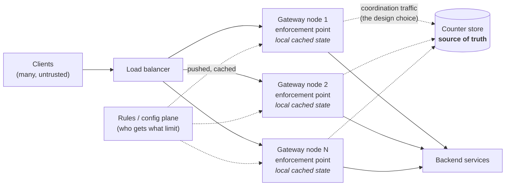
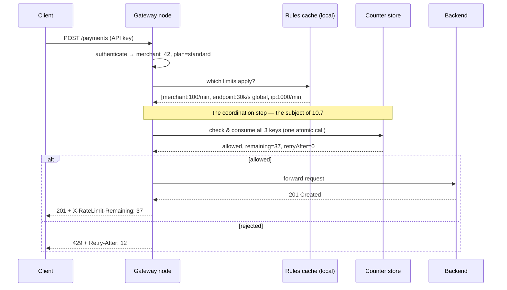
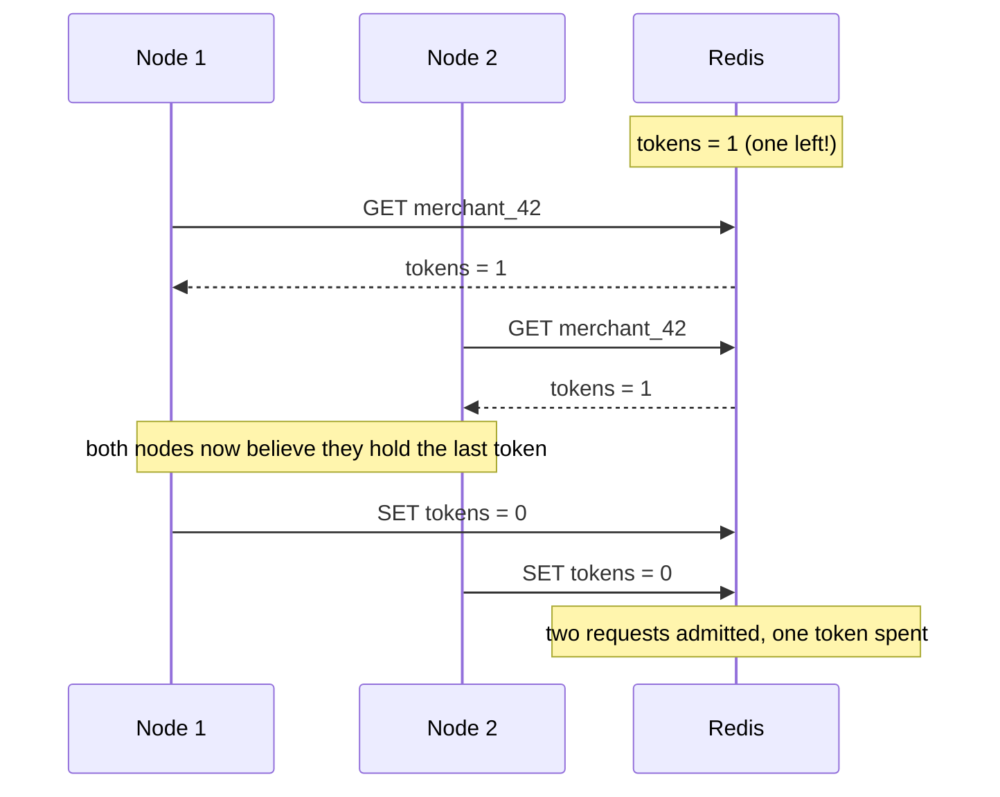
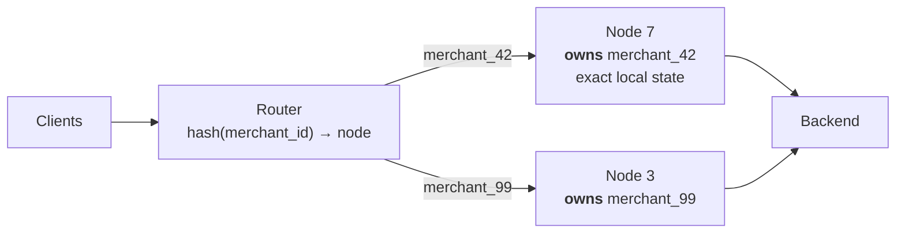
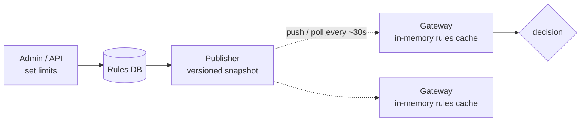
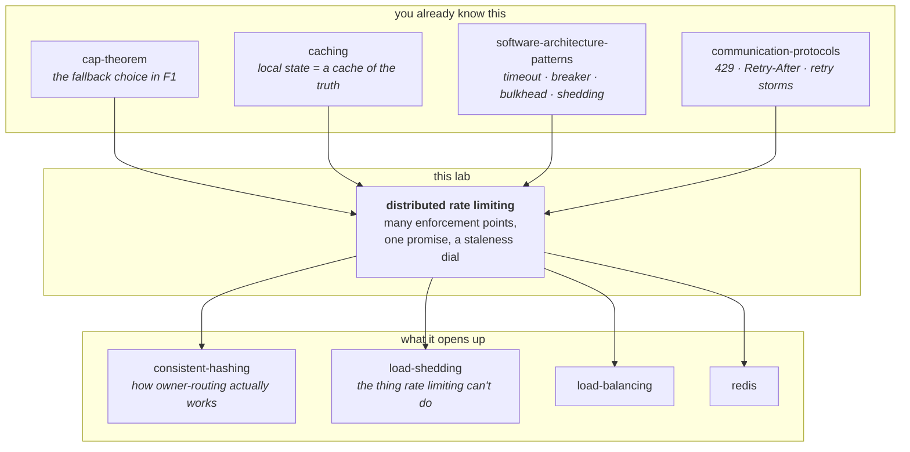

```mermaid
flowchart TB
    subgraph P1["① In the client SDK"]
        direction LR
        c1[Client] --> c2[limit check]
    end
    subgraph P2["② At the edge / CDN / L7 load balancer"]
        direction LR
        e1[Client] --> e2[Edge PoP] --> e3[Origin]
    end
    subgraph P3["③ In the API gateway"]
        direction LR
        g1[Client] --> g2[Gateway] --> g3[Services]
    end
    subgraph P4["④ In a sidecar next to each service"]
        direction LR
        s1[Service] --> s2[Sidecar] --> s3[Store]
    end
    subgraph P5["⑤ In the service code itself"]
        direction LR
        v1[Service + library] --> v2[Store]
    end
```

# High-Level Design: a Scalable Distributed Rate Limiter

> **What this lab is.** An architecture lesson. We design the *system* — where
> the limiter sits, what talks to what, where the state lives, how it survives
> failure, and what it costs. We deliberately stay above the code.
>
> **What this lab is not.** An implementation. The counting algorithms that sit
> underneath the architecture have their own runnable appendix in `src/` — see
> [Appendix A](#appendix-a--the-algorithm-layer-optional). You do not need it to
> follow this document.
>
> **Depth layers.** BEGINNER (stages 1–9) → INTERMEDIATE (stage 10) →
> ENGINEERING (stages 11–12) → PRODUCTION (stages 13–15). There is a
> checkpoint at each transition telling you what you can do at that point.

---

## 1. WHY — what goes wrong if nobody builds this

You run an online service. Anyone on the internet can send it requests, and
sending a request costs the sender almost nothing while serving it costs you
real money — a database query, a card-network call, a CPU.

That asymmetry is the whole problem. One caller with a bad `while` loop, one
customer's misconfigured retry, one person trying to guess passwords, and your
service spends all of its capacity on them. Everyone else — the customers who
were behaving perfectly — gets slow responses or errors. You did not get
attacked; you got *crowded out*.

A rate limiter is the thing that says "you, specifically, have had enough for
now" so that everyone else keeps working. Concretely, without one you get:
your service falling over from one bad client, your cloud bill tracking abuse
instead of business, a paying customer's traffic starved by a free one, and no
way to sell "10,000 calls a month" as a product because you cannot enforce it.

---

## 2. PROBLEM — the free breakfast counter

A large office gives every employee **one free breakfast plate per hour**.

At the start, there is one counter. **Arjun** stands behind it with a notebook.
Someone walks up, Arjun looks up their name, sees whether they already took a
plate this hour, and either hands one over and writes it down, or says "come
back later".

This works perfectly. Arjun's notebook is the truth, Arjun is the only person
who can change it, and nobody gets two plates.

Then the office grows to 5,000 people. The queue at Arjun's counter is now
forty minutes long. So the office does the obvious thing: it opens **twenty
counters**, with twenty clerks, and a host at the door sending each arriving
person to whichever counter is free.

**Meera** works out what has happened before anyone else does. She takes a
plate from Arjun. Then she walks to **Bela**'s counter and takes another. Then
a third from the counter next to it. Bela has no idea; Bela's notebook has
never heard of Meera.

Twenty counters means twenty plates per hour per person, not one.

Nobody wrote a bug. Every clerk followed the rule exactly. The rule itself
stopped being enforceable the moment there was more than one clerk.

---

## 3. NAIVE SOLUTION — the thing every engineer builds first

Keep the counter in the application. A hash map from customer to a count, in
memory, in the service process:

```
if (counts.get(customerId) >= 100) return TOO_MANY_REQUESTS;
counts.increment(customerId);
```

This is genuinely correct and genuinely fast — no network call, nanoseconds,
no extra infrastructure. It is the right answer for exactly as long as there
is one process.

---

## 4. FAILURE — and the deeper problem it reveals

You are running for real, so you run **20 instances** behind a load balancer.
The limit you configured is 100 requests per minute. The limit your customers
actually experience is **2,000 per minute**, because each instance enforces 100
independently and the load balancer spreads the customer's traffic across all
of them.

That is the visible failure. Here is the deeper one:

> **The limit is a property of the whole system, but the state that enforces it
> lives inside one process.**

And it gets worse in ways that are not just "off by 20×":

- **The multiplier is not stable.** Autoscaling takes you from 20 instances to
  60 at peak. Your effective limit silently triples at exactly the moment you
  most needed it to hold.
- **A deploy resets it.** Rolling restart, in-memory counters gone, everyone
  gets a fresh 100.
- **It is unsellable.** You cannot put "100 requests/minute" in a contract when
  the real number depends on your deployment topology.

**🔮 Predict:** *The obvious fix is to give each of the 20 instances a limit of
5, so 20 × 5 = 100. Does that work?*

<details><summary>Reveal</summary>

The ceiling becomes correct, and that is real progress — you will never exceed
100 again. But you have created the opposite error.

The load balancer does not send each customer's traffic evenly to all 20
instances. A customer sending 60 requests/minute might have 40 of them land on
instance 7. Instance 7 allows 5 and rejects 35 — while the other 19 instances
sit there holding 95 unused allowance for that customer.

So the customer is told "limit exceeded" at 5% of their actual limit. You have
traded **over-admission** (letting too many through) for **under-admission**
(rejecting traffic you promised to serve). Under-admission is often the worse
bug, because over-admission shows up as a capacity problem you can see, and
under-admission shows up as a support ticket from a customer who is being
lied to.

Hold onto this. These two errors are the axis the entire design lives on.
</details>

---

## 5. THE REAL REQUIREMENT

Say it in plain words, because everything after this is the pursuit of it:

> **Many independent machines must enforce one shared promise, on every single
> request, fast enough that nobody notices, and the enforcement must not itself
> become the thing that breaks.**

Four clauses, four sources of difficulty:

| Clause | Why it is hard |
|---|---|
| *many independent machines* | The state is shared, so somebody has to coordinate |
| *one shared promise* | Coordination has to be correct, not approximately correct |
| *on every single request* | Whatever you build runs 100% of the time, at full traffic |
| *fast enough* | It sits in front of the user; every millisecond is added to every call |
| *must not become the thing that breaks* | It is now a dependency of everything. If it dies, does your API die with it? |

Notice the tension: clauses 2 and 3–5 pull in opposite directions. Perfect
coordination means talking to a shared thing on every request. Talking to a
shared thing on every request is slow, expensive, and a new single point of
failure.

---

## 6. KEY IDEA

> **Separate the place where the decision is made from the place where the
> truth lives — and then choose, deliberately, how out-of-date each decision
> point is allowed to be.**

That second half is the part people miss. There are many decision points (one
per gateway node, at the edge, where speed matters) and one logical truth (the
shared counter). They cannot be in the same place, so every decision point is
working from a slightly old copy of the truth.

**How old you let that copy get is a dial, not a bug.** Turn it to zero and you
get perfect enforcement at maximum cost and maximum fragility. Turn it up and
you get cheap, fast, resilient enforcement that is slightly wrong. Distributed
rate limiting at scale is choosing where on that dial to sit — per limit, not
per system.

---

## 7. TERMINOLOGY

Now the vocabulary, introduced where the design needs it. Each load-bearing
term gets: what it means in plain English, what it means precisely, why the
word exists at all, and a concrete example.

**Rate limit** — plain: a cap on how often someone may do something.
Precise: a maximum number of accepted operations per identity per unit of time.
Why the term exists: to distinguish a cap on *rate* (100/minute, refilling
forever) from a cap on *total* (100 ever — that is a **quota**). Example:
`merchant_42` may call `POST /payments` 100 times per minute, every minute,
forever.

**Throttling** — plain: slowing someone down rather than refusing them.
Precise: delaying or queueing excess requests instead of rejecting them. Why
it exists: because "rate limit" is often used for both behaviours and they
have opposite failure modes. Rejecting is instant and pushes the problem to the
client; delaying keeps the request but consumes your memory and the client's
patience. That difference — reject now, or accept and delay — comes back
as a real architectural choice in 10.6.

**Load shedding** — plain: dropping requests because *you* are struggling,
regardless of who sent them. Precise: rejecting traffic based on server health
rather than on caller identity. Why the distinction matters: a rate limiter
protects fairness between callers and is configured in advance; load shedding
protects survival and reacts to the present moment. You need both, and they are
different components. A rate limiter alone will happily let 10,000 well-behaved
customers, each inside their limit, collectively melt your database.

**Enforcement point** — plain: the machine that actually says yes or no.
Precise: the component in the request path that evaluates the limit and can
reject. Why the term exists: because in a distributed limiter there are many of
these and only one source of truth, and confusing the two is the central error.
Example: each of your 20 API gateway pods is an enforcement point.

**Counter store** (also: decision store) — plain: the shared place that
remembers how much everyone has used. Precise: the datastore holding
per-key limiter state, readable and writable by every enforcement point.
Example: a Redis cluster holding `merchant_42:payments → {tokens: 37.2,
lastRefill: …}`.

**Key** (also: limit dimension) — plain: *who* the limit applies to.
Precise: the string that identifies one independent bucket of allowance.
Why it exists: the limiter itself is trivial; almost all the design judgment is
in choosing this string. Example: `merchant_42` is one key,
`merchant_42:POST /payments` is a different, narrower key, and both can exist
at once with different limits. Covered properly in [stage 10.5](#105-what-is-the-key-the-most-underrated-decision).

**Over-admission** — plain: letting more through than you promised.
Precise: the true number accepted in some window exceeds the configured limit.
Example: limit 100/min, 20 uncoordinated nodes, actual 2,000/min → 20×
over-admission.

**Under-admission** — plain: rejecting traffic you promised to serve.
Precise: rejecting a request while the global limit had unused allowance.
Why both terms exist: they are *different failures with different victims*.
Over-admission hurts you (capacity, cost). Under-admission hurts your customer
(broken promise). Every coordination design trades one against the other, and
you cannot have neither.

**Fail-open / fail-closed** — plain: when the limiter breaks, do you let
everyone in or nobody? Precise: the enforcement behaviour when the counter
store is unreachable. Why it exists: because there is no safe default and the
right answer depends on what the limit is protecting. Fail-open on a limit that
guards your database means an outage becomes a stampede. Fail-closed on a limit
that guards a nice-to-have means a Redis blip takes down your whole API.

**Hot key** — plain: one entry that everyone hammers. Precise: a single key
whose request rate exceeds what one store partition (one CPU core) can serve.
Why it exists: sharding a datastore spreads *keys* across machines, so it does
nothing at all for a single key. Example: your biggest merchant does 8,000 rps
alone; every one of those requests touches the one entry `merchant_42`.

**Staleness budget** — plain: how out-of-date a node's view is allowed to be.
Precise: the maximum age of the shared state a decision may be based on.
This is the dial from stage 6, and it is the single most useful number to name
explicitly in a design review.

---

## 8. MENTAL MODELS

### The simple model (carry this one around)

The office breakfast counter, grown up:

Twenty clerks, each at their own counter, each able to hand out a plate. In the
middle of the room, **Kiran** sits with the one register book that records what
everyone has taken. Every clerk can walk to Kiran, but walking takes time, and
while a clerk is walking, the other nineteen are still serving people.

Every design in this document is an answer to: *how often does a clerk walk to
Kiran, and what do they do while they are not there?*

### The engineering model (the precise picture)



Three planes, and it is worth naming them separately because they have
completely different requirements:

- **Data plane** (client → gateway → backend): every request, microseconds
  matter, must never be down.
- **Coordination plane** (gateway ↔ counter store): the dotted lines. *This is
  the entire subject of this lesson.* How much of it exists is your design.
- **Control plane** (rules → gateways): which customer has which limit. Changes
  rarely, read constantly, must be cached locally, must survive its own outage.

### Mapping the two models

| Breakfast counter | Engineering | Note |
|---|---|---|
| A clerk at a counter | Gateway node / enforcement point | Many of them; each can say no |
| The host at the door | Load balancer | Decides which clerk you get — and this matters more than it looks |
| Kiran's register book | Counter store (Redis) | The single logical truth |
| Walking to Kiran and back | Store round trip | ~1 ms in-AZ, ~10 ms cross-AZ, ~80 ms cross-region |
| A clerk's own scratch notes | Node-local cached state | Fast, and always slightly wrong |
| "One plate per person per hour" | Limit + window | The promise |
| A person's name | Key | Which bucket of allowance |
| Meera taking a plate at every counter | Over-admission | The stage-4 failure |
| A clerk turning someone away while another has spare plates | Under-admission | The stage-4 *reveal* failure |
| Kiran goes home sick | Counter store outage | Fail-open, fail-closed, or degrade |
| Taking a block of 10 tickets from Kiran at once | Batched lease | Fewer walks, some tickets wasted |
| Clerks shouting tallies across the room every 5s | Periodic sync / gossip | No walking at all, everyone slightly behind |

### Where the analogy breaks

Four places. Each one is a real design consideration that the story hides:

1. **Walking is slow but reliable; networks fail silently.** A clerk always
   comes back. A store call can hang for 30 seconds and then time out — which
   is far worse than a fast failure, because your request thread was held the
   whole time. In the analogy, coordination has a cost. In reality, coordination
   has a cost *and a failure mode*, and the failure mode is what wakes you at
   3am. Stage 11, F4.

2. **Kiran is one person; Redis is one process per shard, which is nearly the
   same thing but for a different reason.** The analogy makes the bottleneck
   look like "queue at the book". The real bottleneck is that a single key
   lives on a single core, so adding machines to your Redis cluster does not
   help your biggest customer at all. Stage 11, F3.

3. **Everyone in the office shares one clock on the wall. Your servers do
   not.** Two nodes can disagree about what time it is by tens of
   milliseconds — or, when NTP misbehaves, by minutes. Every window-based limit
   depends on nodes agreeing where the window boundary is. Stage 11, F5.

4. **People arriving at counters are independent. Requests are not.** When
   your backend slows down, clients time out and retry, so *rejected traffic
   comes straight back*. The analogy has no equivalent of a rejected person
   instantly rejoining the queue and bringing a friend. This is why a rate
   limiter's response format (`Retry-After`) is a load-bearing part of the
   design, not a nicety. Stage 11, F7.

---

## 9. VISUALIZATION

Open **[`visualization.html`](visualization.html)** (also published as an
artifact — link in the chat message).

It is an architecture simulator, not an animation. You choose a coordination
design, a number of gateway nodes, and a load-balancing policy; traffic flows;
and the scoreboard shows you the four numbers that decide every real design:

- **Admitted vs the promise** — is it over-admitting, under-admitting, or exact?
- **Store operations per second** — what this design costs the counter store.
- **Added latency** — what it costs every single user request.
- **What happens when the store dies** — press the button.

Start with *"Run the whole story"*, which walks the seven designs in order with
narration. Then go back and break things yourself. Before each scenario the
page asks you to predict; predicting first is most of the value.

> **✅ CHECKPOINT — end of the BEGINNER model.**
> You can now explain why a rate limiter that works on one machine stops
> working on twenty, name the two opposite ways it can be wrong
> (over-admission and under-admission), and say what the central trade is:
> how stale each enforcement point's view of the truth is allowed to be.
> **Next:** the actual design — requirements, capacity numbers, where the
> limiter physically sits, and the seven coordination options with their real
> costs.

---

## 10. THE DESIGN

We will build it the way you would in a design review: pin the requirements,
work out how big the thing actually is, decide where it physically sits, then
spend most of the time on the one hard part — coordination.

### 10.1 Requirements

A worked example makes every later number concrete. Ours: **a payments API**.

**Functional**

1. Reject requests that exceed a configured limit, with `429 Too Many Requests`.
2. Limits are configurable per identity, per endpoint group, and per plan tier
   (free / standard / enterprise), and take effect within about a minute of
   being changed.
3. Multiple limits apply to one request simultaneously (per-merchant AND
   per-endpoint AND per-IP); the request is rejected if **any** of them is
   exceeded.
4. A rejected client is told *when* to come back (`Retry-After`), and a
   succeeding client can see how much it has left (`X-RateLimit-Remaining`).
5. Some endpoints cost more than others — a bulk report is not one unit of
   work — so limits are charged in weighted **cost**, not raw request count.

**Non-functional** — this is where the design is actually decided:

| Requirement | Target | Why this number |
|---|---|---|
| Added latency | **p99 < 5 ms** | The API's own p99 budget is 150 ms; the limiter runs on every call and must be invisible |
| Availability | **higher than the service it protects** | It is in the path of 100% of traffic. If it is less available than the API, it *is* the API's availability |
| Accuracy | **exact for billing limits, ±5% acceptable for abuse limits** | Different limits genuinely deserve different answers — see 10.7 |
| Throughput | **40,000 rps peak** | Derived below |
| Scale-out | Adding gateway nodes must not change the effective limit | The stage-4 failure, stated as a requirement |

That third row is the one people forget to ask about, and it is the row that
unlocks the whole design. "How accurate does this limit need to be?" is a
product question, not an engineering one, and the answer is *different for
different limits in the same system*.

### 10.2 Capacity estimation

Rough numbers, done out loud, because they decide the architecture.

**Traffic**

```
1 billion API calls/day
  ÷ 86,400 s              = ~11,600 rps average
  × 3.5 peak-to-average   = ~40,000 rps peak
```

Each request is checked against 3 limit dimensions (merchant, endpoint,
IP), so:

```
40,000 rps × 3 dimensions = ~120,000 counter checks/sec at peak
```

**State size** — this is the surprise:

```
2,000,000 merchants total
  ~150,000 active in any peak minute
  × 3 dimensions          = ~450,000 live counters
  × ~120 bytes each       (token bucket = 2 numbers, plus key + store overhead)
                          = ~54 MB
```

Even if you keep *every* merchant resident: 2M × 3 × 120 B ≈ **720 MB**. That
fits in one commodity machine's RAM with room to spare.

> **The single most useful thing to notice in this whole document:**
> **memory is never the constraint. Throughput and latency are.**
>
> This inverts how people instinctively design it. You are not building a big
> distributed database. You are building a very small, very hot one. That is
> why the answer is a Redis-shaped thing and not a Cassandra-shaped thing, and
> why every hard problem below is about *access*, not *storage*.

**What that means for the store**

A single Redis shard is single-threaded and realistically serves **~50,000
scripted operations/sec** (an atomic limiter check is a small Lua script, not a
bare `GET`). 120,000 checks/sec therefore needs at least 3 shards for raw
throughput, and you would run ~6 for headroom and failover.

**Latency budget**

| Hop | Typical p99 | Fits in a 5 ms budget? |
|---|---|---|
| Same-host (sidecar / in-process) | ~0.05 ms | Trivially |
| Same availability zone | ~1–2 ms | Yes, with room for one call |
| Cross-AZ | ~5–10 ms | No — already blows the budget |
| Cross-region | ~70–150 ms | Absolutely not |

Two conclusions fall straight out, and they are structural:

1. **One store call per request is affordable, but only one, and only in-AZ.**
   Any design needing two round trips is dead on arrival.
2. **Cross-region coordination on the hot path is impossible.** Not slow —
   impossible. This is why every global limit is really a set of regional
   limits. See 10.9.

### 10.3 Where does the limiter live?

Before any algorithm, decide the physical placement, because it determines how
many enforcement points exist and therefore how bad the coordination problem
is.



| Placement | Enforcement points | Protects | Fatal weakness |
|---|---|---|---|
| ① Client SDK | Every client | Nothing you control | The client is the attacker. Useful only as politeness — a well-behaved SDK backing off — never as enforcement |
| ② Edge / CDN | 100s of PoPs worldwide | Everything, including your bandwidth bill | Coordination across PoPs is cross-region → impossible on the hot path. Must be approximate |
| ③ API gateway | 10s of nodes, one region | All services behind it | Cannot see limits that depend on service-internal facts (e.g. "this merchant's balance is low") |
| ④ Sidecar | One per service instance | Per-service limits, including service-to-service | Most enforcement points of any option → the hardest coordination |
| ⑤ Service library | One per instance | Just that service | Duplicated in every service, in every language, redeployed to change |

**The choice for our payments API: ③ the API gateway, with ② at the edge for
crude volumetric protection.** Reasoning:

- The gateway is already in the path, already terminates TLS, already
  authenticates — so it already knows *who* the caller is, which is exactly
  what a key needs. Doing the check anywhere earlier means doing it before you
  know the identity, which limits you to IP-based limits.
- There are tens of gateway nodes, not hundreds — the coordination problem is
  hard but tractable.
- The edge tier is not trying to be accurate. Its job is to absorb the 10-Gbps
  garbage flood so it never reaches your gateway. Crude and approximate is
  correct there.

This is worth stating as a general rule: **layer your limiters, and let each
layer be as accurate as its position allows.** Edge = approximate and huge.
Gateway = accurate and per-customer. Service = precise and narrow.

### 10.4 The request path



Two details in that diagram that are easy to skim past and expensive to get
wrong:

- **The rules lookup is local**, served from an in-memory cache on the gateway.
  It must never be a network call — see 10.9.
- **All three limits are checked in one call**, not three. Three round trips
  would triple both the latency and the store load, and would leave you with a
  partial-consumption bug: if limit 1 and 2 pass and limit 3 fails, you have
  already consumed quota from 1 and 2 for a request that was rejected. Check
  them together, consume only if all pass.

### 10.5 What is the key? (the most underrated decision)

The algorithm is a hundred lines. Choosing the key is where systems actually go
wrong, and it is almost never discussed.

A key is the string identifying one independent allowance. The candidates:

| Key | Good for | Fails at |
|---|---|---|
| IP address | Anonymous endpoints, crude abuse control | 50,000 users behind one corporate NAT share a limit; an attacker with a botnet has 50,000 keys. Both errors at once |
| API key / merchant ID | Everything after authentication | Requires the caller to be authenticated first — useless for login and signup endpoints |
| User ID | Per-human fairness | A single merchant's server-side integration is one API key and many users |
| API key + endpoint group | Stopping one expensive endpoint from eating the whole allowance | More keys, more counters, more configuration to explain |
| Global (one key for an endpoint) | Protecting a specific fragile downstream | It is a hot key by construction — every request touches it. See F3 |

**Three rules that come from real incidents:**

1. **Limit on the most specific identity you can authenticate, and fall back
   outward.** Authenticated merchant → API key → IP, in that order. Anything
   keyed on IP is both too coarse and too easy to evade; use it only where you
   genuinely have nothing better, which is essentially the unauthenticated
   endpoints.

2. **Login endpoints need two keys at once.** Key on IP (stops one host trying
   many accounts) *and* on the target username (stops a botnet trying one
   account). Either alone is trivially bypassed, and this is the single most
   common rate-limiting design bug in production systems.

3. **Charge by cost, not by count.** "1,000 requests/minute" means something
   wildly different for `GET /ping` and `POST /bulk-settlement`. Give each
   endpoint a weight and let one request consume 20 units. Otherwise your limit
   does not correlate with the thing you were actually protecting.

**🔮 Predict:** *Your limit is keyed on the API key. A large merchant's
integration is deployed across 12 of their own servers, all sharing one API
key. They complain that their traffic is being rejected even though "each
server is well under the limit". Whose bug is this?*

<details><summary>Reveal</summary>

Nobody's — it is a *key granularity* mismatch, and it is a product
conversation, not an engineering one.

Your limit is per API key, which is exactly what you sold them. Their mental
model is per server. The system is behaving as specified; the specification
does not match how the customer deployed.

The available fixes are all product decisions, which is why this belongs in a
design doc:

- Let them mint sub-keys (one per server), each with its own allowance. Clean,
  and it makes your key granularity match their deployment granularity.
- Raise the limit on that key and let them self-distribute. Simple, but you
  have now lost the ability to protect against *their* runaway server.
- Charge by cost so their cheap health-check traffic stops consuming the same
  allowance as their expensive calls.

The engineering lesson: **the key is a contract with the customer about how
they may deploy.** Choose it knowing that, and document it. A limiter whose key
granularity is a surprise to the customer will generate support load forever,
no matter how correct the counting is.
</details>

### 10.6 Which counting algorithm?

At HLD altitude this is a table, not a lecture. All of these count; they differ
in what they store per key and how they behave at window edges. (The runnable
side-by-side with measured numbers is in [Appendix A](#appendix-a--the-algorithm-layer-optional) if you want it.)

| Algorithm | State per key | Burst behaviour | Notable flaw | Use when |
|---|---|---|---|---|
| Fixed window | 2 numbers | Allows **2× the limit** across a boundary | The boundary bug is exploitable and predictable | Never for real limits; fine for rough metrics |
| Sliding log | **1 timestamp per request** | Exact | Memory grows with *traffic* — measured at ~74 GB for our scale | Small key counts, audit-grade accuracy |
| Sliding counter | 3 numbers | Approximates the previous window as evenly spread | ~0.003% of decisions wrong (Cloudflare's published figure) | A good general default |
| **Token bucket** | 2 numbers | Explicit, controllable burst allowance | Burst must be tuned separately from rate | **The production default** |
| Leaky bucket (queue) | queue | Zero burst — output is perfectly smooth | It is a *shaper*: it adds unbounded latency instead of rejecting | Outbound traffic to a partner who will ban you for bursting |
| GCRA | **1 number** | Same decisions as token bucket | Harder to explain in a code review | Extreme key counts; Redis `CL.THROTTLE` uses it |

**Pick token bucket** for the gateway, for three architectural reasons rather
than mathematical ones:

1. Its state is 2 numbers with no per-request growth, so a store round trip
   carries a fixed tiny payload no matter how much traffic a key has seen.
2. Its refill is computed lazily from a timestamp — there is no background
   timer sweeping millions of keys, which means a key that goes quiet costs
   nothing and can simply be evicted by TTL.
3. **Burst is a separate, explicit dial from rate.** That matters for real
   customers: "100/minute but you may spend 20 of them at once" is a sentence
   you can put in documentation, and it is the difference between a limiter
   that works for bursty integrations and one that generates tickets.

One distinction worth carrying forward, because it changes your architecture:

- A **policer** answers yes/no immediately and rejects the excess. It protects
  your backend and pushes the problem to the client, who must retry.
- A **shaper** accepts the request and releases it later at a steady pace. It
  protects the *downstream* and pushes the problem into latency and memory.

Police your public edge (you can tell strangers to retry). Shape your outbound
calls to partners (you cannot ask a card network to retry, and it will suspend
you for bursting).

### 10.7 Coordination — the actual hard part

Everything so far is setup. This is the design.

We have 20 gateway nodes and one logical truth. The question is how often a
node talks to the truth and what it does in between. We will build it the way
you would actually arrive at it — starting with what a smart engineer tries
first, and letting each version break.

Throughout, the scoreboard is four numbers:
**accuracy · store load · added latency · behaviour when the store dies.**

---

#### v1 — No coordination (each node enforces the full limit)

This is not a design; it is what you get by accident. 20 nodes × 100/min =
**2,000/min**, and the number changes when you autoscale.

**Verdict:** unusable for any limit that is a promise. Genuinely fine for one
thing: a crude per-node safety valve ("no node will ever process more than
5,000 rps regardless of who is asking"), because there the per-node number *is*
the thing you meant.

#### v2 — Static division (each node enforces limit ÷ N)

The ceiling is now correct. And as we found in stage 4, the floor collapses:
traffic is not evenly distributed across nodes, so a customer hits the wall at
a fraction of their real limit while unused allowance sits idle on other nodes.

It also breaks on autoscaling — N changes, so every node's share must change,
which means every node needs to know the current cluster size. You have
accidentally created a coordination problem in the design whose whole selling
point was having no coordination.

**Verdict:** works only when you can guarantee even distribution *and* a stable
node count. That is rarer than it sounds.

#### v3 — Shared store, read-modify-write

Now the obvious real fix: put the counter in Redis. Every node reads it,
decides, and writes it back.



**🔮 Predict:** *At 40,000 rps with a 1 ms one-way hop to the store, roughly
how often does that overlap happen?*

<details><summary>Reveal</summary>

Constantly — it is the normal case, not an edge case.

The window of vulnerability runs from the moment the GET lands to the moment
the SET lands — the GET's return trip plus the SET's outbound trip, so about
**2 ms** here. At 40,000 rps that means roughly **80 requests are inside the
window at any moment**, every one of them reading the same counter value and
spending the same tokens. For a hot key, essentially every decision is made
from a stale read.

This is why "we'll just put the counter in Redis" is not a solution by itself.
The store being shared does not make the operation atomic. The read and the
write are two separate trips, and *the gap between them is where your limit
leaks*.

Worse, it is a bug that scales with your success: it is invisible in staging
with 10 rps and severe in production at 40,000.
</details>

**Verdict:** broken. Also twice as slow as it needs to be — two round trips per
request, which we already established blows the latency budget.

#### v4 — Shared store, one atomic operation

The fix for the gap is to remove the gap: send the *decision* to the store
instead of fetching the data to the node. In Redis that is a Lua script (or
`CL.THROTTLE` from the redis-cell module); the script reads, refills, decides
and writes without any other client observing an intermediate state.

One round trip. No race. Exact enforcement across all 20 nodes.

| | |
|---|---|
| Accuracy | **Exact** |
| Store load | 120,000 ops/s — *the full traffic rate* |
| Added latency | +1 round trip (~2 ms p99 in-AZ) |
| Store dies | Every request must decide alone — see F1 |

**This is the correct baseline, and for a great many systems it is also the
final answer.** Do not skip past it looking for something cleverer: if 120k
ops/s fits your store and 2 ms fits your budget, you are done, and everything
below buys efficiency at the cost of accuracy.

Two problems stop it being the answer *here*.

#### v5 — Sharding, and the hot-key problem it does not solve

120,000 ops/s exceeds one Redis shard (~50k), so we shard: keys are hashed
across 6 shards, each shard owns a slice of the keyspace.

That fixes aggregate throughput. It does nothing whatsoever for the limit
`endpoint:POST /payments`, our global 30,000 rps cap. That is **one key**, and
one key hashes to **one shard**, which is **one CPU core**. Every request in
the system touches it.

> **Sharding spreads keys across machines. A hot key is one key. Adding
> machines cannot help it.** This is the single most important thing to
> understand about scaling a counter store, and it catches people who assume
> "we're on a cluster" means "we scale".

The fix is to split the key itself: replace `endpoint:POST /payments` with 16
sub-keys `…#0` … `…#15`, each carrying 1/16th of the limit, and have each node
pick one at random per request.

And notice what that is: **v2's static division, applied to the store instead
of the nodes** — with exactly v2's weakness back in miniature. A sub-bucket can
be exhausted by chance while others have room, so you under-admit slightly. The
error shrinks as traffic grows (the random spread evens out), which is
convenient, because hot keys are by definition the ones with lots of traffic.

**Verdict:** necessary for any global or per-endpoint limit. Use the smallest
number of sub-keys that fits under one core's capacity, because every extra
sub-key adds under-admission.

#### v6 — Batched leases (stop asking one token at a time)

Even sharded, we are still doing 120,000 store operations per second and adding
2 ms to every request. Both are pure overhead.

Idea: a node does not ask for one token. It atomically takes a **lease** — a
block of, say, 20 tokens — and then serves the next 20 requests locally with no
network call at all.

Store load drops by roughly the batch size. Latency drops to near zero for 19
requests out of 20.

**🔮 Predict:** *What does a node do with leased tokens it has not spent when
the traffic moves elsewhere?*

<details><summary>Reveal</summary>

It strands them, and this is the design's real cost.

A node takes 20 tokens, serves 3 requests, and then the customer's traffic
shifts to other nodes. Those 17 tokens are *already deducted from the shared
counter* — the store believes they are spent. Other nodes are told there is no
allowance left while 17 units of it sit unused on a node nobody is talking to.

So you must attach a **TTL to the lease**: unspent tokens expire and return to
the pool after, say, 1 second. That bounds the damage but does not remove it —
during that second the quota really is unavailable.

Net effect: **v6 under-admits.** Worst-case stranded quota is roughly
`N × batch`, so 20 nodes × 20 tokens = 400 units in flight. If your limit is
100/min, that is catastrophic. If your limit is 30,000/s, it is noise.

The rule this gives you: **batch size must be small relative to the limit.**
Leases work beautifully for high limits and are unusable for low ones.

There is a second, sneakier cost. On a key that is *already saturated*, a node
asks for a batch, is granted zero, and has burned a round trip to be told no.
Every rejected request costs a full store call — exactly when your store is
busiest. Production systems fix this with a short negative cache ("this key was
exhausted 50 ms ago, don't ask again yet").
</details>

#### v7 — Periodic sync (take the store off the hot path entirely)

The last step: nodes stop calling the store per request *or* per batch. Each
node counts locally and, every `T` milliseconds, publishes what it spent and
learns the global total.

Hot path: **zero network calls, zero added latency.** Store load no longer
depends on traffic at all.

The error is whatever the nodes collectively spend while out of touch:

```
worst-case over-admission  ≈  N × (per-node rate for that key) × T
```

With 20 nodes, a key doing 6,000 rps (so 300 rps per node), and T = 500 ms:
20 × 300 × 0.5 = **3,000 requests of overshoot**. On a 30,000/s limit that is
10% — acceptable for an abuse limit, unacceptable for a billing limit.

Turn the dial: T = 100 ms gives 600 overshoot (2%) at five times the store
load. **That is the staleness budget, made numeric.**

**🔮 Predict:** *v7's store load is "N nodes × their active keys ÷ T". We have
450,000 live counters and 20 nodes. Sync every 1 second. What is the store
load — and is v7 actually cheaper than v4's 120,000 ops/s?*

<details><summary>Reveal</summary>

**20 × 450,000 ÷ 1 s = 9,000,000 ops/s.** Seventy-five times *worse* than the
per-request design it was supposed to improve on.

This is the trap in v7, and it is the insight that produces the real
architecture. Periodic sync decouples store load from traffic — but it couples
it to **the number of keys × the number of nodes**. For 450,000 mostly-idle
counters that is a disaster.

Look at where each design's cost actually comes from:

- **v4 (per-request)** costs *one trip per request*. A key seen twice a minute
  costs two trips a minute. Cheap, and exact.
- **v6/v7 (local + sync)** cost *a trip per key per node per interval*,
  whether that key saw a million requests or one. Cheap only if the key is busy.

They are cheap in **opposite regimes**. So do not choose between them —
**apply each to the keys it suits**:

| Key class | Share of keys | Share of traffic | Design | Why |
|---|---|---|---|---|
| **Cold** (< 1 rps) | ~99.9% | ~40% | v4 central atomic | Few requests each, so per-request cost is tiny — and you get exactness free |
| **Hot** (> 100 rps) | ~0.1% (a few hundred keys) | ~60% | v7 local + periodic sync | Huge traffic, so per-request cost is unaffordable; few keys, so sync cost is trivial |

Run the numbers for our system with the top 200 keys treated as hot:

```
hot:  20 nodes × 200 keys ÷ 0.5 s   =   8,000 ops/s
cold: 120,000 × 40%                 =  48,000 ops/s
                                       ------------
total                                  56,000 ops/s   (was 120,000)
```

Store load halved, hot-key contention gone, added latency removed from the
majority of traffic — and the long tail of customers, who are the ones with
small limits where accuracy matters most, still gets **exact** enforcement.

That two-tier split is the production architecture. It is also why "which
algorithm should I use?" is the wrong question: the interesting decision is
which keys get which *coordination* design.
</details>

#### The option that sidesteps all of it: route the key to one owner

Worth naming explicitly, because it is the cheapest correct answer when it is
available.

If the load balancer routes by **hash of the rate-limit key** — every request
for `merchant_42` always reaches gateway node 7 — then node 7 has complete,
exact, local state for that merchant. No store. No coordination. No added
latency. The distributed problem simply does not exist.



The costs are real and they are structural, not incidental:

- **You must control the routing layer**, and you can only hash on one
  dimension. Our design needs three simultaneous limits (merchant, endpoint,
  IP) — you cannot route by all three at once, so at best this covers one of
  them.
- **The owning node is a hot spot.** Your biggest merchant's entire traffic now
  lands on one node.
- **Scaling or losing a node reshuffles ownership**, and during the reshuffle
  two nodes briefly both think they own a key — a short over-admission window
  on exactly the event (a scale-up under load) when you least want it.
- Node 7 dying loses that merchant's counter state entirely.

**Verdict:** excellent for a single dominant dimension in a system where you
own the router (this is essentially how partitioned stream processors handle
per-key state). Not sufficient alone for a multi-dimensional public API.

#### The scoreboard

Everything above, at our scale (40k rps · 20 nodes · 450k live counters ·
120k checks/s):

| | Accuracy | Store ops/s | Added latency | On store outage | Verdict |
|---|---|---|---|---|---|
| v1 independent | up to **20× over** | 0 | 0 | unaffected | Per-node safety valves only |
| v2 divided | up to **20× under** | 0 | 0 | unaffected | Needs even traffic + fixed N |
| v3 read-modify-write | leaks under load | 120,000 | +4 ms | — | **Never.** Broken and slow |
| v4 central atomic | **exact** | 120,000 | +2 ms | must degrade | **The correct default** |
| v5 sharded atomic | ~exact | 120,000 spread | +2 ms | must degrade | Required for hot/global keys |
| v6 batched lease | under (≤ N×batch) | 6,000 | ~0.1 ms | degrades gracefully | High limits only |
| v7 periodic sync | over (bounded by N·r·T) | N × keys ÷ T | **0** | degrades gracefully | Hot keys only |
| owner routing | exact per key | 0 | 0 | unaffected | One dimension, you own the router |

**The design we ship:** v5 (sharded central atomic) as the default for the long
tail, v7 (local + 500 ms sync) automatically promoted for keys crossing a
traffic threshold, with the tier decision made per key and re-evaluated
continuously.

### 10.8 Choosing the counter store

The store's requirements are unusual, and they rule out most databases:

1. **Sub-millisecond p99** — so, in-memory.
2. **Atomic read-decide-write** — so, server-side scripting or a purpose-built
   command.
3. **Automatic expiry** — 450k live counters out of 6M possible; you need dead
   keys to evict themselves. TTL is not optional.
4. **Durability: not required.** This is the counter-intuitive one. Losing the
   counters means everyone briefly gets a fresh allowance — a minor,
   self-healing accuracy incident. Paying for durability on the hot path of
   100% of your traffic to protect data that is worthless in 60 seconds is a
   bad trade.

| Candidate | Verdict |
|---|---|
| **Redis / Valkey** | The default. In-memory, Lua for atomicity, native TTL, `CL.THROTTLE` if you want GCRA built in |
| Memcached | `incr` is atomic but there is no scripting, so a token bucket cannot be done in one operation |
| Relational DB | Atomicity yes, sub-millisecond at 120k writes/s no. Also: this is the fastest way to turn a rate limiter into an outage |
| Cassandra / Dynamo | Wrong shape entirely — quorum writes cost more latency than your whole budget, and eventual consistency defeats the purpose |
| A dedicated service (gRPC) | What Envoy's RLS does. Adds a hop but centralises the logic and lets you batch. Sensible at large scale |

Requirement 4 has an important consequence: **run Redis without persistence and
treat it as expendable.** No AOF fsync on the hot path. Replicate for
availability, not for durability. If you lose a shard, you lose those counters,
and the correct response is a metric, not a page.

### 10.9 Multi-region

The latency table in 10.2 already decided this: cross-region coordination on
the hot path is impossible. So a "global" limit cannot be globally enforced in
real time. You choose one of three, and you choose per limit:

| Approach | How | Accuracy | Use for |
|---|---|---|---|
| **Independent regional limits** | Each region enforces the full limit locally | Total = limit × regions | Abuse protection, where the point is per-region capacity anyway |
| **Split the limit** | Each region gets a fixed share (US 60%, EU 40%) | Correct ceiling, under-admits when traffic shifts | Predictable geographic traffic |
| **Async global reconciliation** | Regions enforce locally, stream counts to a global aggregator, which adjusts each region's share every few seconds | Converges; wrong during the lag window | Billing-adjacent limits that must be *roughly* globally correct |

The honest position, and the one to state out loud in a design review: **a
global limit enforced across regions is always approximate.** If a limit
genuinely must be exact and global, it cannot be enforced at the edge — it must
move to whatever single-region component already serialises the operation
(usually the database write that actually performs the action). Rate limiting
is not the right tool for a hard global invariant; a transaction is.

### 10.10 The control plane (rules and configuration)

The limits themselves — which merchant gets what — are a separate system, and
it fails in a separate way.



Three rules, each learned the hard way:

1. **The rules cache is in memory on every gateway, and it never expires on
   failure.** If the rules service is down, gateways keep using the last
   snapshot they have, forever. A config system outage must not become a
   traffic outage. Stale limits are almost always better than no limits.
2. **Snapshots are versioned and applied atomically.** Half-applied rule sets
   produce inconsistent enforcement across nodes, which is impossible to debug
   because it depends on which node you hit.
3. **Ship a hardcoded default.** A brand-new gateway that cannot reach the
   rules service on startup must still enforce *something* sane rather than
   starting up fully open.

### 10.11 What the client sees

The response contract is part of the design, because it determines whether
rejected traffic goes away or comes straight back.

```http
HTTP/1.1 429 Too Many Requests
Retry-After: 12
RateLimit-Limit: 100
RateLimit-Remaining: 0
RateLimit-Reset: 12
```

- **`429`**, not `503`. `503` means *you* are broken and tells well-behaved
  clients and load balancers to retry aggressively and possibly mark you
  unhealthy. `429` means *they* are over their allowance.
- **`Retry-After` must be honest.** If you say 12 seconds and are still
  rejecting at 12 seconds, every rejected client retries in lockstep and you
  have built a synchronised retry storm — with your own header as the
  synchroniser. Compute it from the actual limiter state (when will there
  genuinely be a token?), and expect clients to add jitter.
- **Send the headers on success too.** A client that can see it has 4 of 100
  remaining can slow itself down. A client that only learns at rejection cannot.
- **Return the limit that was hit** when several apply. "Rate limited" with no
  indication of *which* limit is unactionable, and generates support tickets
  that you will answer by reading logs.

> **✅ CHECKPOINT — end of the INTERMEDIATE model.**
> You can now design the system: state the requirements, size it, place the
> limiter, choose the key and algorithm, and — the real skill — pick a
> coordination design per key class with the cost of each one in front of you.
> **Next:** what breaks in production, and which guarantees survive each break.

---

## 11. FAILURE SCENARIOS

The happy path is the easy half. Each failure below states: how it happens,
where to watch it, what the system does, which guarantee survives, which is
lost, and what production actually does about it.

### F1 — The counter store goes down

**How it happens.** Redis primary fails, a failover takes 8 seconds, or a
network rule change makes it unreachable from one AZ.

**Watch it:** in the visualization, choose *v4 central atomic*, then press
**Kill the store** and try each fallback.

**What happens.** Every enforcement point loses the truth simultaneously. There
is no correct answer, only three choices with different victims:

| Fallback | Behaviour | Consequence |
|---|---|---|
| **Fail open** | Allow everything | Your API stays up and your backend takes 100% unfiltered traffic — including whatever abuse the limiter was suppressing. A Redis blip becomes a database outage |
| **Fail closed** | Reject everything | Total API outage caused by a component that is not on the critical path of doing any actual work |
| **Degrade to local** | Each node falls back to `limit ÷ N` locally | Neither correct nor catastrophic — you keep serving, roughly within the intended envelope |

**Guarantee kept:** with degrade-to-local, the *ceiling* still roughly holds —
you will not see 20× over-admission.
**Guarantee lost:** exactness, and fairness across nodes (v2's skew problem
comes back for the duration).

**In production:** degrade to local is the standard answer, and the fallback
is chosen **per limit, not per system**. A limit protecting a fragile
downstream should fail closed *for that endpoint only*. A limit that exists for
billing fairness should fail open — you can reconcile money later, but you
cannot un-reject a customer's payment. Write the fallback into the rule
definition alongside the limit, so it is a product decision, reviewed, and not
a global default nobody remembers choosing.

### F2 — The store gets *slow* (the one that actually takes you down)

**How it happens.** A `KEYS` command from someone's debugging session. A big
key expiring. Memory pressure triggering eviction. The store does not fail; it
answers in 400 ms instead of 1 ms.

**What happens, in order.** Every gateway request now blocks for 400 ms on the
limiter. Request threads pile up. The gateway's connection pool exhausts.
Requests that would have been *allowed* start failing — not because of the
limit, but because the thing checking the limit is holding them. Clients time
out and retry, doubling load. Your service is now down, and the component that
took it down is the one whose entire job was to protect it.

> **Slow is more dangerous than down.** Down is detected in milliseconds and
> triggers your fallback. Slow keeps the failure invisible while it consumes
> every resource you have. This is the single most common way a rate limiter
> becomes the outage it was built to prevent.

**Guarantee kept:** limit accuracy, ironically — it is enforcing perfectly.
**Guarantee lost:** availability, which was the whole point.

**In production, all four of these, not one:**
- **An aggressive timeout on the limiter call** — 5–10 ms, not the default.
  Treat a timeout exactly like F1's outage and take the fallback path.
- **A circuit breaker.** After N consecutive timeouts, stop calling the store
  entirely for a few seconds and run degraded. This also stops you adding load
  to a store that is already struggling.
- **A bulkhead**: a bounded, separate connection pool for limiter calls, so
  exhausting it cannot starve everything else.
- **Alert on limiter latency and fallback rate**, not just store uptime. The
  dashboard question is "what fraction of decisions were made without the
  store?" — that number going from 0% to 3% is the earliest signal you get.

### F3 — Hot key

**How it happens.** A global limit (`endpoint:POST /payments`) is touched by
every request by construction. Or one merchant runs a flash sale and does 15%
of your traffic alone.

**Watch it:** in the visualization, set *Traffic shape → one dominant key* and
compare store load per shard.

**What happens.** One key lives on one shard on one core. Adding shards does
nothing. That core saturates, its latency climbs, and F2 follows.

**Guarantee kept:** correctness of the limit itself.
**Guarantee lost:** the ability to scale by adding machines — for that key you
have hit a hard ceiling.

**In production:** split the key into `k` sub-buckets of `limit ÷ k`
(reintroducing a little under-admission, per v5), or promote the key to the
local-plus-sync tier (v7) so it stops touching the store per request at all.
Detect hot keys continuously — top-N by request rate, sampled at the gateway —
and promote them **automatically**. A design that requires a human to notice a
hot key will not survive its first flash sale.

### F4 — The cluster resizes

**How it happens.** Autoscaling adds 20 gateway nodes during a traffic spike.
Or a deploy rolls, briefly running 40.

**What happens.** Anything with a per-node share is instantly wrong. v2's
`limit ÷ N` is now dividing by a stale N — either over-admitting (nodes think
N is smaller than it is) or under-admitting. v7's error bound `N × r × T` grows
with N precisely when traffic is highest.

**Guarantee kept:** with central atomic (v4/v5), *everything* — this is its
quiet superiority. The store does not care how many nodes exist.
**Guarantee lost:** with any node-share design, the ceiling itself, at exactly
the worst moment.

**In production:** prefer designs that are indifferent to N. Where you cannot,
derive N from the service registry rather than from configuration, and accept
that during a scale event the limit is approximate. This is a strong argument
for keeping the long tail on v4: **your accuracy should not depend on your
deployment topology**, which was the original complaint in stage 4.

### F5 — Clock skew

**How it happens.** NTP drift, a VM pausing for live migration, a leap-second
handling difference. Nodes disagree about the time by 50 ms — or, when
something is genuinely broken, by minutes.

**What happens.** Depends entirely on where time is read:

- **Central atomic (v4/v5):** immune. The refill is computed from the *store's*
  clock, inside the store. All nodes implicitly agree because only one clock
  is consulted. This is an underrated advantage.
- **Local designs (v1/v2/v6/v7):** each node computes refill from its own
  clock. A node running 5 minutes fast believes far more time has elapsed and
  refills buckets that should be empty — it hands out free allowance.
- **Fixed-window algorithms:** worst affected. Nodes disagree about where the
  window boundary is, so the boundary-doubling bug happens at several different
  moments instead of one, smearing over-admission across a wider interval.

**Guarantee kept:** relative ordering on any single node.
**Guarantee lost:** the global limit, silently — there is no error, no log
line, just more traffic admitted than configured.

**In production:** read time in one place wherever possible (the store).
Monitor clock offset as a first-class metric on every gateway and alert on it.
Prefer **monotonic** clocks for measuring elapsed time locally — a wall clock
can jump backwards, and a negative elapsed time in a refill calculation
produces spectacular results.

### F6 — A node dies holding leased quota

**How it happens.** With v6, a node has leased 20 tokens and is killed.

**What happens.** The store already decremented those 20. Nobody will ever
spend them. Every other node sees less allowance than exists. Repeated across
a rolling deploy, a meaningful slice of every customer's limit evaporates.

**Guarantee kept:** the ceiling — you never over-admit from this.
**Guarantee lost:** the floor. Customers are rejected below their limit, and
the cause is invisible to them and to you.

**In production:** short lease TTLs (~1 s), sized so that stranded quota is
small relative to the limit; return unused lease on graceful shutdown; and
never use leases for small limits, where `N × batch` is a large fraction of the
limit.

### F7 — Dishonest `Retry-After`, and the retry storm you built yourself

**How it happens.** The limiter rejects and reports a retry time that is
computed loosely — rounded to the next window, or a fixed constant, or
off by a hair.

**What happens, two ways:**

1. **Too early, even slightly.** A client obeys the header exactly, retries at
   that microsecond, and is rejected again — because the token had not *quite*
   arrived. It retries again. You have created a client that is polling you as
   fast as your own header permits, and your logs will show it as an abusive
   client when in fact it is the only one doing exactly what you asked.

   This is not hypothetical: the algorithm appendix's own test
   (`retry_after_is_honest_for_every_limiter`) failed until floating-point
   slack was added to the comparison, because `elapsed × rate` does not land
   exactly on integer token counts in binary floating point. A limiter can be
   arithmetically wrong by 4 × 10⁻¹⁰ tokens and produce a production retry
   storm.

2. **Identical for everyone.** Every rejected client is told "retry in 12
   seconds", so all of them retry in the same millisecond. Your own header is
   now a synchroniser, converting scattered load into a coordinated spike, once
   every 12 seconds, forever.

**Guarantee kept:** the limit is still enforced.
**Guarantee lost:** the *purpose* of the limit — total load goes up, not down,
because rejected traffic returns immediately and in lockstep.

**In production:** compute `Retry-After` from real limiter state ("when will
there actually be a token?"), round **up** never down, add server-side jitter
so clients are spread rather than synchronised, and document exponential
backoff for SDK authors. Rejecting a request is cheap; rejecting the same
request forty times a second is not.

### F8 — A bad rule reaches production

**How it happens.** Someone sets a limit to `0`, or ships a rule set with the
wrong plan tier mapping, or the publisher pushes a half-written snapshot.

**What happens.** Instant, total, correctly-implemented rejection of legitimate
traffic. The system is working perfectly and the business is down.

**Guarantee kept:** all of them. That is what makes this failure so effective —
nothing is broken.
**Guarantee lost:** nothing technical. Only the service.

**In production:** validate rules on write (a limit of 0 requires an explicit
override flag); version snapshots and make rollback a single fast operation;
roll new rule sets out gradually and watch the rejection rate; and run a
**shadow mode** — evaluate a new rule, log what it *would* have rejected, and
enforce nothing — before enabling it. Shadow mode is the highest-value feature
in a rate-limiting control plane and it is almost always built after the first
incident rather than before.

---

## 12. CORRECTNESS — what you can and cannot promise

### Guaranteed (with sharded central atomic, v4/v5)

- **The ceiling holds.** In any window, admitted ≤ limit + burst, regardless of
  how many gateway nodes exist or how traffic is distributed across them.
- **Atomicity.** No two requests can both consume the same last unit of
  allowance. The decision and the state update are one indivisible step.
- **Independence.** One key's traffic cannot consume another key's allowance.
- **Node-count independence.** The enforced limit does not change when you
  scale, deploy, or lose a node.

### Explicitly NOT guaranteed — say these out loud in a design review

- **Fairness within a key.** If merchant_42's allowance is 100/min, the limiter
  says nothing about *which* 100 requests get through. A tight retry loop will
  systematically beat a polite client to the tokens.
- **Global exactness across regions.** Physically impossible on the hot path.
  See 10.9.
- **Exactness during any degradation.** Store outage, store timeout, cluster
  resize, or clock skew each move you onto a fallback path that is approximate
  by design.
- **Ordering.** A limiter is not a queue. Requests are not served in arrival
  order, and nothing is preserved for later.
- **Protection from aggregate load.** Ten thousand customers, each perfectly
  within their individual limits, can still overwhelm you. Per-key limits do
  not sum to a system limit. You need load shedding as a separate mechanism —
  this is the most common gap in otherwise well-designed systems.

### What was traded away, and for what

| You gave up | To get | Where |
|---|---|---|
| Zero added latency | Exactness across nodes | v4: +1 round trip on every request |
| Exactness | Zero latency and low store load | v7: bounded over-admission on hot keys |
| Some of the customer's allowance | Fewer store calls | v6: stranded lease quota |
| Perfect enforcement during failures | Staying available at all | F1's degrade-to-local |
| A globally exact limit | Being able to run in more than one region | 10.9 |

Every row is a deliberate purchase. The failure mode of an inexperienced design
is not choosing wrong — it is not noticing that a choice was made.

### Safety vs liveness, in this system's terms

- **Safety** ("nothing bad happens"): the limit is never exceeded. Central
  atomic gives you this unconditionally.
- **Liveness** ("something good eventually happens"): allowed requests actually
  get served. Fail-closed preserves safety and destroys liveness. Fail-open
  does the reverse.

The fallback decision in F1 is precisely a choice of which one to sacrifice
during a partition — the same shape as the CAP trade-off you saw in the
[cap-theorem](../24-cap-theorem/) lab, applied to your own infrastructure rather
than to a database.

> **✅ CHECKPOINT — end of the ENGINEERING model.**
> You can now defend the design under pressure: name what each failure costs,
> which guarantee it bends, and what you would monitor to see it happening.
> **Next:** how real systems do it, and what this document has left out.

---

## 13. CODE

By design, this lab has none at the architecture level — a simulated cluster
would teach you the simulation, not the design.

What *does* exist, from an earlier session, is the layer underneath: all six
counting algorithms implemented side by side, with tests and measured
experiments. It is optional, and it is genuinely good for turning stage 10.6's
table into something you have seen behave. See
[Appendix A](#appendix-a--the-algorithm-layer-optional).

## 14. EXPERIMENTS

These run against the algorithm appendix, so they answer *algorithm*
questions, not coordination questions. Each is worth predicting first. All
output below is real — copied from an actual run, not described.

```bash
cd 60-distributed-rate-limiting
java src/Experiments.java     # the four experiments
java src/LimiterTest.java     # 12 tests, all passing
```

**🔮 Predict (E1):** *Limit is 10 per second. What is the most a client can
actually get through in some one-second stretch, under fixed window? Under a
token bucket with burst 10?*

<details><summary>Reveal — measured</summary>

```
algorithm             greedy client boundary-timed     WORST CASE   verdict
                      (every 10 ms) (saves for flip)  (max of both)
----------------------------------------------------------------------------
fixed-window                     10             20             20   2.0x over
sliding-log                      10             10             10   holds the limit
sliding-counter                  10             10             10   holds the limit
token-bucket b=10                19             10             19   1.9x over
token-bucket b=1                 10              1             10   holds the limit
gcra b=10                        19             10             19   1.9x over
```

Two things worth carrying into a design review. Fixed window is only beaten by
a client that *knows* where the boundary is — so the attacker column is the
real one. And the token bucket goes over too, at 1.9×, which is not a bug:
`burst` is permission to exceed the average rate, and `burst = limit` is
permission to double it. Your "100 per minute" limit, with a burst of 100,
means a client may legitimately send 199 in some minute.
</details>

**🔮 Predict (E2):** *Which algorithm's memory depends on traffic rather than
on the number of keys, and how bad does that get?*

<details><summary>Reveal — measured, at 1M keys</summary>

```
sliding-log      per-key state grows with requests   →  74.5 GB
sliding-counter  3 numbers                           → 228.9 MB
token-bucket     2 numbers                           → 152.6 MB
gcra             1 number                            →  76.3 MB
```

The sliding log is the only exact algorithm here and the only one that stores a
timestamp per request. That is the trade in one line, and it is why exactness
is bought at the algorithm layer only for small key counts.
</details>

**🔮 Predict (E3):** *A 200-request thundering herd hits a 50/s limit. Compare
a policer (token bucket) with a shaper (leaky-bucket queue) — which one is
"better"?*

<details><summary>Reveal — measured</summary>

```
token bucket (POLICER, burst 50):
   50 admitted in the same instant, 150 rejected outright
   → backend sees a 50× spike; 150 users see an error

leaky bucket (SHAPER, queue 200):
   200 accepted, 0 dropped; the last one is forwarded at t = 3,980 ms
   → backend sees a perfectly flat 50/s; 0 users see an error,
     but the unluckiest user waits 4 seconds
```

Neither is better. A queue is unbounded latency wearing a disguise. This is
exactly why 10.6 says police the public edge and shape your outbound calls to
partners.
</details>

---

## 15. PRODUCTION

### From this document to a real deployment

| Layer | This design | Real implementation |
|---|---|---|
| Enforcement point | "gateway node" | Envoy + `ratelimit` filter, Nginx `limit_req`, Kong, AWS API Gateway usage plans, Cloudflare Rate Limiting Rules |
| Decision service | "the store" | Envoy's [RLS](https://github.com/envoyproxy/ratelimit) gRPC service over Redis; or Redis directly via Lua / `CL.THROTTLE` (redis-cell, which is GCRA) |
| Local + sync tier | v7 | Google's Doorman (per-client capacity leases), Cloudflare's counter propagation between PoPs, Stripe's tiered limiters |
| Control plane | "rules cache" | Envoy xDS pushing config, or a versioned snapshot in S3 polled by every node |
| Edge tier | "crude volumetric" | Cloudflare / Akamai / AWS Shield, absorbing volumetric floods before origin |

### What this document deliberately left out

Each of these is real work that a production system needs and this lesson
skipped, with what handles it:

- **Distributed quota accounting for billing.** Rate limits are approximate;
  invoices are not. Real systems keep a *separate*, durable, exact usage ledger
  fed asynchronously — never the limiter's counters. (Related:
  [transactional-outbox](../48-transactional-outbox/), [event-sourcing](../50-event-sourcing/).)
- **Authentication and identity resolution.** We assumed the gateway already
  knows the caller. Resolving an API key to a merchant and plan is itself a
  cached lookup with its own failure modes.
- **Warm-up and cold start.** A fresh gateway node with empty local state
  behaves differently for the first few seconds — significant during a scale-up.
- **Adaptive / concurrency-based limits.** Fixed rate limits are a guess about
  capacity. Systems like Netflix's `concurrency-limits` derive the limit from
  observed latency (a TCP-congestion-control-shaped idea) instead of a config
  file.
- **Priority and graceful degradation.** When over the limit, reject the health
  checks and analytics calls before the payments.
- **Security of the limiter itself.** If a limit is keyed on a header a client
  controls, the limit is optional. Key only on values you derived server-side.
- **Cost accounting for the store.** 120k ops/s of managed Redis is a real line
  item; the design choice in 10.7 is partly a budget decision.

### What an on-call engineer actually watches

Four dashboards, in the order you would look at them during an incident:

1. **Rejection rate by limit and by key class.** A step change is either an
   attack or a bad rule (F8). The two look identical for the first minute; the
   distinguishing question is whether the change lines up with a config
   deployment.
2. **Limiter decision latency, p50/p99/p999.** The earliest possible signal of
   F2, and it moves before anything else does.
3. **Fallback rate** — the fraction of decisions made without the store. Should
   be 0. Anything above 0 means you are running approximate and do not know it.
4. **Top-N keys by request rate.** Your hot key list (F3), and your best early
   warning of an emerging abuse pattern.

### The tuning dials, and what each one costs

| Dial | Turn it up | Turn it down |
|---|---|---|
| Sync period `T` (v7) | Less store load, more over-admission | Tighter accuracy, more store load |
| Batch size (v6) | Fewer round trips, more stranded quota | Tighter accuracy, more round trips |
| Burst | Bursty clients work, backend sees spikes | Smooth backend, legitimate spikes rejected |
| Sub-key count `k` (v5) | Hot key spread thinner, more under-admission | Less under-admission, hotter shard |
| Hot/cold threshold | More keys exact, higher store load | Lower store load, more keys approximate |
| Store call timeout | Fewer false fallbacks, more F2 exposure | Better outage isolation, more spurious degradation |

## 16. EXERCISES

See **[EXERCISES.md](EXERCISES.md)** — eight rungs from "explain it in your own
words" to a full multi-region design prompt. Answers are in
**[SOLUTIONS.md](SOLUTIONS.md)**; attempt first.

## 17. KNOWLEDGE MAP & NEXT STEPS



**Builds directly on labs you have done:**

- **[cap-theorem](../24-cap-theorem/)** — F1's fail-open/fail-closed decision is
  the CAP trade-off applied to your own infrastructure. During a partition
  between gateway and store you choose consistency (fail closed, refuse to
  answer) or availability (fail open, answer possibly wrongly). Same choice,
  and this time you are the database.
- **[caching](../11-caching/)** — every local design here is a cache of the
  counter store, and the staleness budget of stage 6 is that lab's consistency
  window with a different name. The stampede that lab measured (200 readers,
  one expired key, 200 database calls) is F3's hot key in a different costume.
- **[software-architecture-patterns](../06-software-architecture-patterns/)** —
  that lab listed rate limiting as one resilience pattern in a family. This lab
  is that one bullet point expanded, and it needed four of its siblings
  (timeout, circuit breaker, bulkhead, load shedding) to survive F2.
- **[communication-protocols](../02-communication-protocols/)** — the
  timeout + retry + idempotency atom from that lab is what F7 is about: your
  `Retry-After` is an input to somebody else's retry policy.
- **[http-caching](../12-http-caching/)** — same insight as 10.10's rules plane:
  a cached copy that keeps serving when its source is unreachable is a feature,
  not a bug.

**Commonly confused with — the one sentence that separates each:**

- **Load shedding** — rate limiting rejects based on *who you are* and is
  configured in advance; load shedding rejects based on *how the server feels
  right now*. You need both; neither substitutes for the other.
- **Throttling** — usually means *delaying* rather than *rejecting*; that is a
  shaper, and it converts a rejection into latency plus memory.
- **Backpressure** — a signal flowing *backwards* from an overloaded consumer
  to a producer to slow it down; rate limiting is a *unilateral* cap applied at
  the front door with no negotiation.
- **A circuit breaker** — protects *you* from a failing *dependency*; a rate
  limiter protects your dependency from *callers*. Opposite directions.
- **Admission control / quotas** — a quota is a cap on a *total* (100 GB this
  month); a rate limit is a cap on a *rate* (100 per minute, forever).

**Suggested next:**

```
/learn consistent-hashing     ← how owner-routing and shard assignment really work;
                                also the missing piece under caching and sharding
/learn load-shedding          ← the guarantee stage 12 says rate limiting cannot give you
/learn redis                  ← the store this whole design assumes; Lua atomicity,
                                single-threaded model, cluster mode, eviction
/learn load-balancing         ← the box in every diagram here that we treated as a given
/learn idempotency-keys       ← what makes the retries this system provokes safe
```

## 18. GLOSSARY

In order of first appearance.

| Term | One line |
|---|---|
| Rate limit | A cap on accepted operations per identity per unit of time |
| Quota | A cap on a *total* rather than a rate (100 GB this month) |
| Throttling | Delaying excess requests rather than rejecting them |
| Load shedding | Rejecting traffic because the server is struggling, regardless of caller |
| Enforcement point | A machine that actually evaluates the limit and can say no |
| Counter store | The shared datastore holding per-key limiter state; the source of truth |
| Key / limit dimension | The string identifying one independent bucket of allowance |
| Over-admission | Letting more through than the limit promised |
| Under-admission | Rejecting a request while global allowance was actually available |
| Fail-open / fail-closed | Allow-all / reject-all when the counter store is unreachable |
| Hot key | One key whose traffic exceeds what a single store partition can serve |
| Staleness budget | How out-of-date an enforcement point's view of the truth may be |
| Burst | Saved-up allowance that may be spent at once, above the average rate |
| Window | The time span a limit is measured over |
| Data / coordination / control plane | Request path · gateway↔store traffic · rule distribution |
| Policer | Answers yes/no immediately and rejects the excess |
| Shaper | Accepts and releases later at a steady pace; trades rejection for latency |
| Fixed window | Count per calendar interval; allows 2× across a boundary |
| Sliding log | One timestamp per request; exact, and memory grows with traffic |
| Sliding counter | Weighted blend of this and the previous window; ~0.003% error |
| Token bucket | Tokens drip in at a rate, requests spend them; burst is explicit |
| Leaky bucket | The same machine inverted; as a queue it is a shaper |
| GCRA | Token-bucket behaviour stored as a single "next allowed time" number |
| Cost weighting | Charging expensive endpoints more than one unit of quota |
| Read-modify-write | Fetch, decide locally, write back — two trips, with a race in the gap |
| Lost update | Two nodes read the same value and both write, so one update vanishes |
| Atomic operation | Read-decide-write executed at the store with no observable middle |
| Lua script / `CL.THROTTLE` | How Redis provides that atomicity in practice |
| Sharding | Spreading *keys* across store partitions; no help for a single hot key |
| Sub-key splitting | Splitting one hot key into `k` buckets of `limit ÷ k` |
| Lease / batch | Taking a block of allowance to spend locally without further calls |
| Stranded quota | Leased allowance a node never spent and nobody else could use |
| Periodic sync | Nodes count locally and exchange totals every `T`; zero hot-path latency |
| Owner routing | Hashing the limit key to one node so its state is exact and local |
| Circuit breaker | Stop calling a failing dependency for a while |
| Bulkhead | An isolated resource pool so one dependency cannot starve the rest |
| Shadow mode | Evaluate a new rule and log what it *would* reject, without enforcing |
| `429` / `Retry-After` | The rejection status code, and the honest "come back at" hint |
| Retry storm | Synchronised client retries turning a rejection into a bigger spike |

---

## Appendix A — the algorithm layer (optional)

Built in an earlier session; kept because it makes stage 10.6's table concrete.
It is the **low-level** counterpart to this document: six algorithms, one
interface, no dependencies, no build tool.

```bash
java src/LimiterTest.java     # 12 scenario-named tests  → 12 passed, 0 failed
java src/Experiments.java     # the four measured experiments quoted in stage 14
```

| File | What it holds |
|---|---|
| `src/Limiter.java` | The shared interface. Time and key are *arguments*, which is what makes every experiment deterministic and instant |
| `src/Algorithms.java` | All six algorithms side by side, so the state-size trade is visible in one screen |
| `src/LimiterTest.java` | Tests named after claims — two of them assert the fixed-window bug *on purpose* |
| `src/Experiments.java` | The measured numbers quoted in stage 14 |

Verified: both commands were run for this document and their real output is
quoted in stage 14. The `Algorithms.java` comments referring to "README stage
11, failure F7" and "stage 10.6" point at
[F7](#f7--dishonest-retry-after-and-the-retry-storm-you-built-yourself) and
[10.5/10.6](#105-what-is-the-key-the-most-underrated-decision) in this document.
