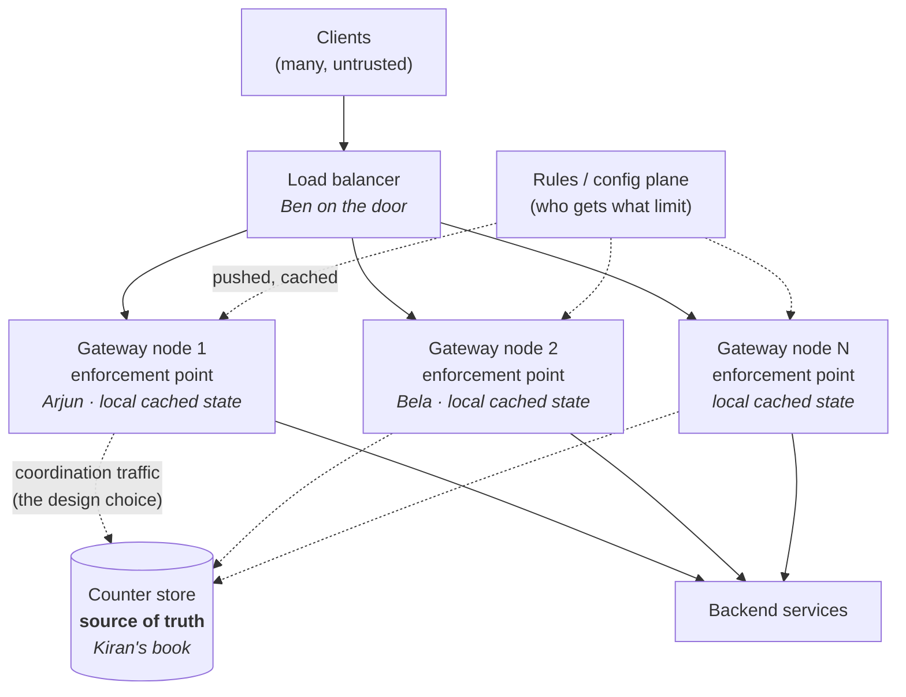
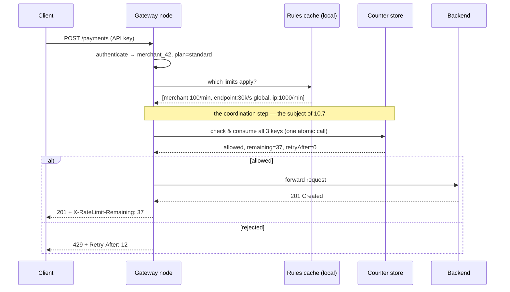
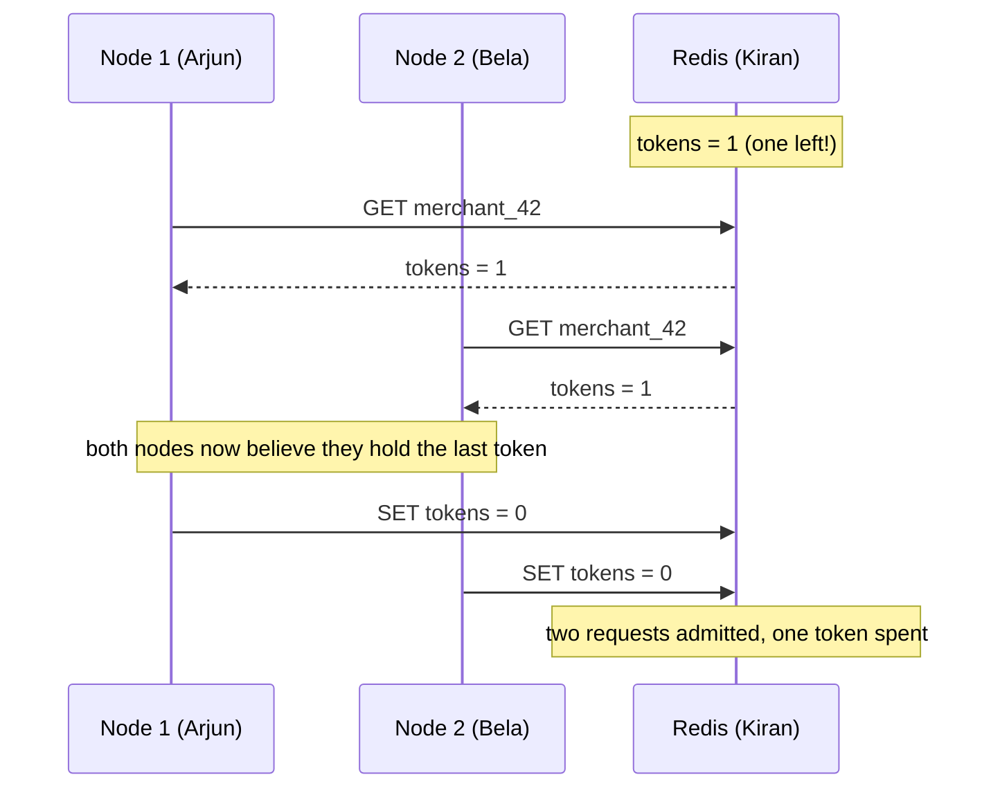
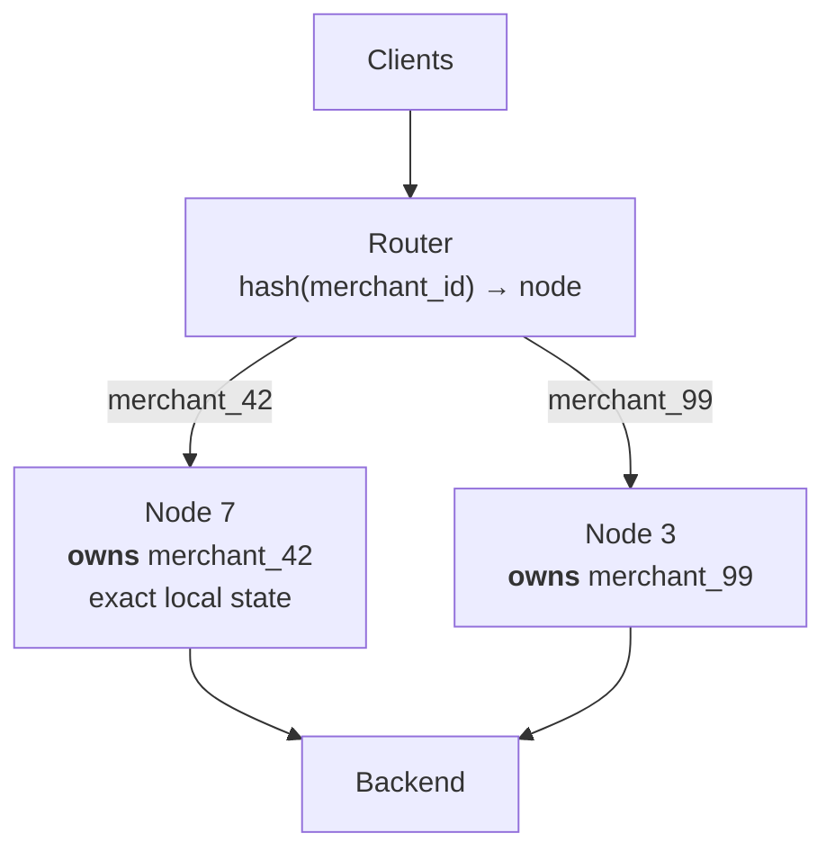
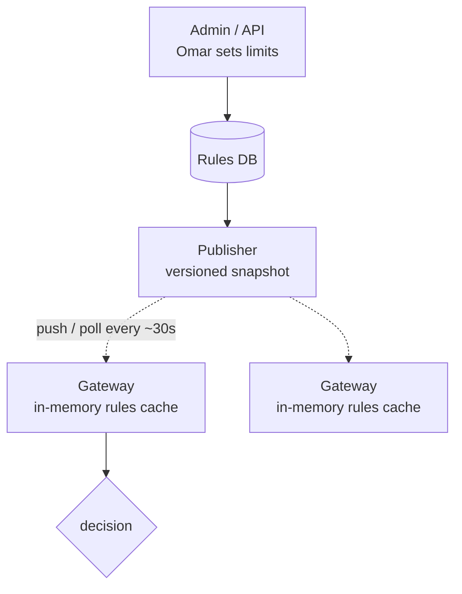
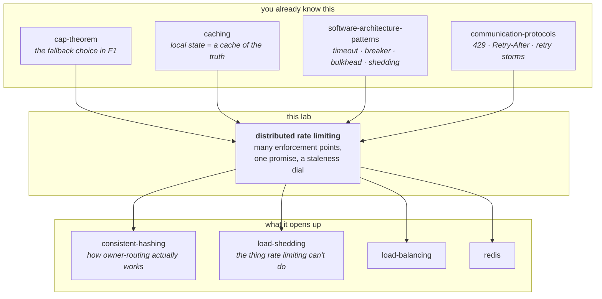

# Distributed Rate Limiting — one promise, twenty people enforcing it

> **Tell a friend:** An office gives every employee one free breakfast plate an
> hour, and Arjun behind the counter enforces it perfectly with a notebook. Then
> the office opens twenty counters, and Meera walks down the line taking a plate
> from every one of them. Nobody broke a rule. The rule simply stopped being
> enforceable the moment there was more than one clerk. Your rate limiter is
> Arjun: exactly right on one machine, and quietly letting through twenty times
> the limit on twenty. The fix is not a cleverer counting algorithm. It is
> deciding how out of date each clerk's view of the shared register book is
> allowed to be, and this lab prices every point on that dial.

Run the twenty counters yourself in [`visualization.html`](visualization.html):
pick a coordination design, kill the store, watch the scoreboard. What this lab
is, what it is not, and where every number came from is stage 19.

---

# BEGINNER MODEL — stages 1 to 9

## 1. What goes wrong if nobody builds this?

> **In one breath:** Sending Asha a request costs a stranger nothing. Serving it
> costs Asha real money. So one stranger with a broken loop can spend everything
> she has, and the customers who did nothing wrong get nothing back.

Asha runs an online payments service. Anyone on the internet can send it
requests. Sending one costs the sender almost nothing. Serving one costs Asha a
database query, a call out to the card network, and a slice of a CPU.

That asymmetry is the whole problem.

One caller with a bad `while` loop. One customer's misconfigured retry. One
person trying to guess passwords. Any of the three, and Asha's service spends
all of its capacity on them. Everyone else gets slow responses or errors, and
everyone else is the customers who were behaving perfectly.

Asha did not get attacked. She got *crowded out*.

A rate limiter is the thing that says "you, specifically, have had enough for
now" so that everyone else keeps working. Without one, four things happen, and
none of them look like a security incident on the dashboard.

| What Asha loses | What it looks like on an ordinary Tuesday |
|---|---|
| The service itself | One bad client, and every customer sees timeouts |
| The budget | The cloud bill tracks abuse instead of business |
| Fairness | A paying customer's traffic is starved by a free one |
| A product | She cannot sell "10,000 calls a month" because she cannot enforce it |

That last row is the one people miss. A limit you cannot enforce is not a
weaker promise. It is not a promise at all, so it cannot be sold, written into
a contract, or defended when a customer complains.

## 2. Why does one plate an hour become twenty?

> **In one breath:** A rule that one person can enforce with one notebook stops
> being a rule the moment two people are enforcing it from two notebooks.

A large office gives every employee **one free breakfast plate per hour**.

At the start there is one counter. **Arjun** stands behind it with a notebook.
Someone walks up, Arjun looks up their name, sees whether they already took a
plate this hour, and either hands one over and writes it down, or says "come
back later".

This works perfectly. Arjun's notebook is the truth. Arjun is the only person
who can change it. Nobody gets two plates.

Then the office grows to 5,000 people. The queue at Arjun's counter is now
forty minutes long. So the office does the obvious thing. It opens **twenty
counters**, with twenty clerks, and puts **Ben** on the door to send each
arriving person to whichever counter is free.

**Meera** works out what has happened before anyone else does. She takes a plate
from Arjun. Then she walks to **Bela**'s counter and takes another. Then a third
from the counter next to Bela's. Bela has no idea. Bela's notebook has never
heard of Meera.

> **🔮 Predict:** *Twenty counters, twenty clerks, every clerk following the
> one-plate rule exactly. How many plates can Meera walk out with in one hour?*
> <details><summary>Reveal</summary>
>
> **Twenty.** One per counter, because each notebook is a separate memory of who
> has eaten.
>
> If you said one, you assumed the rule lives in the office. It does not. It
> lives in Arjun's notebook, and there are now twenty notebooks that have never
> spoken to each other.
>
> If you said "somewhere between one and twenty, depending on luck", you are
> closer. You have also found the thing that makes this hard. The number depends
> on how Ben spreads people across counters, and stage 4 turns that into the
> second, nastier failure.
> </details>

Twenty counters means twenty plates per hour per person, not one.

Nobody wrote a bug. Every clerk followed the rule exactly. The rule itself
stopped being enforceable the moment there was more than one clerk. Hold that
sentence; it is the thesis of the whole lab.

## 3. What does every engineer build first?

> **In one breath:** You keep the count in a variable inside your program. It is
> fast, it is correct, and it is correct for exactly as long as there is one
> program.

The naive solution keeps the counter in the application, as a hash map from
customer to a count, in memory, in the service process. It deserves that name
kindly, because it is the right first move:

```
if (counts.get(customerId) >= 100) return TOO_MANY_REQUESTS;
counts.increment(customerId);
```

This is Arjun with his notebook, written in Java. No network call. Nanoseconds.
No extra infrastructure to run, pay for, or page anybody about.

It is genuinely correct and genuinely fast. It is the right answer for exactly
as long as there is one process.

## 4. What breaks the moment there are twenty copies?

> **In one breath:** You configured one hundred requests a minute. Your
> customers get two thousand, and the number changes every time the cluster
> grows.

Asha is running for real, so she runs **20 instances** behind Ben the load
balancer. The limit she configured is 100 requests per minute. The limit her
customers actually experience is **2,000 per minute**, because each instance
enforces 100 independently and Ben spreads each customer's traffic across all of
them.

That is the visible failure. Here is the deeper one:

> **The limit is a property of the whole system, but the state that enforces it
> lives inside one process.**

And it gets worse in ways that are not just "off by 20×". Read the middle
column as the thing Asha would actually see happen.

| What happens | What Asha sees | Why it is worse than the 20× |
|---|---|---|
| Autoscaling takes 20 instances to 60 at peak | The effective limit silently triples | It triples at exactly the moment she most needed it to hold |
| A rolling deploy restarts every instance | In-memory counters gone, everyone gets a fresh 100 | An abuser only has to wait for her next release |
| Sales asks for "100 requests/minute" in a contract | She cannot write it down honestly | The real number depends on deployment topology |

**🔮 Predict:** *The obvious fix is to give each of the 20 instances a limit of
5, so 20 × 5 = 100. Does that work?*

<details><summary>Reveal</summary>

The ceiling becomes correct, and that is real progress — you will never exceed
100 again. But you have created the opposite error.

Ben does not send each customer's traffic evenly to all 20 instances. **Priya**
sends 60 requests a minute, and 40 of them happen to land on instance 7.
Instance 7 allows 5 and rejects 35, while the other 19 instances sit there
holding 95 unused allowance with Priya's name on it.

So Priya is told "limit exceeded" at 5% of the limit she was sold. You have
traded **over-admission** (letting too many through) for **under-admission**
(rejecting traffic you promised to serve).

Under-admission is often the worse bug. Over-admission shows up as a capacity
problem you can see on a graph. Under-admission shows up as a support ticket
from a customer who is being lied to.

If you said "yes, that works", you were reasoning about the ceiling only. The
ceiling is half the promise. The other half is that Priya gets what she paid
for.

Hold onto this pair. Meera getting twenty plates and Priya being turned away
with plates going spare are the two ends of the axis the entire design lives on.
</details>

## 5. What are we actually asking for, in plain words?

> **In one breath:** Many machines must keep one promise, on every request, fast
> enough that nobody notices, without becoming the thing that breaks.

Say it in plain words, because everything after this is the pursuit of it:

> **Many independent machines must enforce one shared promise, on every single
> request, fast enough that nobody notices, and the enforcement must not itself
> become the thing that breaks.**

Four clauses, and five sources of difficulty, because the last clause carries
two. Read the right-hand column as "why you cannot just do the obvious thing".

| Clause | Why it is hard |
|---|---|
| *many independent machines* | The state is shared, so somebody has to coordinate |
| *one shared promise* | Coordination has to be correct, not approximately correct |
| *on every single request* | Whatever you build runs 100% of the time, at full traffic |
| *fast enough* | It sits in front of the user; every millisecond is added to every call |
| *must not become the thing that breaks* | It is now a dependency of everything. If it dies, does your API die with it? |

Notice the tension. Clause 2 pulls one way and clauses 3, 4 and 5 pull the
other. Perfect coordination means Arjun walks to the shared book on every single
plate. Walking on every plate is slow, expensive, and a new way for the whole
counter to stop.

## 6. What is the one idea the whole design turns on?

> **In one breath:** The place that decides and the place that knows cannot be
> the same place. So every decision is made from a slightly old copy of the
> truth, and how old is a number you choose.

> **Separate the place where the decision is made from the place where the
> truth lives — and then choose, deliberately, how out-of-date each decision
> point is allowed to be.**

That second half is the part people miss. There are many places where a decision
happens: Arjun's counter, Bela's counter, eighteen more. There is one logical
truth. They cannot be in the same place, so every clerk is working from a
slightly old copy.

**How old you let that copy get is a dial, not a bug.** Turn it to zero and you
get perfect enforcement at maximum cost and maximum fragility. Turn it up and
you get cheap, fast, resilient enforcement that is slightly wrong.

Distributed rate limiting at scale is choosing where on that dial to sit — per
limit, not per system. Asha's billing limit and her abuse limit will sit at
different points on the same dial, in the same cluster, on the same afternoon.

Here is the road from here, and what you can do at the end of each stretch.

| Layer | Stages | After it you can… |
|---|---|---|
| Beginner | 1–9 | say why one machine's limiter breaks on twenty, and name both errors |
| Intermediate | 10 | design the system: size it, place it, key it, and coordinate it |
| Engineering | 11–12 | defend it under failure and say which guarantee each break bends |
| Production | 13–15 | say what real systems ship and what the on-call engineer watches |

## 7. Which words are being used as if they were one?

> **In one breath:** Half a dozen different mechanisms all end with somebody
> being told no. They are not interchangeable, and knowing which is which is
> most of the design.

This is the terminology stage, and it is deliberately not a dictionary. Each
word below is a thing that has already happened to Arjun, Meera, Priya or Ben.
The precise definitions are collected again in the glossary at stage 18.

### Which four words all end with somebody being told no?

A **rate limit** is a cap on how often someone may do something. Precisely: a
maximum number of accepted operations per identity per unit of time. Asha's
promise is that `merchant_42` may call `POST /payments` 100 times per minute,
every minute, forever.

The word exists to separate a cap on *rate* from a cap on *total*. A cap on the
total is a **quota**: 100 ever, or 100 GB this month, and when it is gone it is
gone. A rate refills. That difference decides whether an exhausted customer
waits sixty seconds or opens a support ticket.

**Throttling** means slowing someone down rather than refusing them. Precisely:
delaying or queueing the excess instead of rejecting it. The word exists because
"rate limit" is casually used for both behaviours, and they fail in opposite
ways. Rejecting is instant and pushes the problem to the client. Delaying keeps
the request and spends your memory and the client's patience instead. Reject
now, or accept and delay: that comes back as a real architectural choice in
10.6.

**Load shedding** is dropping requests because *you* are struggling, whoever
sent them. Precisely: rejecting traffic based on server health rather than on
caller identity. Your `load-shedding` lab is Ben looking over his shoulder at
the waiting room; a rate limiter is Ben checking a list. A rate limiter protects
fairness between callers and is configured in advance. Load shedding protects
survival and reacts to this second. You need both. A rate limiter alone will
happily let 10,000 well-behaved customers, each inside their limit, collectively
melt Asha's database.

| Word | The question it asks | Where you have met it |
|---|---|---|
| Rate limit | are you over your allowance for this minute? | stage 2, Arjun's notebook |
| Quota | have you used up your total for the period? | this section, and stage 18 |
| Throttling | how do I slow you down instead of refusing you? | 10.6, policer versus shaper |
| Load shedding | can I finish what I already have? | 12, the thing this design cannot do |

### Who decides, and where does the truth live?

An **enforcement point** is the machine that actually says yes or no. Precisely:
the component in the request path that evaluates the limit and can reject. Arjun
is one. Bela is another. Each of Asha's 20 API gateway pods is one. The word
exists because in a distributed limiter there are many of these and only one
source of truth, and confusing the two is the central error of the whole
subject.

The **counter store**, also called the decision store, is the shared place that
remembers how much everyone has used. Precisely: the datastore holding per-key
limiter state, readable and writable by every enforcement point. In the office
it is the register book. In Asha's system it is a Redis cluster holding
`merchant_42:payments → {tokens: 37.2, lastRefill: …}`.

A **key**, also called a limit dimension, is *who* the limit applies to.
Precisely: the string identifying one independent bucket of allowance. In the
office it is a person's name. The counting itself is trivial; almost all the
design judgment is in choosing this string. `merchant_42` is one key,
`merchant_42:POST /payments` is a different and narrower key, and both can exist
at once with different limits. This gets its own stage:
[10.5](#105-what-is-the-key-the-most-underrated-decision).

### What are the two opposite ways to be wrong?

**Over-admission** is letting more through than you promised. Precisely: the
true number accepted in some window exceeds the configured limit. It is Meera
with twenty plates. Limit 100/min, 20 uncoordinated nodes, actual 2,000/min, so
20× over-admission.

**Under-admission** is rejecting traffic you promised to serve. Precisely:
rejecting a request while the global limit had unused allowance. It is Priya
turned away at instance 7 while nineteen other instances hold her unused 95.

Both words exist because they are *different failures with different victims*.
Over-admission hurts Asha, in capacity and cost. Under-admission hurts Asha's
customer, by breaking a promise. Every coordination design in stage 10 trades
one against the other, and you cannot have neither.

### Which two dials does the rest of the lab turn?

**Fail-open or fail-closed** is what an enforcement point does when the counter
store is unreachable: let everyone in, or nobody. Kiran has gone home sick and
the clerks must still serve breakfast. The term exists because there is no safe
default. Fail-open on a limit that guards Asha's database turns a Redis blip
into a stampede. Fail-closed on a limit that guards a nice-to-have turns the
same blip into a total API outage.

A **hot key** is one entry that everyone hammers. Precisely: a single key whose
request rate exceeds what one store partition can serve, and a store partition
is one CPU core. **Dev** is Asha's biggest merchant and does 8,000 rps by himself, and
every one of those requests touches the one entry `merchant_42`. Sharding a
datastore spreads *keys* across machines, so it does nothing at all for a single
key. Stage 11's F3 is this failure with numbers on it.

The **staleness budget** is how out-of-date a node's view is allowed to be.
Precisely: the maximum age of the shared state a decision may be based on. This
is the dial from stage 6, and naming it as an explicit number is the single most
useful thing you can do in a design review for this system.

| Term | The one-line version | Where the thing happened |
|---|---|---|
| Enforcement point | the machine that says yes or no | stage 2, Arjun and Bela |
| Counter store | the shared book everyone reads | stage 8, Kiran in the middle of the room |
| Key | which bucket of allowance you spend from | 10.5 |
| Over-admission | more got through than you promised | stage 2, Meera's twenty plates |
| Under-admission | you refused someone who had allowance left | stage 4's reveal, Priya at instance 7 |
| Staleness budget | how old a decision's information may be | stage 6, and 10.7 makes it a number |

## 8. Which two pictures should you carry?

> **In one breath:** One picture is twenty clerks and one register book in the
> middle of the room. The other is the same thing with three kinds of wire
> drawn separately, because those wires have completely different jobs.

Carry both mental models. The first one you can hold in your head during an
argument. The second one tells you which wire to change.

### What does the simple picture look like?

The office breakfast counter, grown up.

Twenty clerks, each at their own counter, each able to hand out a plate. In the
middle of the room **Kiran** sits with the one register book that records what
everyone has taken. Every clerk can walk to Kiran. Walking takes time, and while
Arjun is walking, the other nineteen are still serving people.

Every design in this document is an answer to one question: *how often does a
clerk walk to Kiran, and what do they do while they are not there?*

### What does the engineer's picture look like?

Same room, real names. Read the dotted lines first; they are the only part of
this diagram that is genuinely up to you.



Three planes live in that picture, and they are worth naming separately because
they have completely different requirements.

The **data plane** is client to gateway to backend. It carries every request,
microseconds matter, and it must never be down.

The **coordination plane** is gateway to counter store: the dotted lines to
Kiran. *This is the entire subject of this lesson.* How much of it exists at all
is your design.

The **control plane** is rules to gateways: which customer has which limit. It
changes rarely, is read constantly, must be cached locally, and must survive its
own outage. **Omar** owns it, and 10.10 is his stage.

### How do the two pictures map onto each other?

Three small tables rather than one long one, because these are three different
kinds of thing. Start with the people and the places.

| Breakfast counter | Engineering | Note |
|---|---|---|
| A clerk at a counter | Gateway node / enforcement point | Many of them; each can say no |
| The host at the door | Load balancer | Decides which clerk you get — and this matters more than it looks |
| Kiran's register book | Counter store (Redis) | The single logical truth |
| A clerk's own scratch notes | Node-local cached state | Fast, and always slightly wrong |

Then the promise itself, and every way a clerk can stay in touch with Kiran.

| Breakfast counter | Engineering | Note |
|---|---|---|
| "One plate per person per hour" | Limit + window | The promise |
| A person's name | Key | Which bucket of allowance |
| Walking to Kiran and back | Store round trip | ~1 ms in-AZ, ~10 ms cross-AZ, ~80 ms cross-region |
| Taking a block of 10 tickets from Kiran at once | Batched lease | Fewer walks, some tickets wasted |
| Clerks shouting tallies across the room every 5s | Periodic sync / gossip | No walking at all, everyone slightly behind |

And finally the three ways the room goes wrong.

| Breakfast counter | Engineering | Note |
|---|---|---|
| Meera taking a plate at every counter | Over-admission | The stage-4 failure |
| A clerk turning someone away while another has spare plates | Under-admission | The stage-4 *reveal* failure |
| Kiran goes home sick | Counter store outage | Fail-open, fail-closed, or degrade |

### Where does the story lie to you?

Four places. Each lie is a real design consideration that the office hides.

**Walking is slow but reliable; networks fail silently.** Arjun always comes
back from Kiran's desk. A store call can hang for 30 seconds and then time out,
which is far worse than a fast failure, because the request thread was held the
whole time. In the office, coordination has a cost. In reality it has a cost
*and* a failure mode, and the failure mode is what wakes Asha at 3am. Stage 11,
F4 — and F2 is the one that actually takes her down.

**Kiran is one person; Redis is one process per shard.** That is nearly the same
thing, for a different reason. The office makes the bottleneck look like a queue
at the book. The real bottleneck is that a single key lives on a single core, so
adding machines to a Redis cluster does nothing at all for Dev's flash sale.
Stage 11, F3.

**Everyone in the office shares one clock on the wall. Servers do not.** Two
nodes can disagree about what time it is by tens of milliseconds, or, when NTP
misbehaves, by minutes. Every window-based limit depends on nodes agreeing where
the window boundary is. Stage 11, F5.

**People arriving at counters are independent. Requests are not.** When Asha's
backend slows down, clients time out and retry, so *rejected traffic comes
straight back*. The office has no equivalent of a rejected person instantly
rejoining the queue and bringing a friend. This is why the limiter's response
format, `Retry-After` included, is a load-bearing part of the design rather than
a nicety. Stage 11, F7.

## 9. Where can you break the counter yourself?

> **In one breath:** The page is a room full of clerks you can reconfigure. Pick
> a design, change how many clerks there are, then kill Kiran and watch what
> each fallback does to the numbers.

Open **[`visualization.html`](visualization.html)** (also published as an
artifact — link in the chat message).

It is an architecture simulator, not an animation. You choose a coordination
design, a number of gateway nodes, and a load-balancing policy. Traffic flows.
The scoreboard shows the four numbers that decide every real design.

| What the scoreboard shows | The question it answers |
|---|---|
| Admitted vs the promise | is it over-admitting, under-admitting, or exact? |
| Store operations per second | what does this design cost Kiran? |
| Added latency | what does it cost every single user request? |
| Behaviour when the store dies | press the button and find out |

Start with *"Run the whole story"*, which walks the seven designs in order with
narration. Then go back and break things yourself. Before each scenario the page
asks you to predict; predicting first is most of the value.

> **✅ CHECKPOINT — end of the BEGINNER model.**
> You can now explain why a rate limiter that works on one machine stops working
> on twenty. You can name the two opposite ways it can be wrong, over-admission
> and under-admission. And you can say what the central trade is: how stale each
> enforcement point's view of the truth is allowed to be.
> **Next:** the actual design — requirements, capacity numbers, where the
> limiter physically sits, and the seven coordination options with their real
> costs.

> **Say it back.** Without using the words *distributed*, *state* or
> *coordination*, explain to a friend why Asha's limiter was correct in staging
> and lets through twenty times the limit in production.
> <details><summary>A good answer sounds like</summary>
>
> "In staging there was one clerk with one notebook, so the notebook was the
> truth. In production there are twenty clerks, and each one only remembers the
> people who came to *their* counter. Meera can eat twenty breakfasts because
> nobody in the room has the whole picture. Nothing is broken; there just is no
> longer a single place that knows the answer."
> </details>

# INTERMEDIATE MODEL — stage 10

## 10. How would you actually design this?

> **In one breath:** Pin what it must do, work out how big it really is, and
> decide where it physically sits. Then spend almost all your time on the one
> hard part, which is how often a clerk walks to Kiran.

We will build it the way Asha would in a design review. Requirements first,
then the size of the thing, then its physical position, and then coordination,
which is where the lesson actually lives.

### 10.1 What must it do, and how well?

A worked example makes every later number concrete. Ours is Asha's **payments
API**.

Five things it must do:

1. Reject requests that exceed a configured limit, with `429 Too Many Requests`.
2. Let Omar configure limits per identity, per endpoint group, and per plan tier
   (free / standard / enterprise), taking effect within about a minute of being
   changed.
3. Apply several limits to one request at once (per-merchant AND per-endpoint
   AND per-IP) and reject if **any** of them is exceeded.
4. Tell a rejected client *when* to come back (`Retry-After`), and let a
   succeeding client see how much it has left (`X-RateLimit-Remaining`).
5. Charge expensive endpoints more. A bulk report is not one unit of work, so
   limits are spent in weighted **cost**, not raw request count.

Now the numbers Asha has to commit to, which is where the design is actually
decided. The third row is the one people forget to ask about.

| Requirement | Target | Why this number |
|---|---|---|
| Added latency | **p99 < 5 ms** | The API's own p99 budget is 150 ms; the limiter runs on every call and must be invisible |
| Availability | **higher than the service it protects** | It is in the path of 100% of traffic. If it is less available than the API, it *is* the API's availability |
| Accuracy | **exact for billing limits, ±5% acceptable for abuse limits** | Different limits genuinely deserve different answers — see 10.7 |
| Throughput | **40,000 rps peak** | Derived below |
| Scale-out | Adding gateway nodes must not change the effective limit | The stage-4 failure, stated as a requirement |

That accuracy row unlocks the whole design. "How accurate does this limit need
to be?" is a product question, not an engineering one. Asha will get a different
answer for Priya's billing limit than for Dev's abuse limit, in the same system,
on the same day.

### 10.2 How big is this thing, really?

Rough numbers, done out loud, because they decide the architecture.

Start with traffic.

```
1 billion API calls/day
  ÷ 86,400 s              = ~11,600 rps average
  × 3.5 peak-to-average   = ~40,000 rps peak
```

Each request is checked against 3 limit dimensions (merchant, endpoint, IP), so
the coordination plane sees three times the request rate:

```
40,000 rps × 3 dimensions = ~120,000 counter checks/sec at peak
```

Now state size, which is the surprise.

```
2,000,000 merchants total
  ~150,000 active in any peak minute
  × 3 dimensions          = ~450,000 live counters
  × ~120 bytes each       (token bucket = 2 numbers, plus key + store overhead)
                          = ~54 MB
```

Even if Asha keeps *every* merchant resident, 2M × 3 × 120 B is about **720
MB**. That fits in one commodity machine's RAM with room to spare.

**🔮 Predict:** *Which one forces Asha into a distributed store first: memory,
or throughput?*

<details><summary>Reveal</summary>

**Throughput. Memory is never the constraint here, and this inverts how people
instinctively design it.**

If you said memory, you were reasoning by analogy with every other data store
you have built, where "two million customers" means shard it. Here the entire
working set is 54 MB, and the entire keyspace is 720 MB. One machine holds it.

> **The single most useful thing to notice in this whole document: memory is
> never the constraint. Throughput and latency are.**
>
> Asha is not building a big distributed database. She is building a very small,
> very hot one. That is why the answer is a Redis-shaped thing and not a
> Cassandra-shaped thing, and why every hard problem below is about *access*,
> not *storage*.
</details>

That conclusion decides the store. A single Redis shard is single-threaded and
realistically serves **~50,000 scripted operations/sec**, because an atomic
limiter check is a small Lua script rather than a bare `GET`. So 120,000
checks/sec needs at least 3 shards for raw throughput, and Asha would run ~6 for
headroom and failover.

Then the latency budget, which is the other half of the same story. Read the
right-hand column against the 5 ms target from 10.1.

| Hop | Typical p99 | Fits in a 5 ms budget? |
|---|---|---|
| Same-host (sidecar / in-process) | ~0.05 ms | Trivially |
| Same availability zone | ~1–2 ms | Yes, with room for one call |
| Cross-AZ | ~5–10 ms | No — already blows the budget |
| Cross-region | ~70–150 ms | Absolutely not |

Two conclusions fall straight out of that table, and they are structural rather
than a matter of taste.

**One store call per request is affordable, but only one, and only in-AZ.** Any
design needing two round trips is dead on arrival, which quietly kills the most
obvious design in 10.7.

**Cross-region coordination on the hot path is impossible.** Not slow.
Impossible. This is why every global limit is really a set of regional limits.
See 10.9.

### 10.3 Where does the limiter physically live?

> Before any algorithm, decide the physical placement. It determines how many
> enforcement points exist, and therefore how bad the coordination problem is.

Five places it could go, from the client's machine to deep inside the service.

```mermaid
flowchart TB
    subgraph P1["① In the client SDK"]
        direction LR
        c1[Client] --> c2[limit check]
    end
    subgraph P2["② At the edge / CDN / L7 load balancer"]
        direction LR
        e1[Client] --> e2[Edge PoP] --> e3[Origin]
    end
    subgraph P3["③ In the API gateway"]
        direction LR
        g1[Client] --> g2[Gateway] --> g3[Services]
    end
    subgraph P4["④ In a sidecar next to each service"]
        direction LR
        s1[Service] --> s2[Sidecar] --> s3[Store]
    end
    subgraph P5["⑤ In the service code itself"]
        direction LR
        v1[Service + library] --> v2[Store]
    end
```



The second column is the one that matters: it is the number of Arjuns.

| Placement | Enforcement points | Protects | Fatal weakness |
|---|---|---|---|
| ① Client SDK | Every client | Nothing you control | The client is the attacker. Useful only as politeness — a well-behaved SDK backing off — never as enforcement |
| ② Edge / CDN | 100s of PoPs worldwide | Everything, including your bandwidth bill | Coordination across PoPs is cross-region → impossible on the hot path. Must be approximate |
| ③ API gateway | 10s of nodes, one region | All services behind it | Cannot see limits that depend on service-internal facts (e.g. "this merchant's balance is low") |
| ④ Sidecar | One per service instance | Per-service limits, including service-to-service | Most enforcement points of any option → the hardest coordination |
| ⑤ Service library | One per instance | Just that service | Duplicated in every service, in every language, redeployed to change |

**Asha's choice: ③ the API gateway, with ② at the edge for crude volumetric
protection.** Three reasons.

The gateway is already in the path, already terminates TLS, already
authenticates. So it already knows *who* the caller is, which is exactly what a
key needs. Doing the check anywhere earlier means doing it before you know the
identity, which limits you to IP-based limits.

There are tens of gateway nodes, not hundreds. Twenty Arjuns is a hard
coordination problem. Six hundred is an intractable one.

The edge tier is not trying to be accurate. Its job is to absorb the 10-Gbps
garbage flood so it never reaches the gateway. Crude and approximate is the
correct answer there.

That gives a general rule worth stating out loud: **layer your limiters, and let
each layer be as accurate as its position allows.** Edge is approximate and
huge. Gateway is accurate and per-customer. Service is precise and narrow.

### 10.4 What happens to one request, step by step?

> **Read the note in the middle of the diagram.** Everything above it is
> bookkeeping; that one step is the subject of 10.7.



Two details there are easy to skim past and expensive to get wrong.

**The rules lookup is local.** It is served from an in-memory cache on the
gateway, and it must never be a network call. Omar's control plane, and why that
cache must outlive its own source, is 10.10.

**All three limits are checked in one call, not three.** Three round trips would
triple both the latency and the load on Kiran. Worse, it would leave a
partial-consumption bug: if limits 1 and 2 pass and limit 3 fails, you have
already spent quota from 1 and 2 on a request you then rejected. Check them
together, consume only if all pass.

### 10.5 What is the key? (the most underrated decision)

> **In one breath:** The counting is a hundred lines of code. The string you
> count *against* is where real systems go wrong, and almost nobody discusses
> it.

A key is the string identifying one independent allowance. In the office it is
the name Arjun looks up. Here are the candidates, with the way each one fails.

| Key | Good for | Fails at |
|---|---|---|
| IP address | Anonymous endpoints, crude abuse control | 50,000 users behind one corporate NAT share a limit; an attacker with a botnet has 50,000 keys. Both errors at once |
| API key / merchant ID | Everything after authentication | Requires the caller to be authenticated first — useless for login and signup endpoints |
| User ID | Per-human fairness | A single merchant's server-side integration is one API key and many users |
| API key + endpoint group | Stopping one expensive endpoint from eating the whole allowance | More keys, more counters, more configuration to explain |
| Global (one key for an endpoint) | Protecting a specific fragile downstream | It is a hot key by construction — every request touches it. See F3 |

Three rules follow, and each of them came from a real incident.

**Limit on the most specific identity you can authenticate, and fall back
outward.** Authenticated merchant, then API key, then IP, in that order.
Anything keyed on IP is both too coarse and too easy to evade, so use it only
where you genuinely have nothing better. That means the unauthenticated
endpoints, and nothing else.

**Login endpoints need two keys at once.** Key on IP, which stops one host
trying many accounts, *and* on the target username, which stops a botnet trying
one account. Either alone is trivially bypassed. This is the single most common
rate-limiting design bug in production systems.

**Charge by cost, not by count.** "1,000 requests/minute" means something wildly
different for `GET /ping` and `POST /bulk-settlement`. Give each endpoint a
weight and let one request consume 20 units. Otherwise the limit does not
correlate with the thing you were actually protecting.

**🔮 Predict:** *Asha's limit is keyed on the API key. Dev's integration is
deployed across 12 of his own servers, all sharing one API key. He complains
that his traffic is being rejected even though "each server is well under the
limit". Whose bug is this?*

<details><summary>Reveal</summary>

Nobody's — it is a *key granularity* mismatch, and it is a product conversation,
not an engineering one.

If you said "Dev's, he should shard his own traffic", you are technically right
and commercially wrong. If you said "Asha's, the limiter is broken", look again:
it is enforcing exactly what was sold.

The limit is per API key, which is exactly what Asha sold him. Dev's mental
model is per server. The system is behaving as specified; the specification does
not match how the customer deployed.

The available fixes are all product decisions, which is why this belongs in a
design doc:

- Let Dev mint sub-keys, one per server, each with its own allowance. Clean, and
  it makes key granularity match deployment granularity.
- Raise the limit on that key and let him self-distribute. Simple, but Asha has
  now lost the ability to protect against *his* runaway server.
- Charge by cost, so his cheap health-check traffic stops consuming the same
  allowance as his expensive calls.

The engineering lesson: **the key is a contract with the customer about how they
may deploy.** Choose it knowing that, and document it. A limiter whose key
granularity surprises the customer generates support load forever, no matter how
correct the counting is.
</details>

### 10.6 Which counting algorithm?

> **In one breath:** Six ways to count the same thing. They differ in how much
> they remember per person and in what they do at the edge of a window, and only
> one of those differences changes your architecture.

At this altitude these are six short stories rather than a lecture. Imagine each
one as a different rule written on the front of Arjun's notebook. The runnable
side-by-side is [Appendix A](#appendix-a--the-algorithm-layer-optional) if you
want it.

**Fixed window.** Arjun counts plates per clock hour and resets on the hour.
Meera learns the reset time, takes ten plates at 10:59 and ten more at 11:01,
and walks away with **2× the limit** across the boundary. Two numbers of state,
and an exploitable, predictable flaw.

**Sliding log.** Arjun writes down the exact time of every plate and counts
backwards one hour on each request. Perfectly exact, and the notebook now grows
with *traffic* rather than with people. Measured at our scale in E2, that is
about 74 GB.

**Sliding counter.** Arjun keeps this hour's count, last hour's count, and how
far into this hour we are, then blends them as if last hour's plates were spread
evenly. Three numbers, and about 0.003% of decisions come out wrong. That is
Cloudflare's published figure, and it is a good general default.

**Token bucket.** Arjun keeps a bowl of tokens that refills at a steady drip.
Each plate spends one token; an empty bowl means come back later. Two numbers,
and burst is an explicit dial you can set separately from the rate.

**Leaky bucket, as a queue.** Instead of refusing Meera, Arjun puts her in a
line that empties at a fixed pace. The output is perfectly smooth and nobody is
rejected, but a queue is unbounded latency wearing a disguise.

**GCRA.** The same decisions as the token bucket, stored as a single number: the
earliest time the next plate is allowed. One number of state, and much harder to
explain in a code review. Redis's `CL.THROTTLE` uses it.

Now the one comparison table. The last column is the sentence you would actually
say in a design review.

| Algorithm | State per key | Notable flaw | Use when |
|---|---|---|---|
| Fixed window | 2 numbers | Allows **2× the limit** across a boundary; the bug is exploitable and predictable | Never for real limits; fine for rough metrics |
| Sliding log | **1 timestamp per request** | Exact, but memory grows with *traffic* — about 74 GB at our scale | Small key counts, audit-grade accuracy |
| Sliding counter | 3 numbers | Approximates the previous window as evenly spread; ~0.003% of decisions wrong | A good general default |
| **Token bucket** | 2 numbers | Explicit, controllable burst — which must be tuned separately from rate | **The production default** |
| Leaky bucket (queue) | queue | Zero burst and a perfectly smooth output; it is a *shaper*, so it adds unbounded latency instead of rejecting | Outbound traffic to a partner who will ban you for bursting |
| GCRA | **1 number** | Same decisions as token bucket, harder to explain in a code review | Extreme key counts; Redis `CL.THROTTLE` uses it |

**Asha picks the token bucket** for the gateway, for three architectural reasons
rather than mathematical ones.

Its state is 2 numbers with no per-request growth, so a trip to Kiran carries a
fixed tiny payload no matter how much traffic a key has seen.

Its refill is computed lazily from a timestamp. There is no background timer
sweeping millions of keys, which means a key that goes quiet costs nothing and
can simply be evicted by TTL.

**Burst is a separate, explicit dial from rate.** That matters for real
customers. "100/minute, but you may spend 20 of them at once" is a sentence Asha
can put in documentation. That sentence is the difference between a limiter that
works for bursty integrations and one that generates tickets.

One distinction from those six stories changes your architecture, so carry it
forward.

A **policer** answers yes or no immediately and rejects the excess. It protects
your backend and pushes the problem to the client, who must retry.

A **shaper** accepts the request and releases it later at a steady pace. It
protects the *downstream* and pushes the problem into latency and memory.

Police your public edge, because you can tell strangers to retry. Shape your
outbound calls to partners, because you cannot ask a card network to retry, and
it will suspend you for bursting.

### 10.7 Coordination — how often does a clerk walk to Kiran?

> **In one breath:** Twenty clerks, one book. Every design below is a different
> answer to how often a clerk walks over, and what they do while they are away.

Everything so far was setup. This is the design.

We have 20 gateway nodes, twenty Arjuns, and one logical truth. We will build it
the way you would actually arrive at it: start with what a smart engineer tries
first, and let each version break.

Throughout, the scoreboard is four numbers: **accuracy · store load · added
latency · behaviour when Kiran goes home.**

---

#### v1 — what if every clerk enforces the whole limit?

This is not a design. It is what you get by accident, and it is stage 4.

Twenty nodes each enforce 100/min, so the customer gets **2,000/min**, and the
number changes the moment autoscaling changes the node count.

It is unusable for any limit that is a promise. It is genuinely fine for exactly
one thing: a crude per-node safety valve, such as "no node will ever process
more than 5,000 rps regardless of who is asking". There, the per-node number
*is* the thing you meant.

#### v2 — what if each clerk gets one twentieth?

Give each node `limit ÷ N`. The ceiling is now correct. Asha will never exceed
100 again.

And as stage 4 already showed, the floor collapses. Ben does not spread traffic
evenly, so Priya hits the wall at a fraction of her real limit while unused
allowance sits idle on nodes she never reached.

It also breaks on autoscaling. N changes, so every node's share must change,
which means every node needs to know the current cluster size. You have
accidentally created a coordination problem inside the design whose entire
selling point was having no coordination.

This works only when you can guarantee even distribution *and* a stable node
count. That is rarer than it sounds.

#### v3 — what if the clerks share Kiran's book: read, decide, write?

Now the obvious real fix. Put the counter in Redis. Every node reads it, decides
locally, and writes it back.

Watch what two clerks do when there is one token left.



**🔮 Predict:** *At 40,000 rps with a 1 ms one-way hop to the store, roughly how
often does that overlap happen?*

<details><summary>Reveal</summary>

Constantly. It is the normal case, not an edge case.

If you guessed "rarely, only under contention", you are picturing the office,
where two clerks reaching the book at the same instant is a coincidence. At
these speeds it is not a coincidence; it is the steady state.

The window of vulnerability runs from the moment the read lands to the moment
the write lands: the read's return trip plus the write's outbound trip, so about
**2 ms** here. At 40,000 rps that means roughly **80 requests are inside the
window at any moment**, every one of them reading the same counter value and
spending the same tokens. For a hot key, essentially every decision is made from
a stale read.

This is why "we'll just put the counter in Redis" is not a solution by itself.
The store being shared does not make the operation atomic. The read and the
write are two separate trips, and *the gap between them is where the limit
leaks*.

Worse, it is a bug that scales with success. It is invisible in staging at 10
rps and severe in production at 40,000.
</details>

So v3 is broken. It is also twice as slow as it needs to be, at two round trips
per request, which 10.2 already ruled out.

#### v4 — what if Kiran makes the decision himself?

The fix for the gap is to remove the gap. Send the *decision* to Kiran instead
of fetching his data to the counter. In Redis that is a Lua script, or
`CL.THROTTLE` from the redis-cell module. The script reads, refills, decides and
writes, and no other client ever observes an intermediate state.

One round trip. No race. Exact enforcement across all 20 nodes.

| Scoreboard number | v4's answer |
|---|---|
| Accuracy | **Exact** |
| Store load | 120,000 ops/s — *the full traffic rate* |
| Added latency | +1 round trip (~2 ms p99 in-AZ) |
| Store dies | Every request must decide alone — see F1 |

**This is the correct baseline, and for a great many systems it is also the
final answer.** Do not skip past it looking for something cleverer. If 120k
ops/s fits your store and 2 ms fits your budget, you are done, and everything
below buys efficiency at the cost of accuracy.

Two problems stop it being the answer for Asha.

#### v5 — does sharding fix Dev's flash sale?

The first problem is raw volume. 120,000 ops/s exceeds one Redis shard's ~50k,
so we shard: keys are hashed across 6 shards, and each shard owns a slice of the
keyspace.

That fixes aggregate throughput. It does nothing whatsoever for the limit
`endpoint:POST /payments`, Asha's global 30,000 rps cap. That is **one key**, one
key hashes to **one shard**, and one shard is **one CPU core**. Every request in
the system touches it. Dev's flash sale is the same shape: one merchant, one
key, all the traffic.

> **Sharding spreads keys across machines. A hot key is one key. Adding machines
> cannot help it.** This is the single most important thing to understand about
> scaling a counter store, and it catches everyone who assumes "we're on a
> cluster" means "we scale".

The fix is to split the key itself. Replace `endpoint:POST /payments` with 16
sub-keys `…#0` through `…#15`, each carrying 1/16th of the limit, and have each
node pick one at random per request.

Notice what that is. It is **v2's static division, applied to the store instead
of the nodes**, with exactly v2's weakness back in miniature. A sub-bucket can
be exhausted by chance while its siblings have room, so you under-admit
slightly. The error shrinks as traffic grows, because the random spread evens
out, which is convenient: hot keys are by definition the ones with lots of
traffic.

Sub-key splitting is necessary for any global or per-endpoint limit. Use the
smallest number of sub-keys that fits under one core's capacity, because every
extra sub-key adds under-admission.

#### v6 — what if a clerk takes twenty tickets at once?

The second problem is cost. Even sharded, Asha is doing 120,000 store operations
per second and adding 2 ms to every request. Both are pure overhead.

So change what Arjun asks for. He does not ask Kiran for one token. He
atomically takes a **lease**, which is a block of say 20 tokens. Then he serves
the next 20 requests at his own counter with no walk at all.

Store load drops by roughly the batch size. Latency drops to near zero for 19
requests out of every 20.

**🔮 Predict:** *What does a node do with leased tokens it has not spent when
the traffic moves elsewhere?*

<details><summary>Reveal</summary>

It strands them, and this is the design's real cost.

Arjun takes 20 tokens, serves 3 requests, and then Ben starts sending that
customer to other counters. Those 17 tokens are *already deducted from Kiran's
book*. The store believes they are spent. Bela is told there is no allowance
left while 17 units of it sit unused on a counter nobody is walking to.

If you said "they just go back", that is what you must *build*: a **TTL on the
lease**, so unspent tokens expire and return to the pool after, say, 1 second.
That bounds the damage but does not remove it. During that second the quota
really is unavailable.

Net effect: **v6 under-admits.** Worst-case stranded quota is roughly `N ×
batch`, so 20 nodes × 20 tokens = 400 units in flight. If the limit is 100/min,
that is catastrophic. If the limit is 30,000/s, it is noise.

The rule this gives you: **batch size must be small relative to the limit.**
Leases work beautifully for high limits and are unusable for low ones.

There is a second, sneakier cost. On a key that is *already saturated*, a node
asks for a batch, is granted zero, and has burned a round trip to be told no.
Every rejected request costs a full store call, exactly when the store is
busiest. Production systems fix this with a short negative cache: "this key was
exhausted 50 ms ago, don't ask again yet".
</details>

#### v7 — what if nobody walks to Kiran at all?

The last step. Nodes stop calling the store per request *or* per batch. Each
node counts locally and, every `T` milliseconds, publishes what it spent and
learns the global total. The clerks shout their tallies across the room instead
of walking.

Hot path: **zero network calls, zero added latency.** Store load no longer
depends on traffic at all.

The error is whatever the nodes collectively spend while out of touch:

```
worst-case over-admission  ≈  N × (per-node rate for that key) × T
```

Put Asha's numbers in it. The right-hand column says what each number is.

| Quantity | Value | In words |
|---|---|---|
| N | 20 | gateway nodes, all counting locally |
| per-node rate | 300 rps | a key doing 6,000 rps, spread over 20 nodes |
| T | 500 ms | how long a node goes without telling anyone |
| overshoot | **3,000 requests** | 20 × 300 × 0.5, admitted above the promise |
| as a share of a 30,000/s limit | 10% | fine for an abuse limit, not for a billing one |

Turn the dial the other way. T = 100 ms gives 600 requests of overshoot, which
is 2%, at five times the store load. **That is the staleness budget from stage
6, made numeric.**

**🔮 Predict:** *v7's store load is "N nodes × their active keys ÷ T". Asha has
450,000 live counters and 20 nodes. Sync every 1 second. What is the store load
— and is v7 actually cheaper than v4's 120,000 ops/s?*

<details><summary>Reveal</summary>

**20 × 450,000 ÷ 1 s = 9,000,000 ops/s.** Seventy-five times *worse* than the
per-request design it was supposed to improve on.

If you said "much cheaper, it takes the store off the hot path", you had the
right mechanism and the wrong denominator. Taking the store off the hot path
means the cost no longer scales with requests. It now scales with *keys*, and
Asha has 450,000 of those.

This is the trap in v7, and it is the insight that produces the real
architecture. Look at where each design's cost actually comes from.

**v4, per-request,** costs one trip per request. Priya's key, seen twice a
minute, costs two trips a minute. Cheap, and exact.

**v6 and v7, local plus sync,** cost a trip per key per node per interval,
whether that key saw a million requests or one. Cheap only if the key is busy.

They are cheap in **opposite regimes**. So do not choose between them. Apply
each to the keys it suits.

| Key class | Share of keys | Share of traffic | Design | Why |
|---|---|---|---|---|
| **Cold** (< 1 rps) | ~99.9% | ~40% | v4 central atomic | Few requests each, so per-request cost is tiny — and you get exactness free |
| **Hot** (> 100 rps) | ~0.1% (a few hundred keys) | ~60% | v7 local + periodic sync | Huge traffic, so per-request cost is unaffordable; few keys, so sync cost is trivial |

Run the numbers with Dev and the other 199 busiest keys treated as hot:

```
hot:  20 nodes × 200 keys ÷ 0.5 s   =   8,000 ops/s
cold: 120,000 × 40%                 =  48,000 ops/s
                                       ------------
total                                  56,000 ops/s   (was 120,000)
```

Store load halved. Hot-key contention gone. Added latency removed from the
majority of traffic. And the long tail of customers still gets **exact**
enforcement: Priya and two million others, the ones with small limits where
accuracy matters most.

That two-tier split is the production architecture. It is also why "which
algorithm should I use?" is the wrong question. The interesting decision is
which keys get which *coordination* design.
</details>

#### What if you never need to coordinate — can you route the key to one owner?

Worth naming explicitly, because it is the cheapest correct answer whenever it
is available.

Suppose Ben stops sending people to whichever counter is free, and instead sends
them by name: everyone whose name starts with M always goes to Bela. In
engineering terms, the load balancer routes by **hash of the rate-limit key**,
so every request for `merchant_42` always reaches gateway node 7.

Node 7 then has complete, exact, local state for that merchant. No store. No
coordination. No added latency. The distributed problem simply does not exist.



The costs are real, and they are structural rather than incidental.

**You must control the routing layer, and you can only hash on one dimension.**
Asha needs three simultaneous limits: merchant, endpoint and IP. You cannot
route by all three at once, so at best this covers one of them.

**The owning node is a hot spot.** Dev's entire flash sale now lands on one
node.

**Scaling or losing a node reshuffles ownership.** During the reshuffle two
nodes briefly both think they own a key. That is a short over-admission window
on a scale-up under load, which is exactly the event when you least want one.

**Node 7 dying loses that merchant's counter state entirely.**

Owner routing is excellent for a single dominant dimension in a system where you
own the router. This is essentially how partitioned stream processors handle
per-key state. It is not sufficient alone for a multi-dimensional public API.

#### What does the scoreboard say?

Everything above, at Asha's scale: 40k rps, 20 nodes, 450k live counters, 120k
checks/s. First, what each design costs and how wrong it is.

| Design | Accuracy | Store ops/s | Added latency |
|---|---|---|---|
| v1 independent | up to **20× over** | 0 | 0 |
| v2 divided | up to **20× under** | 0 | 0 |
| v3 read-modify-write | leaks under load | 120,000 | +4 ms |
| v4 central atomic | **exact** | 120,000 | +2 ms |
| v5 sharded atomic | ~exact | 120,000 spread | +2 ms |
| v6 batched lease | under (≤ N×batch) | 6,000 | ~0.1 ms |
| v7 periodic sync | over (bounded by N·r·T) | N × keys ÷ T | **0** |
| owner routing | exact per key | 0 | 0 |

Then what happens when Kiran goes home, and the sentence you would say about
each design in a review.

| Design | On store outage | Verdict |
|---|---|---|
| v1 independent | unaffected | Per-node safety valves only |
| v2 divided | unaffected | Needs even traffic + fixed N |
| v3 read-modify-write | — | **Never.** Broken and slow |
| v4 central atomic | must degrade | **The correct default** |
| v5 sharded atomic | must degrade | Required for hot/global keys |
| v6 batched lease | degrades gracefully | High limits only |
| v7 periodic sync | degrades gracefully | Hot keys only |
| owner routing | unaffected | One dimension, you own the router |

**The design Asha ships:** v5, sharded central atomic, as the default for the
long tail, and v7, local with a 500 ms sync, automatically promoted for keys
that cross a traffic threshold. The tier decision is made per key, and
re-evaluated continuously.

### 10.8 Which store can actually do this?

> **In one breath:** The store must answer in under a millisecond, decide
> without help, forget things by itself — and it does not need to survive a
> restart.

The requirements are unusual, and they rule out most databases.

It needs **sub-millisecond p99**, so it is in-memory. It needs **atomic
read-decide-write**, so it needs server-side scripting or a purpose-built
command. It needs **automatic expiry**, because 450k live counters out of 6M
possible means dead keys must evict themselves, and TTL is not optional.

**🔮 Predict:** *Does the counter store need to be durable — that is, must it
survive its own restart with the counters intact?*

<details><summary>Reveal</summary>

**No, and this is the counter-intuitive one.**

If you said yes, you were treating the counters as data. They are not; they are
a fact about the last sixty seconds, and in sixty seconds they are worthless.

Losing the counters means everyone briefly gets a fresh allowance. That is a
minor, self-healing accuracy incident. Paying for durability on the hot path of
100% of your traffic, to protect data that expires in a minute, is a bad trade.

The consequence is concrete: **run Redis without persistence and treat it as
expendable.** No AOF fsync on the hot path. Replicate for availability, not for
durability. If Asha loses a shard, she loses those counters, and the correct
response is a metric, not a page.
</details>

With those four requirements in hand, the candidates sort themselves out.

| Candidate | Verdict |
|---|---|
| **Redis / Valkey** | The default. In-memory, Lua for atomicity, native TTL, `CL.THROTTLE` if you want GCRA built in |
| Memcached | `incr` is atomic but there is no scripting, so a token bucket cannot be done in one operation |
| Relational DB | Atomicity yes, sub-millisecond at 120k writes/s no. Also: this is the fastest way to turn a rate limiter into an outage |
| Cassandra / Dynamo | Wrong shape entirely — quorum writes cost more latency than your whole budget, and eventual consistency defeats the purpose |
| A dedicated service (gRPC) | What Envoy's RLS does. Adds a hop but centralises the logic and lets you batch. Sensible at large scale |

### 10.9 Can a limit be global across regions?

> **In one breath:** No, not in real time. Physics already decided this in
> 10.2's latency table, so pick which kind of approximate you want.

Cross-region coordination on the hot path is impossible, so a "global" limit
cannot be globally enforced as it happens. Asha chooses one of three, and she
chooses per limit.

| Approach | How | Accuracy | Use for |
|---|---|---|---|
| **Independent regional limits** | Each region enforces the full limit locally | Total = limit × regions | Abuse protection, where the point is per-region capacity anyway |
| **Split the limit** | Each region gets a fixed share (US 60%, EU 40%) | Correct ceiling, under-admits when traffic shifts | Predictable geographic traffic |
| **Async global reconciliation** | Regions enforce locally, stream counts to a global aggregator, which adjusts each region's share every few seconds | Converges; wrong during the lag window | Billing-adjacent limits that must be *roughly* globally correct |

The honest position, and the one to say out loud in a design review: **a global
limit enforced across regions is always approximate.**

If a limit genuinely must be exact and global, it cannot be enforced at the
edge. It must move to whatever single-region component already serialises the
operation, which is usually the database write that actually performs the
action. Rate limiting is not the right tool for a hard global invariant. A
transaction is.

### 10.10 Who decides who gets what limit?

> **In one breath:** Omar's rules are a separate system with a separate failure
> mode, and the gateway must keep working when that system is down.

The limits themselves, which merchant gets what, do not live with the counters.
They live in Omar's control plane.



Three rules, each learned the hard way.

**The rules cache is in memory on every gateway, and it never expires on
failure.** If Omar's service is down, gateways keep using the last snapshot they
have, forever. A config system outage must not become a traffic outage. Stale
limits are almost always better than no limits.

**Snapshots are versioned and applied atomically.** Half-applied rule sets
produce inconsistent enforcement across nodes, which is impossible to debug
because the answer depends on which node you hit.

**Ship a hardcoded default.** A brand-new gateway that cannot reach the rules
service on startup must still enforce *something* sane, rather than starting up
fully open.

### 10.11 What does the client see when you say no?

> **In one breath:** The rejection is part of the design, because it decides
> whether rejected traffic goes away or comes straight back with friends.

```http
HTTP/1.1 429 Too Many Requests
Retry-After: 12
RateLimit-Limit: 100
RateLimit-Remaining: 0
RateLimit-Reset: 12
```

Four things in that little block are load-bearing.

**Send `429`, not `503`.** `503` means *you* are broken, and it tells
well-behaved clients and load balancers to retry aggressively and possibly mark
you unhealthy. `429` means *they* are over their allowance.

**`Retry-After` must be honest.** If Asha says 12 seconds and is still rejecting
at 12 seconds, every rejected client retries in lockstep. She has then built a
synchronised retry storm, with her own header as the synchroniser. Compute it
from the actual limiter state — when will there genuinely be a token? — and
expect clients to add jitter.

**Send the headers on success too.** Priya, who can see she has 4 of 100 left,
can slow herself down. A client that only learns at rejection cannot.

**Return which limit was hit** when several apply. "Rate limited" with no
indication of *which* limit is unactionable, and it generates support tickets
that Asha will answer by reading logs.

> **✅ CHECKPOINT — end of the INTERMEDIATE model.**
> You can now design the system: state the requirements, size it, place the
> limiter, and choose the key and algorithm. Then the real skill: pick a
> coordination design per key class with the cost of each one in front of you.
> **Next:** what breaks in production, and which guarantees survive each break.

> **Say it back.** Asha's colleague proposes "sync every node's counts every
> second, it takes the store off the hot path". In your own words, and without
> using the word *staleness*, say why that made things seventy-five times worse
> rather than better.
> <details><summary>A good answer sounds like</summary>
>
> "Talking once per request costs you one message for each request. Shouting
> your tallies across the room every second costs you one message per *customer
> name*, per clerk, every second — even for the names nobody asked about. There
> are 450,000 names and twenty clerks, and almost all of those names get one or
> two visits a minute. So the shouting is only cheaper for the handful of names
> that are genuinely busy, which is exactly why we do it for those and nothing
> else."
> </details>

# ENGINEERING MODEL — stages 11 to 12

## 11. What are the eight ways this breaks?

> **In one breath:** The happy path was the easy half. Here are the eight things
> that actually happen to Asha's limiter, and the one that takes her down is not
> the one anybody expects.

Each failure below is a short story: how it starts, what Asha sees, and what she
ships to survive it. The whole catalogue is compared in one table at the end of
the stage.

### F1 — what happens when the counter store goes down?

Kiran goes home sick. In engineering terms: the Redis primary fails, a failover
takes 8 seconds, or a network rule change makes the store unreachable from one
availability zone.

**Watch it:** in the visualization, choose *v4 central atomic*, then press **Kill
the store** and try each fallback.

Every enforcement point loses the truth at the same moment. Arjun and Bela and
eighteen others are all suddenly holding notebooks with no register book behind
them. There is no correct answer here, only three choices with different
victims.

| Fallback | Behaviour | Consequence |
|---|---|---|
| **Fail open** | Allow everything | Your API stays up and your backend takes 100% unfiltered traffic — including whatever abuse the limiter was suppressing. A Redis blip becomes a database outage |
| **Fail closed** | Reject everything | Total API outage caused by a component that is not on the critical path of doing any actual work |
| **Degrade to local** | Each node falls back to `limit ÷ N` locally | Neither correct nor catastrophic — you keep serving, roughly within the intended envelope |

Degrade-to-local keeps the ceiling roughly holding: Meera will not get twenty
plates. It loses exactness, and it loses fairness across nodes, because v2's
skew problem comes back for the duration and Priya starts seeing rejections she
has not earned.

Degrade to local is the standard answer, and Asha chooses the fallback **per
limit, not per system**. A limit protecting a fragile downstream should fail
closed *for that endpoint only*. A limit that exists for billing fairness should
fail open, because she can reconcile money later, but she cannot un-reject a
customer's payment. Write the fallback into Omar's rule definition alongside the
limit, so it is a product decision that somebody reviewed, and not a global
default nobody remembers choosing.

### F2 — why is a slow store worse than a dead one?

Kiran does not go home. Kiran gets slow. Somebody runs a `KEYS` command from a
debugging session, or a big key expires, or memory pressure triggers eviction.
The store does not fail. It answers in 400 ms instead of 1 ms.

**🔮 Predict:** *Which is worse for Asha's API: the store being down for two
minutes, or the store answering in 400 ms for two minutes?*

<details><summary>Reveal</summary>

**Slow is far worse, and it is the single most common way a rate limiter becomes
the outage it was built to prevent.**

If you said "down is worse, at least slow is still working", follow the threads.
Every gateway request now waits 400 ms on the limiter. Request threads pile up.
The gateway's connection pool exhausts. Requests that would have been *allowed*
start failing, not because of the limit, but because the thing checking the
limit is holding them. Clients time out and retry, doubling load. Asha's service
is now down, and the component that took it down is the one whose entire job was
to protect it.

> **Slow is more dangerous than down.** Down is detected in milliseconds and
> triggers your fallback. Slow keeps the failure invisible while it consumes
> every resource you have.

The bitter part: limit accuracy is perfect throughout. The limiter is enforcing
beautifully. What it lost was availability, which was the entire point of having
it.
</details>

Asha ships all four of these, not one of them.

An **aggressive timeout on the limiter call** of 5–10 ms, not the library
default. A timeout is treated exactly like F1's outage, and takes the fallback
path.

A **circuit breaker**. After N consecutive timeouts, stop calling the store
entirely for a few seconds and run degraded. This also stops her adding load to
a store that is already struggling.

A **bulkhead**: a bounded, separate connection pool for limiter calls, so
exhausting it cannot starve everything else.

An **alert on limiter latency and fallback rate**, not just on store uptime. The
dashboard question is "what fraction of decisions were made without the store?"
That number going from 0% to 3% is the earliest signal she gets.

### F3 — what happens when one key gets all the traffic?

Dev runs a flash sale and does 15% of Asha's traffic by himself. Or the global
limit `endpoint:POST /payments` is touched by every request in the system, which
it is, by construction.

**Watch it:** in the visualization, set *Traffic shape → one dominant key* and
compare store load per shard.

One key lives on one shard, which lives on one core. Adding shards does nothing.
That core saturates, its latency climbs, and F2 follows it down.

The limit itself stays correct the whole time. What Asha loses is the ability to
scale by adding machines: for that key she has hit a hard ceiling, and no
purchase order fixes it.

The fix is either v5's sub-key split into `k` buckets of `limit ÷ k`, which
reintroduces a little under-admission, or promotion to the local-plus-sync tier.
Promotion stops the key touching the store per request at all. Detect hot keys
continuously, as a top-N by request rate sampled at the gateway, and promote
them **automatically**. A design that requires a human to notice a hot key will
not survive its first flash sale.

### F4 — what happens when the cluster resizes?

Autoscaling adds 20 gateway nodes during a traffic spike. Or a deploy rolls, and
for ninety seconds Asha is briefly running 40.

Anything with a per-node share is now instantly wrong. v2's `limit ÷ N` is
dividing by a stale N, so it is either over-admitting, when nodes think N is
smaller than it is, or under-admitting. v7's error bound `N × r × T` grows with
N precisely when traffic is highest.

Central atomic, v4 and v5, keeps *everything* through this, and that is its
quiet superiority. Kiran does not care how many clerks are in the room. Any
node-share design instead loses the ceiling itself, at exactly the worst moment.

So prefer designs that are indifferent to N. Where you cannot, derive N from the
service registry rather than from configuration, and accept that during a scale
event the limit is approximate. This is a strong argument for keeping the long
tail on v4: **your accuracy should not depend on your deployment topology**,
which was the original complaint back in stage 4.

### F5 — what happens when the clocks disagree?

NTP drifts. A VM pauses for a live migration. Two nodes handle a leap second
differently. Arjun's watch and Bela's watch now disagree by 50 ms, or, when
something is genuinely broken, by minutes.

What that costs depends entirely on *where time is read*, which is why this
failure sorts the designs so cleanly.

| Where time is read | What clock skew does | Which designs |
|---|---|---|
| Inside the store | Nothing. All nodes implicitly agree, because only one clock is consulted | v4, v5 |
| On each node | A node running 5 minutes fast believes far more time has elapsed, refills buckets that should be empty, and hands out free allowance | v1, v2, v6, v7 |
| At a window boundary | Nodes disagree about where the boundary is, so the doubling bug fires at several different moments and smears over-admission across a wider interval | any fixed-window algorithm |

That top row is an underrated advantage of central atomic, and it is rarely
mentioned in design reviews.

Each node still orders its own events correctly. What Asha loses is the global
limit, silently. There is no error, no log line, just more traffic admitted than
she configured.

Read time in one place wherever possible, and let that place be the store.
Monitor clock offset as a first-class metric on every gateway and alert on it.
Prefer **monotonic** clocks for measuring elapsed time locally, because a wall
clock can jump backwards, and a negative elapsed time in a refill calculation
produces spectacular results.

### F6 — what happens to quota a dead node was holding?

Arjun takes 20 tickets from Kiran and is then hit by a bus. In v6 terms: a node
has leased 20 tokens and is killed.

Kiran's book already decremented those 20. Nobody will ever spend them. Every
other node sees less allowance than actually exists. Repeat that across a
rolling deploy, and a meaningful slice of every customer's limit simply
evaporates.

The ceiling survives — this failure never over-admits. The floor does not. Priya
is rejected below her limit, and the cause is invisible both to her and to Asha.

Three remedies. Keep lease TTLs short, about 1 second, sized so stranded quota
stays small relative to the limit. Return the unused lease on graceful shutdown.
And never use leases for small limits, where `N × batch` is a large fraction of
the limit in the first place.

### F7 — how does an honest-looking `Retry-After` build a retry storm?

Asha rejects Priya and tells her when to come back. The retry time is computed
loosely: rounded to the next window, or a fixed constant, or off by a hair.

It goes wrong in two different ways.

**Too early, even slightly.** Priya obeys the header exactly, retries at that
microsecond, and is rejected again, because the token had not *quite* arrived.
She retries again. Asha has created a client that is polling her as fast as her
own header permits. Her logs will show Priya as an abusive client, when Priya is
in fact the only one doing exactly what she was asked.

This is not hypothetical. The algorithm appendix's own test
`retry_after_is_honest_for_every_limiter` failed until floating-point slack was
added to the comparison, because `elapsed × rate` does not land exactly on
integer token counts in binary floating point. A limiter can be arithmetically
wrong by 4 × 10⁻¹⁰ tokens and produce a production retry storm.

**Identical for everyone.** Every rejected client is told "retry in 12 seconds",
so all of them retry in the same millisecond. Asha's own header is now a
synchroniser, converting scattered load into a coordinated spike, once every 12
seconds, forever.

The limit is still enforced perfectly through all of this. What is lost is the
*purpose* of the limit, because total load goes up rather than down: rejected
traffic returns immediately and in lockstep.

So compute `Retry-After` from real limiter state — when will there actually be a
token? — round **up** and never down, add server-side jitter so clients are
spread rather than synchronised, and document exponential backoff for SDK
authors. Rejecting a request is cheap. Rejecting the same request forty times a
second is not.

### F8 — what does one bad rule do?

Omar sets a limit to `0`. Or he ships a rule set with the wrong plan-tier
mapping. Or the publisher pushes a half-written snapshot.

The result is instant, total, correctly-implemented rejection of legitimate
traffic. Every guarantee in stage 12 holds. Nothing is broken. The business is
down.

That is what makes this failure so effective: there is no technical guarantee to
lose, and nothing on the failure dashboards to find.

Asha's defences are all in Omar's plane. Validate rules on write, so a limit of
`0` requires an explicit override flag. Version snapshots and make rollback a
single fast operation. Roll new rule sets out gradually and watch the rejection
rate. And run a **shadow mode**: evaluate a new rule, log what it *would* have
rejected, and enforce nothing.

Shadow mode is the highest-value feature in a rate-limiting control plane, and
it is almost always built after the first incident rather than before it.

### What do the eight failures look like side by side?

Read the last two columns together. The pattern that matters is that no failure
loses everything, and no failure loses nothing.

| Failure | What it costs Asha | Guarantee kept | Guarantee lost |
|---|---|---|---|
| F1 store down | a forced choice between three victims | the ceiling roughly holds, under degrade-to-local | exactness, and fairness across nodes |
| F2 store slow | the API itself, via thread exhaustion | limit accuracy, ironically perfect | availability, which was the whole point |
| F3 hot key | one saturated core, then F2 | correctness of the limit itself | the ability to scale by adding machines |
| F4 cluster resizes | the ceiling, during a scale-up under load | everything, if you are on v4 or v5 | the ceiling, on any node-share design |
| F5 clock skew | free allowance nobody asked for | relative ordering on any single node | the global limit, silently |
| F6 node dies with a lease | a slice of every customer's limit | the ceiling — this never over-admits | the floor, invisibly to everyone |
| F7 dishonest `Retry-After` | more total load than you started with | the limit is still enforced | the *purpose* of enforcing it |
| F8 bad rule | the business, with everything working | all of them | nothing technical; only the service |

## 12. What can you promise, and what can you not?

> **In one breath:** With a sharded atomic store you can promise the ceiling
> holds no matter how many machines you run. You cannot promise fairness, global
> exactness, ordering, or protection from everyone behaving well at once.

### What is guaranteed?

With sharded central atomic, v4 and v5, Asha can put four things in writing.

**The ceiling holds.** In any window, admitted ≤ limit + burst, regardless of how
many gateway nodes exist or how Ben distributes traffic across them.

**Atomicity.** No two requests can both consume the same last unit of allowance.
The decision and the state update are one indivisible step, which is exactly what
v3 did not have.

**Independence.** Dev's traffic cannot consume Priya's allowance. One key's
counter is one key's counter.

**Node-count independence.** The enforced limit does not change when Asha scales,
deploys, or loses a node.

### What is explicitly not guaranteed?

These are the sentences to say out loud in a design review, before somebody
assumes the opposite.

**Fairness within a key.** If Dev's allowance is 100/min, the limiter says
nothing about *which* 100 requests get through. A tight retry loop will
systematically beat a polite client to the tokens.

**Global exactness across regions.** Physically impossible on the hot path. See
10.9.

**Exactness during any degradation.** A store outage, a store timeout, a cluster
resize or clock skew each move you onto a fallback path that is approximate by
design.

**Ordering.** A limiter is not a queue. Requests are not served in arrival order,
and nothing is preserved for later.

**Protection from aggregate load.** Ten thousand customers, each perfectly within
their individual limits, can still overwhelm Asha. Per-key limits do not sum to a
system limit. That needs load shedding as a separate mechanism, and it is the
most common gap in otherwise well-designed systems.

### What did you trade away, and for what?

Every row here is a deliberate purchase, made in the stage named in the last
column.

| You gave up | To get | Where |
|---|---|---|
| Zero added latency | Exactness across nodes | v4: +1 round trip on every request |
| Exactness | Zero latency and low store load | v7: bounded over-admission on hot keys |
| Some of the customer's allowance | Fewer store calls | v6: stranded lease quota |
| Perfect enforcement during failures | Staying available at all | F1's degrade-to-local |
| A globally exact limit | Being able to run in more than one region | 10.9 |

The failure mode of an inexperienced design is not choosing wrong. It is not
noticing that a choice was made.

### Where is the safety-versus-liveness line here?

**Safety** means nothing bad happens: the limit is never exceeded. Central atomic
gives Asha this unconditionally.

**Liveness** means something good eventually happens: allowed requests actually
get served. Fail-closed preserves safety and destroys liveness. Fail-open does
the reverse.

F1's fallback decision is precisely a choice of which one to sacrifice during a
partition. That is the same shape as the trade you saw in the
[cap-theorem](../24-cap-theorem/) lab, applied to your own infrastructure rather
than to a database. This time you are the database, and Kiran is the replica you
cannot reach.

> **✅ CHECKPOINT — end of the ENGINEERING model.**
> You can now defend the design under pressure: name what each failure costs,
> which guarantee it bends, and what you would monitor to see it happening.
> **Next:** how real systems do it, and what this document has left out.

> **Say it back.** A reviewer says "just make the limiter fail closed, then it
> can never be wrong." Answer them in your own words, without using the words
> *safety* or *liveness*.
> <details><summary>A good answer sounds like</summary>
>
> "Failing closed means that when we cannot reach the counter book, we refuse
> everybody. The limit is then never exceeded, which is true and useless: we
> have turned a broken register book into a total outage, and the register book
> was never doing the actual work. What we want instead is for each clerk to
> fall back to a small local share — not exactly right, but still serving. And
> which way we fall is a decision per limit: refuse-everybody is right for the
> limit guarding a fragile downstream, and let-everybody-through is right for
> the one that only decides who gets billed."
> </details>

# PRODUCTION MODEL — stages 13 to 15

## 13. Why is there no code at this altitude?

> **In one breath:** A simulated cluster would teach you the simulation, not the
> design. The layer underneath it does have code, and it is worth an hour.

At the architecture level this lab has none, deliberately. Twenty simulated
gateway nodes in Java would be a program about Java.

What *does* exist, from an earlier session, is the layer underneath: all six
counting algorithms implemented side by side, with tests and experiments. It is
optional, and it is genuinely good for turning 10.6's six stories into something
you have watched behave. See
[Appendix A](#appendix-a--the-algorithm-layer-optional).

## 14. What do the algorithms do when you actually run them?

> **In one breath:** Three questions about counting, each with a number that
> surprises people, and each worth guessing before you look.

These run against the algorithm appendix, so they answer *algorithm* questions
rather than coordination questions. Every block of output below is real, copied
from an actual run rather than described.

```bash
cd 60-distributed-rate-limiting
java src/Experiments.java     # the four experiments
java src/LimiterTest.java     # 12 tests, all passing
```

**🔮 Predict (E1):** *Limit is 10 per second. What is the most a client can
actually get through in some one-second stretch, under fixed window? Under a
token bucket with burst 10?*

<details><summary>Reveal — what the run printed</summary>

```
algorithm             greedy client boundary-timed     WORST CASE   verdict
                      (every 10 ms) (saves for flip)  (max of both)
----------------------------------------------------------------------------
fixed-window                     10             20             20   2.0x over
sliding-log                      10             10             10   holds the limit
sliding-counter                  10             10             10   holds the limit
token-bucket b=10                19             10             19   1.9x over
token-bucket b=1                 10              1             10   holds the limit
gcra b=10                        19             10             19   1.9x over
```

Two things worth carrying into a design review.

Fixed window is only beaten by a client that *knows* where the boundary is, so
the middle column is the attacker's column and the real one. Meera has to learn
the clock.

And the token bucket goes over too, at 1.9×, which is not a bug. `burst` is
permission to exceed the average rate, and `burst = limit` is permission to
double it. If you predicted "the token bucket holds at 10", that is the
assumption to correct. Asha's "100 per minute" limit, with a burst of 100, means
a client may legitimately send 199 in some minute.
</details>

**🔮 Predict (E2):** *Which algorithm's memory depends on traffic rather than on
the number of keys, and how bad does that get?*

<details><summary>Reveal — at 1M keys</summary>

```
sliding-log      per-key state grows with requests   →  74.5 GB
sliding-counter  3 numbers                           → 228.9 MB
token-bucket     2 numbers                           → 152.6 MB
gcra             1 number                            →  76.3 MB
```

The sliding log is the only exact algorithm here and the only one that stores a
timestamp per request. That is the trade in one line, and it is why exactness is
bought at the algorithm layer only for small key counts.

If you expected the differences to be small, look at the ratio: the exact
algorithm costs about a thousand times the memory of the cheapest one that is
nearly as good.
</details>

**🔮 Predict (E3):** *A 200-request thundering herd hits a 50/s limit. Compare a
policer (token bucket) with a shaper (leaky-bucket queue) — which one is
"better"?*

<details><summary>Reveal — what the run printed</summary>

```
token bucket (POLICER, burst 50):
   50 admitted in the same instant, 150 rejected outright
   → backend sees a 50× spike; 150 users see an error

leaky bucket (SHAPER, queue 200):
   200 accepted, 0 dropped; the last one is forwarded at t = 3,980 ms
   → backend sees a perfectly flat 50/s; 0 users see an error,
     but the unluckiest user waits 4 seconds
```

Neither is better, and if you picked one you probably picked the shaper, because
zero errors reads as zero harm. A queue is unbounded latency wearing a disguise.
The unluckiest user waited four seconds for a payment.

This is exactly why 10.6 says police the public edge and shape your outbound
calls to partners.
</details>

## 15. What does a real deployment look like?

> **In one breath:** Every box in this lab has a product name behind it, four
> dashboards tell Asha what is happening, and six dials let her move between the
> designs without redeploying.

### What are the real products behind each box?

| Layer | This design | Real implementation |
|---|---|---|
| Enforcement point | "gateway node" | Envoy + `ratelimit` filter, Nginx `limit_req`, Kong, AWS API Gateway usage plans, Cloudflare Rate Limiting Rules |
| Decision service | "the store" | Envoy's [RLS](https://github.com/envoyproxy/ratelimit) gRPC service over Redis; or Redis directly via Lua / `CL.THROTTLE` (redis-cell, which is GCRA) |
| Local + sync tier | v7 | Google's Doorman (per-client capacity leases), Cloudflare's counter propagation between PoPs, Stripe's tiered limiters |
| Control plane | "rules cache" | Envoy xDS pushing config, or a versioned snapshot in S3 polled by every node |
| Edge tier | "crude volumetric" | Cloudflare / Akamai / AWS Shield, absorbing volumetric floods before origin |

### What did this document deliberately leave out?

Seven pieces of real work that a production system needs and this lesson skipped.
Each one names what handles it instead.

**Distributed quota accounting for billing.** Rate limits are approximate;
invoices are not. Real systems keep a *separate*, durable, exact usage ledger fed
asynchronously, never the limiter's counters. See
[transactional-outbox](../48-transactional-outbox/) and
[event-sourcing](../50-event-sourcing/).

**Authentication and identity resolution.** We assumed the gateway already knows
the caller. Resolving an API key to a merchant and a plan is itself a cached
lookup with its own failure modes.

**Warm-up and cold start.** A fresh gateway node with empty local state behaves
differently for its first few seconds, which is significant during a scale-up.

**Adaptive and concurrency-based limits.** A fixed rate limit is a guess about
capacity. Systems like Netflix's `concurrency-limits` derive the limit from
observed latency, which is a TCP-congestion-control-shaped idea, instead of from
a config file.

**Priority and graceful degradation.** When over the limit, reject the health
checks and analytics calls before the payments.

**Security of the limiter itself.** If a limit is keyed on a header the client
controls, the limit is optional. Key only on values you derived server-side.

**Cost accounting for the store.** 120k ops/s of managed Redis is a real line
item, so the design choice in 10.7 is partly a budget decision.

### What does an on-call engineer actually watch?

Four dashboards, in the order Asha would look at them during an incident.

| # | Dashboard | What a change in it means |
|---|---|---|
| 1 | Rejection rate by limit and by key class | A step change is either an attack or a bad rule (F8). The two look identical for the first minute; the question that separates them is whether the change lines up with a config deployment |
| 2 | Limiter decision latency, p50/p99/p999 | The earliest possible signal of F2, and it moves before anything else does |
| 3 | Fallback rate — decisions made without the store | Should be 0. Anything above 0 means you are running approximate and do not know it |
| 4 | Top-N keys by request rate | Your hot key list (F3), and your best early warning of an emerging abuse pattern |

### Which dials can you turn, and what does each cost?

Every row is a way to move along the same axis: over-admission on one side,
under-admission and cost on the other.

| Dial | Turn it up | Turn it down |
|---|---|---|
| Sync period `T` (v7) | Less store load, more over-admission | Tighter accuracy, more store load |
| Batch size (v6) | Fewer round trips, more stranded quota | Tighter accuracy, more round trips |
| Burst | Bursty clients work, backend sees spikes | Smooth backend, legitimate spikes rejected |
| Sub-key count `k` (v5) | Hot key spread thinner, more under-admission | Less under-admission, hotter shard |
| Hot/cold threshold | More keys exact, higher store load | Lower store load, more keys approximate |
| Store call timeout | Fewer false fallbacks, more F2 exposure | Better outage isolation, more spurious degradation |

> **✅ CHECKPOINT — end of the PRODUCTION model.**
> You can now name the real product behind every box in the architecture. You
> can say what goes on the on-call dashboard, and why in that order. And you can
> turn any of the six dials while saying out loud who pays for it.
> **Next:** the exercises, the map of what this connects to, and the words.

> **Say it back.** Asha's dashboard shows the fallback rate moving from 0% to
> 3%, and nothing else has changed. Explain to a new on-call engineer what that
> number is and why it is the one to act on.
> <details><summary>A good answer sounds like</summary>
>
> "Three percent of our limit decisions were made without asking the shared
> counter — the clerk guessed instead of walking to the book. Nothing is down and
> no alarm has fired, because we deliberately keep serving when the book is
> unreachable. But it means the store is either failing or getting slow for some
> of our calls, and slow is the failure that ends with our own API falling over.
> So we look at limiter latency next, and we treat 3% as the early warning it
> is, not as a rounding error."
> </details>

## 16. Where do you practise this?

> **In one breath:** Eight rungs, from "say it in your own words" to designing
> the whole thing across three regions.

See **[EXERCISES.md](EXERCISES.md)** — eight rungs from "explain it in your own
words" to a full multi-region design prompt. Answers are in
**[SOLUTIONS.md](SOLUTIONS.md)**; attempt first.

Rungs 1 to 4 need only this document and the visualization. Rungs 5 to 8 are
design work, the kind of thing Asha would actually write in a doc or say at a
whiteboard.

## 17. What does this connect to, and what should you learn next?

> **In one breath:** This lab is four labs you have already done, pointed at
> your own infrastructure, and it opens four more.

Here is the knowledge map: what fed into this lab on the left, and the next
steps it unlocks on the right.



### Which labs does this build on?

**[cap-theorem](../24-cap-theorem/)** — F1's fail-open versus fail-closed
decision is the CAP trade-off applied to your own infrastructure. During a
partition between gateway and store you choose consistency (fail closed, refuse
to answer) or availability (fail open, answer possibly wrongly). Same choice, and
this time you are the database.

**[caching](../11-caching/)** — every local design here is a cache of the counter
store, and stage 6's staleness budget is that lab's consistency window with a
different name. That lab's stampede, where 200 readers hit one expired key and
produced 200 database calls, is F3's hot key in a different costume.

**[software-architecture-patterns](../06-software-architecture-patterns/)** —
that lab listed rate limiting as one resilience pattern in a family. This lab is
that one bullet point expanded. It needed four of its siblings to survive F2:
timeout, circuit breaker, bulkhead and load shedding.

**[communication-protocols](../02-communication-protocols/)** — the timeout,
retry and idempotency atom from that lab is what F7 is about. Asha's
`Retry-After` is an input to somebody else's retry policy.

**[http-caching](../12-http-caching/)** — the same insight as 10.10's rules
plane: a cached copy that keeps serving when its source is unreachable is a
feature, not a bug.

### What is this commonly confused with?

Five neighbours, and the one sentence that separates each from rate limiting.

| Neighbour | The sentence that separates it |
|---|---|
| Load shedding | Rate limiting rejects based on *who you are* and is configured in advance; load shedding rejects based on *how the server feels right now*. You need both; neither substitutes for the other |
| Throttling | Usually means *delaying* rather than *rejecting*; that is a shaper, and it converts a rejection into latency plus memory |
| Backpressure | A signal flowing *backwards* from an overloaded consumer to a producer to slow it down; rate limiting is a *unilateral* cap applied at the front door with no negotiation |
| A circuit breaker | Protects *you* from a failing *dependency*; a rate limiter protects your dependency from *callers*. Opposite directions |
| Admission control / quotas | A quota is a cap on a *total* (100 GB this month); a rate limit is a cap on a *rate* (100 per minute, forever) |

### What should you learn next?

```
/learn consistent-hashing     ← how owner-routing and shard assignment really work;
                                also the missing piece under caching and sharding
/learn load-shedding          ← the guarantee stage 12 says rate limiting cannot give you
/learn redis                  ← the store this whole design assumes; Lua atomicity,
                                single-threaded model, cluster mode, eviction
/learn load-balancing         ← the box in every diagram here that we treated as a given
/learn idempotency-keys       ← what makes the retries this system provokes safe
```

## 18. What does each word mean?

> **In one breath:** Every word below is something that already happened to
> Arjun, Meera, Priya, Dev or Kiran. The last column says where.

The glossary is grouped by theme rather than by first appearance, so that words
which are easy to confuse sit next to each other.

### What are the words for the promise itself?

| Term | One line | Where it happened |
|---|---|---|
| Rate limit | A cap on accepted operations per identity per unit of time | stage 2, Arjun's one plate an hour |
| Quota | A cap on a *total* rather than a rate (100 GB this month) | stage 7 |
| Throttling | Delaying excess requests rather than rejecting them | stage 7, and 10.6's shaper |
| Load shedding | Rejecting traffic because the server is struggling, regardless of caller | stage 7, and stage 12's gap |
| Window | The time span a limit is counted over | 10.6, fixed versus sliding |
| Burst | Saved-up allowance that may be spent at once, above the average rate | 10.6, and E1's 1.9× |

### What are the words for the machinery?

| Term | One line | Where it happened |
|---|---|---|
| Enforcement point | A machine that actually evaluates the limit and can say no | stage 2, twenty clerks |
| Counter store | The shared datastore holding per-key limiter state; the source of truth | stage 8, Kiran's register book |
| Key / limit dimension | The string identifying one independent bucket of allowance | 10.5 |
| Data / coordination / control plane | Request path · gateway↔store traffic · rule distribution | stage 8 |
| Cost weighting | Charging expensive endpoints more than one unit of quota | 10.5's third rule |
| Staleness budget | How out-of-date an enforcement point's view of the truth may be | stage 6, priced in 10.7 |

### What are the words for the ways of counting?

| Term | One line | Where it happened |
|---|---|---|
| Fixed window | Count per calendar interval; allows 2× across a boundary | 10.6, and E1's 2.0× |
| Sliding log | One timestamp per request; exact, and memory grows with traffic | 10.6, and E2's 74.5 GB |
| Sliding counter | Weighted blend of this and the previous window; ~0.003% error | 10.6 |
| Token bucket | Tokens drip in at a rate, requests spend them; burst is explicit | 10.6, Asha's choice |
| Leaky bucket | The same machine inverted; as a queue it is a shaper | 10.6, and E3's 4-second wait |
| GCRA | Token-bucket behaviour stored as a single "next allowed time" number | 10.6, Redis `CL.THROTTLE` |

### What are the words for being wrong in each direction?

| Term | One line | Where it happened |
|---|---|---|
| Policer | Answers yes/no immediately and rejects the excess | 10.6, the public edge |
| Shaper | Accepts and releases later at a steady pace; trades rejection for latency | 10.6, outbound to partners |
| Over-admission | Letting more through than the limit promised | stage 2, Meera's twenty plates |
| Under-admission | Rejecting a request while global allowance was actually available | stage 4's reveal, Priya at instance 7 |
| Hot key | One key whose traffic exceeds what a single store partition can serve | F3, Dev's flash sale |

### What are the words for coordination?

| Term | One line | Where it happened |
|---|---|---|
| Read-modify-write | Fetch, decide locally, write back — two trips, with a race in the gap | v3 |
| Lost update | Two nodes read the same value and both write, so one update vanishes | v3's sequence diagram |
| Atomic operation | Read-decide-write executed at the store with no observable middle | v4 |
| Lua script / `CL.THROTTLE` | How Redis provides that atomicity in practice | v4, and 10.8 |
| Sharding | Spreading *keys* across store partitions; no help for a single hot key | v5 |
| Sub-key splitting | Splitting one hot key into `k` buckets of `limit ÷ k` | v5, and F3's fix |

### What are the words for avoiding coordination?

| Term | One line | Where it happened |
|---|---|---|
| Lease / batch | Taking a block of allowance to spend locally without further calls | v6 |
| Stranded quota | Leased allowance a node never spent and nobody else could use | v6's reveal, and F6 |
| Periodic sync | Nodes count locally and exchange totals every `T`; zero hot-path latency | v7 |
| Owner routing | Hashing the limit key to one node so its state is exact and local | 10.7's sidestep |

### What are the words for surviving failure?

| Term | One line | Where it happened |
|---|---|---|
| Fail-open / fail-closed | Allow-all / reject-all when the counter store is unreachable | F1 |
| Circuit breaker | Stop calling a failing dependency for a while | F2 |
| Bulkhead | An isolated resource pool so one dependency cannot starve the rest | F2 |
| Shadow mode | Evaluate a new rule and log what it *would* reject, without enforcing | F8, Omar's plane |
| `429` / `Retry-After` | The rejection status code, and the honest "come back at" hint | 10.11 |
| Retry storm | Synchronised client retries turning a rejection into a bigger spike | F7 |

---

## 19. About this lab — where did everything in it come from?

> **In one breath:** One architecture document, one simulator, one exercise
> ladder, and one runnable appendix that produced the measured numbers in stage
> 14.

### What is this lab, and what is it not?

**What this lab is.** An architecture lesson. We design the *system*: where the
limiter sits, what talks to what, where the state lives, how it survives
failure, and what it costs. We deliberately stay above the code.

**What this lab is not.** An implementation. The counting algorithms that sit
underneath the architecture have their own runnable appendix in `src/`, below.
You do not need it to follow this document.

**Depth layers.** BEGINNER (stages 1–9) → INTERMEDIATE (stage 10) → ENGINEERING
(stages 11–12) → PRODUCTION (stages 13–15). There is a checkpoint at each
transition telling you what you can do at that point, and a Say-it-back box that
asks you to prove it.

### What is this lab made of?

| File | What it is |
|---|---|
| `README.md` | this document — 19 stages, four depth layers, the terminology stage at 7 and the glossary at 18 |
| `visualization.html` | the architecture simulator: seven coordination designs, adjustable node count and router policy, and a kill-the-store button; also published as an artifact, link in the chat message |
| `EXERCISES.md` | eight rungs, from explaining it in plain words to a three-region design |
| `SOLUTIONS.md` | worked answers, discussion-style for the design rungs |
| `src/` | the algorithm appendix — six counting algorithms, one interface, no build tool |

### How were the numbers produced?

Every architecture figure in stages 10 to 12 is arithmetic done out loud from the
capacity assumptions in 10.2, and the working is shown where the number appears.
They are estimates on stated assumptions, not measurements.

The figures in stage 14 are different. They are real output, copied from a run of
the algorithm appendix on this machine:

```bash
java src/LimiterTest.java     # 12 scenario-named tests  → 12 passed, 0 failed
java src/Experiments.java     # the four measured experiments quoted in stage 14
```

Both commands were run for this document and their real output is quoted in
stage 14. Verified in the same pass: the `Algorithms.java` comments referring to
"README stage 11, failure F7" and "stage 10.6" point at
[F7](#f7--how-does-an-honest-looking-retry-after-build-a-retry-storm) and
[10.5/10.6](#105-what-is-the-key-the-most-underrated-decision) in this document.

The store latency figures are the usual published ranges for cloud networks
rather than measurements taken here. That covers roughly 1 ms in-AZ, 10 ms
cross-AZ, 80 ms cross-region, and 10.2's p99 table. Cloudflare's ~0.003% sliding
counter error is their published figure.

### Where does this sit among your other labs?

This is the HLD layer of the subject. The correctness argument in stage 12 is
deliberately about promises rather than proofs, because the interesting
correctness question here is a product question: which limits deserve exactness.

Your `load-shedding` lab picks up the one guarantee stage 12 says this design
cannot give you, and it separates rate limit, quota, throttling, load shedding
and backpressure at more length than stage 7 does. Your `queueing-theory` lab
explains why the boundary this limiter defends is a cliff and not a slope.

### Appendix A — the algorithm layer (optional)

Built in an earlier session; kept because it makes 10.6's six stories concrete.
It is the **low-level** counterpart to this document: six algorithms, one
interface, no dependencies, no build tool.

| File | What it holds |
|---|---|
| `src/Limiter.java` | The shared interface. Time and key are *arguments*, which is what makes every experiment deterministic and instant |
| `src/Algorithms.java` | All six algorithms side by side, so the state-size trade is visible in one screen |
| `src/LimiterTest.java` | Tests named after claims — two of them assert the fixed-window bug *on purpose* |
| `src/Experiments.java` | The measured numbers quoted in stage 14 |

