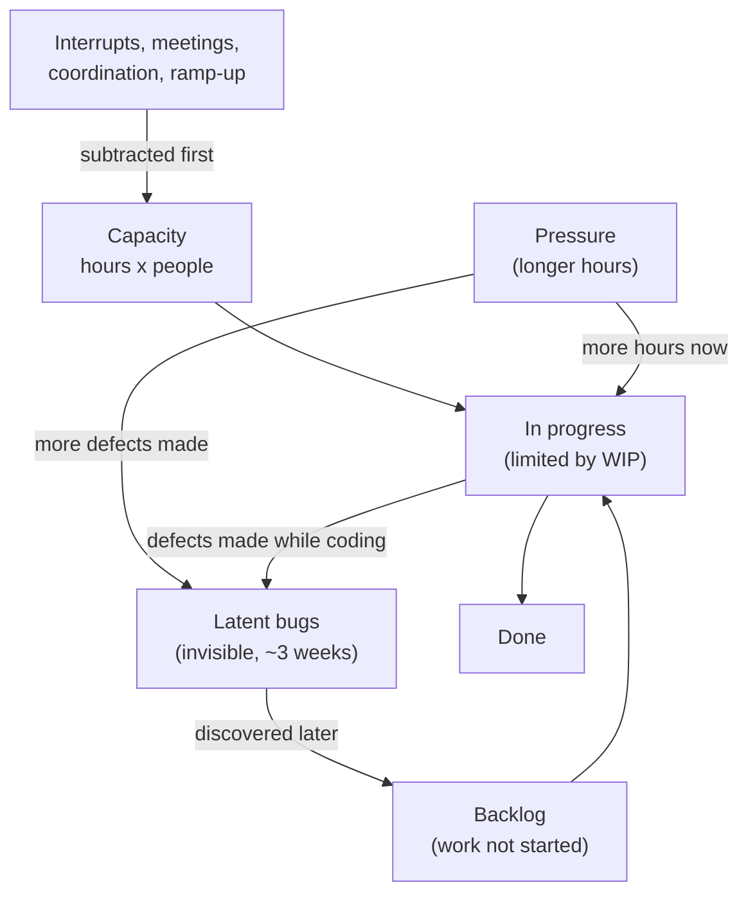
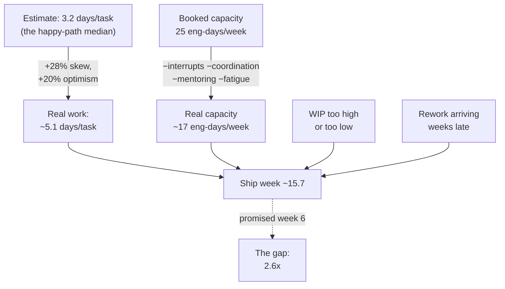
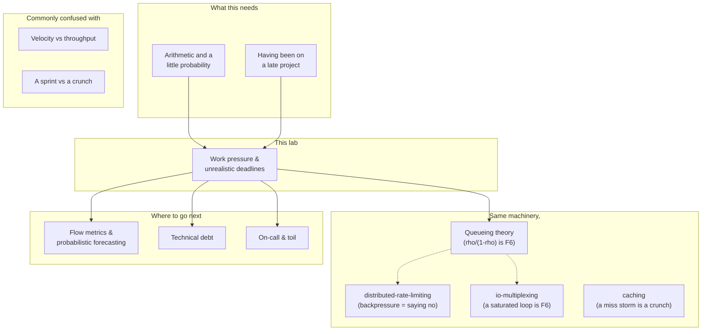

# Work pressure and unrealistic deadlines

> **Tell a friend:** Asha's team of five said six weeks, worked every single day,
> and shipped in week 15.7. Nobody slacked off, and the plan was already wrong on
> the morning it was written. Telling Asha to *push back* would not have helped,
> because the director across the table has advice too, and hers is *just get it
> done*. So this lab replaces advice with a bet you can defend out loud: week 12
> is a coin flip, and week 14 holds 85 times out of 100. It also hands you the
> twenty items to cut if you want the earlier date.

Run Asha's project yourself in [`visualization.html`](visualization.html), also
published as [The Deadline Machine](https://claude.ai/code/artifact/29d16479-2b42-4dd0-bffc-9d1d8332ae7e).
What to say on Monday is in [PLAYBOOK.md](PLAYBOOK.md). What this lab is made of,
and where every number came from, is section 19.

---

# BEGINNER MODEL — sections 1 to 9

## 1. Why is a missed date so expensive?

> **In one breath:** Somebody writes your honest guess on a slide, and from that
> moment it is a promise other people have made plans around. Almost none of the
> damage is the late date itself.

Asha leads five engineers: Meera, Arjun, Ben, Dev and herself. Priya is the
director who owns the payments release. Priya asks Asha how long the work will
take. Asha thinks about it carefully and says **six weeks**.

Priya writes "six weeks" on a slide. Marketing books a launch around it. Sales
tells a customer. Nobody has lied and nobody has been careless. But six weeks has
quietly stopped being a guess. It is now a fact that other people are standing on.

Then the work turns out to be harder than it looked. There is now a gap between a
real project and a public number. That gap is where the damage happens, and this
is the part worth being precise about.

Read the third column of this table first. It is the part everybody forgets.

| What breaks | How it looks from inside | What it costs |
|---|---|---|
| the product | the same features ship, with more defects in them | a team on 60-hour weeks left **2.7× more bugs** in the code for users to find than the same team on 40-hour weeks |
| the date, quietly | nobody announces a slip in week 3 | the announcement comes in week 9, after six weeks of hoping, when no cheap option is left |
| the learning | the story becomes "the team was slow" | the next estimate gets the same treatment, and so does the one after that |
| you | good engineers get cynical and leave | they usually blame themselves for a gap that arithmetic created before anyone wrote a line of code |

Here is the sentence this whole lab exists to earn. It is not a slogan. Every
number in the eighteen sections after it is there to hold this sentence up.

> **In every simulation run in this lab, the project missed its date, and in none
> of them did anyone slack off.** Missing the date was not a behaviour problem. It
> was the plan meeting the world.

You cannot fix a plan by trying harder inside it. You fix it by changing what is
in it. To do that, you have to be able to *show* what the plan implies, rather
than assert it. That is the whole job of this document.

Most writing on this subject is advice: communicate early, push back, set
boundaries. The advice is correct. It is also useless in the room, because the
person across the table has advice too, and theirs is *just get it done*. Advice
loses to advice. Arithmetic does not.

So the middle of this lab builds a small, honest simulation of a team under a
deadline. It then runs the moves people actually make: work weekends, add
engineers, start everything at once, cut scope. For each move it reports what
happens to the ship date. The last part covers the human half: what to say, to whom, in
what order, and what to do when the answer is still "do it anyway".

If you are in the middle of a bad week right now and want exactly one thing, read
section 6 and then open [PLAYBOOK.md](PLAYBOOK.md), item 2.

## 2. What does a doomed evening look like from inside the kitchen?

> **In one breath:** Five cooks, forty tables, and a manager whose arithmetic was
> perfectly reasonable. By 8pm nobody is idle, everybody is faster than they were
> an hour ago, and the tickets keep getting older.

Forget software for a moment. Meera cooked in a restaurant kitchen for three
years before she wrote any software, and this is the story she tells Asha's team
whenever a date arrives.

It is Saturday night. The kitchen has **five cooks**. Tickets come in from the
dining room. Each dish takes a cook a few minutes. The manager looks at the
evening's bookings and does some arithmetic. *Forty tables, five cooks, we can
do this.* He promises every table their food within twenty minutes.

By 8pm the pass is covered in half-finished plates. Nobody is idle. Nobody is
slow. Everyone is moving faster than they were at 7pm. And the tickets are
getting older.

What did the manager's arithmetic leave out? Four things, and Meera can name them
without thinking, because she lived all four.

A cook does not only cook. She answers the phone, shows the new kid where the
stock is, and steps away when a customer sends something back.

Some dishes take three times as long as expected, and nobody knows which ones
until they start.

A plate that goes out wrong comes back forty minutes later. Worse, it comes back
to the **front** of the queue, ahead of food nobody has started.

And when the manager shouts "faster", plates do go out faster — and more of them
come back.

Every one of those four is a real mechanism in a software project. Every one of
them is missing from the arithmetic that produced the promise. Hold on to this
kitchen. Section 8 maps it onto Asha's project line by line, and section 10 puts
a number on each of the four.

> **🔮 Predict:** *The manager sees the pass clogging up at 8pm and calls in two
> cooks from the other branch. They walk in at 8:30. Does the kitchen catch up
> faster?*
> <details><summary>Reveal</summary>
>
> Not that night. The new cooks do not know where anything is, so for the first
> hour they are asking questions. Every question is asked to somebody who was
> cooking. The kitchen's output goes **down** first, then slowly up. By the time
> they are useful, the rush is over.
>
> If you said yes, you counted two extra pairs of hands and stopped there. Two
> pairs of hands arrived; some of the existing hands stopped cooking to point at
> shelves. That trade is the whole result.
>
> You already believe this about kitchens. Section 11 shows the identical result
> for engineers, with numbers: two engineers added in week 12 of this lab's
> project made it finish **0.9 weeks later**. The same two people, hired in week
> 0, made it finish **3.0 weeks earlier**. The hire was never the mistake. The
> timing was.
> </details>

**Where this lab takes you.** Stop at any checkpoint and you still have something
whole and usable.

| Layer | Sections | After it you can… |
|---|---|---|
| Beginner | 1–9 | say why deadlines get missed, in plain words, without blaming anyone |
| Intermediate | 10 | put a number on each of the five mechanisms that eat a schedule |
| Engineering | 11–14 | name every failure mode, price any intervention, and run the code |
| Production | 15 | hold the conversations, run the weekly rhythm, and know your own limits |

## 3. Where exactly does the promise come from?

> **In one breath:** A capacity spreadsheet. It divides the work by the people and
> adds a bit for safety. It is the most reasonable thing in the world, and it is
> wrong by about a factor of two.

Watch the promise being made. This is the real shape of a real planning
conversation, and you can run it yourself: `java src/BrokenPlan.java`.

```
  Scope        40 tasks x 3.2 days   = 128 engineer-days
  Capacity     5 engineers x 5 days  =  25 engineer-days/week
  Build        128 / 25              = 5.1 weeks
  Test & fix   fixed allowance       = 1.0 weeks
  Contingency  10%                   = 0.5 weeks
  ------------------------------------------------
  COMMITTED DATE                     = 7 weeks
```

One piece of vocabulary before we go on, because every argument about deadlines
is conducted in this unit. When Asha says a task is "about three days", she means
three days of one person's attention. One engineer's output for one working day
is what engineers call an **engineer-day**. Five engineers for five days is
therefore twenty-five engineer-days a week, and that is line 2 of the sheet.

Getting from "five engineers" to "twenty-five engineer-days a week" is the first
place a plan goes wrong. Section 10, correction 2, takes that line apart.

Nobody in that room is stupid and nobody is lying. Asha's estimates were honest.
Priya added a test phase *and* a contingency on top. Divide the work by the
people, then add a bit for safety. Ask anybody outside software how to plan a
project and you will get this sheet.

> **🔮 Predict:** *Asha's team runs this exact project. The sheet says seven
> weeks. Before you read section 4: how late are they, roughly? Ten per cent?
> Thirty? Double?*
> <details><summary>Reveal</summary>
>
> They ship in **week 15.7**, which is **2.6×** the six weeks the model treats as
> the promise. Most people guess twenty to thirty per cent, because that is what
> "a bit late" feels like, and because that is the size of the mistakes we can
> see. A factor of two feels like incompetence.
>
> If you guessed 30%, you were pricing the surprises. The surprises are the small
> half of it. Four separate effects each cost between 10% and 30%, and they
> **multiply** rather than add. That is section 10's whole argument, and it is why
> nobody spots the error by looking harder at the sheet.
> </details>

The sheet is not wrong because somebody was sloppy. It is wrong for reasons that
have nothing to do with anybody's effort, and section 4 takes them one at a time.

## 4. What happens when you actually run that project?

> **In one breath:** Run Asha's project forty times, changing nothing but luck,
> and it ships in week 15.7 instead of week 6. Only 57% of the paid time ever
> became product, and even in a fantasy world with no surprises at all it still
> takes 9.6 weeks.

Here is the command that does it. It runs that exact project forty times: same
forty tasks, same five engineers, same sheet. Only luck differs between runs.

```bash
java src/Experiments.java estimate
```

Forty runs, averaged, gives one headline number and a spread around it.

| What the run reports | Value | What it means |
|---|---|---|
| average ship week | **15.7** | when the work was actually finished, across forty runs |
| P10 | week 13 | one run in ten was this early or earlier |
| P90 | week 19 | one run in ten was this late or later |
| overrun | **2.6×** | against the six weeks the model carries as the promise |

Nobody was lazy. Meera, Arjun, Ben and Dev worked every day. The work simply did
not fit.

### Where did all the paid time go?

Every hour Priya paid for went somewhere. The simulation tracks each one, and
this is the accounting for the whole project.

| Where the paid time went | Engineer-days | Share | What it actually is |
|---|---|---|---|
| building features | 224.9 | **57.4%** | the only rows the spreadsheet knew about |
| fixing bugs the team made itself | 20.9 | 5.3% | rework — work done a second time |
| support, meetings, interrupts | 90.0 | 23.0% | the pager, reviews, incidents, the rest of the job |
| coordination between people | 31.3 | 8.0% | the cost of five people needing to agree |
| nobody had anything to pick up | 24.4 | 6.2% | idle time waiting for work to become available |
| **total paid for** | **391.5** | 100% | the whole project's wage bill, in engineer-days |

**Fifty-seven per cent.** The spreadsheet assumed one hundred. That single number
is most of the gap. It is not a moral failing. It is what the other 43% of a real
job looks like once somebody writes it down.

### What is each cause actually worth?

Now turn the causes off one at a time. Each row below is the same project with
one mechanism removed. The "weeks saved" column is therefore exactly what that
mechanism was costing.

| The world you run in | Ships in week | Weeks saved | What the saving tells you |
|---|---|---|---|
| everything on (reality) | 15.7 | — | the baseline every other row is compared to |
| no task-to-task variability | 15.3 | 0.3 | making every task exactly average buys almost nothing |
| no interrupts | 12.0 | 3.7 | handing back 25% of capacity is the single biggest term |
| no defects, so no rework | 14.3 | 1.3 | small in total, but it lands at the worst moment |
| no communication overhead | 14.5 | 1.1 | five people agreeing costs a week of the schedule |
| **all of them off** (pure coding) | **9.6** | 6.1 | the four together are worth more than any one of them |

> **🔮 Predict:** *Look at the bottom row before you read on. No interrupts, no
> bugs, no meetings, no variation between tasks. Perfect execution. Does the
> 5.1-week estimate come true?*
> <details><summary>Reveal</summary>
>
> **No. It takes 9.6 weeks.** In a world with nothing going wrong at all, the
> project still runs to nearly twice the estimate.
>
> If you said yes, you assumed the estimate described the work. It did not. It
> described the version of each task where nothing goes wrong, which is not the
> same thing and is not even the typical thing. That remaining 4.5-week gap is
> pure optimism, baked in before the first line of code.
>
> This is the result that changes how you read every plan you are ever handed.
> The corrections in section 10 explain exactly where the 4.5 weeks came from.
> </details>

That leads to the sentence everybody gets backwards, so it is worth stating
carefully:

> The plan was not missed because reality intervened. **The plan was already wrong
> on day one.** Reality then made it worse.

One word from that first table needs its own sentence, because it comes back
repeatedly. **Rework** is work you have to do a second time, because the first
version was wrong. The team's own bugs come back as new work. Section 7 gives it
a proper definition, and section 11 shows why 5.3% of the budget can do far more
than 5.3% of the damage.

## 5. If a single date is a bet you lose, what should you produce instead?

> **In one breath:** Not a better date. Change nothing but luck and the same plan
> ships anywhere between week 12.6 and week 18.6. No single number can be right
> about that. A number can only be right about it with a probability attached.

Asha runs the identical plan twelve times. Same team, same forty tasks, same
sheet. The only difference between runs is which tasks turn out nasty, and nobody
can know that in advance.

Each row below is one run. The **seed** is just a label for which random draw of
task durations that run used. Same plan, different luck.

| Seed (which luck) | Ships in week | Seed (which luck) | Ships in week |
|---|---|---|---|
| 1000 | 12.6 | 1006 | 13.8 |
| 1001 | 17.4 | 1007 | 14.6 |
| 1002 | 16.4 | 1008 | 16.6 |
| 1003 | 18.6 | 1009 | 13.8 |
| 1004 | 14.8 | 1010 | 17.4 |
| 1005 | 13.2 | 1011 | 16.6 |

**Week 12.6 to week 18.6 — a six-week spread, with nothing changed but luck.**

Sit with that for a moment. Nobody made a decision differently. Nobody worked
harder in run 1000 than in run 1003. The spread is not a measure of the team. It
is a property of the work.

So when Priya asks Asha for "the date", the honest answer is not a better single
number. It is four things, and everything after this point in the lab exists to
produce them.

The first is **a range with probabilities on it**, built from evidence rather
than feelings. It sounds like this: *"60 items left, this team's own last ten
weeks, no new scope: week 12 is a coin flip, week 14 holds 85% of the time."*

The second is **a menu of decisions with their real costs**, so that the date
becomes somebody's choice rather than your failure. It sounds like this: *"week
10 at 85% needs 20 of the 60 items gone. Here are the 20 I would cut."*

The third is **a way to keep the promise honest as the work reveals itself**,
updated weekly, so that nobody finds out in week 9.

The fourth is **a sustainable version of you** at the end of it, because you will
be asked again next quarter, and the quarter after that.

## 6. What are the two sentences the whole lab reduces to?

> **In one breath:** A date is a bet, not a fact, so say the odds out loud. And
> of the four things you can change, only one of them moves quickly and honestly.

Everything in this document collapses into two sentences. Learn these two and you
have the lab, even if you never open the code.

> **1. A date is not a fact about the work; it is a bet about the work. Say the
> odds out loud, or somebody else will assume they are 100%.**
>
> **2. There are only four levers — scope, time, people, quality — and under
> pressure exactly one of them moves quickly and honestly: scope.**

The second sentence is the one that changes your Monday, so take the four levers
one at a time.

**Time** is what Priya is telling Asha to change, and it is the one thing in the
room that is already fixed. **People** arrive too slowly to help; section 11
gives the exact week after which a new hire makes the current date worse.
**Quality** does not actually move. It only *appears* to move, and it gives the
time back later with interest.

What is left is **scope**. That is why *"what should we not build?"* is the most
senior question in any planning room, and the one engineers ask least often.

Both sentences are run, not asserted. Section 10 puts a number on each lever and
section 11 shows each one failing in public.

> **Say it back.** Without using the words *distribution*, *percentile* or
> *variance*, explain to a non-engineer why Asha refuses to give Priya one date.
> <details><summary>A good answer sounds like</summary>
>
> "We ran the same plan twelve times with the same people and the same work. It
> finished anywhere from week 12.6 to week 18.6, and the only thing that changed
> was which jobs turned out to be nasty. So any single date I give you is really
> me picking one of those twelve and hoping. What I can tell you instead is how
> often each week comes true, and what we would have to drop to make an earlier
> one likely."
> </details>

## 7. Which words let you argue precisely?

> **In one breath:** Vague words lose arguments. These are the load-bearing ones,
> earned in the story first and named afterwards, so that you can say exactly what
> you mean when it counts.

Every term below is defined again, in one line, in the glossary in section 18.
Here it gets the story it came from.

### What are the three different things people call "the date"?

Go back to the first page. Priya asked, Asha said six weeks, and Priya wrote it on
a slide. Between those two moments the same six weeks changed category twice, and
nobody noticed.

That silent upgrade is the most expensive confusion in the subject, so the three
categories get three names.

| Word | What it really is | Who it binds | Where you met it |
|---|---|---|---|
| **Estimate** | a guess about one piece of work, in isolation | nobody | Asha's "about three days" in section 3 |
| **Forecast** | a probability statement about a whole body of work, from evidence | nobody, but it can be checked | "week 14 holds 85%" in section 5 |
| **Commitment** | a promise to other people, who then act on it | marketing, sales, the customer | the slide in section 1 |

A forecast has an error bar by definition. A forecast without one is not a
forecast; it is an estimate wearing a suit.

Naming the three lets Asha say the single most useful sentence in project work:
*"that was an estimate, not a commitment — do you want me to turn it into a
forecast?"* The journey is: "about three days" → "60 items left, P85 is week 14"
→ "we will ship the payments release on 12 October".

### Why is one number never enough?

A **point estimate** is a single number: "six weeks". A **distribution** is the
full set of outcomes with how often each one happens — the twelve runs in section
5, or the histogram in section 14. A **percentile** picks a point on that
distribution. **P50** is the coin flip, where half the outcomes land earlier.
**P85** is the date you make 85 times out of 100.

Why bother? Because a point estimate silently reports P50 *at best*, while
everyone in the room hears P100. This lab's own run makes that concrete: a team's
average velocity said week 12, and week 12 came true **53%** of the time. P85 was
week 14.

If you did the [cap-theorem](../24-cap-theorem/) or
[distributed-rate-limiting](../60-distributed-rate-limiting/) labs, this is the
same move as reporting p99 latency instead of an average. Nobody would accept
"our average response time is fine" as a statement about the worst case. **A date
is a latency number.**

### What are the only four things that can change?

**Scope** is how much you build. **Time** is when it is due. **People** is how
many work on it. **Quality** is how carefully.

Every deadline conversation you will ever have is about these four and nothing
else. Fixing all four at once is not ambitious; it is arithmetic denial.

### How do you talk about flow rather than effort?

Ben, on Asha's team, has forty branches open and cannot name one finished thing.
Section 11 shows what that costs. To describe it you need four words, and one of
them is a law.

| Word | Plain meaning | Why it earns its own word |
|---|---|---|
| **Throughput** | finished items per week | it is counted, not guessed — a fact about the past |
| **Cycle time** | how long one item takes start to finish, *including all the waiting* | the waiting is usually most of it |
| **WIP** | work in progress: how many items are open at once | "started" and "finished" feel similar to a busy team and are worlds apart to a business |
| **Little's Law** | cycle time equals WIP divided by throughput | double what you have on the go and everything takes twice as long to come out |

Little's Law is worth saying twice, because it is the least intuitive true thing
in this lab. In story terms: if the pass has twice as many half-finished plates on
it, each plate sits there twice as long, even though the cooks are working just as
hard. In words: the time one item takes is the number of open items divided by how
many finish per week. In symbols: `cycle time = WIP / throughput`.

Ben's forty open branches are not a personality flaw. They are a number in that
formula. The same team with 40 tasks open at once had **1.4 features working by
week 6**; with 5 open it had **17.1**.

### Why does a fully allocated team move so slowly?

**Utilization** is the fraction of capacity that is committed. It is **not** a
measure of how hard people work. It is a measure of how little slack the system
has left.

Waiting time does not grow gently as utilization rises. It goes off a cliff, and
the shape of that cliff is `ρ / (1 − ρ)`, where ρ (rho) is just the utilization
written as a fraction. Section 10 puts the numbers on it: at 80% busy an item
takes **5×** its own work time to come out, and at 95% busy it takes **19×**.

This is the same mathematics as the [queueing-theory](../57-queueing-theory/) lab,
where one clerk at one desk produces exactly this curve. There the queue is made
of people waiting for a passport. Here it is made of tasks waiting for an
engineer. The arithmetic does not care which.

### What is rework, and why does 5% of the budget hurt so much?

**Rework** is work you have to do again because the first version was wrong. A
**latent bug** is a defect that exists but has not been found yet. An **escaped
defect** is one you never found at all — production found it, which means a user
found it.

Rework is the reason pressure does not remove work. It *moves* work. A bug Dev
makes in week 4 is invisible until about week 7, and then it arrives as new work
at the **front** of the queue. That is Meera's plate coming back to the pass,
ahead of food nobody has started.

### What is scope creep, and why is it never subtracted?

Scope creep is work added after the plan was made. Most of it is genuinely
needed, so this is not a complaint about anybody's discipline. It is simply never
subtracted from the date.

Section 14 prices it: **1.5 extra items a week** moved a P50 from week 12 to
**week 18**. In that forecast, creep was the single largest term — larger than
everything else put together.

### What does a new joiner actually cost?

**Ramp-up time** is how long a new person takes to reach full productivity, plus
what they cost the people teaching them. In this model it is about **six weeks**
to full speed, and **a quarter of an experienced engineer's day, every day**,
while it happens.

That second half is the one that surprises people. Omar joining does not only
mean Omar is slow for six weeks. It means Meera is slower too.

### Which four famous effects can you now put a number to?

You have probably heard all four of these quoted as folk wisdom. Each row says
what the effect is and where this lab prices it, so you can stop quoting and start
showing.

| Effect | What it says | What this lab shows |
|---|---|---|
| **Planning fallacy** | people estimate the version of a task where nothing goes wrong | section 10, correction 1: honest estimates are 28% short before anything goes wrong |
| **Brooks's Law** | "adding people to a late software project makes it later" | section 11, F2: true from about week 8 of this 16-week project, false before it |
| **Parkinson's Law** | work expands to fill the time available | early finishes are rarely reported, so each task's buffer is spent whether or not it was needed |
| **Student syndrome** | work starts at the last moment the buffer allows | the buffer becomes a delay before anyone begins |

Brooks's Law deserves one extra sentence, because it is the most misquoted line in
software. It has a crossover point. It is a **warning, not a physics constant**,
and section 11 finds the exact week where it flips.

## 8. Which two pictures should you carry, and where does the first one lie?

> **In one breath:** Carry the kitchen for arguing with people, and carry a queue
> with a feedback loop for arguing with a plan. The kitchen lies in three places,
> and all three matter.

### What is the simple picture? Meera's Saturday night

Five cooks. Tickets arriving. A pass filling up with half-finished plates. Food
coming back to be redone. And a manager who is certain the problem is speed.

That picture fits in one breath and survives being repeated by somebody who was
not in the room. Keep it.

### What is the engineer's picture? A queue that feeds itself

Said precisely, Asha's project is four things and one loop.

There is a **queue of work items**. There is a **small number of servers**,
which is what the engineers are in this picture. Their capacity is reduced by
interrupts, coordination and fatigue before any coding happens. **Service times are drawn from a right-skewed
distribution**: a task can run very late but never very early, and nobody can see
which is which in advance.

And then the part that makes it a machine rather than a pipe: **a feedback loop,
in which the rate of work determines the rate of future work.**

Read the diagram below by following the arrows out of **Pressure**. There are two
of them, and the second one is the whole subject.



Pressure goes two places. It buys a little more capacity now, and it makes more
latent bugs that come back as new work later. That loop is why a project has a
*shape* rather than a speed. It is also why the intuitive fix is a loan rather
than income.

### How does the kitchen map onto the project?

Read this table left to right. Each row is the same thing, said three ways: as
Meera would say it, as Asha would say it, and as the code says it.

| In Meera's kitchen | On Asha's project | In the code |
|---|---|---|
| a ticket | a task | `Task` |
| the cooks | the engineers | `Plan.teamSize` |
| plates on the pass at once | WIP | `Plan.wipLimit` |
| nobody knows which dish is nasty | right-skewed durations | `Rand.lognormal` |
| answering the phone, teaching the new kid | interrupts, coordination, mentoring | `interruptFraction`, comm overhead, `MENTOR_DRAIN` |
| a plate sent back, jumping the queue | rework preempting features | `Defect` → front of backlog |
| "Faster!" | overtime | `hoursPerWeek` |
| cooks slowing down at 1am | fatigue | `energy` |
| the rush ending | the ship date | `Result.shipDay` |

### Where does the story lie to you?

Three places, and each one makes the real thing worse than the kitchen.

**A kitchen has recipes; software does not.** Meera knew a risotto was 18 minutes
because she had made 4,000 of them. Most engineering tasks are done once,
ever. That is why estimates are not merely noisy but *biased*, and why "just
estimate better" is not a plan.

**A kitchen resets at midnight.** Tomorrow starts clean. A project carries its
debt forward. Bugs made in week 4 are still arriving in week 9, and the code Dev
rushed is code the team will work in for years.

**A dish that comes back is obviously back.** A latent bug is invisible for weeks.
Everything looks fine right up until a third of the team is doing nothing but
rework, and the progress chart has been stuck at 90% for a month.

Where the analogy holds perfectly is the moment at 8pm, when everyone is moving
faster than an hour ago and the tickets are still getting older. **That is what
being on a doomed project feels like from the inside, and it is the reason people
blame themselves.**

## 9. Where can you run the project yourself?

> **In one breath:** The same simulation, with every lever exposed and a chart
> that separates what was planned from what got finished. Move one slider and the
> date moves by weeks.

**→ [The Deadline Machine](https://claude.ai/code/artifact/29d16479-2b42-4dd0-bffc-9d1d8332ae7e)**,
also saved beside this file as `visualization.html`, which works offline and
opens straight from the file.

The page runs the same simulation as `src/Project.java`, using the same random
number generator. A number you read there is a number this lab prints.

Look at five things, in this order.

**The dotted line against the green one.** This is a **burn-up chart**: finished
work climbing towards the scope line, rather than a burn-down. A burn-up is used
deliberately, because it makes a scope change visible as the ceiling moving. The
dotted line is Priya's plan, a straight march to 40 features by the promised date.
Green is what Asha's team actually finished. They separate in week 1 and never
come back together.

**"Where week N went."** The stacked bar under the chart splits that week's paid
time into what became product and what did not. Step through the weeks and watch
the teal segment shrink as new joiners arrive and fatigue accumulates.

**The luck slider.** Change nothing except which tasks turn out hard. The date
moves by weeks. This is section 5 made physical, and it is the fastest way to
convince somebody who thinks the spread is an excuse.

**The four "what could you do now" boxes.** Set the week, then read the four
options. This is the meeting Asha is about to walk into, with the answers already
computed.

**The four predict-then-run questions at the bottom.** Commit to an answer before
you press anything. The explanations are the same ones in section 11, so a wrong
guess here meets you again later with the numbers attached.

> **Checkpoint — end of the BEGINNER MODEL.** You can now explain to a
> non-engineer why a reasonable plan, produced by reasonable people, misses by 2×
> without anybody underperforming. You can also say why a date without a
> probability is not an answer. What you cannot do yet is put a number on each
> mechanism, or say which intervention to reach for in week 4 rather than week 12.
> That is next.

> **Say it back.** Priya says: "Your team just needs to focus." Using nothing but
> section 4's accounting of where the paid time went, answer her in three
> sentences, without being defensive and without using the word *unrealistic*.
> <details><summary>A good answer sounds like</summary>
>
> "Of every hundred days we are paid for, fifty-seven became features. Twenty-three
> went to support, meetings and incidents. Eight went to the five of us keeping
> each other in step. Five went to fixing our own bugs, and six went to people
> waiting for something to pick up. Focus can move the last one and part of the
> second. It cannot move the other seventy, because those are the job, and the
> plan was built as if none of them existed."
> </details>

# INTERMEDIATE MODEL — section 10

## 10. What are the five things that eat a schedule?

> **In one breath:** Start with the model in everybody's head, which is work
> divided by people, and let it break five times. Each break has its own number,
> and the five numbers multiply rather than add.

### Model v1 — what if you just divide the work by the people?

```
40 tasks × 3.2 days = 128 engineer-days ÷ 5 engineers ÷ 5 days = 5.1 weeks
```

This is the model Priya is using, and it is not stupid. It is exactly right for
work that is fully known, fully parallel, and done by people who do nothing else.

Almost no engineering work is any of those three things. Five corrections turn v1
into the real thing, and each correction is a separate mechanism with a separate
price.

### Correction 1 — why is an honest estimate still 28% short?

Task durations are **right-skewed**. A task cannot take less than zero time, but
it can easily take four times as long as expected. Draw that shape and it has a
long tail on the right and nothing on the left.

Now think about what happens in Asha's head when Priya asks. Asha pictures the
typical case. The typical case is the **median** — the middle outcome, with half
above and half below. But a schedule does not pay the median. A schedule pays the
**average**, and for a right-skewed shape the average sits above the median,
dragged up by the disasters.

The test suite checks this directly. Its tests are named after the claims they
check, so `summing_most_likely_estimates_understates_the_total` is the claim that
adding up everybody's most likely guesses gives a total that is too small.

```bash
java src/Tests.java
```

| What the test reports | Value | What it means |
|---|---|---|
| median task duration | 4.0d | the length Asha pictures when she estimates |
| mean task duration | 5.12d | the length the schedule actually pays for |
| the same, from theory | 5.11d | the closed-form answer, agreeing with the run |
| the gap | **28% undercount** | every honest estimate is short by this much on average |

Every task is honestly estimated. Every task is 28% short, before anything goes
wrong at all. Now add the ordinary human optimism on top. People picture the
happy path, and this lab models that as a further 20%. Together the two effects
leave the estimate covering roughly **63%** of the real coding time.

> **A concrete case.** Take one task Asha honestly estimated at 3.2 days. Eight
> times out of ten it lands between 2 and 6 days. One time in twenty it takes 14,
> because the API is undocumented, the staging environment is broken, and the
> "small refactor" reaches into nine files. Nobody estimates the 14-day version,
> and nobody should. But *some* task in the forty will be it, and the schedule has
> no room for it anywhere.

### Correction 2 — why is capacity not people times hours?

The spreadsheet books 25 engineer-days a week from five engineers. Reality
subtracts, in this order, before anybody writes a line of code.

| Step | Engineer-days left | What is being taken out |
|---|---|---|
| 5 engineers × 5 days | 25.0 | the number on the spreadsheet |
| minus new joiners not yet at full speed | — | Omar is present but not yet productive (section 11, F2) |
| minus mentoring those joiners | — | 0.25 of a day, per mentor, per day |
| minus coordination between five people | −2.0 | 2% of each person's time, for each other person |
| minus support, meetings, incidents, reviews | −5.8 | 25% of what remains |
| **what is actually available** | **≈17.3** | the number Asha should have planned with |

The interrupt tax on the last row is the one people get wrong, and they get it
wrong in one specific way.

> **🔮 Predict:** *Arjun's team hands 25% of its capacity to support and on-call.
> The project was going to take 12 weeks. How much later does it ship — 25%
> later?*
> <details><summary>Reveal</summary>
>
> **31% later, not 25%.** Here is the run.
>
> If you said 25%, you subtracted what was gone. The schedule divides by what is
> left. Giving a quarter of the team's time to support is not a 25% delay. It is a
> **33% delay**. Twelve weeks of work done at 75% speed takes 12 ÷ 0.75 = 16
> weeks, not 12 + 25%.
>
> The bigger the tax, the wider the two answers get. At half your capacity the
> naive answer says 50% later, and the truth is **double**.
> </details>

```bash
java src/Experiments.java interrupts
```

| Unplanned work | Ships in week | Versus 0% | What the division rule predicts |
|---|---|---|---|
| 0% of capacity | 12.0 | 1.00× | 1.00× |
| 10% of capacity | 13.2 | 1.10× | 1.11× |
| 25% of capacity | 15.7 | **1.31×** | 1.33× |
| 50% of capacity | 23.1 | 1.93× | 2.00× |

The rule in the last column is worth carrying as a sentence before you carry it as
a symbol. In words: **you divide by the fraction that is left, you do not subtract
the fraction that is gone.** As a formula, if `f` is the fraction of capacity
handed to unplanned work, the delay multiplier is `1/(1−f)`. Say the words version
in a planning meeting and watch a plan change.

### Correction 3 — why is quality a loan rather than a lever?

Under pressure a team goes faster by being less careful, and this genuinely
works — for a while. That is the honest version, and the honest version is far
more useful than the slogan, because anybody who has seen crunch work will stop
listening the moment you deny it.

The catch is timing. A bug Dev makes in week 4 is invisible until about week 7.
When it appears it is *new work that jumps the queue ahead of features*.

```bash
java src/Experiments.java overtime
```

| Hours per week | Ships in week | Versus 40h | Escaped bugs | Hours burnt |
|---|---|---|---|---|
| 40 | 15.7 | — | 3 | 3132 |
| 50 | 15.4 | −0.2 | 5 | 3855 |
| 60 | **16.4** | **+0.7** | **7** | **4914** |
| 70 | 17.3 | +1.6 | 10 | 6055 |

Now read the 60-hour row across, and then watch it happen week by week. Crunch is
not immediately useless. It is ahead for about three months.

| By week | Features done at 40h | Features done at 60h | Who is winning |
|---|---|---|---|
| 4 | 11.8 | 16.0 | crunch is 36% ahead |
| 8 | 22.8 | 27.3 | crunch still ahead |
| 12 | 34.1 | 35.8 | the lead is nearly gone |
| 16 | 39.4 | 39.3 | crunch is now behind |

For about twelve weeks the crunching team is genuinely ahead. Then two things
catch up at once. An hour of tired work is worth less than an hour of rested work.
And the extra bugs made in all those extra hours start arriving.

The 60-hour team ships **0.7 weeks later**, with **2.7× the bugs** left in
production, having burnt **57% more hours** to get there.

> **A two-week push before a real, immovable date is a legitimate engineering
> decision.** A quarter of 60-hour weeks is not a plan. It is a way of paying more
> for less. The crossover is around week 12 to 14 here, and it arrives sooner the
> more defect-prone the work is.

### Correction 4 — why is starting not the same as finishing?

Here is the mechanism that is invisible in every capacity spreadsheet, because a
spreadsheet has no idea how many things are open at once.

> **🔮 Predict:** *Ben has 40 tasks open at once instead of 5. Same team, same
> work, same forty tasks in total. By week 6, how many features are actually
> finished and working?*
> <details><summary>Reveal</summary>
>
> **1.4, against 17.1.** Not fewer by a bit. Fewer by twelve times.
>
> If you guessed "about the same, just spread out", you were counting work done
> rather than work finished. Total work done per week barely moves. What collapses
> is anything crossing the finish line, and finishing is the only thing that
> counts to Priya, to a customer, or to a scope conversation.
>
> There is a second cost hiding in there. Half-built work cannot be cut. At 40 open
> tasks, Asha has lost the one lever that works.
> </details>

```bash
java src/Experiments.java wip
```

| Tasks open at once | Ships in week | Finished by week 6 | Idle days | Thrash days |
|---|---|---|---|---|
| 1 | 72.0 | 3.8 | 993.8 | 0.0 |
| 2 | 36.5 | 7.2 | 381.6 | 0.0 |
| **5** | **15.7** | **17.1** | 24.4 | 0.0 |
| 8 | 16.8 | 15.1 | 26.1 | 24.8 |
| 20 | 21.3 | 8.4 | 26.8 | 107.6 |
| 40 | 26.3 | **1.4** | 26.8 | 195.6 |

That is a **U-curve**, and both walls hurt, for opposite reasons.

Below the team size, people sit idle waiting for something to pick up. At one task
open at a time, the team wastes **993.8 engineer-days** doing nothing — call it
993 wasted engineer-days at WIP 1.

Above the team size, everybody is on several things at once and pays a switching
cost on each. At forty open, **195.6 engineer-days** go to thrashing: 195 wasted
days at WIP 40.

The right-hand wall is the one that kills teams, because it is what "everything is
a priority" actually *is*, mechanically. Look again at the "finished by week 6"
column. At 40 open tasks the team has 1.4 working features out of 40. Six weeks of
full effort, nothing to show, nothing to hand over, nothing to demo — and no way
to cut scope, because every task is half-built.

### Correction 5 — why is the answer never a single line?

Even with the first four corrections applied, one thing remains, and it is the
result from section 5. None of this is deterministic. The identical plan, run
twelve times with nothing different but which tasks turned out hard, ships between
**week 12.6 and week 18.6**.

So the output of all this arithmetic is not a date. It is a distribution. The only
honest way to report a distribution is with a probability attached.

### How do the five corrections fit together?

Follow the two chains down into the ship week. The left chain is what the work
really costs; the right chain is what the team really has.



The four small effects in that diagram are each worth between 10% and 30%. They
compose multiplicatively, not additively, which is why nobody catches the error by
staring harder at the spreadsheet. Four "small" ten-per-cent effects are not a
forty-per-cent problem.

> **Checkpoint — end of the INTERMEDIATE MODEL.** You can now put a number on each
> of the five mechanisms, and say which correction the plan in front of you is
> missing. Next: what each one looks like as a live failure, how to recognise it
> from the inside, and what it costs.

> **Say it back.** Without using the words *multiplicative*, *skew* or *capacity*,
> explain to Dev why four separate mistakes of about 10% each did not add up to a
> 40% miss.
> <details><summary>A good answer sounds like</summary>
>
> "Each one takes its cut of whatever is left after the one before it. Five people
> for five days is twenty-five days, but two of those go to keeping each other in
> step, and a quarter of what is left goes to support. Then every task is bigger
> than we said. Each step shrinks a smaller number, and the shrinking compounds, so
> the end of the chain is about a third of what we started with instead of 60% of
> it."
> </details>

# ENGINEERING MODEL — sections 11 to 14

## 11. What are the seven ways this actually goes wrong?

> **In one breath:** Seven named failures, each one a short story about somebody on
> Asha's team, each one with a command that shows it happening. Six of them are in
> the model. The seventh is the one you personally control.

### F1 — Why is the heroic quarter always followed by a slow one?

Dev volunteers for 60-hour weeks. For two months it works, visibly. Then output
falls below where it started.

Run it with `java src/Experiments.java overtime`, or open the visualization and
set hours to 60. Escaped bugs go from 3 to 7. Total hours burnt rise by 57%.

Two loops are running at once. Tired hours are worth less than rested ones; this
model floors an hour's value at 60% of a rested hour after sustained overtime. And
rushed hours make more defects, which arrive as queue-jumping rework about three
weeks later.

The work still gets done, and for short pushes crunch really is faster. What is
lost is the *sustainability* of the pace, plus quality — permanently, because an
escaped defect is by definition one that a user finds.

> **🔮 Predict:** *Asha's team crunches for eight weeks and ships. The next
> quarter's plan assumes the same rate. What has actually happened?*
> <details><summary>Reveal</summary>
>
> Two things, and the second one is the career-relevant one.
>
> Mechanically, a quarter's worth of rework and escaped defects now arrives during
> the quarter that was planned at full speed. The next project starts already
> behind.
>
> Organisationally, and this is the part nobody warns you about, **the crunch
> rate is now the baseline.** Nobody who set the next plan saw the 60-hour weeks.
> They saw the output. This is the ratchet, and it is why "we did it last time" is
> the most dangerous sentence in the whole subject.
>
> If you answered only "the team is tired", you named the smaller half. Tiredness
> recovers. A baseline does not, unless somebody moves it back on purpose. The only
> defence is to make the cost visible *while it is being paid*: hours worked
> reported alongside features delivered, in the same status update, every week.
> </details>

### F2 — Why does help arriving late make things worse?

Priya offers Asha two more engineers in week 12. It sounds like help. Run
`java src/Experiments.java people` and watch what it does.

| When the two engineers arrive | Ships in week | Versus doing nothing | Versus hiring on day 0 |
|---|---|---|---|
| week 0 | 12.6 | −3.0 | +0.0 |
| week 2 | 14.4 | −1.3 | +1.8 |
| week 4 | 14.9 | −0.8 | +2.3 |
| week 8 | 15.9 | **+0.2** | +3.3 |
| week 12 | 16.5 | **+0.9** | +3.9 |
| five engineers at week 8 | 16.3 | +0.7 | — |

Omar takes about six weeks to reach full speed, and costs Meera a quarter of every
day while it happens. Early, that investment has months in which to repay itself.
In week 12 of a 16-week project it never repays at all. Notice the bottom row:
adding *five* people in week 8 is worse than adding two.

The hire is still right for the *next* project. What is lost is this date, plus
some of the existing team's throughput. At work this arrives as "we're getting you
two more people", which sounds like help and is usually a substitute for the scope
conversation nobody wants to have. The useful reply is not "no". It is: *"yes, and
they will help from about week N — for this date, what comes out of scope?"*

There is a second, dumber trap hiding in the same place.

| The team | Tasks open at once | Ships in week |
|---|---|---|
| 5 engineers | 5 | 15.7 |
| 7 engineers | 5 | **16.4 — worse** |
| 7 engineers | 7, planned from day 0 | 12.6 |

Two extra engineers with no extra open work are worth **less than nothing**. They
add coordination cost and receive idleness in return. **Capacity you cannot break
into parallel work is not capacity.**

### F3 — Why does "everything is a priority" produce nothing at all?

Ben is on eleven things. So is everybody else. Run
`java src/Experiments.java wip`, or set the visualization's WIP to 40.

The project ships in week 26 instead of week 15.7. By week 6 it has **1.4** working
features instead of 17.1. Capacity split across 40 tasks means every task creeps,
and each switch costs something. Nothing crosses the finish line.

Total work done per week is only moderately lower — that is what makes this so
hard to see from inside. What is lost is everything *finished*, which is the only
thing that counts. With it goes Asha's ability to negotiate, because half-built
work cannot be cut.

This is the failure that feels the most like personal inadequacy. Ben worked every
day, has 40 branches, and cannot name one thing that is done.

### F4 — Why is a team that carries the pager not the team on your plan?

Arjun carries the pager. Run `java src/Experiments.java interrupts`. Handing 25%
of capacity to support makes the project 31% longer; handing over half makes it
93% longer.

The reason is correction 2's division rule, `1/(1−f)`: you divide by what is left.
The support work itself survives — it was real work all along, and somebody was
always going to do it. What is lost is the pretence that a team can be "80% on the
project" while hitting a plan built at 100%.

This is the most under-priced line in every plan in the industry. If your team
carries the pager, your usable capacity is not your headcount, and the fix is a
number: *"we are the on-call team; plan us at 3.5 engineers, not 5."*

### F5 — Why does the date move when nobody moved it?

Run `java src/Experiments.java forecast`. Sixty items are left and the team's own
history says about five finish per week. With nothing added, the coin-flip date is
week 12. With **1.5 items a week** quietly added, the coin-flip date is **week
18**.

The arithmetic is unforgiving. Adding 1.5 against a throughput of 5 is a 30% tax,
so the remaining time divides by 0.7. Creep does not add to the pile once; it
lowers the rate at which the pile shrinks, permanently.

Usually the new items really are needed, so this is not a story about weak people
saying yes. What is lost is the date, silently, because nobody logs an addition as
a slip. This is the single largest term in most real forecasts and the easiest one
to fix: **every addition gets a date impact quoted at the moment it is added**, in
the same message. Not a refusal. A price tag.

### F6 — Why did your pull request sit for three days on a busy team?

Run `java src/Experiments.java utilization`. This is the same curve as the
[queueing-theory](../57-queueing-theory/) lab, with engineers in place of a clerk.

| How busy the team is | Cycle time, in units of its own work | What the standard formula predicts | What it feels like |
|---|---|---|---|
| 50% busy | 1.99 | 2.00 | things come back the same day |
| 80% busy | 5.00 | 5.00 | a day's work takes a working week |
| 90% busy | 9.84 | 10.00 | "we're quite busy right now" |
| 95% busy | **19.28** | 20.00 | nothing unplanned can be absorbed at all |
| 98% busy | 57.95 | 50.00 | the team has stopped responding to anything |

Waiting grows as `ρ/(1−ρ)`, the utilization divided by the slack that is left. A
team with no slack cannot absorb variation, so every arrival waits behind the
queue that the last surprise created.

The third column is **Kingman's formula**, the standard approximation for how long
a queue makes you wait. The simulation runs slightly worse than the formula at 98%
because real service times have a fat tail. The formula is the polite version.

Throughput survives. The team really is producing more per week at 95% than at
50%, which is exactly why this failure is so hard to argue against. What is lost is
responsiveness, and therefore everything that depends on it: code review latency,
incident response, and any ability to take on something unplanned.

"We're all fully allocated" is not a status report. It is a diagnosis. Fully
allocated is precisely the state in which nothing moves.

### F7 — Why does nobody say anything until week 9?

This one has no command, because the model has no morale. It is observational, and
it is flagged as such so you never mistake it for a run.

The team knows in week 3. Nobody says anything until week 9.

In week 3 the evidence is soft and the social cost of raising it is high. The
optimistic story is still *possible*, and each individual week's slip is small
enough to hope through. By week 9 the evidence is undeniable, and it is far too
late for the only lever that works quickly. Cutting scope in week 1 saves 5.1
weeks; cutting the same scope in week 12 saves 0.7.

What is lost is every cheap option. The cost of a slip announced in week 3 is a
conversation. In week 9 it is a crisis.

This is the failure mode *you personally control*, and it is the reason section 15
is mostly about a weekly rhythm rather than one heroic conversation.

### The seven failures at a glance

Read the last column as the diagnosis you can make from your seat, without running
anything.

| # | The failure | What still works | What is lost | How it shows up at work |
|---|---|---|---|---|
| F1 | crunch spiral | the work gets done; short pushes are real | sustainable pace, and quality permanently | heroic in Q1, inexplicably slow in Q2, blamed on motivation |
| F2 | the late hire | the hire is right for the *next* project | this date, plus some existing throughput | "we're getting you two more people" instead of a scope conversation |
| F3 | the WIP trap | total work done per week, roughly | everything finished, and the ability to cut | 40 branches open and nothing you can name as done |
| F4 | the interrupt tax | the support work, which was always real | the pretence of a team being "80% on the project" | the plan says 5 engineers; the team is really 3.5 |
| F5 | scope creep | the new items usually are needed | the date, silently | nobody logs an addition as a slip |
| F6 | utilization collapse | throughput — genuinely higher when busy | responsiveness, review latency, incident response | your pull request sat for three days |
| F7 | the silent slip | nothing; every option quietly expires | every cheap option | week 3 is a conversation; week 9 is a crisis |

## 12. What can you guarantee, and what can you not?

> **In one breath:** You can guarantee a probability, a rate, a menu, a rhythm and
> your own conduct. You cannot guarantee a date, and you cannot guarantee that
> being right will win the argument.

This is the part to have straight before you walk into the room with Priya.

### What can you actually promise?

- **A probability, from evidence.** "Week 14 holds 85% of the time, based on this
  team's last ten weeks." That is a claim you can defend line by line.
- **A rate.** Throughput is a fact about the past. Nobody can argue with it, which
  is exactly why it is the strongest thing you can bring into the room.
- **A menu.** "Week 10 at 85% needs 20 of these 60 items gone. Here are the 20 I
  would cut, and what each one costs." That converts your problem into somebody
  else's decision, which is where it belonged all along.
- **A rhythm.** The forecast updates every week, so nobody is ever surprised.
- **Your own conduct.** You will say what you know when you know it, and then
  execute the decision that gets made.

### What can you never promise?

A **date at 100%** is not available for work nobody has done before. Anybody
promising it is promising the coin-flip date and hoping.

**That effort closes an arithmetic gap** is also not available. Sections 10 and 11
run that experiment repeatedly and it does not hold. Effort moves the cost, mostly
into quality, and mostly into the future.

**That being right will win the argument** is the third. Sometimes the date is
genuinely immovable and the answer is still "do it anyway". Section 15 covers that
case, because it is common and it is survivable.

### What did you trade away to get the guarantee?

Reporting a range instead of a date costs you something real, and it is worth
naming so that it does not ambush you in the room.

**A range sounds less confident.** "Week 14" sounds like somebody in control.
"Week 12 to 16, 85% by 14" sounds like hedging, to an audience not used to it.

The trade is worth making, but only if you make the range *useful* rather than
merely honest. Two things do that. Always bring the decision that shortens it. And
never report a range you would not defend to the day — a forecast that keeps
sliding is worse than a date, because it teaches people that your numbers mean
nothing.

### Which four rules hold in every deadline conversation?

1. **Never let an estimate become a commitment silently.** Name the upgrade out
   loud at the moment it happens.
2. **Never report a date without a probability, and never report a probability
   without the evidence under it.**
3. **Never take work in without taking work out, or quoting the price.** Both are
   fine. Silence is not.
4. **Never let a slip be discovered.** It should be the fourth week in a row that
   the number has been in front of them.

> **Checkpoint — end of the ENGINEERING MODEL's first half.** You can now name each
> failure mode, run it yourself, and say what it costs. Next: the code that
> produced all of it, so that you can change the assumptions and argue with me.

> **Say it back.** Without using the words *utilization*, *throughput* or *slack*,
> explain to Ben why his pull request sat for three days on a team where absolutely
> everybody was busy.
> <details><summary>A good answer sounds like</summary>
>
> "Everyone already had a full day's work booked before your review arrived. There
> was no gap in anybody's day for it to drop into, so it waited for the first gap
> that appeared, and the gaps were being used up by whatever surprise landed before
> it. The fuller everyone's day is, the longer the wait for the next gap, and it
> gets worse much faster than the day gets fuller."
> </details>

## 13. What is in the code, and which lines carry the argument?

> **In one breath:** No dependencies and no build tool. Four commands, nine files,
> and about five lines that do all the damage. Read those five and you can argue
> with every number in this document.

JDK 25's source launcher compiles the directory as it runs it.

```bash
cd 61-work-pressure-and-deadlines

java src/Tests.java              # 17 scenario checks — every claim this doc makes
java src/Experiments.java        # all 8 experiments (a couple of seconds)
java src/Experiments.java wip    # one of them: estimate|overtime|people|scope|
                                 # wip|utilization|interrupts|forecast
java src/BrokenPlan.java         # a plan with four planted mistakes (Exercise 6)
```

### Which file does what?

| File | What it is |
|---|---|
| `Plan.java` | Every lever a manager can pull. Read this first — it is the whole argument in 40 fields. |
| `Project.java` | The simulator. Day by day: work out capacity, pull work in, spend it, make bugs. |
| `Task.java` `Defect.java` `Result.java` | The three nouns. |
| `Forecast.java` | Monte Carlo forecasting from a team's own throughput history. |
| `Queueing.java` | Why a busy team is a slow team (section 11, F6). |
| `Rand.java` | mulberry32, deliberately — the visualization runs the identical generator. |
| `Tests.java` | Named after the claims: `overtime_is_ahead_early_and_behind_at_the_end`. |
| `Experiments.java` | The eight measurements quoted throughout this document. |
| `BrokenPlan.java` | A capacity spreadsheet with four planted mistakes. |

### Where exactly does the estimate go wrong?

One line, in `Rand.java`, and it is the whole of correction 1.

```java
double lognormal(double median, double sigma) {
    return median * Math.exp(sigma * gauss());
}
```

In the story, this is "nobody knows which dish is nasty until they start it". In
words: draw a duration whose typical value is the number Asha said, but which can
run long and cannot run short. In symbols, the caller passes the **median**,
which is the value a person pictures when estimating. What the schedule pays is
the mean, `median × exp(σ²/2)`. For a spread parameter σ of 0.7, that mean is
28% higher.

Nothing else in the model has to be pessimistic for the plan to be wrong.

### Where does the capacity go?

In `Project.java`, the subtractions happen in this order, and the order is the
argument.

```java
double energy = ot > 0 ? Math.max(0.60, 1 - 0.03 * otWeeks * (ot / 20.0)) : 1.0;
// ... ramp-up per joiner ...
double mentor    = MENTOR_DRAIN * joinersInRamp * perPersonDays;
double afterComm = afterMentor * (1 - comm);      // 2% per other engineer
double capacity  = afterComm * (1 - interrupts);  // the 1/(1-f) tax
```

Each line is one of section 10's corrections. Every line multiplies the line
above it rather than subtracting from the original. That is why four "small" 10%
effects are not a 40% problem.

### Where does pressure turn into future work?

Also in `Project.java`. This is the feedback loop from section 8's diagram, in
three lines.

```java
// Pressure does not remove work, it moves work into the future.
double qualityMult = 1 + (ot / 20.0) * (1 + 0.08 * otWeeks);
defectAcc += spent * p.defectsPerEngineerDay * qualityMult;
...
int disc = day + (int) Math.round(p.discoveryDelayDays * (0.5 + qa.next()));
```

Two properties do all the work. Defects scale with *both* how much overtime there
is *and* how long it has been going on — that second factor is the spiral. And
defects are discovered weeks after they are made, which is why the burndown looks
fine right up until it does not.

### Why does rework hurt more than its size?

One argument to one method call, in `Project.java`.

```java
// Rework preempts features: bugs jump the queue, which is exactly why a
// "code complete" project can sit at 95% done for a month.
backlog.add(0, new Task(nextTaskId++, d.reworkDays, true));
```

`add(0, …)` — the zero is the front of the queue. This is Meera's returned plate
going ahead of food nobody has started. The 20.9 engineer-days of rework are
only 5% of the budget, but they land on the critical path at the worst possible
moment.

### How does the lab compare two plans fairly?

Task durations are drawn from a stream seeded by the world seed alone. Two plans
compared under the same seed therefore face an identical universe of work.

This is why the lab can say "the same project, with one decision changed" and mean
it. Comparing two plans on different random draws would tell you about luck rather
than about the decision. Engineers call this trick **common random numbers**.

### What does the model deliberately not have?

A model's omissions are as load-bearing as its contents, so here they are by name.

There are no **dependencies between tasks**. Real critical paths are worse than
this model, because variance compounds along a chain instead of averaging out.
There is no **people leaving**, no **morale**, and no **task that turns out to be
impossible**. There is no **one senior engineer everything routes through**. And
there is no **learning**: a real team gets faster at its own codebase, and this
one never does.

The overtime and ramp-up curves have the shape reported in published studies of
sustained overtime. The exact constants are this model's own. Treat every number
here as the direction and rough size of an effect, not as a prediction for your
team.

## 14. Which eight experiments should you run yourself?

> **In one breath:** Eight commands, each a few seconds. Commit to an answer
> before you press return, because the gap between your guess and the output is
> the actual lesson.

### E1 — Does perfect execution save the estimate?

```bash
java src/Experiments.java estimate
```

> **🔮 Predict:** *In a world with no interrupts, no bugs, no meetings and no
> variability, does the 5.1-week estimate come true?*
> <details><summary>Reveal</summary>
>
> No: **9.6 weeks**. The estimate was the median of the happy path, and even
> perfect execution pays the mean. If you said yes, you were treating the estimate
> as a description of the work rather than as a description of its best day.
> </details>

### E2 — Does crunch work?

```bash
java src/Experiments.java overtime
```

> **🔮 Predict:** *At what week does the 60-hour team fall behind the 40-hour
> team?*
> <details><summary>Reveal</summary>
>
> It leads for about **twelve weeks**, then loses. It ships **0.7 weeks later**
> with **2.7×** the escaped bugs. Tired hours are worth less, and rushed hours make
> rework that arrives later. If you answered "it never falls behind", you have
> probably only ever measured a two-week push, which is the case where crunch
> genuinely wins.
> </details>

### E3 — When do reinforcements stop helping?

```bash
java src/Experiments.java people
```

> **🔮 Predict:** *Which week is the break-even point for adding two engineers?*
> <details><summary>Reveal</summary>
>
> About **week 8** in a 16-week project — roughly half way. Six weeks of ramp-up,
> plus a quarter of a mentor's day, has to repay itself before the end. If you said
> "never", you have over-learned Brooks's Law: hiring in week 0 finishes the same
> project **3.0 weeks earlier**.
> </details>

### E4 — When is cutting scope worth doing?

```bash
java src/Experiments.java scope
```

> **🔮 Predict:** *Cutting 40% of the work in week 1 saves 5.1 weeks. How much
> does the identical cut save in week 12?*
> <details><summary>Reveal</summary>
>
> **0.7 weeks.** By week 12 you have already paid for most of it. If you guessed
> "about half as much", you were assuming the saving is proportional to what is
> left. It is proportional to what has not been *started*, which is a much smaller
> pile. The lesson is not "cut scope". It is **"cut scope early or do not bother"**.
> </details>

### E5 — What does starting everything cost?

```bash
java src/Experiments.java wip
```

> **🔮 Predict:** *With 40 tasks open instead of 5, how many features work by week
> 6?*
> <details><summary>Reveal</summary>
>
> **1.4, against 17.1.** Everything creeps, nothing crosses the line, and half-built
> work cannot be cut. If you guessed a number above 10, you were counting effort
> spent rather than items finished.
> </details>

### E6 — How much slower is a busy team?

```bash
java src/Experiments.java utilization
```

> **🔮 Predict:** *Going from 80% to 95% allocated — how much slower does one item
> get?*
> <details><summary>Reveal</summary>
>
> From **5×** its own work time to **19×**: nearly four times worse, for fifteen
> percentage points of extra load. The wait grows as `ρ/(1−ρ)`. If you expected
> "about 20% worse", you read the load axis as if the response were a straight
> line. It is a cliff.
> </details>

### E7 — What does the pager really cost?

```bash
java src/Experiments.java interrupts
```

> **🔮 Predict:** *The team gives 25% of its time to support. How much later does
> the project ship?*
> <details><summary>Reveal</summary>
>
> **31% later, not 25%.** You divide by what is left, which is `1/(1−f)`. This is
> the same trap as E6, one step earlier in the chain: the naive answer is the
> subtraction, and the true answer is the division.
> </details>

### E8 — What forecast do you take into the meeting?

```bash
java src/Experiments.java forecast
```

This is the one to learn to do with your own team's numbers. It uses nothing but a
throughput history, meaning items finished per week for the last ten weeks. It
replays that history 20,000 times.

```
Last 10 weeks the team finished: [4, 6, 3, 7, 5, 2, 6, 5, 4, 8]
There are 60 items left. The date already promised is week 10.

Average velocity says: 12.0 weeks. One number, no range, no scope creep.

  week  10 | #####                                      3.8%  <== the promised date
  week  11 | #######################                   17.8%
  week  12 | ########################################  31.3%
  week  13 | ###################################       27.4%
  week  14 | ##################                        14.2%
  week  15 | ######                                     4.4%

  P50 = week 12    P85 = week 14    P95 = week 15
  Chance of hitting the promised week 10: 4%
```

Read that histogram as three numbers rather than six.

| The reading | Week | What you would say out loud |
|---|---|---|
| P50 | 12 | "week 12 is a coin flip" |
| P85 | 14 | "week 14 holds 85 times out of 100" |
| P95 | 15 | "week 15 is as safe as this evidence gets" |
| the promise | 10 | "the promised date comes true **4%** of the time" |

Then come the two lines that actually change the conversation.

```
Now add the 1.5 items per week that keep getting 'just added':
  P50 = week 18    P85 = week 20     Chance of hitting week 10: 0%

How much scope must go to make week 10 an 85% bet (no creep)?
  60 items left -> P85 = week 14, chance of week 10 =   4%
  50 items left -> P85 = week 12, chance of week 10 =  54%
  40 items left -> P85 = week  9, chance of week 10 =  97%
```

**Twenty items out of sixty, and week 10 goes from a 4% bet to a 97% bet.** That
is the sentence Asha takes into the room. Not "we can't do it" — *"here is the
exact size of the gap, and here is what closes it."*

> **Checkpoint — end of the ENGINEERING MODEL.** You can now produce a forecast,
> defend it line by line, and price any intervention somebody proposes. What
> remains is the part that actually decides how your week goes: what you say, to
> whom, and when.

> **Say it back.** Without using the words *Monte Carlo*, *percentile* or
> *distribution*, explain to Priya where the sentence "week 14 holds 85% of the
> time" came from.
> <details><summary>A good answer sounds like</summary>
>
> "We wrote down how many items we actually finished in each of the last ten weeks.
> Then we dealt those ten weeks out at random, over and over, until the sixty items
> left were gone, and we did that twenty thousand times. Week 14 was enough in
> eighty-five of every hundred replays. Nothing in there is an opinion — it is our
> own last ten weeks, played forward."
> </details>

# PRODUCTION MODEL — section 15

## 15. What do you actually say, and to whom?

> **In one breath:** Everything above is ammunition. This section is the weapon,
> and it is mostly not about numbers. It is about which kind of deadline you have,
> what you say on day one, and the boring weekly habit that prevents the week-9
> crisis entirely.

Paste-ready wording for every situation below is in [PLAYBOOK.md](PLAYBOOK.md).

### 15.1 — Which kind of deadline do you actually have?

Four completely different things get called "an unrealistic deadline". They need
four different responses. Using the wrong response is how smart engineers lose
these arguments while being entirely correct.

> **🔮 Predict:** *Priya's date is the last day of the quarter. Nobody can say
> what breaks if it moves. Which of the four kinds is that, and does bringing a
> forecast help?*
> <details><summary>Reveal</summary>
>
> It is **the anchor**, and a forecast usually just moves it. This is the easy
> case, and it is far more common than engineers assume — which is why the habit of
> arguing rather than showing is so costly.
>
> If you assumed it was manufactured urgency, you may be pattern-matching on a bad
> previous job. The test in the table below separates them in one question, and it
> takes about four seconds to ask.
> </details>

| Kind of deadline | How to recognise it | What actually works |
|---|---|---|
| **The anchor** | The date came from a round number, a quarter boundary, or somebody's guess. Nobody can say what breaks if it moves. | Evidence. A forecast usually just moves it. This is the easy case and it is more common than engineers assume. |
| **The hard external date** | A regulation, a contract, a conference, a partner launch, a tax year. Real money or legal exposure attached. | The date genuinely will not move. **Do not argue about it.** Go straight to scope: what is the smallest thing that is legally or contractually enough on that date? |
| **Manufactured urgency** | Everything is urgent. There is always a new "critical" date. Last quarter's emergency shipped and nothing happened. | Evidence will not work, because the date was never the point. This is a management-practice problem; see 15.7. |
| **The real business constraint** | Runway, a funding round, a competitor, a customer who will leave. Costly but genuine. | Full transparency in both directions. This is where a two-week push is legitimate, *bounded and named as such*. |

One question separates all four: **"What happens if this lands two weeks later?"**

An anchor produces vagueness. A hard date produces a specific, checkable
consequence. Manufactured urgency produces annoyance at the question — and that
annoyance is itself the answer.

### 15.2 — What do you say on the day you are handed the date?

Do not accept, and do not refuse. Both are traps. Accepting makes the date yours;
refusing makes you the obstacle. Convert it into a forecast instead, and buy a day
or two to build one.

The move is one sentence: *"Let me come back tomorrow with what fits and what
doesn't."*

Then bring three things. The forecast, with its probability. The gap, in units of
work rather than in weeks. And a menu of options with dates attached. Never a
problem without options; never options without dates.

Here is the framing that does the real work. **You are not asking permission. You
are handing back a decision that was always theirs.** "I can't do it in six weeks"
is a statement about you. "Six weeks fits 40 of these 60 items at 85% confidence;
here are the 20 I would drop, or here is what the other dates look like" is a
statement about the work.

### 15.3 — What is the one habit that prevents the crisis?

The single highest-value habit in this entire lab, and it is boring:

> **Send the same short forecast every week, whether or not it has changed.**

Four lines, the same format, the same day, every week.

```
Finished this week:   6 items (60 -> 54 left)
Throughput, last 6w:  5.0 items/week
Forecast:             P50 week 12, P85 week 14  (promised: week 10)
Changed this week:    +2 items added for the fraud review
```

Why does it work? Because of the arithmetic in section 11, F5 and F7. A slip
announced in week 3 is a conversation with cheap options: cutting scope in week 1
saves 5.1 weeks. A slip announced in week 9 is a crisis with no options left,
because the same cut in week 12 saves 0.7 weeks.

The weekly note makes week 3 the natural moment to say it, because the number
moving is *routine* rather than an alarm. You have been sending it since week 1.

It also quietly solves the credibility problem. When the number moves in week 6, it
is the sixth in a series rather than the first thing anybody has heard. Nobody can
say they were surprised, and nobody has to be blamed for surprising them.

### 15.4 — Which three sentences do most of the work?

**When new work arrives mid-project**, never refuse. Always price it.

> *"Happy to take it. It's about four days, which moves the forecast from week 12
> to week 13. Do you want it in, or do you want something else out?"*

That works because it is genuinely cooperative and completely non-negotiable at
the same time. You did not say no. You made the arithmetic visible and handed the
choice back. Do this every single time, including for small things. The whole
damage of scope creep, which turned week 12 into week 18 in section 11's F5, is
made of items that were each individually too small to mention.

**When the answer is "just work harder"**, concede the true part first.

> *"We can push for two weeks before the date and that's real — it buys about X.
> As a way to close a six-week gap it doesn't work; here's what happened last time
> we tried it."*

Crunch really is faster for short pushes, as section 10's correction 3 shows.
Pretending otherwise costs you the argument with anybody who has watched it work.

**When you are told to do it anyway**, and you will be, say this once in
writing. Then go and do the work properly.

> *"Understood — we'll go for the 30th and I'll push for it. So it's on the
> record: my forecast is week 14 at 85%, and the main risk is X. I'll send the
> forecast weekly and flag it the moment it moves."*

That is not covering yourself. It is the disagree-and-commit that makes you
somebody worth listening to next time. The engineer who says "I told you so" in
November was never going to be believed in September either.

### 15.5 — Why write it down, and how do you do it without sounding adversarial?

Everything material goes in writing. But the *reason* matters, and it changes how
you write it. You are not building a case. You are building a shared memory,
because in week 9 nobody will remember week 3 the same way.

- Write it as a **summary for the group**, not a note to file: "Summarising where
  we landed so we're all working from the same picture."
- Give it four parts and no adjectives: facts, forecast, decision, owner. No "as I
  warned".
- Send it to the person who made the decision. Copy the people affected by it.
- If the reply comes verbally, summarise it in writing yourself: *"Confirming what
  we agreed…"*.

Those four parts fit in a note this short:

```
Facts:     60 items left. We finished 5.0/week over the last six weeks.
Forecast:  P50 week 12, P85 week 14. Promised date is week 10.
Decision:  Week 10 at 85% needs 20 items out. My list is attached.
Owner:     Priya decides which 20; I'll re-run the forecast the same day.
```

There is one test for a good escalation note. **The person you are escalating
about would be comfortable forwarding it.** If it would embarrass them, rewrite it.

### 15.6 — How do you handle the pressure itself?

Everything above is about the project. This part is about you, and it is the part
engineers skip.

**Separate the two things that feel identical.** *"This plan will not fit"* is an
arithmetic problem, and it is not yours to feel bad about. *"I am not good enough"*
is what an arithmetic gap feels like from the inside. That is especially true in
the WIP trap of section 11, F3, where Ben worked every day and finished nothing.
Every simulation in this lab missed the date, and there was nobody in any of them
to blame. When the feeling arrives, go and look at the forecast. It is usually the
arithmetic, and the arithmetic is public.

**Know the difference between a sprint and a lifestyle.** Two weeks of long hours
before a real date is a professional decision. A quarter of them is a system that
has decided your time is free. The signal is not the hours. It is the *recovery*: a
real sprint has a named end date and a slack week after it. If nobody has budgeted
the recovery, it was never a sprint.

**Watch the ratchet.** Heroics become the baseline, as section 11, F1 shows. The
defence is to make the cost visible while it is being paid rather than afterwards:
hours reported next to features, every week, in the same note as the forecast. That
is not complaining. It is the same principle as the rest of this lab — put the real
number where people can see it.

**Take the early symptoms seriously**, because they show up before you notice them
yourself. Sleep goes first. Work leaks into the last hour before bed. You dread
Mondays specifically rather than generally. Cynicism arrives where you used to be
curious. Small tasks start to feel enormous. Two or more of those for a month is
data, not weakness.

**Protect the recovery like a deliverable.** After a real crunch, the next two
weeks run at reduced load. Not because people deserve it, though they do, but
because F1's rework is arriving in exactly those weeks and somebody has to absorb
it. Plan it in, out loud.

### 15.7 — What if you do everything right and nothing changes?

Sometimes the forecasts are ignored, the scope conversation never happens, and
every quarter is an emergency.

That is real, and it is worth naming honestly rather than concluding that you
argued badly. Some organisations run on manufactured urgency and are not, in the
short term, going to stop. Four things remain in your control.

**Do the process anyway**, at low cost. The weekly forecast takes ten minutes and
builds the only currency that matters: a record of being right early, repeatedly.

**Find the person who can actually decide scope**, and talk to them directly. Very
often the pressure is being relayed by somebody with no authority to relieve it.

**Protect the floor, not the ceiling.** If you cannot control the hours, control
the quality floor: tests, review, no unreviewed merges. Those are the things that
make the *next* quarter survivable, and they are much harder to argue away than a
date.

**Set an honest time limit for yourself.** "If this is still the pattern in six
months, I will move." Chronic deadline pressure with no lever is one of the few
genuinely good reasons to change teams or companies. Treating that as a normal
option, rather than as a failure, is what stops the slow slide into cynicism.

### 15.8 — How does the toy map onto the real thing?

| In this lab | On a real team | In the wider world |
|---|---|---|
| `Forecast.simulate` on made-up throughput | the same Monte Carlo on your Jira or Linear cycle-time export | probabilistic forecasting, `#NoEstimates`, Troy Magennis's spreadsheets |
| `wipLimit` | a column limit on the board | Kanban, flow metrics, "stop starting, start finishing" |
| `interruptFraction` | a support tax per team, counted rather than guessed | explicit interrupt rotation; capacity planned at the observed number |
| overtime turning into defects | the team's own defect rate under pressure | published sustained-overtime studies; DORA change-failure rate |
| the utilization curve | why your pull request sat for three days | Slack (DeMarco); deliberate 80% allocation |
| adding people late | onboarding cost per hire | Brooks, *The Mythical Man-Month* |

**Worth reading next, in this order.** Vacanti, *Actionable Agile Metrics for
Predictability*, for the forecasting method in E8 done properly. DeMarco, *Slack*,
for why 100% utilization is the mistake. Brooks, *The Mythical Man-Month*, chapter
2. Goldratt, *Critical Chain*, for buffers and student syndrome. Kahneman on the
planning fallacy in *Thinking, Fast and Slow*.

> **Checkpoint — end of the PRODUCTION MODEL.** You can now diagnose which kind
> of deadline you have, and produce a defensible forecast from your team's own
> history. You can price any intervention and run a weekly rhythm that prevents
> week-9 crises. You can also recognise when the problem is not solvable from
> your seat.

> **Say it back.** Asha has been told "do it anyway" and the date has not moved.
> Without using the words *escalate*, *risk* or *unrealistic*, say what she sends
> that afternoon and why she sends it.
> <details><summary>A good answer sounds like</summary>
>
> "One short note to Priya, copying the people who planned around the date. It says
> what we agreed, what our own last ten weeks say the finish week looks like, which
> item worries me most, and that the same note will arrive every week. She sends it
> so that when the number moves in three weeks, it is the fourth one in a series
> rather than a surprise, and so nobody has to be blamed for being surprised."
> </details>

## 16. Where are the exercises?

> **In one breath:** Eight rungs, from "explain it in your own words" up to
> designing a two-quarter programme. Four of them are worth doing even if you do
> nothing else.

[EXERCISES.md](EXERCISES.md) has eight rungs, from "explain it in your own words"
to "design the plan for a three-team, two-quarter programme with a regulatory
date". Answers are in [SOLUTIONS.md](SOLUTIONS.md). Attempt first.

Four of them are worth doing even if you skip everything else.

| Rung | What it asks | Why this one |
|---|---|---|
| **3.2** | predict which of four interventions wins in week 4, then run it | most people get this wrong in a specific, revealing way |
| **4.1** | set every task to exactly its average duration, then watch the date | the answer is far smaller than anyone predicts, and it explains why "estimate better" is not the fix |
| **6** | find the four planted mistakes in `java src/BrokenPlan.java` | they are the four mistakes in most real capacity sheets |
| **8.1** | write the actual message you would send | the only exercise that changes what happens on Monday |

## 17. What does this connect to, and what should you learn next?

> **In one breath:** The four levers are a trade-off argument you have already met
> in another lab, and the utilization curve is the same mathematics that collapses
> a saturated event loop. Rate limiting is backpressure in code; saying "yes, and
> here is what comes out" is backpressure in a person.



### How does this build on labs you have already done?

In an unexpected way. The four levers (scope, time, people, quality) are the
same shape of argument as [cap-theorem](../24-cap-theorem/). You have a small set
of properties you would like all of, the world forces a choice between them, and
the professional skill is *naming the trade publicly* rather than pretending to
escape it.

The utilization curve in section 11, F6 is the same mathematics that makes a
saturated event loop in [io-multiplexing](../03-io-multiplexing/) collapse. It is
also the reason [distributed-rate-limiting](../60-distributed-rate-limiting/)
exists at all: **a queue with no slack does not degrade, it falls over.**

Rate limiting is backpressure implemented in code. Saying "yes, and here is what
comes out" is backpressure implemented in a person. They are the same move.

### Which pairs get confused, and what separates them?

| These two get mixed up | The one sentence that separates them |
|---|---|
| velocity vs throughput | velocity counts estimated points, a guess about a guess; throughput counts finished items, a fact. Forecast with throughput. |
| a sprint vs a crunch | a sprint is a fixed-length planning window; a crunch is working beyond sustainable hours. Calling a crunch a sprint is how it becomes permanent. |
| utilization vs productivity | utilization is how committed capacity is; productivity is how much comes out. Past about 80% they move in opposite directions. |
| a deadline vs a target vs a milestone | a deadline has a real consequence on the day; a target is a thing to aim at; a milestone is a checkpoint. Most "deadlines" are targets, and 15.1's question finds out which. |
| estimate vs forecast vs commitment | see section 7. The most expensive confusion in the entire subject. |

### Where should you go next?

```
/learn queueing-theory        # Little's Law and Kingman properly - the machinery
                              # under F6, and under every saturated system you own
/learn technical-debt         # the quality loop of F1, as a long-run balance sheet
/learn on-call-and-toil       # where F4's interrupt tax actually comes from
/learn kafka                  # unrelated to this lab, and the next big systems gap
                              # in your map after consistent-hashing
```

## 18. Glossary — which word means what?

> **In one breath:** Every load-bearing word in the lab, one line each, grouped
> by theme rather than by order of appearance, with a pointer back to the place
> the thing actually happened.

Grouped by theme rather than by order of appearance, so that related words sit
together. The last column says where in the lab you met the thing itself.

### The three words for a date

| Term | Plain meaning | Where you met it |
|---|---|---|
| **Estimate** | A guess about one piece of work, in isolation. Not a schedule. | section 3, Asha's "about three days" |
| **Forecast** | A probability statement about a whole body of work, from evidence. Always has an error bar. | section 5, and produced in E8 |
| **Commitment** | A promise other people plan around. | section 1, Priya's slide |
| **Point estimate** | A single number with no probability attached. Heard as certainty; true at best half the time. | section 7 |

### The shape of uncertainty

| Term | Plain meaning | Where you met it |
|---|---|---|
| **Distribution** | The full set of possible outcomes and how often each occurs. | the twelve runs in section 5 |
| **Percentile (P50, P85)** | The date you make 50% or 85% of the time. P50 is a coin flip. | E8's histogram |
| **Right-skewed** | A shape where things can run very late but not very early. Task durations are this shape. | section 10, correction 1 |
| **Median vs mean** | The median is what you picture; the mean is what you pay. For this lab's tasks the mean is 28% higher. | section 10, correction 1 |
| **Lognormal** | The specific right-skewed distribution used here for task durations. | `Rand.lognormal` in section 13 |

### The things you can actually change

| Term | Plain meaning | Where you met it |
|---|---|---|
| **The four levers** | Scope, time, people, quality. Every deadline conversation is these four. | section 6 |
| **Scope** | How much you are building. The only lever that moves fast and honestly. | section 6, and priced in E4 |

### How work flows through a team

| Term | Plain meaning | Where you met it |
|---|---|---|
| **Throughput** | Finished items per week. A counted fact about the past. | section 7, and the input to E8 |
| **Cycle time** | How long one item takes start to finish, *including waiting*. | section 7 |
| **WIP** | Work in progress: how many items are open at once. | Ben's forty branches, section 11, F3 |
| **Little's Law** | `cycle time = WIP / throughput`. Twice as many things on the go, twice as long to come out. | section 7 |
| **Utilization (ρ)** | The fraction of capacity committed. A measure of slack, not of effort. | section 11, F6 |
| **Slack** | Uncommitted capacity. The thing that absorbs surprises; the first thing cut. | section 11, F6 |

### Why a busy team is a slow team

| Term | Plain meaning | Where you met it |
|---|---|---|
| **Kingman's formula** | The approximation that says waiting grows as `ρ/(1−ρ)`. | section 11, F6's third column |
| **Interrupt tax** | Capacity lost to unplanned work. Costs `1/(1−f)`, not `f`. | section 10, correction 2 |
| **Engineer-day** | One engineer's output for one working day. The unit of every capacity argument. | section 3 |

### Work that comes back, and work that arrives

| Term | Plain meaning | Where you met it |
|---|---|---|
| **Rework** | Work done again because the first version was wrong. | section 4's accounting, 20.9 engineer-days |
| **Latent bug** | A defect that exists but has not been found yet. Invisible for weeks. | section 8's feedback loop |
| **Escaped defect** | A defect users find because you shipped before finding it. | section 10, correction 3 |
| **Scope creep** | Work added after the plan, never subtracted from the date. | section 11, F5 |
| **Ramp-up time** | How long a new joiner takes to reach full speed, plus what they cost their mentor. | Omar in section 11, F2 |

### The four named effects

| Term | Plain meaning | Where you met it |
|---|---|---|
| **Planning fallacy** | Estimating the version of a task where nothing goes wrong. | section 7, priced in section 10 |
| **Brooks's Law** | "Adding people to a late project makes it later." True after a crossover point; false before it. | section 11, F2 |
| **Parkinson's Law** | Work expands to fill the time available, so per-task buffers are always spent. | section 7 |
| **Student syndrome** | Starting at the last moment the buffer allows, converting buffer into delay. | section 7 |

### How the numbers in this lab were made

| Term | Plain meaning | Where you met it |
|---|---|---|
| **Monte Carlo forecast** | Replaying a team's own throughput history thousands of times to get a distribution of finish dates. | E8, 20,000 replays |
| **Bootstrap** | Sampling from real past weeks rather than assuming a mathematical shape. | E8 |
| **Common random numbers** | Comparing two plans against the identical universe of work, so you learn about the decision and not the luck. | section 13 |
| **Burn-up chart** | Finished work climbing towards a scope line, so scope changes are visible. A burn-down hides them. | section 9's visualization |

### The human machinery

| Term | Plain meaning | Where you met it |
|---|---|---|
| **The ratchet** | Heroic output silently becoming the new baseline expectation. | section 11, F1's reveal |
| **Disagree and commit** | Stating your objection once, in writing, then executing the decision properly. | 15.4's third sentence |
| **The anchor** | A deadline that came from a round number and has no consequence behind it. | 15.1 |
| **Manufactured urgency** | Permanent emergency as a management style. Evidence does not fix it. | 15.1 |

## 19. About this lab — where did the numbers come from?

> **In one breath:** One document, one simulator, one playbook and one exercise
> ladder. Everything numeric came from running the code in `src/`, and the two
> places where it did not are named below.

### What is this lab made of?

| File | What it is |
|---|---|
| `README.md` | this document — the story, the mechanisms, the failure modes, in 19 sections |
| [PLAYBOOK.md](PLAYBOOK.md) | what to actually say, in twelve situations. The part you will use on Monday. |
| `visualization.html` | **The Deadline Machine** — the simulator with every lever exposed · <https://claude.ai/code/artifact/29d16479-2b42-4dd0-bffc-9d1d8332ae7e> |
| [EXERCISES.md](EXERCISES.md) / [SOLUTIONS.md](SOLUTIONS.md) | eight rungs, answers run rather than asserted |
| `src/` | the model. No dependencies: `java src/Tests.java` |

### What are the four depth layers?

```
BEGINNER MODEL      §1-§9    why deadlines get missed, in plain words
INTERMEDIATE MODEL  §10      the five mechanisms, with numbers
ENGINEERING MODEL   §11-§14  failure modes, guarantees, runnable code
PRODUCTION MODEL    §15      the conversations, the scripts, and your own limits
```

`EXERCISES.md` and `SOLUTIONS.md` refer to sections with that `§` sign. `§11/F5`
in an exercise means section 11, failure F5 in this document. The numbers are the
same; only the notation differs.

### How were the numbers produced?

**Everything numeric in this document was produced by running the code in `src/`.**
Where a claim is not backed by a run, it says so, and the two places where that
happens are listed in the next subsection.

Headline figures are averaged over 40 simulated universes: the same plan and the
same team, with only the draw of task durations changing between runs. Two plans
being compared always face the identical draw, which is the common-random-numbers
trick from section 13.

The visualization runs the same engine with the same random number generator, so a
number you read on the page is a number this document prints. One difference in
presentation: the page averages **12** runs for its headline figure so that it
stays responsive, while this document quotes averages over **40**.

### Which claims are not runs?

Two, and they are flagged where they appear as well as here.

**Section 11, F7 — the silent slip.** The model has no morale, so this failure
cannot be run at all. It is observational, drawn from what actually happens on
teams, and it is the only failure in section 11 without a command next to it.

**The shape of the overtime and ramp-up curves.** Those shapes are reported in
published studies of sustained overtime. The exact constants are this model's
own: the 60% floor on a tired hour, the six-week ramp, and the quarter-day
mentoring drain. Treat every number in this lab as the direction and rough size of an effect,
not as a prediction for your team.

### Why does the promise appear as both six and seven weeks?

Because the spreadsheet and the simulator disagree, and both numbers are kept
rather than quietly reconciled.

The capacity sheet in section 3 adds 5.1 weeks of build, 1.0 weeks of test and fix
and 0.5 weeks of contingency, then rounds its committed date up to **7 weeks**.
The simulator carries the promise as **6 weeks**, which is the `promisedWeeks`
field exercise 4.3 asks you to change. Every "versus the promise" figure in this
document is against the simulator's 6, and that includes the 2.6× overrun.

If you want the overrun against the slide's 7 weeks instead, it is 15.7 ÷ 7, which
is about 2.2×. The argument does not depend on which one you pick.
