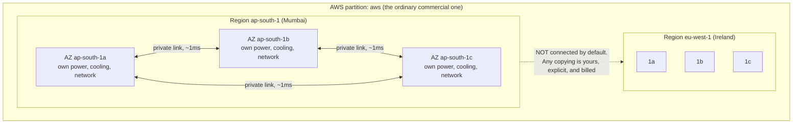
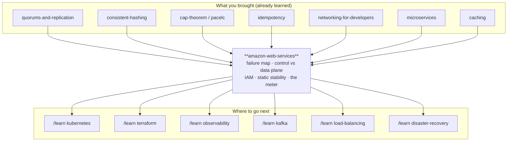

# Amazon Web Services — the failure map, the badge, and the meter

> **A no-code lab.** Documents, diagrams, an interactive simulator, and
> exercises. Nothing here is executed. Every number is either arithmetic you
> can check by hand, a scenario you can play in `visualization.html`, a figure
> published by AWS (marked as such), or a measured result cited from one of
> your earlier labs. **Prices and service limits change** — every one quoted
> here is an order-of-magnitude teaching figure, not a current quote.

---

## Before we start: what this lab is *not*

There is a version of "learn AWS" that is a list. EC2 is virtual machines. S3
is files. RDS is a database. Lambda runs a function. SQS is a queue. That list
is correct, it takes twenty minutes to read, and it will not help you when
something breaks at 2am — because none of it tells you *where your data
physically is*, *what fails together*, or *what you are still responsible for*.

You are also not the audience for that list. You have spent fifty-five labs
learning the machinery underneath: [quorums-and-replication](../34-quorums-and-replication/),
[consistent-hashing](../35-consistent-hashing/), [cap-theorem](../24-cap-theorem/),
[pacelc](../25-pacelc/), [caching](../11-caching/), [idempotency](../49-idempotency/),
[partitioning-and-rebalancing](../36-partitioning-and-rebalancing/),
[microservices](../56-microservices/), [redis](../13-redis/),
[networking-for-developers](../01-networking-for-developers/),
[google-spanner](../66-google-spanner/), [cockroachdb](../67-cockroachdb/).

Here is the reframing this lab is built on:

> **AWS is a shop where you rent other people's distributed systems.**
> You already know how to read a distributed system's guarantees. What you do
> not yet know is the *shop* — where the shelves physically are, what the
> receipt actually promises, and which parts of the job stay yours after you
> have paid.

So this lab spends its time on the three things that decide whether an AWS
system survives its first bad night, none of which appear on the service list:

1. **The failure map** — which physical boundary each copy of your state sits
   inside, and what fails together when one boundary dies.
2. **The recovery dependency** — whether getting better requires you to ask
   Amazon for something *while Amazon is the thing that is broken*.
3. **The badge and the meter** — who is allowed to make which call, and what
   stops the bill — or the damage from one mistake — running away while you sleep.

Everything else — which of the 200+ services to pick — is a lookup you can do
in five minutes once these three are in your head. Stage 13 gives you the
lookup table anyway, organised by *which primitive from your earlier labs each
service actually is*.

---

## Where you are going

The document climbs four labelled layers, with a checkpoint at each transition
telling you what you can now do and what the next layer adds.

> **BEGINNER MODEL** (stages 1–9) → **INTERMEDIATE MODEL** (stage 10) →
> **ENGINEERING MODEL** (stages 11–12) → **PRODUCTION MODEL** (stage 13)

If you stop after stage 9 you will understand what a cloud is and why it was
invented. If you stop after stage 10 you can design a system that survives a
machine dying. Stages 11–12 are what survives a *bad night*. Stage 13 is what
a team actually runs.

---

# Stage 1 — WHY: the problem in one paragraph

You have written a program. It works on your laptop. But other people need to
use it — at 3am, on a Sunday, from another country — and your laptop is in your
bag, closed, and moving. So the program needs to live on a computer that is
always switched on, always connected, and is not yours to carry around. The
moment you accept that, you have quietly signed up for a second job that has
nothing to do with writing programs: buying computers, putting them in a room
with power and cooling and internet, replacing their disks when they die,
guessing a year in advance how many you will need, and being the person who
drives to that room at 3am. **The cloud is the offer to stop doing that second
job and pay someone else, by the second, to do it instead.**

Concretely, if nobody solves this: you spend six weeks and a large cheque
before your first customer, you buy for the busiest hour of your busiest day
and then own that hardware for the other 8,700 idle hours of the year, and the
first disk failure at 3am is *your* 3am.

---

# Stage 2 — PROBLEM: Marigold Pay buys a server

*(No jargon in this stage. A ten-year-old could follow it.)*

**Asha** runs a small payments company called **Marigold Pay**. Shops use it to
take card payments. The software is one program with one job: a shop sends
"charge ₹450 to this card", Marigold talks to the bank, and Marigold answers
"paid" or "declined". It has to write down every charge, permanently, because
that record is the money.

Asha needs a computer for it. So she buys one.

**What buying one computer actually involves.** She has to decide, *today*, how
big it should be — for a business whose size next year she cannot know. Too
small and the shops get errors on the busiest day of the year. Too big and she
has spent money on a machine that sits at 6% busy for twelve months. She picks
something in the middle, signs a cheque for the whole thing up front, and waits
**six weeks** for it to arrive.

Then it has to live somewhere. Her flat has power cuts, and the internet
connection has one wire to it. So she rents space in a **data centre** — a
building full of racks, with two power feeds, generators, air conditioning and
several internet connections. She drives over, screws the machine into a rack,
plugs it in, installs the operating system, and Marigold Pay goes live.

Now watch three things happen.

**The festival.** In October, sales across every shop go up seven times for
four days. The machine cannot keep up. Requests queue, then time out, then
shops start declining cards. Asha cannot make the machine bigger — it is a
physical object, in a rack, 40 kilometres away, and a bigger one is six weeks
out. The festival is four days long. She loses it.

**The other eleven months.** The machine runs at 6% busy. She paid for all of
it. She is still paying for the rack space, the power, and the internet.

**The 3am.** A disk fails. The machine stops. Marigold Pay is down. Nobody can
take a payment anywhere in the country until Asha wakes up, sees the alert,
drives 40 kilometres, works out which disk, finds a spare, and rebuilds. That
is four hours if everything goes well. And the record of every charge was on
that disk.

Hold on to all three. They are the same problem wearing three coats:
**capacity was a purchase, not a setting; and everything lived in one place
that could stop.**

---

# Stage 3 — NAIVE SOLUTION: rent the machine instead of buying it

The obvious fix is to stop owning hardware. Companies exist that already have
racks full of machines and will rent you one by the month. This was, and still
is, a real product — dedicated server hosting, VPS providers.

Asha signs up. Now:

- No cheque up front. She pays **₹8,000 a month** instead of ₹5,00,000 once.
- No six-week wait for the *first* machine — the provider has stock, so a
  machine can be ready in a **day or two**.
- No driving. When a disk dies, the provider's technician is already in the
  building. They swap it.

This is genuinely better, and for many small businesses it is enough. It fixes
the cheque and it fixes the drive.

Before you read on, commit to a guess.

> **🔮 Predict:** The October festival comes round again. Asha is renting
> instead of owning. What happens this time?
> <details><summary>Reveal</summary>
>
> **She still loses it — just less badly.** Renting changed *who owns the
> metal* and *how you pay for it*. It did not change the two things that
> actually hurt:
>
> 1. Getting a second machine still takes a day or two of human process (an
>    order, a provisioning queue, an OS install, a configuration). The spike is
>    four days long and arrives without warning.
> 2. And when the four days end, she is renting a second machine on a monthly
>    contract for a spike that lasted a weekend.
>
> The unit of purchase is still **a whole machine, for a whole month, decided
> by a human in advance.** That is the thing that has to break.
> </details>

---

# Stage 4 — FAILURE: what renting did not fix

Walk the three pains again against the rented machine.

**Capacity is still a purchase.** It is a smaller, more frequent purchase — a
month instead of three years — but it is still a decision a person makes ahead
of time, in units of one whole machine, with a lead time measured in hours or
days. Marigold's traffic changes in *minutes*. You cannot track a minute-shaped
demand with a day-shaped supply. So you do what everyone did: you buy for the
peak and waste the rest. Asha's utilisation is still 6%.

**One machine is still one machine.** The provider replaced the dead disk
faster than Asha could have. But between the disk dying and the technician
finishing, Marigold Pay was **down**, and the record of charges was on that
disk. Renting improved the *repair time*. It did nothing about the *existence
of a single thing whose death stops everything*.

And now the deeper problem, the one this whole lab is really about.

**Asha does not know what fails together.** She asks the hosting company for a
second machine so that one can take over if the other dies. They give her one.
It is a good machine. Two months later, everything goes down anyway — both
machines at once.

Why? Because both machines were in the same rack, fed by the same power
distribution unit, behind the same top-of-rack switch. The provider never told
her, she never asked, and there was no way to ask. She bought "two machines"
believing she had bought **two chances**, and she had bought one.

This is the discovery that reorganises everything:

> Redundancy is not a count of machines. It is a count of **independent things
> that can fail**. Two copies inside one failure boundary are one copy with
> extra steps.

And you cannot count independent failures if nobody will tell you where the
boundaries are.

---

# Stage 5 — THE REAL REQUIREMENT

Everything from here is the pursuit of four sentences. Asha needs a supplier
where:

1. **Capacity is a runtime decision, not a purchasing decision.** Ask for a
   machine with a single message and have it in a minute; give it back in a
   minute; pay only for the minutes held.

2. **The failure boundaries are published.** Not "we have lots of data
   centres" — an actual, named, contractual statement of the form *"these two
   things do not share power, cooling, or a network path, so they should not
   die together"*, so that "two copies" can be made to mean two chances.

3. **The undifferentiated work can be handed over — deliberately, piece by
   piece.** Replacing disks, patching operating systems, running replication,
   taking backups: each of these should be something Asha can *choose* to stop
   doing, at a stated price, with a stated guarantee. Not all-or-nothing.

4. **And she must still be able to tell what is left hers.** Whatever the
   supplier does not do is still Asha's job, and she needs to know exactly
   which jobs those are — because the ones you *think* someone else is doing
   are the ones nobody is doing.

Requirement 4 is the one everybody skips. It is stage 11's biggest failure and
stage 12's sharpest edge. Keep it in view.

---

# Stage 6 — KEY IDEA: the pool, the map, and the badge

Amazon Web Services is one answer to those four sentences. Stripped to its
core it is three inventions stacked on each other:

> **Take an enormous pool of hardware. Cut it into slices you can rent through
> an HTTP API, by the second. Publish the map of which slices fail together.
> Then put one authorization check in front of every single call.**

Three parts, and it is worth naming them separately because engineers reliably
learn the first, ignore the second, and are eventually taught the third by an
incident:

- **The pool + the rental API.** Every action — create a machine, delete a
  database, read a file — is an HTTPS request to a web service. Nothing is a
  form you post, a person you email, or a wire you plug in. This is what turns
  capacity into a runtime decision (requirement 1) and, incidentally, is why
  infrastructure can be written as code at all.

- **The map.** AWS publishes its physical failure boundaries as a hierarchy you
  design against, and commits to their independence. This is requirement 2, it
  is the half of AWS that most tutorials skip entirely, and it is the reason a
  design that "works" can still be a single point of failure.

- **The badge.** Every one of those API calls is signed and evaluated against
  a policy before anything happens, and the default answer is no. This is what
  makes requirement 3 safe to buy — you can hand over the disks without handing
  over the keys — and requirement 4 knowable, because the badge is also the
  audit trail.

Everything else in AWS — all two hundred–odd services — is one of two things:
a slice of the pool (rent a machine, rent a disk, rent an IP address), or
**somebody else's distributed system with an API in front of it** (rent a
replicated object store, rent a partitioned queue, rent a Raft-backed
coordination service). That second category is why your fifty-five labs are the
right preparation: you are not learning new mechanisms here. You are learning
*whose* mechanism it is, *where* it runs, and *what happens when it stops*.

---

# Stage 7 — TERMINOLOGY: the ten words that carry the weight

Now the vocabulary, and only now. Each of these was earned by something in
stages 2–6. Minor terms get one line at first use; these ten get the full
treatment because you cannot reason about an AWS failure without them.

## 7.1 Region

- **Plain meaning:** a city-sized place where Amazon has built data centres.
- **Technical meaning:** an independent, geographically separate cluster of
  data centres with its own API endpoints, its own copy of most services, its
  own capacity pool and its own price list. Named like `ap-south-1` (Mumbai),
  `us-east-1` (Northern Virginia), `eu-west-1` (Ireland).
- **Why the term exists:** to name the largest boundary that is *supposed* to
  be independent. Two regions are near-separate installations of AWS. They do
  not share a database, they do not automatically copy your data to each other,
  and a region can have a very bad day while every other region is fine.
- **Concrete example:** Asha creates an S3 bucket in `ap-south-1`. From
  `eu-west-1` that bucket does not exist in any local sense — a request for it
  is either redirected or refused, and any copy in Europe is one *she* set up
  and pays to keep in sync.
- **Connects to:** this is a **failure domain**, the largest one in the map.
  The whole point of stage 4's discovery.

## 7.2 Availability Zone (AZ)

- **Plain meaning:** one independently-powered wing of a region.
- **Technical meaning:** one or more discrete data centres inside a region with
  redundant power, cooling and networking, physically separated from the other
  AZs in that region (kilometres apart, different flood plains, different power
  substations), connected to them by a private, high-bandwidth, low-latency
  network — typically single-digit milliseconds round trip, often under one.
  A region has at least three in modern designs. Written `ap-south-1a`,
  `ap-south-1b`, `ap-south-1c`.
- **Why the term exists:** **this is the answer to stage 4.** It is the
  contractual name for "these do not fail together". When Asha places one
  machine in `1a` and one in `1b`, she has bought two chances, and AWS has
  committed in writing that the rack, the power feed and the switch are not
  shared. That is exactly what the hosting company could not tell her.
- **Concrete example:** Marigold Pay runs three application servers, one in
  each of `ap-south-1a`, `1b`, `1c`. A transformer fire takes out `1b`. One
  third of capacity vanishes; two thirds keep serving. Compare: three servers
  all in `1a` — same fire, zero capacity.
- **Sharp detail most people never learn:** the *name* `ap-south-1a` is
  scrambled per AWS account. Your `ap-south-1a` and my `ap-south-1a` are
  probably different physical zones — AWS does this so everyone doesn't pile
  into "a". The stable, cross-account identifier is the **AZ ID**, like
  `aps1-az1`. If you ever need to correlate your outage with a colleague's in
  another account, names lie and IDs don't.
- **Connects to:** an AZ is the unit you place replicas across. Everything in
  [quorums-and-replication](../34-quorums-and-replication/) about *where* the
  copies go is answered here: the AZ is the "where".

Here is the map so far. Every design decision in the rest of this lab is a
statement about which box a thing sits in.



> **Read the dotted line, not the boxes.** Solid lines are things AWS built and
> maintains. The dotted line is the one you have to build yourself, and stage
> 10's version 5 is entirely about what it costs.

*(A third boundary exists above region — the **partition**: `aws` is the
ordinary commercial one, `aws-cn` is China, `aws-us-gov` is US government.
They have separate account systems entirely. You will almost certainly never
leave `aws`; it is here so the word doesn't surprise you.)*

## 7.3 Control plane vs data plane

You already own this distinction — you met it in
[distributed-rate-limiting](../60-distributed-rate-limiting/), where the counter
store was the data plane and the limit configuration was the control plane. It
is the same idea, and in AWS it is arguably **the single most operationally
important concept in the whole platform.**

- **Plain meaning:** the difference between *changing* your setup and *using*
  it.
- **Technical meaning:** the **control plane** is the set of APIs that create,
  modify, describe and delete resources — `RunInstances`, `CreateBucket`,
  `ModifyTargetGroup`. The **data plane** is the set of APIs and paths that
  *use* an already-existing resource — an HTTP request reaching your running
  EC2 instance, `GetObject` on an existing S3 key, a query against a running
  database.
- **Why the term exists:** because **they fail separately, and the control
  plane fails more often.** A control plane is a complicated, stateful,
  globally-coordinating system that must validate, allocate, schedule and
  reconcile. A data plane is a comparatively simple, local, high-volume path.
  AWS designs data planes to keep working using their *last known
  configuration* even when the control plane is unavailable.
- **Concrete example (this is the whole lesson in one picture):** during a large
  AZ event, Marigold's running EC2 instances keep serving traffic perfectly and
  the load balancer keeps routing to them — data plane, healthy. But
  `RunInstances` starts returning `InsufficientInstanceCapacity` and errors, so
  the Auto Scaling Group **cannot launch replacements** — control plane,
  degraded. A design that survives by *already having* spare capacity survives.
  A design that survives by *asking for* replacement capacity does not.
- **Connects to:** hold on to this asymmetry. In §10.6 it turns into a design
  principle with a name, and it is the most valuable AWS-specific idea in this
  lab; failure F3 in stage 11 is what it looks like at 6pm on a Friday.

## 7.4 Service quota (limit)

- **Plain meaning:** a cap on how much of a thing your account may have.
- **Technical meaning:** a numeric limit applied **per account, per region,
  per resource type** — 5 Elastic IPs, 1,000 concurrent Lambda executions, N
  vCPUs of a given instance family, X API calls per second. Some are adjustable
  by request; some are hard.
- **Why the term exists:** because the pool is shared. Multi-tenancy needs a
  bound on what one tenant can grab, both to protect other tenants and to
  protect *you* from a runaway loop. It is a rate limiter and a blast-radius
  control at once.
- **Concrete example:** at 6pm on festival day Marigold's Auto Scaling Group
  tries to grow from 12 to 30 instances and stops at 20, because the account's
  vCPU quota in `ap-south-1` is 80 and the instance type uses 4 each. Nothing
  is broken. Nothing is failed over. The system simply will not get bigger, and
  the error appears in an activity log nobody is watching.
- **Connects to:** this is [distributed-rate-limiting](../60-distributed-rate-limiting/)
  pointed at you, and the "over-admission vs under-admission" framing applies
  exactly. Failure F4.

## 7.5 Managed service, and the shared responsibility model

- **Plain meaning:** you rent the *outcome* instead of the *machine*, and the
  job splits in two.
- **Technical meaning:** AWS states the split formally as: AWS is responsible
  for security **of** the cloud (hardware, the physical facility, the
  virtualisation layer, the managed service's own software and operations); the
  customer is responsible for security **in** the cloud (your data, who may
  access it, your operating system and patches where you have one, your network
  configuration, your encryption choices). The exact dividing line **moves per
  service**, and that movement is the whole point.
- **Why the term exists:** to make requirement 3 purchasable in pieces. On a
  raw EC2 instance you patch the OS. On RDS, AWS patches the database engine
  but you still choose the version, the network, the backup retention, and who
  may connect. On DynamoDB or S3 there is no OS or version at all — the
  remaining surface is data, access and configuration.
- **Concrete example, and the trap:** Asha moves Marigold's database to RDS and
  stops thinking about it. Eight months later a bad migration deletes a table.
  AWS has been faithfully replicating that deletion to the standby and
  faithfully snapshotting the deleted state. "Managed" moved the *disks* and
  the *engine patching* to AWS. It never moved **"is the data correct?"** or
  **"can we get back to yesterday?"** — and the retention window for automated
  backups has a default that is *finite*.
- **Connects to:** requirement 4. The jobs you think someone else is doing are
  the ones nobody is doing. Failure F8.

## 7.6 IAM: principal, policy, role, temporary credentials

IAM (Identity and Access Management) is the badge. Four words:

- A **principal** is whoever is making the call — a human user, an application,
  another AWS service acting on your behalf.
- A **policy** is a JSON document listing allowed or denied (action, resource,
  condition) triples. `s3:GetObject` on `arn:aws:s3:::marigold-receipts/*`,
  allowed, only from inside our network. *(That second string names a specific
  resource; §7.10 unpacks its structure.)*
- A **role** is a set of permissions that has **no permanent password or key**
  and is instead *assumed* — an EC2 instance, a Lambda function or a container
  is attached to a role, and automatically receives credentials that **expire**
  (typically in hours) and are rotated for it.
- **Temporary credentials** are that expiring key set. This is the mechanism
  that makes it possible to run code in the cloud without a long-lived secret
  in it.

- **Why these terms exist:** because "who may do what" has to be answerable
  *before every single API call*, uniformly, for humans and machines alike, and
  because the alternative — a long-lived access key pasted into a config file —
  is the single most common way AWS accounts get compromised. A leaked
  permanent key works forever from anywhere; a leaked role credential expires
  on its own.
- **Concrete example:** Marigold's payment service runs on EC2 with a role
  allowing exactly `dynamodb:PutItem` and `dynamodb:GetItem` on the `charges`
  table, and `kms:Decrypt` with one key. Its code contains no credentials at
  all. If someone gets shell on that instance, what they can reach is that
  table and that key — not the whole account.
- **Connects to:** blast radius (§7.8) is measured in exactly these units.

**The evaluation rule, because you will need it and it is not intuitive:**
the default is **deny**. An `Allow` somewhere flips it to yes. And an explicit
`Deny` **anywhere** in any applicable policy flips it back to no, permanently
— deny always wins, and no allow can override it. That is why a
"deny everything not from our network" guardrail at the organisation level is
safe to apply even though a hundred teams write their own allow policies
underneath it.

## 7.7 Elasticity (and why it is not "scalability")

- **Plain meaning:** capacity that goes up *and comes back down*, by itself,
  fast enough to track real demand.
- **Technical meaning:** the ability to acquire and release capacity
  programmatically in minutes, with billing granularity (per-second or
  per-request) small enough that releasing it actually saves money.
- **Why the term exists as distinct from "scalable":** a system is *scalable*
  if you can make it bigger. Asha's owned server was scalable — she could buy
  another, in six weeks, forever. It was not *elastic*. **Elasticity is
  scalability with a small time constant and a refund.** Both halves matter:
  scaling up in 90 seconds is useless if you still pay for a year, and cheap
  per-second billing is useless if provisioning takes a day.
- **Concrete example:** festival evening, Marigold goes 12 → 30 instances in
  four minutes and back to 12 at midnight. Cost of the spike: 18 machines × 6
  hours, not 18 machines × 1 month. That ratio — roughly 120× less — is the
  entire commercial argument for cloud, and it only exists because *both*
  halves are true.
- **Where it stops being true:** elasticity is a property of the *stateless*
  parts. You cannot elastically double a database that holds 4TB, because the
  data has to get there. This asymmetry is the shape of every AWS architecture
  in stage 10.

## 7.8 Blast radius

- **Plain meaning:** how much breaks when this one thing breaks.
- **Technical meaning:** the set of resources, customers or data affected by a
  single fault, a single bad deployment, or a single compromised credential.
- **Why the term exists:** because in a shared pool, "will it fail?" is a bad
  question (it will) and "how far does the failure reach?" is the useful one.
  Every AWS structural decision — multiple AZs, multiple regions, multiple
  *accounts*, narrow IAM roles, per-service quotas — is a blast-radius
  decision, not a reliability decision.
- **Concrete example:** Marigold runs staging and production in the **same**
  account. A load test in staging exhausts the account's shared vCPU quota in
  `ap-south-1`, so production's Auto Scaling Group cannot scale during the
  evening peak. Nothing failed. The blast radius of "staging" simply included
  production, because a quota is per-account.
- **Connects to:** stage 13's multi-account structure. It is the single
  cheapest blast-radius control AWS offers and it is organisational, not
  technical.

## 7.9 VPC, subnet, security group

- **Plain meaning:** your own private network inside AWS, and the doors in it.
- **Technical meaning:** a **VPC** (Virtual Private Cloud) is a private IP
  address range that is yours alone inside a region. A **subnet** is a slice of
  that range that lives **in exactly one AZ** — this is the point where the
  network model and the failure map meet. A **security group** is a stateful
  allow-list attached to a resource: "TCP 443 from the load balancer, TCP 5432
  to the database, nothing else".
- **Why the terms exist:** because "rent a machine on the internet" would be
  unusable. You need machines that can talk to each other and *not* to the
  world, and you need the network boundary to be software you can version, not
  a cable.
- **Concrete example:** Marigold's VPC is `10.0.0.0/16`. Three **public**
  subnets (`10.0.1.0/24` in 1a, `10.0.2.0/24` in 1b, `10.0.3.0/24` in 1c) hold
  the load balancer. Three **private** subnets hold the application servers and
  the database — machines there have no public IP and cannot be reached from
  the internet at all. The application's security group allows port 8080 only
  from the load balancer's security group.
- **The detail that matters for this lab:** *a subnet is AZ-scoped.* So "I have
  three subnets" is only three chances if they are in three different AZs. This
  is stage 4's mistake, reappearing in network clothing.

## 7.10 Endpoint, ARN, and SigV4 (the shape of every call)

Three small ones that make the mechanism in stage 10 readable:

- An **endpoint** is the hostname you send an API call to, and it is almost
  always **regional**: `dynamodb.ap-south-1.amazonaws.com`. The region is in
  the DNS name. There is no "AWS" to talk to — there is `ap-south-1`'s
  DynamoDB, which is a different running system from `eu-west-1`'s.
- An **ARN** (Amazon Resource Name) is the globally unique identifier of any
  resource, and it is worth reading one because it *is* the failure map written
  as a string:
  `arn:aws:dynamodb:ap-south-1:123456789012:table/charges`
  — partition, service, region, account, resource. Every policy is written
  against these.
- **SigV4** is the signing scheme. Every request carries a signature computed
  over the request's method, path, headers, body hash and a timestamp, using
  the caller's secret key. The key itself never travels. A signature is valid
  for a few minutes, so a captured request cannot be replayed tomorrow.

> **CHECKPOINT — you have the vocabulary.**
> You can now read an AWS architecture diagram and ask the only two questions
> that matter: *which failure domain is each box in?* and *what does this
> design need from the control plane in order to recover?* Next: two mental
> models to hold it all together, then the machinery.

---

# Stage 8 — MENTAL MODELS: the building, and the machine

You need two pictures. One to carry around in conversation, one to reason with
when something is broken.

## 8.1 The simple model — a serviced office building, with a meter

Imagine a company that owns enormous office buildings and rents you desks.

- Each **building** is in a different city. Buildings are run separately: a
  flood in the Mumbai building has nothing to do with the Dublin one. You must
  choose which building your team works in, and moving your filing cabinets to
  another city is a removal job you organise and pay for.
- Each building has several **wings**, and each wing has its own generator,
  its own air conditioning and its own internet line. The landlord guarantees
  in writing that the wings do not share these. If you want to survive a
  generator failure, you put people in two wings.
- You get desks by **sending a message**, not by signing a lease. "Four desks,
  please" — four desks are ready in a minute. "Done with them" — they are gone
  in a minute, and the meter stops.
- **Everything is on a meter.** Desks by the second. The photocopier by the
  page. Crucially, carrying paper *out of the building* costs money per sheet,
  while carrying paper *in* is free.
- You **badge in for every single action.** Not once at the door — every time
  you open a drawer. Your badge is checked against a rulebook, and the default
  answer is no. Staff badges expire every few hours and renew themselves.
- You can rent **serviced desks** where the landlord also does the filing, the
  photocopying and the archiving. You still decide what goes in the files and
  who may read them.

That model is genuinely load-bearing: region = building, AZ = wing, API call =
sending a message, IAM = badging in for every action, managed service =
serviced desk, egress charges = paper leaving the building.

## 8.2 The engineering model — what is actually true

Strip the building away:

- An **account** is a namespace and a billing boundary. Every resource belongs
  to exactly one account. It is also the *default* blast-radius boundary: most
  quotas are per-account, and IAM's reach stops at the account edge unless you
  deliberately extend it.
- A **resource** lives at a definite point in the hierarchy
  `partition → region → (usually) AZ`. Some resources are region-scoped and
  internally spread across AZs by AWS (an S3 bucket, a DynamoDB table, an SQS
  queue). Some are AZ-scoped and it is your job to spread them (an EC2
  instance, an EBS volume, a subnet, an RDS instance in a single-AZ
  deployment). **Knowing which is which for every resource in your diagram is
  the job.**
- Every action is an **authenticated, authorized, quota-checked HTTPS request**
  to a regional endpoint of an independent multi-tenant service.
- Each service is **its own distributed system** with its own consistency
  model, its own durability claim, its own quotas, and its own control and data
  planes. There is no shared transaction, no shared clock, no shared lock. Two
  AWS services are as independent from each other as two vendors.
- Only two things in your system cannot be recreated from code: **your state
  and your identity configuration.** Everything else — instances, load
  balancers, networks, DNS records — is a rebuildable consequence of a
  template. This is why "infrastructure as code" is not tidiness; it is the
  recovery plan.

## 8.3 Mapping the two

| Building | Engineering | Why it matters |
|---|---|---|
| Building (city) | Region, e.g. `ap-south-1` | Largest independence boundary; nothing crosses it unless you build it |
| Wing with own generator | Availability Zone | The unit you place replicas across; the answer to stage 4 |
| Desk | EC2 instance / container / Lambda invocation | Rentable, disposable, AZ-scoped |
| Filing cabinet at the desk | Instance store (local disk) | Dies with the desk. Not storage, scratch space |
| Cabinet in the wing's store room | EBS volume | Survives the desk, **not** the wing — AZ-scoped |
| The building's archive | S3 bucket | Region-scoped, AWS spreads it across wings for you |
| Sending a message to get desks | Control plane API call | Can be refused or slow, exactly when you need it most |
| Working at a desk you already have | Data plane | Keeps working when the message system is down |
| Badging in for every drawer | IAM policy evaluation | Deny by default; explicit deny always wins |
| Serviced desk | Managed service | Moves work, never moves "is my data correct?" |
| The meter, including paper leaving | Billing, egress charges | Runs whether or not anything useful happens |
| Reception being down | Control plane outage | You keep working; you cannot get new desks |

## 8.4 Where the analogy breaks — four places, all of them expensive

An analogy left unqualified is a bug with a delay fuse. Here is exactly where
the building stops being true.

**1. Buildings do not have per-tenant quotas that bite at 3am.** If a real
landlord has 500 free desks, you can have 500. In AWS your account has a
*numeric cap* per region that is unrelated to available capacity, applies to
things you are not currently using, and is enforced by returning an error
rather than by a person saying "sorry". The failure mode is not "the building
is full" — it is "the building is empty and the door still won't open for
you". Quotas are also **per-region**, so a limit increase you obtained in
`ap-south-1` does nothing for your `eu-west-1` disaster-recovery plan. That
sentence has ruined more than one failover test.

**2. Regions are not branches of one company.** In the building analogy the
company is one company — HR knows about you everywhere. In AWS, regions are
much closer to separate installations. Your data does not travel between them.
Your quota does not travel. Even service *availability* does not: a service
launched last year exists in `us-east-1` and may not exist in `ap-south-1`
yet. And a small number of things are genuinely global with their control plane
concentrated in **`us-east-1`** — IAM, Route 53's control plane, CloudFront,
Organizations, and historically the billing console. That is a real, structural
dependency: an event in Northern Virginia can affect your ability to *change*
things in Mumbai even though Mumbai's data planes are perfectly healthy. It is
also the honest reason `us-east-1` incidents are the ones that make the news.

**3. "Serviced" does not mean "supervised".** A serviced office's staff would
notice if you set fire to your own filing cabinet. AWS will not. `DeleteTable`
is a valid, authorized, instantly-executed API call, and the replication you
are paying for will faithfully replicate the deletion. Every safety net against
*your own correct-looking actions* — backups you have actually restored,
deletion protection, versioning, a separate account holding the copies — is
something you switch on. This is requirement 4, and it is where the analogy is
most dangerously comforting.

**4. The meter has no idle discount, and the direction of travel is priced.**
An empty desk costs nothing in a real office. A running instance at 0% CPU
costs full price; an unattached disk costs full price; an idle NAT Gateway
costs by the hour; an Elastic IP that is *not* attached to anything is billed
precisely *because* it is idle. And data has a direction: bytes coming **in**
are generally free, bytes going **out** to the internet cost roughly an order
of ¢/GB, and — the one that surprises people — bytes crossing **between AZs**
inside your own region are also charged, in both directions. So the
architecture that gives you stage 4's independence (spread across AZs) has a
line item, and a chatty service mesh spread across three AZs can spend more on
internal traffic than on compute. Nothing in the office picture prepares you
for "talking to yourself costs money".

> **CHECKPOINT — you have both models.**
> You can now explain what a cloud *is* and why AZs exist, to anyone. What you
> cannot yet do is watch a failure and predict the outcome. That is the next
> two stages: first the simulator, then the machinery.

---

# Stage 9 — VISUALIZATION: watch Marigold Pay break

Open **`visualization.html`**, or the published copy:
**https://claude.ai/code/artifact/c5052244-bae4-4e3e-9d94-6d8f0e3bc543**
It is a self-contained page; the local file works offline.

**What it shows.** One region, `ap-south-1`, with three availability zones
drawn as three columns — the same spatial layout as the diagram in §7.2, so the
picture in your head and the picture on the screen are the same picture. Inside
them: your load balancer, your application servers, your database, and the
regional services (S3, DynamoDB). Above them, drawn deliberately *outside* the
zones, is the **control plane** — because that is exactly where it lives in
reality and exactly why it fails separately.

**What to look at first.** Traffic flows as small dots from the client, through
DNS and the load balancer, to whichever instances are healthy. The number that
matters is the **verdict bar** at the top: how many of the last 100 payment
requests succeeded, and a full-sentence explanation of why the number is what
it is. Everything else on the page exists to explain that one number.

**The controls, and what each one is for:**

| Control | What it does | Which stage it teaches |
|---|---|---|
| **Architecture v1 … v5** | Swaps the whole design, from one server to multi-region | §10.2–10.7 |
| **Kill instance** | Terminates one application server | F1 |
| **Kill AZ** (pick which) | Takes out an entire zone: instances, database, subnet | F2 |
| **Freeze control plane** | Existing things keep running; nothing new can be launched | F3 — the big one |
| **Hit the quota** | Caps how large the Auto Scaling Group may grow | F4 |
| **Traffic dial** | Normal → festival (7×) | §7.7 elasticity |
| **Static stability toggle** | Pre-provision N+1 vs launch-on-demand | §10.6 |
| **DB placement** | Single-AZ / Multi-AZ / Aurora-style quorum | §10.4–10.5 |
| **Step ◀ / ▶, play, reset** | Move through time in either direction | everything |
| **Click any box** | Inspect its state: role, health, AZ, what it is waiting for | everything |

**Run these three first, in this order.** Each one asks you to predict before
it runs, then tells you whether you were right and why.

1. **"One server, one disk"** (v1 + kill instance) — 30 seconds. Establishes the
   baseline pain from stage 2, and shows the thing beginners get wrong: the
   *data* does not come back.
2. **"Two servers, one wing"** (v2 + kill AZ `1a`) — this is stage 4's discovery
   as a moving picture. Two instances, zero survivors.
3. **"The night the control plane froze"** (v4 + kill AZ + freeze control
   plane) — run it once with static stability **off** and once **on**. Same
   fault, same architecture diagram, opposite outcome. If you only do one thing
   in the simulator, do this pair.

**The two settings that are usually invisible are controls here, deliberately.**
Which AZ dies, and whether the control plane responds, are normally hidden
assumptions in an architecture diagram — a diagram silently assumes the answer
doesn't matter. It matters enormously, so both are dials you turn.

---

# Stage 10 — THE ACTUAL MECHANISM

Two mechanisms, and they are different in kind. First, what physically happens
inside **one API call** — because every single thing you do in AWS is that call
and its failure modes are the platform's failure modes. Second, how a real
architecture is **forced** into existence, version by version, by things
breaking.

## 10.1 Anatomy of one call: `PutItem` on DynamoDB

Marigold's Java service records a charge. In the AWS SDK this is one line, and
that line hides seven distinct things that can each fail differently. Here is a
hand-worked trace with concrete values.

**Starting state.** The code runs on an EC2 instance in `ap-south-1b`. The
instance has an attached role `MarigoldChargeWriter`. The table is
`arn:aws:dynamodb:ap-south-1:123456789012:table/charges`. The item is
`{charge_id: "ch_8812", amount: 45000, status: "captured"}`.

```
Step 1  CREDENTIALS
        The SDK asks the instance's local metadata endpoint for credentials.
        It gets back a temporary triple that expires in ~6 hours:
          AccessKeyId    = ASIA...           (note: ASIA = temporary)
          SecretAccessKey= wJal...
          SessionToken   = IQoJb3JpZ2lu...
        No secret is stored in the application. This is §7.6's role, working.
        FAILS AS: credentials expired / no role attached -> the SDK throws
                  before a single byte reaches the network.

Step 2  ENDPOINT RESOLUTION
        Region ap-south-1 is turned into a hostname:
          dynamodb.ap-south-1.amazonaws.com
        DNS resolves it to an IP inside AWS's network.
        FAILS AS: this is where the networking lab's DNS lesson applies. A
                  5-second resolver stall here looks exactly like "DynamoDB is
                  slow" from the application's point of view.

Step 3  SIGNING (SigV4)
        A canonical form of the request is built - method, path, sorted
        headers, SHA-256 of the body - and signed with the secret key plus the
        date, region and service name. The result goes in a header:
          Authorization: AWS4-HMAC-SHA256 Credential=ASIA.../20260830/
            ap-south-1/dynamodb/aws4_request, Signature=8f42...
        The secret never travels. The signature is time-bound.
        FAILS AS: SignatureDoesNotMatch - and the classic cause is a machine
                  whose clock has drifted more than a few minutes.

Step 4  TRANSPORT
        TLS to the regional endpoint, HTTP POST, connection reused from a pool.
        Everything from the networking lab applies unchanged: connect timeout
        vs read timeout are different bounds, and a slow response is more
        dangerous than a refused one.

Step 5  AUTHORIZATION  (the badge, evaluated)
        The DynamoDB front end asks IAM: may principal
        arn:aws:sts::123456789012:assumed-role/MarigoldChargeWriter/i-0abc
        perform dynamodb:PutItem on .../table/charges ?
        Evaluation, in this order, with deny always winning:
          a. Organization SCP        -> allows dynamodb:*        (pass)
          b. Permission boundary     -> none attached            (pass)
          c. Identity policy on role -> Allow PutItem on charges (ALLOW)
          d. Resource policy         -> none for DynamoDB tables (n/a)
          e. Any explicit Deny?      -> none                     (pass)
        Result: ALLOW. Default was DENY; (c) is what flipped it.
        FAILS AS: AccessDeniedException. Note it fails HERE - after the network
                  round trip, before any data work. An IAM mistake is a
                  100%-of-calls failure, instantly, not a slow degradation.

Step 6  QUOTA / THROTTLE CHECK
        Does this table have write capacity right now, and does this partition?
        FAILS AS: ProvisionedThroughputExceededException. The SDK retries it
                  automatically with backoff, which is why this failure often
                  shows up as LATENCY rather than as errors. See F5.

Step 7  THE ACTUAL DISTRIBUTED SYSTEM
        Only now does anything resemble a database. The key "ch_8812" is
        hashed to a partition; the partition's replicas live in three AZs; the
        write is acknowledged once a quorum of them has it.
        This is your quorums-and-replication lab, running on someone else's
        machines, in three buildings you will never see.
        RETURNS: 200, and the charge is durable across an AZ failure.
```

Two things to take from that trace.

**First: five of the seven steps have nothing to do with the database.** When
"DynamoDB is broken", it is usually steps 1, 3, 5 or 6 — credentials, clock,
policy, quota. That is the shape of almost every AWS incident an application
team actually experiences.

**Second: step 7 is the only step that is a distributed system, and you already
know how it works.** That is the reframing from the top of this lab, made
concrete. What was new here was the shop, not the machinery.

## 10.2 Version 1 — one instance, and everything on it

Asha's first AWS deployment is a direct translation of the rented server:

- one EC2 instance, `t3.medium`, in `ap-south-1a`
- the application, and PostgreSQL, both on that instance
- data on the instance's local disk
- a public IP

It works. It costs about ₹2,000 a month. It is also, in AWS terms, strictly
*worse* than what she had, and it takes one paragraph to see why.

> **🔮 Predict:** Asha stops the instance for ten minutes one evening to change
> its size, then starts it again. What happens to the payment records?
> <details><summary>Reveal</summary>
>
> **If the data was on <em>instance store</em> — the physical disk attached to
> the host machine — it is gone.** Not corrupted: gone, with no error. Instance
> store is scratch space tied to the specific host your VM happens to be on,
> and stopping the instance releases the host.
>
> If it was on an **EBS volume** — network-attached storage that lives in the
> AZ rather than on the host — it survives the stop, and this is why EBS is the
> default for anything you care about.
>
> **The general rule, and it is the most useful one-liner in AWS storage:**
> *instance store dies with the host; EBS dies with the AZ; S3 and DynamoDB
> die with the region.* Three different boundaries, three different levels of
> "gone". Pick per piece of data, deliberately.
> </details>

So: v1 with EBS. Now the instance's underlying hardware fails at 3am, which
happens. The instance stops. Marigold is down until someone launches a new one
and reattaches the volume. We have reproduced stage 2's 3am — cheaper and
faster, but the same shape.

## 10.3 Version 2 — two instances and a load balancer

The obvious fix: two application servers, and something in front to spread
traffic and stop sending it to a dead one.

- an **Application Load Balancer** (ALB) with a public DNS name
- two EC2 instances registered as **targets**
- a **health check**: the ALB requests `/health` every 30 seconds; two
  consecutive failures and it stops sending that target traffic

The database is now on its own instance, because two application servers cannot
share one local disk.

Now the failure test. One instance dies: the ALB notices within about a minute
and routes everything to the other one. Customers see a handful of errors
during the detection window, then normal service. **This genuinely works**, and
it is the first design in this lab that does.

> **🔮 Predict:** All three boxes — both application servers and the database —
> were launched in `ap-south-1a`, because that was the default in the console
> and nobody changed it. A power event takes out `ap-south-1a`. How much of
> Marigold Pay survives?
> <details><summary>Reveal</summary>
>
> **None of it.** The ALB survives (it is region-scoped and AWS runs it in
> multiple zones) and it is now a perfectly healthy load balancer with zero
> healthy targets, returning 503 to every shop in the country.
>
> This is **stage 4's discovery**, exactly, on new hardware. Asha bought two
> instances believing she had bought two chances. Redundancy is a count of
> independent failure domains, and she had one. The difference between this and
> the hosting company is that **AWS would have told her** — the AZ was a
> visible, selectable field on the launch screen, and she left it on the
> default.
>
> Watch this as scenario 2 in the simulator. The instructive detail is the
> ALB's own state: it is *up*, it is *healthy*, its dashboard is green, and it
> serves nothing.
> </details>

## 10.4 Version 3 — spread across zones, and let it heal itself

Two changes, and they are the two halves of every AWS reliability story.

**Placement.** Application servers go one per zone: `1a`, `1b`, `1c`. Subnets
are created per zone (remember §7.9: a subnet is AZ-scoped, so three subnets in
one AZ is still one chance). The ALB is given all three subnets.

**Replacement.** The instances stop being pets. An **Auto Scaling Group** (ASG)
is told: *desired 3, minimum 3, maximum 12, spread evenly across these three
subnets, and here is the health check.* Now, when an instance dies, the ASG
launches a replacement — automatically, in the same zone, from the same image.
The same mechanism handles the festival: a scaling policy says *if average CPU
across the group exceeds 60%, add instances*.

This is the standard shape, and it is the picture on the front of every AWS
tutorial. Watch the AZ failure again: `1b` dies, one third of capacity
vanishes, the ALB stops routing there within a minute, the ASG launches a
replacement in `1a` or `1c`, and Marigold serves the whole festival with a
brief dip.

Except for one box in the diagram.

> **🔮 Predict:** In version 3 the database is still a single PostgreSQL
> instance, sitting in `ap-south-1a`, because moving a database felt like a
> separate project. `1a` fails. The application servers in `1b` and `1c` are
> healthy and the ALB is happily routing to them. What do shops see?
> <details><summary>Reveal</summary>
>
> **Every payment fails**, and — this is the cruel part — they fail *slowly*.
> The application servers are up, so they accept the request, try to reach the
> database, and block until their connection times out. A shop that would
> rather have had a fast "declined" instead waits 30 seconds for a 500.
>
> This is the [microservices](../56-microservices/) lab's central result on AWS
> hardware: **a slow dependency destroys a system harder than a dead one**,
> because the healthy tier converts its own health into a queue of stuck
> threads. All three application servers become useless within seconds of the
> database going away, regardless of which zone they are in.
>
> The lesson that generalises past this example: **elasticity is a property of
> the stateless tier, and it buys you nothing while state has a single home.**
> Auto-scaling three application servers across three zones is decoration if
> the thing they all need is in one.
> </details>

## 10.5 Version 4 — giving the state a failure story

State is the hard half, and AWS offers it at three prices. All three are the
same trade you have already studied; only the packaging is new.

**(a) RDS Multi-AZ.** One primary database instance in `1a`, one standby in
`1b`. Every write is replicated **synchronously** to the standby before being
acknowledged. The standby serves no traffic — it exists purely to take over.
On failure, AWS detects it and flips a DNS name from the primary's address to
the standby's; AWS documents this as typically **60–120 seconds** for the
classic Multi-AZ instance deployment, faster for the newer Multi-AZ DB cluster
form. You change nothing in the application: it always connects to the same
endpoint name.

This is a **CP** choice in [cap-theorem](../24-cap-theorem/) terms and a **PC/EC**
choice in [pacelc](../25-pacelc/) terms: synchronous replication means the write
latency includes a cross-AZ round trip (single-digit ms — the price of
consistency in the no-partition case, exactly PACELC's "else" branch), and
during failover the database refuses service rather than serving two primaries.

**(b) Aurora.** The same API and the same engines, with the storage layer
rebuilt as a distributed system: the database's data is held as **six copies
across three AZs**, and the engine writes to that storage layer rather than to
a disk. AWS describes the write path as requiring acknowledgement from **four
of six** copies and reads as satisfiable from **three of six** — which is a
straight quorum with `W=4, R=3, N=6`, so `W + R > N` holds with a margin
chosen so that the system survives losing an *entire AZ plus one more copy*
and still writes. Read replicas share that storage instead of copying data, so
adding one is fast and adds little write cost.

If that felt familiar, it should: it is
[quorums-and-replication](../34-quorums-and-replication/) with the numbers picked
so the failure domain — not the individual disk — is the unit being tolerated.

**(c) DynamoDB / S3 / SQS.** Skip the database-shaped thing entirely and use a
service that is *already* multi-AZ by construction, with no instances, no
failover event and no version to patch. You do not choose zones for a DynamoDB
table; there is nowhere on the screen to make stage 4's mistake. The price is
that you accept its data model and its consistency menu rather than SQL's.

> **A useful way to hold the three:** (a) moves the *failover* to AWS, (b)
> moves the *storage layer* to AWS, (c) moves the *entire idea of a server* to
> AWS. Each step removes a class of mistake and removes a control.

Version 4 is Marigold with an ASG across three zones and RDS Multi-AZ. It
survives an instance failure and an AZ failure. It is a good design.

Now the night it doesn't work.

## 10.6 Version 4 breaks: the night the control plane froze

This is the section to read twice.

**The scenario.** A large event affects `ap-south-1b`. Marigold's design says:
lose a third of capacity, ASG launches replacements, carry on. Traffic that
evening is at festival level, so the group is at 12 instances, four per zone.

Here is what actually happens, step by step, with concrete numbers:

```
18:04:00  AZ 1b degrades. 4 of 12 instances stop responding.
18:04:30  ALB health checks fail for those 4. It stops routing to them.
          Capacity: 8 of 12. Latency rises; some requests shed.
18:05:00  ASG notices 4 unhealthy, terminates them, calls RunInstances
          for 4 replacements.
18:05:02  RunInstances returns InsufficientInstanceCapacity.
          Reason: every other customer in ap-south-1 whose design also
          depended on launching replacements is asking for the same
          instance type in the same two surviving zones, at the same second.
18:05:02  ASG backs off and retries. And retries.
18:11:00  Still 8 instances. Festival traffic needs 12. Marigold is now
          shedding roughly a third of payments, and has been for 7 minutes.
19:40:00  Capacity gradually becomes available. The group refills.
```

Nothing in Marigold's design was wrong by the diagram. The application tier was
spread across three zones. The database failed over correctly in 90 seconds.
And the system still spent an hour and a half degraded — because **the recovery
plan depended on making a control plane call during the exact minute that
control plane was under region-wide stress.**

> **🔮 Predict:** What change to the design would have made this a non-event —
> without adding a fourth zone, a second region, or any new AWS service?
> <details><summary>Reveal</summary>
>
> **Run 18 instances instead of 12, six per zone, and never let the design need
> a launch in order to recover.**
>
> With `N = 3` zones and enough capacity in any two of them to serve 100% of
> peak, losing one zone means going from 150% of needed capacity to 100%. The
> ASG's launch call still fails. **It does not matter**, because nothing was
> waiting on it. Recovery consisted entirely of the load balancer *stopping*
> doing something — removing unhealthy targets — which is a data-plane action
> that needs nobody's permission.
>
> This is **static stability**: designing so that the response to a failure is
> to *keep doing what you were already doing with what you already have*, never
> to acquire something new. AWS names it explicitly in its own Builders'
> Library, and it is the principle behind why their data planes keep serving
> from last-known configuration when control planes are unavailable.
>
> The bill is real and you should say it out loud: you are paying for 18
> machines to serve 12 machines' worth of traffic — **50% overprovisioning**,
> which is the price of not depending on the control plane. That is the actual
> trade, and it is a business decision, not an engineering one.
> </details>

**Generalise it into a checklist**, because this is the highest-value thing in
the lab. For each recovery path in your design, ask: *does getting better
require a successful control-plane call?*

| Recovery mechanism | Needs control plane? | Statically stable? |
|---|---|---|
| ALB removes an unhealthy target | No — data plane | ✅ |
| Traffic shifts to already-running instances in other AZs | No | ✅ |
| ASG launches a replacement instance | **Yes** (`RunInstances`) | ❌ |
| RDS Multi-AZ failover to an existing standby | Mostly no — the standby already exists | ✅ mostly |
| Creating a new RDS instance from a snapshot | **Yes**, and slowly | ❌ |
| Route 53 health-check failover between existing endpoints | No — the health-check data plane | ✅ |
| Changing a Route 53 record by hand during an incident | **Yes** (and its control plane is in `us-east-1`) | ❌ |
| Reading from a DynamoDB table that already exists | No | ✅ |
| Auto-scaling a DynamoDB table's capacity upward | **Yes** | ❌ |

Read the ❌ rows as: *these will be unavailable precisely when you need them.*
Design so they are optimisations, never the plan.

## 10.7 Version 5 — the second region, and why it is a different kind of problem

A region can have a bad day. If Marigold must survive that, it needs a second
one — and this is where AWS stops being able to hide anything from you, because
copying state between regions is not a feature you buy, it is a **CAP position
you take**.

Three honest options, and you have already studied all three:

**Warm standby with asynchronous replication.** Aurora Global Database
replicates to a second region with typical lag AWS describes as **under a
second**. Failover is a promotion you trigger. The number this design is really
buying is **RPO** — recovery point objective, *how much data you accept
losing*. Async replication with 1s lag means an instant region loss can lose up
to about a second of committed writes. For most businesses that is fine. For
Marigold, one second of payments is a reconciliation problem with real money in
it, and someone in finance needs to agree to that number in advance.

**Active-active with DynamoDB Global Tables.** Both regions accept writes; AWS
replicates both ways; conflicts resolve **last-writer-wins**. That is a
deliberate **AP** choice, and it is the [eventual-consistency](../28-eventual-consistency/)
and [crdts](../32-crdts/) discussion arriving with a price tag: LWW silently
discards one of two concurrent updates, and your `charges` table is the one
place where silently discarding a write is unacceptable. It is excellent for
sessions, profiles, feature flags and carts. Think very hard before it holds
money.

**Synchronous across regions.** Available in effect via
[google-spanner](../66-google-spanner/)-style systems (and in the AWS world,
things built on similar principles), and the reason almost nobody does it for
an interactive path is in your PACELC lab: cross-region round trips are
**tens to hundreds of milliseconds** and they are added to *every write*, in the
normal, unpartitioned case. Mumbai to Ireland is roughly 120ms one way. Two
round trips of consensus and your payment API has a floor of half a second
before it does any work.

There is no fourth option. The reason multi-region is hard is not AWS; it is
the speed of light plus the CAP theorem, and AWS's contribution is only that it
makes the choice explicit and bills you for it.

**The often-better answer, and say it before someone spends a year on this:**
*most* businesses should be multi-AZ, statically stable, with tested backups
restorable into a second region — and should accept several hours of downtime
in a genuine region loss. Multi-region active-active roughly doubles the
infrastructure bill, more than doubles the operational complexity, introduces
data-consistency failure modes that do not exist in a single region, and its
own machinery becomes a new source of outages. Buy it when the cost of an hour
down exceeds all of that, and not before.

## 10.8 Version 6 — the three that actually take companies down

Versions 1–5 are the infrastructure story. In practice, the incidents that hurt
most are not zone failures. They are these, and none of them appear on an
architecture diagram:

1. **A permission that was wider than it needed to be.** A leaked long-lived
   access key, or a role with `*`, turns one compromised laptop into an
   account-wide event. The whole of §7.6 exists for this. Blast radius is
   measured in IAM policies, and it is the cheapest thing on this list to fix.
2. **A bill nobody bounded.** A misconfigured job, a recursive Lambda, a
   forgotten cluster left running in a region nobody looks at. The meter never
   sleeps and AWS will not stop you.
3. **A backup nobody had ever restored.** Multi-AZ replicates your mistakes at
   the speed of light. See F8.

> **CHECKPOINT — you have the intermediate model.**
> You can now design a system that survives an instance failure and a zone
> failure, and — more valuably than most working AWS engineers — you can look at
> a design and say *"this recovers by asking the control plane for something,
> so it will not recover"*. Next, the engineering layer: every failure mode
> laid out with what it keeps and what it loses, then the guarantees.

---

# Stage 11 — FAILURE SCENARIOS

Eleven failures. For each: how to create it, where to watch it, what happens
and why, how the system responds, which guarantee survives, which is lost, and
what a real team does about it. They are ordered roughly by how often a working
engineer meets them, which is *not* the order tutorials use.

---

### F1 — A single instance dies

**Create:** simulator, any version, *Kill instance*. In reality: underlying
host hardware fails, or the OS is killed by the kernel out-of-memory killer, or
a deploy ships a broken build.

**What happens.** The instance stops answering. The ALB's health check fails
twice (default-ish 30s interval, 2 unhealthy threshold) and it is removed from
rotation about 60 seconds later. In v3+ the ASG terminates it and launches a
replacement, which takes 2–5 minutes to boot, configure and pass its first
health checks.

**Why.** Nothing exotic — hardware fails. The interesting part is the
**detection window**: for that ~60 seconds the load balancer is still sending
a share of traffic to a dead target.

**Response / kept / lost.** Kept: durability — anything already written to EBS
or a managed store is untouched. Lost: a slice of requests during detection,
and any in-flight request on that instance. **In-flight is the one people
forget:** a payment that was mid-flight has an unknown outcome, which is
precisely why [idempotency](../49-idempotency/) keys are not optional on a write
path. The client retries; the server must not double-charge.

**Production.** Health check tuning is a real trade (aggressive checks detect
faster and also eject healthy instances during a GC pause). Connection draining
/ deregistration delay lets in-flight requests finish on a *planned* removal.
Run at least 3 instances so losing one is a third, not a half.

---

### F2 — An entire Availability Zone fails

**Create:** simulator, *Kill AZ*, and pick which one — try `1a` when the
database is in `1a`, then try `1c`.

**What happens.** Every AZ-scoped resource in it becomes unreachable at once:
instances, their EBS volumes, the subnet, the NAT gateway in it, an RDS primary
if it lived there. Region-scoped services (S3, DynamoDB, SQS, the ALB itself)
keep working — AWS runs them across zones for you.

**Why.** Shared power, cooling or network *within* the zone — which is exactly
the boundary the zone was defined to contain.

**Response.** ALB stops routing to the dead zone. RDS Multi-AZ fails over to
the standby, typically 60–120 seconds. The ASG tries to rebalance. **Which is
where F3 usually joins in.**

**Kept:** if you are spread across three zones with capacity in two,
availability survives; durability of anything in a region-scoped service is
untouched. **Lost:** one third of capacity instantly, plus the RDS failover
window in which writes fail, plus every open database connection in every
application server — connection pools hold dead sockets and must be evicted
before the application recovers, which is the
[networking-for-developers](../01-networking-for-developers/) result appearing
again.

**Production.** Three zones, not two, so losing one leaves a majority for
anything quorum-based. Never put the only copy of anything AZ-scoped anywhere.
Test it: AWS Fault Injection Service can simulate zone loss on purpose.

---

### F3 — The control plane is unavailable while the data plane is fine

**Create:** simulator, *Freeze control plane* — with static stability off, then
on.

**What happens.** Everything currently running keeps running and keeps serving.
`RunInstances`, `CreateTable`, `UpdateService`, console operations and API
describes become slow, throttled or failing. Auto Scaling cannot replace
anything. Deployments cannot proceed. This is the shape of several of the
largest publicly-documented AWS events, including the November 2020
`us-east-1` Kinesis event (whose effects reached other services that depended
on it) and the December 2021 `us-east-1` internal network event, where customer
data planes were substantially healthier than the control planes and the
console. *(Summarised from AWS's public post-event summaries — read the
originals; they are among the best incident writing in the industry.)*

**Why.** A control plane does hard, stateful, coordinating work and is
correlated across the whole region, whereas a data plane is a simple local path
designed to keep serving from last-known configuration.

**Response.** *Yours,* not AWS's: a statically stable system does nothing and
is fine; a just-in-time system waits.

**Kept:** the data plane — existing capacity keeps serving, existing data stays
readable and writable. **Lost:** every form of *change* — scaling, replacing,
deploying, failing over anything that needs a create call.

**Production.** The §10.6 checklist. Additionally: keep a runbook that assumes
the console is unusable, avoid making the incident response itself depend on
control-plane calls, and remember that during a big event you are **competing
with every other customer** for the same capacity.

---

### F4 — A service quota is reached

**Create:** simulator, *Hit the quota*, then raise traffic to festival level.

**What happens.** Scaling stops at a number that has nothing to do with load or
available hardware. Nothing crashes. The metric is a line in the ASG activity
history and an API error code, and neither is on anybody's dashboard by
default.

**Why.** Per-account, per-region caps (§7.4). The classic causes are:
never having asked for an increase in a region you only use for disaster
recovery; a shared account where a load test consumed the pool; and hitting an
*API rate* quota rather than a resource-count quota during a mass launch.

**Kept:** correctness — everything running is right. **Lost:** elasticity,
silently. You have a scalable design that will not scale.

**Production.** Enumerate the quotas your recovery path needs — in *every*
region you would fail over to — and raise them **before** you need them, since
an increase is a support process with a human in it. Alarm on utilisation
(Service Quotas publishes usage metrics) at ~70%, not at 100%. And this is one
of the strongest arguments for separate accounts per environment.

---

### F5 — A hot partition throttles your database

**Create:** in the simulator, festival traffic with a single merchant
dominating. In reality: a DynamoDB table partitioned by something with skew.

**What happens.** The table has plenty of unused capacity overall, and a subset
of requests get `ProvisionedThroughputExceededException`. Because the SDK
retries with backoff automatically, the first symptom is usually **p99 latency,
not errors** — which sends people looking at the network.

**Why.** This is your [consistent-hashing](../35-consistent-hashing/) and
[partitioning-and-rebalancing](../36-partitioning-and-rebalancing/) labs, exactly.
DynamoDB hashes the partition key and splits data into partitions with
*per-partition* throughput ceilings (historically documented around 3,000
read units and 1,000 write units each). A key that is hot — one giant merchant,
or a partition key like `date` where everything today shares one value — sends
all of its traffic to one partition. DynamoDB's adaptive capacity absorbs a
lot of this now, but it cannot make one key be in two places, because *the
whole point of a placement function is that a key has one owner.*

**Kept:** correctness and durability, fully. **Lost:** the throughput you
thought you had bought, on one key.

**Production.** Fix the key, not the capacity: write-sharding a hot key into
`merchant#42#0..9` is the sub-key splitting from your
[distributed-rate-limiting](../60-distributed-rate-limiting/) lab, same remedy in
a new place. Watch `ThrottledRequests` per table. If your access pattern is
genuinely "one entity is 40% of traffic", a cache in front is the right answer
and DynamoDB's own (DAX) or [redis](../13-redis/) both work.

---

### F6 — A whole region has an event, and the `us-east-1` twist

**Create:** simulator, architecture v5, *Region event*.

**What happens.** Regional endpoints degrade broadly. If you are single-region,
you are down for the duration. There is nothing clever available at that point;
your options were all exercised months earlier.

**The twist worth knowing.** A handful of AWS things are **global with their
control plane concentrated in `us-east-1`**: IAM, Organizations, Route 53's
control plane, CloudFront, and historically parts of billing. So a `us-east-1`
event can prevent you from *changing* an IAM policy or a DNS record even while
your Mumbai workload is entirely healthy. This is why `us-east-1` incidents get
disproportionate coverage — and it is a genuine structural dependency, not a
myth.

**Kept:** other regions' data planes, and any data you had already replicated
elsewhere. **Lost:** the region, and possibly your ability to reconfigure
anything global.

**Production.** Decide your RPO and RTO as numbers, with the business, in
advance. Test the restore — a backup you have never restored is a hypothesis.
Keep at least the ability to *serve a static apology page* from elsewhere.
And note that Route 53 **health-check-based** failover between existing
endpoints is a data-plane behaviour and keeps working; *editing* records by
hand is the control-plane action that may not.

---

### F7 — An IAM mistake

**Create:** simulator, *IAM deny*, and watch where in the request path it
fails.

**What happens, in two opposite flavours.**
*Too narrow:* a deploy ships a role missing one action. 100% of writes fail
instantly with `AccessDeniedException` — a total, immediate, unambiguous
outage, which is the *good* kind because you will find it in ninety seconds.
*Too wide:* nothing happens at all, for months, until a key leaks or a bug in
one service reaches data belonging to another. This is the bad kind.

**Why.** Deny-by-default plus explicit-deny-wins makes the narrow failure loud.
Nothing makes the wide failure loud, because "worked fine" is what excess
permission looks like every single day.

**Kept:** in the narrow case, everything except availability of that path — no
data is at risk. **Lost:** in the wide case, potentially the containment
property that the rest of the design depends on.

**Production.** No long-lived access keys in applications, ever — roles and
temporary credentials (§7.6). Scope roles to specific actions on specific ARNs.
Use organisation-level guardrails (SCPs) as an explicit deny that no team can
override — for example "no principal in this account may disable logging" or
"only these regions may be used". Turn on access analysis to find over-broad
grants, and treat a public S3 bucket as a paged incident.

---

### F8 — The deletion that replicated perfectly

**Create:** cannot be simulated meaningfully; it is a one-line story. A
migration drops a column with data in it. A cleanup job's `WHERE` clause is
wrong. Someone deletes the "unused" bucket.

**What happens.** The action is authorized, valid, and executed immediately.
Multi-AZ replication copies it to the standby within milliseconds. Aurora's six
copies all agree. Your cross-region replica receives it in under a second.
**Every reliability mechanism you bought works perfectly and against you**,
because none of them can distinguish your mistake from your intent.

**Why.** Replication protects against *hardware and infrastructure* failure. It
is not, and has never been, a backup. That distinction is
[requirement 4](#stage-5--the-real-requirement) with money on it.

**Kept:** availability, ironically — the system is perfectly up. **Lost:** the
data, and possibly the business.

**Production.** Point-in-time recovery switched on with a retention window
someone has actually chosen (defaults are finite and often shorter than the
time it takes to *notice*). S3 versioning plus MFA-delete on anything
irreplaceable. Deletion protection on production databases. Backups in a
**separate account** whose credentials production does not hold, so that a
compromise of production cannot reach them. And a restore rehearsal on a
calendar, because the number you care about is not "do backups exist" but "how
long does a restore take and does anyone here know how".

---

### F9 — The bill

**Create:** leave a `p4d` GPU instance running in a region you don't check. Or
a recursive Lambda: a function writes to an S3 bucket whose events trigger the
same function.

**What happens.** Nothing breaks. The meter runs. The failure surfaces days
later as a number.

**Why.** Elasticity has no upper bound by default, and AWS's default posture is
to let you have what you ask for. There is no "spend limit" that hard-stops
resources.

**Kept:** everything technical. **Lost:** money, and sometimes the project.

**Production.** Budgets with alerts (they alert; they do not stop). Mandatory
cost-allocation tags so a spike is attributable to a team in minutes rather
than a week. Watch the three that surprise people most: **cross-AZ data
transfer** (the price of §7.2's independence), **NAT Gateway** hourly plus
per-GB processing, and **internet egress**. Non-production accounts with hard
guardrails. And know the pricing models — on-demand, Savings Plans/Reserved for
committed baseline, Spot for interruptible work at a large discount — because
choosing them well is usually a bigger lever than any code change.

---

### F10 — A dependency gets slow, not dead

**Create:** simulator, throttle the database rather than killing it.

**What happens.** Application threads block. The pool fills. Requests queue.
Health checks — which usually hit a trivial `/health` that does not touch the
database — keep passing, so the ALB keeps sending traffic to instances that
cannot do anything with it. Then the ASG, seeing high CPU or high request
count, **adds more instances**, which open more connections to the struggling
dependency and make it worse.

**Why.** Precisely the [microservices](../56-microservices/) result: a slow
dependency is worse than a dead one, because a dead one fails fast and frees
the caller. Auto-scaling turns it into a positive feedback loop.

**Kept:** correctness. **Lost:** availability, with every dashboard green.

**Production.** Timeouts on every call, always shorter going inward
(the timeout budget from your networking lab). Circuit breakers. Bulkheads so
one dependency's queue cannot consume the whole thread pool. Health checks
that are *shallow* by design — a deep health check that fails when the database
is slow will eject your entire fleet and turn a degradation into an outage.

---

### F11 — Failover happened and the clients did not notice

**Create:** RDS Multi-AZ failover, or any DNS-based failover.

**What happens.** AWS flips the DNS record to the standby in 60–120 seconds.
Your application keeps failing for much longer, because: the JVM or the
connection pool cached the old IP; the pool holds established TCP connections
to an address that no longer answers; and `isConnected()` cheerfully returns
true until something tries to write.

**Why.** DNS-based failover updates a *name*, and your process resolved that
name a long time ago. This is the connection-pool lesson from
[networking-for-developers](../01-networking-for-developers/) with a specific and
very common trigger.

**Kept:** the database is healthy and available. **Lost:** your application's
access to it, for minutes after the platform considers the incident over.

**Production.** Bound DNS caching (in the JVM, `networkaddress.cache.ttl` —
historically the default under a security manager was to cache forever, which
is exactly wrong here). Use a pool that validates connections and evicts on
failure. Test failover as a routine exercise, not as a theory — RDS lets you
trigger one on demand, and the first time you do it you will learn something
about your application that no diagram would have told you.

> **CHECKPOINT — the failure catalogue is complete.**
> You can now take any AWS design and enumerate what happens to it under
> instance, zone, control-plane, quota, partition-skew, region, permission,
> operator-error, cost, latency and DNS failure. Next: pulling the guarantees
> together — what AWS actually promises, and what it very carefully does not.

---

# Stage 12 — CORRECTNESS: what is actually guaranteed

Everything below is earned by something in stages 10–11. Read it as a contract,
because that is what it is.

## 12.1 Durability and availability are different numbers, and only one is a promise

S3 is described by AWS as **designed for 99.999999999% durability** — eleven
nines — of objects over a year. That is a *design target for not losing data*,
achieved by storing redundantly across multiple AZs. It is not a service level
agreement and it is not about whether you can reach your data.

S3's *availability* is a separate, much smaller number with an actual SLA
attached (99.9% monthly for S3 Standard, with service credits below that).
EC2's SLA is 99.99% for a region-level deployment across multiple AZs, and a
lower figure for a single instance.

Three things follow, and each of them catches people:

1. **An SLA is a refund, not a guarantee.** Breaching it costs AWS a
   percentage of your bill for that service. It does not cost them your
   customers. Never design as though the SLA is a floor on your outcomes; it is
   a bound on your compensation.
2. **Availability composes downward, multiplicatively.** If your request path
   touches a load balancer, compute, a database and a queue, and each is
   independently 99.95%, your path is `0.9995⁴ ≈ 99.80%` — about 17 hours a
   year, from four components that each promised under 5. This is the
   [microservices](../56-microservices/) arithmetic, and it is why the answer is
   never "add more nines to each component" but "remove the component from the
   critical path" (cache it, queue it, make it optional, degrade without it).
3. **The multi-AZ number is only yours if you are actually multi-AZ.** EC2's
   99.99% describes a design across zones. Version 2 of Marigold did not get
   it, and no amount of reading the SLA would have revealed that.

## 12.2 The independence claim, stated exactly

AWS's structural guarantee is: **AZs in a region are physically separated and do
not share power, cooling, or a single network path, and are connected by
private, low-latency, high-bandwidth links.** That is a claim about
*infrastructure*, and it has held up well.

It is **not** a claim that:

- a *service's* control plane is per-AZ (it usually is not — it is regional,
  which is F3),
- your *own* dependencies are spread across zones (that is your job, which is
  §10.3),
- a bug in a service's software is contained by a zone (software deploys are
  the correlated failure that physical separation cannot address — which is
  why AWS itself deploys in stages across zones and regions).

Read the last one twice. Physical independence is a strong protection against
*physical* correlation. The dominant correlated failure in modern systems is a
deployment, and a zone boundary does not stop one.

## 12.3 Consistency: per service, and you must look it up

There is no platform-wide consistency model. Each service is its own system —
here are the ones you will actually meet, in the vocabulary you already have:

| Service | Model | The sharp edge |
|---|---|---|
| **S3** | Strong read-after-write for PUTs, overwrites and deletes, since December 2020 | Before that it was eventual for overwrites, and a *great deal* of internet writing predates the change and is now wrong |
| **DynamoDB** | Eventually consistent reads **by default**; strongly consistent available per read, at 2× the read cost | Strong reads are not available on **global secondary indexes**, and never across regions |
| **DynamoDB Global Tables** | Multi-active, asynchronous, **last-writer-wins** | An **AP** choice. LWW silently discards a concurrent write — see [crdts](../32-crdts/) for why this is the crudest possible resolution |
| **SQS Standard** | At-least-once delivery, best-effort ordering | Duplicates and reordering are *normal operation*, not failure. Consumers must be idempotent — [idempotency](../49-idempotency/) is mandatory here |
| **SQS FIFO** | Ordered per message-group, deduplicated within a ~5-minute window | Lower throughput; the dedup window is time-bounded, so it is not "exactly once" in general |
| **Kinesis / Kafka-shaped logs** | Ordered **per shard/partition**, not globally | Same result as [partitioning-and-rebalancing](../36-partitioning-and-rebalancing/): ordering is a per-partition property, always |
| **RDS Multi-AZ (standby)** | Synchronous; standby serves no reads | **CP / PC+EC** — you pay the cross-AZ round trip on every write |
| **RDS read replicas** | Asynchronous, replica lag is real and variable | Read-your-own-writes is **not** provided. You must engineer it — [caching](../11-caching/) covered exactly this |
| **Aurora** | Quorum storage, `W=4, R=3, N=6` across 3 AZs | Replica lag to reader endpoints still exists (typically ms), so the read-your-writes problem is smaller, not gone |
| **ElastiCache / Redis** | Whatever [redis](../13-redis/) said: async replication, no rollback | "Redis said OK" ≠ "this survives a failover", unchanged |

**The rule to carry away:** when you adopt an AWS service, the first question is
not what it costs — it is *what does a successful write mean here, and what can
a subsequent read see?* Every one of your fifty-five labs was preparation for
asking that question well.

## 12.4 What was traded away for all of this

An honest ledger. You gave up:

- **Placement control.** You choose a region, a zone and an instance type. You
  do not choose the rack, the neighbours, or the host. Noisy-neighbour effects
  and variance are real, and the answer is usually "use a larger instance type
  or a dedicated one", i.e. pay more.
- **Inspectability.** When a managed service is slow, you get metrics AWS
  chose to publish and a support case. You cannot attach a profiler to it.
- **Price coupling.** Compute is competitive; *data movement* is where the
  economics bite, and it is deliberately asymmetric — in is free, out and
  sideways are not. That asymmetry is also the main mechanism of lock-in, and
  it is more effective than any API incompatibility.
- **A lock-in gradient, which you choose per component.** Roughly: EC2 and
  containers are near-portable; RDS-on-PostgreSQL is portable with effort;
  DynamoDB, Lambda's execution model, IAM's policy model and the event glue
  between services are not. This is a legitimate trade — managed services are
  genuinely cheaper to operate — but make it consciously, per component, and
  know which side of the line each of your components is on.
- **The ability to be sure.** You are running on someone else's distributed
  systems. You will have incidents whose root cause is a paragraph in a
  post-event summary published four days later, and there is nothing you can do
  about it except have been statically stable at the time.

## 12.5 The three invariants worth memorising

If you retain nothing else from stages 10–12:

1. **Redundancy is a count of independent failure domains, never a count of
   machines.** (Stage 4; §10.3.)
2. **A recovery path that requires a control-plane call is not a recovery
   path.** (Static stability; §10.6; F3.)
3. **Replication protects against infrastructure; only backups protect against
   you.** (F8.)

> **CHECKPOINT — you have the engineering model.**
> You can read a service's guarantees, compute a design's compound
> availability, and name what each mechanism does and does not protect
> against. The last layer is what a team actually runs: accounts, code,
> observability, cost, and the map of which service is which primitive.

---

# Stage 13 — PRODUCTION

## 13.1 The bridge: from this lab's Marigold to a real team's AWS

| This lab | A real team |
|---|---|
| One account | An **Organization**: separate accounts for prod, staging, dev, security, and shared services — the cheapest blast-radius control that exists |
| Resources created in a console | **Infrastructure as code** — Terraform, CDK or CloudFormation — in git, reviewed, applied by a pipeline |
| One region, three zones | Same, plus a documented RPO/RTO and a *tested* restore into a second region |
| "Watch the verdict bar" | CloudWatch metrics and alarms, structured logs, distributed tracing, and an on-call rota |
| Static stability as a toggle | A capacity plan with an explicit overprovisioning percentage that finance has agreed to |
| A role per application | Least-privilege roles, no long-lived keys, SCP guardrails, automated access analysis |
| The meter | Cost allocation tags, budgets, Savings Plans for the baseline, Spot for the interruptible |

## 13.2 Why click-ops fails, stated properly

Creating things by hand in the console is fine for learning and fatal in
production, for a reason more specific than "it's not repeatable":

**Your infrastructure code is your disaster recovery plan.** Recall §8.2: only
state and identity cannot be recreated. If everything else is a template, a
region loss is "apply the template elsewhere and restore the data". If
everything else is 400 console clicks that one person half-remembers, a region
loss is a rewrite under pressure. The value of IaC is not tidiness — it is that
it converts "rebuild our company's infrastructure" from an unbounded task into
a bounded one.

The secondary benefits are real too: a diff to review before it happens, drift
detection, and the fact that "who changed this?" has an answer.

## 13.3 Compute: how to choose, in one page

The genuine decision is *how much of the machine you want to think about*.

- **EC2** — you get a VM. You own the OS, patching, the image, the scaling
  group. Right when you have specific OS/kernel/licensing needs, long-running
  stateful processes, or an existing estate to lift.
- **ECS / EKS (containers)** — you get a scheduler. EKS is Kubernetes with a
  managed control plane; ECS is AWS's simpler, non-portable equivalent. Right
  when you have many services and want one deployment model. With **Fargate**
  you additionally stop managing the underlying instances at the cost of price
  per unit and some control. Kubernetes is a large operational commitment; a
  team of five running eight services usually does not need it, and saying so
  out loud is more useful than the diagram it replaces.
- **Lambda (serverless)** — you get a function invocation. No servers, no
  scaling configuration, pay per request-millisecond, scales to zero. Right for
  event-driven work, spiky and low-average traffic, and glue. Constraints to
  know: an execution time limit (15 minutes), a memory ceiling, a per-region
  concurrency quota, and **cold starts** — which for a JVM application is the
  real one, since a Spring Boot cold start is measured in seconds unless you
  work at it (SnapStart, a smaller framework, or provisioned concurrency).
- **The honest default for a Java/Spring team:** containers on ECS Fargate or
  EKS for the always-on request path, Lambda for the event glue and scheduled
  jobs. EC2 when something forces it.

## 13.4 The service map — organised by *what it already is* in your labs

This is the lookup table promised at the top. The point of the middle column is
that you are not learning a hundred new things; you are learning which of your
existing mental models each product is an instance of.

| Service | The primitive it is | Your lab |
|---|---|---|
| **S3** | Replicated object store, multi-AZ, strong read-after-write | [quorums-and-replication](../34-quorums-and-replication/) |
| **EBS** | Network-attached block device, AZ-scoped | §10.2's storage boundary rule |
| **DynamoDB** | Hash-partitioned KV store, per-partition throughput ceilings | [consistent-hashing](../35-consistent-hashing/), [partitioning-and-rebalancing](../36-partitioning-and-rebalancing/) |
| **DynamoDB Global Tables** | Multi-master, async, LWW conflict resolution | [eventual-consistency](../28-eventual-consistency/), [crdts](../32-crdts/) |
| **RDS Multi-AZ** | Synchronous primary/standby with DNS failover | [cap-theorem](../24-cap-theorem/), [pacelc](../25-pacelc/) |
| **Aurora** | Quorum storage `W=4 R=3 N=6` across 3 AZs | [quorums-and-replication](../34-quorums-and-replication/) |
| **ElastiCache (Redis)** | Exactly [redis](../13-redis/), rented | [redis](../13-redis/), [caching](../11-caching/) |
| **SQS** | At-least-once queue; duplicates are normal | [idempotency](../49-idempotency/), [transactional-outbox](../48-transactional-outbox/) |
| **SNS / EventBridge** | Fan-out pub/sub, at-least-once | [microservices](../56-microservices/) choreography |
| **Kinesis / MSK** | Partitioned ordered log; order is per-shard | [partitioning-and-rebalancing](../36-partitioning-and-rebalancing/), [event-sourcing](../50-event-sourcing/) |
| **DynamoDB Streams / DMS** | Change data capture off a store | [change-data-capture](../52-change-data-capture/), [transactional-outbox](../48-transactional-outbox/) |
| **Step Functions** | Orchestrated workflow with compensations | [saga](../47-saga/) — orchestration flavour |
| **ALB / NLB** | L7 / L4 load balancing with health checks | [microservices](../56-microservices/), [networking-for-developers](../01-networking-for-developers/) |
| **Route 53** | DNS + health-check failover; **control plane in `us-east-1`** | [networking-for-developers](../01-networking-for-developers/), F6 |
| **CloudFront** | CDN — a cache at the edge with TTLs and invalidation | [http-caching](../12-http-caching/), [caching](../11-caching/) |
| **API Gateway** | Edge: authn, throttling, request routing | [distributed-rate-limiting](../60-distributed-rate-limiting/) |
| **DynamoDB conditional writes** | Compare-and-set / optimistic concurrency | [optimistic-vs-pessimistic-locking](../10-optimistic-vs-pessimistic-locking/) |
| **DynamoDB lock with lease + fencing** | Distributed lock, needs a fencing token | [distributed-locking](../43-distributed-locking/) |
| **Auto Scaling Group** | Supervised replica set with health-driven replacement | §10.3, F3 |
| **CloudWatch** | Metrics, logs, alarms | operational surface for all of the above |
| **KMS** | Managed key hierarchy; envelope encryption | [tls](../14-tls/) adjacent |
| **IAM / STS** | Authorization on every call; temporary credentials | §7.6 |

Two notes on that table. **Nothing in the middle column is new to you.** And
the services with no lab in the right column — CloudWatch, KMS, IAM — are the
operational and security surface, which is genuinely AWS-specific knowledge and
the part worth reading real documentation for.

## 13.5 What the on-call engineer actually sees

Not "AZ 1b is down". The first signal is almost always one of:

- ALB `HTTPCode_Target_5XX_Count` rising, or `TargetResponseTime` p99 rising
- `UnHealthyHostCount` non-zero on a target group
- `ThrottledRequests` on a DynamoDB table, or `ReadThrottleEvents`
- database `CPUUtilization` at 100% or `DatabaseConnections` at the ceiling
- Lambda `Throttles` or `ConcurrentExecutions` at the account quota
- a queue's `ApproximateAgeOfOldestMessage` climbing — the single best
  early-warning metric in an asynchronous system, because it turns a throughput
  deficit into a visibly growing number before anything times out

The diagnostic instinct worth building, straight from
[networking-for-developers](../01-networking-for-developers/): **read the symptom
backwards to the layer.** Fast failures mean something answered and refused
(IAM, throttling, a closed connection). Slow failures mean something did not
answer (a dependency, a dropped packet path, a saturated pool). And a *green*
dashboard with unhappy customers means your health check is shallower than your
actual dependency graph — which is F10, and it is the most common way an
incident goes unnoticed for twenty minutes.

Always check the **AWS Health Dashboard** — the personalised one, which shows
events affecting *your* account and resources, not just the public status page.

## 13.6 The Java/Spring angle

Since this is the day job, three concrete things. *(These are illustrative
shapes to read, not files to run.)*

**Credentials should be invisible.** AWS SDK v2's `DefaultCredentialsProvider`
walks a chain — environment, system properties, web identity token, profile
file, then the container/instance metadata endpoint. On ECS or EC2 with a role
attached, the last step supplies temporary credentials automatically:

```java
// No keys anywhere. On ECS/EC2 the role supplies temporary credentials.
DynamoDbClient ddb = DynamoDbClient.builder()
    .region(Region.AP_SOUTH_1)
    .build();
```

If you ever find yourself writing `.credentialsProvider(StaticCredentials...)`
with a literal key in a deployed application, that is F7's "too wide" flavour
waiting to happen.

**Timeouts are yours to set, and the defaults are not your defaults.** Every
SDK client takes an override configuration; set an API call timeout and an
attempt timeout so a slow AWS dependency cannot become F10:

```java
ClientOverrideConfiguration.builder()
    .apiCallTimeout(Duration.ofSeconds(3))        // whole operation, all retries
    .apiCallAttemptTimeout(Duration.ofMillis(800))// one attempt
    .build();
```

**The SDK retries for you, which is a feature and a trap.** It retries
throttling and transient errors with backoff automatically. That is why F5
shows up as latency. It also means a write can be attempted more than once, so
the [idempotency](../49-idempotency/) rule holds: a payment write needs a
condition expression or an idempotency key, not a hope.

## 13.7 What this lab deliberately left out

Named honestly, so you know the shape of the hole:

- **Kubernetes/EKS in depth** — a large subject of its own.
- **Networking beyond the basics** — Transit Gateway, PrivateLink, Direct
  Connect, IPv6, hybrid connectivity.
- **Serverless internals** — Firecracker, cold-start mechanics, event source
  mappings.
- **Data and analytics** — Redshift, Athena, Glue, EMR, the lakehouse story.
- **Compliance and governance** — Config, Control Tower, audit regimes.
- **Cost engineering as a discipline** — this lab gives you the traps, not the
  practice.
- **The Well-Architected Framework** — AWS's own six-pillar review structure
  (operational excellence, security, reliability, performance efficiency, cost
  optimisation, sustainability). Worth reading once; most of its reliability
  pillar is stages 10–12 of this lab in AWS's own words.
- **Anything about a specific price.** Prices and quotas change; the *shapes*
  in this lab do not.

> **CHECKPOINT — production model reached.**
> You can design, defend and operate a multi-AZ AWS system, name what each
> service is in terms you already knew, and predict its behaviour under eleven
> distinct failures. What remains is practice — the exercises — and choosing
> which of the holes above to open next.

---

# Stage 14 — EXERCISES

See **`EXERCISES.md`** (answers in **`SOLUTIONS.md`** — attempt first). Eight
rungs, from "explain it in your own words" to "design a payments platform for
three regions and defend the CAP position you took". Rungs 3–5 are done in the
simulator; 6–8 are pencil and paper.

The three worth doing even if you skip the rest:

- **4.2** — turn static stability off and explain, in one sentence, what
  physically changed.
- **6.1** — a design with a planted flaw that survives every diagram review and
  fails on the first bad night.
- **8.1** — the multi-region payments design, where the interesting answer is
  the RPO number you refuse to accept.

---

# Stage 15 — KNOWLEDGE MAP & NEXT STEPS



**Commonly confused, with the sentence that separates them:**

- **AWS vs "the cloud"** — AWS is one vendor's implementation of the idea;
  GCP and Azure make the same three inventions (pool, map, badge) with
  different names (GCP's *zone* and *region* map cleanly; Azure's *availability
  zone* likewise). The failure-domain reasoning ports; the product names do
  not.
- **Region vs Availability Zone** — a region is a city and does not fail over
  to another region by itself; a zone is an independently-powered wing of that
  city and is the unit you place replicas across.
- **Availability vs durability** — durability is "the bytes still exist";
  availability is "you can reach them right now". S3's famous eleven nines is
  the first one.
- **Replication vs backup** — replication copies your mistakes perfectly and
  immediately; a backup is a point in time you can go back to. (F8.)
- **Elasticity vs scalability** — scalability is "can be made bigger";
  elasticity is "made bigger and smaller automatically, in minutes, with the
  bill following".
- **Control plane vs data plane** — changing your setup vs using it. They fail
  separately, and the second one keeps working.
- **Managed vs serverless** — managed means AWS runs the software (RDS still
  has an instance size and an hourly cost); serverless means there is no
  instance and it scales to zero (DynamoDB on-demand, Lambda, SQS).
- **Serverless vs Lambda** — Lambda is one serverless product; S3, DynamoDB
  on-demand, SQS and EventBridge are equally serverless and considerably older.
- **An SLA vs a guarantee** — the SLA is what AWS refunds, not what AWS
  promises will happen. (§12.1.)

**Suggested next commands, in the order that compounds best:**

- `/learn terraform` — infrastructure as code is the recovery plan from
  §13.2, and it is the single highest-leverage thing to add next.
- `/learn kubernetes` — the compute layer this lab left as a box.
- `/learn observability` — stage 13.5 is a list of metrics; this turns it into
  a practice (SLOs, error budgets, tracing, cardinality).
- `/learn kafka` — the one big distributed-systems primitive with no lab yet;
  it has been on your "next" list since [consistent-hashing](../35-consistent-hashing/)
  and [redis](../13-redis/).
- `/learn load-balancing` — flagged as "next" by four previous labs and still
  unopened.
- `/learn disaster-recovery` — RPO/RTO, backup strategies, and the restore
  rehearsal that F8 says you owe yourself.

---

# Stage 16 — GLOSSARY

In order of first appearance.

| Term | One line |
|---|---|
| **Data centre** | A building with redundant power, cooling and network where machines live |
| **Failure boundary / failure domain** | The set of things that die together when one physical thing fails |
| **Region** | An independent, city-scale cluster of AWS data centres with its own endpoints, capacity and prices (`ap-south-1`) |
| **Availability Zone (AZ)** | One or more discrete data centres in a region with their own power, cooling and network — the unit you place replicas across |
| **AZ ID** | The stable cross-account identifier of a zone (`aps1-az1`); the *name* `ap-south-1a` is scrambled per account |
| **Partition (AWS sense)** | The largest boundary: `aws`, `aws-cn`, `aws-us-gov` — separate account systems entirely |
| **Control plane** | The APIs that create, change and delete resources. Fails more often; fails region-wide |
| **Data plane** | The path that *uses* an existing resource. Designed to keep serving from last-known configuration |
| **Service quota (limit)** | A numeric cap on a resource or API rate, **per account, per region** |
| **Managed service** | A service where AWS operates the software; the dividing line moves per service |
| **Shared responsibility model** | AWS secures *of* the cloud (hardware, facility, hypervisor, service software); you secure *in* it (data, access, config) |
| **IAM** | Identity and Access Management — the authorization check in front of every API call |
| **Principal** | Whoever is making the call: a user, a role session, a service acting for you |
| **Policy** | A JSON document of allow/deny (action, resource, condition) triples |
| **Role** | Permissions with no permanent secret, *assumed* by a machine or person; supplies expiring credentials |
| **Temporary credentials** | The expiring key/secret/token triple a role hands out; `ASIA…` rather than `AKIA…` |
| **Explicit deny wins** | Default is deny; an Allow flips it; an explicit Deny anywhere flips it back and cannot be overridden |
| **SCP (Service Control Policy)** | An organisation-level guardrail that caps what any account under it may do |
| **Elasticity** | Capacity that grows *and shrinks* automatically in minutes, with billing granularity small enough that shrinking saves money |
| **Blast radius** | How much breaks when one thing breaks — the useful reliability question |
| **VPC** | Your private IP network inside a region |
| **Subnet** | A slice of a VPC that lives in **exactly one AZ** |
| **Security group** | A stateful allow-list of traffic attached to a resource |
| **Endpoint** | The (usually regional) hostname an API call is sent to |
| **ARN** | The globally unique name of a resource; it literally encodes partition, service, region, account |
| **SigV4** | The request-signing scheme: signature over method, path, headers, body hash, timestamp; the secret never travels |
| **EC2 instance** | A rented virtual machine, AZ-scoped |
| **AMI** | The image an instance boots from |
| **Instance store** | Local disk on the host — **dies with the host** |
| **EBS** | Network-attached block storage — survives the instance, **dies with the AZ** |
| **S3** | Region-scoped object store, redundant across AZs, strong read-after-write since Dec 2020 |
| **ALB / NLB** | Application (L7) / Network (L4) load balancer with health checks; region-scoped, multi-AZ |
| **Health check** | A periodic probe deciding whether a target receives traffic |
| **Target group** | The set of things a load balancer routes to, with their health state |
| **Auto Scaling Group (ASG)** | Keeps N healthy instances alive across chosen subnets, replacing and scaling them |
| **RDS** | Managed relational database instances |
| **Multi-AZ (RDS)** | Synchronous standby in another zone; DNS failover typically 60–120s |
| **Aurora** | AWS's rebuilt storage layer: 6 copies over 3 AZs, `W=4 R=3` quorum writes |
| **DynamoDB** | Serverless hash-partitioned KV/document store, multi-AZ by construction |
| **Hot partition** | One partition key taking disproportionate traffic and hitting a per-partition ceiling |
| **Global Table** | Multi-region, multi-active DynamoDB with last-writer-wins conflict resolution |
| **SQS** | Managed queue; Standard is at-least-once and unordered, FIFO is ordered and deduplicated in a window |
| **Kinesis** | Partitioned ordered log; ordering is per-shard |
| **Lambda** | Serverless function invocation; 15-minute ceiling, per-region concurrency quota, cold starts |
| **Fargate** | Run containers without managing the underlying instances |
| **Route 53** | DNS with health-check failover; its **control plane lives in `us-east-1`** |
| **CloudFront** | CDN — an edge cache, global |
| **KMS** | Managed encryption keys and envelope encryption |
| **CloudWatch** | Metrics, logs and alarms |
| **Static stability** | Designing so recovery uses capacity you already have, never a control-plane call |
| **RPO / RTO** | How much data you accept losing / how long you accept being down |
| **Egress charge** | Cost of bytes leaving — to the internet, and also **between AZs** in your own region |
| **NAT Gateway** | Lets private-subnet machines reach the internet outbound; billed hourly *and* per GB |
| **Savings Plan / Reserved / Spot** | Commit for a discount / commit to an instance / take interruptible capacity cheaply |
| **Organization / account** | The billing, quota and blast-radius boundary; the cheapest isolation AWS sells |
| **IaC** | Infrastructure as code — Terraform, CDK, CloudFormation; it *is* the recovery plan |
| **AWS Health Dashboard** | The personalised view of events affecting your account, distinct from the public status page |
| **Fault Injection Service** | AWS's tool for deliberately causing failures, including simulated AZ loss |
| **Well-Architected Framework** | AWS's six-pillar review structure; its reliability pillar is this lab in AWS's words |
