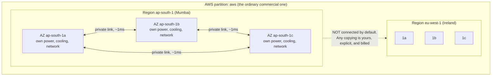
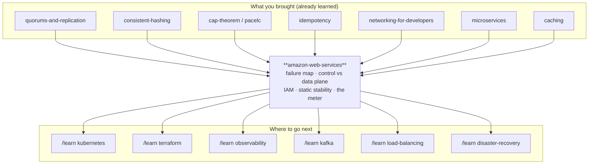

# Amazon Web Services — a shop where you rent other people's distributed systems

> **Tell a friend:** Asha runs a small payments company and bought one computer
> to run it on. That computer cost her the festival, eleven months of paying for
> idle metal, and one very bad 3am. Amazon's answer is a shop: you rent slices of
> an enormous pool by the second, Amazon publishes a map of which slices die
> together, and a guard checks your badge before every call. Everything else in
> the shop is somebody else's distributed system with a price on it, so the hard
> part is never picking a service. It is knowing which boundary each copy of your
> data sits in, and whether getting better means asking Amazon for help while
> Amazon is the thing that is broken.

The simulator is `visualization.html`, beside this file; section 9 says what to
do with it. What this lab is made of, where its numbers come from, and who is in
it are all in section 17 at the end.

---

## 1. Why does one working program turn into a second job?

> **In one breath:** You wrote a program and it works. Other people need it at
> 3am on a Sunday, from another country, while your laptop is in your bag. The
> moment you accept that, you have taken a second job that has nothing to do
> with writing programs.

You have written a program. It works on your laptop.

But other people need to use it. At 3am. On a Sunday. From another country. And
your laptop is in your bag, closed, and moving.

So the program needs to live on a computer that is always switched on, always
connected, and is not yours to carry around.

That sounds like one small decision. It is not. It is a second job, and here is
the job description: buy computers. Put them in a room with power and cooling
and internet. Replace their disks when they die. Guess a year in advance how
many you will need. Be the person who drives to that room at 3am.

**The cloud is the offer to stop doing that second job and pay someone else, by
the second, to do it instead.**

What does it cost you if nobody makes that offer? Three bills, and none of them
arrives looking like a computing problem.

You spend six weeks and a large cheque before your first customer. You buy for
the busiest hour of your busiest day, then own that hardware for the other 8,700
idle hours of the year. And the first disk failure at 3am is *your* 3am.

### What is this lab not going to give you?

There is a version of "learn AWS" that is a list. EC2 is virtual machines. S3 is
files. RDS is a database. Lambda runs a function. SQS is a queue.

That list is correct. It takes twenty minutes to read. And it will not help you
at 2am when something breaks.

Why not? Because none of it tells you *where your data physically is*, *what
fails together*, or *what you are still responsible for*.

You are also not the audience for that list. You have spent fifty-five labs
learning the machinery underneath: [quorums-and-replication](../34-quorums-and-replication/),
[consistent-hashing](../35-consistent-hashing/), [cap-theorem](../24-cap-theorem/),
[pacelc](../25-pacelc/), [caching](../11-caching/), [idempotency](../49-idempotency/),
[partitioning-and-rebalancing](../36-partitioning-and-rebalancing/),
[microservices](../56-microservices/), [redis](../13-redis/),
[networking-for-developers](../01-networking-for-developers/),
[google-spanner](../66-google-spanner/), [cockroachdb](../67-cockroachdb/).

Here is the reframing this lab is built on. Everything after it is a consequence.

> **AWS is a shop where you rent other people's distributed systems.**
> You already know how to read a distributed system's guarantees. What you do
> not yet know is the *shop* — where the shelves physically are, what the
> receipt actually promises, and which parts of the job stay yours after you
> have paid.

### Which three questions decide whether a system survives its first bad night?

The subtitle of this lab is *the failure map, the badge, and the meter*. Those
are the three things that decide the bad night, and not one of them appears on
the service list.

The first is **the failure map**. Which physical boundary does each copy of your
state sit inside, and what dies with it when that boundary dies?

The second is **the recovery dependency**. Does getting better require you to
ask Amazon for something *while Amazon is the thing that is broken*?

The third is **the badge and the meter**. Who is allowed to make which call, and
what stops the bill running away while you sleep? The meter also covers the
damage one mistake can do before anybody notices it.

Everything else, including which of the 200+ services to pick, is a lookup you
can do in five minutes once those three are in your head. Section 13 gives you
the lookup table anyway, organised by *which primitive from your earlier labs
each service actually is*.

## 2. What happens when Asha buys one computer?

> **In one breath:** Asha buys one machine for her payments company. It is too
> small for four days a year and too big for the other 361. And when its disk
> dies at 3am, the record of every payment dies with it.

No jargon in this section. A ten-year-old could follow it.

**Asha** runs a small payments company called **Marigold Pay**. Shops use it to
take card payments. The software is one program with one job: a shop sends
"charge ₹450 to this card", Marigold talks to the bank, and Marigold answers
"paid" or "declined".

It has to write down every charge, permanently. That record *is* the money.

Asha needs a computer for it. So she buys one.

### What does buying one computer actually involve?

She has to decide, *today*, how big it should be. For a business whose size next
year she cannot know.

Too small, and the shops get errors on the busiest day of the year. Too big, and
she has spent money on a machine that sits at 6% busy for twelve months.

She picks something in the middle. She signs a cheque for the whole thing up
front. Then she waits **six weeks** for it to arrive.

Then it has to live somewhere. Her flat has power cuts, and the internet
connection has one wire to it. So she rents space in a **data centre**, which is
a building full of racks with two power feeds, generators, air conditioning and
several internet connections.

She drives over, screws the machine into a rack, plugs it in, installs the
operating system, and Marigold Pay goes live.

Now watch three things happen to her.

### Three coats, one problem — which one hurts most?

**The festival.** In October, sales across every shop go up seven times for four
days. The machine cannot keep up. Requests queue, then time out, then shops
start declining cards.

Asha cannot make the machine bigger. It is a physical object, in a rack, 40
kilometres away, and a bigger one is six weeks out. The festival is four days
long. She loses it.

**The other eleven months.** The machine runs at 6% busy. She paid for all of
it. She is still paying for the rack space, the power, and the internet.

**The 3am.** A disk fails. The machine stops. Marigold Pay is down, and nobody
can take a payment anywhere in the country.

Not until Asha wakes up, sees the alert, drives 40 kilometres, works out which
disk, finds a spare, and rebuilds. That is four hours if everything goes well.
And the record of every charge was on that disk.

Hold on to all three. They are the same problem wearing three coats:
**capacity was a purchase, not a setting; and everything lived in one place that
could stop.**

### Where does this lab take you?

Stop at any checkpoint and you still have something whole. The lab climbs four
layers, and every checkpoint tells you what you can now do.

| Layer | Sections | After it you can… |
|---|---|---|
| Beginner | 1–9 | say what a cloud is, why it was invented, and why "two machines" is not two chances |
| Intermediate | 10 | design a system that survives a machine dying and a whole zone dying |
| Engineering | 11–12 | reason about eleven distinct failures and read what AWS actually guarantees |
| Production | 13 | say what a real team runs: accounts, code, alarms, cost, and which service is which primitive |

## 3. Does renting the machine instead of buying it fix this?

> **In one breath:** Stop owning hardware and rent it by the month. The cheque
> goes away, the drive to the data centre goes away, and the festival still
> gets lost.

The obvious fix is to stop owning hardware.

Companies exist that already have racks full of machines and will rent you one
by the month. This is not a made-up option. It is a real product, sold today as
dedicated server hosting and as VPS providers.

Asha signs up. Three things get better immediately.

There is no cheque up front. She pays **₹8,000 a month** instead of ₹5,00,000
once.

There is no six-week wait for the *first* machine. The provider has stock, so a
machine can be ready in a **day or two**.

And there is no driving. When a disk dies, the provider's technician is already
in the building. They swap it.

This is genuinely better. For many small businesses it is enough. It fixes the
cheque and it fixes the drive.

Before you read on, commit to a guess.

> **🔮 Predict:** The October festival comes round again. Asha is renting
> instead of owning. What happens this time?
> <details><summary>Reveal</summary>
>
> **She still loses it — just less badly.** Renting changed *who owns the
> metal* and *how you pay for it*. It did not change the two things that
> actually hurt:
>
> 1. Getting a second machine still takes a day or two of human process (an
>    order, a provisioning queue, an OS install, a configuration). The spike is
>    four days long and arrives without warning.
> 2. And when the four days end, she is renting a second machine on a monthly
>    contract for a spike that lasted a weekend.
>
> If you guessed "she is fine now, she can just rent more", you have made the
> most common mistake in this whole subject: you treated *cheaper* as *faster*.
> They are different axes. Renting moved the price. It did not move the clock.
>
> The unit of purchase is still **a whole machine, for a whole month, decided
> by a human in advance.** That is the thing that has to break.
> </details>

## 4. What did renting not fix?

> **In one breath:** Renting made the repair faster and the bill smaller. It
> left capacity as a purchase, it left one machine as one machine, and it hid
> the thing that actually kills Asha: she cannot find out what dies together.

Walk Asha's three pains again, this time against the rented machine.

**Capacity is still a purchase.** It is a smaller, more frequent purchase now, a
month instead of three years. But it is still a decision a person makes ahead of
time, in units of one whole machine, with a lead time counted in hours or days.

Marigold's traffic changes in *minutes*. You cannot track a minute-shaped demand
with a day-shaped supply. So you do what everyone did: you buy for the peak and
waste the rest. Asha's utilisation is still 6%.

**One machine is still one machine.** The provider replaced the dead disk faster
than Asha could have. But between the disk dying and the technician finishing,
Marigold Pay was **down**, and the record of charges was on that disk.

Renting improved the *repair time*. It did nothing about the *existence of a
single thing whose death stops everything*.

### Asha buys two machines. Why does that not save her?

Now the deeper problem, the one this whole lab is really about.

**Ben** is the newest engineer at Marigold, and he asks the obvious question:
why not just get a second machine, so one can take over if the other dies?

Asha asks the hosting company for exactly that. They give her one. It is a good
machine.

> **🔮 Predict:** Asha now has two rented machines instead of one. Two months
> later, everything goes down anyway — both machines at once. Before you read
> on, say what could take out two separate computers at the same moment.
> <details><summary>Reveal</summary>
>
> **They were in the same rack.** Same power distribution unit, same
> top-of-rack switch. One power unit failed and both machines went with it.
>
> The provider never told her. She never asked. And crucially, there was no way
> to ask, because the hosting company sells you machines, not a description of
> what shares a fuse with what.
>
> If you guessed a network outage or a shared disk array, you are right in
> spirit and it does not change the lesson: the two things she bought had a
> shared parent she could not see.
>
> She bought "two machines" believing she had bought **two chances**. She had
> bought one.
> </details>

This is the discovery that reorganises everything that follows:

> Redundancy is not a count of machines. It is a count of **independent things
> that can fail**. Two copies inside one failure boundary are one copy with
> extra steps.

And you cannot count independent failures if nobody will tell you where the
boundaries are.

## 5. What does Asha actually need? Four sentences, and everyone skips the last

> **In one breath:** Asha needs capacity she can ask for in a message. She needs
> a written statement of what dies together. She needs to hand over chores one at
> a time, and a clear list of what is still hers. The last one is where the
> accidents live.

Everything from here is the pursuit of four sentences. Asha needs a supplier
where:

1. **Capacity is a runtime decision, not a purchasing decision.** Ask for a
   machine with a single message and have it in a minute; give it back in a
   minute; pay only for the minutes held.

2. **The failure boundaries are published.** Not "we have lots of data
   centres". She needs an actual, named, contractual statement of the form
   *"these two things do not share power, cooling, or a network path, so they
   should not die together"*. Only then can "two copies" be made to mean two
   chances.

3. **The undifferentiated work can be handed over — deliberately, piece by
   piece.** Replacing disks, patching operating systems, running replication,
   taking backups: each of these should be something Asha can *choose* to stop
   doing, at a stated price, with a stated guarantee. Not all-or-nothing.

4. **And she must still be able to tell what is left hers.** Whatever the
   supplier does not do is still Asha's job. She needs to know exactly which
   jobs those are, because the ones you *think* someone else is doing are the
   ones nobody is doing.

Requirement 4 is the one everybody skips. **Omar**, who runs Marigold's
quarterly disaster drill, is the only person on the team who reads it as a
sentence about work rather than a sentence about vendors.

He is right to. It is section 11's biggest failure and section 12's sharpest
edge. Keep it in view.

## 6. What are the three inventions underneath all of it?

> **In one breath:** Take an enormous pool of hardware. Cut it into slices you
> can rent through a web request, by the second. Publish the map of which slices
> die together. Then put one guard in front of every single call.

Amazon Web Services is one answer to Asha's four sentences. Stripped to its
core, it is three inventions stacked on each other:

> **Take an enormous pool of hardware. Cut it into slices you can rent through
> an HTTP API, by the second. Publish the map of which slices fail together.
> Then put one authorization check in front of every single call.**

Three parts. It is worth naming them separately, because engineers reliably
learn the first, ignore the second, and are eventually taught the third by an
incident.

### Invention one: what is the pool, and why does an API change everything?

Amazon owns far more hardware than any one customer needs. It cuts that
hardware into rentable slices, and every action on a slice is an HTTPS request
to a web service.

Create a machine. Delete a database. Read a file. Each of those is a request.

Nothing is a form you post, a person you email, or a wire you plug in. That is
the whole of invention one, and it is what turns capacity into a runtime
decision, which was Asha's requirement 1.

It has a side effect that matters later. If every action is a request, then
every action can be written down as code. Infrastructure as code exists because
of this, not the other way round. Section 13.2 and the whole of the
[terraform](../63-terraform/) lab live in that side effect.

### Invention two: what is the map, and why does nobody read it?

AWS publishes its physical failure boundaries as a hierarchy you design against,
and commits contractually to their independence.

That is Asha's requirement 2. It is the half of AWS that most tutorials skip
entirely. And it is the reason a design that "works" can still be a single
point of failure, which is exactly what section 4 did to her.

### Invention three: what is the badge, and what is its default answer?

Every one of those API calls is signed and evaluated against a policy before
anything happens. The default answer is no.

This is what makes requirement 3 safe to buy. You can hand over the disks
without handing over the keys.

It is also what makes requirement 4 knowable, because the badge doubles as the
audit trail. Who did what, when, with which permission, is a question with an
answer.

### So what are the other 200 services?

Everything else in AWS is one of exactly two things.

Some of it is a slice of the pool: rent a machine, rent a disk, rent an IP
address.

The rest is **somebody else's distributed system with an API in front of it**:
rent a replicated object store, rent a partitioned queue, rent a Raft-backed
coordination service.

That second category is why your fifty-five labs are the right preparation. You
are not learning new mechanisms here. You are learning *whose* mechanism it is,
*where* it runs, and *what happens when it stops*.

## 7. Which ten words carry the weight, and what did each one cost?

> **In one breath:** Now the vocabulary, and only now. Each of these ten words
> was earned by something that already happened to Asha in sections 2 to 6. You
> cannot reason about an AWS failure without them.

Minor terms get one line at first use. These ten get the full treatment, because
each one is a thing that will bite somebody in section 11.

### 7.1 What is a region, and why does your data not leave one?

Asha's problem was that her single data centre was a single building. Amazon's
first structural answer is to have many buildings, in many cities, and to run
each city as a separate business.

In plain words: a **region** is a city-sized place where Amazon has built data
centres.

Precisely: it is an independent, geographically separate cluster of data centres
with its own API endpoints, its own copy of most services, its own capacity
pool, and its own price list. Regions are named like `ap-south-1` (Mumbai),
`us-east-1` (Northern Virginia) and `eu-west-1` (Ireland).

Why does the word exist at all? To name the largest boundary that is *supposed*
to be independent.

Two regions are near-separate installations of AWS. They do not share a
database. They do not automatically copy your data to each other. And one region
can have a very bad day while every other region is entirely fine.

Watch that bite. Asha creates a file store in `ap-south-1` for Marigold's
receipts. From `eu-west-1`, that store does not exist in any local sense. A
request for it is either redirected or refused. Any copy sitting in Europe is
one *she* set up, and *she* pays to keep it in sync.

A region is a **failure domain**, and it is the largest one on the map. It is
the whole point of section 4's discovery, drawn at the biggest scale AWS sells.

### 7.2 What is an Availability Zone, and why is it the answer to section 4?

Remember Ben's question and the two machines in one rack. Asha needed somebody
to tell her, in writing, what shares a fuse with what.

In plain words: an **Availability Zone**, written AZ, is one independently
powered wing of a region.

Precisely: an AZ is one or more discrete data centres inside a region, with
redundant power, cooling and networking, physically separated from the other AZs
in that region. Kilometres apart. Different flood plains. Different power
substations.

They are connected to each other by a private, high-bandwidth, low-latency
network. Round trips between zones are typically single-digit milliseconds, and
often under one. A modern region has at least three of them. They are written
`ap-south-1a`, `ap-south-1b`, `ap-south-1c`.

**This is the answer to section 4.** It is the contractual name for "these do
not fail together".

When Asha places one machine in `1a` and one in `1b`, she has bought two
chances. AWS has committed in writing that the rack, the power feed and the
switch are not shared. That is exactly the sentence the hosting company could
not give her.

Concretely: Marigold Pay runs three application servers, one in each of
`ap-south-1a`, `1b` and `1c`. A transformer fire takes out `1b`. One third of
capacity vanishes and two thirds keep serving.

Compare the other arrangement. Three servers, all in `1a`, same fire: zero
capacity.

**Here is the sharp detail most people never learn.** The *name* `ap-south-1a`
is scrambled per AWS account. Your `ap-south-1a` and Ben's `ap-south-1a` are
probably different physical zones. AWS does this deliberately so that everyone
does not pile into "a".

The stable, cross-account identifier is the **AZ ID**, which looks like
`aps1-az1`. If you ever need to correlate your outage with a colleague's in
another account, names lie and IDs do not.

An AZ is the unit you place replicas across. Everything in
[quorums-and-replication](../34-quorums-and-replication/) about *where* the
copies go is answered here. The AZ is the "where".

Here is the map so far. Every design decision in the rest of this lab is a
statement about which box a thing sits in. Read it from the outside in: the
outer box is the whole commercial installation, the middle boxes are cities, and
the inner boxes are the wings that do not share a generator.



> **Read the dotted line, not the boxes.** Solid lines are things AWS built and
> maintains. The dotted line is the one you have to build yourself, and section
> 10.7's version 5 is entirely about what it costs.

One more boundary exists above region, and it is here only so the word does not
surprise you later. It is called a **partition**. `aws` is the ordinary
commercial one, `aws-cn` is China, and `aws-us-gov` is US government. They have
separate account systems entirely. You will almost certainly never leave `aws`.

### 7.3 What is the difference between changing your setup and using it?

You already own this distinction. You met it in
[distributed-rate-limiting](../60-distributed-rate-limiting/), where the counter
store was one thing and the limit configuration was another.

It is the same idea here. In AWS it is arguably **the single most operationally
important concept in the whole platform.**

In plain words: there is a difference between *changing* your setup and *using*
it.

The engineers' names for the two halves are the **control plane** and the **data
plane**.

The control plane is the set of APIs that create, modify, describe and delete
resources. Calls like `RunInstances`, `CreateBucket` and `ModifyTargetGroup`.

The data plane is the set of APIs and paths that *use* a resource that already
exists. An HTTP request reaching your running machine. A read of an object that
is already in the store. A query against a database that is already up.

Why does the distinction earn a name? Because **they fail separately, and the
control plane fails more often.**

A control plane is complicated, stateful and globally coordinating. It must
validate, allocate, schedule and reconcile. A data plane is comparatively
simple, local and high-volume. AWS deliberately designs data planes to keep
working from their *last known configuration* even when the control plane is
unavailable.

> **🔮 Predict:** A large event hits one of Marigold's zones. Priya is on call.
> Her running machines in the other two zones are healthy and the load balancer
> is routing to them happily. Her auto-scaling group tries to launch four
> replacement machines and gets an error every time. Which half is broken, and
> which half is fine?
> <details><summary>Reveal</summary>
>
> **The data plane is fine. The control plane is degraded.**
>
> The running machines keep serving traffic perfectly. The load balancer keeps
> routing to them. Nothing about *using* what already exists has stopped.
>
> But `RunInstances` starts returning `InsufficientInstanceCapacity` and other
> errors, so the auto-scaling group **cannot launch replacements**.
>
> If you said "AWS is down", you have made the mistake this whole section
> exists to prevent. AWS was not down. The half of AWS that *changes things*
> was down, and Priya's recovery plan happened to need that half.
>
> Here is the sentence to carry: a design that survives by *already having*
> spare capacity survives. A design that survives by *asking for* replacement
> capacity does not.
> </details>

Hold on to that asymmetry. In section 10.6 it turns into a design principle with
a name, and it is the most valuable AWS-specific idea in this lab. Failure F3 in
section 11 is what it looks like at 6pm on a Friday.

### 7.4 What is a service quota, and why does it stop you when nothing is broken?

**Arjun** looks after Marigold's shared plumbing: accounts, permissions and the
numbers nobody thinks about. He is the person who finds this one.

In plain words: a **service quota**, also called a limit, is a cap on how much
of a thing your account may have.

Precisely: it is a numeric limit applied **per account, per region, per resource
type**. Some are adjustable by request and some are hard.

Why does the cap exist? Because the pool is shared. Multi-tenancy needs a bound
on what one tenant can grab, both to protect the other tenants and to protect
*you* from a runaway loop. It is a rate limiter and a blast-radius control at
the same time.

Here is Arjun's evening. At 6pm on festival day, Marigold's auto-scaling group
tries to grow from 12 machines to 30. It stops at 20.

Why 20? Because the account's vCPU quota in `ap-south-1` is 80, and the instance
type Marigold uses takes 4 each.

Nothing is broken. Nothing has failed over. The system simply will not get
bigger, and the error appears in an activity log nobody is watching.

These are the caps this lab names. Every one is a number with a meaning, so read
the third column before the second:

| The cap | The number | What that number means |
|---|---|---|
| Elastic IP addresses | 5 per account per region | how many reserved public addresses you may hold |
| Lambda concurrency | 1,000 concurrent executions | how many function copies may run at once in a region |
| vCPU quota, Marigold's account | 80 in `ap-south-1` | the ceiling that stopped Arjun's group at 20 machines |
| vCPUs per instance, Marigold's type | 4 | why 80 vCPUs is 20 machines and not 80 |
| API rate quotas | X calls per second, per API | a separate ceiling that bites during a mass launch |

This is [distributed-rate-limiting](../60-distributed-rate-limiting/) pointed at
you, and that lab's "over-admission versus under-admission" framing applies
exactly. It comes back as failure F4.

### 7.5 What does "managed" actually move, and what does it never move?

Asha's requirement 3 was that the chores could be handed over one at a time. AWS
sells that, and the word for it is **managed**.

In plain words: you rent the *outcome* instead of the *machine*, and the job
splits in two.

AWS states the split formally, and the formal name is the **shared
responsibility model**. AWS is responsible for security **of** the cloud: the
hardware, the physical facility, the virtualisation layer, and the managed
service's own software and operations. The customer is responsible for security
**in** the cloud: your data, who may access it, your operating system and
patches where you have one, your network configuration, and your encryption
choices.

The exact dividing line **moves per service**, and that movement is the whole
point. Read this table as a slider, not as three products:

| What Asha rents | Who patches the machine | Who patches the engine | What is still hers |
|---|---|---|---|
| A raw machine | Asha | Asha | everything above the metal |
| A managed relational database | AWS | AWS | version choice, network, backup retention, who may connect |
| A serverless store or object store | nobody, there is none | nobody, there is none | data, access, configuration |

Now the trap, and it is the most expensive one in this lab.

Asha moves Marigold's database to the managed service and stops thinking about
it. Eight months later **Dev** ships a migration that deletes a table.

AWS has been faithfully replicating that deletion to the standby. It has been
faithfully snapshotting the deleted state.

"Managed" moved the *disks* and the *engine patching* to AWS. It never moved
**"is the data correct?"** or **"can we get back to yesterday?"**. And the
retention window for automated backups has a default that is *finite*.

That is requirement 4 with money on it. The jobs you think someone else is doing
are the ones nobody is doing. It comes back as failure F8.

### 7.6 Who is allowed to make this call, and what is the default answer?

The badge has a real name: **IAM**, Identity and Access Management. It is the
authorization check in front of every API call, and it has four words worth
learning.

A **principal** is whoever is making the call. A human user, an application, or
another AWS service acting on your behalf.

A **policy** is a JSON document listing allowed or denied triples: an action, a
resource, and a condition. For example: read one object, from
`arn:aws:s3:::marigold-receipts/*`, allowed, only from inside our network. That
second string names a specific resource, and section 7.10 unpacks its structure.
The action itself is written `s3:GetObject`.

A **role** is a set of permissions with **no permanent password or key**.
Instead it is *assumed*. A machine, a function or a container is attached to a
role and automatically receives credentials that **expire**, typically in hours,
and are rotated for it.

**Temporary credentials** are that expiring key set. This is the mechanism that
makes it possible to run code in the cloud without a long-lived secret inside it.

Why do these four words exist? Because "who may do what" has to be answerable
*before every single API call*, uniformly, for humans and machines alike.

And because the alternative is worse. A long-lived access key pasted into a
config file is the single most common way AWS accounts get compromised. A leaked
permanent key works forever, from anywhere. A leaked role credential expires on
its own.

Watch it work for Marigold. The payment service runs on a machine with a role
allowing exactly three things: write one charge record, read one charge record,
and unlock one encryption key.

Written as the actions themselves, that role allows `dynamodb:PutItem` and
`dynamodb:GetItem` on the `charges` table, plus `kms:Decrypt` with one key. Its
code contains no credentials at all.

If someone gets shell on that instance, what they can reach is that table and
that key. Not the whole account.

**Meera** reviews these policies before they ship, and the rule she applies is
not intuitive, so learn it now.

The default is **deny**. An `Allow` somewhere flips it to yes. And an explicit
`Deny` **anywhere** in any applicable policy flips it back to no, permanently.
Deny always wins, and no allow can override it.

That is why a "deny everything not from our network" guardrail written once at
the organisation level is safe to apply, even though a hundred teams write their
own allow policies underneath it.

### 7.7 What is elasticity, and why is it not the same as scalability?

Asha's owned server could be made bigger. She could buy another one. In six
weeks. Forever.

So it was *scalable*. It was not **elastic**, and the difference is the entire
commercial argument for cloud.

In plain words: elasticity is capacity that goes up *and comes back down*, by
itself, fast enough to track real demand.

Precisely: it is the ability to acquire and release capacity programmatically in
minutes, with billing granularity (per-second or per-request) small enough that
releasing it actually saves money.

**Elasticity is scalability with a small time constant and a refund.** Both
halves matter. Scaling up in 90 seconds is useless if you still pay for a year.
Cheap per-second billing is useless if provisioning takes a day.

Here is festival evening under elasticity, with the arithmetic that follows:

| What happens | The number | What that number means |
|---|---|---|
| Marigold grows for the evening peak | 12 → 30 instances in four minutes | the time constant half of elasticity |
| Marigold shrinks again at midnight | back to 12 | the refund half; without it, nothing is saved |
| What the spike actually costs | 18 machines × 6 hours | the extra machines, held only while needed |
| What the same spike cost when rented | 18 machines × 1 month | the monthly contract from section 3 |
| The ratio between those two | roughly 120× less | why anyone moved to cloud at all |

And here is where elasticity stops being true, which is the shape of every
architecture in section 10. Elasticity is a property of the *stateless* parts.
You cannot elastically double a database that holds 4TB, because the data has to
get there.

### 7.8 How far does one failure reach?

In a shared pool, "will it fail?" is a bad question. It will.

The useful question is "how far does the failure reach?", and engineers call the
answer the **blast radius**.

In plain words: how much breaks when this one thing breaks.

Precisely: the set of resources, customers or data affected by a single fault, a
single bad deployment, or a single compromised credential.

Once you have the phrase, a lot of AWS reorganises itself. Multiple zones,
multiple regions, multiple *accounts*, narrow roles, per-service quotas: every
one of those is a blast-radius decision, not a reliability decision.

Here is Marigold's version, and it is an ordinary Tuesday, not a disaster.
Staging and production run in the **same** account. A load test in staging
exhausts the account's shared vCPU quota in `ap-south-1`. Production's
auto-scaling group then cannot grow during the evening peak.

Nothing failed. The blast radius of "staging" simply included production,
because a quota is per-account.

Arjun's fix is section 13.1's multi-account structure. It is the single cheapest
blast-radius control AWS offers, and it is organisational rather than technical.

### 7.9 What is your own private network inside somebody else's building?

"Rent a machine on the internet" would be unusable. Asha needs machines that can
talk to each other and *not* to the world. She also needs the network boundary
to be software she can version, rather than a cable somebody moved.

Three words do that job.

A **VPC**, or Virtual Private Cloud, is a private IP address range that is yours
alone inside a region.

A **subnet** is a slice of that range, and it lives **in exactly one AZ**. This
is the point where the network model and the failure map meet.

A **security group** is a stateful allow-list attached to a resource. In words:
"TCP 443 from the load balancer, TCP 5432 to the database, nothing else."

Marigold's network, concretely. The VPC is `10.0.0.0/16`. Three **public**
subnets hold the load balancer: `10.0.1.0/24` in `1a`, `10.0.2.0/24` in `1b`,
`10.0.3.0/24` in `1c`. Three **private** subnets hold the application servers
and the database.

Machines in those private subnets have no public IP and cannot be reached from
the internet at all. The application's security group allows port 8080 only from
the load balancer's own security group.

**The detail that matters for this lab:** *a subnet is AZ-scoped.* So "I have
three subnets" is only three chances if they are in three different AZs.

That is section 4's mistake, reappearing in network clothing. It will reappear
twice more before this lab is finished.

### 7.10 What does one API call actually look like on the wire?

Three small words make the mechanism in section 10 readable.

An **endpoint** is the hostname you send an API call to, and it is almost always
**regional**. For example, `dynamodb.ap-south-1.amazonaws.com`.

Read that hostname again. The region is *in the DNS name*. There is no "AWS" to
talk to. There is `ap-south-1`'s key-value store, which is a different running
system from `eu-west-1`'s.

An **ARN**, or Amazon Resource Name, is the globally unique identifier of any
resource. It is worth reading one slowly, because an ARN *is* the failure map
written as a string:

`arn:aws:dynamodb:ap-south-1:123456789012:table/charges`

| The piece | What it says | Where you met it |
|---|---|---|
| `aws` | the partition, the ordinary commercial one | 7.2, the outer box on the map |
| `dynamodb` | which service, and each one is its own system | 6, "somebody else's distributed system" |
| `ap-south-1` | the region, the largest failure domain | 7.1 |
| `123456789012` | the account, the billing and blast-radius boundary | 7.8 |
| `table/charges` | the resource itself | 7.6, the thing the policy names |

Every policy Meera reviews is written against strings of that shape.

**SigV4** is the signing scheme. Every request carries a signature computed over
the request's method, path, headers, body hash and a timestamp, using the
caller's secret key.

Two properties follow, and both matter. The key itself never travels. And a
signature is valid for only a few minutes, so a captured request cannot be
replayed tomorrow.

### The ten words, mapped back to where each one hurt

Where did you feel each of these before it had a name? Here are two small maps,
split by what the word is for. Every row names the place in the
story where you felt the thing before you knew its name.

The five words that describe **where things are and what dies together**:

| Word | What it names | Where it hurt |
|---|---|---|
| Region | a city-scale independent installation | 7.1, the receipts that do not exist in Europe |
| Availability Zone | one independently powered wing of a region | 4, Ben's two machines in one rack |
| VPC / subnet / security group | your private network, sliced per zone | 7.9, three subnets that were one chance |
| Blast radius | how far one failure reaches | 7.8, staging eating production's headroom |
| Elasticity | capacity that grows *and shrinks*, fast, with a refund | 2, the festival Asha lost |

The five words that describe **who is allowed to do what, and what stops you**:

| Word | What it names | Where it hurt |
|---|---|---|
| Control plane / data plane | changing your setup versus using it | 7.3, Priya's launches failing while traffic flowed |
| Service quota | a numeric cap per account, per region | 7.4, Arjun's group stopping at 20 |
| Managed service | renting the outcome; the line moves per service | 7.5, Dev's deleted table replicated perfectly |
| IAM | the check before every call; default deny | 7.6, the shell that reached one table |
| Endpoint / ARN / SigV4 | where a call goes, what it names, how it is signed | 7.10, the region living in a hostname |

> **CHECKPOINT — you have the vocabulary.**
> You can now read an AWS architecture diagram and ask the only two questions
> that matter: *which failure domain is each box in?* and *what does this
> design need from the control plane in order to recover?* Next: two mental
> models to hold it all together, then the machinery.

> **Say it back.** Without using the words *zone*, *region* or *redundancy*,
> explain to Ben why Asha's two rented machines were not two chances, and what
> AWS gives her that the hosting company could not.
> <details><summary>A good answer sounds like</summary>
>
> "Both her machines were plugged into the same fuse box. When the fuse box
> went, both went, so she really only had one machine that cost twice as much.
> The hosting company knew which fuse box each machine was on and never told
> her, and there was no way to ask. Amazon publishes that answer up front and
> promises it in the contract, so she can deliberately put her two machines on
> two different fuse boxes and know it is true."
> </details>

## 8. What two pictures should you keep in your head?

> **In one breath:** One picture to carry around in conversation, and one to
> reason with when something is broken. The first is a serviced office building.
> The second is what is actually true underneath it.

You need both. The building gets you through a design discussion. The machine
underneath gets you through an incident.

### 8.1 What does the serviced office building look like?

Imagine a company that owns enormous office buildings and rents you desks. Asha
is a tenant. Here is her tenancy, in six sentences.

Each **building** is in a different city. Buildings are run separately, so a
flood in the Mumbai building has nothing to do with the Dublin one. You must
choose which building your team works in, and moving your filing cabinets to
another city is a removal job you organise and pay for.

Each building has several **wings**, and each wing has its own generator, its own
air conditioning and its own internet line. The landlord guarantees in writing
that the wings do not share these. If you want to survive a generator failure,
you put people in two wings.

You get desks by **sending a message**, not by signing a lease. "Four desks,
please" — four desks are ready in a minute. "Done with them" — they are gone in a
minute, and the meter stops.

**Everything is on a meter.** Desks by the second. The photocopier by the page.
And here is the one nobody expects: carrying paper *out of the building* costs
money per sheet, while carrying paper *in* is free.

You **badge in for every single action.** Not once at the door. Every time you
open a drawer. Your badge is checked against a rulebook, and the default answer
is no. Staff badges expire every few hours and renew themselves.

You can also rent **serviced desks**, where the landlord does the filing, the
photocopying and the archiving. You still decide what goes in the files and who
may read them.

That model is genuinely load-bearing. Building is region. Wing is availability
zone. Sending a message is an API call. Badging in for every action is IAM. A
serviced desk is a managed service. Paper leaving the building is an egress
charge.

### 8.2 What is actually true, with the building stripped away?

Five statements. Each one is something you can check, and each one decides
something later.

An **account** is a namespace and a billing boundary. Every resource belongs to
exactly one account. It is also the *default* blast-radius boundary, because most
quotas are per-account and IAM's reach stops at the account edge unless you
deliberately extend it.

A **resource** lives at a definite point in the hierarchy
`partition → region → (usually) AZ`. Some resources are region-scoped, and AWS
spreads them across zones internally: an object store bucket, a serverless
table, a managed queue.
Some are AZ-scoped and it is *your* job to spread them: a machine, a network
disk, a subnet, a single-zone managed database. **Knowing which is which for
every resource in your diagram is the job.**

Every action is an **authenticated, authorized, quota-checked HTTPS request** to
a regional endpoint of an independent multi-tenant service.

Each service is **its own distributed system**, with its own consistency model,
its own durability claim, its own quotas, and its own control and data planes.
There is no shared transaction, no shared clock and no shared lock. Two AWS
services are as independent from each other as two vendors.

And only two things in your system cannot be recreated from code: **your state
and your identity configuration.** Everything else (instances, load balancers,
networks, DNS records) is a rebuildable consequence of a template.

Read that last one twice. It is why "infrastructure as code" is not tidiness. It
is the recovery plan, and section 13.2 is where Omar makes Asha prove it.

### 8.3 Which office word is which engineering word?

Read the third column first. It is the reason each row is in the table at all.

| Building | Engineering | Why it matters |
|---|---|---|
| Building (city) | Region, e.g. `ap-south-1` | Largest independence boundary; nothing crosses it unless you build it |
| Wing with own generator | Availability Zone | The unit you place replicas across; the answer to section 4 |
| Desk | EC2 instance / container / Lambda invocation | Rentable, disposable, AZ-scoped |
| Filing cabinet at the desk | Instance store (local disk) | Dies with the desk. Not storage, scratch space |
| Cabinet in the wing's store room | EBS volume | Survives the desk, **not** the wing — AZ-scoped |
| The building's archive | S3 bucket | Region-scoped, AWS spreads it across wings for you |
| Sending a message to get desks | Control plane API call | Can be refused or slow, exactly when you need it most |
| Working at a desk you already have | Data plane | Keeps working when the message system is down |
| Badging in for every drawer | IAM policy evaluation | Deny by default; explicit deny always wins |
| Serviced desk | Managed service | Moves work, never moves "is my data correct?" |
| The meter, including paper leaving | Billing, egress charges | Runs whether or not anything useful happens |
| Reception being down | Control plane outage | You keep working; you cannot get new desks |

That table also introduces four product names you will now meet constantly, so
take them in the order the story gives them. The rented desk is a virtual
machine you rent by the second, and it is called **EC2**. The filing cabinet at
the desk is scratch space on the host, called **instance store**. The cabinet in
the wing's store room is network-attached disk that outlives the machine but not
the wing, called **EBS**. And the building's archive is the region-wide object
store, called **S3**.

### 8.4 Where does the shop story lie to you?

An analogy left unqualified is a bug with a delay fuse. Here is exactly where the
building stops being true. Four places, and all four are expensive.

**One: buildings do not have per-tenant quotas that bite at 3am.**

If a real landlord has 500 free desks, you can have 500. In AWS your account has
a *numeric cap* per region. It is unrelated to available capacity. It applies to
things you are not currently using. And it is enforced by returning an error,
not by a person saying "sorry".

So the failure mode is not "the building is full". It is "the building is empty
and the door still will not open for you".

Quotas are also **per-region**. A limit increase Arjun obtained in `ap-south-1`
does nothing for the `eu-west-1` disaster-recovery plan. That single sentence has
ruined more than one failover test, and Omar has the drill notes to prove it.

**Two: regions are not branches of one company.**

In the building story the company is one company, and HR knows about you
everywhere. In AWS, regions are much closer to separate installations.

Your data does not travel between them. Your quota does not travel. Even service
*availability* does not travel: a service launched last year exists in
`us-east-1` and may not exist in `ap-south-1` yet.

And a small number of things are genuinely global, with their control plane
concentrated in **`us-east-1`**. IAM. Route 53's control plane. CloudFront.
Organizations. Historically, the billing console.

That is a real, structural dependency. An event in Northern Virginia can affect
your ability to *change* things in Mumbai, even though Mumbai's data planes are
perfectly healthy. It is also the honest reason `us-east-1` incidents are the
ones that make the news.

**Three: "serviced" does not mean "supervised".**

A serviced office's staff would notice if you set fire to your own filing
cabinet. AWS will not.

Deleting a table is a valid, authorized, instantly executed API call. It is
literally one call, named `DeleteTable`, and the replication you are paying for
will faithfully replicate the deletion.

Every safety net against *your own correct-looking actions* is something you
switch on. Backups you have actually restored. Deletion protection. Versioning.
A separate account holding the copies.

This is requirement 4 again, and it is where the analogy is most dangerously
comforting.

**Four: the meter has no idle discount, and the direction of travel is priced.**

An empty desk costs nothing in a real office. In AWS, a running instance at 0%
CPU costs full price. An unattached disk costs full price. An idle NAT Gateway
costs by the hour. And an Elastic IP that is *not* attached to anything is
billed precisely *because* it is idle.

Then there is direction. Omar found this one on a bill, which is how everybody
finds it:

| Where the bytes go | Roughly what it costs | What that means for a design |
|---|---|---|
| Into AWS from the internet | generally free | pulling data in is never the expensive half |
| Out of AWS to the internet | an order of ¢/GB | every response to a customer has a price |
| Between AZs inside your own region | charged, in both directions | section 7.2's independence has a line item |

Read the third row again, because it is the one that surprises people. The
architecture that gives you section 4's independence is the one that spreads
across zones, and it is also the one that pays for its own internal chatter.

A talkative service mesh spread across three zones can spend more on internal
traffic than on compute. Nothing in the office picture prepares you for "talking
to yourself costs money".

> **CHECKPOINT — you have both models.**
> You can now explain what a cloud *is* and why AZs exist, to anyone. What you
> cannot yet do is watch a failure and predict the outcome. That is the next
> two sections: first the simulator, then the machinery.

> **Say it back.** Without using the words *control plane*, *quota* or *egress*,
> tell Ben three ways the serviced-office story would mislead him if he believed
> it completely.
> <details><summary>A good answer sounds like</summary>
>
> "First, the landlord can refuse you a desk even when the floor is empty. Your
> company has a written cap on desks, and nobody checks whether the building is
> actually busy. Second, the Mumbai and Dublin buildings are not the same
> company — your pass, your files and even the list of available services stop
> at the door. Third, sending a page out of the building costs money, and so
> does walking a page from one wing to another, so the safest layout is also
> the one with a bill attached."
> </details>

## 9. What should you watch in the simulator?

> **In one breath:** One region, three zones, Marigold's system drawn inside
> them, and the control plane drawn deliberately outside. One number at the top
> tells you how many payments succeeded. Everything else exists to explain that
> number.

Open **`visualization.html`**, or the published copy:
**https://claude.ai/code/artifact/c5052244-bae4-4e3e-9d94-6d8f0e3bc543**
It is a self-contained page; the local file works offline.

### What is on the screen, and why is it laid out that way?

You are looking at one region, `ap-south-1`, with its three availability zones
drawn as three columns. That is the same spatial layout as the diagram in
section 7.2, deliberately, so the picture in your head and the picture on the
screen are the same picture.

Inside the columns: Marigold's load balancer, its application servers, its
database, and the regional services.

Above them, drawn *outside* the zones, is the **control plane**. That is exactly
where it lives in reality, and exactly why it fails separately.

Traffic flows as small dots from the client, through DNS and the load balancer,
to whichever instances are healthy.

The number that matters is the **verdict bar** at the top: how many of the last
100 payment requests succeeded, and a full-sentence explanation of why the number
is what it is. Everything else on the page exists to explain that one number.

### Which control teaches which idea?

Read the third column. It tells you which part of this lab you are looking at.

| Control | What it does | Which section it teaches |
|---|---|---|
| **Architecture v1 … v5** | Swaps the whole design, from one server to multi-region | 10.2–10.7 |
| **Kill instance** | Terminates one application server | F1 |
| **Kill AZ** (pick which) | Takes out an entire zone: instances, database, subnet | F2 |
| **Freeze control plane** | Existing things keep running; nothing new can be launched | F3 — the big one |
| **Hit the quota** | Caps how large the Auto Scaling Group may grow | F4 |
| **Traffic dial** | Normal → festival (7×) | 7.7 elasticity |
| **Static stability toggle** | Pre-provision N+1 vs launch-on-demand | 10.6 |
| **DB placement** | Single-AZ / Multi-AZ / Aurora-style quorum | 10.4–10.5 |
| **Step ◀ / ▶, play, reset** | Move through time in either direction | everything |
| **Click any box** | Inspect its state: role, health, AZ, what it is waiting for | everything |

### Which three runs should you do first?

Run these three, in this order. Each one asks you to predict before it runs, then
tells you whether you were right and why.

**One server, one disk.** Choose v1 and kill the instance. Thirty seconds. This
establishes Asha's pain from section 2, and it shows the thing beginners get
wrong: the *data* does not come back.

**Two servers, one wing.** Choose v2 and kill AZ `1a`. This is Ben's discovery
from section 4 as a moving picture. Two instances, zero survivors.

**The night the control plane froze.** Choose v4, kill an AZ, and freeze the
control plane. Run it once with static stability **off** and once **on**.

Same fault. Same architecture diagram. Opposite outcome. If you only do one thing
in the simulator, do this pair.

### Why are two of these dials at all?

Which AZ dies, and whether the control plane responds, are normally hidden
assumptions in an architecture diagram. A diagram silently assumes the answer
does not matter.

It matters enormously. So both are dials you turn.

## 10. How does one call work, and how does a real design get forced into existence?

> **In one breath:** Two mechanisms, different in kind. First, what physically
> happens inside one API call, because every single thing you do in AWS is that
> call. Second, how Marigold's real architecture gets built, version by version,
> by things breaking.

The first mechanism is small and you can trace it by hand. The second is a
story with six versions, and Asha loses something in every one of them.

### 10.1 What are the seven steps hiding inside one line of code?

Marigold's Java service records a charge. In the AWS SDK that is one line, and
that line hides seven distinct things that can each fail differently.

The charge records live in the store that has no zones to choose, no servers and
no version to patch — the thing section 8.2 called a serverless table. Its name
is **DynamoDB**, and writing one record into it is called `PutItem`.

Here is a hand-worked trace with concrete values.

**Starting state.** The code runs on a machine in `ap-south-1b`. The machine has
an attached role called `MarigoldChargeWriter`. The table is
`arn:aws:dynamodb:ap-south-1:123456789012:table/charges`. The item is
`{charge_id: "ch_8812", amount: 45000, status: "captured"}`.

Read the trace as seven doors. The request has to get through every one, and
each door has its own way of slamming.

```
Step 1  CREDENTIALS
        The SDK asks the instance's local metadata endpoint for credentials.
        It gets back a temporary triple that expires in ~6 hours:
          AccessKeyId    = ASIA...           (note: ASIA = temporary)
          SecretAccessKey= wJal...
          SessionToken   = IQoJb3JpZ2lu...
        No secret is stored in the application. This is §7.6's role, working.
        FAILS AS: credentials expired / no role attached -> the SDK throws
                  before a single byte reaches the network.

Step 2  ENDPOINT RESOLUTION
        Region ap-south-1 is turned into a hostname:
          dynamodb.ap-south-1.amazonaws.com
        DNS resolves it to an IP inside AWS's network.
        FAILS AS: this is where the networking lab's DNS lesson applies. A
                  5-second resolver stall here looks exactly like "DynamoDB is
                  slow" from the application's point of view.

Step 3  SIGNING (SigV4)
        A canonical form of the request is built - method, path, sorted
        headers, SHA-256 of the body - and signed with the secret key plus the
        date, region and service name. The result goes in a header:
          Authorization: AWS4-HMAC-SHA256 Credential=ASIA.../20260830/
            ap-south-1/dynamodb/aws4_request, Signature=8f42...
        The secret never travels. The signature is time-bound.
        FAILS AS: SignatureDoesNotMatch - and the classic cause is a machine
                  whose clock has drifted more than a few minutes.

Step 4  TRANSPORT
        TLS to the regional endpoint, HTTP POST, connection reused from a pool.
        Everything from the networking lab applies unchanged: connect timeout
        vs read timeout are different bounds, and a slow response is more
        dangerous than a refused one.

Step 5  AUTHORIZATION  (the badge, evaluated)
        The DynamoDB front end asks IAM: may principal
        arn:aws:sts::123456789012:assumed-role/MarigoldChargeWriter/i-0abc
        perform dynamodb:PutItem on .../table/charges ?
        Evaluation, in this order, with deny always winning:
          a. Organization SCP        -> allows dynamodb:*        (pass)
          b. Permission boundary     -> none attached            (pass)
          c. Identity policy on role -> Allow PutItem on charges (ALLOW)
          d. Resource policy         -> none for DynamoDB tables (n/a)
          e. Any explicit Deny?      -> none                     (pass)
        Result: ALLOW. Default was DENY; (c) is what flipped it.
        FAILS AS: AccessDeniedException. Note it fails HERE - after the network
                  round trip, before any data work. An IAM mistake is a
                  100%-of-calls failure, instantly, not a slow degradation.

Step 6  QUOTA / THROTTLE CHECK
        Does this table have write capacity right now, and does this partition?
        FAILS AS: ProvisionedThroughputExceededException. The SDK retries it
                  automatically with backoff, which is why this failure often
                  shows up as LATENCY rather than as errors. See F5.

Step 7  THE ACTUAL DISTRIBUTED SYSTEM
        Only now does anything resemble a database. The key "ch_8812" is
        hashed to a partition; the partition's replicas live in three AZs; the
        write is acknowledged once a quorum of them has it.
        This is your quorums-and-replication lab, running on someone else's
        machines, in three buildings you will never see.
        RETURNS: 200, and the charge is durable across an AZ failure.
```

Two things to take from that trace, and the first one will change how you read
every incident for the rest of your career.

**Five of the seven steps have nothing to do with the database.** When somebody
says "DynamoDB is broken", it is usually step 1, 3, 5 or 6: credentials, clock,
policy, quota. That is the shape of almost every AWS incident an application
team actually experiences.

**Step 7 is the only step that is a distributed system, and you already know how
it works.** That is the reframing from the top of this lab, made concrete. What
was new here was the shop, not the machinery.

### 10.2 Version 1 — why is one instance worse than the machine she rented?

Asha's first AWS deployment is a direct translation of the rented server. One
machine, and everything on it.

She launches one instance of type `t3.medium` in `ap-south-1a`. The application
and PostgreSQL both run on it. The data sits on the instance's local disk. It
has a public IP.

It works. It costs about ₹2,000 a month. And it is, in AWS terms, strictly
*worse* than what she had. It takes one paragraph to see why.

> **🔮 Predict:** Asha stops the instance for ten minutes one evening to change
> its size, then starts it again. What happens to the payment records?
> <details><summary>Reveal</summary>
>
> **If the data was on <em>instance store</em>, it is gone.** Instance store is
> the physical disk attached to the host machine. Not corrupted: gone, with no
> error. Instance
> store is scratch space tied to the specific host your VM happens to be on,
> and stopping the instance releases the host.
>
> If it was on an **EBS volume**, it survives the stop. An EBS volume is
> network-attached storage that lives in the AZ rather than on the host, and
> this is why it is the default for anything you care about.
>
> If you guessed "nothing happens, it is a computer, stopping a computer does
> not erase it", you have made exactly the mistake that costs the data. On a
> rented physical machine you would have been right. Here, the disk was never
> hers; it belonged to a host she has now given back.
>
> **The general rule, and it is the most useful one-liner in AWS storage:**
> *instance store dies with the host; EBS dies with the AZ; S3 and DynamoDB
> die with the region.* Three different boundaries, three different levels of
> "gone". Pick per piece of data, deliberately.
> </details>

So: version 1, with the data on network-attached disk. Now the instance's
underlying hardware fails at 3am, which happens.

The instance stops. Marigold is down until someone launches a new one and
reattaches the volume.

We are back at section 2's 3am. It is cheaper and faster than driving 40
kilometres, and it is the same shape.

### 10.3 Version 2 — what does a load balancer fix, and what does it not?

The obvious fix is two application servers, with something in front to spread
traffic and stop sending it to a dead one.

That something is a **load balancer**. Marigold uses the layer-7 kind, called an
**Application Load Balancer**, or ALB. It gets a public DNS name.

The two machines are registered with it as **targets**. The ALB runs a **health
check**: it requests `/health` every 30 seconds, and after two consecutive
failures it stops sending that target any traffic.

The database now lives on its own instance, because two application servers
cannot share one local disk.

Now the failure test. One instance dies. The ALB notices within about a minute
and routes everything to the other one. Customers see a handful of errors during
the detection window, then normal service.

**This genuinely works.** It is the first design in this lab that does.

> **🔮 Predict:** All three boxes (both application servers and the database)
> were launched in `ap-south-1a`, because that was the default in the console
> and nobody changed it. A power event takes out `ap-south-1a`. How much of
> Marigold Pay survives?
> <details><summary>Reveal</summary>
>
> **None of it.** The ALB survives (it is region-scoped and AWS runs it in
> multiple zones) and it is now a perfectly healthy load balancer with zero
> healthy targets, returning 503 to every shop in the country.
>
> This is **section 4's discovery**, exactly, on new hardware. Asha bought two
> instances believing she had bought two chances. Redundancy is a count of
> independent failure domains, and she had one.
>
> If you guessed "two out of three boxes survive, so most of it works", you
> counted boxes rather than boundaries. That is the same arithmetic Ben used
> with the two rented machines, and it is wrong for the same reason.
>
> The difference between this and the hosting company is that **AWS would have
> told her** — the AZ was a visible, selectable field on the launch screen, and
> she left it on the default.
>
> Watch this as scenario 2 in the simulator. The instructive detail is the
> ALB's own state: it is *up*, it is *healthy*, its dashboard is green, and it
> serves nothing.
> </details>

### 10.4 Version 3 — how does a system replace its own dead parts?

Two changes, and they are the two halves of every AWS reliability story.

**Placement.** Application servers go one per zone: `1a`, `1b`, `1c`. Subnets
are created per zone, because a subnet is AZ-scoped and three subnets in one AZ
is still one chance. That was section 7.9. The ALB is given all three subnets.

**Replacement.** The instances stop being pets. Asha creates an **Auto Scaling
Group**, or ASG, which is a supervisor that keeps a stated number of healthy
machines alive.

She tells it: desired 3, minimum 3, maximum 12, spread evenly across these three
subnets, and here is the health check.

Now, when an instance dies, the group launches a replacement automatically, in
the same zone, from the same image. The same mechanism handles the festival: a
scaling policy says *if average CPU across the group exceeds 60%, add
instances*.

This is the standard shape. It is the picture on the front of every AWS
tutorial.

Watch the AZ failure again. `1b` dies. One third of capacity vanishes. The ALB
stops routing there within a minute. The group launches a replacement in `1a` or
`1c`, and Marigold serves the whole festival with a brief dip.

Except for one box in the diagram.

> **🔮 Predict:** In version 3 the database is still a single PostgreSQL
> instance, sitting in `ap-south-1a`, because moving a database felt like a
> separate project. `1a` fails. The application servers in `1b` and `1c` are
> healthy and the ALB is happily routing to them. What do shops see?
> <details><summary>Reveal</summary>
>
> **Every payment fails**, and here is the cruel part: they fail *slowly*.
> The application servers are up, so they accept the request, try to reach the
> database, and block until their connection times out. A shop that would
> rather have had a fast "declined" instead waits 30 seconds for a 500.
>
> This is the [microservices](../56-microservices/) lab's central result on AWS
> hardware: **a slow dependency destroys a system harder than a dead one**,
> because the healthy tier converts its own health into a queue of stuck
> threads. All three application servers become useless within seconds of the
> database going away, regardless of which zone they are in.
>
> If you guessed "two thirds of payments succeed", you assumed the application
> servers were independent of each other. They are. They are not independent of
> the one thing they all need.
>
> The lesson that generalises past this example: **elasticity is a property of
> the stateless tier, and it buys you nothing while state has a single home.**
> Auto-scaling three application servers across three zones is decoration if
> the thing they all need is in one.
> </details>

### 10.5 Version 4 — what are the three prices AWS charges for keeping state safe?

State is the hard half, and AWS offers it at three prices. All three are the
same trade you have already studied. Only the packaging is new.

**(a) RDS Multi-AZ.** The managed relational database service is called **RDS**,
and its two-zone arrangement is called **Multi-AZ**.

One primary database instance sits in `1a`, one standby in `1b`. Every write is
replicated **synchronously** to the standby before being acknowledged. The
standby serves no traffic; it exists purely to take over.

On failure, AWS detects it and flips a DNS name from the primary's address to
the standby's. AWS documents this as typically **60–120 seconds** for the
classic Multi-AZ instance deployment, and faster for the newer Multi-AZ DB
cluster form. You change nothing in the application, because it always connects
to the same endpoint name.

In [cap-theorem](../24-cap-theorem/) terms this is a **CP** choice. In
[pacelc](../25-pacelc/) terms it is **PC/EC**. Synchronous replication means the
write latency includes a cross-AZ round trip, which is single-digit
milliseconds, and that is the price of consistency in the no-partition case —
exactly PACELC's "else" branch. During failover the database refuses service
rather than serving two primaries.

**(b) Aurora.** Same API, same engines, with the storage layer rebuilt as a
distributed system. AWS calls it **Aurora**.

The data is held as **six copies across three AZs**, and the engine writes to
that storage layer rather than to a disk. AWS describes the write path as
requiring acknowledgement from **four of six** copies, and reads as satisfiable
from **three of six**.

That is a straight quorum. In your own notation, `W=4, R=3, N=6`, so `W + R > N`
holds with a margin chosen so the system survives losing an *entire AZ plus one
more copy* and still writes.

Read replicas share that storage instead of copying data, so adding one is fast
and adds little write cost.

If that felt familiar, it should. It is
[quorums-and-replication](../34-quorums-and-replication/) with the numbers picked
so the failure domain, not the individual disk, is the unit being tolerated.

**(c) DynamoDB, S3 and SQS.** Skip the database-shaped thing entirely. Use a
service that is *already* multi-AZ by construction, with no instances, no
failover event and no version to patch.

You do not choose zones for a serverless table. There is nowhere on the screen
to make section 4's mistake. The price is that you accept its data model and its
consistency menu rather than SQL's.

> **A useful way to hold the three:** (a) moves the *failover* to AWS, (b)
> moves the *storage layer* to AWS, (c) moves the *entire idea of a server* to
> AWS. Each step removes a class of mistake and removes a control.

Version 4 is Marigold with an auto-scaling group across three zones and RDS
Multi-AZ. It survives an instance failure and an AZ failure. It is a good design.

Now the night it does not work.

### 10.6 Version 4 breaks — what happens the night the control plane freezes?

This is the section to read twice.

**The scenario.** A large event affects `ap-south-1b`. Marigold's design says:
lose a third of capacity, the group launches replacements, carry on. Traffic
that evening is at festival level, so the group is at 12 instances, four per
zone. Priya is on call.

Here is what actually happens, step by step, with concrete numbers. Read the
left column as a clock and the right as what Priya can see:

```
18:04:00  AZ 1b degrades. 4 of 12 instances stop responding.
18:04:30  ALB health checks fail for those 4. It stops routing to them.
          Capacity: 8 of 12. Latency rises; some requests shed.
18:05:00  ASG notices 4 unhealthy, terminates them, calls RunInstances
          for 4 replacements.
18:05:02  RunInstances returns InsufficientInstanceCapacity.
          Reason: every other customer in ap-south-1 whose design also
          depended on launching replacements is asking for the same
          instance type in the same two surviving zones, at the same second.
18:05:02  ASG backs off and retries. And retries.
18:11:00  Still 8 instances. Festival traffic needs 12. Marigold is now
          shedding roughly a third of payments, and has been for 7 minutes.
19:40:00  Capacity gradually becomes available. The group refills.
```

Nothing in Marigold's design was wrong by the diagram. The application tier was
spread across three zones. The database failed over correctly in 90 seconds.

And the system still spent an hour and a half degraded. Why?

Because **the recovery plan depended on making a control plane call during the
exact minute that control plane was under region-wide stress.**

> **🔮 Predict:** What change to the design would have made this a non-event —
> without adding a fourth zone, a second region, or any new AWS service?
> <details><summary>Reveal</summary>
>
> **Run 18 instances instead of 12, six per zone, and never let the design need
> a launch in order to recover.**
>
> With `N = 3` zones and enough capacity in any two of them to serve 100% of
> peak, losing one zone means going from 150% of needed capacity to 100%. The
> group's launch call still fails. **It does not matter**, because nothing was
> waiting on it. Recovery consisted entirely of the load balancer *stopping*
> doing something, namely removing unhealthy targets. That is a data-plane
> action, and it needs nobody's permission.
>
> If you guessed "use a smaller instance type so capacity is easier to find",
> you are optimising the odds of a control-plane call succeeding. That is a
> better bet, not a removed dependency, and on the worst night the odds are
> exactly when they fail.
>
> This is **static stability**: designing so that the response to a failure is
> to *keep doing what you were already doing with what you already have*, never
> to acquire something new. AWS names it explicitly in its own Builders'
> Library, and it is the principle behind why their data planes keep serving
> from last-known configuration when control planes are unavailable.
>
> The bill is real and you should say it out loud: you are paying for 18
> machines to serve 12 machines' worth of traffic — **50% overprovisioning**,
> which is the price of not depending on the control plane. That is the actual
> trade, and it is a business decision, not an engineering one.
> </details>

**Generalise it into a checklist**, because this is the highest-value thing in
the lab. For each recovery path in your design, ask one question: *does getting
better require a successful control-plane call?*

| Recovery mechanism | Needs control plane? | Statically stable? |
|---|---|---|
| ALB removes an unhealthy target | No — data plane | ✅ |
| Traffic shifts to already-running instances in other AZs | No | ✅ |
| ASG launches a replacement instance | **Yes** (`RunInstances`) | ❌ |
| RDS Multi-AZ failover to an existing standby | Mostly no — the standby already exists | ✅ mostly |
| Creating a new RDS instance from a snapshot | **Yes**, and slowly | ❌ |
| Route 53 health-check failover between existing endpoints | No — the health-check data plane | ✅ |
| Changing a Route 53 record by hand during an incident | **Yes** (and its control plane is in `us-east-1`) | ❌ |
| Reading from a DynamoDB table that already exists | No | ✅ |
| Auto-scaling a DynamoDB table's capacity upward | **Yes** | ❌ |

Read the ❌ rows as: *these will be unavailable precisely when you need them.*
Design so they are optimisations, never the plan.

### 10.7 Version 5 — why is a second region a different kind of problem?

A region can have a bad day. If Marigold must survive that, it needs a second
one.

This is where AWS stops being able to hide anything from you, because copying
state between regions is not a feature you buy. It is a **CAP position you
take**.

Three honest options, and you have already studied all three.

**Warm standby with asynchronous replication.** Aurora Global Database
replicates to a second region with typical lag AWS describes as **under a
second**. Failover is a promotion you trigger.

The number this design is really buying is **RPO**, the recovery point
objective, which is *how much data you accept losing*. Async replication with
one second of lag means an instant region loss can lose up to about a second of
committed writes.

For most businesses that is fine. For Marigold, one second of payments is a
reconciliation problem with real money in it, and someone in finance needs to
agree to that number in advance. Omar is the one who has to get that agreement,
in writing, before the drill.

**Active-active with DynamoDB Global Tables.** Both regions accept writes. AWS
replicates both ways. Conflicts resolve **last-writer-wins**.

That is a deliberate **AP** choice. It is the
[eventual-consistency](../28-eventual-consistency/) and [crdts](../32-crdts/)
discussion arriving with a price tag: last-writer-wins silently discards one of
two concurrent updates.

Marigold's `charges` table is the one place where silently discarding a write is
unacceptable. Global Tables are excellent for sessions, profiles, feature flags
and carts. Think very hard before one holds money.

**Synchronous across regions.** This is available in effect via
[google-spanner](../66-google-spanner/)-style systems, and in the AWS world via
things built on similar principles.

The reason almost nobody does it for an interactive path is in your PACELC lab.
Cross-region round trips are **tens to hundreds of milliseconds**, and they are
added to *every write*, in the normal unpartitioned case.

Mumbai to Ireland is roughly 120ms one way. Two round trips of consensus and
your payment API has a floor of half a second before it does any work.

There is no fourth option. The reason multi-region is hard is not AWS. It is the
speed of light plus the CAP theorem, and AWS's contribution is only that it
makes the choice explicit and bills you for it.

**Say this before someone spends a year on it.** *Most* businesses should be
multi-AZ, statically stable, with tested backups restorable into a second region
— and should accept several hours of downtime in a genuine region loss.

Multi-region active-active roughly doubles the infrastructure bill. It more than
doubles the operational complexity. It introduces data-consistency failure modes
that do not exist in a single region. And its own machinery becomes a new source
of outages.

Buy it when the cost of an hour down exceeds all of that, and not before.

### 10.8 Version 6 — which three things actually take companies down?

Versions 1 to 5 are the infrastructure story. In practice, the incidents that
hurt most are not zone failures.

They are these three, and none of them appears on an architecture diagram.

**A permission that was wider than it needed to be.** A leaked long-lived access
key, or a role with `*`, turns one compromised laptop into an account-wide
event. The whole of section 7.6 exists for this. Blast radius is counted in IAM
policies, and this is the cheapest thing on the list to fix. Meera's review is
the control.

**A bill nobody bounded.** A misconfigured job, a recursive function, a
forgotten cluster left running in a region nobody looks at. The meter never
sleeps and AWS will not stop you. Omar finds this one, late.

**A backup nobody had ever restored.** Multi-AZ replicates your mistakes at the
speed of light. This is failure F8, and Dev is the one who triggers it without
doing anything wrong.

> **CHECKPOINT — you have the intermediate model.**
> You can now design a system that survives an instance failure and a zone
> failure. More valuably than most working AWS engineers, you can also look at
> a design and say *"this recovers by asking the control plane for something,
> so it will not recover"*. Next, the engineering layer: every failure mode
> laid out with what it keeps and what it loses, then the guarantees.

> **Say it back.** Without using the words *static stability*, *control plane*
> or *auto scaling*, explain to Omar why running 18 machines to do 12 machines'
> work is sometimes the cheaper choice.
> <details><summary>A good answer sounds like</summary>
>
> "On the worst night, everybody who planned to buy more machines is queueing
> at the same counter at the same second, and the counter runs out. If we
> already own the spare machines, we do not join that queue. We pay every month
> for machines we mostly do not need, and in exchange we never depend on a
> shop that is busiest exactly when we need it."
> </details>

## 11. What does it look like when it goes wrong?

> **In one breath:** Eleven failures, in the order a working engineer actually
> meets them, which is not the order tutorials use. For each one: how to cause
> it, what Marigold sees, why it happens, what survives, and what a real team
> does about it.

Every one of these happens to somebody on Asha's team. Priya is on call for most
of them. Read them as eleven short nights rather than eleven entries.

### F1 — What happens when a single instance dies?

Priya's pager goes at lunchtime, which is the good version of this job.

To cause it yourself: open the simulator, pick any version, and press *Kill
instance*. In reality the causes are dull. Host hardware fails. The operating
system kills the process because it ran out of memory. A deploy ships a broken
build.

The instance stops answering. The ALB's health check fails twice, on defaults
near enough to a `30s` interval and an unhealthy threshold of 2. So it is
removed from rotation about 60 seconds later. From version 3 onward the
auto-scaling group terminates it and launches a replacement, which takes 2–5
minutes to boot, configure and pass its first health checks.

Nothing exotic caused this. Hardware fails. The interesting part is the
**detection window**: for that 60 seconds the load balancer is still sending a
share of traffic to a dead target.

Durability survives completely. Anything already written to network-attached
disk or a managed store is untouched.

What Priya loses is a slice of requests during detection, plus any request that
was in flight on that instance. **The in-flight one is what people forget.** A
payment that was mid-flight has an unknown outcome, which is precisely why
[idempotency](../49-idempotency/) keys are not optional on a write path. The
client retries; the server must not double-charge.

In production, health check tuning is a real trade. Aggressive checks detect
faster and also eject healthy instances during a garbage-collection pause.
Connection draining, also called the deregistration delay, lets in-flight
requests finish on a *planned* removal. And run at least 3 instances, so losing
one is a third rather than a half.

### F2 — What happens when an entire Availability Zone fails?

In the simulator, press *Kill AZ* and pick which one. Try `1a` when the database
is in `1a`, then try `1c`. The difference between those two runs is the whole
lesson.

Every AZ-scoped resource in that zone becomes unreachable at once. Instances,
their network-attached disks, the subnet, the NAT gateway in it, and an RDS
primary if it lived there.

Region-scoped services keep working. The object store, the serverless table, the
queue and the ALB itself are run across zones by AWS for you.

The cause is shared power, cooling or network *within* the zone, which is
exactly the boundary the zone was defined to contain.

The response is layered. The ALB stops routing to the dead zone. RDS Multi-AZ
fails over to the standby, typically 60–120 seconds. The auto-scaling group
tries to rebalance. **Which is where F3 usually joins in.**

If Asha is spread across three zones with enough capacity in two, availability
survives. Durability of anything in a region-scoped service is untouched.

What is lost is a third of capacity instantly, plus the RDS failover window in
which writes fail, plus every open database connection in every application
server. Connection pools hold dead sockets and must be evicted before the
application recovers, which is the
[networking-for-developers](../01-networking-for-developers/) result appearing
again.

In production: three zones, not two, so losing one leaves a majority for
anything quorum-based. Never put the only copy of anything AZ-scoped anywhere.
And test it — AWS Fault Injection Service can simulate zone loss on purpose,
which is how Omar's drill stops being a document.

### F3 — What happens when the control plane is unavailable and the data plane is fine?

In the simulator, press *Freeze control plane*, once with static stability off
and once with it on.

Everything currently running keeps running and keeps serving. Meanwhile
`RunInstances`, `CreateTable`, `UpdateService`, console operations and API
describes become slow, throttled or failing. Auto Scaling cannot replace
anything. Deployments cannot proceed.

This is the shape of several of the largest publicly documented AWS events. One
is the November 2020 `us-east-1` Kinesis event, whose effects reached other
services that depended on it. Another is the December 2021 `us-east-1` internal
network event, where customer data planes were substantially healthier than the
control planes and the console.

The cause is structural, not accidental. A control plane does hard, stateful,
coordinating work, and it is correlated across the whole region. A data plane is
a simple local path designed to keep serving from last-known configuration.

The response here is *Asha's*, not AWS's. A statically stable system does
nothing and is fine. A just-in-time system waits.

The data plane survives: existing capacity keeps serving, and existing data
stays readable and writable. What is lost is every form of *change* — scaling,
replacing, deploying, and failing over anything that needs a create call.

In production, apply the section 10.6 checklist. Keep a runbook that assumes the
console is unusable. Avoid making the incident response itself depend on
control-plane calls. And remember that during a big event you are **competing
with every other customer** for the same capacity.

### F4 — What happens when a service quota is reached?

This is Arjun's failure, and it is the quietest one in the list.

In the simulator, press *Hit the quota*, then raise traffic to festival level.

Scaling stops at a number that has nothing to do with load or available
hardware. Nothing crashes. The evidence is a line in the auto-scaling group's
activity history and an API error code, and neither is on anybody's dashboard by
default.

The cause is the per-account, per-region caps from section 7.4. The classic
triggers are three. Never having asked for an increase in a region you only use
for disaster recovery. A shared account where a load test consumed the pool. And
hitting an *API rate* quota rather than a resource-count quota during a mass
launch.

Correctness survives entirely; everything running is right. What is lost is
elasticity, silently. Asha has a scalable design that will not scale.

In production, enumerate the quotas your recovery path needs, in *every* region
you would fail over to, and raise them **before** you need them. An increase is
a support process with a human in it, so it is not something you do at 18:05.
Alarm on utilisation at around 70%, not at 100%, using the usage metrics Service
Quotas publishes. And this is one of the strongest arguments for separate
accounts per environment.

### F5 — What happens when one key gets all the traffic?

In the simulator, run festival traffic with a single merchant dominating. In
reality: a serverless table partitioned by something with skew.

The table has plenty of unused capacity overall, and yet a subset of requests
get `ProvisionedThroughputExceededException`. Because the SDK retries with
backoff automatically, the first symptom is usually **p99 latency, not errors**,
which sends people looking at the network.

This is your [consistent-hashing](../35-consistent-hashing/) and
[partitioning-and-rebalancing](../36-partitioning-and-rebalancing/) labs,
exactly. DynamoDB hashes the partition key and splits data into partitions with
*per-partition* throughput ceilings, historically documented around 3,000 read
units and 1,000 write units each.

A key that is hot sends all of its traffic to one partition. One giant merchant
will do it. So will a partition key like `date`, where everything today shares
one value.

DynamoDB's adaptive capacity absorbs a lot of this now. But it cannot make one
key be in two places, because *the whole point of a placement function is that a
key has one owner.*

Correctness and durability survive, fully. What is lost is the throughput you
thought you had bought, on one key.

In production, fix the key, not the capacity. Write-sharding a hot key into
`merchant#42#0..9` is the sub-key splitting from your
[distributed-rate-limiting](../60-distributed-rate-limiting/) lab, the same
remedy in a new place. Watch `ThrottledRequests` per table. And if the access
pattern is genuinely "one entity is 40% of traffic", a cache in front is the
right answer — DynamoDB's own, called DAX, and [redis](../13-redis/) both work.

### F6 — What happens when a whole region has an event, and what is the `us-east-1` twist?

In the simulator, choose architecture v5 and trigger *Region event*.

Regional endpoints degrade broadly. If Marigold is single-region, it is down for
the duration. There is nothing clever available at that point, because Asha's
options were all exercised months earlier.

Now the twist worth knowing, and it is the reason this failure has a second half.

A handful of AWS things are **global with their control plane concentrated in
`us-east-1`**: IAM, Organizations, Route 53's control plane, CloudFront, and
historically parts of billing.

So a `us-east-1` event can prevent Meera from *changing* an IAM policy, or Priya
from editing a DNS record, even while the Mumbai workload is entirely healthy.
This is why `us-east-1` incidents get disproportionate coverage, and it is a
genuine structural dependency rather than a myth.

Other regions' data planes survive, along with any data Asha had already
replicated elsewhere. What is lost is the region, and possibly her ability to
reconfigure anything global.

In production, decide your RPO and RTO as numbers, with the business, in
advance. Test the restore, because a backup you have never restored is a
hypothesis. Keep at least the ability to *serve a static apology page* from
elsewhere.

And note the split inside Route 53 itself. **Health-check-based** failover
between existing endpoints is a data-plane behaviour and keeps working.
*Editing* records by hand is the control-plane action that may not.

### F7 — What does an IAM mistake look like, in both directions?

In the simulator, trigger *IAM deny* and watch where in the request path it
fails.

This failure has two opposite flavours, and Meera cares much more about the
second.

*Too narrow.* A deploy ships a role missing one action. 100% of writes fail
instantly with `AccessDeniedException`. That is a total, immediate, unambiguous
outage — which is the *good* kind, because somebody finds it in ninety seconds.

*Too wide.* Nothing happens at all, for months. Then a key leaks, or a bug in
one service reaches data belonging to another. That is the bad kind.

Why the asymmetry? Deny-by-default plus explicit-deny-wins makes the narrow
failure loud. Nothing makes the wide failure loud, because "worked fine" is what
excess permission looks like every single day.

In the narrow case everything survives except availability of that one path, and
no data is at risk. In the wide case what is lost is potentially the containment
property that the rest of the design depends on.

In production: no long-lived access keys in applications, ever — roles and
temporary credentials, which is section 7.6. Scope roles to specific actions on
specific ARNs. Use organisation-level guardrails, called SCPs, as an explicit
deny that no team can override. For example, "no principal in this account may
disable logging", or "only these regions may be used". Turn on access analysis
to find over-broad grants. And treat a public object-store bucket as a paged
incident.

### F8 — What happens when a deletion replicates perfectly?

This one cannot be simulated meaningfully. It is a one-line story, and it is
Dev's.

A migration drops a column with data in it. A cleanup job's `WHERE` clause is
wrong. Someone deletes the "unused" bucket.

The action is authorized, valid, and executed immediately. Multi-AZ replication
copies it to the standby within milliseconds. Aurora's six copies all agree. The
cross-region replica receives it in under a second.

**Every reliability mechanism Asha bought works perfectly, and works against
her**, because none of them can distinguish her mistake from her intent.

Replication protects against *hardware and infrastructure* failure. It is not,
and has never been, a backup. That distinction is
[requirement 4](#5-what-does-asha-actually-need-four-sentences-and-everyone-skips-the-last)
with money on it.

Availability survives, ironically. The system is perfectly up. What is lost is
the data, and possibly the business.

In production, this is the longest list in the lab, and every item is a separate
switch somebody has to throw. Point-in-time recovery, with a retention window
someone has actually chosen, because defaults are finite and often shorter than
the time it takes to *notice*. Versioning plus MFA-delete on anything
irreplaceable. Deletion protection on production databases. Backups in a
**separate account** whose credentials production does not hold, so a compromise
of production cannot reach them.

And a restore rehearsal on a calendar. The number Omar cares about is not "do
backups exist". It is "how long does a restore take, and does anyone here know
how".

### F9 — What happens when nobody bounds the bill?

To cause it: leave a `p4d` GPU instance running in a region you do not check. Or
write a recursive function — one that writes to a bucket whose events trigger
the same function.

Nothing breaks. The meter runs. The failure surfaces days later as a number, on
Omar's desk.

Elasticity has no upper bound by default, and AWS's default posture is to let
you have what you ask for. There is no spend limit that hard-stops resources.

Everything technical survives. What is lost is money, and sometimes the project.

In production, set budgets with alerts, and understand what they do: they alert,
they do not stop. Make cost-allocation tags mandatory, so a spike is
attributable to a team in minutes rather than a week.

Watch the three line items that surprise people most. **Cross-AZ data transfer**,
which is the price of section 7.2's independence. **NAT Gateway**, billed hourly
*and* per GB. And **internet egress**.

Keep non-production accounts behind hard guardrails. And know the pricing
models — on-demand, Savings Plans and Reserved for a committed baseline, and
Spot for interruptible work at a large discount. Choosing them well is usually a
bigger lever than any code change.

### F10 — Why is a slow dependency worse than a dead one?

In the simulator, throttle the database rather than killing it.

Application threads block. The pool fills. Requests queue.

Now the part that turns a bad hour into an outage. Health checks usually hit a
trivial `/health` that does not touch the database, so they keep passing. The
ALB keeps sending traffic to instances that cannot do anything with it.

Then the auto-scaling group, seeing high CPU or high request count, **adds more
instances**. Those instances open more connections to the struggling dependency
and make it worse.

This is precisely the [microservices](../56-microservices/) result. A slow
dependency is worse than a dead one, because a dead one fails fast and frees the
caller. Auto-scaling turns it into a positive feedback loop.

Correctness survives. What is lost is availability, with every dashboard green.

In production: timeouts on every call, always shorter going inward, which is the
timeout budget from your networking lab. Circuit breakers. Bulkheads, so one
dependency's queue cannot consume the whole thread pool. And health checks that
are *shallow* by design — a deep health check that fails when the database is
slow will eject the entire fleet and turn a degradation into an outage.

### F11 — What happens when failover works and the clients do not notice?

Cause it with an RDS Multi-AZ failover, or any DNS-based failover. Priya has
seen this one more than once, and it always looks like AWS lying.

AWS flips the DNS record to the standby in 60–120 seconds. Marigold's
application keeps failing for much longer.

Three reasons stack up. The JVM or the connection pool cached the old IP. The
pool holds established TCP connections to an address that no longer answers. And
`isConnected()` cheerfully returns true until something tries to write.

DNS-based failover updates a *name*, and your process resolved that name a long
time ago. This is the connection-pool lesson from
[networking-for-developers](../01-networking-for-developers/) with a specific and
very common trigger.

The database survives and is healthy and available. What is lost is your
application's access to it, for minutes after the platform considers the
incident over.

In production, bound DNS caching. In the JVM that is `networkaddress.cache.ttl`,
and historically the default under a security manager was to cache forever,
which is exactly wrong here. Use a pool that validates connections and evicts on
failure. And test failover as a routine exercise rather than as a theory. RDS
lets you trigger one on demand, and the first time you do it you will learn
something about your application that no diagram would have told you.

### The eleven failures on one page

What survives each of the eleven, and what does not? Read the last two columns
together. The pattern that repeats is that the thing
which survives is almost never the thing you were worried about.

| Failure | What breaks | What survives | What is lost |
|---|---|---|---|
| F1 | one machine stops answering | durability of everything already written | ~60s of traffic to a dead target, and in-flight requests |
| F2 | one zone, and everything AZ-scoped in it | region-scoped services, and availability if two zones can serve | a third of capacity, the failover window, every open DB connection |
| F3 | the half of AWS that changes things | all existing capacity and data, serving normally | scaling, replacing, deploying, any failover needing a create call |
| F4 | a number in an account, not a machine | correctness — everything running is right | elasticity, silently; a scalable design that will not scale |
| F5 | one partition key's throughput ceiling | correctness and durability, fully | the throughput you thought you bought, on one key |
| F6 | a region, plus anything global in `us-east-1` | other regions' data planes, and data already replicated | the region, and possibly your ability to reconfigure |
| F7 | a policy that is too narrow or too wide | in the narrow case, all data; nothing is at risk | availability of one path, or containment for the whole design |
| F8 | your own correct-looking delete | availability, ironically — the system is perfectly up | the data, and possibly the business |
| F9 | nothing technical at all | every technical property | money, and sometimes the project |
| F10 | a dependency gets slow, not dead | correctness | availability, with every dashboard green |
| F11 | the client's memory of a DNS name | the database, healthy and available | your application's access, minutes past the all-clear |

> **CHECKPOINT — the failure catalogue is complete.**
> You can now take any AWS design and enumerate what happens to it under
> instance, zone, control-plane, quota, partition-skew, region, permission,
> operator-error, cost, latency and DNS failure. Next: pulling the guarantees
> together — what AWS actually promises, and what it very carefully does not.

> **Say it back.** Pick F8 and F10. Without using the words *replication*,
> *health check* or *circuit breaker*, explain to Ben why both of them happen
> while every dashboard stays green.
> <details><summary>A good answer sounds like</summary>
>
> "In the first one, we asked the system to throw something away and it did
> exactly that, everywhere, immediately. Every safety copy is a copy of the
> throwing-away. Nothing is broken, so nothing lights up.
>
> In the second one, the machines are alive and answering the question 'are you
> alive?', and that is the only question anyone is asking them. They just
> cannot finish any real work, because the thing they all depend on is slow. So
> the monitors are honest and useless at the same time."
> </details>

## 12. What does AWS actually guarantee?

> **In one breath:** Read this section as a contract, because that is what it
> is. Everything in it was earned by something that happened to Marigold in
> sections 10 and 11.

Four things are worth separating: what the numbers mean, what the independence
claim covers, what each service promises about reads and writes, and what Asha
gave up to get any of it.

### 12.1 Why are durability and availability different numbers?

S3 is described by AWS as **designed for 99.999999999% durability** of objects
over a year. Eleven nines.

Read what that sentence is about. It is a *design target for not losing data*,
achieved by storing redundantly across multiple AZs. It is not a service level
agreement, and it is not about whether you can reach your data.

S3's *availability* is a separate, much smaller number, and that one does have
an actual SLA attached: 99.9% monthly for S3 Standard, with service credits
below that. EC2's SLA is 99.99% for a region-level deployment across multiple
AZs, and a lower figure for a single instance.

> **🔮 Predict:** Omar's request path touches a load balancer, compute, a
> database and a queue. Each is independently 99.95% available. He tells the
> board the path is "about 99.95%, call it four hours a year". Before reading
> on, say whether he is right, and if not, which direction the error goes.
> <details><summary>Reveal</summary>
>
> **He is wrong, and the error goes the expensive way.** Availability composes
> downward, multiplicatively. The path is `0.9995⁴ ≈ 99.80%` — about 17 hours a
> year, from four components that each promised under 5.
>
> If you guessed "it averages out to roughly the same number", you assumed the
> components take turns failing. They do not. Every one of them has to be up
> for the request to work, so the probabilities multiply rather than average.
>
> This is the [microservices](../56-microservices/) arithmetic, and it is why
> the answer is never "add more nines to each component". It is "remove the
> component from the critical path" — cache it, queue it, make it optional, or
> degrade without it.
> </details>

Three things follow from those numbers, and each of them catches people.

**An SLA is a refund, not a guarantee.** Breaching it costs AWS a percentage of
your bill for that service. It does not cost them your customers. Never design
as though the SLA is a floor on your outcomes; it is a bound on your
compensation.

**Availability composes downward, multiplicatively**, which is the arithmetic in
the reveal above.

**The multi-AZ number is only yours if you are actually multi-AZ.** EC2's 99.99%
describes a design across zones. Version 2 of Marigold did not get it, and no
amount of reading the SLA would have revealed that.

### 12.2 What exactly does the independence claim cover?

AWS's structural guarantee is one sentence, and it is worth being able to quote:
**AZs in a region are physically separated and do not share power, cooling, or a
single network path, and are connected by private, low-latency, high-bandwidth
links.**

That is a claim about *infrastructure*, and it has held up well.

It is **not** a claim about three other things, and the gap is where designs
fail.

It does not claim that a *service's* control plane is per-AZ. It usually is not.
It is regional, which is F3.

It does not claim that your *own* dependencies are spread across zones. That is
your job, which was section 10.3.

And it does not claim that a bug in a service's software is contained by a zone.
Software deploys are the correlated failure that physical separation cannot
address, which is why AWS itself deploys in stages across zones and regions.

Read that last one twice. Physical independence is a strong protection against
*physical* correlation. The dominant correlated failure in modern systems is a
deployment, and a zone boundary does not stop one.

### 12.3 What does a successful write mean, service by service?

There is no platform-wide consistency model. Each service is its own system.

Here are the ones you will actually meet, in the vocabulary you already have.
Read the third column first in both tables; it is where the money is.

The stores — the things that hold Marigold's state:

| Service | Model | The sharp edge |
|---|---|---|
| **S3** | Strong read-after-write for PUTs, overwrites and deletes, since December 2020 | Before that it was eventual for overwrites, and a *great deal* of internet writing predates the change and is now wrong |
| **DynamoDB** | Eventually consistent reads **by default**; strongly consistent available per read, at 2× the read cost | Strong reads are not available on **global secondary indexes**, and never across regions |
| **DynamoDB Global Tables** | Multi-active, asynchronous, **last-writer-wins** | An **AP** choice. LWW silently discards a concurrent write — see [crdts](../32-crdts/) for why this is the crudest possible resolution |
| **RDS Multi-AZ (standby)** | Synchronous; standby serves no reads | **CP / PC+EC** — you pay the cross-AZ round trip on every write |
| **RDS read replicas** | Asynchronous, replica lag is real and variable | Read-your-own-writes is **not** provided. You must engineer it — [caching](../11-caching/) covered exactly this |
| **Aurora** | Quorum storage, `W=4, R=3, N=6` across 3 AZs | Replica lag to reader endpoints still exists (typically ms), so the read-your-writes problem is smaller, not gone |
| **ElastiCache / Redis** | Whatever [redis](../13-redis/) said: async replication, no rollback | "Redis said OK" ≠ "this survives a failover", unchanged |

The pipes — the things that move Marigold's messages:

| Service | Model | The sharp edge |
|---|---|---|
| **SQS Standard** | At-least-once delivery, best-effort ordering | Duplicates and reordering are *normal operation*, not failure. Consumers must be idempotent — [idempotency](../49-idempotency/) is mandatory here |
| **SQS FIFO** | Ordered per message-group, deduplicated within a ~5-minute window | Lower throughput; the dedup window is time-bounded, so it is not "exactly once" in general |
| **Kinesis / Kafka-shaped logs** | Ordered **per shard/partition**, not globally | Same result as [partitioning-and-rebalancing](../36-partitioning-and-rebalancing/): ordering is a per-partition property, always |

**The rule to carry away:** when you adopt an AWS service, the first question is
not what it costs. It is *what does a successful write mean here, and what can a
subsequent read see?*

Every one of your fifty-five labs was preparation for asking that question well.

### 12.4 What was traded away for all of this?

An honest ledger. Five things were traded away, and Asha does not get any of
them back.

**Placement control.** She chooses a region, a zone and an instance type. She
does not choose the rack, the neighbours, or the host. Noisy-neighbour effects
and variance are real, and the answer is usually "use a larger instance type or
a dedicated one", which means pay more.

**Inspectability.** When a managed service is slow, she gets the metrics AWS
chose to publish and a support case. She cannot attach a profiler to it.

**Price coupling.** Compute is competitive. *Data movement* is where the
economics bite, and it is deliberately asymmetric: in is free, out and sideways
are not. That asymmetry is also the main mechanism of lock-in, and it is more
effective than any API incompatibility.

**A lock-in gradient, chosen per component.** Roughly: EC2 and containers are
near-portable. RDS-on-PostgreSQL is portable with effort. DynamoDB, Lambda's
execution model, IAM's policy model and the event glue between services are not.

That last one is a legitimate trade, because managed services are genuinely
cheaper to operate. Make it consciously, per component, and know which side of
the line each of your components is on.

**The ability to be sure.** Asha is running on someone else's distributed
systems. She will have incidents whose root cause is a paragraph in a post-event
summary published four days later, and there is nothing she can do about it
except have been statically stable at the time.

### 12.5 Which three sentences should you memorise?

If you retain nothing else from sections 10 to 12, retain these.

**Redundancy is a count of independent failure domains, never a count of
machines.** That is section 4 and section 10.3, and Ben learned it with two
rented machines in one rack.

**A recovery path that requires a control-plane call is not a recovery path.**
That is static stability, section 10.6, and F3. Priya learned it at 18:05.

**Replication protects against infrastructure; only backups protect against
you.** That is F8, and Dev learned it eight months after nobody was watching.

> **CHECKPOINT — you have the engineering model.**
> You can read a service's guarantees, compute a design's compound
> availability, and name what each mechanism does and does not protect
> against. The last layer is what a team actually runs: accounts, code,
> observability, cost, and the map of which service is which primitive.

> **Say it back.** Without using the word *SLA*, explain to Omar why "all four
> of our components promise 99.95%" does not mean the system promises 99.95%,
> and what he should do about it.
> <details><summary>A good answer sounds like</summary>
>
> "Every one of the four has to be working for a payment to go through, so
> their bad luck adds up instead of averaging out. Four components at 99.95%
> give us about 99.80%, which is roughly 17 hours a year rather than four. The
> fix is not to ask each supplier for a better promise. It is to make the
> payment need fewer of them — cache one, queue another, and make a third
> optional so we can still take money without it."
> </details>

## 13. How does a team actually run this?

> **In one breath:** Everything so far was one account, one region, and a
> simulator. A real team adds separate accounts, infrastructure written as code,
> alarms, a cost discipline, and a decision about which service is which
> primitive.

### 13.1 What changes between this lab and a real team?

Arjun's job is this table. Read it as the seven things that get added on the way
from Marigold-in-a-simulator to Marigold-in-production.

| This lab | A real team |
|---|---|
| One account | An **Organization**: separate accounts for prod, staging, dev, security, and shared services — the cheapest blast-radius control that exists |
| Resources created in a console | **Infrastructure as code** — Terraform, CDK or CloudFormation — in git, reviewed, applied by a pipeline |
| One region, three zones | Same, plus a documented RPO/RTO and a *tested* restore into a second region |
| "Watch the verdict bar" | CloudWatch metrics and alarms, structured logs, distributed tracing, and an on-call rota |
| Static stability as a toggle | A capacity plan with an explicit overprovisioning percentage that finance has agreed to |
| A role per application | Least-privilege roles, no long-lived keys, SCP guardrails, automated access analysis |
| The meter | Cost allocation tags, budgets, Savings Plans for the baseline, Spot for the interruptible |

### 13.2 Why does click-ops fail, stated properly?

Creating things by hand in the console is fine for learning and fatal in
production. The reason is more specific than "it is not repeatable".

Recall section 8.2: only state and identity cannot be recreated.

> *Your infrastructure code is your disaster recovery plan. If everything but
> state and identity is a template, a region loss is "apply the template
> elsewhere and restore the data". If it is 400 console clicks that one person
> half-remembers, a region loss is a rewrite under pressure.*

The value of infrastructure as code is not tidiness. It converts "rebuild our
company's infrastructure" from an unbounded task into a bounded one.

The secondary benefits are real too. A diff to review before it happens. Drift
detection. And the fact that "who changed this?" has an answer.

That paragraph is an assertion, and this lab does not defend it. The
[terraform](../63-terraform/) lab is the mechanism behind it, and its own section
13.2 comes back and qualifies the claim properly. Read it next; it is about
managing exactly the resources this lab taught you to rent.

### 13.3 How much of the machine do you want to think about?

That is the genuine decision. Not "which compute service", but how much of the
machine you want in your head.

Asha has four answers, and they are four rungs of a ladder.

**You get a whole virtual machine.** You own the operating system, the patching,
the image and the scaling group. The name is **EC2**, and section 8.3 called it
the rented desk.

It is right when you have specific OS, kernel or licensing needs, long-running
stateful processes, or an existing estate to lift.

**You get a scheduler instead of machines.** You hand it containers and it
decides where they run. There are two: **EKS** is Kubernetes with a managed
control plane, and **ECS** is AWS's simpler, non-portable equivalent.

Either is right when you have many services and want one deployment model.
Kubernetes is a large operational commitment. A team of five running eight
services usually does not need it, and saying so out loud is more useful than
the diagram it replaces.

**You stop owning the machines under the scheduler.** That option is called
**Fargate**, and it costs more per unit and gives up some control.

**You get a function invocation and nothing else.** No servers, no scaling
configuration, pay per request-millisecond, scales to zero. The name is
**Lambda**.

It is right for event-driven work, spiky and low-average traffic, and glue. Its
constraints are hard numbers, and the last one is the one that hurts a Java
team:

| The constraint | The number | What it means for you |
|---|---|---|
| Execution time limit | 15 minutes | anything longer must be split or moved to a container |
| Memory ceiling | a fixed maximum per function | large in-memory work does not belong here |
| Concurrency quota | per region, per account | the F4 failure, wearing a serverless hat |
| Cold start | seconds for a Spring Boot app | the real one; fix it with SnapStart, a smaller framework, or provisioned concurrency |

**The honest default for a Java or Spring team:** containers on ECS Fargate or
EKS for the always-on request path, and Lambda for the event glue and scheduled
jobs. EC2 when something forces it.

### 13.4 Which of your labs is each service, really?

This is the lookup table promised in section 1. The point of the middle column
is that you are not learning a hundred new things. You are learning which of
your existing mental models each product is an instance of.

It is split by what the thing does, so you can find a service by its job rather
than by its name.

Things that hold state:

| Service | The primitive it is | Your lab |
|---|---|---|
| **S3** | Replicated object store, multi-AZ, strong read-after-write | [quorums-and-replication](../34-quorums-and-replication/) |
| **EBS** | Network-attached block device, AZ-scoped | section 10.2's storage boundary rule |
| **DynamoDB** | Hash-partitioned KV store, per-partition throughput ceilings | [consistent-hashing](../35-consistent-hashing/), [partitioning-and-rebalancing](../36-partitioning-and-rebalancing/) |
| **DynamoDB Global Tables** | Multi-master, async, LWW conflict resolution | [eventual-consistency](../28-eventual-consistency/), [crdts](../32-crdts/) |
| **RDS Multi-AZ** | Synchronous primary/standby with DNS failover | [cap-theorem](../24-cap-theorem/), [pacelc](../25-pacelc/) |
| **Aurora** | Quorum storage `W=4 R=3 N=6` across 3 AZs | [quorums-and-replication](../34-quorums-and-replication/) |
| **ElastiCache (Redis)** | Exactly [redis](../13-redis/), rented | [redis](../13-redis/), [caching](../11-caching/) |

Things that move messages:

| Service | The primitive it is | Your lab |
|---|---|---|
| **SQS** | At-least-once queue; duplicates are normal | [idempotency](../49-idempotency/), [transactional-outbox](../48-transactional-outbox/) |
| **SNS / EventBridge** | Fan-out pub/sub, at-least-once | [microservices](../56-microservices/) choreography |
| **Kinesis / MSK** | Partitioned ordered log; order is per-shard | [partitioning-and-rebalancing](../36-partitioning-and-rebalancing/), [event-sourcing](../50-event-sourcing/) |
| **DynamoDB Streams / DMS** | Change data capture off a store | [change-data-capture](../52-change-data-capture/), [transactional-outbox](../48-transactional-outbox/) |
| **Step Functions** | Orchestrated workflow with compensations | [saga](../47-saga/) — orchestration flavour |

Things at the edge, where traffic arrives:

| Service | The primitive it is | Your lab |
|---|---|---|
| **ALB / NLB** | L7 / L4 load balancing with health checks | [microservices](../56-microservices/), [networking-for-developers](../01-networking-for-developers/) |
| **Route 53** | DNS + health-check failover; **control plane in `us-east-1`** | [networking-for-developers](../01-networking-for-developers/), F6 |
| **CloudFront** | CDN — a cache at the edge with TTLs and invalidation | [http-caching](../12-http-caching/), [caching](../11-caching/) |
| **API Gateway** | Edge: authn, throttling, request routing | [distributed-rate-limiting](../60-distributed-rate-limiting/) |

Things that coordinate, supervise or protect:

| Service | The primitive it is | Your lab |
|---|---|---|
| **DynamoDB conditional writes** | Compare-and-set / optimistic concurrency | [optimistic-vs-pessimistic-locking](../10-optimistic-vs-pessimistic-locking/) |
| **DynamoDB lock with lease + fencing** | Distributed lock, needs a fencing token | [distributed-locking](../43-distributed-locking/) |
| **Auto Scaling Group** | Supervised replica set with health-driven replacement | section 10.3, F3 |
| **CloudWatch** | Metrics, logs, alarms | operational surface for all of the above |
| **KMS** | Managed key hierarchy; envelope encryption | [tls](../14-tls/) adjacent |
| **IAM / STS** | Authorization on every call; temporary credentials | section 7.6 |

Two notes on those tables. **Nothing in the middle column is new to you.**

And three services have no lab in the right column: CloudWatch, KMS and IAM.
Those are the operational and security surface. That is genuinely AWS-specific
knowledge, and it is the part worth reading real documentation for.

### 13.5 What does the on-call engineer actually see?

Not "AZ 1b is down". Priya never sees that first.

The first signal is almost always one of these, and each one is a metric name
worth recognising on sight:

| What Priya sees first | What it usually means |
|---|---|
| ALB `HTTPCode_Target_5XX_Count` rising, or `TargetResponseTime` p99 rising | something behind the balancer is failing or slowing |
| `UnHealthyHostCount` non-zero on a target group | instances are being ejected — F1, or the start of F2 |
| `ThrottledRequests` or `ReadThrottleEvents` on a table | F5, a hot partition, or capacity set too low |
| Database `CPUUtilization` at 100% or `DatabaseConnections` at the ceiling | the state tier is the bottleneck; F10 is next |
| Lambda `Throttles` or `ConcurrentExecutions` at the account quota | F4 in serverless clothing |
| A queue's `ApproximateAgeOfOldestMessage` climbing | the single best early warning in an asynchronous system |

That last row deserves its own sentence. A climbing queue age turns a throughput
deficit into a visibly growing number *before* anything times out. It is the
only metric in the list that warns you rather than reports on you.

The diagnostic instinct worth building comes straight from
[networking-for-developers](../01-networking-for-developers/): **read the symptom
backwards to the layer.**

Fast failures mean something answered and refused: IAM, throttling, a closed
connection. Slow failures mean something did not answer: a dependency, a dropped
packet path, a saturated pool.

And a *green* dashboard with unhappy customers means your health check is
shallower than your actual dependency graph. That is F10, and it is the most
common way an incident goes unnoticed for twenty minutes.

Always check the **AWS Health Dashboard** — the personalised one, which shows
events affecting *your* account and resources, not just the public status page.

### 13.6 What does this look like in Java and Spring?

Since this is the day job, three concrete things. These are illustrative shapes
to read, not files to run.

**Credentials should be invisible.** AWS SDK v2's `DefaultCredentialsProvider`
walks a chain: environment, system properties, web identity token, profile file,
then the container or instance metadata endpoint.

On ECS or EC2 with a role attached, that last step supplies temporary
credentials automatically. So the client is built with no secret in sight:

```java
// No keys anywhere. On ECS/EC2 the role supplies temporary credentials.
DynamoDbClient ddb = DynamoDbClient.builder()
    .region(Region.AP_SOUTH_1)
    .build();
```

If you ever find yourself writing `.credentialsProvider(StaticCredentials...)`
with a literal key in a deployed application, that is F7's "too wide" flavour
waiting to happen.

**Timeouts are yours to set, and the defaults are not your defaults.** Every SDK
client takes an override configuration. Set an API call timeout and an attempt
timeout, so a slow AWS dependency cannot become F10:

```java
ClientOverrideConfiguration.builder()
    .apiCallTimeout(Duration.ofSeconds(3))        // whole operation, all retries
    .apiCallAttemptTimeout(Duration.ofMillis(800))// one attempt
    .build();
```

**The SDK retries for you, which is a feature and a trap.** It retries throttling
and transient errors with backoff automatically. That is why F5 shows up as
latency rather than errors.

It also means a write can be attempted more than once. So the
[idempotency](../49-idempotency/) rule holds: a payment write needs a condition
expression or an idempotency key, not a hope.

### 13.7 What did this lab deliberately leave out?

Named honestly, so you know the shape of the hole.

**Kubernetes and EKS in depth**, which is a large subject of its own.
**Networking beyond the basics** — Transit Gateway, PrivateLink, Direct Connect,
IPv6, hybrid connectivity. **Serverless internals** — Firecracker, cold-start
mechanics, event source mappings.

**Data and analytics** — Redshift, Athena, Glue, EMR, the lakehouse story.
**Compliance and governance** — Config, Control Tower, audit regimes. And **cost
engineering as a discipline**, since this lab gives you the traps rather than
the practice.

**The Well-Architected Framework** is left out too, and it is worth naming
precisely. It is AWS's own six-pillar review structure: operational excellence,
security, reliability, performance efficiency, cost optimisation, and
sustainability. Read it once. Most of its reliability pillar is sections 10 to
12 of this lab in AWS's own words.

And **anything about a specific price**. Prices and quotas change; the *shapes*
in this lab do not.

> **CHECKPOINT — production model reached.**
> You can design, defend and operate a multi-AZ AWS system, name what each
> service is in terms you already knew, and predict its behaviour under eleven
> distinct failures. What remains is practice, which is the exercises, plus
> choosing which of the holes above to open next.

> **Say it back.** Without using the words *infrastructure as code* or
> *template*, explain to Asha why the console being convenient is the reason
> Omar's disaster drill keeps failing.
> <details><summary>A good answer sounds like</summary>
>
> "Everything we built by clicking exists only as the running thing itself.
> There is no written description of it anywhere. So if the city goes away, the
> only way to get it back is for somebody to remember four hundred screens in
> the right order, at the worst possible moment. Writing it down turns 'rebuild
> the company' from a task with no end into one with a known length."
> </details>

## 14. What should you practise?

> **In one breath:** Eight rungs in `EXERCISES.md`, from "explain it in your own
> words" to "design a payments platform for three regions and defend the CAP
> position you took". Three of them are worth doing even if you skip the rest.

See **`EXERCISES.md`**, with answers in **`SOLUTIONS.md`**. Attempt first. The
value is entirely in being wrong before you read.

Rungs 3–5 are done in the simulator. Rungs 6–8 are pencil and paper.

If you only do three, do these.

**4.2** — turn static stability off and explain, in one sentence, what
physically changed. Not what setting you flipped.

**6.1** — a design with a planted flaw that survives every diagram review and
fails on the first bad night.

**8.1** — the multi-region payments design, where the interesting answer is the
RPO number you refuse to accept.

## 15. Where does this sit, and what comes next?

> **In one breath:** Seven labs fed into this one, and six follow from it. The
> map below is that sentence as a picture.



### Which pairs get confused, and what separates them?

Nine pairs, and one sentence each. If you can say the right-hand column without
looking, the lab has done its job.

| The pair people confuse | The sentence that separates them |
|---|---|
| AWS vs "the cloud" | AWS is one vendor's implementation of the idea; GCP and Azure make the same three inventions (pool, map, badge) with different names. GCP's *zone* and *region* map cleanly, and Azure's *availability zone* likewise. The failure-domain reasoning ports; the product names do not |
| Region vs Availability Zone | A region is a city and does not fail over to another region by itself; a zone is an independently-powered wing of that city, and is the unit you place replicas across |
| Availability vs durability | Durability is "the bytes still exist"; availability is "you can reach them right now". S3's famous eleven nines is the first one |
| Replication vs backup | Replication copies your mistakes perfectly and immediately; a backup is a point in time you can go back to. That is F8 |
| Elasticity vs scalability | Scalability is "can be made bigger"; elasticity is "made bigger and smaller automatically, in minutes, with the bill following" |
| Control plane vs data plane | Changing your setup versus using it. They fail separately, and the second one keeps working |
| Managed vs serverless | Managed means AWS runs the software, and RDS still has an instance size and an hourly cost; serverless means there is no instance and it scales to zero, as with DynamoDB on-demand, Lambda and SQS |
| Serverless vs Lambda | Lambda is one serverless product; S3, DynamoDB on-demand, SQS and EventBridge are equally serverless and considerably older |
| An SLA vs a guarantee | The SLA is what AWS refunds, not what AWS promises will happen. That is section 12.1 |

### What should you learn next, in the order that compounds best?

- `/learn terraform` — infrastructure as code is the recovery plan from
  section 13.2, and it is the single highest-leverage thing to add next.
- `/learn kubernetes` — the compute layer this lab left as a box.
- `/learn observability` — section 13.5 is a list of metrics; this turns it into
  a practice (SLOs, error budgets, tracing, cardinality).
- `/learn kafka` — the one big distributed-systems primitive with no lab yet;
  it has been on your "next" list since [consistent-hashing](../35-consistent-hashing/)
  and [redis](../13-redis/).
- `/learn load-balancing` — flagged as "next" by four previous labs and still
  unopened.
- `/learn disaster-recovery` — RPO/RTO, backup strategies, and the restore
  rehearsal that F8 says you owe yourself.

## 16. Glossary — what does each word mean, precisely?

Every term in this lab, grouped by what it is for. Within each group the terms
run in the order you met them.

### Which words describe where things are?

| Term | One line |
|---|---|
| **Data centre** | A building with redundant power, cooling and network where machines live |
| **Failure boundary / failure domain** | The set of things that die together when one physical thing fails |
| **Region** | An independent, city-scale cluster of AWS data centres with its own endpoints, capacity and prices (`ap-south-1`) |
| **Availability Zone (AZ)** | One or more discrete data centres in a region with their own power, cooling and network — the unit you place replicas across |
| **AZ ID** | The stable cross-account identifier of a zone (`aps1-az1`); the *name* `ap-south-1a` is scrambled per account |
| **Partition (AWS sense)** | The largest boundary: `aws`, `aws-cn`, `aws-us-gov` — separate account systems entirely |
| **VPC** | Your private IP network inside a region |
| **Subnet** | A slice of a VPC that lives in **exactly one AZ** |
| **Security group** | A stateful allow-list of traffic attached to a resource |

### Which words describe what fails, and what stops you?

| Term | One line |
|---|---|
| **Control plane** | The APIs that create, change and delete resources. Fails more often; fails region-wide |
| **Data plane** | The path that *uses* an existing resource. Designed to keep serving from last-known configuration |
| **Service quota (limit)** | A numeric cap on a resource or API rate, **per account, per region** |
| **Blast radius** | How much breaks when one thing breaks — the useful reliability question |
| **Elasticity** | Capacity that grows *and shrinks* automatically in minutes, with billing granularity small enough that shrinking saves money |
| **Static stability** | Designing so recovery uses capacity you already have, never a control-plane call |

### Which words describe who is allowed to do what?

| Term | One line |
|---|---|
| **IAM** | Identity and Access Management — the authorization check in front of every API call |
| **Principal** | Whoever is making the call: a user, a role session, a service acting for you |
| **Policy** | A JSON document of allow/deny (action, resource, condition) triples |
| **Role** | Permissions with no permanent secret, *assumed* by a machine or person; supplies expiring credentials |
| **Temporary credentials** | The expiring key/secret/token triple a role hands out; `ASIA…` rather than `AKIA…` |
| **Explicit deny wins** | Default is deny; an Allow flips it; an explicit Deny anywhere flips it back and cannot be overridden |
| **SCP (Service Control Policy)** | An organisation-level guardrail that caps what any account under it may do |
| **Endpoint** | The (usually regional) hostname an API call is sent to |
| **ARN** | The globally unique name of a resource; it literally encodes partition, service, region, account |
| **SigV4** | The request-signing scheme: signature over method, path, headers, body hash, timestamp; the secret never travels |
| **KMS** | Managed encryption keys and envelope encryption |

### Which words describe what you rent to run code?

| Term | One line |
|---|---|
| **Managed service** | A service where AWS operates the software; the dividing line moves per service |
| **Shared responsibility model** | AWS secures *of* the cloud (hardware, facility, hypervisor, service software); you secure *in* it (data, access, config) |
| **EC2 instance** | A rented virtual machine, AZ-scoped |
| **AMI** | The image an instance boots from |
| **Instance store** | Local disk on the host — **dies with the host** |
| **EBS** | Network-attached block storage — survives the instance, **dies with the AZ** |
| **S3** | Region-scoped object store, redundant across AZs, strong read-after-write since Dec 2020 |
| **Lambda** | Serverless function invocation; 15-minute ceiling, per-region concurrency quota, cold starts |
| **Fargate** | Run containers without managing the underlying instances |

### Which words describe the stores and the pipes?

| Term | One line |
|---|---|
| **RDS** | Managed relational database instances |
| **Multi-AZ (RDS)** | Synchronous standby in another zone; DNS failover typically 60–120s |
| **Aurora** | AWS's rebuilt storage layer: 6 copies over 3 AZs, `W=4 R=3` quorum writes |
| **DynamoDB** | Serverless hash-partitioned KV/document store, multi-AZ by construction |
| **Hot partition** | One partition key taking disproportionate traffic and hitting a per-partition ceiling |
| **Global Table** | Multi-region, multi-active DynamoDB with last-writer-wins conflict resolution |
| **SQS** | Managed queue; Standard is at-least-once and unordered, FIFO is ordered and deduplicated in a window |
| **Kinesis** | Partitioned ordered log; ordering is per-shard |

### Which words describe how traffic finds you?

| Term | One line |
|---|---|
| **ALB / NLB** | Application (L7) / Network (L4) load balancer with health checks; region-scoped, multi-AZ |
| **Health check** | A periodic probe deciding whether a target receives traffic |
| **Target group** | The set of things a load balancer routes to, with their health state |
| **Auto Scaling Group (ASG)** | Keeps N healthy instances alive across chosen subnets, replacing and scaling them |
| **Route 53** | DNS with health-check failover; its **control plane lives in `us-east-1`** |
| **CloudFront** | CDN — an edge cache, global |

### Which words describe the meter, the drill and the paperwork?

| Term | One line |
|---|---|
| **RPO / RTO** | How much data you accept losing / how long you accept being down |
| **Egress charge** | Cost of bytes leaving — to the internet, and also **between AZs** in your own region |
| **NAT Gateway** | Lets private-subnet machines reach the internet outbound; billed hourly *and* per GB |
| **Savings Plan / Reserved / Spot** | Commit for a discount / commit to an instance / take interruptible capacity cheaply |
| **Organization / account** | The billing, quota and blast-radius boundary; the cheapest isolation AWS sells |
| **IaC** | Infrastructure as code — Terraform, CDK, CloudFormation; it *is* the recovery plan |
| **CloudWatch** | Metrics, logs and alarms |
| **AWS Health Dashboard** | The personalised view of events affecting your account, distinct from the public status page |
| **Fault Injection Service** | AWS's tool for deliberately causing failures, including simulated AZ loss |
| **Well-Architected Framework** | AWS's six-pillar review structure; its reliability pillar is this lab in AWS's words |

## 17. About this lab

Everything about the lab itself lives here, so the story above is not
interrupted by it.

One naming note before anything else. This lab's numbered parts were once called
**stages**, and `EXERCISES.md` and `SOLUTIONS.md` still use that word in places.
"Stage 11" means section 11. The numbers never moved, and neither did the
sub-numbers: §7.4, §10.6 and the F1–F11 labels all still point where they always
did.

> **A no-code lab.** Documents, diagrams, an interactive simulator, and
> exercises. Nothing here is executed. Every number is one of four things: it is
> arithmetic you can check by hand, a scenario you can play in
> `visualization.html`, a figure published by AWS and marked as such, or a
> measured result cited from one of your earlier labs. **Prices and service
> limits change.** Every one quoted here is an order-of-magnitude teaching
> figure, not a current quote.

### Where do the numbers come from?

Four kinds, and it is worth knowing which is which before you quote one in a
meeting.

| Kind of number | Example | Where it came from |
|---|---|---|
| Arithmetic you can redo | 80 vCPUs ÷ 4 per instance = 20 machines, in 7.4 | dividing one published cap by one instance size |
| Published by AWS | eleven nines of durability; 60–120s failover; `W=4 R=3 N=6` | AWS's own documentation, quoted as such |
| Illustrative scale | ₹8,000 a month, ₹2,000 a month, ₹5,00,000 once | a plausible small business, not a price list |
| Quoted from an earlier lab | the compound-availability arithmetic in 12.1 | the microservices lab |

### What is documented rather than executed?

Three things in this lab come from AWS's public record rather than from a run
performed here.

The failover timings in section 10.5 and F11, and the per-partition throughput
ceilings in F5, are AWS's documented figures. They change. Check the current
documentation before designing to a specific number.

F3 names two large incidents: the November 2020 `us-east-1` Kinesis event and
the December 2021 `us-east-1` internal network event. Both are summarised here
from AWS's public post-event summaries. Read the originals; they are among the
best incident writing in the industry.

And every price shape is a teaching figure. Prices, quotas and even service
availability per region move. The *shapes* in this lab do not.

### Who is in this lab?

The same cast runs through every section, so a name you meet in section 2 is
still the same person in section 13. It is also the cast of the
[terraform](../63-terraform/) lab next door, doing the same jobs.

| Person | Their role at Marigold Pay | First seen |
|---|---|---|
| Asha | Runs engineering; buys the first machine; makes every design call | 2 |
| Ben | Newest engineer; asks why two machines are not two chances | 4, 8.4 |
| Priya | On call; lives through the frozen control plane and the failover | 7.3, 10.6, F11 |
| Arjun | Looks after accounts, permissions and the caps nobody thinks about | 7.4, F4, 13.1 |
| Meera | Reviews the permission policies before they ship | 7.6, F7 |
| Dev | Ships the migration that deletes a table, and does nothing wrong | 7.5, F8 |
| Omar | Runs the quarterly drill and reads the bill | 5, 8.4, F9 |

### What sits either side of this lab?

Section 15 has the full map. In one sentence each:
[quorums-and-replication](../34-quorums-and-replication/) and the CAP labs are
what make step 7 of section 10.1 readable.
And [terraform](../63-terraform/) is the next lab, because managing the
resources this lab taught you to rent is a subject of its own.
