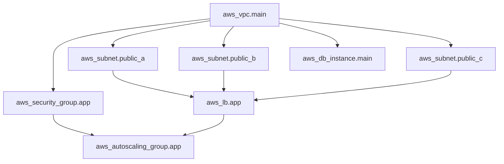
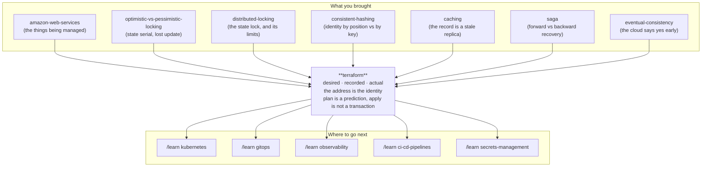

# Terraform — the ledger that knows what you own

> **Tell a friend:** Asha built her company's cloud by clicking through screens,
> and now nobody can say exactly what she built, copy it, or rebuild it after a
> bad day. Writing the clicks down as a script does not rescue her, because a
> script has no memory of what it already made, so running it again gives her a
> second copy of everything. Terraform's answer is a written ledger that maps
> every name Asha chose to the object the cloud actually created. Nothing in the
> cloud knows that mapping, so the ledger is the only thing in the world that
> knows what she owns. Every hard thing in this lab comes from that one ledger
> being shared, going stale, or going missing.

The simulator is `visualization.html`, beside this file; section 9 says what to
do with it. What this lab is made of, and where its numbers come from, is in
section 17 at the end.

---

## 1. Why must the description of a system live outside the system?

> **In one breath:** Asha built her company's cloud by clicking. The only
> complete description of what she built is the running thing itself. You
> cannot copy a thing, review a thing, or rebuild a thing from memory.

You built something on a cloud by clicking. It works. Now you need it again.

You need it in a second environment for testing. Or in a second region, because
the first one had a bad day. Or simply back the way it was before somebody
changed it.

And nobody can tell you what "it" is. The only complete description of what you
built is *the thing itself*, sitting in a console, spread over a hundred screens
you visited once, in an order you no longer remember.

**Infrastructure as code is the idea that the description should exist
somewhere other than inside the running system.** Terraform is one way to do
that. Why it is harder than it sounds is the subject of this lab.

### What does it cost to leave the description inside the system?

Four bills arrive, and none of them looks like an infrastructure problem when it
lands.

Your staging environment quietly stops resembling production, so tests stop
meaning anything. A change made at 2am to end an incident is never made anywhere
else, and is forgotten by Friday. The one person who remembers why a setting is
the way it is leaves the company. And the disaster recovery plan says "rebuild
in another region", which is a sentence, not a plan.

### What promise is this lab paying off?

The [amazon-web-services](../62-amazon-web-services/) lab made a claim in its
§13.2 and did not defend it:

> *Your infrastructure code is your disaster recovery plan. If everything but
> state and identity is a template, a region loss is "apply the template
> elsewhere and restore the data". If it is 400 console clicks that one person
> half-remembers, a region loss is a rewrite under pressure.*

That was an assertion. This lab is the mechanism behind it. The mechanism turns
out to be far more interesting than "write your infrastructure down", and
section 13.2 comes back and qualifies the claim properly.

Here is the thesis. Everything else in this document is a consequence of it.

> **Terraform is not a tool for creating infrastructure. It is a tool for
> maintaining a *mapping* — between names you chose and objects a cloud
> created. Nothing in the cloud knows that mapping, so Terraform writes it
> down. Every difficult thing about Terraform is a consequence of that written
> mapping being shared, going stale, and being the only thing in the world that
> knows what you own.**

### Which of your old labs are about to come back?

Three of them, wearing different clothes. The lab names each one as it arrives,
so you do not have to hold them now.

The record Terraform keeps carries a version counter, and any change computed
against an out-of-date copy of it is refused. That is
[optimistic-vs-pessimistic-locking](../10-optimistic-vs-pessimistic-locking/)'s
`WHERE version = ?`, living in a file. It arrives in section 10.5.

That record is a shared mutable thing two engineers can write at once, so it
needs [distributed-locking](../43-distributed-locking/). Every limit that lab
established applies here unchanged. It arrives in section 10.5 too, and again
as failure F2.

And Terraform offers two ways to say *"make several of these"*. One of them
destroys and recreates resources that did not need to change. That is
**exactly** the `hash(key) % n` versus consistent-hashing bug from
[consistent-hashing](../35-consistent-hashing/): identity derived from a
positional property, versus identity derived from a stable key. Same bug, same
catastrophic remapping. This time the things being remapped are your production
databases.

That last one is section 10.7, and it is the centrepiece of the lab.

---

## 2. Why does Asha have to build Marigold Pay twice?

> **In one breath:** Asha built a payments company's infrastructure by clicking
> for three weeks. Then four different people needed a copy of it, and there was
> nothing to copy — only a running system nobody could read.

No jargon in this section. A ten-year-old could follow it.

**Asha** runs the engineering at **Marigold Pay**, the small payments company
from the last lab. Over three weeks she has built their system on AWS by
clicking. A private network. Subnets in three zones. A load balancer. Servers
that replace themselves. A database with a standby. Storage for receipts. And
about forty permission rules.

It works. Then four things happen, in this order, and each one hurts more than
the last.

### One: the second environment

The team wants a staging copy to test against, so Asha starts clicking again.
Three days later staging exists and is *almost* the same. The load balancer
timeout is different, because she forgot. One permission is broader, because it
was easier that afternoon.

Six weeks later a change works in staging and breaks in production. It takes two
days to find out why. The difference was a setting nobody knew was different,
because nowhere in the world is there a list of the settings.

### Two: the change nobody can see

At 2am during an incident, **Priya** is on call. She widens a rule to let
traffic through, and the incident ends. The change is never written down, never
reviewed, and never removed.

It is now permanent, invisible and load-bearing. Hold on to Priya's 2am fix. It
comes back four more times in this lab, and each time it costs more.

### Three: the person who left

The engineer who set up the network leaves. Nobody knows why one subnet has a
strange address range. Nobody dares change it. It becomes a thing the team works
around rather than understands.

### Four: the plan that is a sentence

The disaster recovery document says: *if we lose the region, we rebuild in
another one.* **Omar**, who runs the quarterly drill, reads that and does the
arithmetic. "Rebuild" means three weeks of clicking, from memory, at the worst
possible moment, by whoever is awake.

> **🔮 Predict:** Four different pains, four different people. Before reading on,
> say in one sentence what is broken *once*, underneath all four.
> <details><summary>Reveal</summary>
>
> **The description of the system exists only inside the system.**
>
> You cannot diff it, review it, copy it, or rebuild from it. That is all four
> at once: staging drifts because there is no list to compare; Priya's fix is
> invisible because there is nowhere to write it; the leaver's knowledge had no
> file to live in; and Omar's drill has nothing to replay.
>
> If you said "they should have documented it", you are close, and the lab is
> about why that is not enough. A document describes the system. It does not
> *make* the system. The moment those two can disagree, they will.
> </details>

### Where does this lab take you?

Stop at any checkpoint and you still have something whole.

| Layer | Sections | After it you can… |
|---|---|---|
| Beginner | 1–9 | say what Terraform is, and why a state file has to exist |
| Intermediate | 10 | read a plan and predict what an apply will do |
| Engineering | 11–12 | reason about every failure, and state what is guaranteed |
| Production | 13 | run this on a team without hurting yourself |

Said another way, as a path with four stops on it:

> **BEGINNER MODEL** (sections 1–9) → **INTERMEDIATE MODEL** (section 10) →
> **ENGINEERING MODEL** (sections 11–12) → **PRODUCTION MODEL** (section 13)

Stop after section 9 and you will understand what Terraform is, and why a state
file exists. Stop after section 10 and you can read a plan and predict what an
apply will do. Sections 11 and 12 are what happens when it goes wrong at 4pm on
a Thursday. Section 13 is how a team runs it without hurting itself.

---

## 3. Why doesn't writing the clicks down as a script fix it?

> **In one breath:** Every click has a command-line twin, so Asha writes the
> whole build as a script. It is a real fix for two of her four pains. Then she
> runs it a second time.

This is the obvious repair, and it is not a strawman. It is how everyone did
this for years.

Every click Asha made has a command-line equivalent. So she writes a script:
create the network, then the subnets, then the load balancer, then the servers.
Now the description lives in a file, in version control, where it can be read
and reviewed and run again.

It fixes pains three and four *partially*. There is now a written description,
and "rebuild" means "run the script". **Ben**, the newest engineer on the team,
reads it on his first day and understands the shape of production in an hour.
That is real value.

Before you read on, commit to a guess.

> **🔮 Predict:** Asha runs her script a second time — same file, same account,
> nothing changed. What happens?
> <details><summary>Reveal</summary>
>
> **She gets a second copy of everything.** A second network, six more subnets,
> another load balancer, another database.
>
> The script says *"create a load balancer"*. It does not say *"there should be
> one load balancer"*. Those are different sentences, and only the second one
> is safe to say twice.
>
> This is the same distinction as [idempotency](../49-idempotency/): an operation
> is safe to repeat only if repeating it lands you in the same state. "Create"
> is not that operation. And she cannot simply avoid running it twice, because
> **running it again is the entire point** — she wants to change one setting and
> have everything else stay as it is.
> </details>

---

## 4. What three things can a script never do?

> **In one breath:** Asha patches the script to check before it creates. Each
> patch works until it meets the next problem, and the third one is the problem
> the rest of the lab is about.

Asha does the obvious repair. Before creating anything, check whether it is
already there. In her words: *if it does not exist, create it*, which she
writes in the script as `if not exists, create`.

Then Ben asks three questions, and each one opens a hole underneath the last.

### Ben's first question: how do you know it is already there?

Check by *name*? Most cloud objects do not have a unique, immutable, queryable
name. An AWS load balancer has a name. A subnet has an identifier that AWS chose, a string like
`subnet-0a3f...`. At best it also carries a `Name` tag, which is neither unique
nor enforced.

Two different teams can tag two different subnets `marigold-app-a`. A tag can be
edited by anyone.

So "does `marigold-app-a` exist?" has no reliable answer. And worse: if
something *does* come back, Asha has no way to know whether it is **the one her
script made**, or somebody else's that happens to share a name.

### Ben's second question: how does the script delete anything?

Asha removes the "create a cache cluster" block from her script, because
Marigold stopped using it. She runs the script. Nothing happens. The cache
cluster is still there, still running, still billed.

Of course it is. The script is a list of things to create, and she deleted a
line from the list.

**A file of instructions has no memory of the instructions it used to contain.**
To delete something, you must compare *what the file says now* with *what the
file caused before*. A file cannot compare itself to its own past.

### Ben's third question: what will it do before it does it?

Asha wants to change the load balancer's timeout from 30 seconds to 60. She
edits the script and stands with her finger over the enter key.

The only way to find out what the script will do is to let it do it. On a
payments system. On a Tuesday afternoon.

> **🔮 Predict:** All three problems have one shared root cause. Before reading
> section 5, try to say it in one sentence.
> <details><summary>Reveal</summary>
>
> **The script describes actions, and Asha wants to describe an outcome. To turn
> an outcome into the right actions, you must know which real objects in the
> cloud your previous outcomes produced.**
>
> Not "what exists" — the cloud can tell you that. **Which of what exists is
> yours, and which line of your file it came from.** That mapping is not
> recoverable from the cloud, because the cloud never knew about your file.
>
> Every one of the three problems is that missing mapping:
> - can't tell if it exists → can't map a config line to a real object;
> - can't delete → can't tell which real object a *removed* line used to own;
> - can't preview → can't compare against something you never recorded.
>
> If you guessed "the script isn't idempotent", that is the symptom and section 3
> already named it. The cause is one level down: idempotence needs identity, and
> she has no identity to work with.
> </details>

---

## 5. What does Asha actually need? Five sentences, and one of them is the hard one

> **In one breath:** Asha writes down what a tool would have to do for her.
> Five sentences. The third one forces the entire design of Terraform, and the
> fifth one causes most of its pain.

Everything from here pursues five sentences. Asha needs a tool where:

1. **She describes the end state, not the steps.** "There should be one load
   balancer with a 60-second timeout", not "create a load balancer".
2. **Running it when everything already matches does nothing.** Not "does it
   again harmlessly" — does *nothing*, and says so.
3. **Removing a description removes the thing.** The tool must remember what
   its own past descriptions produced.
4. **It shows her exactly what will change, before anything changes**, in
   enough detail that Meera can review it in a pull request.
5. **It works for a team**, not for one laptop — several people, several
   changes, no lost work.

Requirement 3 is the one that forces the whole design. It is the only one that
cannot be satisfied by looking at the cloud, because the cloud has no idea what
your file used to say.

Requirement 5 is where most of the pain in sections 11 and 12 lives. **Meera**
reviews Marigold's infrastructure pull requests, and **Arjun** looks after the
shared plumbing the team runs on. Both of them exist because of requirement 5,
and both of them appear again shortly.

---

## 6. What if you simply write the mapping down?

> **In one breath:** Keep a written note of which real cloud object each line of
> your description produced. That one note turns an impossible question into an
> arithmetic problem, and it is the whole invention.

Here is the idea, stated once, plainly:

> **Keep a written record of which real cloud object each line of your
> description produced. Then "what should change?" becomes a comparison between
> three things instead of two: what you want, what you made last time, and what
> is actually out there now.**

That record is the whole invention. Four things fall out of it: the plan
output, the locking, the strange
refactoring rules, and the famous ways to destroy production by accident. All of
them exist because this record exists, is shared, and can be wrong.

There are two halves here, and separating them is worth doing carefully.

**The description** is a set of named blocks. Each says *what should exist*.
And here is the crucial part. Each carries
**a name you chose**, which is stable even though the cloud's own identifier is
not.

**The record** maps each of your names to the cloud's identifier for the object
it produced. On the left, `my name "app_load_balancer"`. On the right, the
thing AWS calls
`arn:aws:elasticloadbalancing:...:loadbalancer/app/marigold/6d0ecf831eec9f09`.

With those two, all five of Asha's requirements become achievable. And one thing
becomes newly dangerous.

**That record is now the only object in the universe that knows the connection
between your file and your production infrastructure.** Lose it and you have not
lost your configuration. You have lost your *claim* on everything you built.

---

## 7. Which nine words carry the weight, and what did each one cost?

> **In one breath:** Nine words, and every one of them was already paid for by
> something that hurt Asha in sections 2 to 6. Each arrives as a thing in the
> story first, then gets its real name.

This is the lab's terminology, and you do not have to memorise it. Each word is
a repair for a specific pain you have already watched. Two short tables at the end of the section map them all
back to where they hurt.

### 7.1 What is a resource, and what is the name you call it by?

Asha writes one block that says *"there should be one load balancer, with a
60-second timeout"*. One block, one thing that should exist. Engineers call that
block a **resource**, and call the block itself a declaration of one object
managed by Terraform.

Now she needs to refer to it later, and here is the trouble. The cloud's own
identifier for that load balancer is a long string AWS chose *after* creating
it. Asha cannot write it in a file she has not run yet. So she needs a name that
exists **before** the object does, stays stable while the object changes, and
can be read by Meera in a pull request.

That name is built from two parts she controls: the kind of thing it is, and a
local label she invents. Engineers call it the **resource address**, and it is
written `aws_lb.app`. Another one is `aws_subnet.private_a`. Once resources are
grouped into reusable bundles, which
section 7.8 gets to, addresses nest: `module.network.aws_vpc.main`.

**The address is the key of the whole system.** The record from section 6 is
filed by it. Section 10.7 is entirely about what happens when addresses move.

Here is a concrete pair. The block Asha named `aws_lb.app` produces a load
balancer whose AWS identifier is
`arn:...loadbalancer/app/marigold/6d0ecf83`. Tomorrow she changes the timeout.
The AWS identifier stays. The address stays. Terraform knows they are the same
object, because the record says so.

That is an identity problem, and identity problems are the spine of
[consistent-hashing](../35-consistent-hashing/). Hold that thought until 10.7.

Here is the shape of one resource block, printed to be read:

```hcl
resource "aws_lb" "app" {                 # address: aws_lb.app
  name               = "marigold-app"
  load_balancer_type = "application"
  subnets            = [aws_subnet.public_a.id,   # <- a reference
                        aws_subnet.public_b.id,
                        aws_subnet.public_c.id]
  idle_timeout       = 60
}
```

*(That is HCL, HashiCorp Configuration Language. You are not learning the syntax
in this lab — you are learning what the tool does with it. The one thing to
notice is the references to `aws_subnet.public_a.id`. Section 7.5 explains why
they matter far more than they look.)*

### 7.2 Who actually knows how to talk to AWS?

Not Terraform. This surprises people.

Terraform knows nothing about load balancers, subnets or databases. It is a
general engine for reconciling a description against a record against reality.
The thing that turns "there should be a load balancer" into actual API calls is
a separate plugin, and engineers call it a **provider**.

Said precisely: a provider is a separately-versioned binary. For every resource
type it supports, it implements four operations: create, read, update and
delete. It also carries a schema, describing that type's arguments and which of
them can be changed in place.

That separation is why the same tool manages Cloudflare DNS, GitHub repos,
Kubernetes objects and PostgreSQL roles. Learn the engine once; the providers
are catalogue lookups.

And it has a consequence worth writing on the wall: **idempotence is the
provider's job, not Terraform's.** When section 12 tells you that Terraform
guarantees less than you assumed, most of the missing guarantees are missing
right here.

### 7.3 Why does Asha need three states and not two?

Asha now has three different pictures of Marigold Pay, and confusing them is the
single most common way to misread a plan. Naming them separately is the most
useful thing you can do for your own understanding, and Terraform's own
documentation does not always do it.

The first picture is **what her files say should exist**. Engineers call it the
**desired state**.

The second is **what Terraform believes it created**, including a full copy of
every object's attributes as of the last time it looked. That is the record from
section 6. Engineers call it the **recorded state**, and it lives in a file
called the **state file**.

The third is **what is really in the cloud right now**, discovered by asking the
provider. Engineers call it the **actual state**.

Why three, and not just "what I want" versus "what is there"? Because
desired-versus-actual cannot tell you what to *delete* — nothing in the cloud
says "this used to be in your config". It also cannot tell you what is *yours*.
Desired-versus-recorded tells you what you meant to change. Recorded-versus-
actual tells you what changed behind your back. Asha needs both comparisons,
which means she needs all three states.

Watch it decide something. Desired says the timeout should be 60. Recorded says
30. Actual says 30. Conclusion: you asked for a change, nobody has interfered,
do the update.

Now change only the third number. Actual says 120, because someone edited it by
hand. The conclusion is now different, and the plan will tell you so.

One connection to carry forward: the recorded state is a **cached replica** of
the cloud, and it goes stale exactly the way [caching](../11-caching/) said
replicas do. The refresh in section 10.4 is cache revalidation, wearing a hat.

### 7.4 What is a plan, and which of its four symbols ends careers?

Asha's fourth requirement was "show me what will change before it changes". The
two halves of that are a **plan** and an **apply**, and in plain words they are
"tell me what you would do" and then "do it".

A plan is the computed difference between the three states, expressed as one
action per resource address. There are four possible actions: create, update in
place, destroy, or *replace* — which means destroy and then create. An apply
executes a plan.

The separation exists so that Meera can read the change before it happens. This
is the single most valuable thing Terraform gives you over Asha's script, and it
is why a Terraform plan belongs in a pull request the way a code diff does.

Here are the four action symbols, printed as you will read them for the rest of
your career:

```text
  + create              a new object will be made
  ~ update in-place     an attribute changes; the object survives
  - destroy             the object goes away
-/+ replace             DESTROY and then CREATE  <-- read this one twice
```

> **🔮 Predict:** Meera is reviewing a 40-line plan. One line reads
> `-/+ aws_db_instance.main`. Everything else is a `~`. Which line should stop
> the review, and what is about to happen if it does not?
> <details><summary>Reveal</summary>
>
> **The `-/+` line.** It says the production database will be destroyed, and a
> new empty one created in its place. Terraform does not copy the data across.
> There is no undo.
>
> It happens because Asha changed an attribute the provider cannot change in
> place, and the provider's only remaining option is to make a new object.
> Failure F6, in section 11.6, is this exact line and the three controls that
> stop it.
>
> If you said "the `~` lines are the risky ones because they change things",
> that is the natural guess and it is backwards. A `~` keeps the object and
> edits it. A `-/+` throws the object away. The dangerous symbol is the one that
> looks like two small ones.
> </details>

### 7.5 Who decides what gets built first?

Nobody writes the order down. That is the elegant part, and it takes a moment to
believe.

Look again at Asha's block in 7.1. The load balancer's list of subnets is not a
list of names she typed. It reads `subnets = [aws_subnet.public_a.id, ...]`,
and each entry is a *reference* to another block. Terraform cannot even work out
what to send to AWS for the load balancer until those subnets exist and have
identifiers.

So the reference *is* the ordering. Terraform reads every reference in the
configuration and builds a graph out of them: one box per resource, one arrow
per reference. Engineers call it the **dependency graph**, and it is a directed
acyclic graph — a set of boxes and arrows with no loops.

Terraform then walks that graph. Independent work runs in parallel, ten
concurrent operations by default, and no box is ever started before the boxes it
points at have finished.

**The ordering is a consequence of the data flow.** That means it cannot drift
out of sync with the code, the way a hand-written ordering would.

Here is the shape of Marigold's graph. Read it downwards; every arrow exists
because the lower box mentions the upper one.



> **What to look at:** the three subnets have no arrows between them, so
> Terraform creates all three at the same time. And destroy runs the graph
> **backwards**, which is why `terraform destroy` removes the load balancer
> before the subnets it sits in.

There is an escape hatch, and it is a smell. `depends_on` lets you declare an
arrow by hand. It exists for dependencies that are real but invisible to the data flow. The
classic case is an IAM policy that must exist before a service can assume a
role, where nothing in the second resource references the first. Every `depends_on` in
a repository is a place the graph could not infer the truth.

### 7.6 Where does the ledger live, and who is allowed to hold it?

Arjun is the engineer who looks after Marigold's shared plumbing, and this is his
section.

The record has to live somewhere. Engineers call that somewhere the **backend**.
By default it is an ordinary file sitting next to your configuration, named
`terraform.tfstate`. That is fine for one person on one laptop, and it is not a
team's record.

So Arjun moves it to shared storage — an S3 bucket, Terraform Cloud, or a
database. That is a **remote backend**, and it satisfies Asha's fifth
requirement. The moment he does it, he creates a new problem: two people can now
write the same file at once, which is a lost update on a shared mutable object.

His fix is a **state lock**: a mutual-exclusion mechanism, taken at the start of
an apply and held until the record is written.

The classic AWS setup is an S3 bucket holding the state file, with versioning
switched on, plus a lock. Historically that lock was a DynamoDB table using the
state's path as its partition key, claimed with a conditional write — which is
precisely the conditional-write pattern from
[optimistic-vs-pessimistic-locking](../10-optimistic-vs-pessimistic-locking/).
Recent Terraform versions can hold the lock in S3 itself using a lock file,
removing the separate table. *(Version-specific; check the current backend
documentation rather than trusting a blog post, including this one.)*

Everything [distributed-locking](../43-distributed-locking/) established applies
here without modification, including its limits. Section 11.2 is what happens
when the lock is off.

> **A naming collision, cleared up before it confuses you.** Terraform has two
> unrelated things called a lock. The **state lock** above is mutual exclusion
> during an apply. The **dependency lock file** is `.terraform.lock.hcl`,
> committed to git. It pins exact provider versions and their checksums, like a
> `package-lock.json`. They share a word and nothing else.

### 7.7 What is drift, and why is it worse than a config change?

Come back to Priya's 2am fix from section 2.

She widened a rule by hand, in the console, to end an incident. Nothing in
Terraform's record knows she did it. Reality quietly stopped matching the
description. Engineers call that **drift**: a difference between the actual state
and the recorded state, caused by something other than Terraform.

Drift has many parents. A console click. Another tool. An AWS-side default
applied without asking. An autoscaling event that changed a server count.

The word exists because drift is a genuinely different failure from "someone
changed the config". A config change is intentional and reviewable. Drift is
neither, and it is invisible until the next plan — or worse, until the next plan
**silently reverts it**.

Here is the whole shape in one run. Six weeks after Priya's night, Ben applies
an unrelated change. Terraform, doing exactly its job, narrows the rule back,
because the description says it should be narrow. The incident returns,
apparently caused by a change that had nothing to do with it. That is failure F1
in section 11.1, and its operational answer is in 13.5 and 13.6.

### 7.8 What is a module, and why is the root one your blast radius?

Asha's first pain was building staging by hand. The repair is to write "a
network with three subnets and the routing" **once**, and then ask for it twice
with different inputs. Engineers call that reusable bundle a **module**.

Precisely: a module is a directory of configuration with declared inputs, called
variables, and declared outputs. The configuration you actually run is the
**root module**. Everything it calls is a child module. Addresses nest to match,
so a subnet inside the network module is
`module.network.aws_subnet.private_a`.

Now the sentence that matters more than the definition:

**The root module is the unit of state, and therefore the unit of blast
radius.** One root module means one state file, which means one lock, one plan
and one apply. Put everything your company owns in one root module, and every
change to anything locks and risks everything. Section 13.3 is how Arjun draws
those boundaries, and 11.10 is what it costs when he does not.

### 7.9 What are the two ways to say "make several of these"?

Marigold needs five private subnets. Asha does not want five nearly-identical
blocks, so Terraform offers two ways to say "make several of these". They are
called `count` and `for_each`.

Both create multiple instances of one resource block. They differ in **how the
instances are named in the record**, and that is the only difference that
matters.

With `count = 3`, the instances are addressed by their **position in a list**:
`aws_subnet.private[0]`, `[1]`, `[2]`.

With `for_each = { a = ..., b = ..., c = ... }`, they are addressed by **a
string you chose**: `aws_subnet.private["a"]`, `["b"]`, `["c"]`.

It does not look like it should matter. It is the single most destructive detail
in the tool, and section 10.7 is the whole story. For now, hold this shape: one
of them keys identity by *where a thing sits in a list*, the other keys it by
*what the thing is*.

If that framing rings a bell, it should.
[consistent-hashing](../35-consistent-hashing/) opened with the same bug. There,
a key's location was a function of a *global property*, the machine count,
rather than of the key itself. That is `hash(key) % n`, and `count` is the
same idea with subnets instead of cache entries.

### The nine words, mapped back to where each one hurt

Two tables, split by what the word is about. The first covers what you write.

| Word | Where it hurt | In plain words | Why it had to exist |
|---|---|---|---|
| **Resource** | 4, Ben's first question | one block saying one thing should exist | you need a unit smaller than "the system" |
| **Resource address** | 4, the tag that meant nothing | the name *you* chose, `aws_lb.app` | the cloud's identifier arrives too late to use |
| **Provider** | 3, every click had a twin | the plugin that makes the API calls | the engine must not know about AWS |
| **Module** | 2, staging built by hand | a bundle of resources with inputs | write the network once, ask for it twice |
| **Root module** | 2, one blast for everything | the configuration you actually run | it is the unit of state, lock, plan and risk |

The second covers what Terraform keeps and what it does with it.

| Word | Where it hurt | In plain words | Why it had to exist |
|---|---|---|---|
| **Desired state** | 5, describe the end not the steps | what your files say should exist | requirement 1 |
| **Recorded state** | 4, Ben's second question | what Terraform believes it created | you cannot delete what you cannot remember |
| **Actual state** | 7.7, Priya's 2am fix | what is really in the cloud now | the record can be wrong, so check |
| **Plan and apply** | 4, Ben's third question | "what would you do", then "do it" | requirement 4, so Meera can review it |
| **Dependency graph** | 3, the script's hand-written order | arrows built from references | an order derived from data cannot drift |
| **Drift** | 2, the change nobody could see | reality moved, and nobody wrote it down | it is not the same failure as a config change |

> **CHECKPOINT — you have the vocabulary.**
> You can read a Terraform plan's four symbols and say what a state file is for.
> What you cannot yet do is predict what a plan will *say* in a given situation.
> Next: two pictures to think in, then the machinery that produces the plan.

> **Say it back.** Without using the words *state*, *resource* or *address*,
> explain to Ben why Terraform has to keep a file of its own, when AWS already
> knows everything that exists.
> <details><summary>A good answer sounds like</summary>
> "AWS knows what exists. It does not know which of those things came from your
> file, or which line made them. So when you delete a line, AWS cannot tell you
> what to delete, because it never knew the line existed. Terraform keeps its
> own note of 'I made this one, and it came from here', and that note is the
> only place that connection is written down anywhere."
> </details>
---

## 8. What two pictures should you keep in your head?

> **In one breath:** Two mental models. A shopkeeper with a list, a ledger and
> a stock-take is the whole of Terraform. Then we strip the shop away and say the same machine
> precisely, and then we find the four places the shop lies to you.

### 8.1 What does the shopkeeper's ledger tell you?

Imagine Asha keeping a shop, and stocking it from one supplier.

She keeps a **shopping list** pinned to the wall: what the shop *should* stock.
Three shelves of rice. One freezer. A sign outside. That is the configuration.

She keeps a **ledger** of what she has actually bought, with the supplier's
order number written next to each line — *"one freezer, supplier reference
FRZ-88213"*. That is the state file. The reference numbers matter, because the
supplier only understands its own numbers, not her descriptions.

Before ordering anything she does a **stock-take**. She walks the shop and
checks that each ledger line's item is still there, and still as recorded. That
is the refresh.

Then she compares three things: the list, the ledger and the shelves. Out of
that comparison she writes a **to-do list**: buy this, return that, one shelf needs restocking. She
reads it before she does any of it. That is the plan.

Only then does she act, ticking the ledger as each thing is done.

The three-way comparison is what makes the picture earn its keep, so here it is
made concrete. Read the last row twice.

| Shopping list says | Ledger says | Shelves say | What Asha concludes |
|---|---|---|---|
| one freezer | one freezer, FRZ-88213 | freezer there | nothing to do |
| one freezer | (nothing) | no freezer | buy one |
| (nothing) | one freezer, FRZ-88213 | freezer there | return FRZ-88213 |
| one freezer | one freezer, FRZ-88213 | no freezer | someone took it — buy again |
| big freezer | small freezer, FRZ-88213 | small freezer | upgrade FRZ-88213 |
| one freezer | one freezer, FRZ-88213 | **two** freezers | the second one is not hers, and she will not touch it |

That last row explains the entire existence of the ledger. Without it she could
not tell her freezer from somebody else's.

### 8.2 What is the same machine, stated precisely?

Now strip the shop away. Six sentences, and they are the engineering model: a
reconciliation loop with a written key.

Terraform is a **reconciler**. It computes a plan as a function of three inputs:
what you want, what it recorded, and what is out there. Then it executes that
plan. Written the way an engineer would write it, `plan = f(desired,
recorded, actual)`. It is not a script runner, and it has no concept of steps
you wrote.

**The address is the primary key.** Structurally, the state file is a keyed
table. Each row is `address → (provider, cloud identifier, full attribute
snapshot, dependencies)`. Everything Terraform can do rests on that key being
stable.

**Ordering is derived, not declared.** The graph comes from references, and the
walk runs in parallel wherever the graph permits.

**The state file is a replica of the cloud.** It is refreshed at plan time and
written at apply time. Between those two moments it is stale by definition.

**An apply is not a transaction.** It is a graph walk of independent operations,
against many separate systems that share no commit protocol. There is no
rollback. Section 10.6 is what that feels like.

**The unit of concurrency, blast radius and locking is the root module**, not
the resource.

### 8.3 Which shop word is which engineering word?

Two tables. The first maps the things that sit still.

| In Asha's shop | In Terraform | Why it matters |
|---|---|---|
| Shopping list on the wall | Configuration (`.tf` files) — desired state | Reviewable, diffable, in git |
| Ledger with supplier reference numbers | State file — recorded state | The only thing that knows which cloud object is yours |
| Supplier's order number | Cloud identifier (`subnet-0a3f…`, an ARN) | Chosen by the cloud, meaningless to you, mandatory for the API |
| Asha's own words for an item | Resource address (`aws_subnet.public_a`) | Chosen by you, stable, exists before the object does |
| One ledger per shop | One state file per root module | The unit of blast radius |

The second maps the things Asha does.

| In Asha's shop | In Terraform | Why it matters |
|---|---|---|
| Walking the shelves | Refresh — reading actual state | Costs time and API calls; can be skipped, at a price |
| The to-do list, read before acting | Plan | The reason this beats a script |
| Ticking the ledger as you go | State written incrementally during apply | Why a failed apply is not a clean slate |
| Someone else's freezer in your shop | An unmanaged resource | Terraform ignores what is not in its ledger |
| Only one person may hold the ledger | State lock | Two stock-takes at once corrupt the record |

### 8.4 Where does the shop story lie to you?

Four places, and all four are expensive.

**Lie one: the ledger is a passive record.** It is not. It has authority.

If Asha's ledger says she owns a freezer and the freezer is gone, she buys
another, which is fine. But suppose the ledger says she owns *nothing*, while a freezer she paid for
stands in the shop. She will not claim it. She will not maintain it. She will
happily buy a second one beside it.

**Terraform manages exactly what is in the state file, and is blind to
everything else.** Objects that fall out of state do not become "unmanaged but
fine". They become invisible, unowned, un-deleted, and billed. That is the
failure behind bringing an existing object under management, in section 11.5,
and behind the sinking feeling of a lost state file, in 11.3.

**Lie two: the shelves hold still while she walks them.** A stock-take assumes a
still shop. A cloud is a live multi-tenant system with other actors,
autoscaling, and its own eventual consistency. An API that returns success
before the object is fully visible is normal, not exceptional. You saw exactly
this shape in [eventual-consistency](../28-eventual-consistency/).

So the actual state Terraform reads is a **snapshot with a timestamp**, and the
plan built from it is a prediction that was true a moment ago. Sections 11.7 and
11.8 are the two ways that bites.

**Lie three: a half-finished stock-take is a bug.** It is not. It is a real
outcome.

If Asha is interrupted after buying the freezer but before buying the shelves,
the shop is genuinely half-stocked, and the ledger genuinely records one
purchase. There is no undo. She cannot un-buy a freezer by closing her eyes.

**Terraform has no rollback, and does not pretend to.** Recovery is forward: fix
the problem and run it again. This is [saga](../47-saga/) without compensations,
which means forward recovery only. It is a deliberate choice rather than an
omission. Section 10.6 builds it.

**Lie four: the ledger lists items.** A shop ledger lists items. Terraform's
record stores **every attribute of every object, including the sensitive ones**.
Generated passwords. Private keys. Certificate bodies. Connection strings.

Marking a variable `sensitive` hides it from *console output*. It does not
remove it from the file. Anyone who can read your state file can read your
database password. That is section 11.9, and it is the most commonly missed fact
in the entire tool. Nothing in the shop picture warns you about it.

> **CHECKPOINT — you have both pictures.**
> You can now explain to a colleague why Terraform needs a state file at all,
> which is the question most people get wrong. Next: watch the three states
> disagree on screen, then build the mechanism that resolves them.

> **Say it back.** Using only Asha's shop, explain why a lost ledger is a
> disaster even though every item in the shop is untouched.
> <details><summary>A good answer sounds like</summary>
> "The freezer is still there and still working. But nothing now connects it to
> her shopping list. She cannot prove she bought it, cannot look up its supplier
> number to return it, and if she reads her list tomorrow she will conclude she
> needs a freezer and buy a second one. The goods survived. The claim on them
> did not."
> </details>

---

## 9. What should you look at in the simulator?

> **In one breath:** Three columns: what you want, what Terraform remembers,
> and what actually exists. A sentence at the top says what the next plan would
> do. Everything else on the page explains that sentence.

Open **`visualization.html`**, or the published copy:
**https://claude.ai/code/artifact/78aeb612-6287-444c-9aa3-504bd9b7ed60**
It is a self-contained page; the local file works offline.

**What it shows.** Three columns, left to right: **Config** (what you want),
**State file** (what Terraform remembers), **Cloud** (what actually exists).
That is section 8.1's table, alive. Every resource appears as a row in each
column where it is known, and the colour of a row tells you whether the three
agree.

**What to look at first.** The **verdict bar** at the top states, in one
sentence, what the next plan would say and why. Below the columns, the plan
output renders in the real `+ ~ - -/+` notation, so the thing you read on screen
is the thing you will read in a terminal.

### Which controls change the world?

These six change one of the three states, and each one is a story you have
already met.

| Control | What it does | Which section |
|---|---|---|
| **Add / remove / edit** a resource in Config | Changes desired state | 10.2 |
| **Someone clicks in the console** | Changes cloud without touching state — drift | 7.7, 11.1 |
| **Someone deletes it in the console** | Removes from cloud; state still claims it | 11.1 |
| **Someone creates it in the console** | Adds to cloud with no row in state | 11.5 |
| **Delete the state file** | The record is gone; the infrastructure is not | 11.3 |
| **`count` ↔ `for_each`**, then remove a middle item | The centrepiece | 10.7, 11.5 |

These five change how a run behaves. They are normally invisible defaults in
somebody's repository.

| Control | What it does | Which section |
|---|---|---|
| **Plan** | Refresh, then compute the three-way diff | 10.4 |
| **Apply** | Walk the graph and execute, writing state as it goes | 10.5 |
| **Make apply fail at step N** | Partial apply — the thing with no rollback | 10.6, 11.4 |
| **Second engineer applies too** | Concurrent write to the shared record | 11.2 |
| **State lock: on / off** | Whether that concurrency is prevented | 7.6, 11.2 |

And two controls just move you around: **Step ◀ / ▶, play, reset** walks an
apply in either direction, and **clicking any row** shows its three states side
by side with an explanation of why they differ.

### Which three scenarios should you run first?

In this order. Each asks you to predict before it runs.

1. **"Nothing to do"** — plan with everything already matching. Thirty seconds,
   and it establishes what "converged" looks like, so the later scenarios have a
   baseline.
2. **"The 2am fix"** — Priya widens a rule by hand, then Ben applies an
   unrelated change. Watch Terraform silently undo the fix. This is the one that
   changes how you think about drift.
3. **"Remove the middle one"** — five subnets under `count`, delete the second.
   Predict how many resources change before you run it. Then switch to
   `for_each` and do it again. If you only do one thing on this page, do this
   pair.

**The usually-hidden choices are controls here on purpose.** Whether the state
is locked, whether an apply fails halfway, and whether identity is positional or
keyed are normally defaults nobody chose deliberately. Each of them decides
whether an ordinary Tuesday is an incident, so each is a dial you turn.
---

## 10. How would you build the reconciler yourself, one failure at a time?

> **In one breath:** We build Terraform the way you would build it. Simplest
> thing that could work, then let it break, then let the breakage force the next
> repair. Every strange feature of the real tool arrives here as the scar of a
> failure you just watched.

Six versions, and one capstone rule that ties them together. Before the
evolution, watch the finished machine run once.

### 10.1 What does one plan look like, worked by hand?

Marigold's configuration has four resources. Here are the three states from
section 7.3, with real values in them.

Four attribute names appear below, so read them as English first. A network's
address range is written `cidr_block`. How long a load balancer waits before
hanging up is `idle_timeout`. The size of machine a database runs on is
`instance_class`. And whether that database keeps a standby in a second zone is
`multi_az`.

**What Asha's files say should exist** — the desired state:

```hcl
resource "aws_vpc" "main"        { cidr_block   = "10.0.0.0/16" }
resource "aws_subnet" "public_a" { vpc_id = aws_vpc.main.id, cidr_block = "10.0.1.0/24" }
resource "aws_lb" "app"          { subnets = [aws_subnet.public_a.id], idle_timeout = 60 }
resource "aws_db_instance" "main"{ instance_class = "db.r6g.large", multi_az = true }
```

**What the ledger remembers from the last apply** — the recorded state. The
middle column is the identifier AWS chose; the right column is the attribute
snapshot Terraform kept.

| Address | Cloud ID | Recorded attributes |
|---|---|---|
| `aws_vpc.main` | `vpc-0a1b2c3d` | `cidr_block = 10.0.0.0/16` |
| `aws_subnet.public_a` | `subnet-0e4f5a6b` | `cidr_block = 10.0.1.0/24` |
| `aws_lb.app` | `arn:…/app/marigold/6d0ecf83` | `idle_timeout = 30` |
| `aws_db_instance.main` | `marigold-prod-db` | `instance_class = db.t3.medium`, `multi_az = true` |

**What AWS says right now** — the actual state, read back by a refresh. It is
identical to the record, with one exception. The subnet's address range, which
Terraform writes as `cidr_block`, has moved: the refresh reads
`cidr_block = 10.0.9.0/24`. Somebody changed it in the console last week.

Now the comparison, one row at a time. This trace is the entire algorithm.

```
aws_vpc.main
  desired  10.0.0.0/16
  recorded 10.0.0.0/16
  actual   10.0.0.0/16
  -> all three agree                                     ACTION: none

aws_subnet.public_a
  desired  10.0.1.0/24
  recorded 10.0.1.0/24
  actual   10.0.9.0/24     <- recorded != actual, so this is DRIFT
  -> refresh overwrites recorded with actual (10.0.9.0/24),
     then desired(10.0.1.0/24) != recorded(10.0.9.0/24)
  -> provider says cidr_block cannot be changed in place
     ACTION: -/+ REPLACE  (destroy subnet-0e4f5a6b, create a new one)

aws_lb.app
  desired  idle_timeout 60
  recorded idle_timeout 30
  actual   idle_timeout 30      <- no drift; you changed the config
  -> provider says idle_timeout IS updatable in place
     ACTION: ~ update in-place

aws_db_instance.main
  desired  db.r6g.large
  recorded db.t3.medium
  actual   db.t3.medium
  -> provider says instance_class is updatable in place (with a restart)
     ACTION: ~ update in-place
```

And here is the plan Terraform prints. You can now read it as an output rather
than a mystery.

```text
Plan: 1 to add, 2 to change, 1 to destroy.

  ~ aws_lb.app
      ~ idle_timeout: 30 -> 60
  ~ aws_db_instance.main
      ~ instance_class: "db.t3.medium" -> "db.r6g.large"
-/+ aws_subnet.public_a  (forces replacement)
      ~ cidr_block: "10.0.9.0/24" -> "10.0.1.0/24"  # forces replacement
```

> **The three things to take from that trace.** First, drift did not produce a warning. It
> produced a *plan action*, silently, and the fix someone made in the console is
> about to be destroyed. Second, `-/+` appeared because of a
> **provider** decision, since the address range of a subnet is immutable in
> AWS. That is section 7.2's sentence about the provider owning the semantics,
> made concrete. Third, the plan says `1 to add, 1 to destroy` for what is *one*
> resource, and that arithmetic surprises people in exactly the situations where
> it matters most.

Also notice what is **not** in the plan. The load balancer references the subnet
that is about to be replaced. In a real run, replacing the subnet also disturbs
everything attached to it. Whether Terraform destroys the old subnet before or
after creating the new one decides whether there is an outage. Section 10.6
gives that behaviour its name.

### 10.2 Version 1 — why isn't comparing config to cloud enough?

Start with the obvious reconciler, and no record at all. Read the config, read
the cloud, and diff them.

For creation it works. The config says a load balancer named `marigold-app`
should exist. Ask AWS for load balancers. None named that, so create it. Run
again, find it, do nothing. Asha's requirement 2 looks satisfied.

> **🔮 Predict:** Two problems kill version 1 immediately, and one of them is
> the reason the state file exists at all. What are they?
> <details><summary>Reveal</summary>
>
> **Problem A — it cannot delete.** You remove the cache cluster block from your
> config. Version 1 compares config to cloud: the config does not mention a
> cache cluster, and the cloud has one. Should it be deleted? *Terraform cannot tell.* "Not in the config" is true of the cache
> cluster it created **and** of every other object in the account: the database
> another team owns, the bucket the CI system made, the VPC that came with the
> account. Without a
> record of what it made, "delete everything not in my config" is the most
> destructive command ever written.
>
> **Problem B — matching by name is a lie.** Version 1 has to find "the load
> balancer for `aws_lb.app`" by *some* attribute of the config, and every
> candidate is wrong. Names are not unique across resource types or accounts.
> Most resource types have no name at all. Tags are mutable and unenforced. And
> if you *change* the name in your config, name-matching finds nothing and
> creates a second one rather than renaming the first.
>
> Both problems are the same missing thing: **a record of which cloud object
> each address produced.** That is the state file, and this is why it cannot be
> optimised away.
>
> If you predicted "it would be too slow", that is true of very large estates
> and it is not fatal. These two are fatal.
> </details>

### 10.3 Version 2 — what changes once you write down what you made?

Add the record. After creating an object, store the address, the cloud
identifier, and the attributes. Now four rules cover everything.

- **Create:** the address is in the config and not in the record, so make it,
  then write it down.
- Address in both, attributes differ → update it.
- Address in the record and **not** in the config → destroy it, then remove the
  line. This is safe now, because the record only ever contained things
  Terraform made.
- In the cloud but not in the record → **not yours; never touched.**

That last rule is what makes Terraform usable in a real account alongside other
people, and it is the source of section 8.4's first lie.

Version 2 satisfies Asha's requirements 1, 2 and 3. It is a genuinely working
tool, and plenty of teams have run something like it for years.

> **🔮 Predict:** Version 2 compares **config against the record** and never
> looks at the cloud. Priya widens a security group rule by hand at 2am to end
> an incident. A week later Ben runs version 2 to change an unrelated load
> balancer timeout. What does the plan say, and what happens to Priya's fix?
> <details><summary>Reveal</summary>
>
> **The plan says `1 to change` — just the timeout. Priya's fix is not
> mentioned, and it is not reverted either.** Version 2 has no idea the rule was
> widened, because it never looked.
>
> That sounds like a lucky escape and it is the opposite. The record now says
> the rule is narrow; reality says it is wide; and **nobody will ever find out**
> until something makes them look. The record is the one artefact the team trusts to
> describe production, and it is quietly lying. Every plan computed from it is
> computed from a false premise.
>
> This is the stale-replica problem from [caching](../11-caching/) exactly: a
> cached copy whose source changed underneath it, serving confident wrong
> answers. And the fix is the same one that lab prescribed — **revalidate before
> you use it.**
> </details>

### 10.4 Version 3 — why must a plan look at reality first?

The repair is one step, inserted before the diff. Ask the provider to read the
current state of every recorded object, and update the record to match. *Then*
diff the config against the refreshed record. Engineers call that step the
**refresh**, and it is what real Terraform does at the start of every plan.

Now Priya's 2am fix appears in the plan, as a change back to the narrow rule.
That is the correct behaviour, and it still surprises everyone. Ben wanted to
change a timeout, and he is now also reverting a security fix he knows nothing
about. That is failure F1 in section 11.1, and the operational answer is in
13.5.

Three consequences of the refresh are worth carrying with you.

**A plan costs API calls in proportion to your resource count.** A root module
with 800 resources makes roughly 800 read calls per plan. That is why very large
root modules become slow enough that people start skipping the refresh, and why
section 13.3's advice to split them is a performance argument as well as a
blast-radius one.

**There is a mode that only looks.** In words: update the record from reality
and tell me what changed, without proposing to change anything back. The flag is
`-refresh-only`. It is the honest way to detect drift, and it is the basis of
13.5's drift report.

**There is also a mode that does not look.** The flag is `-refresh=false`, and
skipping the refresh puts you straight back into version 2, with version 2's
lie. Use it knowing that.

### 10.5 Version 4 — what happens when Asha and Ravi apply at once?

Marigold now has four engineers, and the record lives in a shared bucket that
Arjun set up. Version 3 was safe on one laptop. Watch it meet a second person.

Asha and Ravi both plan at 14:32. Both read the same record. Asha's plan says
"change the timeout". Ravi's says "add a subnet". Both apply.

The record carries a counter that goes up by one on every write. Engineers call
it the **serial**, and here it starts at 41.

```
14:32:00  Asha  reads record  (serial 41)
14:32:01  Ravi  reads record  (serial 41)
14:32:10  Asha  applies: timeout changed in AWS
14:32:14  Asha  writes record (serial 42, containing the new timeout)
14:32:20  Ravi  applies: subnet created in AWS
14:32:25  Ravi  writes record — built from serial 41, plus his subnet
                    -> the record now describes the OLD timeout and the new subnet
```

The load balancer's timeout really is 60 in AWS. The record says 30. Asha's work
has been erased from the record, not from the cloud. Next time anyone plans,
Terraform will helpfully offer to change the timeout back.

> **🔮 Predict:** You have seen this exact failure before, twice, in two
> different labs. Name the failure, and name the two mechanisms that fix it —
> one that Terraform actually uses for the file, and one it uses for saved
> plans.
> <details><summary>Reveal</summary>
>
> It is the **lost update** — read-modify-write on a shared mutable object with
> no concurrency control, from
> [optimistic-vs-pessimistic-locking](../10-optimistic-vs-pessimistic-locking/).
> Ravi's write was computed from a version that was no longer current, and SQL's
> version of this was that lab's central result.
>
> **The pessimistic fix, which is what Terraform actually does for the state
> file:** take a **lock** before the refresh and hold it until the record is
> written. Ravi's apply waits, or fails with `Error acquiring the state lock`
> naming Asha and when she started. Everything from
> [distributed-locking](../43-distributed-locking/) applies, including its
> limits. The lock is a lease with an owner recorded in it. A crashed apply
> leaves it held. And `force-unlock` is the manual override that exists
> precisely because slow and dead are indistinguishable from outside.
>
> **The optimistic fix, which Terraform uses for saved plans:** the state file
> carries a **serial** number that increments on every write, and a `lineage`
> identifying the state's history. A plan saved with `-out=tfplan` records the
> serial it was built against, and applying that saved plan when the serial has
> moved is refused as stale. That is `WHERE version = ?`, the
> first-committer-wins rule, carrying proof-of-what-you-read exactly as your
> locking lab described.
>
> Both mechanisms exist because they answer different questions: the lock stops
> two applies overlapping, and the serial check stops **one** apply executing a
> decision made against a world that has since moved.
>
> If you named only the lock, you have the common answer. The serial is the half
> most people never notice, and section 11.7 is what it does not protect.
> </details>

### 10.6 Version 5 — what is left behind when an apply stops halfway?

Version 4 is safe against two people. Now watch one person fail in the middle.

Marigold applies a change of 7 resources. The graph walk reaches resource 4, an
RDS database instance, and AWS returns an error, because the chosen instance
class is not available in that availability zone.

```
14:40:00  aws_vpc.main               no change
14:40:00  aws_subnet.public_a        CREATED   subnet-0f1e2d3c   -> recorded
14:40:02  aws_subnet.public_b        CREATED   subnet-0c4b5a69   -> recorded
14:40:03  aws_security_group.app     CREATED   sg-07d8e9f0       -> recorded
14:40:31  aws_db_instance.main       ERROR: InvalidParameterValue
14:40:31  apply halts. aws_lb.app, aws_autoscaling_group.app: never attempted.
```

> **🔮 Predict:** What is in the cloud, and what is in the record, one second
> after that error?
> <details><summary>Reveal</summary>
>
> **Three new objects exist in the cloud, and the record correctly lists all
> three.** Nothing is rolled back. Nothing is orphaned either — the record was
> written as each resource completed, which is the important half.
>
> **Terraform has no rollback, and this is a design choice rather than a gap.**
> Rolling back would mean destroying resources it just created, in order to
> recover from a *partial success*. For a database that is data loss. For a load
> balancer it is an outage. And a rollback can itself fail, leaving you
> somewhere worse than either end state.
>
> So the recovery model is **forward-only**: fix the configuration, run again,
> and the reconciler converges from wherever it actually is. This works only
> because of the property the whole tool is built on — **the desired state is
> absolute, not relative.** A script that says "create three subnets" cannot be
> re-run from the middle. A description that says "there should be three
> subnets" can be re-run from anywhere.
>
> You have met this trade before: [saga](../47-saga/) is a sequence of local
> transactions with **compensations** — backward recovery. Terraform is the same
> shape with the compensations deliberately removed and forward recovery in
> their place. And the reason it can get away with that is the reason sagas
> cannot: infrastructure operations are re-runnable to convergence, whereas
> "charge the customer" is not.
> </details>

Two refinements come out of this failure, and both are settings you will meet in
real code. Terraform groups them under the word `lifecycle`.

The first says: for a replacement, make the new object *before* destroying the
old one. It is written `create_before_destroy`. The default is destroy-first,
which for anything serving traffic is an outage window. Destroy-first is the
default because create-first is impossible when a unique name or address is
involved.

The second says: refuse to plan any destroy of this resource at all. It is
written `prevent_destroy`. A blunt instrument, and exactly right on a production
database. It is section 7.4's `-/+` catastrophe, stopped by a fence.

There is a third, which tells Terraform to stop caring about particular
attributes. It is written `ignore_changes`. It is the correct answer when something outside
Terraform legitimately owns a value. Two examples: the server count of an
autoscaling group, written `desired_capacity`, and a tag applied by a compliance
system. Used well it is essential. Used to silence a confusing diff, it hides
drift permanently.

### 10.7 Version 6 — how does deleting one subnet destroy four?

Everything so far has treated the address as fixed. Here is what happens when it
is not. This is the most destructive detail in the tool, and it is where
[consistent-hashing](../35-consistent-hashing/) comes back.

Marigold has five private subnets. Asha wrote them the compact way, with a list
of address ranges and one block that repeats itself once per entry.

```hcl
variable "subnet_cidrs" {
  default = ["10.0.1.0/24", "10.0.2.0/24", "10.0.3.0/24", "10.0.4.0/24", "10.0.5.0/24"]
}

resource "aws_subnet" "private" {
  count      = length(var.subnet_cidrs)
  cidr_block = var.subnet_cidrs[count.index]
}
```

The record therefore looks like this. Notice that the addresses in the left
column are numbers, because `count` names instances by their position.

| Address | Cloud ID | cidr_block |
|---|---|---|
| `aws_subnet.private[0]` | `subnet-0aaa` | 10.0.1.0/24 |
| `aws_subnet.private[1]` | `subnet-0bbb` | 10.0.2.0/24 |
| `aws_subnet.private[2]` | `subnet-0ccc` | 10.0.3.0/24 |
| `aws_subnet.private[3]` | `subnet-0ddd` | 10.0.4.0/24 |
| `aws_subnet.private[4]` | `subnet-0eee` | 10.0.5.0/24 |

Ben picks up a small ticket. The second range, `10.0.2.0/24`, is no longer
needed. He deletes it from the list, leaving four, and opens a pull request that
Meera reviews.

> **🔮 Predict:** How many of the five subnets does Terraform destroy, and how
> many does it create? Commit to two numbers before revealing.
> <details><summary>Reveal</summary>
>
> **It destroys 4 and creates 3.** One subnet is deleted because you asked; the
> other three are destroyed and recreated for no reason at all.
>
> Here is the arithmetic, and it is worth reading slowly:
>
> | Address | Record says | Config now says | Action |
> |---|---|---|---|
> | `private[0]` | 10.0.1.0/24 | 10.0.1.0/24 | none |
> | `private[1]` | 10.0.2.0/24 | **10.0.3.0/24** | -/+ replace |
> | `private[2]` | 10.0.3.0/24 | **10.0.4.0/24** | -/+ replace |
> | `private[3]` | 10.0.4.0/24 | **10.0.5.0/24** | -/+ replace |
> | `private[4]` | 10.0.5.0/24 | *(nothing)* | - destroy |
>
> Nothing is wrong with Terraform's reasoning. It is doing precisely what the
> record and the config say. The bug is **in the identity scheme**: with
> `count`, an object's address is its *position in a list*, so removing an
> element renumbers everything after it, and every renumbered address now points
> at an object whose attributes no longer match.
>
> If you predicted "one destroy", you were reasoning about what Ben *meant*.
> Terraform reasons about keys, and Ben changed four of them.
> </details>

**Now name the bug, because you have already met it.** From
[consistent-hashing](../35-consistent-hashing/):

> *The bug: `hash(key) % n` makes every key's location a function of a **global
> property** of the cluster, so changing the machine count changes almost every
> answer at once — measured at 100→101 machines, modulo moves 99.0% of keys
> where only 1.0% had to move.*

`count` is `% n`. The subnet's identity is a function of a global property: its
position in a list. So changing the list changes almost every identity at once.
Here the numbers are smaller and the objects are bigger.

| Case | Things disturbed | Things that had to move | Churn |
|---|---|---|---|
| Modulo hashing, 100→101 machines | 99.0% of keys | 1.0% of keys | 99× more than needed |
| `count`, 5 subnets minus one | 4 of 5 objects | 1 of 5 objects | 4× more than needed |

Same bug, same shape. Read the right-hand column of that table as 80% churn to
do 20% of the work. And this time the things being destroyed and recreated are
not cache entries. They are subnets, and in the general case databases.

**The fix is the same fix, too:** make identity a function of the *thing*, not
of *where it sits*. Terraform's version of that is `for_each`, which takes a map
of names to values instead of a list.

```hcl
variable "subnets" {
  default = {
    app_a = "10.0.1.0/24"
    app_b = "10.0.2.0/24"     # <- delete this line
    app_c = "10.0.3.0/24"
    app_d = "10.0.4.0/24"
    app_e = "10.0.5.0/24"
  }
}

resource "aws_subnet" "private" {
  for_each   = var.subnets
  cidr_block = each.value
}
```

Now the addresses are `aws_subnet.private["app_a"]`, `["app_b"]` and so on. Ben
deletes `app_b`, and the plan is:

```text
Plan: 0 to add, 0 to change, 1 to destroy.
  - aws_subnet.private["app_b"]
```

**One destroy. Nothing else moves.** That is the same guarantee consistent
hashing bought — the ring's **monotonicity**, where adding or removing a node
moves only the keys that must move and never shuffles the others sideways.
`for_each` is monotone under insertion and deletion. `count` is not.

**The rule, stated so it survives without the analogy:** *use `count` only when
the instances are genuinely interchangeable and the number is the only thing
that ever changes.* Three identical NAT gateways qualify. So does a resource
that exists zero or one times, written `count = var.enabled ? 1 : 0`. **Use
`for_each` whenever the instances have identities** — which is nearly always,
because "the subnet in zone b" is an identity even when it looks like item 2 of
a list.

**And when you get it wrong,** the repair is a `moved` block. It tells Terraform
that an address changed without the object changing.

```hcl
moved {
  from = aws_subnet.private[2]
  to   = aws_subnet.private["app_c"]
}
```

That is a *record edit*, not an infrastructure change. It rewrites the key in the
ledger, so the same cloud object is now filed under a new name. The older,
imperative form is `terraform state mv`, run by hand. A `moved` block is better,
because it is reviewable by Meera, is applied by everyone automatically, and
cannot be forgotten by the colleague who pulls your branch.

### 10.8 Why must Terraform know every address before it does anything?

One rule ties versions 1 to 6 together. Once you see it, several of Terraform's
most confusing error messages become obvious.

**The set of addresses must be fully known at plan time.** Not the attribute
values; those may be unknown. The *addresses*. Because addresses are the keys of
the record, and a plan is a statement about keys.

That is why asking `for_each` to loop over a value that depends on another
resource's not-yet-created attribute fails with this well-known message:

```text
Error: Invalid for_each argument
The "for_each" value depends on resource attributes that cannot be determined
until apply.
```

People read that as a limitation. It is a **safety property**. If the set of
addresses were only discoverable during the apply, then a partially-failed apply
from 10.6 would leave Terraform unable to say what it owns. The whole
forward-recovery model depends on the record being trustworthy after a crash, so
it would collapse.

Its sibling is the marker Terraform prints for a value the cloud has not
generated yet:

```text
  + aws_lb.app
      + arn         = (known after apply)
      + dns_name    = (known after apply)
      + idle_timeout = 60
```

A plan is a **prediction**, and any value the cloud generates cannot be
predicted. Everything downstream of an unknown is also unknown. So a plan
containing a new resource is systematically less informative than a plan that
only changes existing ones.

This matters for review. `Plan: 12 to add` tells Meera much less than
`Plan: 0 to add, 1 to change` does, and reviewers should be told so.

> **CHECKPOINT — you have the intermediate model.**
> You can read a plan, predict what an apply will do, and explain why the
> state file is unavoidable. You can also say exactly why `count` is dangerous
> and when it is not, which is better than most people using Terraform daily. Next: the failures, each
> tied to the guarantee it bends.

> **Say it back.** Without using the words *count*, *index* or *key*, explain to
> Omar why deleting one line from a list of five destroyed four subnets.
> <details><summary>A good answer sounds like</summary>
> "Terraform did not file those subnets under their names. It filed them under
> their place in the queue: first, second, third. Delete the second one and
> everybody behind it shuffles forward a place. Now the thing filed as 'third'
> is a different subnet from the one that was filed as 'third' yesterday, so
> Terraform throws the old one away and builds the new one. Nothing shuffles if
> you file things under their names instead."
> </details>
---

## 11. What does it look like when it goes wrong?

> **In one breath:** Ten failures, each one a night in somebody's life. Four of
> them arrive with an error message. The other six arrive as silence, and those
> are the ones to read twice.

They are ordered by how often you will actually meet them, which is not the
order tutorials use. Every one of them happens to somebody you already know:
Asha, Ravi, Priya, Meera, Arjun, Ben, Dev and Omar all get a turn.

> **🔮 Predict:** Before you read them, guess which of these two hurts more —
> the failure that stops your apply with a red error, or the failure that lets
> your apply finish successfully. Then count, as you read, how many of the ten
> produce no error at all.
> <details><summary>Reveal</summary>
>
> **Six of the ten are silent**, and they are the expensive ones: F1, F3, F5,
> F7, F9 and F10 all complete without an error message. F2 is silent without a
> lock and loud with one, which is the whole argument for the lock.
>
> A red error stops you before the damage. A green apply that quietly reverted a
> security fix, or quietly left a database unmanaged, hands you the damage and a
> clean exit code. If you guessed that the loud ones are worse, that is the
> natural instinct, and it is exactly backwards.
> </details>

### 11.1 F1 — why does a timeout change undo Priya's 2am fix?

In the simulator, choose *"The 2am fix"*. You can also build it by hand: click
**Someone edits it in the console** on the security group, then press **Plan**.

Priya widened the rule six weeks ago and told nobody. Ben opens a pull request
that changes a load balancer timeout, and nothing else.

The refresh from section 10.4 reads the widened rule into the record. The diff
against the config then proposes narrowing it back. That proposal appears mixed
in with the thing Ben actually wanted, often as a one-line `~` among twenty
lines, and it is applied without comment.

Terraform is doing its job perfectly here. The configuration is the desired
state, and reality no longer matches it. There is no notion of "this difference
is deliberate" unless somebody encodes one.

Convergence survives: after the apply, reality matches the config, which is the
whole promise. What is lost is an assumption everybody held who was not in the
2am incident — that a change to a load balancer timeout only changes a load
balancer timeout.

Three habits fix it, in order of value. Read the whole plan, and make that a
review rule: a plan touching resources unrelated to the pull request's stated
purpose is a blocked review, not a curiosity. Run `-refresh-only` on a schedule,
so drift arrives as a daily report rather than as a surprise inside someone
else's change. And close the loop on emergency changes: the incident is not
resolved until the fix is in the configuration, because otherwise the next apply
is a scheduled re-incident.

### 11.2 F2 — what breaks when two applies overlap?

In the simulator, set **State lock: off**, then press **Second engineer applies
too**. Run it again with the lock on and watch the difference.

Without a lock you get section 10.5's timeline exactly: a lost update on the
record. Reality holds both changes. The record holds one. Every future plan is
then computed from a false premise, and the first symptom is usually a plan
proposing to "fix" something that was never broken.

There is a worse version. The two writes interleave inside the file itself, and
the state is *corrupt* rather than merely wrong.

The mechanism is read-modify-write on a shared mutable object with nothing
guarding it, which is the exact shape from
[optimistic-vs-pessimistic-locking](../10-optimistic-vs-pessimistic-locking/).

With Arjun's lock in place, Ravi's apply fails cleanly:
`Error acquiring the state lock`, naming who holds it and since when. Notice the
shape of that outcome. It is a fast, loud failure, which is the good kind.

So the lock buys the record's correctness. Without it, what you lose is the
trustworthiness of the only artefact that knows what you own.

A remote backend with locking is not optional for a team; it is the first thing
Arjun set up. Turn on **versioning** on the bucket holding the state, so a
corrupt write is recoverable rather than terminal. Know that `force-unlock`
exists for the crashed-apply case, and know why it is dangerous:
[distributed-locking](../43-distributed-locking/) established that slow and dead
are indistinguishable from outside, so force-unlocking a lock whose holder is
merely slow gives you two concurrent applies with your blessing.

### 11.3 F3 — what is left when the state file is gone?

In the simulator, press **Delete the state file**, then **Plan**.

Arjun's heart stops, because the plan proposes to create *everything*, from
scratch, alongside the infrastructure that already exists and is still serving
production traffic:

```text
Plan: 47 to add, 0 to change, 0 to destroy.
```

The cause is section 8.4's first lie. Terraform manages what is in the record
and is blind to everything else. With an empty record it owns nothing, so every
config block is a thing that does not exist yet.

Say the good news out loud, because the panic suggests otherwise. Your
infrastructure is untouched. Nothing has been damaged. Your configuration is
also intact. What is lost is the mapping. You still own everything; you can no
longer *prove* it, and Terraform can no longer manage it.

Prevention is cheap and total: remote state, bucket versioning, and never
letting the state file live only on one laptop because someone added it to
`.gitignore` and stopped there. Recovery is `import`, which is section 11.5, and
for a large estate it is counted in days. This is the failure that turns "we'll
set up remote state later" into a decision with a number attached.

### 11.4 F4 — what does a half-finished apply leave behind?

In the simulator, use **Make apply fail at step N**, then step through it.

You get section 10.6's timeline. Some resources created and recorded. The
failing one absent. Everything after it never attempted. `terraform apply` exits
non-zero with the provider's error, and Ben has to decide what to do next.

No transaction spans several independent cloud APIs, and Terraform does not
pretend otherwise. Forward recovery instead of rollback.

What survives is the record's accuracy: it lists exactly what was created, which
is precisely what makes re-running safe. What you lose is atomicity, which was
never offered. And a partially-built environment can be *worse than either
endpoint*. A security group that exists without the rules that were going to
constrain it is briefly more open than both the before and after states.

Re-run after fixing, and expect that to be normal rather than alarming. Two
sharp edges are worth knowing. A resource whose creation succeeded but whose
provisioner failed is marked for replacement on the next run; modern Terraform
expresses that as `-replace=ADDRESS` rather than the older `taint` command. And
an apply interrupted by a lost network connection or a killed CI job **may not
have written its final state**, which is F2's corruption case arriving by a
different road. Bucket versioning again. In CI, make applies non-cancellable, or
accept that cancelling one is an incident.

### 11.5 F5 — what happens to something Terraform never knew about?

In the simulator, press **Someone creates it in the console**. A resource
appears in the Cloud column with no row in State.

Then nothing happens. Terraform ignores it forever. Omar keeps paying for it
forever.

And if the configuration later describes something with the same name, the apply
fails with a provider error about a duplicate. That is the *lucky* outcome,
because the alternative for resource types with no name is a silent second copy.

The cause is section 10.3's fourth rule: in the cloud, not in the record, not
yours.

Safety survives, and it is the reason the rule exists at all: Terraform will
never destroy something it did not create. What is lost is completeness. Your
configuration is no longer a description of your infrastructure, only of the
part Terraform happens to manage, and the gap between those two is invisible.

Dev brings it under management with an `import` block, which is declarative and
reviewable:

```hcl
import {
  to = aws_subnet.private["app_f"]
  id = "subnet-0f9e8d7c"
}
```

He then runs a plan. Terraform reads the real object, writes it into the record
at that address, and shows him the difference between it and the configuration.
That difference is usually enlightening, because hand-made resources rarely match
what anyone would have written. *(The `import` block form is available in recent
Terraform; the older imperative `terraform import` command does the same job one
resource at a time.)*

The strategic answer is to prevent the gap rather than close it repeatedly: deny
console write access in production and make Terraform the only path. That is
section 13.6.

### 11.6 F6 — how does one character delete the production database?

In the simulator, edit an immutable attribute on the database row, press
**Plan**, and read the `-/+`.

Meera is reviewing. One line says:

```text
-/+ aws_db_instance.main (forces replacement)
```

If that is applied, the production database is destroyed and a new, empty one is
created. Terraform does not restore the data. There is no undo.

The cause sits in the provider, not in Terraform. The provider declares each
attribute as updatable in place or not, and some attributes are genuinely
immutable in the cloud API — a subnet's CIDR, an instance's
availability zone, many `name` fields. Changing one leaves the provider no option
but replacement, and the plan says so, in a line that looks much like the other
lines.

Honesty survives here, completely. Terraform tells you, every time, in the plan,
before doing it. This failure is *always* preventable by reading. What is lost,
if you do not read, is everything in the resource.

Three controls, each of which stops it alone. Put
`lifecycle { prevent_destroy = true }` on every stateful production resource; it
is the fence that turns a catastrophe into a failed plan. Make
`forces replacement` a searched-for string in code review and in CI, so a plan
containing it on a stateful resource requires a second approver. And when a
replacement is genuinely intended, do it deliberately: snapshot first, and
consider `create_before_destroy` so there is a working object at every moment.

### 11.7 F7 — why isn't a reviewed plan a contract?

This one is hard to stage cleanly. The simulator approximates it: press
**Someone edits it in the console** *between* a Plan and an Apply.

Meera reviewed a plan showing one change and approved it. Between the plan and the
apply, reality moved. That gap might be thirty seconds, or a lunch break, or a
CI queue. The
apply does something the reviewed plan did not describe.

A plan is a prediction computed from a snapshot, which is section 8.4's second
lie. Terraform's protection is the optimistic check from section 10.5: a
**saved** plan records the state serial it was built against, and is refused if
that serial has moved. But that protects against the *state* changing, not
against the *cloud* changing beneath an unchanged state.

So the record's consistency survives, and with a saved plan you also keep the
guarantee that you are not applying a decision made against a superseded record.
What is lost is the idea that a reviewed plan is a contract. It is a
well-informed forecast.

In CI, always run `plan -out=tfplan` and apply *that artefact*, never re-planning
at apply time. Otherwise the thing a human approved and the thing that runs are
two different computations. Keep the gap between plan and apply short. And treat
a large gap, such as an approval that sat for two days, as grounds to
re-plan and re-review.

### 11.8 F8 — why does the same apply fail once and then succeed?

Not simulated; this one is a provider-level behaviour.

Arjun's apply creates a permission role and then, immediately, something that
references it. The second step fails, saying the role does not exist. He runs it
again, changing nothing, and it succeeds.

Cloud control planes are distributed systems with their own propagation delay.
An API returns success when the write is *accepted*, not when it is *visible
everywhere*. IAM, the AWS identity service, is the classic offender. You met this precise
shape in [eventual-consistency](../28-eventual-consistency/); here it appears as
a flaky apply.

Correctness on retry survives — the reconciler converges. What is lost is the
assumption that an apply either works or is broken. Some applies simply need to
be run twice, and telling that apart from a real failure is a judgement call.

Good providers implement retry-with-backoff internally, so this is less common
than it was. When it persists, the honest fix is a `depends_on` that makes the
ordering explicit, rather than a sleep. And be suspicious of any runbook step
that says "if it fails, just run it again" without saying why. That sentence
hides both this failure and several worse ones.

### 11.9 F9 — who else can read your database password?

Not simulated. Click the database row in the simulator and read the note.

Nothing happens, until someone reads the file. The state file contains every
attribute of every managed object. Generated passwords. Private keys.
Certificate bodies. All in plain text.

That is not an oversight. The record's job is to hold a full attribute snapshot
so the next plan can diff against it, and it cannot diff against something it did
not store. Writing `sensitive = true` on a variable suppresses the value in
*console output*. It does not remove it from the file.

The diff's correctness survives. What is lost is any assumption that the state
file is merely metadata. It is a credential store that nobody labelled as one,
and Omar's auditors will eventually ask about it.

Treat the state backend as a production secret store: encryption at rest, a
bucket policy tighter than the rest of your account, access logging, and no state
file in git, ever. Better still, avoid putting secrets in Terraform at all. Have
Terraform create the *container*, such as a Secrets Manager entry or a KMS key.
Let something else populate it, so the value never enters the record.

### 11.10 F10 — what does one root module for the whole company cost?

In the simulator, set the root module to include every resource, then watch the
lock and the plan time.

Every change to anything locks everything. A plan takes eight minutes, because it
refreshes 900 resources. Two teams cannot ship at once. And the blast radius of
one bad apply is the entire company. So is the blast radius of one
`terraform destroy` run in the wrong directory.

The cause is section 7.8's sentence: the root module is the unit of state, lock,
plan and blast radius. Nothing else in Terraform is.

Correctness survives. A giant root module is not *wrong*. What is lost is team
throughput, plan speed, and any containment of mistakes.

Arjun splits it by rate of change and by blast radius. Networking, which changes
rarely and breaks everything, goes in one place. Applications, which change
hourly and break one thing, go in another. Data stores go in a third.
Cross-module references become explicit inputs: pass values in as variables from
a pipeline, rather than reaching into another module's state, which recreates
the coupling you split to avoid. The cost of splitting is real and is paid in
plumbing. Pay it anyway.

### The ten failures on one page

The first five are the ones you meet in your first month.

| Failure | What you see | What still holds | What you lose |
|---|---|---|---|
| F1 drift reverted | a `~` line you did not ask for | convergence | "my change only changed my thing" |
| F2 two applies | nothing, or `Error acquiring the state lock` | the record, if locked | trust in the record, if not |
| F3 state lost | `Plan: 47 to add` on a live system | the infrastructure and the config | the mapping, and the ability to manage |
| F4 partial apply | a non-zero exit and a provider error | the record's accuracy | atomicity, never offered |
| F5 unmanaged object | nothing at all, and a bill | safety: it destroys nothing it made | completeness of the description |

The second five are the ones that end up in a post-incident review.

| Failure | What you see | What still holds | What you lose |
|---|---|---|---|
| F6 forced replacement | `-/+ … (forces replacement)` | honesty: it always tells you | the contents of the resource |
| F7 stale plan | an apply unlike the plan you read | the record's consistency | the plan as a contract |
| F8 cloud lag | a failure that passes on retry | convergence on re-run | "it worked or it is broken" |
| F9 secrets in state | nothing, until someone reads it | the diff's correctness | the file being "just metadata" |
| F10 one big module | an eight-minute plan and a queue | correctness | throughput and containment |

> **CHECKPOINT — the failure catalogue is complete.**
> Take any Terraform repository and you can now enumerate what happens to it
> under all ten. Drift, concurrent applies, a lost record, a partial apply,
> unmanaged resources. Then an immutable-attribute change, a stale plan,
> provider eventual consistency, secret exposure, and an oversized blast radius. Next: what is
> actually guaranteed.

> **Say it back.** Pick the three failures above that produce a completely
> successful, green, zero-error run. Say why that makes them more dangerous than
> the ones that fail loudly.
> <details><summary>A good answer sounds like</summary>
> "F1, F5 and F9 all end with a success message. Nothing in the output asks
> anyone to look. So the security fix stays reverted, the hand-made database
> stays unmanaged and billed, and the password stays readable — for months,
> because there is no moment where a person is forced to notice. A failure that
> stops the run buys you attention at the cheapest possible moment. A failure
> that succeeds spends your attention later, at a much worse rate."
> </details>
---

## 12. What does Terraform actually promise?

> **In one breath:** One sentence, with four conditions attached, and every one
> of the four conditions is a failure you just read. What Terraform sells is
> convergence. It has never sold atomicity.

### 12.1 What is the one real guarantee?

Here it is, in full:

> **If the record is accurate and the apply completes without error, then
> reality matches your configuration for every resource Terraform manages.**

Read the conditions, because all four do real work.

*"If the record is accurate"* — sections 11.3 and 11.5 are the two ways it is
not.

*"If the apply completes"* — section 11.4 is what a partial apply leaves you.

*"reality matches your configuration"* — as understood by the provider. If the
provider's schema does not model an attribute, Terraform cannot manage it and
will not notice it changing.

*"for every resource Terraform manages"* — which is exactly the set in the
record, and nothing else in your account.

That is the whole promise, and it is worth a great deal. It is convergence, not
atomicity.

### 12.2 What is explicitly not guaranteed?

Four things about the run itself:

| Not guaranteed | Consequence | Where you saw it |
|---|---|---|
| **Atomicity** | A failed apply leaves a partial world; there is no rollback | 10.6, 11.4 |
| **That the plan is what happens** | A plan is a prediction from a snapshot | 10.8, 11.7 |
| **Ordering beyond the graph** | Independent resources run in parallel, in an unspecified order | 7.5 |
| **Idempotence of provider operations** | That is the provider's responsibility, and providers have bugs | 7.2, 11.8 |

And four things about the record and the world around it:

| Not guaranteed | Consequence | Where you saw it |
|---|---|---|
| **That the record matches reality** | Only true immediately after a successful refresh | 10.4, 11.1 |
| **Protection from your own destroy** | `terraform destroy` is a supported command | 11.6, 11.10 |
| **Secrecy of state contents** | Everything is stored in plain text | 11.9 |
| **That two runs of the same config produce identical infrastructure** | Provider defaults, cloud-generated values and AMI lookups drift over time | 13.4 |

That last row deserves a sentence of its own, because it is the most frequently
over-claimed property of infrastructure as code.

**Terraform gives you reproducible *descriptions*, not reproducible
*infrastructure*.** Pin your provider versions, which is what
`.terraform.lock.hcl` is for. Pin your inputs too, and you narrow the gap a
great deal. But a configuration that says "the latest Ubuntu AMI" means
something different this month than last, and that is a property of the
configuration, not a failure of the tool.

### 12.3 What was traded away to get it?

Four trades, and the third one is the deep one.

**Speed, for reviewability.** Plan-then-apply is slower than clicking. That is
the point. The slowness is where the review happens.

**Expressiveness, for predictability.** HCL is deliberately not a general
programming language. You cannot loop arbitrarily, cannot call out to anything,
and must know your resource addresses before you run. Section 10.8 explains why
the last one is a feature rather than a wart. When people find this constraining
they reach for CDK or Pulumi, which trade it back — and inherit a different class
of problem, where a plan depends on the behaviour of a program.

**A single source of truth, for a *second* source of truth.** This is easy to
miss, so slow down. Before Terraform, the cloud was the only place the truth
lived, and you could not review it. After Terraform there are two places, the
config and the record, plus the cloud.

**Keeping three things in agreement is now a permanent job.** Every failure in
section 11 is a disagreement among those three. You did not remove a problem.
You exchanged "I cannot see the truth" for "I must maintain the truth in three
places", and that is a very good trade made with open eyes.

**Cloud-native abstractions, for portability of *workflow*.** Terraform's model
is the same for AWS, Cloudflare, GitHub and Datadog, which is enormous. It is not
the same as being cloud-agnostic. A configuration full of `aws_*`
resources does not become an Azure configuration, and anyone promising you otherwise is selling
something.

### 12.4 Which three sentences should you memorise?

These three are the lab's invariants. Everything else is a consequence of them.

1. **Terraform manages exactly what is in the record.** Not what is in your
   config; not what is in your account. Everything in 11.3 and 11.5 follows.
2. **The address is the identity, so anything that moves an address moves an
   object.** `count` renumbering, module renames, and refactors all destroy and
   recreate unless you tell Terraform the address moved.
3. **A plan is a prediction and an apply is not a transaction.** Read the whole
   plan; expect to re-run.

> **CHECKPOINT — you have the engineering model.**
> You can state what Terraform guarantees, in one sentence with four
> qualifications, and defend each qualification with a failure. What remains is
> how a team runs this without hurting itself.

> **Say it back.** A colleague says: "Terraform is idempotent, so applying twice
> is always safe." Answer them in two sentences, without using the word
> *idempotent*.
> <details><summary>A good answer sounds like</summary>
> "Running it twice is safe only if the picture it holds of your infrastructure
> is still true, and if it managed to finish last time. Either of those can be false. Someone edited the console, or an
> earlier run died halfway. Then the second run is not a repeat of the first; it
> is a new decision made from different facts."
> </details>

---

## 13. How does a team run this without hurting itself?

> **In one breath:** Move the record somewhere shared and locked, split it into
> pieces small enough to reason about, and put the plan in front of a human
> before it runs. Everything else in this section is detail on those three.

### 13.1 What changes between this lab and a real repository?

Four changes to where things live:

| In this lab | On Arjun's team |
|---|---|
| A state file on a laptop | Remote backend with locking, versioning and encryption |
| One root module | Several, split by rate of change and blast radius |
| One environment | Environments as separate root modules with separate state and separate accounts |
| Everyone has admin | The pipeline has the credentials; humans have read access to production |

Three changes to how a change travels:

| In this lab | On Arjun's team |
|---|---|
| `terraform apply` typed by a person | A pipeline: plan on pull request, apply on merge, from a saved plan |
| "Read the plan" | The plan posted as a PR comment, with rules about what blocks a merge |
| Hoping for no drift | Scheduled `-refresh-only` runs producing a drift report |

### 13.2 What does "your IaC is your disaster recovery plan" actually mean?

Now the AWS lab's assertion from section 1 can be defended precisely, and also
*qualified*, which the original claim was not. Omar runs the quarterly drill, so
this is his section.

**What the configuration genuinely gives him:** every resource whose creation is
a pure function of your inputs can be recreated elsewhere by changing a region
variable and applying. Networks, subnets, security groups, load balancers,
scaling groups, roles, policies, DNS records. In the AWS lab's terms, that is
almost the whole diagram.

**What it does not give him,** and this is the part the assertion skipped, is
four separate things.

*Data.* The configuration creates an *empty* database. Recovery is configuration
**plus** a restored snapshot, and the restore is the long pole.

*State.* Omar's Terraform record describes objects in the region that just died.
A second region needs its own state, which means the disaster recovery
configuration must have been *structured* for two regions before the disaster —
not adapted during it.

*Quotas.* Straight from the AWS lab's F4: quotas are per account, per region. An
apply in the recovery region will get partway through and start failing on
limits nobody raised. A configuration that has never been applied in the recovery
region is a hypothesis.

*Provider and module versions.* A configuration that has not been applied for a
year may not apply at all, because the provider has moved. The dependency lock
file is what makes this survivable.

**So the honest version of the claim:** *infrastructure as code converts
disaster recovery from an unbounded task into a bounded one, and the bound is
only real if you have measured it.* Which is the same conclusion the AWS lab
reached about its recovery time objective, its RTO, by a different road: an
untested recovery is a wish.

### 13.3 Where should the state boundaries go?

The one decision that matters is **where the state boundaries go**, because that
is where locks, plans and blast radii go. Sections 7.8 and 11.10 are why. Here is
a layout that works for most teams:

```text
live/
  prod/
    network/      <- own state: VPC, subnets, routing. Changes monthly.
    data/         <- own state: RDS, S3. Changes rarely. prevent_destroy everywhere.
    services/     <- own state: ASGs, load balancers, ECS. Changes hourly.
  staging/
    network/  data/  services/
modules/
  network/        <- reusable, versioned, no provider or backend blocks inside
  service/
```

Three rules come out of this lab rather than out of taste.

**Split by rate of change**, so a fast-moving thing does not hold a lock against
a slow-moving one, and a routine deploy cannot propose to touch your VPC.

**Modules do not configure providers or backends.** A module is a function; the
root module is the program. Mixing them makes a module unusable in any context
but the one it was written for.

**Pass values between layers explicitly**, as pipeline variables or via a
parameter store, rather than reading another layer's state. Reaching into
another state file recreates the coupling you split to remove, and it adds a read
dependency on a file that layer's owners believe is private.

There is a tempting alternative, and it is usually wrong. Terraform's
`workspace` feature gives one configuration several states. For environments it
is normally the wrong tool, because production and staging then share a
configuration, a provider, a backend and often an account. A mistake reaches
both, and environments cannot legitimately differ in shape. Workspaces suit
short-lived parallel copies of the *same* thing — per-developer sandboxes,
per-branch preview stacks. Directories suit environments.

### 13.4 What does the pipeline look like, and why each step?

The workflow most teams converge on, with the reason for each step attached.

1. **Pull request opens.** CI runs `fmt -check`, `validate`, a linter
   (`tflint`) and a security scanner (`tfsec`/`checkov`).
2. **CI runs `terraform plan -out=tfplan`** with read-only credentials, and
   **posts the plan as a comment.** The plan is the diff being reviewed; the HCL
   change is only the cause of it.
3. **Meera reads it.** Rules worth encoding: any `-/+ forces replacement` on a
   stateful resource needs a second approver; any resource touched that is
   unrelated to the pull request's purpose is a blocking question, because that
   is F1 arriving.
4. **On merge, CI applies the saved `tfplan`** — the artefact, not a fresh plan,
   because of F7. Credentials for apply live only in the pipeline.
5. **Nightly, a `-refresh-only` run** reports drift, which is F1 again, this
   time caught early.

The security scanners are worth more than they look. Most of the AWS lab's F7, over-broad IAM,
is catchable by a static rule before it ever reaches an account.

### 13.5 What do the error messages actually mean?

Recognising these is most of day-to-day Terraform. Four of them are about the
record and the run:

| What you see | What it means | Which failure |
|---|---|---|
| `Error acquiring the state lock` (names a holder and a time) | Someone else is applying, or a previous apply died holding it | F2 |
| `Saved plan is stale` | The record moved between plan and apply | F7, 10.5 |
| `Objects have changed outside of Terraform` | Drift, reported at the top of a plan | F1 |
| Apply fails, succeeds on retry with no changes | Provider or cloud eventual consistency | F8 |

And five are about what the plan is telling you:

| What you see | What it means | Which failure |
|---|---|---|
| `-/+ … (forces replacement)` | An immutable attribute changed. **Stop and read.** | F6 |
| `Plan: 47 to add` on a system that exists | The record does not know about your infrastructure | F3, F5 |
| `already exists` from a provider | Something exists that the record does not know about | F5 |
| `for_each value depends on resource attributes…` | Addresses are not knowable at plan time | 10.8 |
| `(known after apply)` everywhere downstream | Normal for new resources; makes the plan less informative | 10.8 |

### 13.6 Which habits prevent whole classes of failure?

**Nobody has write access to production in the console.** This is the single most
effective control, because it makes F1 and F5 structurally impossible rather than
culturally discouraged. Break-glass access exists, is audited, and its use ends
with a configuration change.

**`prevent_destroy` on everything stateful**, from day one, not after the
incident.

**Bucket versioning on state**, so F2's corruption and F4's interrupted write
are recoverable.

**Pin everything**: provider versions in the lock file, module versions by tag,
and AMIs by identifier rather than "latest" where an identical rebuild matters.

**`moved` blocks for every refactor**, so a rename never reaches an apply as a
destroy.

**Small, frequent applies.** A plan with four changes is reviewable. A plan with
ninety is rubber-stamped, and every failure in section 11 hides more easily in
ninety.

### 13.7 What about the neighbours, honestly?

**CloudFormation**, and the CDK which generates it, is AWS's own. Its state is
managed *by AWS*, inside the service, which removes F2 and F3 entirely: no file
to lose, no lock to run. In exchange it is AWS-only, its rollback behaviour can
leave stacks in states that need manual rescue, and its iteration loop is slower.
**If you are AWS-only and value never handling a state file, this is a real
argument** and worth weighing rather than dismissing.

**Pulumi and CDK for Terraform** use the same reconciler model, with a general
programming language instead of HCL. You gain expressiveness and lose section
12.3's predictability: your plan now depends on the behaviour of a program.

**Kubernetes operators and Crossplane** are a *continuous* reconciler running in
a cluster, rather than one you invoke. The mechanism you learned here is the same
three-state comparison. The difference is that it runs every few seconds forever,
which makes F1 self-correcting, and makes the "silently undoes the 2am fix"
problem constant rather than occasional.

**Ansible and friends** are configuration management, not infrastructure
provisioning. Ansible is *mostly* stateless: it re-derives the current state from
the machine each run instead of keeping a record. That works because a machine
can be inspected in a way that "which of these 900 cloud objects are mine"
cannot.

**And a licensing note you need, because it affects tool choice.** In August 2023
HashiCorp changed Terraform's licence from the open-source MPL to the Business
Source License. The community forked the last MPL version as **OpenTofu**, now a
Linux Foundation project, which remains largely a drop-in alternative. IBM
subsequently acquired HashiCorp. For most teams this is a procurement question
rather than a technical one, and the two tools' mechanisms are the ones taught in
this lab either way.

### 13.8 What did this lab deliberately leave out?

- **HCL as a language** — expressions, functions, dynamic blocks, type
  constraints. This lab teaches the engine; the syntax is a reference lookup.
- **Writing a provider**, and the plugin protocol.
- **Terraform Cloud / Enterprise** — hosted state, policy as code (Sentinel/OPA),
  run pipelines.
- **Testing** — `terraform test`, Terratest, contract testing for modules.
- **The large-estate import problem** — tooling and strategy for bringing
  thousands of existing resources under management.
- **Multi-cloud and provider-specific depth** — the AWS lab covers what those
  resources actually *are*.

> **CHECKPOINT — production model reached.**
> You can structure a Terraform repository and defend where its state
> boundaries go. You can read the ten errors you will actually meet. And you can
> say precisely what "infrastructure as code is our DR plan" does and does not
> buy. What remains is
> practice.

> **Say it back.** Arjun asks you where to draw the very first state boundary in
> a repository that currently has one. Answer him, and say which failure your
> boundary contains.
> <details><summary>A good answer sounds like</summary>
> "Split the things that change hourly from the things that change once a
> quarter. Put the network in its own directory with its own record, and leave
> the applications in another. That way a routine deploy can never propose to
> touch a subnet, and it never has to wait behind a networking change to get the
> lock. It contains F10, the eight-minute plan and the
> company-wide blast radius. It also makes F6 less likely, because the dangerous
> resources are no longer in the same plan as the boring ones."
> </details>
---

## 14. What should you practise?

> **In one breath:** Eight rungs, from explaining why a state file must exist,
> up to designing the state architecture for a multi-team, multi-region estate.

See **`EXERCISES.md`**, with answers in **`SOLUTIONS.md`**. Attempt them first.

Three of them are worth doing even if you skip the rest.

Rung **3.4** asks you to predict the `count` renumbering numbers before running
it. Being wrong here is the most instructive moment in the lab.

Rung **6.2** is a repository with a planted flaw. It passes every review and
destroys a database on an ordinary Tuesday.

Rung **8.1** is the state architecture design, where the interesting part is the
boundary you refuse to cross.

---

## 15. Where does this sit, and what comes next?

> **In one breath:** Six earlier labs walk into this one, and five later ones
> walk out of it. The map below is the whole neighbourhood on one page.



### Which pairs get confused, and what separates them?

- **Terraform vs Ansible** — Terraform provisions infrastructure and keeps a
  record of what it owns; Ansible configures machines and re-derives their state
  each run. The record is the difference, and it exists because you can inspect
  a machine but you cannot inspect "which of these cloud objects are mine".
- **Terraform vs CloudFormation** — same reconciler idea; CloudFormation's state
  is held by AWS inside the service, so there is no file to lose and no lock to
  run, at the cost of being AWS-only.
- **Declarative vs idempotent** — declarative means you describe the end state;
  idempotent means running twice is the same as running once. Terraform is
  declarative, which is *how* it achieves idempotence; a script can be made
  idempotent without being declarative, and it is much harder.
- **State lock vs `.terraform.lock.hcl`** — mutual exclusion during an apply
  versus pinned provider versions. Same word, unrelated things.
- **`count` vs `for_each`** — identity by position in a list versus identity by
  a stable key. The second one is almost always what you mean.
- **Drift vs a config change** — reality moved versus intent moved. A plan shows
  both in the same output, and telling them apart is a review skill.
- **`terraform destroy` vs removing a resource block** — the first destroys
  everything in the state; the second destroys one thing. Both are real
  destroys, and neither asks twice.
- **Terraform vs OpenTofu** — a licence fork of the same mechanism; everything
  in this lab applies to both.

### What should you learn next, in the order that compounds best?

- `/learn kubernetes` — the compute layer both this lab and the AWS lab left as
  a box, and its controllers are this lab's reconciler running continuously.
- `/learn gitops` — that continuous reconciler pointed at a git repository;
  it is this lab's model with the human removed from the apply, and it makes F1
  self-healing.
- `/learn ci-cd-pipelines` — section 13.4 is a sketch; this makes it a practice.
- `/learn secrets-management` — F9 is a hole this lab could only point at.
- `/learn observability` — still outstanding from the AWS lab.
- `/learn kafka` — still the biggest unopened distributed-systems primitive,
  flagged since [consistent-hashing](../35-consistent-hashing/) and [redis](../13-redis/).

---

## 16. Glossary — what does each word mean, precisely?

Seven small tables, grouped by what the word is about, each row naming the
section where you met the thing.

The words for what you write:

| Term | One line | Met in |
|---|---|---|
| **Infrastructure as code** | Keeping the description of your infrastructure somewhere other than inside the running system | 1 |
| **Resource** | One declared block saying one object should exist | 7.1 |
| **Resource address** | The name *you* control (`aws_lb.app`) — the primary key of the whole system | 7.1 |
| **HCL** | HashiCorp Configuration Language, the syntax Terraform configurations are written in | 7.1 |
| **Provider** | The plugin that knows how to create, read, update and delete one system's resources | 7.2 |
| **Module** | A reusable directory of configuration with inputs and outputs | 7.8 |

The words for making several of something, and for moving things around:

| Term | One line | Met in |
|---|---|---|
| **Root module** | The configuration you actually run — the unit of state, lock, plan and blast radius | 7.8 |
| **`count`** | Multiple instances addressed by **position** (`[0]`, `[1]`) — renumbers on change | 7.9, 10.7 |
| **`for_each`** | Multiple instances addressed by **stable key** (`["app_a"]`) — the safe default | 7.9, 10.7 |
| **`moved` block** | Declares that an address changed without the object changing; a record edit | 10.7 |
| **`import` block** | Brings an existing cloud object under management at a chosen address | 11.5 |

The three states, and the file that holds one of them:

| Term | One line | Met in |
|---|---|---|
| **Desired state** | What your configuration files say should exist | 7.3 |
| **Recorded state** | What Terraform believes it created, with each object's attributes — the state file | 7.3 |
| **Actual state** | What is really in the cloud right now, read via the provider | 7.3 |
| **State file** | The record itself; the only artefact that knows which cloud object is yours | 7.3, 11.3 |
| **Drift** | Reality diverged from the record because something other than Terraform changed it | 7.7, 11.1 |

What a run actually does:

| Term | One line | Met in |
|---|---|---|
| **Plan** | The computed difference between the three states, as actions per address | 7.4 |
| **Apply** | Execution of a plan | 7.4 |
| **`+ ~ - -/+`** | create / update in place / destroy / **replace (destroy then create)** | 7.4 |
| **Refresh** | Reading actual state into the record before diffing; `-refresh-only` reports it without acting | 10.4 |
| **Dependency graph** | The DAG built from references between resources; it determines order and parallelism | 7.5 |

Where the record lives, and who is allowed to touch it:

| Term | One line | Met in |
|---|---|---|
| **`depends_on`** | A hand-declared edge, for dependencies the data flow cannot see | 7.5 |
| **Backend** | Where the state file lives; remote backends make it shareable | 7.6 |
| **State lock** | Mutual exclusion held during an apply so two writes cannot interleave | 7.6, 11.2 |
| **Dependency lock file** | `.terraform.lock.hcl` — pins provider versions. Unrelated to the state lock | 7.6 |
| **Serial / lineage** | The state's version counter and history id; the basis of the stale-plan check | 10.5 |

The per-resource safety controls:

| Term | One line | Met in |
|---|---|---|
| **`lifecycle`** | Per-resource overrides: `prevent_destroy`, `create_before_destroy`, `ignore_changes` | 10.6 |
| **`prevent_destroy`** | Refuses to plan a destroy of this resource — the fence against F6 | 10.6, 11.6 |
| **`create_before_destroy`** | Make the replacement before removing the original, to avoid an outage window | 10.6 |
| **`ignore_changes`** | Stop diffing named attributes, for values something else legitimately owns | 10.6 |
| **Forces replacement** | The provider cannot change this attribute in place, so the object must be recreated | 10.1, 11.6 |

What you read on screen, and the escape hatches:

| Term | One line | Met in |
|---|---|---|
| **`(known after apply)`** | A value the cloud generates, unknowable at plan time — makes plans partial predictions | 10.8 |
| **`-replace=ADDRESS`** | Force one resource to be recreated on the next apply (the modern form of `taint`) | 11.4 |
| **`force-unlock`** | Manually release a state lock — dangerous, because slow and dead look the same | 10.5, 11.2 |
| **Workspace** | Several states for one configuration; suits sandboxes, not usually environments | 13.3 |
| **Data source** | A read-only lookup of something Terraform does not manage | 13.8 |
| **OpenTofu** | The Linux Foundation fork of Terraform created after the 2023 licence change | 13.7 |

---

## 17. About this lab

Everything about the lab itself lives here, so the story above is not
interrupted by it.

One naming note before anything else. This lab's numbered parts were once called
**stages**, and `EXERCISES.md` and `SOLUTIONS.md` still use that word. "Stage
11" means section 11. The numbers never moved.

> **A no-code lab.** Documents, diagrams, an interactive simulator, and
> exercises. Nothing here is executed. Configuration snippets are printed to be
> *read*, never run. Everything quantitative is arithmetic you can check by
> hand, a scenario you can play in `visualization.html`, or a measured result
> cited from one of your earlier labs. Terraform's own version-specific
> behaviour changes; anything I have not personally verified is flagged as
> documented-but-unverified.

### Where do the numbers come from?

Three kinds, and it is worth knowing which is which.

| Kind of number | Example | Where it came from |
|---|---|---|
| Arithmetic you can redo | 4 destroyed, 3 created in 10.7 | counting rows in the record table |
| Quoted from an earlier lab | 99.0% and 1.0% at 100→101 machines | the consistent-hashing lab |
| Illustrative scale | 800 resources, an eight-minute plan | a plausible estate, not a benchmark |

### What is documented rather than executed?

Three claims in this lab come from Terraform's documentation and public record
rather than from a run I performed. Each is flagged where it appears, and
collected here so you can check them yourself before relying on any of them.

Section 10.5 describes a staleness check on saved plans. A plan saved with
`-out=tfplan` records the state serial, and is refused when the serial has
moved. That is documented behaviour, and I have not executed it in this lab.

The backend locking arrangement in section 7.6 is version-specific. Recent
Terraform versions can hold the lock in S3 itself, replacing the older DynamoDB
table. Check the current backend documentation rather than trusting a blog post,
including this one.

The licensing history in section 13.7 is stated from public record. Verify the
current licensing position before making a decision on it.

### Who is in this lab?

The same cast runs through every section, so a name you meet in section 2 is
still the same person in section 13.

| Person | Their role at Marigold Pay | First seen |
|---|---|---|
| Asha | Runs engineering; built the system by clicking; owns the configuration | 2 |
| Priya | On call; made the 2am fix that nobody wrote down | 2, 11.1 |
| Omar | Runs the quarterly disaster recovery drill; pays the bills | 2, 13.2 |
| Ben | Newest engineer; asks the questions that open the holes | 3, 10.7 |
| Meera | Reviews infrastructure pull requests and the plans in them | 5, 11.6 |
| Arjun | Looks after the shared plumbing: backend, locks, state boundaries | 7.6, 13.3 |

Ravi appears once, in section 10.5, as the second engineer applying at the same
time as Asha. `EXERCISES.md` rung 5.2 replays that timeline with him in it.
Dev appears in 11.5, importing a resource somebody made by hand.

### What sits either side of this lab?

This lab is the mechanism behind a claim the
[amazon-web-services](../62-amazon-web-services/) lab made and did not defend,
and section 13.2 is where that debt is settled. Section 15 has the full map of
what feeds in and what follows.
