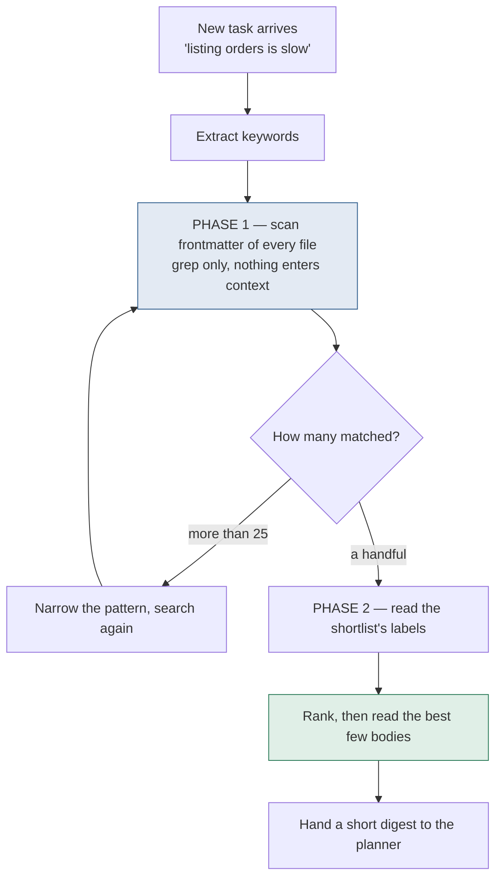
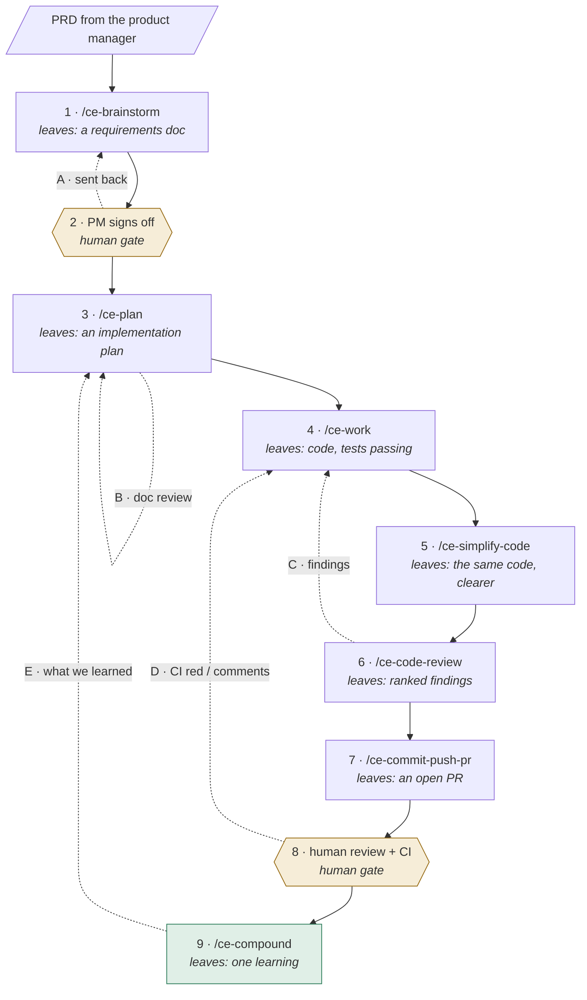
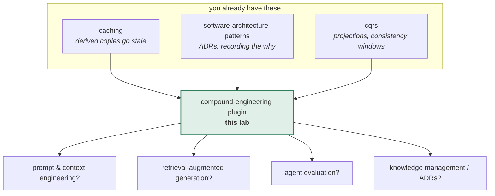

# The compound-engineering plugin

> **Tell a friend:** Maya works out on Monday that the left oven runs hot, and
> by Tuesday nobody in the kitchen knows it, so Dev burns a tray and works the
> same thing out again. Your sessions with an AI coding agent are those shifts.
> The code gets committed; the reasoning does not, so the same discovery is
> paid for twice. This plugin turns the work into a loop whose last step writes
> one small labelled file saying what was learned, and whose first step searches
> those labels before planning anything. That single backward arrow is the whole
> idea, and the other thirty-odd commands are scaffolding around it.

The simulator is `visualization.html` in this folder, also published as
[The Compounding Loop](https://claude.ai/code/artifact/a640ed3e-d372-4daa-b234-024b9d097420).
Section 19 says what this lab is made of and where its numbers came from.

---

# BEGINNER MODEL

## 1. Why does finishing a job lose the thing that made it hard?

> **In one breath:** When work ends, the code is saved and the thinking is
> thrown away. So the next person pays full price for a lesson somebody has
> already learned.

You finish a piece of work with an AI coding agent. Along the way the two of you
worked out something real. Staging names that variable differently. The obvious
fix causes a deadlock. The third-party API returns 200 on failure.

Then the session ends.

All of it is gone. Not the code — the code is committed. What is gone is the
*reasoning*: the dead ends, the reason you chose B over A, the trap you nearly
fell into.

Next month a different task arrives. You, or a different agent, walks into the
same trap. You pay the same cost to get out of it.

The consequence is that work does not get easier. Each change adds code to hold
in your head. Meanwhile the understanding that would make the *next* change
cheap evaporates every time a session closes.

That is the default. This plugin is one attempt to invert it.

## 2. What goes wrong in a kitchen with a new cook every shift?

> **In one breath:** Every shift a different cook. Monday's discovery never
> reaches Tuesday. So the same twenty minutes get spent again, and again, and
> again.

A restaurant kitchen. Omar owns it. Asha runs the rota. Every shift, a different
cook works the line.

Monday, **Maya** works the line. Two trays in, she works out that the left oven
runs about 30 degrees hot. Everything on the top shelf comes out scorched. She
adapts, drops the temperature, and the rest of her shift is fine. Shift ends.
Maya goes home.

Tuesday, **Dev** works the line. He has never met Maya. He puts a tray in the
left oven at the temperature the recipe says. It burns. He spends twenty minutes
working out why. He arrives at exactly Maya's conclusion, and adapts.

Wednesday, **Priya**. Same tray. Same twenty minutes.

Nobody here is incompetent. The kitchen simply has no way for Monday to reach
Tuesday. Every shift starts from zero, and the same discovery gets paid for over
and over.

Your sessions with an agent are the shifts. The oven is every quirk of your
codebase that is not written down anywhere.

Four more people will join the story as it goes. **Meera** likes to write one
tidy summary at the end of the week. **Arjun** rearranges the kitchen. **Ben**
is the customer who says what the dish should be. Asha and Omar keep the whole
thing honest.

**Depth map.** You are going to climb four layers. Stop at any of them and you
will still have something whole.

| Layer | Stages | You will be able to |
|---|---|---|
| **BEGINNER** | 1–9 | Say what the plugin is for and why the loop is a loop |
| **INTERMEDIATE** | 10 | Walk the actual mechanism, step by step, and say why each odd detail exists |
| **ENGINEERING** | 11–14 | Reason about how it fails, what it guarantees, and measure it yourself |
| **PRODUCTION** | 15 | Run it on a real repo, know its costs, and know when not to |

## 3. Why not just leave a note for the next cook?

> **In one breath:** Write the oven fact on a card and pin it where tomorrow's
> cook will see it. This is the naive solution, it genuinely works, and you
> should keep doing it.

Asha's first answer is the obvious one. Leave a note. Put the oven fact
somewhere Dev cannot miss it before his shift starts.

In agent terms, that note board is the file of standing instructions. Your tool
reads it at the start of every session. It might be called `CLAUDE.md`, or
`AGENTS.md`, or a `CONVENTIONS.md`. Write the trap into it, and every future
session knows.

This is not a straw man. It is where most teams start, and for a handful of
facts it is the right answer. Keep it. Nothing below replaces it.

## 4. What happens to the note board after a year?

> **In one breath:** Two things break. The board gets too big for anyone to
> read before starting, and the cook who is exhausted at the end of a shift
> never writes the card in the first place.

Run Asha's fix for a year and watch it fail twice.

**The board gets too big to read.** By month six there are 300 notes on it. The
oven. The sticky walk-in door. The supplier who delivers late on Fridays. Three
notes about the oven that contradict each other. Dev reads all of it at the
start of every shift, before touching a pan. Most of it has nothing to do with
tonight's menu, and the one note that matters is buried in the middle.

For an agent this is not an inconvenience. It is a hard wall. Everything in that
instruction file is read into the context window on every single task, whether
or not it relates. A file that grows without bound eventually crowds out the
actual work. Long before that it dilutes attention, because 300 facts competing
means the important one is just one line among many.

**Nobody writes the note.** The second failure is worse, and much less obvious.
Picture Maya at the end of her shift. She is exhausted. She has just solved the
problem. That is exactly the moment when nobody wants to write documentation.
The note gets written when someone remembers, which is rarely, and never for the
small traps that cost twenty minutes each.

> **🔮 Predict:** Both failures are real. Which one do you think is the harder
> one to engineer around?
>
> <details><summary>Reveal</summary>
>
> **The second.** If you said the first, you picked the one that *looks* bigger,
> and it is the one with an answer. It is a technical problem with a technical
> fix: do not read everything, search it. That is mechanical, and stages 6 to 10
> are about how.
>
> The second is a *human* problem. It depends on Maya choosing to do unrewarding
> work at the worst possible moment. You cannot engineer discipline. What you
> can do is make writing the card a named step of the process that the tooling
> performs, so it happens by default rather than by virtue. That is the entire
> reason `/ce-compound` is a step in a loop rather than advice in a wiki.
>
> The simulator has a control labelled "Does the team write the learning down?".
> That control is this failure. Turn it off and the compounding team collapses
> to exactly the forgetful team: 8 repeats against 8. Every other way of
> breaking the mechanism still leaves some value behind. Skipping capture leaves
> none.
> </details>

## 5. What do we actually need, then?

> **In one breath:** Capture has to happen without anyone remembering. Looking
> things up has to stay cheap as the pile grows. And a card has to be findable
> by someone who only knows tonight's symptom.

Both failures point at the same three requirements.

1. **Capture must not depend on anyone remembering.** It has to be a step in the
   process, not a virtue Maya has at 11pm.
2. **Retrieval must be selective.** Consulting the past has to cost roughly the
   same whether there are 10 cards or 500. Otherwise the system punishes you for
   learning.
3. **A card must be findable by someone who only knows the new problem.** Dev
   does not know what he does not know. He cannot search for "the oven runs
   hot". All he knows is "my tray burned".

Everything from here is the pursuit of those three. Number three is the one
almost everybody underestimates, and stage 10 will show you why.

## 6. What is the one idea underneath all 33 skills?

> **In one breath:** Make the work a loop. The last step writes down what was
> learned, in a shape a search can find. The first step searches before it
> plans.

Here is the whole thing, in one box.

> Make the workflow a **loop** whose closing step writes what was learned into a
> small file with structured labels, and whose opening step searches those
> labels before planning anything.
>
> Knowledge moves out of human memory and session context, into the repository,
> where finding it again is a search rather than an act of recall.

That is it. The plugin is 33 skills, a pipeline, review panels and a config
system. All of it is scaffolding around that one arrow, running from the last
step back to the first.

Everything that follows answers one of two questions. How do you make that arrow
get drawn at all? And how do you make what it writes findable later?

## 7. What are the words, and where does each one come from?

> **In one breath:** Nine words do all the work. Each one gets earned in the
> kitchen first, then given its real name, then written down.

The terminology arrives here in the order you need it, in three passes: who does
the work, what a shift leaves behind, and how tomorrow finds it. Minor words are
defined where they first appear and collected in the glossary at the end.

### Who does the work, and who sends whom?

Omar does not buy a card index, then a rule about filling it in, then a
quarterly weeding routine. He buys one box with all of that inside, and the box
has a version number on the side. Engineers call that box a **plugin**: a
bundle of extra abilities you install into a coding agent, as one unit.

Precisely, it is a distributable package of skills, agents, commands and hooks,
described by one manifest called `plugin.json`, installed into a host such as
Claude Code, Cursor or Codex. The word exists to name the unit of *distribution
and versioning*, as distinct from any one capability inside it. You install and
upgrade a plugin. You invoke a skill. The box this lab reads from is
`compound-engineering@compound-engineering-plugin`, version `3.23.4`, installed
at user scope on 2026-08-27. Stage 19 says where that came from.

Asha never asks for "the box". She asks for one named thing: *plan tonight's
service*. That named thing is a **skill** — one capability the plugin has, that
you ask for by name. Under the hood a skill is a directory containing a
`SKILL.md` file. Its instructions are loaded into the agent's context when you
invoke it, and it pulls in reference files as it goes. You type `/ce-plan`, or
`$ce-plan` if your host is Codex.

Now watch what Asha does *not* do. She does not walk to the card drawer herself.
She sends a runner, who flips the tabs, brings back three cards, and reports.
Engineers call that runner an **agent**, or a *subagent*.

That is the whole distinction, and it is worth holding on to. A skill is the
thing *you* invoke, and it coordinates. An agent is a worker *the skill*
dispatches to do one scoped job and report back. The plugin's own glossary is
explicit about it: a skill orchestrates, an agent performs. So `/ce-plan` is a
skill, and the `learnings-researcher` it sends off to search past work is a
subagent.

Six of those skills run in a fixed order, and engineers here call that order
**the loop**: brainstorm, plan, work, simplify, review, compound. Each step
hands a durable file to the next. The last one writes something the first will
read next time.

The word "loop" is doing one specific job. It names the *return arrow*. A
pipeline that ends at "review" is just a checklist, and the arrow from the end
back to the beginning is what makes the word "compound" mean anything. In
practice: `/ce-brainstorm` writes a requirements document, `/ce-plan` reads that
and writes an implementation plan, and `/ce-work` reads that and writes code.

Here is the first pass in one table. The last column says where in this lab you
meet the thing doing real work.

| Word | In the kitchen | In your repo | Where it turns up |
|---|---|---|---|
| **Plugin** | the box Omar bought, with a version on the side | one manifest, `plugin.json`, installed into a host | stage 19 names the exact version |
| **Skill** | asking Asha for one named job | a directory with a `SKILL.md`, invoked as `/ce-plan` | all six steps in stage 10 |
| **Agent (subagent)** | the runner Asha sends to the drawer | a worker dispatched for one scoped job | `learnings-researcher`, stage 10 |
| **The loop** | plan, cook, taste, review, write the card | six skills, each leaving a file for the next | the pipeline diagram in stage 10 |

### What does a shift actually leave behind?

Maya's twenty minutes at the oven turn into one card. That card is a
**learning**, also called a *solution doc*: one written-down lesson from one
solved problem.

On disk it is a markdown file under `docs/solutions/<category>/`. It carries a
block of structured labels, then prose saying what the problem was, what did not
work, what did, and how to avoid it next time.

The word exists to name the *unit* of compounded knowledge. Not "a doc", not "a
note", but a specific shape: one per solved problem, with a metadata contract
that makes it retrievable. That one-problem-per-file rule is load-bearing, and
stage 11 shows exactly what breaks without it. In the plugin's own repository
there are **81** of these. One of them is
`docs/solutions/skill-design/strong-models-mask-defensive-skill-fixes.md`.

Now the tabs down the side of the card. On the file they are the labels at the
top, sitting between two lines of dashes, and engineers call that block the
**frontmatter**.

It is a YAML block. It always carries `title`, `category`, `module`,
`problem_type`, `component`, `severity` and `tags`. Then, depending on which of
two tracks the document is on, it carries either `symptoms`, `root_cause` and
`resolution_type`, or else `applies_when`.

Why give this block its own word? Because this block, and not the prose, is what
search reads. It is the difference between a document and a *findable*
document. Every one of the three requirements in stage 5 lands here.

Here is a real one, from the plugin's own corpus:

```yaml
---
title: A strong model can mask a defensive skill-prose fix
date: 2026-07-09
category: skill-design
module: compound-engineering
problem_type: best_practice
component: ce-commit-push-pr
severity: medium
applies_when:
  - Improving an LLM-driven skill's prose and wanting to prove the change helps
  - A with-skill vs baseline eval ties on pass-rate
tags:
  - skill-eval
  - eval-methodology
  - confound-control
---
```

Read that block once more and notice one thing. The label `module` holds one
value. So does `component`. So does `problem_type`. Only `tags` holds a list.
That single fact does an enormous amount of work in stage 11, so park it
somewhere you can find it again.

The card is not the only thing a shift leaves behind. The prep list, the tasting
notes, the order to the supplier: each is a piece of paper one step leaves for
the next step to pick up. Engineers call any of those an **artifact**.

Technically, an artifact is a durable, repo-relative document. A plan under
`docs/plans/`, a learning under `docs/solutions/`, a requirements doc, a review
report. Where they all live can be relocated in bulk by a `docs_root` setting.

The word matters because the steps do not pass information to each other in
conversation. They pass *files*. That is what lets a step run in a fresh
session, days later, on a different machine, and still know what came before. A
learning is one kind of artifact, and it is the only kind that flows backwards.

One warning before you go on, because the word is overloaded. Claude Code also
calls a *published web page* an Artifact, and that is what the simulator link at
the top of this file points at. Unrelated meaning. Everywhere below, "artifact"
means a file in your repository that one step leaves for another.

| Word | In the kitchen | In your repo | Where it turns up |
|---|---|---|---|
| **Learning** | Maya's card about the left oven | one markdown file under `docs/solutions/<category>/` | 81 of them in the plugin's own repo |
| **Frontmatter** | the tabs down the side of the card | the YAML label block, the only part search reads | the single-valued fields, stage 11 |
| **Artifact** | any paper one step leaves the next | a durable, repo-relative file under `docs_root` | every row of the step table in stage 10 |

### How does tonight's cook find Monday's card?

Dev's tray has burned. He does not read the drawer from front to back. He flips
to the tabs that match tonight's menu, pulls three cards, and reads those.

That flip-then-read move is **retrieval**, and the plugin's version of it is
called *grep-first*. In full, it is a dispatched subagent that does five things
in order. First it reads the project's shared vocabulary file. Second it
extracts keywords from the new task. Third it searches *frontmatter fields only*
across the whole corpus, to build a shortlist. Fourth it reads the shortlist's
labels. Only then, fifth, does it read the bodies of the best few.

The term is really naming the *ordering*. "Search then read" and "read then
search" return the same documents at wildly different costs. Requirement 2 from
stage 5 is satisfied by this ordering and by nothing else. On a corpus of 96
documents, read-everything costs **68,187 tokens** before any work starts.
Grep-first costs **4,723**.

Those two numbers only mean something if you know what they are spent from. An
agent can hold a fixed amount of text at once. That amount, and the question of
what you spend it on, is the **context budget**.

Precisely, it is the model's context window. Everything loaded takes a share:
standing instructions, skill bodies, retrieved documents, and the code itself.
Anything spent on irrelevant material is not available for the task. The term
earns its keep because it converts a vague question into an arithmetic one you
can actually answer. It is why the note board in stage 3 hits a wall, and why
retrieval is ordered the way it is.

There is one more thing in the room, and it beats the card every time. Above the
oven, taped to the wall, is the recipe the kitchen actually follows tonight.
That is the **guidance layer**: the instructions the agent is reading *while* it
works.

Concretely, that means a skill's own `SKILL.md`, a runbook, or the project's
root instruction file. Anything loaded at the moment of acting.

This word names a conflict that outranks ordinary staleness, so it is worth
being slow about. A learning that merely got out of date is wrong. A learning
that *contradicts the guidance layer* is worse. The agent reads the guidance at
the moment it acts, so the learning simply loses, silently, every time.

Suppose Maya's card says "always run the migration in two steps", and the
project's runbook says "use the one-step helper". The runbook wins in practice,
and the card is decorative. The plugin's maintenance skill treats that as a
higher-priority defect than a stale file path. It resolves it by checking which
side the current code follows, and it *reports* a wrong guidance file rather
than editing it.

| Word | In the kitchen | In your repo | Where it turns up |
|---|---|---|---|
| **Retrieval (grep-first)** | flip the tabs, pull three cards, read those | search labels everywhere, read a handful of bodies | the phase split, stage 10 |
| **Context budget** | how much Dev can hold in his head before service | the model's context window, and what fills it | the cost table, stage 10 |
| **Guidance layer** | the recipe taped above the oven | `SKILL.md`, a runbook, the root instruction file | failure 5, stage 11 |

> **🔮 Predict:** Maya's card has tabs down the side and three paragraphs of
> prose on the front. Dev's runner searches 96 cards in a second. What did the
> runner actually look at?
>
> <details><summary>Reveal</summary>
>
> **Only the tabs.** If you said "it skims each card", you have imagined a
> reader. What is really there is a filter. The first pass never opens a card at
> all. It matches on the label block, because matching labels costs nothing and
> opening cards costs context budget.
>
> This has a consequence that runs through the rest of the lab. Prose you write
> beautifully and label carelessly is invisible. The prose is only ever read
> *after* the labels have earned the card a place on the shortlist.
> </details>

## 8. What two pictures should you carry?

> **In one breath:** Picture a card index with tabs, not a wall of loose notes.
> Then swap it for a folder of labelled files and a runner who reads labels
> before bodies.

### The simple picture: what does a card index do that a note board cannot?

Take Asha's note board and fix it. Instead of a wall of loose notes read start to
finish, put in a card index. One card per lesson, each with tabs down the side
saying which station, which dish, and what kind of problem it was.

Dev does not read the catalogue. He flips to the tabs matching tonight's menu,
pulls three cards, and reads those.

### The engineer's picture: what is it actually made of?

A directory of markdown files, each with a typed YAML header. A dispatched
search agent that pre-filters on header fields without opening files,
shortlists, and reads a handful of bodies. A writer step, invoked as the closing
phase of a work cycle, that appends exactly one new file per solved problem and
validates its header against a schema. And a separate maintenance pass that
re-checks the corpus against the current code.

The two pictures line up row for row.

| Card catalogue | Engineering model | In the plugin |
|---|---|---|
| One card | One markdown file | `docs/solutions/<category>/<name>.md` |
| The tabs on the card | YAML frontmatter | `module`, `problem_type`, `tags`, … |
| The drawer it lives in | The category directory | `performance-issues/`, `conventions/`, … |
| Flipping to matching tabs | Grep on frontmatter fields | the `learnings-researcher` subagent |
| Pulling three cards to read | Reading the shortlist's bodies | top-k body reads |
| Writing a new card at end of shift | The capture step | `/ce-compound` |
| The house glossary at the front | Shared vocabulary file | `CONCEPTS.md` |
| Weeding the drawer once a quarter | Corpus maintenance | `/ce-compound-refresh` |

### Where does the card catalogue lie to you?

Three places, and each one matters.

**A card cannot go quietly wrong, but a learning can.** The oven either runs hot
or it does not. But a card can say "the retry logic lives in
`PaymentRetryService`", and six months later Arjun renamed that class. The card
still reads confidently. Nothing in the drawer knows. In this lab's model, a
rename of two modules left **38%** of a 96-document corpus citing paths that no
longer existed, and **52%** of everything retrieval handed back was silently
rotten. That is why a maintenance pass exists at all. A physical catalogue needs
no such thing.

**Dev can tell a stale card from a fresh one, and an agent mostly cannot.** A
human sees yellowed paper and 1998 handwriting. An agent sees text, and text
written in 2024 looks exactly like text written this morning. Confidence does not
decay with age. This is why the plugin *mechanically* checks the paths and links
a document cites, rather than trusting a reader to notice.

**A card catalogue is a cache, and a learnings corpus is not quite.** This one is
worth being careful about, because it connects to something you already know. In
your [caching lab](../11-caching/README.md) you established that a cache is a
bounded copy of answers whose truth lives elsewhere. The test of being a cache is
that deleting it loses only speed.

A learnings corpus behaves like a cache in two ways. It is a derived copy, and
it goes stale. But it fails that test. Delete `docs/solutions/` and you do not
lose speed alone. You lose the reasoning, the dead ends, and the "we tried X and
here is why it did not work". None of that is recomputable from the code,
because the code only records what *did* happen. So borrow the staleness and
invalidation intuitions from caching, but leave the "it is only a performance
optimisation" one behind.

## 9. Can you watch it happen?

> **In one breath:** Fourteen jobs arrive at two kitchens. One writes cards, one
> does not. Watch the two counters pull apart.

Open **[The Compounding Loop](https://claude.ai/code/artifact/a640ed3e-d372-4daa-b234-024b9d097420)**,
or `visualization.html` in this directory, which works offline.

What to look at, in this order:

1. **Press "Run all 14 tasks"** and watch only the two big numbers. Fourteen
   pieces of work arrive at two teams. Traps repeat. One team remembers, the way
   Asha's kitchen learned to; the other forgets, the way Maya's Monday did.
2. **Watch the right-hand card grid fill up.** Each card is one learning. When a
   task starts, cards that matched on a label light up blue. The one that
   actually prevented the trap turns green and lifts.
3. **Click any card.** You will see its frontmatter, the only part search ever
   reads, and its prose, which is only read if the labels got it shortlisted.
4. **Then start breaking it** with the left-hand controls. Each one corresponds
   to a failure in stage 11. Set "Does the team write the learning down?" to
   *Never*, and the two teams become identical.

Three moments pause and ask you to predict before revealing. Take the guess. It
is the difference between watching and learning.

The second tab, **The loop, end to end**, is the pipeline itself. Ten numbered
steps run from Ben's PRD to a merged pull request, each labelled with the file it
leaves behind. The two dashed boxes are the points where a *human* decides, not
a skill.

Down the left-hand side are five curved arrows, lettered A to E. Those are the
loops, the places work goes backwards. Click each one. It tells you what triggers
it, what it revises, why that particular mistake is cheapest to catch *there*,
and what happens if you skip it. Stage 10 covers the same ground in table form.

---

> ### ✅ Checkpoint — end of the beginner model
>
> You can now explain what compound engineering is trying to do, why leaving
> notes in one big file stops working, and what a "learning" is as an artifact.
>
> **Say it back.** Without using the words *plugin*, *frontmatter* or
> *retrieval*, tell a friend why Dev burns a tray on Tuesday even though the
> kitchen has a note board.
> <details><summary>A good answer sounds like</summary>
> "The board has 300 notes on it. Dev would have to read all of them before he
> starts, so mostly he does not. And the one note he needed was never written,
> because Maya worked it out at the end of an exhausting shift and went home."
> </details>
>
> What the next layer adds: the actual sequence of operations. How a search
> across hundreds of documents stays cheap, and why the design has the specific
> odd details it has.

---

# INTERMEDIATE MODEL

## 10. How does the mechanism actually work, step by step?

> **In one breath:** Build the obvious version, break it, fix it, break it
> again. Every strange detail in the final design is the scar of a failure you
> are about to watch.

Asha is going to build the card index four times. Version one is what anybody
would do. Versions two, three and four each exist because version one, two or
three failed in a specific way.

### v1 — what if you just write the files and read them all?

Two rules, and nothing else.

1. At the end of a task, write a markdown file into `docs/solutions/` describing
   what you learned.
2. At the start of the next task, read `docs/solutions/` before planning.

Concretely: three tasks in, the directory holds three files. Task four begins.
The agent reads all three, notices one is about the trap it is walking toward,
and avoids it.

This works. It is also the entire idea. Everything below is damage control.

> **🔮 Predict:** It is now nine months later and `docs/solutions/` holds 200
> files averaging 2,600 characters. What is the *first* thing that breaks?
>
> <details><summary>Reveal</summary>
>
> **Cost, and it breaks hard.** If you said "the files start contradicting each
> other", that happens too, but much later and much less violently.
>
> 200 documents at roughly 2,800 characters is about **140,000 tokens** loaded
> before the agent has looked at a single line of your code. On most models that
> is most or all of the budget, spent on material that is about 99% irrelevant
> to the task at hand.
>
> The cruel part: this failure gets *worse the more the team learns*. A repo
> that has been diligent about capture is punished for it. That is the precise
> opposite of compounding, so v1 is not merely inefficient. It is
> self-defeating.
> </details>

### v2 — what if you search the labels instead of reading the cards?

The fix is to stop reading and start searching. Give every document a structured
header. Then split retrieval into two phases with very different costs.

The diagram below is that split. Read it top to bottom, and notice that the box
touching every file is the cheap one.



The asymmetry is the whole trick. Phase 1 touches every file and costs nothing,
because grep reads the disk and not the context window. Phase 2 is expensive per
file, and it touches almost none of them.

Here is what experiment 1 in this lab reports, running `java CompoundLab.java`.

| Corpus | Read everything | Grep first | Saving |
|---:|---:|---:|---:|
| 12 docs | 8,529 tokens | 3,979 tokens | 53.3% |
| 40 docs | 28,374 tokens | 4,492 tokens | 84.2% |
| 96 docs | 68,187 tokens | 4,723 tokens | 93.1% |

Read the *shape* of that table, not the numbers. The left column grows linearly
with what you know. The right column is nearly flat, so 12 documents and 96
documents cost about the same to consult. That flatness is the property the
whole design exists to buy, and requirement 2 from stage 5 is now met.

> **🔮 Predict:** Maya stores a card with `module: payments` and
> `tags: [n-plus-one, jpa, lazy-loading]`. Months later Priya arrives with
> *"the orders page takes forever to load and the database looks busy"*. Does
> the search find Maya's card?
>
> <details><summary>Reveal</summary>
>
> **No.** Not one word overlaps. Priya says *slow, page, load, database, busy*.
> The card says *n-plus-one, jpa, lazy-loading, payments, performance_issue*.
> Phase 1 is a text match on labels, so nothing matches, the card is never
> shortlisted, and its body is never read.
>
> If you said yes, you were imagining a reader who understands both phrasings.
> Phase 1 has no such reader in it.
>
> The card exists. It is correct. It is about exactly this problem. And it is
> invisible, which is operationally identical to never having written it, except
> that it cost time to write and now needs maintaining.
>
> In this lab, across 12 topics, house vocabulary found **12 of 12** and symptom
> vocabulary found **0 of 12**.
> </details>

### v3 — what if tomorrow's cook uses different words?

The failure above is a *vocabulary* failure, not a search failure.

Priya describes the **symptom**, because she does not yet know the cause. Maya
described the **cause**, because by the time she wrote the card she did. Those
two never share words. Dev's burned tray and Maya's hot oven are the same fact
in two vocabularies.

So the fix is a phrasebook. Before extracting keywords, the search agent reads
`CONCEPTS.md`, the project's shared glossary of domain terms, entities and named
processes. It maps "the orders page is slow" onto the vocabulary this repository
actually uses, and searches with that instead.

Experiment 2 runs the same 96-document corpus against the same 12 traps, and
varies only how the new task was phrased.

| How the new task was described | Traps found |
|---|---:|
| In the team's own vocabulary | 12 / 12 |
| In symptom words | 0 / 12 |
| In symptom words, with `CONCEPTS.md` | 9 / 12 |

Note honestly what this shows. The glossary recovers most of the loss, **not all
of it**. Three topics stay unreachable, because nothing connects their symptom
words to their house words. Vocabulary grounding is a large mitigation, not a
cure. A corpus whose tags drift away from how people actually describe problems
will quietly stop being consulted.

Worth noticing: `CONCEPTS.md` is itself maintained *by* the capture step, as a
side effect. Every time a card is written, qualifying domain terms are folded
into the glossary. The mechanism that makes retrieval work is fed by the same
loop it serves.

> **🔮 Predict:** Everything now works. Meera has a long session that solves five
> separate problems. Writing five files feels bureaucratic to her. Why not one
> tidy "lessons from this week" document?
>
> <details><summary>Reveal</summary>
>
> **Because a file has one set of labels.** Look again at the schema in stage 7.
> `module` is one string, `component` is one string, and `problem_type` is one
> enum value. A document about five problems must pick one set, so it is
> labelled correctly for one of them and wrongly for the other four.
>
> If you said "it is fine, the prose is all there", you are thinking of a human
> browsing. Phase 1 only ever sees labels.
>
> So four of Meera's five lessons are written down, stored, committed, backed up
> and structurally unfindable. That is worse than not writing them, because it
> *looks* done.
>
> Experiment 3 puts numbers on it. Of five learnings folded into one weekly file,
> search found the file for **1 of the 5** queries. On the one query where it did
> match, context read rose from 4,758 to 7,398 tokens, which is **+56%**, while
> the share of that context actually relevant to the task fell from 15% to 10%.
>
> This is why `/ce-compound` states *"One learning per run"* as a rule, and sends
> a session that produced five learnings through five sequential runs.
> </details>

### v4 — why one card per run, and what happens when a card rots?

Two final refinements, both scars.

**One learning per run** is now forced, for Meera's reason above.

**And the drawer needs weeding.** A card is written once and read for years,
while the code underneath it keeps moving. Nothing in the retrieval path can
detect this. Phase 1 matches labels, and the labels do not change when the code
does. Arjun renames a class and every card citing it goes quietly wrong.

So the plugin adds mechanical checking at two moments.

At **write time**, a bundled script validates that the frontmatter parses
safely. A second script checks every file path, commit SHA and link the document
cites against the actual tree. A dead path is treated as a **question, not a
verdict**, because a card may legitimately cite a file that the very fix it
documents deleted.

Then **later, on a schedule**, `/ce-compound-refresh` re-runs that across the
whole corpus. It classifies each document into one of five outcomes: Keep,
Update, Consolidate, Replace, or Delete.

Experiment 4 says how bad the rot gets. After a refactor renaming two modules
and deleting a third, **36 of 96** documents cited a dead path, and **52%** of
everything retrieval handed back was silently rotten. The mechanical check does
not fix those. It narrows 96 documents down to 36 that Omar or an agent must
adjudicate.

### What does the whole loop look like when it really runs?

The six-step version in stage 6 is the marketing diagram. Here is the shape of a
real piece of work, from Ben's PRD to a merged pull request. It includes the two
places a *human* decides, and all five places work goes backwards.

The dotted arrows are the ones to watch. Solid arrows are progress; dotted
arrows are rework.



The artifact is the interface. No step reads the previous step's conversation,
only its file. Read the third column of the table below as "what physically
exists on disk when this step finishes".

| # | Step | Leaves behind | Reviewed by |
|---|---|---|---|
| — | PRD arrives | the ask, unstructured | — |
| 1 | `/ce-brainstorm` | a requirements doc, stamped `requirements-only` | Ben, at gate 2 |
| 2 | **Ben signs off** | an approved spec, or corrections | — |
| 3 | `/ce-plan` | an implementation plan: numbered units, test scenarios | `/ce-doc-review`, automatically |
| 4 | `/ce-work` | code, with the plan's tests passing | steps 5 and 6 |
| 5 | `/ce-simplify-code` | the same behaviour, expressed more plainly | step 6 |
| 6 | `/ce-code-review` | findings, each with a confidence level | Omar, for the judgment calls |
| 7 | `/ce-commit-push-pr` | commits, a push, an open PR | humans and CI, at gate 8 |
| 8 | **Human review + CI** | approvals and green, or comments and red | — |
| 9 | `/ce-compound` | one document under `docs/solutions/` | `/ce-compound-refresh`, later |

### Why five backward arrows and not one?

The single most useful thing to understand about this pipeline is that it has
five backward arrows, not one. **Each exists because a different kind of mistake
is cheapest to catch in a different place.**

| | Goes back | Triggered by | Why *here* | If you skip it |
|---|---|---|---|---|
| **A** | gate 2 → step 1 | the spec is not what Ben meant | cheapest possible place to be wrong — costs one conversation | you build the wrong thing correctly, and every later step helps you do it faster |
| **B** | step 3 → step 3 | automatic; `/ce-doc-review` runs on every durable plan | a plan defect is multiplied by everything built on it | step 4 faithfully implements a contradiction nobody flagged |
| **C** | step 6 → step 4 | a finding above the confidence threshold | review that produces only a report is a report | findings die in a session transcript |
| **D** | gate 8 → step 4 | Omar comments, or CI goes red | last chance before it is permanent, and the only place outsiders get a vote | the PR stalls, or merges red |
| **E** | step 9 → step 3 | every completed task | — see below — | the forgetful team: 8 repeats instead of 0 |

**Loop E is the odd one out, and that distinction is the whole plugin.** A, B, C
and D all repair *the work in front of you*. Remove any of them and this task
ships worse. Remove E and this task ships **exactly the same**, and the next
hundred tasks are each slightly worse than they needed to be.

That is precisely why E is the one that gets skipped. It is the only loop whose
benefit lands on someone who is not in the room. It is also why the plugin makes
it a step with a command rather than a line in a wiki.

> **🔮 Predict:** Asha wants to drop exactly one of the five arrows to ship
> faster this week. Which one costs her the least *this week*, and which one
> costs her the most *this year*?
>
> <details><summary>Reveal</summary>
>
> **The same arrow, E, is both answers.** Dropping E costs nothing measurable
> this week, which is exactly why it is the tempting cut. It costs the most this
> year, because every trap it would have recorded gets rediscovered at full
> price.
>
> If you said "drop B, the doc review, it is only a document", notice what B
> protects: everything built on the plan. A plan defect is multiplied by step 4,
> 5, 6 and 7. B is the cheapest arrow to keep, not the cheapest to lose.
> </details>

### What does Ben's sign-off actually give you, and what does it not?

Be precise here, because it is easy to over-claim.

**It gives you the artifact.** `/ce-brainstorm` produces a *requirements-only*
document, literally stamped `artifact_readiness: requirements-only`. That is the
"here is what we think you asked for" spec you send back to Ben.
`/ce-doc-review` reads that stamp, and reviews such a document against a Product
Contract only, so it does not report missing implementation detail as a defect.

**It gives you review and a way to share.** `/ce-doc-review` critiques the spec
with role-specific reviewer personas. `/ce-proof` publishes markdown for someone
to comment on. Setting `brainstorm_output: html` renders it for a human reader
instead of an agent.

**It does not give you an enforced gate.** There is no state in the tool meaning
"blocked awaiting approval". Nothing prevents you running `/ce-plan` on an
unapproved spec, and `/lfg` has no human checkpoint at all until a PR exists.

So gate 2 is real and it matters. But it is Asha's discipline plus the tool's
artifacts, not a state machine the tool enforces. Worth knowing before you rely
on it.

One more nuance helps here. The plugin has a notion of a **session-settled
decision**: a tradeoff that was actually examined and chosen in conversation,
then carried downstream as a labelled constraint. Later skills may augment it,
but they must not silently re-ask it or contradict it. A decision merely
*asserted* is a directive, and gets one challenge. A decision that survived
examination is settled. That is the mechanism by which Ben's answer at gate 2
travels into step 3 without being relitigated.

The 33 skills group into a few families. There is the six-step **core loop**
above. Around the loop sit `ce-strategy`, `ce-product-pulse`, `ce-sweep` and
`ce-compound-refresh`. On demand you can call `ce-debug`, `ce-pov`, `ce-explain`,
`ce-ideate`, `ce-doc-review`, `ce-optimize` and `ce-prototype`. Git workflow is
`ce-commit`, `ce-commit-push-pr`, `ce-babysit-pr`, `ce-resolve-pr-feedback` and
`ce-worktree`. Then there are families for testing and design, for
collaboration, and for utilities. Finally there is `/lfg`, which runs the whole
pipeline hands-off through to an open PR.

---

> ### ✅ Checkpoint — end of the intermediate model
>
> You can now walk the mechanism end to end. You can also explain why each part
> is shaped the way it is: why search precedes reading, why there is a glossary,
> why one file per problem, and why a maintenance job exists.
>
> **Say it back.** Without using the words *frontmatter*, *phase* or *corpus*,
> explain to Meera why her one tidy weekly file is worse than five small ones.
> <details><summary>A good answer sounds like</summary>
> "The tabs on a card can only say one station and one kind of problem. Your
> weekly file covers five. So it gets filed under one of them, and the other
> four are in a drawer nobody will ever flip to."
> </details>
>
> What the next layer adds: what happens when each of those parts fails, what
> the system actually guarantees versus merely hopes for, and how to measure it
> yourself.

---

# ENGINEERING MODEL

## 11. What are the nine ways this breaks?

> **In one breath:** Two failures stop the card being written usefully. Five
> stop it being found or believed. Two happen at the edges, where the loop meets
> the outside world.

Nine failure scenarios, numbered, and the numbers stay fixed so the exercises can
point at them. Each one is a short story about somebody in the kitchen. The
comparison table at the end lines all nine up side by side.

### Which failures stop the card being written usefully?

**Failure 1, capture never happens.** Maya goes home without writing anything,
every night, forever. In the simulator you cause this by setting "Does the team
write the learning down?" to *Never*. The two teams then become numerically
identical, at 8 repeats each. The drawer stays empty, and every other mechanism
in the design is intact and irrelevant. The reason is blunt: the loop has no
closing step, so it is not a loop.

There is no response available in the tool. This is the one failure the design
cannot defend against, only make less likely, by making capture a named step
with a command rather than a good intention. Nothing here is ever *wrong*; you
simply lose everything the loop is for. On a real repo the honest signal is
corpus growth rate. A `docs/solutions/` that has not grown in two months means
the loop is not running, whatever anyone says in standup.

**Failure 2, capture happens but batched.** This is Meera's weekly summary. In
the simulator you set "One learning per document?" to *No*. Watch the store: it
shows a single card, and clicking it makes the inspector say how many problems
are inside and how many of them are unreachable. The repeat count lands at 6
instead of 0. In the Java model, 1 of 5 learnings stays retrievable, with +56%
context on the one that works.

The cause is the single-valued `module`, `component` and `problem_type` fields
from stage 7. Labels can only describe one problem. The response is a contract:
`/ce-compound` refuses to batch. The prose Meera wrote is not lost, but
retrievability is, for all but one of her five. In production this is what a
"weekly learnings" doc becomes. It reads like diligence and functions as a
write-only log.

### Which failures stop the card being found, or believed?

**Failure 3, retrieval misses because the vocabulary drifted.** Priya arrives
describing symptoms. To cause it in the simulator, set "How is the next task
described?" to *symptom words* and the shared vocabulary file to *No*. In Java
it is experiment 2. You get 8 repeats with 7 documents sitting in the store, and
0/12 recall in the Java model. Phase 1 is a text match on labels, and symptom
words and cause words do not intersect.

The response is `CONCEPTS.md`, read before keyword extraction, which recovers
9/12 and not 12/12. Correctness is kept, in the sense that nothing wrong is ever
returned. What is lost is the entire benefit, silently. **This is the most
dangerous failure in the set**, because a miss looks exactly like "there was
nothing to find". The counter-measure in production is to write `tags` in the
words people use when the problem *appears*, not only the words they use once it
is understood.

**Failure 4, the card went stale.** Arjun renames the payments module. In the
simulator you press **"Rename the payments module"** and keep stepping; in Java
it is experiment 4. Affected cards get an amber top edge and a `rot` marker, and
they are still retrieved. The outcome pill reads *followed stale advice*. The
Java model reports 36/96 documents citing dead paths and 52% of retrieved
documents rotten.

The cause is that labels do not change when code does, and retrieval never opens
the code. The response is the mechanical claims check at write time, plus
`/ce-compound-refresh` on a schedule; press **"Run /ce-compound-refresh"** in the
simulator to watch the amber clear. Nothing is lost here, which is the trap.
What you lose is trustworthiness, and that is worse than a miss, because the
answer arrives confident. In production, schedule the refresh against the same
events that invalidate knowledge: big renames, framework upgrades, module
deletions.

**Failure 5, the card contradicts the recipe on the wall.** Maya's card says
"always X". The skill instructions or runbook the agent loads while acting say
"never X". The guidance wins, every time, silently, and the card is decorative.
The reason is ordering: guidance is loaded at the moment of acting, while a
retrieved learning is only context, and instructions outrank references. The
maintenance skill ranks a guidance contradiction *above* ordinary staleness. It
resolves it by checking which side the current code follows, and it reports a
wrong guidance file rather than editing it. The system keeps doing what the
guidance says; what is lost is the card's authority.

**Failure 6, two cards about the same thing, drifting apart.** Maya and Dev both
capture the oven, from two different sessions. Now there are two answers to one
question, gradually disagreeing, and retrieval returns whichever ranks higher.
Nothing prevents a near-duplicate at write time except a check, so a check is
what the plugin adds. Before writing, it runs an overlap assessment. **High**
overlap updates the existing document rather than creating a second. **Moderate**
overlap creates the new one and flags it for consolidation review. Nothing is
lost, except a single source of truth, and only until consolidation runs.

**Failure 7, context blowout from reading everything.** This is v1 again, and you
can cause it deliberately. Set "How does the next task consult the past?" to
*Read every document*, or run experiment 1 in Java. The cost meter turns red. In
the simulator's small corpus that is 4,918 tokens against 2,108. In the Java
corpus it is 68,187 against 4,723. The cause is cost proportional to corpus
size, and the response is the phase split. Recall is fine here, because it finds
the same documents. What you lose is affordability, and therefore the
willingness to keep learning at all.

### Which failures happen at the edges of the loop?

**Failure 8, an autonomous run loses its residuals.** Run `/lfg` on work where
review raises findings the run decides not to fix. The finding then exists only
in a session that is about to end, and nothing in a transcript survives it. The
pipeline's response is to define a **residual**: an accepted or deferred
finding. It then refuses to report itself done until each residual reaches a
durable sink, meaning a ticket or a comment on the PR. Never the session. The
change ships, and nothing is lost, provided the sink rule holds.

**Failure 9, the host truncates the skill body.** Install on a host whose prompt
budget is smaller than the skill's instructions. The tail of the instructions is
silently dropped. Every known truncation keeps the beginning and discards the
rest, and none of them reports an error. The ceiling is enforced by the host's
loader, not by the plugin.

The response is that ordering becomes load-bearing. What must survive is written
above what may be cut, and heavy detail moves into reference files pulled in at
the step that needs them. Whatever fit is kept; what may be lost is a safety
rule, with every mechanical check still green.

This is a genuinely nasty class of bug. It is worth knowing about even if you
never author a skill, because the general shape is this: **a size limit enforced
by silent truncation turns document order into a correctness property.**

Now all nine side by side. The last column is the one to read twice.

| # | What breaks | How to cause it | What the tool does about it | What it costs you |
|---|---|---|---|---|
| 1 | Nobody writes the card | simulator: capture *Never* | nothing; only makes it a named step | everything the loop is for; 8 repeats against 8 |
| 2 | Five lessons in one file | simulator: one learning per document *No* | `/ce-compound` refuses to batch | 4 of 5 unfindable; 6 repeats instead of 0 |
| 3 | Symptom words miss cause words | simulator: symptom words, no vocabulary file | `CONCEPTS.md` before keyword extraction | 0/12 recall, recovered only to 9/12 |
| 4 | Code moved, card did not | simulator: rename the payments module | claims check at write time, then refresh | 36/96 dead paths, 52% of results rotten |
| 5 | Card contradicts the runbook | a card saying "always X" under a "never X" runbook | ranked above staleness; reports, never edits | the card's authority, silently |
| 6 | Two cards, one question | capture the same problem twice | overlap check: high updates, moderate flags | one source of truth, until consolidation |
| 7 | Reading the whole drawer | simulator: read every document | the phase split | 68,187 tokens against 4,723; affordability |
| 8 | A hands-off run drops findings | `/lfg` with findings it will not fix | residuals must reach a ticket or the PR | nothing, provided the sink rule holds |
| 9 | The host cuts the instructions | install where the prompt budget is too small | order matters; detail moves to reference files | possibly a safety rule, checks still green |

> **🔮 Predict:** Of failures 3 and 4, one returns nothing and one returns
> something wrong. Which of the two would you rather have on a Friday afternoon?
>
> <details><summary>Reveal</summary>
>
> **Failure 3, the miss.** If you said 4, you were probably thinking that "some
> answer beats no answer". It does not, here.
>
> A miss costs you the benefit. You solve the problem the slow way, which is
> exactly what you would have done without the plugin. Stale advice costs you
> the benefit *and* sends you confidently down a path that no longer exists.
>
> That said, failure 3 is still the more *dangerous* of the two over a year,
> because it is invisible. Failure 4 announces itself the moment the path does
> not exist. Failure 3 looks identical to "there was nothing to find", so nobody
> ever investigates it. Rank them by damage per incident and 4 wins; rank them
> by how long they survive undetected and 3 wins.
> </details>

## 12. What is actually guaranteed, and what is only hoped for?

> **In one breath:** Some of this is a script that either ran or did not. Some of
> it is a design that makes the good outcome likely. And some of it is not
> promised at all, which is fine as long as you know which is which.

Be clear-eyed here. This is a *process and prompt* system, not a protocol. It has
nothing like the guarantees you established in your
[paxos](../39-paxos/README.md) or
[two-phase-commit](../45-two-phase-commit/README.md) labs. Sorting its claims
into three buckets is the useful move, and Asha should be able to say which
bucket any claim lives in before she relies on it.

### What is mechanically enforced?

A script or a hard rule, and it either happened or it did not.

- Frontmatter parses, and parses *safely*. A bundled validator catches an
  unquoted ` #`, which silently truncates the value as a comment, and an
  unquoted `: `, which silently reads as a nested mapping. Both corrupt a card
  without erroring.
- Every file path, SHA and link a document cites is checked against the tree.
- The artifact root **fails closed**. An unusable `docs_root` stops the run
  rather than silently falling back to `docs/`, so a typo cannot scatter
  artifacts across the repo.
- Write boundary: subagents write only to scratch. Only the orchestrator writes
  files in your tree.
- One learning per run.

### What is only structurally encouraged?

The design makes the good outcome likely, not certain.

- Retrieval cost stays near-flat as the corpus grows, because of the phase split.
- Learnings stay findable, because of the schema plus the glossary. That is
  9/12, not 12/12.
- Capture happens, because it is a named step. But only if somebody invokes it.

### What is not guaranteed at all?

Pretending otherwise is how people get burned.

- That the right learning is retrieved. Relevance is a model's judgment.
- That a retrieved learning is still true. Only that its citations were checked
  the last time somebody checked.
- That two runs behave identically. There is no determinism here.
- That the corpus stays consistent with itself.

### What did you trade away to get this?

Determinism, and immediate speed. Every step costs tokens and wall-clock now,
against a payoff that is diffuse, delayed and hard to attribute. Nobody will
ever be able to point at the incident that *did not* happen in September because
of a card written in March.

That asymmetry is the real reason this kind of practice gets dropped. The cost
is certain and now; the benefit is invisible and later. Name it before you decide
to adopt it, and name it again when somebody proposes dropping loop E.

## 13. Can you run the mechanism yourself?

> **In one breath:** Six small Java files model the drawer, the runner and the
> four experiments. No build tool, no dependencies.

```bash
cd ~/Documents/Learning/64-compound-engineering-plugin
java CompoundLab.java
```

That is JDK 25 single-file source mode. Here is what each file is, and which
part of Maya's kitchen it stands for.

| File | What it is |
|---|---|
| `Learning.java` | One learning: the real frontmatter fields, plus body size and cited paths |
| `Corpus.java` | 12 realistic problem topics × 8 modules — a repo's `docs/solutions/` |
| `Retrieval.java` | The return arrow: `readEverything` vs `grepFirst`, plus scoring |
| `Text.java` / `Concepts.java` | Keyword extraction, and the `CONCEPTS.md` vocabulary bridge |
| `CompoundLab.java` | The four experiments |
| `BrokenRetrieval.java` | A planted bug — exercise 6 |

### Which lines actually carry the idea?

The first block is the invariant that makes the whole thing affordable. It lives
in `Retrieval.java`.

```java
// Step 3: pre-filter on frontmatter fields only. Costs zero context.
List<Learning> candidates = corpus.stream()
        .filter(l -> !Collections.disjoint(l.frontmatterTerms(), queryTerms))
        .sorted(Comparator.comparingInt((Learning l) -> -score(l, queryTerms)))
        .limit(SHORTLIST_CAP)
        .toList();

// Step 4: read the frontmatter of the shortlist — small, structured, cheap.
int chars = candidates.stream().mapToInt(Learning::frontmatterChars).sum();

// Step 5: read the bodies of only the best few.
chars += ranked.stream().mapToInt(Learning::bodyChars).sum();
```

Three lines, three costs. The filter touches every file and charges nothing.
Only the last two lines add to the context budget. Change `frontmatterChars` to
`totalChars` on the shortlist line and you have re-created v1's failure while the
correctness tests still pass. That is exactly what `BrokenRetrieval.java` does.

The second block is the set of single-valued fields that force one learning per
file. It lives in `Learning.java`.

```java
String module,        // one string
String problemType,   // one enum value
String component,     // one string
List<String> tags,    // the only multi-valued label
```

One more detail worth knowing before you run it. `Corpus.Topic` carries both a
`canonicalQuery` and a `synonymQuery` for every trap. That pair is what makes
experiment 2 possible: the same problem, described two ways, against an
unchanged corpus. It is Maya's words and Priya's words, side by side.

## 14. What do the four experiments prove?

> **In one breath:** One shows memory can stay cheap. One shows a correct card
> can still be invisible. One shows batching destroys findability. One shows a
> corpus rots.

Predict first each time, then run. Each experiment is one question with a number
attached.

Experiment 1 asks whether the system is still worth having if consulting the past
costs more the more you know. Run `java CompoundLab.java` and read the first
block. Expect read-everything to grow linearly and grep-first to stay near-flat.
That is what happens: 8,529 → 28,374 → 68,187 tokens against 3,979 → 4,492 →
4,723. Flatness in the right column is the property that makes learning safe to
keep doing.

Experiment 2 asks a harder question. Maya's card exists and is correct. Is that
enough? Expect no. You get 12/12 with house vocabulary, **0/12** with Priya's
symptom words, and 9/12 with the glossary bridge. Retrievability is a separate
engineering problem from capture, and it is the harder one. Note the residual
3/12: the bridge is a mitigation, not a fix.

Experiment 3 asks whether Meera's one weekly summary is really worse than five
small files. Expect slightly worse. It is much worse: 4 of 5 learnings become
unreachable, because the labels can only describe one of them. On the one that
survives, context rises by +56% and relevance falls from 15% to 10%. The "one
learning per run" rule is structural, not stylistic.

Experiment 4 asks how bad staleness really is. Expect some decay. After Arjun
renames two modules and deletes one, 36/96 documents cite dead paths and **52%**
of retrieved documents are rotten. A corpus is a liability as well as an asset,
and the maintenance pass is not optional hygiene.

Here they are side by side. The middle columns are the guess and the result, so
you can see where intuition is wrong.

| # | The question | What you would guess | What the run reports | What it means |
|---|---|---|---|---|
| 1 | What does memory cost to consult? | it must get worse as you learn | linear against near-flat: 68,187 vs 4,723 at 96 docs | learning stays affordable |
| 2 | Does a correct card get found? | yes, it is right there | 12/12, then 0/12, then 9/12 | findability is a second problem |
| 3 | Five lessons, one file? | slightly worse | 1 of 5 found, +56% context, relevance 15% → 10% | one per run is structural |
| 4 | What happens when code moves? | some decay | 36/96 dead paths, 52% of results rotten | the corpus is also a liability |

### What happens when you break the simulator instead?

Set each control to its bad value one at a time and read the two big numbers.
Ranked by how much damage they do to a working setup: capture off is the worst,
taking 8 repeats to 8, a total loss. Next comes a vocabulary mismatch with no
glossary, also 8 to 8. Then batching, 8 to 6. Then staleness, 8 to 4, and there
the damage is *misleading* rather than absent.

---

> ### ✅ Checkpoint — end of the engineering model
>
> You can now reason about how this fails, what it does and does not promise,
> and you have measured the central trade-off yourself.
>
> **Say it back.** Without using the word *stale*, explain to Omar why Arjun's
> rename is more dangerous than Priya never finding a card at all.
> <details><summary>A good answer sounds like</summary>
> "If Priya finds nothing, she just does the work the slow way, like before. If
> Arjun renames a class and the card still says the old name, the card gets
> handed over as an answer and it sends her somewhere that no longer exists.
> Nobody doubts it, because it arrives sounding certain."
> </details>
>
> What the last layer adds: what changes between this lab and a real repository.
> What the toy leaves out, what it costs to run, and when the honest answer is
> "do not bother".

---

# PRODUCTION MODEL

## 15. What changes when you move from this lab to a real repository?

> **In one breath:** The lab matches words against words. The real thing sends a
> language model. So the recall numbers here are a floor, and the failure modes
> are the part that transfers.

There is a chain of four things here, and it helps to keep them separate.

**This lab** models retrieval as keyword overlap over synthetic documents. That
is Maya's tabs matched literally against Priya's words.

**The real plugin** replaces the scoring with a dispatched subagent using a
language model, which is much better at relevance than word matching. So the
recall numbers here are a **floor**, not a forecast. The failure *modes* are
real; the percentages are this model's.

**A real repository** adds everything the lab omits, and the table below lists
it.

**Operations** is where it actually lives or dies. Whether capture keeps
happening. Whether the drawer stays true. Whether anyone notices when it stops.

### What does this lab leave out?

Read the right-hand column as "the thing you will actually have to configure".

| Omitted here | How the real thing handles it |
|---|---|
| Config | `.compound-engineering/config.yaml`, with a git-ignored `config.local.yaml` for personal overrides |
| Where artifacts live | `docs_root` relocates every artifact folder under one root; set in the tracked file only, so clones agree |
| Which model does what | Roles declared by cost tier — cheap for retrieval and quoting, mid for evidence work, the orchestrator's own model for judgment |
| Independence of reviewers | Findings count as corroborating only if they came from **separately dispatched contexts**. Two personas reasoning in one context are two perspectives, not two witnesses |
| Cross-model review | An optional second provider; counts as independent only when the serving model can be *verified*, via a receipt from the backend rather than the request parameters |
| Autonomy | `/lfg` runs plan → work → simplify → review → apply → test → ship → watch CI, hands-off, with hard stops at each gate |
| Multiple hosts | 14 agent hosts; skills are authored once and converted, with per-host prompt budgets that make section ordering load-bearing |
| Corpus maintenance | `/ce-compound-refresh`, classifying each document Keep / Update / Consolidate / Replace / Delete |
| Feedback intake | `/ce-sweep` ingests Slack and GitHub Issues into a rolling plan |

### What should Omar watch once it is running?

Four signals, in the order he should check them.

- **Corpus growth rate.** Flat for weeks means the loop is not running. This is
  the single most informative signal, and the cheapest to check.
- **Stale ratio.** The fraction of documents citing paths that no longer exist.
  Run the refresh when it crosses your threshold.
- **Retrieval hit rate.** How often a plan actually cites a prior learning. Near
  zero with a large corpus means failure 3, which is a vocabulary problem and
  not a capture problem.
- **Time-to-first-plan.** If it is climbing, the drawer is being read rather
  than searched.

> **🔮 Predict:** Omar's corpus has 400 documents and the retrieval hit rate is
> near zero. Which of the four signals tells him whether the problem is capture
> or vocabulary?
>
> <details><summary>Reveal</summary>
>
> **Corpus growth rate, read together with the hit rate.** If you said "the hit
> rate on its own", notice that a near-zero hit rate has two completely
> different causes and looks the same from outside.
>
> A growing corpus plus a near-zero hit rate means people are writing cards
> nobody can find. That is failure 3, and the fix is `CONCEPTS.md` and better
> `tags`. A flat corpus plus a near-zero hit rate means nobody is writing cards
> at all. That is failure 1, and no amount of vocabulary work will touch it.
>
> One number cannot tell you which. Two can, which is why the growth rate is
> first on the list.
> </details>

### What does it cost, and when should you not bother?

The costs are real tokens and real minutes per task, spent up front. There is
more process between having an idea and having code. There is a drawer that
needs weeding. And there is genuine risk from stale cards, which are worse than
absent ones, because they arrive confident.

The benefits are that traps stop repeating. Onboarding shortens, because the
reasoning is in the repository rather than in whoever happened to be there.
Agents start each task with grounding nobody had to remember to supply.

And then there are the cases where the honest answer is no. A throwaway
prototype. A repo you will not touch again in three months. A solo project small
enough to hold entirely in your head. The payoff is proportional to *repeat
encounters with the same codebase*. If there will not be many, the cost is all
you get.

---

> ### ✅ Checkpoint — end of the production model
>
> You can now say what a real repository adds on top of this lab, which four
> numbers to watch, and the conditions under which you would tell a team not to
> adopt this at all.
>
> **Say it back.** Without using the words *compound*, *corpus* or *retrieval*,
> tell Ben why this is worth its cost on your main service and not on last
> month's prototype.
> <details><summary>A good answer sounds like</summary>
> "You only get paid back when the same people hit the same codebase again and
> again. On the main service that happens every week, so writing the card is
> cheaper than rediscovering the trap. On a prototype nobody opens twice, you
> pay the writing cost and never collect."
> </details>

---

## 16. Where are the exercises?

In `EXERCISES.md`, eight rungs from "explain it back" to "design it for a real
team". Rungs 1 to 3 need only this README and the simulator. Rungs 4 to 6 need
`java CompoundLab.java`. Rungs 7 and 8 are design work with no single right
answer.

Answers are in `SOLUTIONS.md`. Attempt first. Rung 1 is Maya's test: explain the
whole thing to a colleague without using the word "skill", "artifact" or
"frontmatter".

## 17. What does this connect to, and what should you learn next?

> **In one breath:** You already know three of the ideas underneath this from
> other labs. The map below says which, and which four things it is most often
> confused with.



### What does it build on that you already know?

- From **caching**: a learning is a derived copy whose truth lives elsewhere,
  and it goes stale exactly the way a cache entry does. Invalidation is the hard
  half here too. The difference, which stage 8 spells out, is that deleting a
  cache loses only speed, while deleting a learnings corpus loses reasoning that
  cannot be recomputed from the code.
- From **software-architecture-patterns**: an ADR records *why* a decision was
  made, so the next person does not relitigate it. A learning is the same
  instinct, aimed at traps rather than decisions, and automated rather than
  remembered.
- From **cqrs**: the corpus is a lossy projection of past work, read on a
  different path from the one that wrote it, always slightly behind the truth.
  Same consistency window, same need for a maintenance pass.

### What is it commonly confused with?

- **A wiki.** A wiki is written for humans to browse. A learnings corpus is
  written for a machine to search, which is why the labels matter more than the
  prose.
- **RAG.** Retrieval-augmented generation retrieves from a corpus somebody else
  produced. Here the *same loop* produces and consumes the corpus, which is the
  compounding part.
- **A big `CLAUDE.md`.** That is Asha's naive fix from stage 3. It is read every
  time regardless of relevance; this is searched.
- **Automated documentation.** Docs describe what the code does. A learning
  describes what went wrong and why, which is information that is nowhere in the
  code.

Real things using this shape: ADR practice, postmortem corpora, runbook
libraries, and most agent "memory" systems, which are this same
capture-plus-retrieval pattern with different storage.

### What should you learn next?

```
/learn retrieval-augmented-generation
/learn prompt-and-context-engineering
/learn architecture-decision-records
```

The first is the closest sibling, with the same retrieval problem and a
different producer. The second is the discipline underneath every skill in this
plugin. The third is the pre-AI ancestor of the whole idea.

## 18. GLOSSARY

Which word was that again? Here they are, grouped by what they name, in the
order Asha's kitchen met them. Each group is small enough to hold in your head,
and each term points back at the stage where you earned it.

### Who does the work?

| Term | In one line |
|---|---|
| **Plugin** | A bundle of skills installed into a coding agent as one versioned unit |
| **Skill** | One capability you invoke by name, which orchestrates and may dispatch workers |
| **Agent / subagent** | A worker a skill dispatches to do one scoped job in its own context |
| **The loop** | brainstorm → plan → work → simplify → review → compound, and back |
| **`/lfg`** | The whole pipeline run hands-off, through to an open PR |

### What gets written down?

| Term | In one line |
|---|---|
| **Learning (solution doc)** | One written-down lesson from one solved problem, labelled for search |
| **Frontmatter** | The YAML label block at the top of a learning — the only part search reads |
| **Artifact** | A durable file one step leaves for the next |
| **Track** | Whether a learning is a diagnosed defect (bug) or guidance (knowledge) |
| **Pattern doc** | Guidance generalised from several learnings; higher leverage, higher risk when stale |
| **`docs_root`** | Config relocating every artifact folder under one repo-relative root |

### How does a new task find the past?

| Term | In one line |
|---|---|
| **Retrieval (grep-first)** | Search labels across everything, then read only the best few bodies |
| **Context budget** | How much text the agent can hold at once, and what you spend it on |
| **`CONCEPTS.md`** | The project's shared glossary, read before keyword extraction |
| **Guidance layer** | Instructions loaded at the moment of acting; outranks any retrieved learning |

### What keeps the process honest?

| Term | In one line |
|---|---|
| **Residual** | A review finding accepted or deferred, which must reach a ticket or PR before "done" |
| **Independence** | Two findings corroborate only if they came from separately dispatched contexts |
| **Confidence anchor** | A discrete self-scored confidence level used to gate and rank findings |
| **Host prompt budget** | A host's ceiling on skill-instruction size, enforced by silent truncation |

## 19. About this lab

Where did all of that come from, and how much of it should you trust? Everything
in this section is about the lab itself rather than about the idea, which is why
it waited until the end.

### What is this lab made of?

| Piece | What it is |
|---|---|
| `README.md` | this file, the lesson |
| `visualization.html` | an interactive simulator, also published as an [Artifact](https://claude.ai/code/artifact/a640ed3e-d372-4daa-b234-024b9d097420) |
| `CompoundLab.java` and friends | the runnable experiments |
| `BrokenRetrieval.java` | a planted bug, used by rung 6 |
| `EXERCISES.md` / `SOLUTIONS.md` | eight rungs, and worked answers |

### Where did the facts and the numbers come from?

Everything factual about the plugin was read out of its source on this machine,
at `~/.claude/plugins/marketplaces/compound-engineering-plugin`, version
**3.23.4**, 33 skills. Where the text states a measured number, it came from
running `java CompoundLab.java` in this directory: experiment 1 for the token
costs, experiment 2 for recall, experiment 3 for batching, and experiment 4 for
staleness. The simulator's own counters were read from
`visualization.html` running locally. Where something is a simplification, it
says so on the spot.

One honest caveat. The plugin's source and its own 81 learning documents were
read thoroughly, and every number quoted from the Java experiments was produced
by running them. The plugin itself has **not** been run end-to-end on a real
repository in this session. So claims about its runtime behaviour are reasoned
from its instructions rather than observed, and stage 15's operational advice
should be read as design reasoning, not as a measurement.
