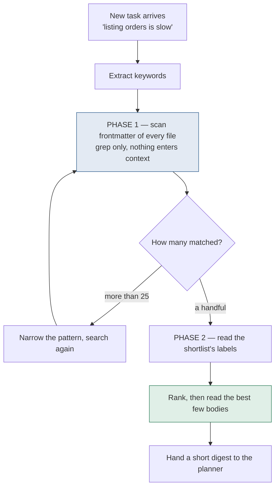
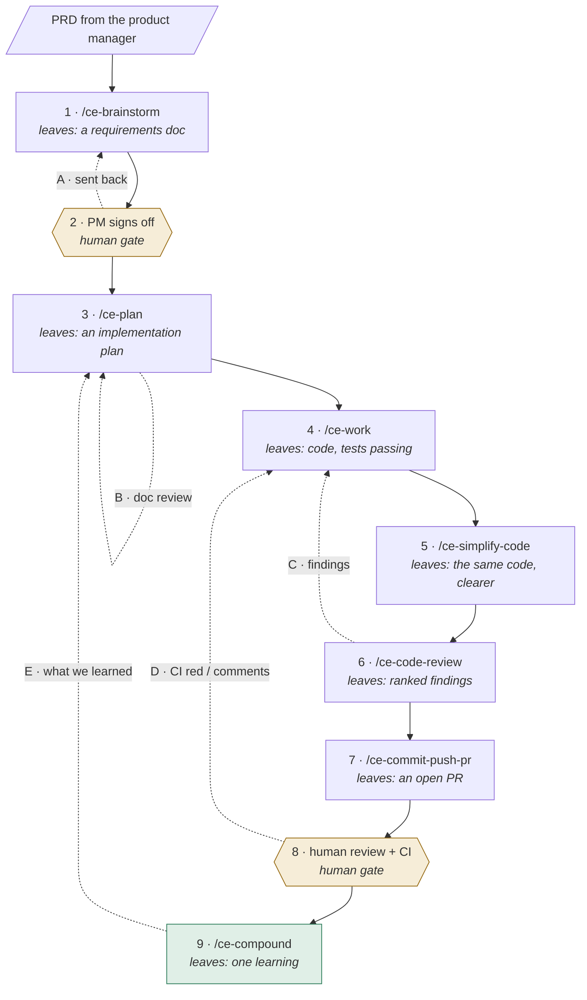
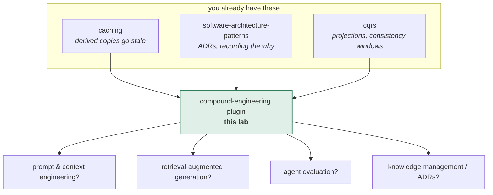

# The compound-engineering plugin

**A lab about the one idea that makes it work: writing down what a piece of work
taught you, in a shape a machine can find again.**

> Lab contents: this README (the lesson), `visualization.html` (an interactive
> simulator, also published at
> [claude.ai/code/artifact/a640ed3e](https://claude.ai/code/artifact/a640ed3e-d372-4daa-b234-024b9d097420)),
> `CompoundLab.java` + friends (runnable experiments), `BrokenRetrieval.java`
> (a planted bug), `EXERCISES.md`, `SOLUTIONS.md`.
>
> Everything factual about the plugin here was read out of its source on this
> machine: `~/.claude/plugins/marketplaces/compound-engineering-plugin`,
> version **3.23.4**, 33 skills. Where I state a measured number, it came from
> running `java CompoundLab.java` in this directory. Where something is a
> simplification, it says so on the spot.

---

## Depth map

You are going to climb four layers. Stop at any of them and you will still have
something whole.

| Layer | Stages | You will be able to |
|---|---|---|
| **BEGINNER** | 1–9 | Say what the plugin is for and why the loop is a loop |
| **INTERMEDIATE** | 10 | Walk the actual mechanism, step by step, and say why each odd detail exists |
| **ENGINEERING** | 11–14 | Reason about how it fails, what it guarantees, and measure it yourself |
| **PRODUCTION** | 15 | Run it on a real repo, know its costs, and know when not to |

---

# BEGINNER MODEL

## 1. WHY — the problem this exists to solve

You finish a piece of work with an AI coding agent. Along the way the two of you
worked out something real: that the staging environment names that variable
differently, that the obvious fix causes a deadlock, that the third-party API
returns 200 on failure. Then the session ends.

All of it is gone. Not the code — the code is committed. What is gone is the
*reasoning*: the dead ends, the reason you chose B over A, the trap you nearly
fell into. Next month, on a different task, you or a different agent walks into
the same trap and pays the same cost to get out of it.

The consequence is that work does not get easier. Each change adds code to hold
in your head, while the understanding that would make the next change cheap
evaporates every time a session closes. That is the default, and this plugin is
one attempt to invert it.

## 2. PROBLEM — the kitchen with a new cook every shift

A restaurant kitchen. Every shift, a different cook.

Monday, Maya works the line. Two trays in, she works out that the left oven runs
about 30 degrees hot — everything on the top shelf comes out scorched. She adapts,
drops the temperature, and the rest of her shift is fine. Shift ends. Maya leaves.

Tuesday, Dev works the line. He has never met Maya. He puts a tray in the left
oven at the temperature the recipe says. It burns. He spends twenty minutes
working out why, arrives at exactly Maya's conclusion, and adapts.

Wednesday, someone else. Same tray. Same twenty minutes.

Nobody is incompetent. The kitchen just has no way for Monday to reach Tuesday.
Every shift starts from zero, and the same discovery gets paid for over and over.

Your sessions with an agent are the shifts. The oven is every quirk of your
codebase that isn't written anywhere.

## 3. NAIVE SOLUTION — tell the next cook

The obvious fix: leave a note. Put the oven fact where the next cook will read it.

In agent terms, that is the file of standing instructions — `CLAUDE.md`,
`AGENTS.md`, a `CONVENTIONS.md`, whatever your tool reads at the start of every
session. Write the trap into it. Now every future session knows.

This genuinely works. It is where most teams start, and for a handful of facts
it is the right answer. Keep it — nothing below replaces it.

## 4. FAILURE — the note board fills up

Run the naive fix for a year and two things go wrong.

**The board gets too big to read.** By month six the note board has 300 notes:
the oven, the sticky walk-in door, the supplier who delivers late on Fridays, the
three notes about the oven that contradict each other. The cook reads all of it
at the start of every shift, before touching a pan. Most of it is irrelevant to
tonight's menu, and the one note that matters is buried in the middle.

For an agent this is not an inconvenience, it is a hard wall. Everything in that
file is read into the context window on every single task, whether or not it
relates. A file that grows without bound eventually crowds out the actual work,
and long before that it dilutes attention — 300 facts competing means the
important one is just one line among many.

**Nobody writes the note.** The second failure is worse and less obvious. At the
end of a shift, exhausted, having just solved the problem — that is exactly the
moment nobody wants to write documentation. The note gets written when someone
remembers, which is rarely, and never for the small traps that cost twenty
minutes each.

> **🔮 Predict:** Both failures are real. Which one do you think is the harder
> one to engineer around?
>
> <details><summary>Reveal</summary>
>
> **The second.** The first is a technical problem with a technical answer: don't
> read everything, search it. That's mechanical, and stages 6–10 are about how.
>
> The second is a *human* problem — it depends on someone choosing to do
> unrewarding work at the worst possible moment. You cannot engineer discipline.
> What you can do is make capture a named step of the process that the tooling
> performs, so it happens by default rather than by virtue. That is the entire
> reason `/ce-compound` is a step in a loop rather than advice in a wiki.
>
> The simulator's "Does the team write the learning down?" control is this
> failure, and it is the only control that reduces the compounding team to
> exactly the forgetful team: 8 repeats against 8. Every other way of breaking
> the mechanism still leaves some value; skipping capture leaves none.
> </details>

## 5. THE REAL REQUIREMENT

Both failures point at the same three requirements. What we actually need:

1. **Capture must happen without depending on anyone remembering.** It has to be
   a step in the process, not a virtue.
2. **Retrieval must be selective.** Consulting the past has to cost roughly the
   same whether there are 10 notes or 500, or the system punishes you for
   learning.
3. **A note must be findable by someone who only knows the new problem.** The
   next task does not know what it doesn't know. It cannot search for "the oven
   runs hot" — it only knows "my tray burned".

Everything from here is the pursuit of those three.

## 6. KEY IDEA

> Make the workflow a **loop** whose closing step writes what was learned into a
> small file with structured labels, and whose opening step searches those labels
> before planning anything.
>
> Knowledge moves out of human memory and session context, into the repository,
> where finding it again is a search rather than an act of recall.

That's it. The plugin is 33 skills, a pipeline, review panels, a config
system — all of it is scaffolding around that one arrow, from the last step back
to the first.

## 7. TERMINOLOGY

Now the vocabulary, introduced where it is needed. The load-bearing terms get the
full treatment; minor ones are defined at first use and collected in the glossary.

### Plugin

- **Plain meaning:** a bundle of extra abilities you install into a coding agent,
  as one unit.
- **Technical meaning:** a distributable package of skills, agents, commands and
  hooks described by one manifest (`plugin.json`), installed into a host like
  Claude Code, Cursor or Codex.
- **Why the term exists:** to name the unit of *distribution and versioning*, as
  distinct from any one capability inside it. You install and upgrade a plugin;
  you invoke a skill.
- **Concrete:** on this machine, `compound-engineering@compound-engineering-plugin`
  version `3.23.4`, installed at user scope on 2026-08-27.

### Skill

- **Plain meaning:** one thing the plugin can do, that you ask for by name.
- **Technical meaning:** a directory containing a `SKILL.md` whose instructions
  are loaded into the agent's context when you invoke it, plus reference files it
  pulls in as it goes. You invoke it as `/ce-plan` (or `$ce-plan` on Codex).
- **Why the term exists:** to distinguish a thing *you* invoke, which coordinates,
  from an **agent** (or *subagent*) — a worker *the skill* dispatches to do one
  scoped job and report back. The plugin's own glossary is explicit that a skill
  orchestrates and an agent performs.
- **Concrete:** `/ce-plan` is a skill. The `learnings-researcher` it dispatches to
  search past work is a subagent.
- **Connects to:** the loop below is six skills in sequence.

### The loop

- **Plain meaning:** the six steps of one piece of work.
- **Technical meaning:** brainstorm → plan → work → simplify → review → compound,
  where each step hands a durable file to the next, and the last writes something
  the first will read next time.
- **Why the term exists:** to name the *return arrow*. A pipeline that ends at
  "review" is just a checklist. The arrow from the end back to the beginning is
  what makes the word "compound" mean anything.
- **Concrete:** `/ce-brainstorm` writes a requirements document; `/ce-plan` reads
  it and writes an implementation plan; `/ce-work` reads that and writes code.

### Learning (also: solution doc)

- **Plain meaning:** one written-down lesson from one solved problem.
- **Technical meaning:** a markdown file under `docs/solutions/<category>/`,
  carrying a block of structured labels (see *frontmatter*) plus prose: what the
  problem was, what didn't work, what did, and how to avoid it next time.
- **Why the term exists:** to name the *unit* of compounded knowledge. Not "a
  doc", not "a note" — a specific shape, one per solved problem, with a metadata
  contract that makes it retrievable. The one-problem-per-file rule is load-
  bearing and stage 11 shows what breaks without it.
- **Concrete:** in the plugin's own repository there are **81** of these. One of
  them is `docs/solutions/skill-design/strong-models-mask-defensive-skill-fixes.md`.
- **Connects to:** the *guidance layer* (below) is what a learning must never
  silently contradict.

### Frontmatter

- **Plain meaning:** the labels at the top of the file, between two lines of
  dashes.
- **Technical meaning:** a YAML block carrying `title`, `category`, `module`,
  `problem_type`, `component`, `severity`, `tags`, and — depending on which of two
  tracks the document is on — `symptoms`, `root_cause`, `resolution_type` or
  `applies_when`.
- **Why the term exists:** because this block, not the prose, is what search
  reads. It is the difference between a document and a *findable* document. Every
  requirement in stage 5 lands here.
- **Concrete, from the plugin's own corpus:**

  ```yaml
  ---
  title: A strong model can mask a defensive skill-prose fix
  date: 2026-07-09
  category: skill-design
  module: compound-engineering
  problem_type: best_practice
  component: ce-commit-push-pr
  severity: medium
  applies_when:
    - Improving an LLM-driven skill's prose and wanting to prove the change helps
    - A with-skill vs baseline eval ties on pass-rate
  tags:
    - skill-eval
    - eval-methodology
    - confound-control
  ---
  ```

  Note that `module`, `component` and `problem_type` are each **single-valued**.
  That one fact does an enormous amount of work in stage 11.

### Artifact

- **Plain meaning:** a file one step leaves behind for the next step to pick up.
- **Technical meaning:** a durable, repo-relative document — a plan under
  `docs/plans/`, a learning under `docs/solutions/`, a requirements doc, a review
  report. Configurable in bulk via a `docs_root` setting.
- **Why the term exists:** because the steps do not pass information to each other
  in conversation, they pass *files*. That is what lets a step run in a fresh
  session, days later, or on a different machine, and still know what came before.
- **Connects to:** a learning is one kind of artifact — the only kind that flows
  backwards.
- **Careful — the word is overloaded.** Claude Code also calls a *published web
  page* an Artifact, which is what the visualization link at the top of this file
  points at. Unrelated meaning. Everywhere below, "artifact" means a file in your
  repository that one step leaves for another.

### Retrieval (grep-first)

- **Plain meaning:** how a new task finds the old lesson.
- **Technical meaning:** a dispatched subagent that (a) reads the project's shared
  vocabulary file, (b) extracts keywords from the new task, (c) searches
  *frontmatter fields only* across the whole corpus to build a shortlist, (d)
  reads the shortlist's labels, and only then (e) reads the bodies of the best
  few.
- **Why the term exists:** to name the ordering. "Search then read" and "read then
  search" return the same documents and have wildly different costs. Requirement 2
  from stage 5 is satisfied by this ordering and nothing else.
- **Concrete:** measured in this lab, on a 96-document corpus, read-everything
  costs **68,187 tokens** before any work starts; grep-first costs **4,723**.
- **Connects to:** *context budget*, below.

### Context budget

- **Plain meaning:** how much text the agent can hold at once, and what you spend
  it on.
- **Technical meaning:** the model's context window, of which everything loaded —
  instructions, skill bodies, retrieved documents, the code itself — takes a
  share. Anything spent on irrelevant material is not available for the task.
- **Why the term exists:** because it converts "is this design good?" into an
  arithmetic question you can answer. It is the reason the naive fix in stage 3
  hits a wall, and the reason retrieval is ordered the way it is.

### Guidance layer

- **Plain meaning:** the instructions the agent is actually reading while it works.
- **Technical meaning:** a skill's own `SKILL.md`, a runbook, the project's root
  instruction file — anything loaded at the moment of acting.
- **Why the term exists:** to name a conflict that outranks ordinary staleness. A
  learning that merely got out of date is wrong. A learning that *contradicts the
  guidance layer* is worse: the agent reads the guidance at the moment it acts, so
  the learning will simply lose, silently, every time.
- **Concrete:** if a learning says "always run the migration in two steps" and the
  project's runbook says "use the one-step helper", the runbook wins in practice
  and the learning is decorative. The plugin's maintenance skill treats this as a
  higher-priority defect than a stale file path, and reports the guidance file
  rather than editing it.

## 8. TWO MENTAL MODELS

### The simple model — the card catalogue

The kitchen note board, fixed. Instead of a wall of loose notes read start to
finish, a card index: one card per lesson, each with tabs down the side saying
which station, which dish, what kind of problem. The cook doesn't read the
catalogue. The cook flips to the tabs matching tonight's menu, pulls three cards,
reads those.

### The engineering model

A directory of markdown files, each with a typed YAML header. A dispatched search
agent that pre-filters on header fields without opening files, shortlists, and
reads a handful of bodies. A writer step, invoked as the closing phase of a work
cycle, that appends exactly one new file per solved problem and validates its
header against a schema. A separate maintenance pass that re-checks the corpus
against the current code.

### Mapping

| Card catalogue | Engineering model | In the plugin |
|---|---|---|
| One card | One markdown file | `docs/solutions/<category>/<name>.md` |
| The tabs on the card | YAML frontmatter | `module`, `problem_type`, `tags`, … |
| The drawer it lives in | The category directory | `performance-issues/`, `conventions/`, … |
| Flipping to matching tabs | Grep on frontmatter fields | the `learnings-researcher` subagent |
| Pulling three cards to read | Reading the shortlist's bodies | top-k body reads |
| Writing a new card at end of shift | The capture step | `/ce-compound` |
| The house glossary at the front | Shared vocabulary file | `CONCEPTS.md` |
| Weeding the drawer once a quarter | Corpus maintenance | `/ce-compound-refresh` |

### Where the analogy breaks

Three places, and each one matters.

**A card can't go quietly wrong; a learning can.** The oven either runs hot or it
doesn't. But a learning says "the retry logic lives in `PaymentRetryService`" —
and six months later that class was renamed. The card still reads confidently.
Nothing in the catalogue knows. In this lab's model, a rename of two modules left
**38% of a 96-document corpus** citing paths that no longer existed, and **52% of
everything retrieval handed back** was silently rotten. That is why a maintenance
pass exists at all; the physical catalogue needs no such thing.

**The cook can tell a stale card from a fresh one; the agent mostly can't.** A
human sees yellowed paper and 1998 handwriting. An agent sees text, and text
written in 2024 looks exactly like text written this morning. Confidence does not
decay with age. This is why the plugin *mechanically* checks the paths and links a
document cites, rather than trusting a reader to notice.

**A card catalogue is a cache; a learnings corpus isn't quite.** This is worth
being careful about, because it connects to something you already know. In your
[caching lab](../11-caching/README.md) you established that a cache is a bounded copy
of answers whose truth lives elsewhere, and that the test of it being a cache is
that deleting it loses only speed. A learnings corpus behaves like a cache in two
ways — it is a derived copy, and it goes stale — but it fails that test. Delete
`docs/solutions/` and you do not lose speed alone; you lose the reasoning, the
dead ends, the "we tried X and here is why it didn't work". None of that is
recomputable from the code, because the code only records what *did* happen. So:
borrow the staleness and invalidation intuitions from caching, but not the
"it's only a performance optimisation" one.

## 9. VISUALIZATION — see it happen

Open **[The Compounding Loop](https://claude.ai/code/artifact/a640ed3e-d372-4daa-b234-024b9d097420)**
(or `visualization.html` in this directory — it works offline).

What to look at, in this order:

1. **Press "Run all 14 tasks"** and watch only the two big numbers. Fourteen
   pieces of work arrive at two teams. Traps repeat. One team remembers.
2. **Watch the right-hand card grid fill up.** Each card is one learning. When a
   task starts, cards that matched on a label light up blue; the one that actually
   prevented the trap turns green and lifts.
3. **Click any card.** You will see its frontmatter — the only part search ever
   reads — and its prose, which is only read if the labels got it shortlisted.
4. **Then start breaking it** with the left-hand controls. Each one corresponds to
   a failure in stage 11. Set "Does the team write the learning down?" to *Never*
   and the two teams become identical.

Three moments pause and ask you to predict before revealing. Take the guess — it
is the difference between watching and learning.

The second tab, **The loop, end to end**, is the pipeline itself: ten numbered
steps from a product manager's PRD to a merged pull request, each labelled with
the file it leaves behind. The two dashed boxes are the points where a *human*
decides, not a skill.

Down the left-hand side are five curved arrows, lettered A–E. Those are the
loops — the places work goes backwards. Click each one: it tells you what
triggers it, what it revises, why that particular mistake is cheapest to catch
*there*, and what happens if you skip it. Stage 10 covers the same ground in
table form.

---

> ### ✅ Checkpoint — end of the beginner model
>
> You can now explain what compound engineering is trying to do, why leaving notes
> in one big file stops working, and what a "learning" is as an artifact.
>
> What the next layer adds: the actual sequence of operations — how a search
> across hundreds of documents stays cheap, and why the design has the specific
> odd details it has.

---

# INTERMEDIATE MODEL

## 10. THE ACTUAL MECHANISM

We will build this the way it was actually arrived at: the obvious version first,
then break it, then fix it. Every strange detail in the final design is the scar
of a failure you are about to watch.

### Mechanism v1 — the obvious thing

Two rules:

1. At the end of a task, write a markdown file into `docs/solutions/` describing
   what you learned.
2. At the start of the next task, read `docs/solutions/` before planning.

Concretely: three tasks in, the directory holds three files. Task four begins, the
agent reads all three, notices one is about the trap it is walking toward, and
avoids it. This works. It is also the entire idea, and everything below is
damage control.

> **🔮 Predict:** It is now nine months later and `docs/solutions/` holds 200
> files averaging 2,600 characters. What is the *first* thing that breaks?
>
> <details><summary>Reveal</summary>
>
> **Cost, and it breaks hard.** 200 documents at ~2,800 characters is roughly
> **140,000 tokens** loaded before the agent has looked at a single line of your
> code. On most models that is most or all of the budget, spent on material that
> is about 99% irrelevant to the task at hand.
>
> The cruel part: this failure gets *worse the more the team learns*. A repo that
> has been diligent about capture is punished for it. That is the precise opposite
> of compounding, and it means v1 is not merely inefficient — it is self-defeating.
> </details>

### Mechanism v2 — search the labels, read the few

The fix is to stop reading and start searching. Give every document a structured
header, and split retrieval into two phases with very different costs:



The asymmetry is the whole trick. Phase 1 touches every file and costs nothing,
because grep reads the disk, not the context window. Phase 2 is expensive per
file but touches almost none of them.

**Measured, in this lab** (`java CompoundLab.java`, experiment 1):

| Corpus | Read everything | Grep first | Saving |
|---:|---:|---:|---:|
| 12 docs | 8,529 tokens | 3,979 tokens | 53.3% |
| 40 docs | 28,374 tokens | 4,492 tokens | 84.2% |
| 96 docs | 68,187 tokens | 4,723 tokens | 93.1% |

Read the *shape* of that table, not the numbers. The left column grows linearly
with what you know. The right column is nearly flat: 12 documents and 96
documents cost about the same to consult. That flatness is the property the whole
design exists to buy, and requirement 2 from stage 5 is now met.

> **🔮 Predict:** v2 stores a learning with `tags: [n-plus-one, jpa, lazy-loading]`
> and `module: payments`. Months later a task arrives described as *"the orders
> page takes forever to load and the database looks busy"*. Does the search find
> it?
>
> <details><summary>Reveal</summary>
>
> **No.** Not one word overlaps. The task says *slow, page, load, database, busy*.
> The document says *n-plus-one, jpa, lazy-loading, payments, performance_issue*.
> Phase 1 is a text match on labels, and nothing matches, so the document is never
> shortlisted and its body is never read.
>
> The document exists. It is correct. It is about exactly this problem. And it is
> invisible — which is operationally identical to never having written it, except
> that it cost time to write and now needs maintaining.
>
> In this lab, across 12 topics, house vocabulary found **12 of 12**; symptom
> vocabulary found **0 of 12**.
> </details>

### Mechanism v3 — ground the search in shared vocabulary

The failure above is a *vocabulary* failure, not a search failure. The person
describing a new problem describes the **symptom**, because they don't yet know
the cause. The person who wrote the learning described the **cause**, because by
then they did. Those two never share words.

So before extracting keywords, the search agent reads `CONCEPTS.md` — the
project's shared glossary of domain terms, entities and named processes. It maps
"the orders page is slow" onto the vocabulary this repository actually uses, and
searches with that instead.

**Measured** (experiment 2), same 96-document corpus, same 12 traps:

| How the new task was described | Found |
|---|---:|
| In the team's own vocabulary | 12 / 12 |
| In symptom words | 0 / 12 |
| In symptom words, with `CONCEPTS.md` | 9 / 12 |

Note honestly what this shows. The glossary recovers most of the loss, **not all
of it** — three topics stay unreachable because nothing connects their symptom
words to their house words. Vocabulary grounding is a large mitigation, not a
cure, and a corpus whose tags drift away from how people actually describe
problems will quietly stop being consulted.

Worth noticing: `CONCEPTS.md` is itself maintained *by* the capture step, as a
side effect. Every time a learning is written, qualifying domain terms are folded
into the glossary. The mechanism that makes retrieval work is fed by the same
loop it serves.

> **🔮 Predict:** Everything now works. A long session solves five separate
> problems. Writing five files feels bureaucratic — why not one tidy
> "lessons from this week" document?
>
> <details><summary>Reveal</summary>
>
> **Because a file has one set of labels.** Look again at the schema: `module` is
> one string, `component` is one string, `problem_type` is one enum value. A
> document about five problems must pick one set — so it is labelled correctly for
> one of them and wrongly for the other four.
>
> Phase 1 only ever sees labels. So four of those five learnings are written down,
> stored, committed, backed up — and structurally unfindable. This is worse than
> not writing them, because it *looks* done.
>
> Measured (experiment 3): of five learnings folded into one weekly file, the
> search found the file for **1 of the 5** queries. On the one query where it did
> match, context read rose from 4,758 to 7,398 tokens (**+56%**) while the share of
> that context actually relevant to the task fell from 15% to 10%.
>
> This is why `/ce-compound` states *"One learning per run"* as a rule and sends a
> session that produced five learnings through five sequential runs.
> </details>

### Mechanism v4 — one learning per run, and knowledge that rots

Two final refinements, both scars.

**One learning per run** is now forced, for the reason above.

**And the corpus needs weeding.** A learning is written once and read for years,
while the code underneath it keeps moving. Nothing in the retrieval path can
detect this: phase 1 matches labels, and the labels don't change when the code
does.

So the plugin adds mechanical checking at two moments:

- **At write time** — a bundled script validates the frontmatter parses safely,
  and a second checks every file path, commit SHA and link the document cites
  against the actual tree. A dead path is treated as a **question, not a verdict**
  — a learning may legitimately cite a file that the very fix it documents
  deleted.
- **Later, on a schedule** — `/ce-compound-refresh` re-runs that across the whole
  corpus and classifies each document: Keep, Update, Consolidate, Replace, Delete.

**Measured** (experiment 4): after a refactor renaming two modules and deleting a
third, **36 of 96** documents cited a dead path, and **52%** of everything
retrieval handed back was silently rotten. The mechanical check does not fix
those — it narrows 96 documents down to 36 that a human or agent must adjudicate.

### The full loop, as it actually runs

The six-step version above is the marketing diagram. Here is the shape of a real
piece of work, from a product manager's PRD to a merged pull request — including
the two places a *human* decides, and all five places work goes backwards.



**What each step leaves behind, and who reviews it.** The artifact is the
interface — no step reads the previous step's conversation, only its file.

| # | Step | Leaves behind | Reviewed by |
|---|---|---|---|
| — | PRD arrives | the ask, unstructured | — |
| 1 | `/ce-brainstorm` | a requirements doc, stamped `requirements-only` | the PM, at gate 2 |
| 2 | **PM signs off** | an approved spec, or corrections | — |
| 3 | `/ce-plan` | an implementation plan: numbered units, test scenarios | `/ce-doc-review`, automatically |
| 4 | `/ce-work` | code, with the plan's tests passing | steps 5 and 6 |
| 5 | `/ce-simplify-code` | the same behaviour, expressed more plainly | step 6 |
| 6 | `/ce-code-review` | findings, each with a confidence level | you, for the judgment calls |
| 7 | `/ce-commit-push-pr` | commits, a push, an open PR | humans and CI, at gate 8 |
| 8 | **Human review + CI** | approvals and green, or comments and red | — |
| 9 | `/ce-compound` | one document under `docs/solutions/` | `/ce-compound-refresh`, later |

### The five cycles, and why each one is where it is

The single most useful thing to understand about this pipeline is that it has
five backward arrows, not one, and **each exists because a different kind of
mistake is cheapest to catch in a different place.**

| | Goes back | Triggered by | Why *here* | If you skip it |
|---|---|---|---|---|
| **A** | gate 2 → step 1 | the spec isn't what the PM meant | cheapest possible place to be wrong — costs one conversation | you build the wrong thing correctly, and every later step helps you do it faster |
| **B** | step 3 → step 3 | automatic; `/ce-doc-review` runs on every durable plan | a plan defect is multiplied by everything built on it | step 4 faithfully implements a contradiction nobody flagged |
| **C** | step 6 → step 4 | a finding above the confidence threshold | review that produces only a report is a report | findings die in a session transcript |
| **D** | gate 8 → step 4 | a reviewer comments, or CI goes red | last chance before it's permanent, and the only place outsiders get a vote | the PR stalls, or merges red |
| **E** | step 9 → step 3 | every completed task | — see below — | the forgetful team: 8 repeats instead of 0 |

**Loop E is the odd one out, and the distinction is the whole plugin.** A, B, C
and D all repair *the work in front of you*. Remove any of them and this task
ships worse. Remove E and this task ships **exactly the same** — and the next
hundred tasks are each slightly worse than they needed to be.

That is precisely why E is the one that gets skipped: it is the only loop whose
benefit lands on someone who isn't in the room. It is also why the plugin makes
it a step with a command rather than a line in a wiki.

### About that PM gate — what CE gives you, and what it doesn't

Be precise here, because it is easy to over-claim:

- **It gives you the artifact.** `/ce-brainstorm` produces a *requirements-only*
  document — literally stamped `artifact_readiness: requirements-only`. That is
  the "here is what we think you asked for" spec you send back. `/ce-doc-review`
  reads that stamp and reviews such a document against a Product Contract only,
  so it does not report missing implementation detail as a defect.
- **It gives you review and a way to share.** `/ce-doc-review` critiques the spec
  with role-specific reviewer personas. `/ce-proof` publishes markdown for someone
  to comment on. `brainstorm_output: html` renders it for a human reader instead
  of an agent.
- **It does not give you an enforced gate.** There is no CE state meaning "blocked
  awaiting approval". Nothing prevents you running `/ce-plan` on an unapproved
  spec, and `/lfg` has no human checkpoint at all until a PR exists.

So gate 2 is real and it matters — but it is **your discipline plus CE's
artifacts**, not a state machine the tool enforces. Worth knowing before you rely
on it.

One more nuance that helps here: CE has a notion of a **session-settled
decision** — a tradeoff that was actually examined and chosen in conversation,
carried downstream as a labelled constraint that later skills may augment but must
not silently re-ask or contradict. A decision merely *asserted* is a directive and
gets one challenge; a decision that survived examination is settled. That is the
mechanism by which a PM's answer at gate 2 travels into step 3 without being
relitigated.

The 33 skills group into: the six-step **core loop** above; **around the loop**
(`ce-strategy`, `ce-product-pulse`, `ce-sweep`, `ce-compound-refresh`); **on
demand** (`ce-debug`, `ce-pov`, `ce-explain`, `ce-ideate`, `ce-doc-review`,
`ce-optimize`, `ce-prototype`); **git workflow** (`ce-commit`,
`ce-commit-push-pr`, `ce-babysit-pr`, `ce-resolve-pr-feedback`, `ce-worktree`);
**testing and design**; **collaboration**; **utilities**; and `/lfg`, which runs
the whole pipeline hands-off through to an open PR.

---

> ### ✅ Checkpoint — end of the intermediate model
>
> You can now walk the mechanism end to end and explain why each part is shaped
> the way it is: why search precedes reading, why there is a glossary, why one
> file per problem, why a maintenance job exists.
>
> What the next layer adds: what happens when each of those parts fails, what the
> system actually guarantees versus merely hopes for, and how to measure it
> yourself.

---

# ENGINEERING MODEL

## 11. FAILURE SCENARIOS

Nine ways this breaks. For each: how to cause it, where to watch it, what happens
and why, how the system responds, and what it costs you.

**1 — Capture never happens.**
*Cause it:* simulator → "Does the team write the learning down?" → **Never**.
*What happens:* the two teams become numerically identical — 8 repeats each. The
corpus stays empty; every other mechanism is intact and irrelevant.
*Why:* the loop has no closing step, so it isn't a loop.
*Response:* none available in the tool. This is the failure the design cannot
defend against, only make less likely, by making capture a named step with a
command rather than a good intention.
*Guarantee kept:* nothing is ever wrong. *Lost:* everything the loop is for.
*In production:* the honest signal is corpus growth rate. A `docs/solutions/`
that hasn't grown in two months means the loop is not running, whatever anyone
says in standup.

**2 — Capture happens, but batched.**
*Cause it:* simulator → "One learning per document?" → **No**.
*Watch:* the store shows a single card; click it and the inspector says how many
problems are inside and how many are unreachable.
*What happens:* 6 repeats instead of 0. Measured in Java: 1 of 5 learnings
retrievable, +56% context on the one that works.
*Why:* single-valued `module` / `component` / `problem_type`. Labels can only
describe one problem.
*Response:* `/ce-compound` refuses to batch by contract.
*Kept:* the prose exists. *Lost:* retrievability for all but one.
*In production:* this is what a "weekly learnings" doc becomes. It reads like
diligence and functions as a write-only log.

**3 — Retrieval miss from vocabulary drift.**
*Cause it:* simulator → "How is the next task described?" → **symptom words**, and
"shared vocabulary file" → **No**. Java: experiment 2.
*What happens:* 8 repeats, with 7 documents sitting in the store. 0/12 recall in
the Java model.
*Why:* phase 1 is a text match on labels; symptom words and cause words don't
intersect.
*Response:* `CONCEPTS.md`, read before keyword extraction. Recovers 9/12, not 12/12.
*Kept:* correctness — nothing wrong is returned. *Lost:* the entire benefit,
silently. **This is the most dangerous failure in the set**, because a miss looks
exactly like "there was nothing to find".
*In production:* the counter-measure is writing `tags` in the words people use
when the problem *appears*, not only the words they use once it's understood.

**4 — The learning went stale.**
*Cause it:* simulator → **"Rename the payments module"**, then keep stepping.
Java: experiment 4.
*Watch:* affected cards get an amber top edge and a `rot` marker, and are still
retrieved.
*What happens:* the outcome pill reads *followed stale advice*. 36/96 docs citing
dead paths; 52% of retrieved documents rotten.
*Why:* labels don't change when code does, and retrieval never opens the code.
*Response:* mechanical claims checks at write time; `/ce-compound-refresh` on a
schedule. Press **"Run /ce-compound-refresh"** in the simulator to watch it clear.
*Kept:* nothing is lost. *Lost:* trustworthiness — worse than a miss, because the
answer arrives confident.
*In production:* schedule the refresh against the same events that invalidate
knowledge — big renames, framework upgrades, module deletions.

**5 — The learning contradicts the guidance layer.**
*Cause it:* a learning says "always X"; the skill instructions or runbook the
agent loads while acting say "never X".
*What happens:* the guidance wins, every time, silently. The learning is
decorative.
*Why:* guidance is loaded at the moment of acting; a retrieved learning is
context. Instructions outrank references.
*Response:* the maintenance skill ranks a guidance contradiction **above**
ordinary staleness, resolves it by checking which side the current code follows,
and *reports* a wrong guidance file rather than editing it.
*Kept:* the system does what the guidance says. *Lost:* the learning's authority.

**6 — Two documents about the same thing, drifting apart.**
*Cause it:* capture the same problem twice, from two sessions.
*What happens:* two answers to one question, gradually disagreeing. Retrieval
returns whichever ranks higher.
*Why:* nothing prevents a near-duplicate at write time except a check.
*Response:* before writing, an overlap assessment. **High** overlap updates the
existing document rather than creating a second; **moderate** creates the new one
and flags it for consolidation review.
*Kept:* no loss. *Lost:* a single source of truth, until consolidation runs.

**7 — Context blowout from reading everything.**
*Cause it:* simulator → "How does the next task consult the past?" → **Read every
document**. Java: experiment 1.
*What happens:* the cost meter turns red; 4,918 tokens vs 2,108 in the simulator's
small corpus, 68,187 vs 4,723 in the Java corpus.
*Why:* cost proportional to corpus size.
*Response:* the phase split.
*Kept:* recall is fine — it finds the same documents. *Lost:* affordability, and
therefore the willingness to keep learning.

**8 — An autonomous run loses its residuals.**
*Cause it:* run `/lfg` on work where review raises findings the run decides not to
fix.
*What happens:* the finding exists only in a session that is about to end.
*Why:* nothing in a transcript survives it.
*Response:* the pipeline defines a **residual** — an accepted or deferred
finding — and refuses to report itself done until each one reaches a durable
sink: a ticket, or a comment on the PR. Never the session.
*Kept:* the change ships. *Lost:* nothing, provided the sink rule holds.

**9 — The host truncates the skill body.**
*Cause it:* install on a host whose prompt budget is smaller than the skill's
instructions.
*What happens:* the tail of the instructions is silently dropped. Every known
truncation keeps the beginning and discards the rest, and none reports an error.
*Why:* the ceiling is enforced by the host's loader, not by the plugin.
*Response:* ordering becomes load-bearing — what must survive is written above
what may be cut, and heavy detail moves into reference files pulled in at the
step that needs them.
*Kept:* whatever fit. *Lost:* possibly a safety rule, with every mechanical check
still green.
*In production:* this one is a genuinely nasty class of bug, and worth knowing
about even if you never author a skill: **a size limit enforced by silent
truncation turns document order into a correctness property.**

## 12. CORRECTNESS — what is actually guaranteed

Be clear-eyed here. This is a *process and prompt* system, not a protocol. It has
nothing like the guarantees you established in your [paxos](../39-paxos/README.md) or
[two-phase-commit](../45-two-phase-commit/README.md) labs. Sorting its claims into
three buckets is the useful move.

**Mechanically enforced** — a script or a hard rule, and it either happened or
didn't:

- Frontmatter parses, and parses *safely*: a bundled validator catches an
  unquoted ` #` (silently truncates the value as a comment) and an unquoted `: `
  (silently reads as a nested mapping). Both corrupt without erroring.
- Every file path, SHA and link a document cites is checked against the tree.
- The artifact root **fails closed**: an unusable `docs_root` stops the run rather
  than silently falling back to `docs/`, so a typo cannot scatter artifacts.
- Write boundary: subagents write only to scratch; only the orchestrator writes
  files in your tree.
- One learning per run.

**Structurally encouraged** — the design makes the good outcome likely, not
certain:

- Retrieval cost stays near-flat as the corpus grows (phase split).
- Learnings stay findable (schema + glossary) — 9/12, not 12/12.
- Capture happens (it's a named step) — but only if invoked.

**Not guaranteed at all** — and pretending otherwise is how people get burned:

- That the right learning is retrieved. Relevance is a model's judgment.
- That a retrieved learning is still true. Only that its citations were checked
  the last time somebody checked.
- That two runs behave identically. There is no determinism here.
- That the corpus stays consistent with itself.

**What was traded away.** Determinism, and immediate speed. Every step costs
tokens and wall-clock now, against a payoff that is diffuse, delayed and hard to
attribute. Nobody will ever be able to point at the incident that *didn't* happen
in September because of a note written in March. That asymmetry — certain cost
now, invisible benefit later — is the real reason this kind of practice gets
dropped, and it is worth naming before you decide to adopt it.

## 13. CODE — the mechanism, runnable

```bash
cd ~/Documents/Learning/64-compound-engineering-plugin
java CompoundLab.java
```

No build tool, no dependencies, JDK 25 single-file source mode.

| File | What it is |
|---|---|
| `Learning.java` | One learning: the real frontmatter fields, plus body size and cited paths |
| `Corpus.java` | 12 realistic problem topics × 8 modules — a repo's `docs/solutions/` |
| `Retrieval.java` | The return arrow: `readEverything` vs `grepFirst`, plus scoring |
| `Text.java` / `Concepts.java` | Keyword extraction, and the `CONCEPTS.md` vocabulary bridge |
| `CompoundLab.java` | The four experiments |
| `BrokenRetrieval.java` | A planted bug — exercise 6 |

The lines that carry the idea:

**The invariant that makes the whole thing affordable** — `Retrieval.java`:

```java
// Step 3: pre-filter on frontmatter fields only. Costs zero context.
List<Learning> candidates = corpus.stream()
        .filter(l -> !Collections.disjoint(l.frontmatterTerms(), queryTerms))
        .sorted(Comparator.comparingInt((Learning l) -> -score(l, queryTerms)))
        .limit(SHORTLIST_CAP)
        .toList();

// Step 4: read the frontmatter of the shortlist — small, structured, cheap.
int chars = candidates.stream().mapToInt(Learning::frontmatterChars).sum();

// Step 5: read the bodies of only the best few.
chars += ranked.stream().mapToInt(Learning::bodyChars).sum();
```

Three lines, three costs. The filter touches every file and charges nothing. Only
the last two lines add to the context budget. Change `frontmatterChars` to
`totalChars` on the shortlist line and you have re-created v1's failure while the
correctness tests still pass — which is exactly what `BrokenRetrieval.java` does.

**The single-valued fields that force one-learning-per-file** — `Learning.java`:

```java
String module,        // one string
String problemType,   // one enum value
String component,     // one string
List<String> tags,    // the only multi-valued label
```

`Corpus.Topic` carries both a `canonicalQuery` and a `synonymQuery` for every
trap. That pair is what makes experiment 2 possible: the same problem, described
two ways, against an unchanged corpus.

## 14. EXPERIMENTS — break it yourself

Predict first each time, then run.

### Experiment 1 — what does memory cost to consult?

*Question:* if consulting the past costs more the more you know, is the system
still worth having?
*Run:* `java CompoundLab.java`, first block.
*Expect:* read-everything grows linearly; grep-first stays near-flat.
*Observed:* 8,529 → 28,374 → 68,187 tokens against 3,979 → 4,492 → 4,723.
*Meaning:* flatness in the right column is the property that makes learning safe
to keep doing.

### Experiment 2 — does the written learning get found?

*Question:* the doc exists and is correct. Is that enough?
*Expect:* no.
*Observed:* 12/12 with house vocabulary, **0/12** with symptom words, 9/12 with
the glossary bridge.
*Meaning:* retrievability is a separate engineering problem from capture, and
harder. Note the residual 3/12 — the bridge is a mitigation.

### Experiment 3 — five learnings, one file?

*Question:* is one weekly summary really worse than five small files?
*Expect:* slightly worse.
*Observed:* much worse — 4 of 5 learnings become unreachable, because the labels
can only describe one. On the one that survives: +56% context, relevance 15% → 10%.
*Meaning:* the "one learning per run" rule is structural, not stylistic.

### Experiment 4 — what happens when the code moves?

*Question:* how bad is staleness, really?
*Expect:* some decay.
*Observed:* after renaming two modules and deleting one, 36/96 documents cite dead
paths and **52%** of retrieved documents are rotten.
*Meaning:* a corpus is a liability as well as an asset, and the maintenance pass
is not optional hygiene.

### And in the simulator

Set each control to its bad value one at a time and read the two big numbers.
Ranked by how much damage they do to a working setup: capture off (8→8, total
loss) > vocabulary mismatch with no glossary (8→8) > batching (8→6) > staleness
(8→4, and the damage is *misleading* rather than absent).

---

> ### ✅ Checkpoint — end of the engineering model
>
> You can now reason about how this fails, what it does and doesn't promise, and
> you have measured the central trade-off yourself.
>
> What the last layer adds: what changes between this lab and a real repository —
> what the toy leaves out, what it costs to run, and when the honest answer is
> "don't".

---

# PRODUCTION MODEL

## 15. FROM THIS LAB TO A REAL REPOSITORY

### The chain

**This lab** models retrieval as keyword overlap over synthetic documents.

**The real plugin** replaces the scoring with a dispatched subagent using a
language model, which is much better at relevance than word matching — so the
recall numbers here are a **floor**, not a forecast. The failure *modes* are real;
the percentages are this model's.

**A real repository** adds everything the lab omits, listed below.

**Operations** is where it actually lives or dies: whether capture keeps
happening, whether the corpus stays true, whether anyone notices when it stops.

### What the lab leaves out

| Omitted here | How the real thing handles it |
|---|---|
| Config | `.compound-engineering/config.yaml`, with a git-ignored `config.local.yaml` for personal overrides |
| Where artifacts live | `docs_root` relocates every artifact folder under one root; set in the tracked file only, so clones agree |
| Which model does what | Roles declared by cost tier — cheap for retrieval and quoting, mid for evidence work, the orchestrator's own model for judgment |
| Independence of reviewers | Findings count as corroborating only if they came from **separately dispatched contexts**. Two personas reasoning in one context are two perspectives, not two witnesses |
| Cross-model review | An optional second provider; counts as independent only when the serving model can be *verified*, via a receipt from the backend rather than the request parameters |
| Autonomy | `/lfg` runs plan → work → simplify → review → apply → test → ship → watch CI, hands-off, with hard stops at each gate |
| Multiple hosts | 14 agent hosts; skills are authored once and converted, with per-host prompt budgets that make section ordering load-bearing |
| Corpus maintenance | `/ce-compound-refresh`, classifying each document Keep / Update / Consolidate / Replace / Delete |
| Feedback intake | `/ce-sweep` ingests Slack and GitHub Issues into a rolling plan |

### What to watch, once it is running

- **Corpus growth rate.** Flat for weeks = the loop is not running. This is the
  single most informative signal, and the cheapest to check.
- **Stale ratio.** Fraction of documents citing paths that no longer exist. Runs
  the refresh when it crosses your threshold.
- **Retrieval hit rate.** How often a plan actually cites a prior learning. Near
  zero with a large corpus means failure 3 — a vocabulary problem, not a capture
  problem.
- **Time-to-first-plan.** If it is climbing, the corpus is being read rather than
  searched.

### The trade-offs, stated plainly

**Costs.** Real tokens and real minutes per task, spent up front. More process
between having an idea and having code. A corpus that needs weeding. And genuine
risk from stale learnings, which are worse than absent ones because they arrive
confident.

**Benefits.** Traps stop repeating. Onboarding shortens, because the reasoning is
in the repository rather than in whoever was there. Agents start each task with
grounding nobody had to remember to supply.

**When not to bother.** A throwaway prototype; a repo you will not touch again in
three months; a solo project small enough to hold entirely in your head. The
payoff is proportional to *repeat encounters with the same codebase*, and if there
won't be many, the cost is all you get.

**One honest caveat about this lab.** I read the plugin's source thoroughly and
ran every number I quote from the Java experiments. I have **not** run the plugin
itself end-to-end on a real repository in this session, so claims about its
runtime behaviour are read from its instructions and its own 81 learning
documents, not observed. Treat stage 15's operational advice as reasoned from the
design, not measured.

---

## 16. EXERCISES

In `EXERCISES.md`, eight rungs from "explain it back" to "design it for a real
team". Answers in `SOLUTIONS.md` — attempt first.

---

## 17. KNOWLEDGE MAP & NEXT STEPS



**Builds on what you already know.**

- From **caching**: a learning is a derived copy whose truth lives elsewhere, and
  it goes stale exactly the way a cache entry does. Invalidation is the hard half
  here too. The difference — and stage 8 spells it out — is that deleting a cache
  loses only speed, while deleting a learnings corpus loses reasoning that cannot
  be recomputed from the code.
- From **software-architecture-patterns**: an ADR records *why* a decision was
  made so the next person doesn't relitigate it. A learning is the same instinct,
  aimed at traps rather than decisions, and automated rather than remembered.
- From **cqrs**: the corpus is a lossy projection of past work, read on a
  different path from the one that wrote it, always slightly behind the truth.
  Same consistency window, same need for a maintenance pass.

**Commonly confused with.**

- **A wiki.** A wiki is written for humans to browse. A learnings corpus is
  written for a machine to search, which is why the labels matter more than the
  prose.
- **RAG.** Retrieval-augmented generation retrieves from a corpus somebody else
  produced. Here the *same loop* produces and consumes the corpus, which is the
  compounding part.
- **A big `CLAUDE.md`.** That is stage 3's naive fix. It is read every time
  regardless of relevance; this is searched.
- **Automated documentation.** Docs describe what the code does. A learning
  describes what went wrong and why — information that is nowhere in the code.

**Real things using this shape.** ADR practice; postmortem corpora; runbook
libraries; and most agent "memory" systems, which are this same
capture-plus-retrieval pattern with different storage.

**Suggested next.**

```
/learn retrieval-augmented-generation
/learn prompt-and-context-engineering
/learn architecture-decision-records
```

The first is the closest sibling — same retrieval problem, different producer.
The second is the discipline underneath every skill in this plugin. The third is
the pre-AI ancestor of the whole idea.

---

## 18. GLOSSARY

In order of first appearance.

| Term | In one line |
|---|---|
| **Plugin** | A bundle of skills installed into a coding agent as one versioned unit |
| **Skill** | One capability you invoke by name, which orchestrates and may dispatch workers |
| **Agent / subagent** | A worker a skill dispatches to do one scoped job in its own context |
| **The loop** | brainstorm → plan → work → simplify → review → compound, and back |
| **Learning (solution doc)** | One written-down lesson from one solved problem, labelled for search |
| **Frontmatter** | The YAML label block at the top of a learning — the only part search reads |
| **Artifact** | A durable file one step leaves for the next |
| **Retrieval (grep-first)** | Search labels across everything, then read only the best few bodies |
| **Context budget** | How much text the agent can hold at once, and what you spend it on |
| **Guidance layer** | Instructions loaded at the moment of acting; outranks any retrieved learning |
| **`CONCEPTS.md`** | The project's shared glossary, read before keyword extraction |
| **Track** | Whether a learning is a diagnosed defect (bug) or guidance (knowledge) |
| **Pattern doc** | Guidance generalised from several learnings; higher leverage, higher risk when stale |
| **Residual** | A review finding accepted or deferred, which must reach a ticket or PR before "done" |
| **Independence** | Two findings corroborate only if they came from separately dispatched contexts |
| **Confidence anchor** | A discrete self-scored confidence level used to gate and rank findings |
| **Host prompt budget** | A host's ceiling on skill-instruction size, enforced by silent truncation |
| **`docs_root`** | Config relocating every artifact folder under one repo-relative root |
| **`/lfg`** | The whole pipeline run hands-off, through to an open PR |
