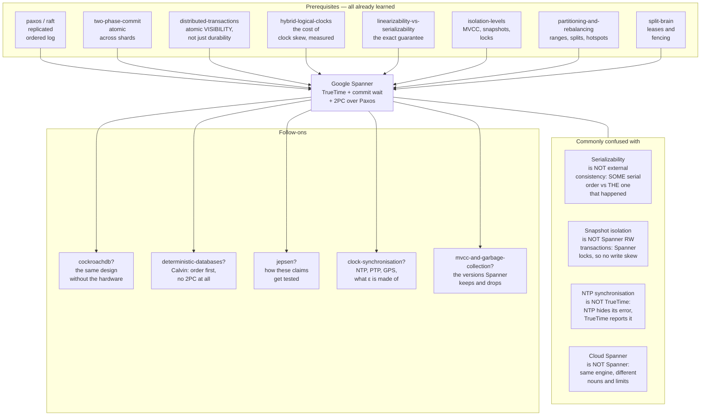

# Google Spanner — the database that bought a clock

> **Tell a friend:** Priya sells her house at the Northgate land registry and
> walks out with a receipt. She telephones her solicitor Dev, who is standing in
> the Southgate office, and he files the mortgage a moment later. The two offices
> stamp their documents from two wall clocks that disagree, so the register ends
> up claiming the mortgage came first. That is a loan against a house nobody had
> sold yet. Google's answer was not a more accurate clock. It was a clock that
> reports a *range* and admits how wrong it might be, plus a clerk who sits on
> the receipt until that range has crawled past the number she stamped. The
> deliberate pause is the whole invention, and its length is the price of the
> guarantee.

The trainer for this lab is [`visualization.html`](visualization.html), also
published as [The Honest Clock](https://claude.ai/code/artifact/10030776-7351-463a-b99a-0209680dc341).
Nothing to install, no code to run. What the lab is made of, where its numbers
come from and where it sits among your other labs are in
[section 17](#17-about-this-lab) at the end.

---

## 1. Why does a database in five countries have to buy a clock?

> **In one breath:** You want one database spread over several countries, and you
> want your code to pretend it is one machine doing one thing at a time. Those
> two wishes fight. The referee everyone reaches for is the clock, and the clock
> cannot be trusted.

You want one database that runs on machines in several countries. Then a burning
datacenter does not lose your data. And a user in Singapore does not sit waiting
on a disk in Iowa.

You also want your application code to pretend it is talking to a single machine
that does one thing at a time.

Those two wants fight. The moment the data lives in more than one place, "one
thing at a time" stops being a fact about the hardware. It becomes something you
have to *manufacture*.

And the usual way people manufacture it is very simple. Put a time on every
change, then sort by time. That quietly stops working, because the machines'
clocks disagree.

Here is what the disagreement costs, concretely. A payment is taken in London.
The service acknowledges it. HTTP 200 comes back, a receipt is emailed, the
customer's phone buzzes. A moment later a fraud check runs against a replica in
Frankfurt and reads the account *as it was before the payment*.

Read the three moments in order. The third one is the bug.

| Moment | Where | What happens | What the record says |
|---|---|---|---|
| Time zero | London | the payment is taken and acknowledged | the payment exists |
| **3 ms later** | Frankfurt | a fraud check reads the same account | the payment has not happened |
| Afterwards | everywhere | nothing corrects itself | both, forever |

Why did Frankfurt miss it? Not because the replica was slow. It *had* the data.
It missed the payment because the payment was labelled with a moment that the
fraud check's own clock had not reached yet.

The payment is real. The acknowledgement is real. The system's own record says it
has not happened.

That is the failure this lab is about. **Not lost data, not late data, but data
that is present, acknowledged, and invisible.** It produces the worst kind of
bug, the one where every log line is correct and the answer is still wrong.

To watch it happen slowly enough to fix, we move it somewhere you can see all of
it at once. A land registry with two offices, Northgate and Southgate, and a
clerk at each desk.

## 2. What goes wrong at the Northgate and Southgate registry?

> **In one breath:** Two offices of the same land registry stamp their documents
> from two wall clocks that disagree. A sale filed first gets a later stamp than
> the mortgage that followed it. Nobody lies, nobody crashes, and the register is
> permanently wrong.

There is a Land Registry with two offices. One is in Northgate, one in Southgate.
A registry does one job. It records who owns what, and *when* each change was
recorded.

Every document that comes in gets a rubber stamp with the date and time. The time
is taken from the clock on the office wall.

**Meera** is the clerk at Northgate. **Arjun** is the clerk at Southgate. They
never speak to each other. They have no reason to.

The register is read by sorting the stamps. **Asha** is a searcher. When she asks
*"who owned 14 Mill Lane at three o'clock on Tuesday?"*, the registry gathers
every stamped document for that address. It throws away the ones stamped after
three o'clock. It reads off the survivor.

That is the whole system, and it works beautifully in one office with one clock.

Now **Priya** files a deed in Northgate. She is selling 14 Mill Lane to **Omar**.
Meera stamps it, files it, and hands Priya a receipt.

The receipt is the important part. It means the registry has publicly committed.

Priya walks out and telephones her solicitor. **Dev** is standing in the
Southgate office. She tells him: *"Done. It's filed."*

Only now does Dev file the follow-up document. It is a mortgage against the
property, in Omar's name. Arjun stamps it and files it.

Two documents. The second one was not even *started* until the first was finished
and announced. Any human would say the order is obvious.

But the Northgate wall clock is four minutes fast, and the Southgate wall clock
is three minutes slow. So the deed is stamped **10:04** and the mortgage is
stamped **9:57**.

Here are the two documents side by side. The column that matters is the last one.

| Document | Filed by | Real moment | Stamp it got | Why the stamp lies |
|---|---|---|---|---|
| The deed, selling to Omar | Priya, with Meera at Northgate | 10:00 | **10:04** | the Northgate clock runs four minutes fast |
| The mortgage in Omar's name | Dev, with Arjun at Southgate | just after 10:00 | **9:57** | the Southgate clock runs three minutes slow |

Now Asha asks the perfectly ordinary question: *"What did the record show at
10:00?"* The registry throws away everything stamped after 10:00. That throws
away the sale and keeps the mortgage. It answers: **there is a mortgage in Omar's
name against a property Priya still owns.**

Nobody lied. Nobody crashed. No message was lost. Both clerks followed the rules
exactly. The register is simply, permanently wrong, and the reason is that *the
two clocks were never the same clock.*

**Ben** is the registry's duty supervisor. He is the one who gets telephoned when
this happens, and he will be with us all the way to section 13.

> **🔮 Predict:** The obvious response is "so synchronise the clocks properly."
> Suppose you install the best network time synchronisation money can buy and get
> both offices to within a few milliseconds of true time. Does the problem go
> away, shrink, or change shape?
>
> <details><summary>Reveal</summary>
>
> It **shrinks and changes shape**, which is worse than either on its own. It
> shrinks, because the window in which Meera and Arjun can disagree drops from
> minutes to milliseconds. It changes shape, because the bug now appears only
> when two related events happen within a few milliseconds of each other.
>
> In a system doing ten thousand operations a second, that is *constantly*. In
> your test environment it is *never*. You have converted a bug that reproduces
> into a bug that does not.
>
> If you guessed "it goes away", you are assuming that a small error is the same
> as no error. Your [hybrid-logical-clocks](../31-hybrid-logical-clocks/) lab
> already caught this exact trap from the other direction. At clock skew of 2 ms
> or less, the wall clock produced **zero** visible anomalies. At skew of 8 ms it
> produced **65 inversions**. Same code, same rules, different weather.
>
> </details>

**How far this lab goes.** Stop at any layer and you still have something whole.

| Layer | Sections | After it you can… |
|---|---|---|
| Beginner | 1–9 | tell the registry story and say why all three obvious fixes fail |
| Intermediate | 10 | trace the protocol, refinement by refinement, with real numbers |
| Engineering | 11–12 | reason about nine failures and say which guarantee each one bends |
| Production | 13 | operate it, design a schema, and read the dashboard Ben watches |

## 3. What are the three obvious fixes?

> **In one breath:** Hand the registry story to a competent engineer and you get
> one of three designs back. Each one is a real, shipped system. Two of them you
> have already built yourself.

### Fix A: what if one clerk stamps everything?

Put a single stamping desk somewhere. Make every office, in every country,
telephone that desk to get a number. Meera and Arjun stop using their wall clocks
entirely. One clock, one sequence, no disagreement possible.

This is real. Engineers call the single stamping desk a **timestamp oracle**, and
it is the design you built in the
[distributed-transactions](../46-distributed-transactions/) lab under the name
Percolator. TiDB ships it in production, with the oracle itself replicated by
Raft and handing out timestamps in batches.

### Fix B: what if the clocks may disagree, but the order may not?

Never trust a clock to order two events. Instead attach a counter to every
document. The counter is forced upward every time a message arrives, so an effect
always carries a bigger number than its cause.

Engineers call that a **hybrid logical clock**, and you built one. Each stamp is
a pair. The first half is a real wall-clock reading. The second half is a counter
of the events the wall reading cannot separate. Written down, the pair is
`(l, c)`: `l` is the wall reading, `c` is the counter.

CockroachDB, YugabyteDB and MongoDB all ship a version of it.

### Fix C: what if you lock the searchers out?

Do not timestamp anything at all. Make Asha take a lock before she may read, so
she simply cannot look at the register while a filing is half-done.

Engineers call this distributed strict two-phase locking, and you put numbers on
it in the [distributed-transactions](../46-distributed-transactions/) lab too.

## 4. Where does each of the three fixes break?

> **In one breath:** The locking one breaks first and hardest. The single desk
> breaks on the speed of light. The clever counter breaks on a telephone call,
> which is the one path through the world that no database can see.

### Why does Fix C break first, and worst?

You already put numbers on this one. Strict two-phase locking across shards is
*correct*. It gives serializable, correctly ordered results. It also makes every
Asha queue behind every Priya, and it inherits two-phase commit's blocking
problem.

Your own lab's crash storm is the argument, in one row.

| Design under a crash storm | Readers stranded forever | What that means for Asha |
|---|---|---|
| Distributed strict two-phase locking | **281** | she waits on a lock held by a dead machine, with no timeout that is safe |
| Timestamp-based (the family Spanner is in) | **0** | she reads a past moment and never takes a lock at all |

A global read of a global database, blocking on a lock held by a coordinator in
another continent that has just died, is not a system you can operate. So the
interesting fight is between Fix A and Fix B.

### Why does Fix A break on geography, and on liveness?

The single stamping desk is in one building. Every write in Sydney now costs a
round trip to that building before it can even begin.

If the desk is in Iowa, that is roughly **180 milliseconds** of pure waiting, on
every transaction, forever. You cannot fix it by adding machines, because the
whole point is that there is exactly one of them.

It is also a single point of failure for *the entire planet's* write path. You
can replicate it, and TiDB does, using Raft. But replication makes the desk more
reliable, not closer. The oracle's problem is not reliability. It is that **the
speed of light is not negotiable and there is only one desk.**

### Why does Fix B break in a way you can already quote?

This is the important one, because Fix B looks like it wins.

A hybrid logical clock guarantees that if event X *caused* event Y, then X's
stamp is smaller. That is genuinely enough for a huge class of systems.

Now look again at the registry story. **Priya's telephone call to Dev is not a
message the database can see.** There is no path *through the system* from the
Northgate filing to the Southgate filing. The information travelled through a
human being and a telephone line.

Your [hybrid-logical-clocks](../31-hybrid-logical-clocks/) lab hit exactly this
case and called it "no external consistency for strangers". *External
consistency* is the property section 5 defines properly. For now, read it as:
*the order the database records is the order that really happened.*

A fast-clock writer, a slow-clock reader, no causal path between them, and the
result was **86 out of 86 reads stale**. Not most. All of them.

That lab also showed the fix is not free. Somebody has to pay for how wrong the
clocks might be, and you get to choose who. Read the third row twice, because it
is this lab.

| Who pays | In the registry | How they pay | Who ships it |
|---|---|---|---|
| The **client** | Priya carries a note from Meera to Dev | a causality token travels from write to read | MongoDB `clusterTime` / `afterClusterTime` |
| The **reader** | Asha is told to come back and ask again | the read retries when its snapshot lands in the doubtful window | CockroachDB uncertainty restarts |
| The **writer** | Meera holds the receipt back for a moment | the write waits before admitting it happened | **Spanner commit wait — this lab** |

> **🔮 Predict:** Charging the writer sounds like the *worst* of the three. Writes
> are already the expensive path. Why would anyone choose it?
>
> <details><summary>Reveal</summary>
>
> Three reasons, and all three are about what the other two options do to *reads*.
>
> **Reads become free.** If Meera has already guaranteed that her stamp is in
> everyone's past, then Asha needs no locks, no retries, no note carried from
> Priya, and no conversation with a clerk in another continent. She reads the
> register as of a moment, at whichever office is nearest.
>
> The paper's own microbenchmarks put numbers on how lopsided that is.
>
> | Operation | Latency | Throughput at 1, 3 and 5 replicas |
> |---|---|---|
> | A write | **14.4 ms** | falls from **4.1** to **2.8** K ops/sec |
> | A snapshot read, meaning a lock-free read at an agreed past moment | **1.3 ms** | rises **13.5 → 38.5 → 50.0** K ops/sec |
>
> **The cost is bounded and known**, not statistical. A reader-pays design has a
> retry rate that depends on load and skew. A writer-pays design adds a fixed,
> predictable amount to every write.
>
> **You can buy the cost down with hardware.** Meera's wait is proportional to how
> wrong her clock might be. That is a number you can shrink by spending money on
> clocks, which is exactly what Google did, and what nobody else could do in
> 2012.
>
> If you guessed "nobody would, it is obviously worse", you were pricing the
> write and forgetting that most workloads are mostly reads.
>
> </details>

## 5. What exactly must the registry guarantee?

> **In one breath:** If the registry finished one document and told somebody so,
> and only then did anyone start a second one, the first must carry the smaller
> stamp. That has to hold even when the news travelled by telephone.

Strip the story back to one sentence with no jargon in it.

> **If the registry finished document A and told somebody so, and only afterwards
> did anyone start document B, then A's stamp must be smaller than B's stamp.
> That holds no matter which office each was filed in, and no matter how the news
> travelled.**

Read the last clause again, because it is the whole difficulty. *No matter how
the news travelled.*

Through the network. Through Priya's telephone call to Dev. Through a customer
refreshing a page on a second device. Through a message queue. Through a human
walking down a corridor.

The database cannot see any of those paths. So it cannot rely on seeing them.

The only thing common to every possible path is that **time passed**. Dev started
after Priya finished, in real, physical, wall-clock time.

So if the guarantee is going to hold for paths the database cannot see, the
stamps must be anchored to something the database also cannot see directly:
actual physical time.

That is the requirement. Everything in the rest of this lab is the pursuit of it.

You have met this guarantee before under two other names. Same property, three
labs, three vocabularies.

| Lab | What it called this property | Applied to |
|---|---|---|
| [linearizability](../26-linearizability/) | the *real-time rule* | single operations |
| [linearizability-vs-serializability](../27-linearizability-vs-serializability/) | *strict serializability* | whole transactions |
| This lab, and Spanner's papers | **external consistency** | whole transactions |

We will use Spanner's name, **external consistency**, because it is the name you
will meet in the documentation and in the paper.

## 6. What is the key idea, in two sentences?

> **In one breath:** Build a clock that admits how wrong it might be, then make
> the clerk wait out her own admission before handing over the receipt. Nobody's
> clock got more accurate. The trick is entirely in the honesty and in the
> waiting.

Two sentences. Read them slowly; the whole lab is inside them.

> **Sentence one: build a clock that admits it might be wrong.** Instead of
> returning a number, it returns a *pair* of numbers, an earliest and a latest,
> and it promises that the true instant lies somewhere between them. It never
> returns "it is 10:04:00.000". It returns "it is somewhere between
> 10:03:59.996 and 10:04:00.004, and I promise it is in there."
>
> **Sentence two: stamp with the latest end, then refuse to admit the change
> happened until your own clock's earliest end has moved past that stamp.** By
> the time anyone in the world hears that the change is done, its stamp is
> provably in the past, for every machine, everywhere.

That is Spanner. Everything else is engineering.

Notice what did *not* happen. Nobody's clock got more accurate. Meera's clock is
exactly as good as it was; she has simply stopped pretending she knows the time
to the millisecond.

And notice the consequence, because it drives every hardware decision Google made
afterwards. **The width of that band is, literally, the latency of every write.**

Work it through. A clock that admits it might be wrong by 100 ms would make every
write cost 200 ms. The stamp is taken from one edge of the band, and the wait
runs all the way to the other edge.

So Google put GPS receivers and atomic clocks in every datacenter. Not to make
time *correct*, but to make the *admission of error* small enough to sleep off.

> **Say it back.** Without using the words *timestamp*, *interval* or
> *consistency*, explain to a friend why Meera holding the receipt back for a
> moment fixes a problem that a better wall clock does not.
> <details><summary>A good answer sounds like</summary>
> "Meera writes the latest time her clock could possibly mean, which is a little
> bit into the future. Then she waits until even the earliest reading on her own
> clock has gone past it. After that she can hand the receipt over, because that
> moment is now behind every clock in the country, not just hers. Anyone who
> hears about the sale afterwards is guaranteed to write down a bigger number."
> </details>
>
> Next: the professional names for everything you have just watched happen.

## 7. What are these things called, now that you have earned the words?

> **In one breath:** Nine load-bearing terms. Every one of them names something
> you have already watched happen to Priya, Meera, Arjun, Dev or Asha. The words
> come last, on purpose.

### What is external consistency?

In plain words: if the system told you an operation was done before you started
another one, the system's own record must agree that yours came second.

Meera handed Priya a receipt. Dev started the mortgage after that. The register
must therefore say the deed came first. When it says 10:04 and 9:57, it is
telling you an order that did not happen.

Stated precisely, this is how the Spanner paper states it as an invariant.
Suppose the commit of transaction T₁ happens, in absolute physical time, before
the start of T₂. Then the commit timestamp of T₁ is smaller than the commit
timestamp of T₂.

Why does the word *external* appear at all? To name the part of the guarantee
that lives *outside* the database.

Serializability says the transactions are equivalent to *some* serial order.
External consistency says they are equivalent to *the specific* serial order that
a person standing outside the system with a stopwatch would have observed.

The difference only shows up when information leaves the system and comes back. A
telephone call. A second device. A message queue. That is exactly why the word is
*external*.

Hold on to this, because it is the sharpest fact in the lab. The deed at 10:04
and the mortgage at 9:57 **satisfy serializability**. There is a serial order,
mortgage then deed, and the register is a faithful record of it. They violate
external consistency, because that order is not the one that happened.

It is the same property your
[linearizability-vs-serializability](../27-linearizability-vs-serializability/)
lab called **strict serializability**. Spanner's papers say "external
consistency". Jepsen and the academic literature say "strict serializability".
Google Cloud's documentation uses both. One property, three names.

### What is TrueTime, and why does it hand you two numbers?

TrueTime is Google's clock service. It is the banded wall clock from the story,
built for real: it reports the time as a range instead of an instant.

It is an interface with three calls, and the second two are only conveniences
over the first.

| The call | In words | What comes back |
|---|---|---|
| `TT.now()` | "what time is it, and how sure are you?" | a `TTinterval`, written `[earliest, latest]`, guaranteed to contain the absolute time at which you called |
| `TT.after(t)` | "has moment `t` **definitely** gone past?" | true or false |
| `TT.before(t)` | "has moment `t` **definitely** not arrived?" | true or false |

Why does the term exist at all? Because every other clock API in computing hands
you a single number, and by doing so hides the one fact you needed.
`System.currentTimeMillis()` is confident and unaccountable. It has no way to
tell you it might be six milliseconds out.

TrueTime's whole contribution is that it makes the uncertainty a *value in your
program*, one you can branch on.

A worked example. At absolute time 100.000 ms, on a machine whose clock is 2 ms
fast and whose error bound is 4 ms, `TT.now()` returns `[99.998, 100.006]`. The
true instant, 100.000, is inside that pair. **That containment is the only
promise TrueTime makes.** It does not claim the midpoint is right. It does not
claim the machine is accurate. It claims the truth is in the box.

This is the `l` half of the hybrid logical clock you built in
[hybrid-logical-clocks](../31-hybrid-logical-clocks/), the real wall reading that
is never incremented, with one addition. TrueTime also reports how much you
should distrust it.

### What is ε, and why is it the price list?

Start with the thing in the story. The band on Meera's wall clock has a width.
Half that width is the number we care about.

Say it in words before you meet the symbol: **half the width of the band is how
wrong this clock might be, right now, at worst.**

Engineers write that number **ε**, said "epsilon". So ε, half the width of the
band, is `ε = (latest − earliest) / 2`.

One thing ε is not: a measurement of the actual error. It is a *bound* that the
clock daemon is prepared to guarantee. It is derived conservatively from four
ingredients, and the paper gives production figures for the ones that move.

| Ingredient of ε | In words | The paper's production figure |
|---|---|---|
| Worst-case drift of the local oscillator | how fast the crystal can wander | **200 µs per second** |
| Time since the last synchronisation | how long the wander has had to accumulate | a poll every **30 s** |
| Uncertainty of the time source itself | how sure the GPS or atomic master is | folded into the ~1 ms below |
| Network delay to the time master | how stale the answer was on arrival | about **1 ms** |

Put those together and ε is a *sawtooth*. Right after a machine polls a time
master, ε is small. It then climbs steadily until the next poll.

Do the arithmetic yourself. Thirty seconds at 200 µs per second is 30 × 200 µs =
**6 ms** of accumulated doubt between polls. Add roughly **1 ms** for the network
delay to the master, and the sawtooth runs from **about 1 ms to about 7 ms**,
averaging **about 4 ms**.

Why does the term earn its own name? Because it is the price list. Almost every
latency number in Spanner is written in units of ε.

You have met this quantity before under another name. It is the *max-offset*, or
*uncertainty interval*, of your
[hybrid-logical-clocks](../31-hybrid-logical-clocks/) lab. CockroachDB's default
for it is **500 ms**, which is the same quantity two orders of magnitude larger.
That single fact is why CockroachDB cannot afford to wait it off, and bills
readers instead.

### What is commit wait?

In plain words: after deciding a change is committed, deliberately doing nothing
for a few milliseconds before telling anybody.

In the story it is Meera putting the receipt face down on the desk and watching
the clock. She has stamped the document with the late edge of her band. She waits
until the early edge of her band has crawled past that stamp. Only then does she
hand the receipt over.

The engineer's version, in words first: having chosen the commit timestamp, the
coordinator blocks until its own clock's earliest end has passed that stamp, and
only then releases locks and answers the client.

The same sentence with the symbols in it: having chosen commit timestamp `s`, the
coordinator blocks until `TT.after(s)` is true, then releases locks and returns.
Since `s` was itself chosen as some `TT.now().latest`, the expected wait is about
**2ε**, which is the full width of the band.

Why does the moment deserve a name? Because it is where the design pays for its
honesty. It is the only place in the entire system where a machine is
deliberately idle for the sake of correctness.

Follow one wait all the way through, with ε at 7 ms.

| Step | The number | What it means |
|---|---|---|
| The clock is asked, at true time 100.000 | `[99.993, 100.007]` | the band is 14 ms wide, so ε is 7 ms |
| The stamp is chosen from the late edge | 100.007 | the most pessimistic reading available |
| The early edge reaches the stamp | absolute **100.014** | the earliest end always trails true time by 7 ms |
| The client is told "committed" | **100.014** | 14 ms of waiting, which is 2 × 7 |

What does that cost in a real datacenter? The paper's Table 3 answers it by
running the same write twice.

| The same write | Latency | What the difference is |
|---|---|---|
| Commit wait switched off | **9.4 ms** | the honest work: locks, Paxos, logging |
| Commit wait switched on | **14.4 ms** | that work plus the deliberate pause |
| The difference | **about 5 ms** | less than 2ε̄, because the pause overlaps the Paxos round trip that was happening anyway |

That last row is worth a second look. The wait is cheaper than the arithmetic
suggests, because the machine was already waiting for Paxos.

### What is a Paxos group here, and why does it never telephone another one?

In plain words: the handful of machines, in different places, that hold copies of
one slice of the data and vote on changes to it. Meera is one of them. So is
Arjun.

Technically, a Paxos group is a replicated state machine over one *tablet*, which
is one contiguous range of the key space, with one long-lived leader. Writes go
through the leader. Reads may be served by any replica that is sufficiently up to
date.

You already built this in [paxos](../39-paxos/) and [raft](../40-raft/), and this
lab uses it as a black box. So why does it get a fresh entry here?

Because a Spanner database is thousands or millions of these groups, each
ordering only its own writes, with **no communication between groups at all**
unless a single transaction happens to touch two of them.

Sit with that. There is no central sequencer. The global order is not produced by
any single thing. **It emerges from the timestamps**, and nothing in the system
ever writes it down. That is the whole architectural bet.

### Who is the participant leader, and who is the coordinator leader?

When one transaction touches two slices of data, each slice's leader takes part.
One of them is elected to run the two-phase commit. Meera and Arjun both take
part; one of them runs the show.

Precisely: for a multi-group transaction the client picks one participant group
as coordinator. That group's Paxos leader becomes the **coordinator leader** and
runs two-phase commit over the other **participant leaders**.

Now the sentence that is the punchline of an earlier lab. **The coordinator's
transaction state is written through its own Paxos group, so it is replicated.**

Your [two-phase-commit](../45-two-phase-commit/) lab's central complaint was that
a coordinator crash blocks every participant indefinitely, because the decision
lived only in the coordinator's memory. Here the decision lives in a Paxos log
held by a quorum.

A dead coordinator leader is replaced by another replica of the same group, which
reads the decision off the log and finishes the job. The composition "2PC over
Paxos" is the fix, and that one sentence is what makes it work.

### What is a leader lease, and what does disjointness forbid?

In plain words: a clerk holds the desk for a fixed stretch of time, and two
clerks of the same office can never hold overlapping stretches. Meera's shift
ends before the next clerk's begins, with no overlap at all.

Technically, a would-be leader collects timed lease votes from a quorum. The
lease defaults to **10 seconds**. The invariant Spanner depends on is that within
each Paxos group, **each leader's lease interval is disjoint from every other
leader's**.

There is one more rule, and it is the story's rule about tidying up before you go
home. Before abdicating, a leader must wait until `TT.after(s_max)`. In words:
until the highest stamp it ever handed out is definitely in the past. That
highest stamp is what `s_max` means.

Why does any of this exist? So that timestamps increase *across clerk changes*,
not merely within one clerk's shift. A leader may only assign timestamps inside
its own lease interval. Disjoint leases therefore give disjoint timestamp ranges,
in order, for free.

This is your [split-brain](../42-split-brain/) lab's lesson applied to *time*.
That lab concluded that you cannot stop a machine believing it is the leader; you
can only stop its effects counting. Here the effect that must not count is
*stamping a document with a time that belongs to the next clerk's shift.*

### What is safe time, and why does it have two halves?

In plain words: the newest moment a particular office is allowed to answer
questions about. "I can tell you the state as of any time up to here, and no
further."

When Asha asks Arjun about a moment, Arjun must be sure that nothing filed
elsewhere could still land before that moment. Safe time is his honest answer to
"how far forward can I speak?"

The engineers' name for it is `t_safe`, and it is the smaller of two numbers.

| The half | In words | Its value |
|---|---|---|
| `t_safe_paxos` | "the newest thing this office has actually filed" | the timestamp of the highest Paxos write this replica has applied |
| `t_safe_TM` | "the oldest thing still half-filed, minus a tick" | infinity when no transaction is prepared but undecided; otherwise `min(prepare timestamps) − 1` |
| `t_safe` | "the furthest forward I can honestly speak" | `min(t_safe_paxos, t_safe_TM)` |

A *prepare timestamp*, in that middle row, is the moment a participant proposes
when it promises it can commit. Section 10.4 works one through from scratch.

The rule that uses all this is one line. A replica may serve a read at timestamp
`t` only when `t ≤ t_safe`.

Why must it exist? Because a read at a moment is only correct if the replica has
*everything* up to that moment. Without the check, a lagging office would
cheerfully answer a question while omitting committed filings, which is the exact
bug from section 1.

Work the example, because the surprising part is the second half.

| The situation | The number | Why |
|---|---|---|
| Writes applied up to | 100.500 | so `t_safe_paxos = 100.500` |
| One prepared transaction, prepare timestamp | 100.300 | so `t_safe_TM = 100.299` |
| Safe time is the smaller of the two | **100.299** | `t_safe = min(t_safe_paxos, t_safe_TM)`, so `t_safe = 100.299` |
| A read at 100.400 | must wait | the prepared transaction might yet commit at **100.350** and land underneath it |

Read the last row again. The replica "has" everything up to 100.500 and still
cannot answer a question about 100.400. That is honesty about the future, not
about the past.

This is the *lock check* in your Percolator reader from the
[distributed-transactions](../46-distributed-transactions/) lab. Same problem, a
reader meeting an undecided writer, solved on the server side by waiting instead
of on the reader side by resolving.

### What is the difference between the three kinds of read?

Three different things, and Spanner keeps them strictly separate. This
distinction is the practical payoff of the whole design, so it is worth being
exact about it.

A **read-write transaction** is the expensive path. It takes locks, it goes to
leaders, it gets a commit timestamp, and it pays commit wait. It may abort, and
the client must be prepared to retry it. Deadlocks are avoided with a rule called
**wound-wait**, which section 11.8 tells as a story.

A **read-only transaction** takes no locks at all and blocks nobody. The system
assigns it a timestamp, and it then executes as a set of snapshot reads at that
timestamp. It is not "a transaction that happens to have only reads in it". It is
a genuinely different mechanism, and it is externally consistent.

A **snapshot read** is a read at a timestamp or staleness bound that the client
chose. It is also lock-free. The only difference from a read-only transaction is
*who picks the moment*.

| The path | Locks? | Who picks the moment | May abort? | Where it can run |
|---|---|---|---|---|
| Read-write transaction | yes, pessimistic | the coordinator, at commit | yes | leaders only |
| Read-only transaction | none | the system | no | any sufficiently current replica |
| Snapshot read | none | the client | no | any sufficiently current replica |

Why does the distinction exist? Because the expensive machinery, meaning locks
and commit wait and leaders, is needed only for writes.

Separating the read paths is what makes reads cheap, local, and endlessly
scalable. It is why Spanner can serve Asha a globally consistent answer from the
office in her own city.

## 8. Which two pictures should you carry, and where does the nice one lie?

> **In one breath:** One picture is the registry with two new pieces of
> furniture. The other is four objects and three invariants. Carry both, because
> the nice one hides exactly four things, and all four cost money.

### What changes about the furniture in the registry?

Same two offices, same rubber stamps, and two changes to what is on the wall and
what the clerk does.

The first change is the clock. It now has **two hands and a shaded band between
them**. Not one hand claiming to know the time. Two hands, and a promise from the
clock's manufacturer that the real time is somewhere inside the shaded band.

When the office has just checked its clock against the observatory, the band is
narrow. As the hours pass without checking, the clock widens its own band,
because it knows its mechanism drifts.

The second change is a new rule for Meera. Stamp the document with the *late*
edge of the band, which is the most pessimistic reading available. Then put the
receipt face down on the desk and wait, watching the clock, until the *early*
edge has moved past the number she stamped. Only then does the receipt leave her
hand.

The wait is the invention. After it, Meera can say something remarkable: *"the
moment printed on this document is now in the past. And it is in the past
according to every clock in the country, not just mine."*

Any document that anybody starts after receiving that receipt is guaranteed to
get a bigger number. Dev's mortgage included.

### Which four objects does the engineer's picture have?

Four objects, and the discipline is in keeping them separate.

**The data** is a multi-version key-value store, written `(key, timestamp) →
value`. Nothing is ever updated in place; a write adds a version. A read at
timestamp `t` returns, for each key, the newest version whose timestamp is at or
below `t`. This is ordinary MVCC, and you know it from
[isolation-levels](../08-isolation-levels/).

**The groups** come from cutting the key space into contiguous ranges. Each range
is replicated by its own Paxos group with its own leader. Groups do not talk to
each other. A group's leader holds a lock table for writes, and a transaction
manager for cross-group transactions.

**The clock** is a function from a machine to an interval containing the true
instant. Its width, 2ε, is the only global parameter in the system.

**The three invariants** are, together, the entire correctness argument.

| Invariant | In words | What it defends |
|---|---|---|
| Monotonicity | within a group, stamps only ever go up, including when the clerk changes | snapshot reads inside one group |
| Disjointness | within a group, two clerks' shifts never overlap, and a clerk stamps only inside her own shift | monotonicity, across leader changes |
| External consistency | if T₁ commits before T₂ starts in absolute time, then s₁ < s₂ | the order Priya, Dev and Asha actually lived through |

That third one is delivered by exactly two rules, and you have now seen both.
Pick the stamp as `s = TT.now().latest`, then commit-wait until `TT.after(s)`.

### How does the registry line up with Spanner?

Three tables, because the mapping falls into three kinds of thing. Read the last
column when you want to remember where you met it.

Places and people first.

| In the registry | In Spanner | Where you met it |
|---|---|---|
| An office | A zone, roughly a datacenter | section 2 |
| A clerk, such as Meera | A Paxos group leader | section 2 |
| The filing cabinet in one office | A tablet on Colossus, replicated by one Paxos group | section 7 |
| One cabinet drawer, a run of addresses | A *directory* or *split*, Spanner's words for a contiguous run of keys | section 13.1 |
| The clerk's shift, which cannot overlap the next clerk's | The Paxos leader lease, and disjointness | section 7 |

Then the paperwork.

| In the registry | In Spanner | Where you met it |
|---|---|---|
| The rubber stamp | The commit timestamp | section 2 |
| A stamped document | An MVCC version, `(key, timestamp) → value` | section 8 |
| Handing over the receipt | Acknowledging the commit to the client | section 2 |
| Asha asking "who owned this at 3 o'clock?" | A snapshot read at a timestamp | section 2 |
| A document half-filed between two offices | A prepared, uncommitted 2PC transaction | section 7 |

Then the clock and the waiting, which is what this lab is really about.

| In the registry | In Spanner | Where you met it |
|---|---|---|
| The banded wall clock | `TT.now()` returning `[earliest, latest]` | section 6 |
| The width of the band | 2ε | section 7 |
| Watching the early edge pass your stamp | `TT.after(s)`, which is commit wait | section 6 |
| Checking the clock against the observatory | The time-slave daemon polling GPS and atomic-clock time masters | section 7 |
| "I have everything filed up to here" | `t_safe` | section 7 |

### Where does the story lie to you?

Four places. Each one is something a real system needs that a registry does not.

#### Lie 1: is there really one book?

In the story you imagine a single register that everything is filed into, so the
order is maintained by the book itself.

In Spanner there is no book. There are millions of independent Paxos groups, each
ordering only its own writes, with no channel between them.

The single global order exists **only as a property of the numbers**, and nothing
in the system ever materialises it. Two transactions on opposite sides of the
world are ordered relative to each other by arithmetic that neither one
performed.

This is exactly why the timestamps have to be anchored to physical time. It is
the only shared reference the groups have, precisely *because* they never talk.

#### Lie 2: is Meera's pause really free?

A clerk pausing for a moment costs nothing. Commit wait sits in the critical path
of every write, and the paper puts it at about 5 ms.

Worse, it holds locks for the whole wait. So it also taxes every Asha queued
behind those locks.

The analogy makes the central trade-off feel weightless. It is not weightless. It
is the entire bill.

#### Lie 3: is the clock's honesty a fact?

The registry's clock manufacturer *promises* the true time is in the band. In
reality that promise is conditional.

It holds only while the machine's oscillator drifts no faster than the assumed
worst case of 200 µs per second. A machine whose crystal degrades past that can
return an interval that does *not* contain the true time. Then commit wait waits
for the wrong number, and external consistency breaks **silently**.

Spanner's answer is not "this cannot happen". It is defence in depth. Time
masters cross-check each other and evict themselves on divergence. Daemons poll
several masters and apply a variant of **Marzullo's algorithm** to reject liars.
Any machine whose frequency excursion exceeds the worst-case bound *removes
itself from the fleet*.

Your [hybrid-logical-clocks](../31-hybrid-logical-clocks/) lab made exactly this
point and put a number on it. One node running **60 ms** fast in a ±8 ms cluster
infected everyone downstream, and the cluster's bound went from **16** to **67**.
A clock bound is a promise about hardware, and it is only as good as the
hardware.

#### Lie 4: does anything in a registry abort?

A clerk never says "sorry, start again."

Spanner read-write transactions take locks and use wound-wait, so under
contention a transaction can be aborted and *must* be retried by the client.
Every Cloud Spanner client library ships a retry loop for this reason.
Application code that does not expect an abort is broken code, and the analogy
hides that completely.

## 9. Where can you break it yourself?

> **In one breath:** Open the simulator, turn commit wait off, and watch the
> register tell Asha a lie. Then turn it on and watch the shaded block that fixes
> it. Then drag ε and watch that block change length while the guarantee does
> not.

Open **`visualization.html`** in this folder, or the hosted copy,
[The Honest Clock](https://claude.ai/code/artifact/10030776-7351-463a-b99a-0209680dc341).

It is a simulator of the registry story with the real rules. Two Paxos groups
whose leaders sit in different regions, a true-time axis running left to right,
and a switch that turns commit wait on and off.

What to look at, in this order.

**1. The clock bands.** Each region's row shows its TrueTime interval as a
bracket around a marker. The thin vertical line running down the whole page is
*true absolute time*, which no machine in a real system can see. The simulator
shows it to you because you are outside the system, the way you were outside
Meera's office.

Watch how each bracket contains that line. That containment is the entire promise
of TrueTime, and scenario 4 breaks it deliberately so you can see what depends on
it.

**2. Scenario 1, "The receipt and the phone call."** This is the registry story
with commit wait **off**. Predict first, then run it.

Look at the two timestamp markers and at the verdict banner. The transaction that
started *later* in true time receives the *smaller* stamp, and the banner names
the reader who then sees the mortgage without the sale.

**3. Scenario 2, the same run with commit wait on.** The thing to watch is the
*shaded wait block* that appears after the commit timestamp and before the
acknowledgement.

Nothing is happening in that block. That is the point. Compare where the
acknowledgement lands in scenario 1 and in scenario 2. The difference is what
external consistency costs.

**4. The ε slider.** Drag it from 7 ms down to 1 ms with commit wait on. The
guarantee does not change. Only the length of the shaded block does.

This is the single most important thing to feel in the whole lab. **Google's
atomic clocks are not there to make time correct. They are there to make that
block short.**

**5. Scenario 5, "the blocked reader."** A cross-group transaction gets stuck
between prepare and commit. Watch a read that touches a completely unrelated key
wait anyway. Then watch `t_safe` in the replica's inspector to see which of its
two components is pinning it.

Click any node to open its inspector. It shows that node's clock interval, its ε,
its `s_max`, and both components of its safe time. Every event in the log is a
full sentence saying what happened and why it matters, with the protocol notation
on the second line.

> **🔮 Predict:** In scenario 2, with commit wait on, does the *deed* get a
> smaller stamp than it did in scenario 1, a bigger one, or the same one?
>
> <details><summary>Reveal</summary>
>
> **The same one.** Commit wait does not change the stamp at all. The stamp is
> still `TT.now().latest`, chosen at the same moment from the same band.
>
> What changes is *when Priya is told*. The number on the document is identical.
> The acknowledgement moves later by roughly the width of the band.
>
> If you guessed "smaller", you are imagining that waiting lets the clerk pick a
> more accurate value. It does not. Nothing in this design ever improves a
> reading. If you guessed "bigger", you are imagining the stamp is taken after
> the wait. It is taken before, and the wait exists to make it true.
>
> </details>

> **Say it back.** Asha loads scenario 1 and sees a mortgage against an unsold
> house. Without using the words *timestamp*, *skew* or *commit wait*, tell her
> why the register is lying, and what one change would stop it.
> <details><summary>A good answer sounds like</summary>
> "Meera wrote a moment on the deed that had not arrived yet by Arjun's clock,
> and then handed Priya the receipt straight away. Dev filed the mortgage using
> Arjun's clock, which was still behind that moment. If Meera had held the
> receipt until even the slowest possible reading of her own clock had passed the
> moment she wrote, Dev could not have got a smaller number."
> </details>

## 10. How is the mechanism built, one failure at a time?

> **In one breath:** We build the real protocol in six goes. Each go is the
> obvious design, then the trace where it breaks, then the one rule that closes
> it. Every odd-looking detail in Spanner arrives here as the scar of a failure
> you have just watched.

**Checkpoint — leaving the beginner model.** You can now say why Spanner exists,
what external consistency is, and what a clock that reports an interval buys you.

> **Say it back.** Without using the words *interval*, *bound* or *epsilon*,
> explain to a friend what is different about Meera's new wall clock, and why
> that difference is useful rather than embarrassing.
> <details><summary>A good answer sounds like</summary>
> "The old clock told her one time and she had no idea how wrong it was. The new
> one gives her two times and swears the real one is between them. That sounds
> worse, but it is the first clock she can actually reason with. She can now ask
> it a question it can answer honestly: has this moment definitely gone past?"
> </details>

Ground rules for this stage. Absolute time is written in milliseconds from an
arbitrary origin. The simulator uses these same numbers, so you can replay every
trace on the page.

Two Paxos groups. **G1**, whose leader is Meera in Northgate. **G2**, whose
leader is Arjun in Southgate.

And one deliberate cruelty, to make a single point unmissable. **Both clocks in
the first trace are perfectly accurate.** Their offset from true time is exactly
zero. They differ only in how wrong they are *prepared to admit they might be*.

### 10.1 What if you just stamp with the late edge of the band?

> **In one breath:** Take the most pessimistic reading your clock offers, use it
> as the stamp, replicate, and tell the client. It is the careful choice, and it
> still produces the registry bug.

Here is the first design a good engineer writes.

> When a transaction's writes are all locked and ready, ask the local clock for
> `TT.now()` and use its `latest` endpoint as the commit timestamp. Replicate
> through Paxos. Acknowledge to the client.

Why the late edge, rather than the early edge or the middle? Because the late
edge is the only endpoint guaranteed to be at or after the true instant.

A stamp that is *behind* true time is exactly what produced the registry bug in
section 2. So this design is already the careful one. It is not naive.

Now trace it. Meera has gone a long time without checking her clock against the
observatory, so her band is wide: ε is 7 ms. Arjun checked recently, so his band
is narrow: ε is 1 ms.

| Absolute time | What happens | The numbers |
|---|---|---|
| 100.000 | T₁, the deed, reaches Meera. She asks her clock. | `TT.now() = [93.000, 107.000]` → **s₁ = 107.000** |
| 100.000 → 102.000 | Paxos replicates the commit record. | applied at 102.000 |
| 102.000 | **Priya is told the deed is filed.** | ack |
| 103.000 | Priya telephones Dev. The news leaves the system entirely. | — |
| 104.000 | T₂, the mortgage, reaches Arjun. He asks his clock. | `TT.now() = [103.000, 105.000]` → **s₂ = 105.000** |

Read the two stamps. **s₂ = 105.000 is smaller than s₁ = 107.000.** The
transaction that began two milliseconds *after* the first one was acknowledged
carries a timestamp two milliseconds *smaller*.

And the damage is not abstract. Asha runs a read-only transaction at timestamp
**106.000**, which is an entirely ordinary "show me the current state" query.

It includes the mortgage, because 105.000 is at or below 106.000. It excludes the
deed, because 107.000 is above 106.000. She is told there is a mortgage against a
property that, by the same query, has not been sold.

> **🔮 Predict:** Both clocks in that trace were *perfectly accurate*. Neither was
> even a microsecond off. So where exactly did the error come from?
>
> <details><summary>Reveal</summary>
>
> From the **asymmetry of the honesty**.
>
> Meera rounded her answer up by 7 ms, because that is how much she was willing
> to be wrong by. Arjun rounded up by only 1 ms. The gap between the two
> admissions is **6 ms**, and that gap is the window in which the ordering can
> invert.
>
> It exists *even when both clocks are exactly right*.
>
> Sit with this, because it kills the intuition that better clocks alone would
> fix the problem. Perfect clocks with imperfect knowledge of their own
> perfection still produce the bug.
>
> If you guessed "Arjun's clock must have been slow", you have gone back to the
> section 2 story, where the clocks really were wrong. This is a different and
> nastier failure. What has to be fixed is not the clock. It is the fact that a
> stamp chosen from the pessimistic end has not yet arrived in everyone's past.
>
> </details>

### 10.2 What does commit wait actually fix?

> **In one breath:** If the stamp is still in the future for somebody, wait until
> it is in the past for everybody. The band tells you exactly when that is.

The fix follows directly from that reveal, and it is Meera's face-down receipt.

> **Rule (commit wait).** Having chosen commit timestamp `s`, do not release locks
> and do not acknowledge to the client until `TT.after(s)` is true. In words:
> until the local band's `earliest` endpoint has passed `s`.

Run the same trace again with the rule in place. Watch the third row, which is
the only new one.

| Absolute time | What happens | The numbers |
|---|---|---|
| 100.000 | T₁ reaches Meera. | `[93.000, 107.000]` → **s₁ = 107.000** |
| 100.000 → 102.000 | Paxos replicates, in parallel with the wait below. | applied 102.000 |
| 100.000 → 114.000 | **Commit wait.** `earliest = absolute − 7`, so `earliest > 107.000` first holds at absolute 114.000. | 14 ms = 2ε, of which 2 ms overlapped Paxos |
| 114.000 | Priya is told the deed is filed. | ack, 12 ms later than before |
| 115.000 | Priya telephones Dev. | — |
| 116.000 | T₂ reaches Arjun. | `[115.000, 117.000]` → **s₂ = 117.000** |

Now **s₁ = 107.000 is smaller than s₂ = 117.000**, which is the order that
actually happened.

And it is not luck. Here is the paper's proof. It is four lines, and it is worth
memorising, because each line tells you which rule is defending it.

```
  s₁ < t_abs(commit₁)          because of commit wait
  t_abs(commit₁) < t_abs(start₂)   by assumption — T₂ started after T₁ finished
  t_abs(start₂) ≤ t_abs(server₂)   because the request cannot arrive before it is sent
  t_abs(server₂) ≤ s₂          because s₂ was chosen as TT.now().latest at the server
  ────────────────────────────
  s₁ < s₂
```

The same four lines in the registry's words, because the symbols are doing very
little work here.

| Line | In words | What holds it up |
|---|---|---|
| 1 | The deed's stamp is already in the past when Priya gets her receipt. | commit wait |
| 2 | Dev started the mortgage after Priya got the receipt. | assumption — this is the case we care about |
| 3 | Arjun cannot receive the mortgage before Dev sends it. | physics |
| 4 | Arjun's stamp is at or after the moment he received it. | the "pick the late edge" rule |
| — | Therefore the deed's stamp is smaller than the mortgage's. | the two rules together |

**Two rules, and the guarantee is closed.** That includes news that travelled by
telephone, because line 2 says nothing at all about *how* Dev learned that Priya
had finished.

### 10.3 Now make reads cheap. How does that break?

> **In one breath:** A read that takes no locks should be servable by the nearest
> office. Try it, and you rebuild the original bug on the read side.

Writes are correct now. Time for the payoff. A read-only transaction takes no
locks, so it ought to be servable by any replica, including the one in Asha's own
city.

> **Design v2.** Assign the read-only transaction a timestamp
> `s_read = TT.now().latest`. Send its reads to any replica. The replica returns,
> for each key, the newest version at or below `s_read`.

Trace the break. Asha issues a read-only transaction at absolute 120.000 from
Singapore. Its timestamp is assigned at a leader whose ε is 4 ms, so
`s_read = 124.000`. It goes to replica **R**, a Singapore replica of G1.

R has applied Paxos writes up to timestamp **107.000**. It has the deed. But
Meera has since committed two more writes, at 118.000 and 121.000, and the
network to Singapore is slow. R has not received them.

R does exactly what design v2 says. It returns the newest version at or below
124.000, which is the one at 107.000.

Asha asked for the state as of 124.000 and got the state as of 107.000, **with no
indication that anything was missing.**

We have rebuilt the original bug on the read side. The write path is now honest
and the read path is not.

> **🔮 Predict:** What is the minimum a replica needs to know in order to refuse
> that read honestly?
>
> <details><summary>Reveal</summary>
>
> It needs one number: **the newest timestamp for which it can promise it has
> everything.**
>
> Not "the newest thing I have". That is the trap, and it is what R used. The
> number it needs is the newest point below which nothing new can still arrive.
>
> Call it `t_safe`. The rule is that a replica may serve a read at `t` only if
> `t ≤ t_safe`. Otherwise it waits.
>
> If you guessed "the highest write it has applied", you have picked exactly the
> first of the two halves, and the next section is entirely about why one half is
> not enough.
>
> </details>

### 10.4 What is safe time, and why does it have two halves?

> **In one breath:** One half says how far this office has actually filed. The
> other says how far it dare speak while a document is half-filed between two
> offices. Safe time is the smaller of the two.

The first half is easy.

> **`t_safe_paxos`** is the timestamp of the highest Paxos write this replica has
> actually applied. Because timestamps within a group increase monotonically, and
> Paxos applies writes in order, nothing will ever arrive at or below this number
> again.

In the trace above, R's `t_safe_paxos` is 107.000 and Asha's read wants 124.000.
So R waits, until the writes at 118.000 and 121.000 arrive and something above
124.000 lands. Correct, and honest.

The second half comes from a failure you already know how to construct: two-phase
commit across two groups.

Transaction T₃ writes to both G1 and G2, which means both Meera and Arjun are
involved. Each participant leader acquires its write locks, chooses a **prepare
timestamp**, and logs a prepare record through its own Paxos group.

Say Meera's group prepares at **200.000** and Arjun's at **200.500**. The
coordinator leader will choose a commit timestamp `s₃ ≥` every prepare timestamp,
`≥ TT.now().latest`, and greater than any timestamp it has previously assigned.
Say **205.000**.

It has not decided yet. The transaction is *in flight*, which is the story's
document that is half-filed between two offices.

Now a read arrives at a G1 replica asking for timestamp **203.000**.

That replica's `t_safe_paxos` might be 204.000, because it has applied everything
G1 has committed. T₃ is prepared and undecided. If T₃ commits at 205.000 then it
is above 203.000 and irrelevant, **but Spanner cannot know that yet.**

The commit timestamp could legally have been anything from 200.500 upward. Until
the decision is made, the state of the keys T₃ touched is *indeterminate* for
every timestamp at or above G1's prepare timestamp.

> **`t_safe_TM`** is infinity when there are no prepared-but-uncommitted
> transactions. Otherwise it is `min(prepare timestamps at this group) − 1`. Here
> that is **199.999**.
>
> **`t_safe = min(t_safe_paxos, t_safe_TM)`**, which here is **199.999**.

So the read at 203.000 blocks. And here is the sting. *Every* read at 203.000
blocks, including reads of keys T₃ never touched, because safe time as defined so
far is one number for the whole group.

The paper calls those **false conflicts**, and fixes them by making safe time
fine-grained. The leader already keeps a lock table mapping key ranges to lock
state. It stores prepared-transaction timestamps per key range in that same
table, and an arriving read is checked only against the ranges it actually
touches.

This looks like an optimisation and is really a survivability requirement.
Without it, one slow cross-group transaction stalls every reader in its group.

### 10.5 What happens when the clerk's shift ends?

> **In one breath:** Everything so far assumed one clerk per office forever. Take
> that away and the stamps can go backwards, because the old clerk stamped
> several milliseconds into the future before she died.

Leader **L1** of G1 holds a lease and has handed out timestamps up to
`s_max = 210.000`. Remember that stamps are chosen from the *late* edge of the
band. So `s_max` can sit several milliseconds **ahead of true time**.

At absolute 205.000, L1's zone loses power. Meera's office goes dark mid-shift.

A quorum of the remaining replicas elects **L2**. L2's own clock says the time is
about 205, so under the section 10.1 rule it would assign the next transaction a
timestamp of about **205.007**. That is **below `s_max`**.

Monotonicity is dead. G1 has now stamped a later write with an earlier number
than an earlier write, and every snapshot read in the group is unsound.

> **The rules that close it.** A Paxos leader holds a **timed lease**, 10 seconds
> by default, granted by a quorum of lease votes. Spanner maintains the
> **disjointness invariant**: within a group, no two leaders' lease intervals
> overlap. A leader may only assign timestamps *inside its own lease interval*,
> and `s_max` is advanced to every timestamp it assigns. Before voluntarily
> abdicating, a leader must wait until `TT.after(s_max)`.

Trace the fix. L1's lease cannot have extended past its final timestamp
assignment in any way that lets L2's lease start early. L2's lease can only begin
after L1's has ended, and L1 could only assign timestamps within its own lease.

So every timestamp L2 assigns is inside a strictly later interval than every
timestamp L1 assigned. Monotonicity across clerks falls out of disjointness for
free.

Notice the shape of this argument. It is your [split-brain](../42-split-brain/)
lab's argument applied to *time*. That lab concluded that you cannot stop a
machine believing it is the leader. You can only stop its effects counting.

Here the effect that must not count is *stamping with a number from the next
clerk's shift*. The mechanism that stops it is an interval a machine may only act
inside, granted by a quorum. That is a fencing token whose values happen to be
timestamps.

And it costs, in exactly the way a ten-second shift handover costs. Because
leases are 10 seconds, killing a leader zone without warning leaves each group
unavailable until its lease expires.

| The paper's experiment | What happens to throughput | How long |
|---|---|---|
| Kill the leader zone with no notice | drops **almost to zero** | recovers over roughly **10 seconds** as leases expire |
| Kill it after a leadership handoff | a dip of **3–4%** | invisible on the graph |

The 10-second lease is a straight trade. Shorter leases mean faster failover and
much more lease-renewal traffic.

> **🔮 Predict:** Ben has a planned maintenance window and wants to reboot the
> whole Northgate zone. He has two ways to do it. Which one should he choose, and
> what is the difference worth?
>
> <details><summary>Reveal</summary>
>
> Drain leadership first, then reboot. The table above prices it: **3–4%** versus
> **ten seconds of nothing.**
>
> The two options are not "graceful" and "slightly less graceful". They are
> different by two orders of magnitude, and the whole difference is whether the
> lease was handed over or left to expire.
>
> If you guessed "it does not matter much, ten seconds is short", price it at
> twenty thousand writes per second. That is two hundred thousand failed
> operations, and it is why Cloud Spanner stages rolling operations rather than
> restarting zones.
>
> </details>

### 10.6 What about the drawer nobody ever writes to?

> **In one breath:** Safe time only moves when writes land. A group nobody writes
> to therefore has a safe time that never moves, and a read of it waits forever.

One more break, and it is delightfully unobvious.

Group G7 holds a reference table, the drawer of standard clause wordings that
gets updated once a month. A client issues a strong read-only transaction, which
picks `s_read = TT.now().latest` = 300.000.

G7's replicas have `t_safe_paxos` = 1.000, because the last write to G7 was ages
ago, and `t_safe_paxos` is *the timestamp of the highest applied write*.

`300.000 > 1.000`, so the read blocks. It blocks **forever**, or until somebody
happens to write to a table nobody writes to.

> **The rule that closes it (`MinNextTS`).** Each leader maintains a promise
> `MinNextTS(n)`: the minimum timestamp it may assign to the next Paxos write
> after sequence number `n`. A replica that has applied through `n` may advance
> `t_safe_paxos` to `MinNextTS(n) − 1`. The promise is safe across leader changes
> for the reason you just saw: promised timestamps lie inside the leader's lease,
> and leases are disjoint. **A leader advances `MinNextTS` every 8 seconds by
> default**, and slaves can also request an advance on demand.

The consequence is quotable, and it is the kind of thing that turns up in a
support ticket. *In the absence of prepared transactions, healthy replicas of an
idle Paxos group can serve reads at timestamps up to 8 seconds old in the worst
case.*

### 10.7 Is there a shortcut when the read stays in one office?

> **In one breath:** If the read touches only one group, its leader already knows
> a timestamp that is guaranteed correct and guaranteed not to wait. Use that
> instead of asking the clock.

For a read-only transaction whose scope is **a single Paxos group**, which is
most of them, Spanner does better than `TT.now().latest`.

The group's leader knows `LastTS()`, the timestamp of the last committed write in
that group. If there are no prepared transactions, assigning `s_read = LastTS()`
is *trivially* externally consistent. The read sees the last write, so it is
ordered after it, and there is nothing newer for it to miss.

Why is that strictly better? Because it is **smaller**. A smaller read timestamp
is already below `t_safe`, so it never waits.

It is the reason a single-group strong read in Spanner costs about a millisecond
rather than about 2ε.

For a multi-group scope, Spanner's shipped implementation takes the simple
option: `s_read = TT.now().latest`, which may wait for safe time to advance. The
paper describes the better option, a negotiation round with all the groups'
leaders based on their `LastTS()` values, and says they did not implement it.

### 10.8 What does the whole write path look like, end to end?

> **In one breath:** Eight steps. Six of them are the two-phase commit you
> already built. One is commit wait. The one that makes a coordinator crash
> survivable is the words "through Paxos" in steps 4 and 6.

With every refinement in place, here is the complete life of a cross-group
read-write transaction. Every step is one you have now seen a reason for.

1. The client opens the transaction and issues reads. These go to the **leader**
   of each group, which takes **read locks** and returns current data. Deadlocks
   are avoided by **wound-wait**: an older transaction wounds a younger one
   holding what it needs, and a younger one waits.
2. Writes are **buffered at the client**, and nothing is sent yet. This is why
   reads inside a Spanner read-write transaction do not see that transaction's
   own writes.
3. The client keeps the transaction alive with keepalives, then begins commit. It
   **chooses one participant group as coordinator** and sends each participant
   leader the buffered writes for its keys, plus the coordinator's identity.
   Having the client drive 2PC avoids sending the data twice across wide-area
   links.
4. Each **non-coordinator participant leader** acquires write locks, chooses a
   **prepare timestamp** greater than any timestamp it has previously assigned,
   logs a prepare record **through Paxos**, and tells the coordinator its prepare
   timestamp.
5. The **coordinator leader** acquires its own write locks, skips prepare, and
   chooses the commit timestamp `s`. That stamp is at least every participant's
   prepare timestamp, greater than `TT.now().latest` as of when it received the
   commit message, and greater than anything it has assigned before.
6. It logs a **commit record through Paxos**, or an abort record if it timed out
   waiting.
7. **Commit wait**: it blocks until `TT.after(s)`. This typically overlaps with
   the Paxos round trip in step 6.
8. It sends `s` to the client and to every participant leader. Each logs the
   outcome through its own Paxos group. All participants apply at the same
   timestamp and release locks.

Steps 1–2 and 4–6 are the two-phase commit you already built. Step 7 is the
entire subject of this lab. And the fact that steps 4 and 6 say "through Paxos"
is what makes a coordinator crash survivable rather than fatal.

What does it cost as the number of offices grows? The paper's Table 4 gives mean
commit latency by number of participant groups, over 3 zones. Read it downwards.

| Participant groups | Mean commit (ms) | 99th percentile (ms) |
|---|---|---|
| 1 | 17.0 | 75.0 |
| 2 | 24.5 | 87.6 |
| 5 | 31.5 | 104.5 |
| 10 | 30.0 | 95.6 |
| 25 | 35.5 | 100.4 |
| 50 | 42.7 | 93.7 |
| 100 | 71.4 | 131.2 |
| 200 | 150.5 | 320.3 |

Flat to about 50 participants, then it bends sharply.

The design rule that follows is **keep transactions inside one group whenever you
can**. That is the same conclusion your
[distributed-transactions](../46-distributed-transactions/) lab reached by a
different route, and it is why Spanner's data model has interleaved tables at
all.

### 10.9 What else does an honest clock make possible?

> **In one breath:** Schema changes across the whole database, atomically, with
> nothing blocking. It works only because every machine agrees what a future
> moment means.

One feature falls out of TrueTime that is worth seeing, because it shows the idea
being used for something other than commit ordering. **Atomic schema changes
across the whole database, without blocking.**

An ordinary transaction cannot do it. The participant count would be every group
in the database, potentially millions, and the table above tells you what that
costs.

Instead, a schema-change transaction is assigned a timestamp **in the future**,
registered during prepare. Reads and writes then synchronise against it. Any
operation whose timestamp is *before* `t` proceeds against the old schema. Any
operation whose timestamp is *after* `t` blocks until the schema change is in
place.

The paper's own remark is the one to remember. *Without TrueTime, defining the
schema change to happen at `t` would be meaningless*, because no set of machines
would agree on when `t` was.

**Checkpoint — leaving the intermediate model.** You can now trace the full write
path, say what each of the three invariants defends, and explain why a read might
block.

> **Say it back.** Without using the words *safe time*, `t_safe` or *prepare*,
> explain to Ben why a read of the standard-clause drawer, which nobody has
> touched in a month, could hang for eight seconds.
> <details><summary>A good answer sounds like</summary>
> "The office only knows it is up to date by looking at the newest thing it
> filed. If nothing has been filed for a month, the newest thing it filed is a
> month old, so it cannot honestly say anything about this morning. To fix that,
> the clerk periodically announces the earliest moment she could possibly stamp
> next, and the office can then speak up to just before that. She makes the
> announcement every eight seconds."
> </details>
>
> Next: nine ways the whole thing fails, and exactly which guarantee bends in
> each one.

## 11. What are the nine ways it fails, and what survives each one?

> **In one breath:** Nine failures, each a short story about Meera, Arjun, Asha
> or Ben. Each one says how to cause it, what breaks, what still holds, and what
> the person on call actually sees. One table at the end lines them all up.

### 11.1 What happens when the clock loses confidence?

Meera has not been able to check her clock against the observatory for a while,
so she widens her own band. Nothing is wrong. She is simply less sure than she
was.

To cause it, load simulator scenario 3, or drag the ε slider from 1 ms to 20 ms
with commit wait on. In production, take two time masters in a datacenter down
for maintenance. That is exactly what happened to Google on 13 April in the
paper's own monitoring data, and ε rose datacenter-wide for about an hour.

Commit wait is 2ε, so every write's acknowledgement is delayed in proportion.
Locks are held for the whole wait, so throughput falls for writers *and* for
every Asha queued behind those locks. Strong read-only transactions also pick
larger `s_read = TT.now().latest` values, so more of them wait on safe time.

The right response is nothing at all. The system is behaving correctly. It is
degrading in latency in exact proportion to how much it distrusts itself.

External consistency survives, fully and without qualification. What is lost is
write latency and throughput.

This is the reason a TrueTime-ε dashboard exists. When Ben sees a latency
incident with no CPU anomaly, no disk anomaly and no network anomaly, but a
raised ε, he is looking at a *time* incident. The paper names the two causes it
saw: time-master unavailability, and network-link congestion inflating the round
trip to the masters.

### 11.2 What if the clock lies?

This is the one that keeps people up at night, because it is the assumption
underneath every argument in this lab.

To cause it, load simulator scenario 4, which sets one region's true offset
*outside* its own ε and leaves commit wait on. In production it is a degrading
crystal oscillator, drifting faster than the assumed 200 µs per second.

Every argument in this lab rests on the true instant being inside
`[earliest, latest]`. If it is not, then `TT.after(s)` returns true while `s` is
still in the future for other machines. Commit wait waits for the wrong number,
and **external consistency breaks with no error, no log line and no symptom**,
other than Asha occasionally seeing an impossible state.

Run scenario 4 and watch the verdict banner go red *with commit wait switched
on*. That is the entire point of the scenario.

Spanner's response is defence in depth, and none of it is a proof. Time masters
compare against each other and evict themselves on divergence. Each daemon polls
several masters, some nearby, some far, some GPS and some atomic, and applies a
variant of **Marzullo's algorithm** to discard liars. Any machine whose frequency
excursion exceeds the worst case derived from component specs and operating
environment is evicted from the fleet.

The paper's argument for why this is acceptable is empirical, not formal. *Bad
CPUs are 6 times more likely than bad clocks.* So TrueTime is as trustworthy as
any other component Spanner already depends on.

In principle nothing survives here. This is the assumption the whole design
stands on, and what is lost is external consistency, silently.

This is why CockroachDB nodes **commit suicide** when they detect their offset
exceeds `max-offset`, and why MongoDB **signs** `clusterTime`. Your
[hybrid-logical-clocks](../31-hybrid-logical-clocks/) lab traced the infection
path: one node 60 ms fast in a ±8 ms cluster dragged the whole cluster's bound
from 16 to 67, and it never came back down.

### 11.3 What if Meera's whole office loses power?

To cause it, load simulator scenario 6. In production it is the paper's
"leader-hard" experiment: kill all servers in the leader zone with no notice.

Each group's leader lease has to expire before a new leader can be elected,
because disjointness forbids overlapping lease intervals. Leases are 10 seconds,
and expiry times are spread across that window, so groups recover staggered over
roughly 10 seconds.

| How the zone is killed | Completion rate | Recovery |
|---|---|---|
| No notice, the "leader-hard" case | drops **almost to 0** | about **10 seconds**, as leases expire |
| After a graceful handoff, "leader-soft" | a dip of **3–4%** | invisible on the graph |

External consistency, monotonicity, durability and every committed write all
survive. What is lost is availability of that group's writes, and of strong reads
that need the leader for timestamp assignment, for up to a lease.

Ben's rule follows directly. Planned maintenance must drain leadership first. The
difference between a 3% dip and a ten-second outage is entirely whether the
handoff happened. In Cloud Spanner this is why leader region placement is a
configuration decision, and why rolling operations are staged.

### 11.4 What if the coordinator dies mid-two-phase-commit?

To cause it, load simulator scenario 5 and kill the coordinator between prepare
and commit.

In the classic protocol from your [two-phase-commit](../45-two-phase-commit/)
lab, the participants are stuck. They have promised to be able to commit, they
cannot unilaterally decide, and the only machine that knows the answer is gone.

In Spanner the coordinator's transaction state was logged **through its own Paxos
group**, so a quorum of replicas holds it. A new coordinator leader is elected in
that group, after lease expiry, and reads the decision off the log.

Atomicity, durability and external consistency all survive. What is lost is
availability of the affected key ranges. Every participant holds its locks and
pins `t_safe_TM` for as long as the decision is missing, so conflicting readers
*and writers* wait.

For Ben, the blocking window is bounded by lease expiry rather than unbounded.
That is the difference between an incident and a page at 3 a.m.

This is precisely what your
[distributed-transactions](../46-distributed-transactions/) lab meant by "running
two-phase commit over Paxos mitigates the availability problems". It is a
*different* fix from Percolator's, which deletes the blocking by moving the
commit point into the data rather than by replicating the coordinator.

### 11.5 Why does one half-filed document stall readers who never touch it?

To cause it, load simulator scenario 5, start a cross-group transaction, pause it
after prepare, and then issue a read at "now" against an unrelated key in the
same group.

As first defined, `t_safe_TM = min(prepare timestamps) − 1` is one number for the
entire group. So a single undecided transaction freezes the group's readable
horizon. Asha's read waits even though it can never conflict with anything.

The response is the fine-grained refinement from section 10.4: prepared
timestamps stored per key range in the lock table, and reads checked only against
the ranges they actually touch.

Correctness of every read that does return survives. What is lost is read latency
for a potentially unrelated population of readers.

This one is genuinely confusing the first time Ben sees it. Long-running or stuck
cross-group transactions show up as *read* latency, not write latency. Cloud
Spanner's lock statistics tables exist for exactly this.

### 11.6 What if a replica falls behind and Asha wants "now"?

To cause it, load simulator scenario 7, slow the network to one replica, then
issue a strong read there.

The read timestamp `s_read` is close to now. The replica's `t_safe_paxos` is the
highest write it has applied. It must wait for the gap to close.

Note the special case from section 10.6. If the group is *idle*, the gap closes
only when `MinNextTS` advances, which is every 8 seconds by default.

Consistency survives. The read never returns a partial or stale answer. What is
lost is latency, converted from staleness, and this is the trade made explicit.

The production response is exactly what **stale reads** are for. Ask for bounded
staleness instead of a strong read, and Spanner picks the newest timestamp within
your window that the closest replica can serve without blocking. Google's
guidance is blunt about the size of the window: use **at least 10 seconds** of
staleness, or you will not get a benefit.

For Ben, a latency spike on reads in one region with normal write latency
globally is replica lag, not load.

### 11.7 What is a hot split, and why is it the commonest incident?

To cause it, make the first column of a table's primary key a timestamp, or an
auto-incrementing integer, and write to it at volume.

Spanner assigns work in units of **splits**, which are contiguous key ranges, and
every split has one leader. A monotonically increasing first key component means
every new row lands at the end of the last split.

So every insert in the system is serialised through one Paxos group's leader, on
one machine. It is as if the whole country had to queue at Meera's desk. Adding
nodes does nothing at all.

This is not a Spanner quirk. It is the same range-partitioning hotspot you
analysed in
[partitioning-and-rebalancing](../36-partitioning-and-rebalancing/). Spanner is
*more* exposed to it than a hash-partitioned store, because it deliberately keeps
keys in sorted order so that range scans and interleaved tables work.

> **🔮 Predict:** Ben's instance is at 12% CPU across every node and inserts are
> queueing. He doubles the node count. What happens to insert throughput?
>
> <details><summary>Reveal</summary>
>
> **Nothing.** It does not improve at all, and the bill doubles.
>
> Every insert is going to the same split, and a split has exactly one leader.
> The other nodes have nothing to do, which is why the average CPU was 12% in the
> first place.
>
> If you guessed "it roughly doubles", you were reasoning about a system where
> work spreads by itself. Range partitioning spreads work by *key*, and a
> monotonic key is a key that does not spread.
>
> Spanner does do **load-based splitting**, which splits a range that is hot even
> if it is small. But it cannot split a single key, and it cannot split away the
> fact that the newest key is always at the end.
>
> </details>

The documented fixes, in rough order of preference, all do the same thing: they
stop consecutive writes landing next to each other.

| The fix | What it does | When to reach for it |
|---|---|---|
| Put a high-cardinality column first | `PRIMARY KEY (UserId, EventTime)` rather than `(EventTime, UserId)` | almost always, and it costs nothing |
| Use a random UUIDv4 | scatters rows across the whole key space | when there is no natural high-cardinality column |
| Use a **bit-reversed sequence** | consecutive values land in distant key ranges; Spanner ships it as a DDL object | when you genuinely need a dense integer key |
| Prepend a computed shard | `ShardId = hash(key) % N`, with N around your node count | when you must keep an ordered key and can pay for fan-out reads |

Everything correctness-related survives a hot split. What is lost is all of your
throughput, and all of the money you spent on nodes.

Key Visualizer is the tool Ben opens. A bright horizontal band that marches
downward over time is the picture of this bug. It is, by a wide margin, the most
common real Cloud Spanner performance incident.

### 11.8 Why does a transaction abort, and why is the retry loop not optional?

To cause it, run two read-write transactions touching the same rows in opposite
orders, at volume.

Read-write transactions are pessimistic, with **wound-wait** for deadlock
avoidance. An older transaction *wounds*, meaning aborts, a younger one holding a
lock it needs. A younger one simply waits for an older one.

Why wound-wait rather than building a waits-for graph and detecting cycles?
Because wound-wait needs no global graph, and that matters enormously when the
cycle spans continents. Your
[distributed-transactions](../46-distributed-transactions/) lab showed why
detection is hopeless there: each shard holds only half the cycle.

Serializability and freedom from deadlock survive. What is lost is the
transaction, and the client's work.

The retry loop is therefore not optional. Every Cloud Spanner client library
wraps read-write transactions in one, and application code must be written so
that the transaction body can be **re-executed from the start**.

That means no side effects inside it, no caching of values read on a previous
attempt, and no assumption that it runs exactly once. This is your
[idempotency](../49-idempotency/) lab's discipline, imposed on you by the
database.

For Ben, a rising abort rate with flat CPU is a *schema and access-pattern*
problem, not a capacity problem. Lock-wait statistics identify the contended key
ranges.

### 11.9 What happens in a network partition?

To cause it, cut a region off from the quorum.

Groups whose leader is on the minority side lose their lease and stop. The
majority side elects new leaders and continues. The minority side serves no
writes and no strong reads.

It can still serve **stale reads** from its local replicas, up to the staleness
it can honestly promise, which is exactly the safe-time machinery from section
10.4 doing its job.

External consistency and every committed write survive. What is lost is
availability on the minority side.

**This makes Spanner CP**, in the terms of your
[cap-theorem](../24-cap-theorem/) lab. And it makes it PC/EC in the terms of your
[pacelc](../25-pacelc/) lab, because it also chooses consistency over latency
when there is *no* partition. That second choice is precisely what commit wait
is.

Eric Brewer's 2017 note on Spanner and CAP makes the practical argument. Spanner
is technically CP. But because Google controls the network, and the observed
availability exceeds five nines, applications may treat it as though it were CA,
while remaining, formally, nothing of the sort.

### The nine failures side by side

The same facts in one place, so you can compare down the columns.

| # | What goes wrong | What survives | What is lost | What Ben sees |
|---|---|---|---|---|
| 11.1 | ε rises; the clock is less sure | external consistency, fully | write latency and throughput | latency up, no CPU or network anomaly |
| 11.2 | the clock lies; truth is outside the band | nothing, in principle | external consistency, silently | nothing at all, until an impossible read |
| 11.3 | the leader's zone dies with no notice | every committed write, and all three invariants | that group's writes for up to a 10 s lease | completion rate to ~0, recovering over 10 s |
| 11.4 | the coordinator dies between prepare and commit | atomicity, durability, external consistency | availability of the affected key ranges | readers and writers stuck on one key range |
| 11.5 | one prepared transaction pins the group | correctness of every read that returns | read latency, for unrelated readers | read latency up globally, writes normal |
| 11.6 | a replica lags and a strong read waits | consistency; no partial answers | latency, converted from staleness | read latency up in one region only |
| 11.7 | a monotonic primary key makes one hot split | everything correctness-related | all throughput, and the node spend | a bright band marching down Key Visualizer |
| 11.8 | two transactions contend and one is wounded | serializability, freedom from deadlock | the transaction and the client's work | abort rate up, CPU flat |
| 11.9 | a region is cut off from the quorum | external consistency, every committed write | availability on the minority side | one region refusing writes and strong reads |

## 12. What is guaranteed, what is not, and what did it cost?

> **In one breath:** Six promises, six refusals, and a bill. The bill is paid in
> the same currency by every system in this family; they differ only in who is
> handed it.

**Checkpoint — you are now in the engineering model.** What follows is the
summary an engineer should be able to give from memory when asked "so what does
Spanner actually promise?"

### What does Spanner actually promise?

**External consistency**, which is the same thing as strict serializability, for
read-write transactions. It is delivered by exactly two rules, and you can now
recite both: pick `TT.now().latest`, then commit-wait until `TT.after(s)`.
Monotonicity and disjointness make the per-group order hold across leader
changes.

**Consistent snapshot reads at any timestamp within the retention window**, from
any sufficiently up-to-date replica, with no locks and no coordination.
Multi-group reads are consistent with each other, so there are no fractured
reads. That is the failure your
[distributed-transactions](../46-distributed-transactions/) lab counted at 16 in
40 runs, with a perfect two-phase commit and zero crashes.

**Atomicity and durability** across groups, via a two-phase commit whose every
step is logged through Paxos.

**Atomic, non-blocking schema change** at a chosen future timestamp.

**Consistent backups, and consistent MapReduce or analytics** at a timestamp, for
free, as a corollary of everything above.

### What does it explicitly not promise?

**That your transaction will not abort.** Wound-wait aborts are normal, and the
retry loop is part of the contract, not a defensive extra.

**Latency independent of geography.** A write must reach a Paxos quorum. If your
quorum spans continents, your writes cost what light costs.

**Correctness if the hardware violates its own drift specification.** TrueTime's
interval is a *conditional* promise. This is the one assumption in the system
that no software check can fully close.

**Availability during a partition, on the minority side.** CP, with excellent
constants.

**That reads never wait.** A strong read at "now" can block on safe time, whether
because of replica lag, a prepared transaction, or an idle group's 8-second
`MinNextTS` cadence.

**Freedom from hotspots.** Range partitioning plus a badly chosen primary key
defeats the entire architecture, and Spanner will not save you from it.

### What was traded away, and who feels it?

| Cost | Size | Who feels it |
|---|---|---|
| Commit wait on every write | ~2ε; the paper's figure is **about 5 ms**, from 9.4 to 14.4 ms on one replica | every writer, and every reader queued behind its locks |
| Wide-area Paxos quorum | tens of ms in multi-region | every writer |
| 2PC across many groups | 17 ms at 1 participant, 42.7 at 50, 150.5 at 200 | cross-group writers |
| GPS receivers and atomic clocks in every datacenter | capital expenditure | Google, once, and it is why nobody else shipped this design in 2012 |
| Careful primary-key design | engineering discipline | every schema author, forever |
| Leader lease length | up to 10 s of unavailability on ungraceful leader loss | everyone, rarely |

### Who pays ε in every other system you have built?

Every design in this family pays the same quantity, the clock's uncertainty ε.
They differ only in **who is billed**.

| System | Ordering source | Who pays ε | The consequence |
|---|---|---|---|
| **Spanner** | TrueTime plus commit wait | the **writer**, always | reads are lock-free, local, and need no retries; requires special hardware to keep ε small |
| **CockroachDB** | HLC plus uncertainty restarts | the **reader**, sometimes | runs on commodity clocks with ε ≈ 500 ms; readers retry when a snapshot lands in the uncertainty window |
| **TiDB / Percolator** | a single timestamp oracle | the **network**, always | no clock assumptions at all; instead one global round trip per transaction, and a global dependency |
| **MongoDB** | HLC plus signed `clusterTime` | the **client**, when it cares | causal consistency for sessions that carry the token; nothing for strangers |

That table is the real takeaway of this lab, and you have now traced or timed
every row of it across four labs.

> **Say it back.** Without using the words *epsilon*, *uncertainty* or *commit
> wait*, explain to Ben why Spanner's reads are cheap and CockroachDB's reads
> sometimes have to be done twice.
> <details><summary>A good answer sounds like</summary>
> "Both systems know their clocks might be wrong by some amount, and somebody has
> to absorb that. Spanner makes the person filing the document sit still for a
> moment before anyone is told, so by the time a reader arrives there is nothing
> left to absorb. CockroachDB does not, because its clocks are wrong by so much
> that sitting still would be unaffordable, so the reader occasionally discovers
> a document it cannot place and has to start again."
> </details>
>
> Next: what you would actually operate, what you would type, and what Ben puts
> on the dashboard.

## 13. What would you actually operate?

> **In one breath:** Everything above describes a mechanism. This stage is the
> bridge to the thing Ben runs, the nouns Google's documentation uses, and the
> lines you would actually type.

**Checkpoint — entering the production model.** Two offices and a clock become
five nested layers, a product with its own vocabulary, and a dashboard.

### 13.1 How does this lab's picture become the real system?

This lab drew two Paxos groups and a clock. A real Spanner deployment stacks five
layers, and each name below is the one you will meet in the paper and in Google's
documentation.

Read it as the registry growing up. An office becomes a zone. Meera's filing
cabinet becomes a tablet. Her cabinet drawer becomes a directory.

```
universe          one Spanner deployment (Google runs about three: test, dev/prod, prod-only)
  └── zone        the unit of administrative deployment and physical isolation;
                  roughly a datacenter, and the granularity at which data is replicated.
                  One zonemaster + 100–several thousand spanservers + location proxies.
      └── spanserver
                  serves 100–1000 tablets. At every tablet where it is leader it also
                  runs a lock table (two-phase locking) and a transaction manager (2PC).
          └── tablet
                  a bag of (key, timestamp) → value, stored as B-tree-like files plus a
                  write-ahead log on Colossus, the distributed filesystem.
              └── Paxos state machine
                  one per tablet, with a 10-second leader lease. The replicas of one
                  tablet across zones form a Paxos group.
                  └── directory (a.k.a. bucket)
                      a set of contiguous keys sharing a prefix. THE UNIT OF DATA
                      MOVEMENT — the placement driver moves whole directories between
                      groups to shed load or improve locality, live, while clients are
                      reading and writing. A ~50 MB directory moves in a few seconds.
```

Two singletons sit above all of it. The **universe master** is essentially a
status console. The **placement driver** looks, every few minutes, for data that
should move, either to satisfy a changed replication constraint or to balance
load.

### 13.2 What does the product look like, and which knob matters most?

The externally available product is the same system with different nouns. It is
called Cloud Spanner.

**Instance configurations** decide where the replicas live, and this is the
single most consequential choice you make.

| Configuration | Where the replicas are | Availability SLA | Survives |
|---|---|---|---|
| **Regional** | three read-write replicas in three zones of one region; all three vote, so the quorum is local and writes are fast | **99.99%** | a zone failure |
| **Multi-region** | read-write replicas in two or more regions, plus **witness** replicas that vote but store no data and serve no reads, plus optional **read-only** replicas that hold full data, serve reads, and do not vote | **99.999%** | a whole region |
| **Dual-region** | two regions in one country, for data-residency rules | **99.999%** | a whole region |

Three consequences are worth internalising, and all three follow from things you
already know.

Every write goes to the leader first, even when a closer replica exists. In a
multi-region instance the leader lives in the configured **leader region**, so
placing that region near your write traffic is a real latency lever. It is the
same fact as "Priya must file at Meera's desk, wherever that desk is."

Read-only replicas do not change write cost. That is their whole reason to exist,
and it follows directly from quorum size.

Witnesses make the arithmetic work without paying for the data. That is the same
tiebreaker role your [split-brain](../42-split-brain/) lab warned you to place in
a third failure domain.

**Capacity** is bought in **nodes**, or in thousandths of one, called a
*processing unit*. Data is split into **splits** automatically, both by size and
by load, and Spanner will split a range that is merely hot.

| Instance type | Keep CPU below | Why this number |
|---|---|---|
| Regional | about **65%** | leaves headroom to absorb a zone failover |
| Multi-region | about **45%** | leaders must also serve the other regions, so the same CPU does more |

### 13.3 What do you actually type?

These snippets are illustrations to read, not files to run. They show the shape
of the API in the stack you work in.

Locality is expressed in DDL. Interleaving physically stores child rows inside
the parent's split, which is how you keep a customer and their orders in one
Paxos group. It turns what would be a cross-group two-phase commit into a
single-group transaction.

```sql
CREATE TABLE Customers (
  CustomerId  STRING(36) NOT NULL,
  Name        STRING(MAX),
) PRIMARY KEY (CustomerId);

CREATE TABLE Orders (
  CustomerId  STRING(36) NOT NULL,
  OrderId     STRING(36) NOT NULL,
  Amount      NUMERIC,
  CreatedAt   TIMESTAMP OPTIONS (allow_commit_timestamp = true),
) PRIMARY KEY (CustomerId, OrderId),
  INTERLEAVE IN PARENT Customers ON DELETE CASCADE;
```

Read that as a distributed-systems statement rather than a schema statement. *Put
these rows in the same split, so that transactions over them cost 17 ms rather
than 24.5 ms, and never appear in the 200-participant row of section 10.8's
table.*

Next, avoiding the hot split from section 11.7. When you genuinely need a dense
integer key, the shipped answer is a sequence whose bits are reversed, so
consecutive values land in distant key ranges.

```sql
CREATE SEQUENCE OrderSeq OPTIONS (sequence_kind = 'bit_reversed_positive');

CREATE TABLE Events (
  EventId  INT64 DEFAULT (GET_NEXT_SEQUENCE_VALUE(SEQUENCE OrderSeq)),
  Payload  JSON,
) PRIMARY KEY (EventId);
```

Then the retry loop, which is not optional. In Java, a read-write transaction
body may be executed more than once, so it must be safe to re-run from the start.

```java
// Illustrative. The runner may invoke run() again after an abort.
Long balance = dbClient.readWriteTransaction().run(tx -> {
    Struct row = tx.readRow("Accounts", Key.of(accountId),
                            List.of("Balance"));
    long updated = row.getLong("Balance") - amount;
    tx.buffer(Mutation.newUpdateBuilder("Accounts")
        .set("AccountId").to(accountId)
        .set("Balance").to(updated)
        .build());
    return updated;                       // no side effects in here
});
```

Finally, buying latency with staleness. A bounded-stale read is served by the
nearest replica without waiting on safe time, and Google's own guidance is that a
window under about 10 seconds is not worth asking for.

```java
// Illustrative. Reads from the closest replica that can serve within the window.
ResultSet rs = dbClient
    .singleUse(TimestampBound.ofMaxStaleness(15, TimeUnit.SECONDS))
    .executeQuery(Statement.of("SELECT Balance FROM Accounts WHERE AccountId = @id"));
```

How far back may Asha look? The version-retention window bounds it: **one hour by
default, configurable up to one week**. A read with a timestamp older than the
window fails with `FAILED_PRECONDITION`, which is a much better outcome than
silently returning garbage, and is the reason the limit exists.

### 13.4 What does Ben watch on the dashboard?

Seven signals, and the point of the third column is that every one of them maps
back to a failure you have already traced.

| Signal | What it tells Ben | The failure it maps to |
|---|---|---|
| CPU utilisation per instance, against the 65% / 45% targets | capacity headroom for failover | — |
| Read latency high, write latency normal, one region only | replica lag | §11.6 |
| Read latency high globally, writes normal | a stuck prepared transaction pinning safe time | §11.5 |
| Write latency up with no CPU or network anomaly | ε is elevated | §11.1 |
| Transaction abort rate up, CPU flat | contention, so a schema or access pattern problem | §11.8 |
| Key Visualizer showing a bright band marching down the key space | monotonic primary key, hot split | §11.7 |
| Lock-wait statistics (`SPANNER_SYS` tables) naming a key range | the specific contended rows | §11.5, §11.8 |

### 13.5 What did this lab deliberately leave out?

Named honestly, so you know the shape of your remaining ignorance.

**The query engine.** Spanner became a full SQL system after the 2012 paper, in
*Spanner: Becoming a SQL System*, SIGMOD 2017. That brought a distributed query
compiler, restartable distributed queries that survive server failures mid-scan,
and a columnar format. None of it is here.

**How the leader lease disjointness invariant is actually enforced.** The paper
puts it in an appendix, and this lab took it as given.

**Paxos itself**, used throughout as a black box. See your
[paxos](../39-paxos/) lab.

**`Movedir`**, the machinery that relocates a directory between Paxos groups
while it is being written to.

**Version garbage collection**, backup and restore, point-in-time recovery,
change streams, encryption, and IAM.

**The PostgreSQL dialect interface**, and the newer graph and vector features.

**The actual `TT.now()` implementation**, which the paper explicitly defers to
another publication.

> **Say it back.** Ben is asked to justify why the payments team should pay for a
> multi-region instance rather than a regional one. Without using the words
> *quorum*, *replica* or *lease*, give him two sentences.
> <details><summary>A good answer sounds like</summary>
> "A regional instance keeps three copies inside one region, so it survives one
> datacenter burning down but not the region going away. A multi-region instance
> keeps copies in more than one region, so it survives losing a whole region, and
> you pay for that with slower writes because the confirmation has to travel
> further."
> </details>

## 14. Where are the exercises?

> **In one breath:** Eight rungs, in [`EXERCISES.md`](EXERCISES.md), with worked
> answers in [`SOLUTIONS.md`](SOLUTIONS.md). Several of them put you back at
> Meera's desk with a pencil. The trace rungs are the ones that convert "I
> followed that" into "I can rebuild that".

They climb the usual ladder: explain, identify, predict, modify, trace,
spot-the-flaw, handle-failure, design. Several of them require the simulator,
which is where your predictions get checked.

Attempt them before reading the solutions. The trace exercises in particular are
the ones that change what you can do, rather than what you can recognise.

## 15. Where does this sit, and what comes next?

> **In one breath:** Eight labs feed into this one, four ideas get confused with
> it, and five follow-ons are worth doing. CockroachDB is the highest-value next
> step, because it is this same trade with the bill sent elsewhere.



### Which four things get confused with this one?

**External consistency versus serializability.** Serializability says the result
matches *some* serial order. External consistency says it matches *the order that
actually happened in real time*. Every violation in this lab was serializable.

**TrueTime versus NTP.** NTP tries to make the clock accurate and tells you
nothing about how well it succeeded. TrueTime makes the clock's own error bound a
value your program can read and branch on. Spanner's daemons *use* NTP-like
polling; TrueTime is what they publish afterwards.

**Commit wait versus "waiting for replication".** Commit wait is not waiting for
anything to arrive anywhere. Nothing is in flight. It is a machine deliberately
idling until a number it already chose is provably in the past. Meera is not
waiting for the post.

**Spanner versus Cloud Spanner.** The same engine. The product adds instance
configurations, quotas, a SQL surface and an SLA. Papers describe the former;
incidents involve the latter.

**Safe time versus staleness.** Safe time is the server's statement of what it
*can* answer. Staleness is the client's statement of what it *will accept*. The
second exists so that the first never has to make you wait.

### What should you learn next?

```
/learn cockroachdb            # the same guarantee on commodity clocks: who pays instead
/learn calvin                 # deterministic databases — decide the order first, delete 2PC
/learn jepsen                 # how "we are strictly serializable" gets falsified in practice
/learn clock-synchronisation  # NTP, PTP, GPS, and what actually goes into ε
```

`cockroachdb` is the highest-value one. You have now seen both halves of the same
trade, and the comparison is the fastest route to remembering either.

## 16. Glossary: what does every word mean?

> **In one breath:** Every term this lab introduced, grouped by what it is about,
> with the section where you first watched it happen to Priya, Meera, Arjun or
> Asha.

### Which words are about the guarantee itself?

| Term | One line | Where you met it |
|---|---|---|
| **External consistency** | If T₁ committed before T₂ started in real time, T₁'s timestamp is smaller. Same thing as strict serializability. | §5, §7 |
| **Timestamp oracle** | A single service that hands out globally ordered timestamps; Percolator's and TiDB's approach. | §3, Fix A |
| **Hybrid logical clock** | A stamp `(l, c)` combining a real wall reading with a counter, giving correct causal order without special hardware. | §3, Fix B |

### Which words are about the clock?

| Term | One line | Where you met it |
|---|---|---|
| **TrueTime** | Google's clock API, which returns an interval guaranteed to contain the true instant rather than a single number. | §6, §7 |
| **TTinterval / TTstamp** | The `[earliest, latest]` pair returned by `TT.now()`, and the type of its endpoints. | §7 |
| **`TT.after(t)` / `TT.before(t)`** | "Has `t` definitely passed?" and "Has `t` definitely not arrived?" — wrappers over `TT.now()`. | §7 |
| **ε (epsilon)** | Half the width of the interval: the worst-case error the clock is prepared to admit. Sawtooth, about 1–7 ms, averaging ~4 ms in the paper's fleet. | §7 |

### Which words are about the machines that serve time?

| Term | One line | Where you met it |
|---|---|---|
| **Time master / time-slave daemon** | The GPS- and atomic-clock-equipped machines that serve time, and the per-machine daemon that polls them every 30 s. | §7, §8 |
| **Armageddon master** | A time master backed by an atomic clock rather than GPS, so that GPS-correlated failures do not take everything down. | §8 |
| **Marzullo's algorithm** | The method the daemon uses to reject lying time sources when polling several. | §8, §11.2 |

### Which words are about ordering and waiting?

| Term | One line | Where you met it |
|---|---|---|
| **Commit wait** | After choosing commit timestamp `s`, doing nothing until `TT.after(s)` before releasing locks and acknowledging. Costs about 2ε. | §6, §10.2 |
| **Leader lease** | A quorum-granted, time-bounded right to be leader; 10 seconds by default. | §7, §10.5 |
| **Disjointness invariant** | Within a group, no two leaders' lease intervals overlap, and a leader assigns timestamps only inside its own lease. | §7, §10.5 |
| **Monotonicity invariant** | Within a group, timestamps are assigned in increasing order, including across leader changes. | §8, §10.5 |
| **`s_max`** | The highest timestamp a leader has assigned; it must wait for `TT.after(s_max)` before abdicating. | §7, §10.5 |

### Which words are about where the data lives?

| Term | One line | Where you met it |
|---|---|---|
| **Paxos group** | The replicas of one tablet, with one long-lived leader; writes go through the leader, reads to any sufficiently up-to-date replica. | §7 |
| **Spanserver / tablet / zone / universe** | The machine, the replicated key range it serves, the datacenter-scale unit of replication, and the whole deployment. | §13.1 |
| **Colossus** | The distributed filesystem beneath every tablet; successor to GFS. | §13.1 |
| **Directory (bucket)** | A contiguous run of keys sharing a prefix; the unit of data movement between Paxos groups. | §13.1 |
| **Placement driver** | The service that moves directories between groups to rebalance load and satisfy replication constraints. | §13.1 |

### Which words are about a transaction that spans two groups?

| Term | One line | Where you met it |
|---|---|---|
| **Participant leader / coordinator leader** | In a cross-group transaction, each group's leader takes part; one is elected to run two-phase commit, and its state is Paxos-replicated. | §7, §10.8 |
| **Prepare timestamp** | The timestamp a participant logs at prepare; the commit timestamp must be at least as large. | §10.4 |
| **Wound-wait** | Deadlock *avoidance*: an older transaction aborts a younger one that holds what it needs; a younger one waits. | §11.8 |

### Which words say how far a replica may speak?

| Term | One line | Where you met it |
|---|---|---|
| **Safe time `t_safe`** | The newest timestamp at which a replica may serve a read: `min(t_safe_paxos, t_safe_TM)`. | §7, §10.4 |
| **`t_safe_paxos`** | The timestamp of the highest Paxos write this replica has applied. | §10.4 |
| **`t_safe_TM`** | Infinity if no prepared transactions; otherwise `min(prepare timestamps) − 1`. | §10.4 |
| **`MinNextTS`** | A leader's promise about the minimum timestamp of its next write, advanced every 8 s, so idle groups' safe time still moves. | §10.6 |
| **`LastTS()`** | The timestamp of the last committed write in a group; used as `s_read` for single-group read-only transactions so they never wait. | §10.7 |

### Which words name the three ways to read?

| Term | One line | Where you met it |
|---|---|---|
| **Read-write transaction** | Locks, leaders, commit wait, may abort — the expensive path. | §7 |
| **Read-only transaction** | Lock-free, externally consistent, timestamped by the system, servable by any up-to-date replica. | §7 |
| **Snapshot read** | A lock-free read at a client-chosen timestamp or staleness bound. | §7 |
| **Strong read / bounded staleness / exact staleness** | Read at now; read at the newest timestamp within a window the nearest replica can serve; read at a specific past timestamp. | §11.6, §13.3 |

### Which words are about schema and operations?

| Term | One line | Where you met it |
|---|---|---|
| **Split** | Cloud Spanner's name for the contiguous key range that is the unit of work assignment; created by size and by load. | §11.7, §13.2 |
| **Interleaved table** | A child table physically stored inside its parent's split, turning cross-group transactions into single-group ones. | §13.3 |
| **Bit-reversed sequence** | A DDL-level sequence generator whose consecutive values land in distant key ranges, defeating the hot-split problem. | §11.7, §13.3 |
| **Version retention period** | How far back snapshot reads may go: 1 hour by default, up to 1 week. | §13.3 |
| **Read-only replica / witness replica** | A full-data replica that serves reads but does not vote; and a voting replica that stores no data and serves no reads. | §13.2 |
| **Leader region** | In a multi-region configuration, the region whose replicas hold leadership, and therefore where writes are fastest. | §13.2 |

## 17. About this lab

> **In one breath:** What the lab is made of, where every number came from, which
> earlier labs it stands on, and what each section covers. None of it is needed
> to follow Priya's story, which is why it lives back here.

### What is this lab made of?

| File | What it is |
|---|---|
| `README.md` | this document: 16 sections of lesson, plus this appendix |
| `visualization.html` | the interactive simulator, also published as [The Honest Clock](https://claude.ai/code/artifact/10030776-7351-463a-b99a-0209680dc341) |
| `EXERCISES.md`, `SOLUTIONS.md` | eight rungs and their worked answers |

There is no code to run and nothing to install. The lab is a teaching document,
an interactive simulator, and a set of pencil-and-paper exercises.

### Where do the numbers come from?

Every number quoted as *measured* comes from one of two places, and the text says
which every time.

| Source | What it supplies | How to check it |
|---|---|---|
| The 2012 Spanner paper, [Corbett et al., OSDI 2012](https://research.google/pubs/pub39966/) | every figure attributed to "the paper" | the citations under Sources below |
| The simulator on this page | every trace you can step through yourself | its rules are printed at the bottom of the page |

The simulator's engine was verified headlessly before publication. That was 45
checks reproducing every scenario's trace to the millisecond, plus four
exhaustive sweeps over its clock settings, and 32 further checks driving its
controls to their extremes.

### Where does this sit among your other labs?

This is the lab that collects the debts. You have already built, separately,
almost every part of Spanner.

- [paxos](../39-paxos/) and [raft](../40-raft/) gave you a replicated group that
  agrees on an ordered log.
- [two-phase-commit](../45-two-phase-commit/) gave you all-or-nothing across
  shards, and left you with a coordinator that can block everyone forever.
- [distributed-transactions](../46-distributed-transactions/) proved that 2PC
  alone is not enough. You counted **16 fractured audits in 40 runs** with a
  perfect 2PC and zero crashes, and it named the two ways out: lock the readers,
  or timestamp the world. It also named "Spanner = 2PC over Paxos + TrueTime +
  commit wait" in one line and moved on. Two of those four words were names you
  had not been given yet, and supplying them is what this lab is for.
- [hybrid-logical-clocks](../31-hybrid-logical-clocks/) put a precise number on
  the thing Spanner spends money to avoid: **86 out of 86 stale reads** when a
  fast-clocked writer and a slow-clocked reader have no causal path between them.
  It told you the bill can be charged to the writer, the reader, or the client.
  **Spanner is the design that charges the writer.**
- [linearizability](../26-linearizability/) and
  [linearizability-vs-serializability](../27-linearizability-vs-serializability/)
  gave you the exact guarantee Spanner claims, under the name Spanner uses for
  it.
- [isolation-levels](../08-isolation-levels/), [split-brain](../42-split-brain/),
  [pacelc](../25-pacelc/),
  [partitioning-and-rebalancing](../36-partitioning-and-rebalancing/) and
  [quorums-and-replication](../34-quorums-and-replication/) supply the rest.

So this lab does not reteach any of that. **It teaches one new idea** — a clock
that tells you how wrong it might be, and a protocol that pays that number off by
sleeping. Then it shows you how everything above snaps onto it, in the order
Spanner's designers hit each problem.

### What does each section cover?

| | Stage | Depth layer |
|---|---|---|
| 1 | [Why a database in five countries buys a clock](#1-why-does-a-database-in-five-countries-have-to-buy-a-clock) | Beginner |
| 2 | [The problem, as a story](#2-what-goes-wrong-at-the-northgate-and-southgate-registry) | Beginner |
| 3 | [The three obvious fixes](#3-what-are-the-three-obvious-fixes) | Beginner |
| 4 | [Where all three break](#4-where-does-each-of-the-three-fixes-break) | Beginner |
| 5 | [What we actually need to guarantee](#5-what-exactly-must-the-registry-guarantee) | Beginner |
| 6 | [The key idea](#6-what-is-the-key-idea-in-two-sentences) | Beginner |
| 7 | [The vocabulary, now that you have earned it](#7-what-are-these-things-called-now-that-you-have-earned-the-words) | Beginner |
| 8 | [Two mental models, and where the nice one lies to you](#8-which-two-pictures-should-you-carry-and-where-does-the-nice-one-lie) | Beginner |
| 9 | [Go and break it yourself](#9-where-can-you-break-it-yourself) | Beginner |
| 10 | [The mechanism, built one failure at a time](#10-how-is-the-mechanism-built-one-failure-at-a-time) | Intermediate |
| 11 | [The failure scenarios in full](#11-what-are-the-nine-ways-it-fails-and-what-survives-each-one) | Engineering |
| 12 | [What is guaranteed, what is not, and what it cost](#12-what-is-guaranteed-what-is-not-and-what-did-it-cost) | Engineering |
| 13 | [Production](#13-what-would-you-actually-operate) | Production |
| 14 | [Exercises](#14-where-are-the-exercises) | — |
| 15 | [Where this sits, and what to learn next](#15-where-does-this-sit-and-what-comes-next) | — |
| 16 | [Glossary](#16-glossary-what-does-every-word-mean) | — |
| 17 | This appendix | — |

The depth map in section 2 is the reading plan. Sections 1 to 9 are the beginner
model, section 10 the intermediate model, sections 11 and 12 the engineering
model, and section 13 the production model. Each transition carries a checkpoint
with a Say-it-back box.

### Sources

- James C. Corbett et al., **"Spanner: Google's Globally-Distributed Database,"**
  OSDI 2012. This is the source of every measured figure attributed to "the
  paper" above. That includes the ε sawtooth (1–7 ms, 30 s poll interval,
  200 µs/s drift), commit wait (~5 ms; write 9.4 → 14.4 ms), the 2PC
  participant-scaling table, the 10-second leader lease and the leader-kill
  availability experiment.
- David F. Bacon et al., **"Spanner: Becoming a SQL System,"** SIGMOD 2017 — the
  query engine, referenced but not covered here.
- Eric Brewer, **"Spanner, TrueTime and the CAP Theorem,"** Google, 2017 — the
  "CP but effectively CA" argument used in §11.9.
- Google Cloud Spanner documentation — replication and instance configurations,
  timestamp bounds and the 10-second staleness guidance, schema design and
  hot-spot avoidance, and the 99.99% / 99.999% availability SLAs.
