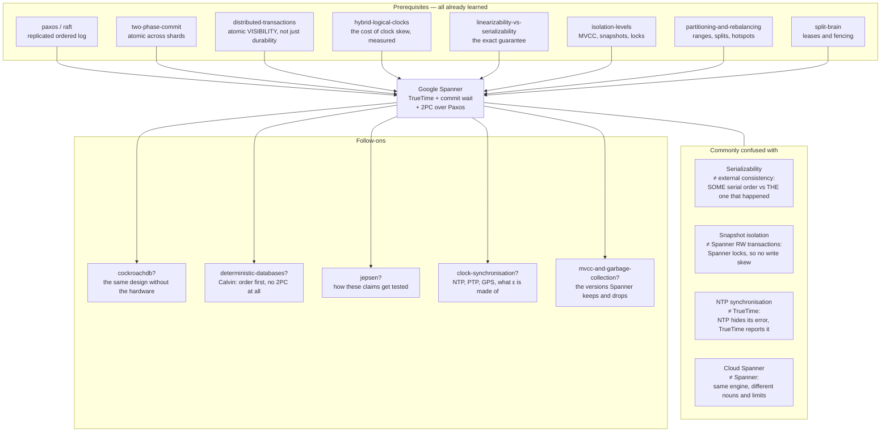

# Google Spanner

### The database that bought a clock

---

**What this lab is.** A teaching document, an interactive simulator
(`visualization.html`, also hosted as
**[The Honest Clock](https://claude.ai/code/artifact/10030776-7351-463a-b99a-0209680dc341)**),
and a set of pencil-and-paper exercises. There is no code to
run and nothing to install. Every number quoted as *measured* comes from one of two
places, and I say which every time: **the 2012 Spanner paper**
([Corbett et al., OSDI 2012](https://research.google/pubs/pub39966/)), or **the
simulator on this page**, whose rules are printed at the bottom of it so you can
check that its numbers mean what I claim they mean. That simulator's engine was
verified headlessly before publication — 45 checks reproducing every scenario's
trace to the millisecond, plus four exhaustive sweeps over its clock settings, and
32 further checks driving its controls to their extremes.

**Where you are in the sequence.** This is the lab that collects the debts. You have
already built, separately, almost every part of Spanner:

- [paxos](../39-paxos/) and [raft](../40-raft/) gave you a replicated group that agrees on
  an ordered log,
- [two-phase-commit](../45-two-phase-commit/) gave you all-or-nothing across shards, and
  left you with a coordinator that can block everyone forever,
- [distributed-transactions](../46-distributed-transactions/) proved that 2PC alone is
  not enough — you measured **16 fractured audits in 40 runs** with a perfect 2PC and
  zero crashes — and it named the two ways out: lock the readers, or timestamp the
  world. It also named "Spanner = 2PC over Paxos + TrueTime + commit wait" in one
  line and moved on — and two of those four words are names you have not been
  given yet. Supplying them is what this lab is for.
- [hybrid-logical-clocks](../31-hybrid-logical-clocks/) measured, precisely, the thing
  Spanner spends money to avoid: **86 out of 86 stale reads** when a fast-clocked
  writer and a slow-clocked reader have no causal path between them, and it told you
  the bill can be charged to the writer, the reader, or the client. **Spanner is the
  design that charges the writer.**
- [linearizability](../26-linearizability/) and
  [linearizability-vs-serializability](../27-linearizability-vs-serializability/) gave
  you the exact guarantee Spanner claims, under the name Spanner uses for it.
- [isolation-levels](../08-isolation-levels/), [split-brain](../42-split-brain/),
  [pacelc](../25-pacelc/), [partitioning-and-rebalancing](../36-partitioning-and-rebalancing/)
  and [quorums-and-replication](../34-quorums-and-replication/) supply the rest.

So this lab does not reteach any of that. **It teaches one new idea** — a clock that
tells you how wrong it might be, and a protocol that pays that number off by sleeping
— and then shows you how everything above snaps onto it, in the order Spanner's
designers hit each problem.

---

## Table of contents

| | Stage | Depth layer |
|---|---|---|
| 1 | [Why this exists](#1-why-this-exists) | Beginner |
| 2 | [The problem, as a story](#2-the-problem-as-a-story) | Beginner |
| 3 | [The three obvious fixes](#3-the-three-obvious-fixes) | Beginner |
| 4 | [Where all three break](#4-where-all-three-break) | Beginner |
| 5 | [What we actually need to guarantee](#5-what-we-actually-need-to-guarantee) | Beginner |
| 6 | [The key idea](#6-the-key-idea) | Beginner |
| 7 | [The vocabulary, now that you have earned it](#7-the-vocabulary-now-that-you-have-earned-it) | Beginner |
| 8 | [Two mental models, and where the nice one lies to you](#8-two-mental-models-and-where-the-nice-one-lies-to-you) | Beginner |
| 9 | [Go and break it yourself](#9-go-and-break-it-yourself) | Beginner |
| 10 | [The mechanism, built one failure at a time](#10-the-mechanism-built-one-failure-at-a-time) | Intermediate |
| 11 | [The failure scenarios in full](#11-the-failure-scenarios-in-full) | Engineering |
| 12 | [What is guaranteed, what is not, and what it cost](#12-what-is-guaranteed-what-is-not-and-what-it-cost) | Engineering |
| 13 | [Production](#13-production) | Production |
| 14 | [Exercises](#14-exercises) | — |
| 15 | [Where this sits, and what to learn next](#15-where-this-sits-and-what-to-learn-next) | — |
| 16 | [Glossary](#16-glossary) | — |

---

## 1. Why this exists

You want one database that runs on machines in several countries — so it survives a
datacenter burning down, and so a user in Singapore is not waiting on a disk in
Iowa — and you want your application code to be able to pretend it is talking to a
single machine that does one thing at a time.

Those two wants fight. The moment the data lives in more than one place, "one thing
at a time" stops being a fact about the hardware and becomes something you have to
*manufacture*. And the usual way people manufacture it — put a time on every change
and sort by time — quietly stops working, because the machines' clocks disagree.

Here is what that costs, concretely. A payment is taken in London. The service
acknowledges it: HTTP 200, receipt emailed, customer's phone buzzes. Three
milliseconds later, a fraud check runs against a replica in Frankfurt and reads the
account *as it was before the payment*. Not because the replica was slow — it had the
data — but because the payment was labelled with a moment that the fraud check's own
clock had not reached yet. The payment is real, the acknowledgement is real, and the
system's own record says it has not happened.

That is the failure this lab is about: **not lost data, not late data, but data that
is present, acknowledged, and invisible.** It produces the worst kind of bug —
the one where every log line is correct and the answer is still wrong.

---

## 2. The problem, as a story

There is a Land Registry with two offices: one in Northgate, one in Southgate. A
registry does one job — it records who owns what, and *when* each change was
recorded. Every document that comes in gets a rubber stamp with the date and time,
taken from the clock on the office wall.

The register is read by sorting the stamps. "Who owned 14 Mill Lane at three o'clock
on Tuesday?" is answered by taking every stamped document for that address, throwing
away the ones stamped after three o'clock, and reading off the survivor. That is the
whole system, and it works beautifully in one office with one clock.

Now Priya files a deed in Northgate: she sells 14 Mill Lane to Omar. The clerk stamps
it, files it, and hands Priya a receipt. **The receipt is the important part** — it
means the registry has publicly committed. Priya walks out and telephones her
solicitor, who is standing in the Southgate office, and says: *"Done. It's filed."*

Only now does the solicitor file the follow-up document — a mortgage against the
property, in Omar's name. The Southgate clerk stamps it and files it.

Two documents. The second one was not even *started* until after the first was
finished and announced. Any human would say the order is obvious.

But the Northgate wall clock is four minutes fast and the Southgate wall clock is
three minutes slow. So the deed is stamped **10:04** and the mortgage is stamped
**9:57**.

Now someone asks the register the perfectly ordinary question: *"What did the record
show at 10:00?"* The register throws away everything stamped after 10:00 — which
throws away the sale — and keeps the mortgage. It answers: **there is a mortgage in
Omar's name against a property Priya still owns.**

Nobody lied. Nobody crashed. No message was lost. Both clerks followed the rules
exactly. The register is simply, permanently wrong, and the reason is that *the two
clocks were never the same clock.*

> **🔮 Predict:** The obvious response is "so synchronise the clocks properly."
> Suppose you install the best network time synchronisation money can buy and get
> both offices to within a few milliseconds of true time. Does the problem go away,
> shrink, or change shape?
>
> <details><summary>Reveal</summary>
>
> It **shrinks and changes shape**, which is worse than either. It shrinks, because
> the window in which two clerks can disagree drops from minutes to milliseconds. It
> changes shape, because now the bug only appears when two related events happen
> within a few milliseconds of each other — which, in a system doing ten thousand
> operations a second, is *constantly*, but in your test environment is *never*.
>
> You have converted a bug that reproduces into a bug that does not. Your
> [hybrid-logical-clocks](../31-hybrid-logical-clocks/) lab already measured this exact
> trap from the other direction: at clock skew ≤ 2ms the wall clock produced **zero
> visible anomalies**, and at skew 8ms it produced 65 inversions. Same code, same
> rules, different weather.
>
> </details>

---

## 3. The three obvious fixes

A competent engineer, handed the story above, produces one of three designs. Each one
is a real, shipped, well-known system. Two of them you have already built.

### Fix A — one clerk stamps everything

Put a single stamping desk somewhere and make every office, in every country, phone
it to get a number. One clock, one sequence, no disagreement possible.

This is real: it is the **timestamp oracle**, and it is the design you built in the
[distributed-transactions](../46-distributed-transactions/) lab under the name
Percolator. TiDB ships it in production, with the oracle itself replicated by Raft
and handing out timestamps in batches.

### Fix B — let the clocks disagree, but never let the *order* be wrong

Never trust a clock to order two events. Instead attach a counter that is forced
upward every time a message arrives, so an effect always carries a bigger number than
its cause. This is the **hybrid logical clock**, and you built it: a stamp `(l, c)`
where `l` is a real wall reading and `c` counts the events `l` cannot separate.
CockroachDB, YugabyteDB and MongoDB all ship a version.

### Fix C — lock the readers out

Don't timestamp anything. Make readers take locks, so a reader simply cannot look at
the register while a filing is half-done. This is distributed strict two-phase
locking, and you measured it in the
[distributed-transactions](../46-distributed-transactions/) lab too.

---

## 4. Where all three break

### Fix C breaks first, and worst

You measured this one. Strict two-phase locking across shards is *correct* — it gives
serializable, correctly ordered results — and it makes every reader queue behind
every writer, and it inherits two-phase commit's blocking problem. In your lab, a
crash storm stranded **281 readers forever** under distributed 2PL, against **0**
under the timestamp-based design. A global read of a global database, blocking on a
lock held by a coordinator in another continent that has just died, is not a system
you can operate.

So the interesting fight is between A and B.

### Fix A breaks on geography and on liveness

The single stamping desk is in one building. Every write in Sydney now costs a round
trip to that building before it can even begin. If the desk is in Iowa, that is
roughly 180 milliseconds of pure waiting, on every transaction, forever — and you
cannot fix it by adding machines, because the whole point is that there is exactly
one of them.

And it is a single point of failure for *the entire planet's* write path. You can
replicate it — TiDB does, with Raft — but replication makes it slower, not closer.
The oracle's problem is not reliability, it is that **the speed of light is not
negotiable and there is only one desk.**

### Fix B breaks in a way you can already quote

This is the important one, because Fix B looks like it wins.

A hybrid logical clock guarantees that if event X *caused* event Y, then X's stamp is
smaller. That is genuinely enough for a huge class of systems. But look again at
the registry story: **the phone call from Priya to her solicitor is not a message the
database can see.** There is no causal path *through the system* from the Northgate
filing to the Southgate filing. The information travelled through a human being.

Your [hybrid-logical-clocks](../31-hybrid-logical-clocks/) lab measured exactly this
case and called it "no external consistency for strangers" — *external consistency*
being the property stage 5 defines properly, and for now readable as: *the order the
database records is the order that really happened*. A fast-clock writer, a
slow-clock reader, no causal path — **86 out of 86 reads stale**. The fix, that lab
showed, is not free; it costs the same clock-uncertainty number **ε** somewhere — ε
being how wrong a clock might be, defined precisely in stage 7 — and you get to
choose who pays:

| Who pays | How | Who ships it |
|---|---|---|
| The **client** | carries a causality token from write to read | MongoDB `clusterTime` / `afterClusterTime` |
| The **reader** | retries when its snapshot lands inside the uncertainty window | CockroachDB uncertainty restarts |
| The **writer** | waits before admitting the write happened | **Spanner commit wait — this lab** |

> **🔮 Predict:** Charging the writer sounds like the *worst* of the three — writes
> are already the expensive path. Why would anyone choose it?
>
> <details><summary>Reveal</summary>
>
> Three reasons, and they are all about what the *other* two options do to reads.
>
> 1. **Reads become free.** If the writer has already guaranteed that its timestamp
>    is in everyone's past, a reader needs no locks, no retries, no token, and no
>    conversation with a leader in another continent. It reads a snapshot at a
>    timestamp from whichever replica is nearest. In the Spanner paper's own
>    microbenchmarks, a write costs **14.4 ms** and a snapshot read — a lock-free read
>    at some agreed past moment — costs **1.3 ms**,
>    and the read cost does not grow as you add replicas — snapshot read throughput
>    went **13.5 → 38.5 → 50.0 K ops/sec** at 1, 3 and 5 replicas while write
>    throughput *fell* from 4.1 to 2.8.
> 2. **The cost is bounded and known**, not statistical. A reader-pays design has a
>    retry rate that depends on load and skew. A writer-pays design has a fixed,
>    predictable addition to every write.
> 3. **You can buy the cost down with hardware.** The writer's wait is proportional
>    to how wrong the clock might be. That is a number you can shrink by spending
>    money on clocks — which is exactly what Google did, and what nobody else could
>    do in 2012.
>
> </details>

---

## 5. What we actually need to guarantee

Strip the story back to one sentence, with no jargon in it:

> **If the registry finished document A and told somebody so, and only afterwards did
> anyone start document B, then A's stamp must be smaller than B's stamp — no matter
> which office each was filed in, and no matter how the news travelled.**

Read the last clause again, because it is the whole difficulty. *No matter how the
news travelled.* Through the network, through a phone call, through a customer
refreshing a page on a different device, through a message queue, through a human
walking down a corridor. The database cannot see any of those paths, so it cannot
rely on seeing them.

The only thing common to every possible path is that **time passed**. B started after
A finished, in real, physical, wall-clock time. So if the guarantee is going to hold
for paths the database cannot see, the stamps have to be anchored to something the
database also cannot see: actual physical time.

That is the requirement. Everything in the rest of this lab is the pursuit of it.

You have met this guarantee before under two other names: your
[linearizability](../26-linearizability/) lab called the same property, for single
operations, the *real-time rule*; your
[linearizability-vs-serializability](../27-linearizability-vs-serializability/) lab
called it, for transactions, *strict serializability*. Spanner's papers call it
**external consistency**, and that is the name we will use, because it is the name
you will see in the documentation.

---

## 6. The key idea

Two sentences.

> **Sentence one: build a clock that admits it might be wrong.** Instead of returning
> a number, it returns a *pair* of numbers — an earliest and a latest — and it
> promises that the true instant lies somewhere between them. It never returns "it is
> 10:04:00.000"; it returns "it is somewhere between 10:03:59.996 and 10:04:00.004,
> and I promise it is in there."
>
> **Sentence two: when you finish a change, stamp it with the *latest* end, and then
> refuse to admit the change happened until your own clock's *earliest* end has moved
> past that stamp.** By the time anyone in the world hears that the change is done,
> its stamp is provably in the past — for every machine, everywhere.

That is Spanner. Everything else is engineering.

Notice what did *not* happen: nobody's clock got more accurate. The trick is entirely
in the honesty and in the waiting. And notice the consequence, which drives every
hardware decision Google made afterwards: **the width of that band is, literally, the
latency of every write.** A clock that admits to being wrong by 100 ms would make
every write cost 200 ms. So Google put GPS receivers and atomic clocks in every
datacenter — not to make time *correct*, but to make the *admission of error* small
enough to sleep off.

---

## 7. The vocabulary, now that you have earned it

Nine load-bearing terms. Every one of them names something you have already felt.

### External consistency

- **In plain words:** if the system told you an operation was done before you started
  another one, the system's own record must agree that yours came second.
- **Technically:** if the commit of transaction T₁ happens (in absolute physical
  time) before the start of T₂, then commit-timestamp(T₁) < commit-timestamp(T₂).
  The Spanner paper states it as an invariant in exactly those terms.
- **Why the term exists:** to name the part of the guarantee that is *outside* the
  database. Serializability says the transactions are equivalent to *some* serial
  order. External consistency says they are equivalent to the *specific* serial order
  that a person with a stopwatch outside the system would have observed. The
  difference only shows up when information leaves the system and comes back — a
  phone call, a second device, a message queue — which is why it is called
  *external*.
- **Example:** the registry story. The deed at 10:04 and the mortgage at 9:57 satisfy
  serializability (there is a serial order: mortgage, then deed) and violate external
  consistency (that order is not the one that happened).
- **Connects to:** identical to **strict serializability** from your
  [linearizability-vs-serializability](../27-linearizability-vs-serializability/) lab.
  Spanner uses "external consistency"; Jepsen and the academic literature use "strict
  serializability"; Google Cloud's documentation uses both. Same property.

### TrueTime

- **In plain words:** Google's clock service, which reports the time as a range
  instead of an instant.
- **Technically:** an API with three calls. `TT.now()` returns a `TTinterval`
  `[earliest, latest]` guaranteed to contain the absolute time at which the call was
  made. `TT.after(t)` returns true if `t` has *definitely* passed. `TT.before(t)`
  returns true if `t` has *definitely* not arrived yet. The latter two are just
  convenience wrappers over the first.
- **Why the term exists:** because every other clock API in computing hands you a
  single number and thereby hides the one fact you needed. `System.currentTimeMillis()`
  is confident and unaccountable. TrueTime's whole contribution is that it makes the
  uncertainty a *value in your program* that you can branch on.
- **Example:** at absolute time 100.000 ms on a machine whose clock is 2 ms fast with
  a 4 ms error bound, `TT.now()` returns `[99.998, 100.006]`. The true instant,
  100.000, is inside. That is the only promise.
- **Connects to:** the `l` component of the hybrid logical clock you built — a real
  wall reading, never incremented — except that TrueTime additionally reports how
  much you should distrust it.

### ε (epsilon), the instantaneous error bound

- **In plain words:** half the width of the band. "How wrong this clock might be,
  right now, at worst."
- **Technically:** `ε = (latest − earliest) / 2`. It is not a measurement of the
  actual error; it is a *bound* the clock daemon is prepared to guarantee, derived
  conservatively from the worst-case drift rate of the local oscillator, the time
  since the last synchronisation, the uncertainty of the time source, and the network
  delay to it.
- **Why the term exists:** because it is the price list. Almost every latency number
  in Spanner is written in units of ε.
- **Example, and these are the paper's own production figures:** ε is a *sawtooth*.
  Immediately after a machine polls a time master it is small; it then grows steadily
  until the next poll. The daemon polls **every 30 seconds** and assumes a worst-case
  drift of **200 microseconds per second**, so the sawtooth climbs 30 × 200 µs = **6
  ms** between polls; adding about **1 ms** for network delay to the time master gives
  a range of **about 1 ms to 7 ms**, averaging **about 4 ms**.
- **Connects to:** the *max-offset* / *uncertainty interval* of your
  [hybrid-logical-clocks](../31-hybrid-logical-clocks/) lab — CockroachDB's 500 ms
  default is the same quantity, two orders of magnitude larger, which is precisely
  why CockroachDB cannot afford to wait it off and charges readers instead.

### Commit wait

- **In plain words:** after deciding a change is committed, deliberately doing nothing
  for a few milliseconds before telling anybody.
- **Technically:** having chosen commit timestamp `s`, the coordinator blocks until
  `TT.after(s)` is true — that is, until its own interval's *earliest* endpoint has
  passed `s` — and only then releases locks and returns to the client. Since `s` was
  chosen as some `TT.now().latest`, the expected wait is about **2ε**.
- **Why the term exists:** to name the moment where the design pays for its honesty.
  It is the only place in the system where a machine is deliberately idle for
  correctness.
- **Example:** ε = 7 ms; at absolute 100.000 the interval is `[99.993, 100.007]`; the
  commit timestamp is 100.007; `earliest` reaches 100.007 at absolute **100.014**;
  the client hears "committed" then. 14 ms of waiting, which is 2 × 7.
- **Measured, from the paper's Table 3:** a write with commit wait disabled took
  **9.4 ms**; the same write with it enabled took **14.4 ms**. Commit wait costs
  **about 5 ms**, and it is less than 2ε̄ because it overlaps with the Paxos round
  trip that is happening anyway.

### Paxos group

- **In plain words:** the handful of machines, in different places, that hold copies
  of one slice of the data and vote on changes to it.
- **Technically:** a replicated state machine over one *tablet* (one contiguous range
  of the key space), with one long-lived leader. Writes go through the leader; reads
  may be served by any replica that is sufficiently up to date.
- **Why it matters here rather than in the [paxos](../39-paxos/) lab:** because a Spanner
  database is thousands or millions of these, each ordering its own writes
  independently, with **no communication between groups at all** unless a single
  transaction happens to touch two of them. The global order is not produced by any
  central thing. It emerges from the timestamps. That is the whole architectural
  bet.
- **Connects to:** everything in your [paxos](../39-paxos/) and [raft](../40-raft/) labs,
  used as a black box here.

### Participant leader / coordinator leader

- **In plain words:** when one transaction touches two slices of data, each slice's
  leader takes part, and one of them is elected to run the two-phase commit.
- **Technically:** for a multi-group transaction the client picks one participant
  group as coordinator; its Paxos leader becomes the **coordinator leader** and runs
  2PC over the other **participant leaders**. Crucially, the coordinator's transaction
  state is written *through its own Paxos group*, so it is replicated.
- **Why this specific detail is the punchline of an earlier lab:** your
  [two-phase-commit](../45-two-phase-commit/) lab's central complaint was that a
  coordinator crash blocks every participant indefinitely, because the decision lived
  only in the coordinator's memory. Here the decision lives in a Paxos log with a
  quorum. A dead coordinator leader is replaced by another replica of the same group,
  which reads the decision off the log and finishes the job. **The composition "2PC
  over Paxos" is the fix, and this is the sentence that makes it work.**

### Leader lease, and the disjointness invariant

- **In plain words:** a leader holds the job for a fixed stretch of time, and two
  leaders of the same group can never hold overlapping stretches.
- **Technically:** a would-be leader collects timed lease votes from a quorum; the
  lease defaults to **10 seconds**. The invariant Spanner depends on is that for each
  Paxos group, **each leader's lease interval is disjoint from every other leader's**.
  Before abdicating, a leader must wait until `TT.after(s_max)`, where `s_max` is the
  highest timestamp it has ever handed out.
- **Why it exists:** so that timestamps are monotonically increasing *across leader
  changes*, not just within one leader. A leader may only assign timestamps inside its
  own lease interval; disjoint leases therefore give disjoint timestamp ranges, in
  order.
- **Connects to:** this is the [split-brain](../42-split-brain/) lab's lesson, applied to
  *time*. That lab's conclusion was that you cannot stop a machine believing it is
  leader, only stop its effects counting. Here the effect that must not count is
  *stamping a document with a time that belongs to the next leader.*

### Safe time (t_safe)

- **In plain words:** the newest moment a particular replica is allowed to answer
  questions about — "I can tell you the state as of any time up to here, and no
  further."
- **Technically:** `t_safe = min(t_safe_paxos, t_safe_TM)`. `t_safe_paxos` is the
  timestamp of the highest Paxos write this replica has actually applied.
  `t_safe_TM` is infinity if there are no prepared-but-not-committed transactions,
  and otherwise `min(prepare timestamps) − 1` — a *prepare timestamp* being the
  moment a participant proposes when it promises it can commit, worked through in
  §10.4. A replica may serve a read at
  timestamp `t` only when `t ≤ t_safe`.
- **Why it exists:** because a read at a timestamp is only correct if the replica has
  *everything* up to that timestamp. Without this check, a lagging replica would
  cheerfully return an answer that omits committed writes — the exact bug from
  stage 1.
- **Example:** a replica has applied writes up to 100.500 and has one prepared
  transaction whose prepare timestamp is 100.300. Then `t_safe_paxos = 100.500`,
  `t_safe_TM = 100.299`, and `t_safe = 100.299`. A read at 100.400 must wait, even
  though the replica "has" everything up to 100.500 — because the prepared
  transaction might yet commit at 100.350 and land underneath it.
- **Connects to:** the *lock check* in your Percolator reader from the
  [distributed-transactions](../46-distributed-transactions/) lab. Same problem —
  a reader meeting an undecided writer — solved on the server side by waiting instead
  of on the reader side by resolving.

### Read-only transaction, snapshot read, read-write transaction

Three different things, and Spanner keeps them strictly separate. This distinction is
the practical payoff of the whole design, so it is worth being precise.

- **Read-write transaction** — takes locks (pessimistic, with **wound-wait** deadlock
  avoidance), goes to leaders, gets a commit timestamp, pays commit wait. May abort;
  the client must be prepared to retry it.
- **Read-only transaction** — takes **no locks at all** and blocks nobody. It is
  assigned a timestamp, then executes as a set of snapshot reads at that timestamp.
  It is not "a transaction with only reads in it"; it is a genuinely different
  mechanism, and it is externally consistent.
- **Snapshot read** — a read at a client-specified timestamp or staleness bound.
  Also lock-free. The difference from a read-only transaction is only *who picks the
  timestamp*.
- **Why the distinction exists:** because the expensive machinery — locks, commit
  wait, leaders — is needed only for writes. Separating the read paths is what makes
  reads cheap, local, and infinitely scalable. It is why Spanner can serve a
  globally-consistent read from the replica in your own city.

---

## 8. Two mental models, and where the nice one lies to you

### The simple model: the registry with honest clocks

Same two offices, same rubber stamps, but two changes to the furniture.

**Change one: the wall clocks now have two hands and a shaded band between them.**
Not one hand claiming to know the time — two hands, and a promise from the clock's
manufacturer that the real time is somewhere inside the shaded band. When the office
has just checked the clock against the observatory, the band is narrow. As the hours
pass without checking, the clock widens its own band, because it knows its
mechanism drifts.

**Change two: a new rule for the clerk.** Stamp the document with the *late* edge of
the band — the most pessimistic reading available. Then put the receipt face down on
the desk and *wait*, watching the clock, until the *early* edge of the band has moved
past the number you stamped. Only then hand the receipt over.

The wait is the invention. After it, the clerk can say something remarkable: *"the
moment printed on this document is now in the past, and it is in the past according
to every clock in the country, not just mine."* Any document that anybody starts
after receiving this receipt is guaranteed to get a bigger number.

### The engineering model

Four objects, and the discipline is in keeping them separate.

1. **The data.** A multi-version key-value store: `(key, timestamp) → value`. Nothing
   is ever updated in place; a write adds a version. A read at timestamp `t` returns,
   for each key, the newest version whose timestamp is ≤ `t`. This is ordinary MVCC
   and you know it from [isolation-levels](../08-isolation-levels/).
2. **The groups.** The key space is cut into contiguous ranges; each range is
   replicated by its own Paxos group with its own leader. Groups do not talk to each
   other. A group's leader holds a lock table (for writes) and a transaction manager
   (for cross-group transactions).
3. **The clock.** A function from a machine to an interval containing the true
   instant. Its width, 2ε, is the only global parameter in the system.
4. **The three invariants**, which together are the entire correctness argument:
   - **Monotonicity** — within a group, timestamps are assigned in increasing order,
     *including across leader changes*.
   - **Disjointness** — within a group, leaders' lease intervals never overlap, and a
     leader only assigns timestamps inside its own lease.
   - **External consistency** — if T₁ commits before T₂ starts in absolute time, then
     s₁ < s₂. Delivered by two rules: pick `s = TT.now().latest`, then commit-wait
     until `TT.after(s)`.

### Mapping

| The registry | Spanner |
|---|---|
| An office | A zone (roughly, a datacenter) |
| A clerk | A Paxos group leader |
| The filing cabinet in one office | A tablet on Colossus, replicated by one Paxos group |
| One cabinet drawer (a run of addresses) | A *directory* or *split* — Spanner's words for a contiguous run of keys |
| The rubber stamp | The commit timestamp |
| A stamped document | An MVCC version `(key, timestamp) → value` |
| Handing over the receipt | Acknowledging the commit to the client |
| The banded wall clock | `TT.now()` returning `[earliest, latest]` |
| The width of the band | 2ε |
| Watching the early edge pass your stamp | `TT.after(s)` — commit wait |
| Checking the clock against the observatory | The time-slave daemon polling GPS and atomic-clock time masters |
| "Who owned this at 3 o'clock?" | A snapshot read at a timestamp |
| "I have everything filed up to here" | `t_safe` |
| A document half-filed between two offices | A prepared, uncommitted 2PC transaction |
| The clerk's shift, which cannot overlap the next clerk's | The Paxos leader lease, and disjointness |

### Where the analogy breaks

Four places. Each one is a thing a real system needs that a registry does not.

**1. The registry has one book; Spanner has millions, and they never speak.** In the
story you imagine a single register that everything is filed into, so the order is
maintained by the book itself. In Spanner there is no book. There are millions of
independent Paxos groups, each ordering only its own writes, with no channel between
them. The single global order exists **only as a property of the numbers**, and
nothing in the system ever materialises it. Two transactions on opposite sides of the
world are ordered relative to each other by arithmetic that neither one performed.
This is why the timestamps have to be anchored to physical time: it is the only
shared reference the groups have, precisely *because* they never talk.

**2. The clerk's wait is free in the story and costs real money here.** A clerk
pausing for a moment costs nothing. Commit wait sits in the critical path of every
write — the paper measures it at about 5 ms, and it holds locks the whole time, so it
also taxes every reader queued behind those locks. The analogy makes the central
trade-off feel weightless. It is not weightless; it is the entire bill.

**3. The clock's honesty is an assumption, not a fact.** The registry's clock
manufacturer *promises* the true time is in the band. In reality that promise is
conditional: it holds only while the machine's oscillator drifts no faster than the
assumed worst case (200 µs/s). A machine whose crystal degrades past that can return
an interval that does *not* contain the true time, and then commit wait waits for the
wrong number and external consistency breaks **silently**. Spanner's answer is not
"this cannot happen"; it is defence in depth — time masters cross-check each other
and evict themselves on divergence, daemons poll several masters and apply a variant
of **Marzullo's algorithm** to reject liars, and any machine whose measured frequency
excursion exceeds the worst-case bound *removes itself from the fleet*. Your
[hybrid-logical-clocks](../31-hybrid-logical-clocks/) lab made exactly this point and
measured it: one node running 60 ms fast in a ±8 ms cluster infected everyone
downstream and the bound went from 16 to 67. **A clock bound is a promise about
hardware, and it is only as good as the hardware.**

**4. Nothing in a registry aborts.** A clerk never says "sorry, start again." Spanner
read-write transactions take locks and use wound-wait, so under contention a
transaction can be aborted and *must* be retried by the client. Every Cloud Spanner
client library ships a retry loop for this reason, and application code that does not
expect an abort is broken code. The analogy hides it completely.

---

## 9. Go and break it yourself

Open **`visualization.html`** in this folder, or the hosted copy —
**[The Honest Clock](https://claude.ai/code/artifact/10030776-7351-463a-b99a-0209680dc341)**.
It is a simulator of the registry story with the real rules: two Paxos
groups whose leaders are in different regions, a true-time axis running left to right,
and a switch that turns commit wait on and off.

**What to look at, in this order.**

1. **The clock bands.** Each region's row shows its TrueTime interval as a bracket
   around a marker. The thin vertical line running down the whole page is *true
   absolute time* — which no machine in a real system can see, and which the simulator
   shows you because you are outside it. Watch how each bracket contains that line.
   That containment is the entire promise of TrueTime, and scenario 4 breaks it
   deliberately so you can see what depends on it.

2. **Scenario 1, "The receipt and the phone call."** This is the registry story with
   commit wait **off**. Predict first, then run it. Look at the two timestamp markers
   and at the verdict banner: the transaction that started *later* in true time
   receives the *smaller* stamp, and the banner names the reader who then sees the
   second without the first.

3. **Scenario 2, the same run with commit wait on.** The thing to watch is the
   *shaded wait block* that appears after the commit timestamp and before the
   acknowledgement. Nothing is happening in that block — that is the point. Compare
   where the acknowledgement lands in scenario 1 and scenario 2; the difference is
   what external consistency costs.

4. **The ε slider.** Drag it from 7 ms down to 1 ms with commit wait on. The guarantee
   does not change; only the length of the shaded block does. This is the single most
   important thing to feel in the whole lab: **Google's atomic clocks are not there to
   make time correct. They are there to make that block short.**

5. **Scenario 5, "the blocked reader."** A cross-group transaction gets stuck between
   prepare and commit. Watch a read that touches a completely unrelated key wait
   anyway, and watch `t_safe` in the replica's inspector to see which of its two
   components is pinning it.

Click any node to open its inspector: its clock interval, its ε, its `s_max`, and
both components of its safe time. Every event in the log is a full sentence saying
what happened and why it matters; the protocol notation is on the second line.

---

## 10. The mechanism, built one failure at a time

**Checkpoint — leaving the beginner model.** You can now say why Spanner exists, what
external consistency is, and what a clock that reports an interval buys you. From
here on we build the actual protocol, and every odd-looking detail in it will arrive
as the scar of a failure you have just watched.

Ground rules for this stage: absolute time is written in milliseconds from an
arbitrary origin, and **the simulator uses these same numbers**, so you can replay
every trace. Two Paxos groups: **G1**, whose leader sits in Northgate, and **G2**,
whose leader sits in Southgate. To make one point unmissable, **both clocks in the
first trace are perfectly accurate** — offset exactly zero. They differ only in how
wrong they are *prepared to admit they might be*.

### 10.1 Mechanism v1 — stamp with the latest end of the band

The first design a good engineer writes:

> When a transaction's writes are all locked and ready, ask the local clock for
> `TT.now()` and use its `latest` endpoint as the commit timestamp. Replicate through
> Paxos. Acknowledge to the client.

Why `latest` and not `earliest` or the midpoint? Because `latest` is the only endpoint
guaranteed to be at or after the true instant, and a timestamp that is *behind* true
time is the thing that produced the registry bug. So v1 is already the careful
choice.

**Trace it.** Northgate has just gone a long time without polling a time master, so
its ε is 7 ms. Southgate polled recently: ε = 1 ms.

| Absolute time | What happens | Numbers |
|---|---|---|
| 100.000 | T₁ (the deed) reaches G1's leader in Northgate. It asks for the time. | `TT.now() = [93.000, 107.000]` → **s₁ = 107.000** |
| 100.000 → 102.000 | Paxos replicates the commit record. | applied at 102.000 |
| 102.000 | **Priya is told the deed is filed.** | ack |
| 103.000 | Priya telephones. The news leaves the system entirely. | — |
| 104.000 | T₂ (the mortgage) reaches G2's leader in Southgate. It asks for the time. | `TT.now() = [103.000, 105.000]` → **s₂ = 105.000** |

**s₂ = 105.000 < s₁ = 107.000.** The transaction that began two milliseconds after the
first one was acknowledged carries a timestamp two milliseconds *smaller*.

And now the damage, which is not abstract: a read-only transaction at timestamp
**106.000** — a perfectly ordinary "show me the current state" query — includes T₂
(105.000 ≤ 106.000) and excludes T₁ (107.000 > 106.000). It returns a mortgage
against a property that, according to the same query, has not been sold.

> **🔮 Predict:** Both clocks in that trace were *perfectly accurate* — neither was
> even a microsecond off. So where exactly did the error come from?
>
> <details><summary>Reveal</summary>
>
> From the **asymmetry of the honesty**. Northgate rounded its answer up by 7 ms
> because that is how much it was willing to be wrong by; Southgate rounded up by only
> 1 ms. The gap between the two admissions — 6 ms — is the window in which the
> ordering can invert, and it exists *even when both clocks are exactly right*.
>
> This is worth sitting with, because it kills the intuition that better clocks alone
> would fix it. Perfect clocks with imperfect *knowledge of their own perfection*
> still produce the bug. What has to be fixed is not the clock; it is the fact that
> a stamp chosen from the pessimistic end has not yet arrived in everyone's past.
>
> </details>

### 10.2 The refinement: commit wait

The fix follows directly from that reveal. If the stamp is in the future for some
observers, then wait until it is in the past for *all* of them — and the interval
tells you exactly when that is.

> **Rule (commit wait).** Having chosen commit timestamp `s`, do not release locks
> and do not acknowledge to the client until `TT.after(s)` is true — that is, until
> the local interval's `earliest` endpoint has passed `s`.

**The same trace, with the rule in place:**

| Absolute time | What happens | Numbers |
|---|---|---|
| 100.000 | T₁ reaches G1's leader. | `[93.000, 107.000]` → **s₁ = 107.000** |
| 100.000 → 102.000 | Paxos replicates, in parallel with the wait below. | applied 102.000 |
| 100.000 → 114.000 | **Commit wait.** `earliest = absolute − 7`, so `earliest > 107.000` first holds at absolute 114.000. | 14 ms = 2ε, of which 2 ms overlapped Paxos |
| 114.000 | Priya is told the deed is filed. | ack, 12 ms later than before |
| 115.000 | Priya telephones. | — |
| 116.000 | T₂ reaches G2's leader. | `[115.000, 117.000]` → **s₂ = 117.000** |

**s₁ = 107.000 < s₂ = 117.000.** And it is not luck. Here is the paper's proof, which
is four lines and worth memorising because it tells you which line each rule
defends:

```
  s₁ < t_abs(commit₁)          because of commit wait
  t_abs(commit₁) < t_abs(start₂)   by assumption — T₂ started after T₁ finished
  t_abs(start₂) ≤ t_abs(server₂)   because the request cannot arrive before it is sent
  t_abs(server₂) ≤ s₂          because s₂ was chosen as TT.now().latest at the server
  ────────────────────────────
  s₁ < s₂
```

Line one is commit wait. Line four is the "pick the latest endpoint" rule. Lines two
and three are physics. **Two rules, and the guarantee is closed** — including for
news that travelled by telephone, because line two says nothing at all about *how*
T₂'s starter learned that T₁ had finished.

### 10.3 Mechanism v2 — now make reads cheap, and break it again

Writes are correct. Now the payoff: a read-only transaction takes no locks, so it
should be servable by any replica, including the one in the reader's own city.

> **Design v2.** Assign the read-only transaction a timestamp `s_read = TT.now().latest`.
> Send its reads to any replica. The replica returns, for each key, the newest version
> at or below `s_read`.

**Trace the break.** A read-only transaction is issued at absolute 120.000 by a client
in Singapore. Its timestamp is assigned at a leader whose ε is 4 ms, so
`s_read = 124.000`. It is sent to replica **R**, a Singapore replica of G1.

R has applied Paxos writes up to timestamp **107.000** — it has the deed. But the
Northgate leader has since committed two more writes at 118.000 and 121.000, and the
network to Singapore is slow; R has not received them.

R does what v2 says: it returns the newest version at or below 124.000, which is the
one at 107.000. The client asked for the state as of 124.000 and got the state as of
107.000, **with no indication that anything was missing.**

We have re-created the original bug on the read side. The write path is now honest
and the read path is not.

> **🔮 Predict:** What is the minimum a replica needs to know to refuse that read
> honestly?
>
> <details><summary>Reveal</summary>
>
> It needs one number: **the newest timestamp for which it can promise it has
> everything.** Not "the newest thing I have" — the newest point below which nothing
> new can still arrive. Call it `t_safe`, and the rule is: a replica may serve a read
> at `t` only if `t ≤ t_safe`; otherwise it waits.
>
> The subtlety, and the reason this needs two components rather than one, is the next
> section.
>
> </details>

### 10.4 The refinement: safe time, and why it has two halves

The first half is easy:

> **`t_safe_paxos`** = the timestamp of the highest Paxos write this replica has
> actually applied. Because timestamps within a group increase monotonically and
> Paxos applies writes in order, nothing will ever arrive at or below this number
> again.

In the trace above, R's `t_safe_paxos` is 107.000, the read wants 124.000, so R waits
until the writes at 118.000 and 121.000 arrive and something above 124.000 lands.
Correct, and honest.

The second half comes from a failure you already know how to construct: **two-phase
commit across two groups.**

Transaction T₃ writes to both G1 and G2. Each participant leader acquires its write
locks, chooses a **prepare timestamp**, and logs a prepare record through its own
Paxos group. Say G1 prepares at **200.000** and G2 at **200.500**. The coordinator
leader will choose a commit timestamp `s₃ ≥` every prepare timestamp, `≥ TT.now().latest`,
and `>` any timestamp it has previously assigned — say **205.000**. It has not decided
yet; the transaction is *in flight*.

Now a read arrives at a G1 replica asking for timestamp **203.000**.

`t_safe_paxos` on that replica might be 204.000 — it has applied everything G1 has
committed. But T₃ is prepared and undecided, and if it commits at 205.000 that is
above 203.000 and irrelevant… **but Spanner cannot know that yet.** The commit
timestamp could legally have been anything from 200.500 upward. Until the decision is
made, the state of the keys T₃ touched is *indeterminate* for every timestamp at or
above G1's prepare timestamp.

> **`t_safe_TM`** = infinity if there are no prepared-but-uncommitted transactions;
> otherwise `min(prepare timestamps at this group) − 1`. Here: **199.999**.
>
> **`t_safe = min(t_safe_paxos, t_safe_TM)`** = 199.999.

The read at 203.000 blocks. Every read at 203.000 blocks — *including reads of keys
T₃ never touched*, because as defined, safe time is one number for the whole group.

**Refinement of the refinement.** The paper calls those *false conflicts* and fixes
them by making safe time fine-grained: the leader already keeps a lock table mapping
key ranges to lock state, so it stores prepared-transaction timestamps per key range
there, and an arriving read is only checked against the ranges it actually touches.
This is the sort of detail that looks like an optimisation and is really a
survivability requirement — without it, one slow cross-group transaction stalls every
reader in its group.

### 10.5 The third break: the leader changes

Everything so far assumed one leader per group forever. Take that away.

Leader **L1** of G1 holds a lease and has handed out timestamps up to
`s_max = 210.000` — remember that timestamps are chosen from the *latest* endpoint, so
`s_max` can be several milliseconds **ahead of true time**. At absolute 205.000, L1's
zone loses power.

A quorum of the remaining replicas elects **L2**. L2's own clock says the time is
about 205, so under v1's rule it would assign the next transaction a timestamp of
about 205.007 — **below `s_max`**. Monotonicity is dead: G1 has now stamped a later
write with an earlier number than an earlier write, and every snapshot read in the
group is unsound.

> **The rules that close it.** A Paxos leader holds a **timed lease** (10 seconds by
> default) granted by a quorum of lease votes. Spanner maintains the **disjointness
> invariant**: within a group, no two leaders' lease intervals overlap. A leader may
> only assign timestamps *inside its own lease interval*, and `s_max` is advanced to
> every timestamp it assigns. Before voluntarily abdicating, a leader must wait until
> `TT.after(s_max)`.

Trace the fix: L1's lease cannot have extended past its final timestamp assignment in
a way that lets L2's lease start early, because L2's lease can only begin after L1's
has ended, and L1 could only assign timestamps within its own lease. So every
timestamp L2 assigns is inside a strictly later interval than every timestamp L1
assigned. Monotonicity across leaders falls out of disjointness for free.

Notice the shape of this: it is your [split-brain](../42-split-brain/) lab's argument
applied to *time*. That lab concluded you cannot stop a machine believing it is the
leader; you can only stop its effects counting. Here the effect that must not count is
*stamping with a number from the next leader's era*, and the mechanism that stops it —
an interval a machine may only act inside, granted by a quorum — is a fencing token
whose values happen to be timestamps.

**And the cost, which the paper measures.** Because leases are 10 seconds, killing a
leader zone without warning leaves each group unavailable until its lease expires.
The paper's experiment: kill the leader zone with no notice and throughput drops
**almost to zero**, recovering over roughly **10 seconds** as leases expire and new
leaders are elected. Kill it *with* a leadership handoff first and the dip is
**3–4%**. The 10-second lease is a straight trade — shorter leases mean faster
failover and much more lease-renewal traffic.

### 10.6 The fourth break: the group that nobody writes to

One more, and it is delightfully unobvious.

Group G7 holds a reference table that is written once a month. A client issues a
strong read-only transaction, which picks `s_read = TT.now().latest` = 300.000.
G7's replicas have `t_safe_paxos` = 1.000, because the last write to G7 was ages ago
and `t_safe_paxos` is *the timestamp of the highest applied write*.

`300.000 > 1.000`, so the read blocks — **forever**, or until somebody happens to
write to a table nobody writes to.

> **The rule that closes it (`MinNextTS`).** Each leader maintains a promise
> `MinNextTS(n)`: the minimum timestamp it may assign to the next Paxos write after
> sequence number `n`. A replica that has applied through `n` may advance
> `t_safe_paxos` to `MinNextTS(n) − 1`. The promise is safe across leader changes for
> the same reason as before — the promised timestamps lie inside the leader's lease,
> and leases are disjoint. **A leader advances `MinNextTS` every 8 seconds by
> default**, and slaves can also request an advance on demand.

The consequence is quotable and is the kind of thing that shows up in a support
ticket: *in the absence of prepared transactions, healthy replicas of an idle Paxos
group can serve reads at timestamps up to 8 seconds old in the worst case.*

### 10.7 One shortcut worth knowing: `LastTS()`

For a read-only transaction whose scope is **a single Paxos group** — which is most
of them — Spanner does better than `TT.now().latest`. The group's leader knows
`LastTS()`, the timestamp of the last committed write in that group. If there are no
prepared transactions, assigning `s_read = LastTS()` is *trivially* externally
consistent: the read sees the last write, so it is ordered after it, and there is
nothing newer to miss.

This is strictly better than `TT.now().latest` because it is **smaller**, so it is
already below `t_safe` and never waits. It is the reason a single-group strong read
in Spanner costs about a millisecond rather than about 2ε.

For a multi-group scope, Spanner's shipped implementation takes the simple option:
`s_read = TT.now().latest`, which may wait for safe time to advance. The paper
describes the better option — a negotiation round with all the groups' leaders based
on their `LastTS()` values — and says they did not implement it.

### 10.8 The whole write path, end to end

With every refinement in place, here is the complete life of a cross-group read-write
transaction. Every step is one you have now seen a reason for.

1. The client opens the transaction and issues reads. These go to the **leader** of
   each group, which takes **read locks** and returns current data. Deadlocks are
   avoided by **wound-wait**: an older transaction wounds a younger one holding what
   it needs; a younger one waits.
2. Writes are **buffered at the client** — nothing is sent yet. (This is why reads in
   a Spanner read-write transaction do not see that transaction's own writes.)
3. The client keeps the transaction alive with keepalives, then begins commit. It
   **chooses one participant group as coordinator** and sends each participant leader
   the buffered writes for its keys plus the coordinator's identity. Having the
   client drive 2PC avoids sending the data twice across wide-area links.
4. Each **non-coordinator participant leader** acquires write locks, chooses a
   **prepare timestamp** greater than any timestamp it has previously assigned, logs a
   prepare record **through Paxos**, and tells the coordinator its prepare timestamp.
5. The **coordinator leader** acquires its own write locks, skips prepare, and chooses
   the commit timestamp `s`: at least every participant's prepare timestamp, greater
   than `TT.now().latest` as of when it received the commit message, and greater than
   anything it has assigned before.
6. It logs a **commit record through Paxos** (or an abort, if it timed out waiting).
7. **Commit wait**: it blocks until `TT.after(s)`. This typically overlaps with the
   Paxos round trip in step 6.
8. It sends `s` to the client and to every participant leader; each logs the outcome
   through its own Paxos group; all participants apply at the same timestamp and
   release locks.

Steps 1–2 and 4–6 are the two-phase commit you already built. Step 7 is the entire
subject of this lab. The fact that steps 4 and 6 say "through Paxos" is what makes a
coordinator crash survivable rather than fatal.

**What it costs, measured** (paper, Table 4, mean commit latency by number of
participant groups, over 3 zones):

| Participants | 1 | 2 | 5 | 10 | 25 | 50 | 100 | 200 |
|---|---|---|---|---|---|---|---|---|
| Mean (ms) | 17.0 | 24.5 | 31.5 | 30.0 | 35.5 | 42.7 | 71.4 | 150.5 |
| 99th (ms) | 75.0 | 87.6 | 104.5 | 95.6 | 100.4 | 93.7 | 131.2 | 320.3 |

Flat to about 50 participants, then it bends. The design rule that follows — **keep
transactions inside one group whenever you can** — is the same conclusion your
[distributed-transactions](../46-distributed-transactions/) lab reached by a different
route, and it is why Spanner's data model has interleaved tables at all.

### 10.9 The bonus that only an honest clock makes possible

One feature falls out of TrueTime that is worth seeing, because it shows the idea
being used for something other than commit ordering: **atomic schema changes across
the whole database, without blocking.**

An ordinary transaction cannot do it — the participant count would be every group in
the database, potentially millions. Instead a schema-change transaction is assigned a
timestamp **in the future**, registered during prepare. Reads and writes then
synchronise against it: any operation whose timestamp is *before* `t` proceeds against
the old schema; any operation whose timestamp is *after* `t` blocks until the schema
change is in place.

The paper's own remark is the one to remember: *without TrueTime, defining the schema
change to happen at `t` would be meaningless* — because no set of machines would agree
on when `t` was.

**Checkpoint — leaving the intermediate model.** You can now trace the full write
path, say what each of the three invariants defends, and explain why a read might
block. Next: what happens when the parts fail, and which guarantee bends in each case.

---

## 11. The failure scenarios in full

Nine failure modes. For each: how to create it, where to watch it, what happens and
why, how the system responds, which guarantee survives, which one bends, and what it
looks like to the person on call.

### 11.1 ε spikes — the clock gets less confident

- **Create it:** simulator scenario 3, or drag the ε slider from 1 ms to 20 ms with
  commit wait on. In production: take two time masters in a datacenter down for
  maintenance, which is exactly what happened to Google on 13 April in the paper's
  own monitoring data — ε rose datacenter-wide for about an hour.
- **What happens and why:** commit wait is 2ε, so every write's acknowledgement is
  delayed proportionally. Locks are held for the whole wait, so throughput falls for
  writers *and* for readers queued behind those locks. Strong read-only transactions
  also pick larger `s_read = TT.now().latest` values, so more of them wait on safe
  time.
- **Response:** none — the system is behaving correctly. It is degrading in latency
  in exact proportion to how much it distrusts itself.
- **Kept:** external consistency, fully. **Lost:** write latency and throughput.
- **On call:** this is the reason a TrueTime-ε dashboard exists. A latency incident
  with no CPU, no disk and no network anomaly, but a raised ε, is a *time* incident.
  The paper attributes the two causes it saw to time-master unavailability and to
  network-link congestion inflating the round trip to the masters.

### 11.2 A lying clock — the bound is violated

- **Create it:** simulator scenario 4 sets one region's true offset *outside* its own
  ε and leaves commit wait on. In production: a degrading crystal oscillator drifting
  faster than the assumed 200 µs/s.
- **What happens and why:** every argument in this lab rests on the true instant
  being inside `[earliest, latest]`. If it is not, `TT.after(s)` returns true while
  `s` is still in the future for other machines, commit wait waits for the wrong
  number, and **external consistency breaks with no error, no log line and no
  symptom** other than a reader occasionally seeing an impossible state. Run scenario
  4 and watch the verdict banner go red *with commit wait switched on* — that is the
  point of the scenario.
- **Response — defence in depth, none of it a proof:** time masters compare against
  each other and evict themselves on divergence; each daemon polls several masters,
  some nearby, some far, some GPS and some atomic, and applies a variant of
  **Marzullo's algorithm** to discard liars; any machine whose frequency excursion
  exceeds the worst case derived from component specs and operating environment is
  evicted from the fleet. The paper's argument for why this is acceptable is
  empirical, not formal: *bad CPUs are 6 times more likely than bad clocks*, so
  TrueTime is as trustworthy as any other component Spanner already depends on.
- **Kept:** nothing, in principle — this is the assumption the whole design stands on.
  **Lost:** external consistency, silently.
- **On call:** the reason CockroachDB nodes **commit suicide** when they detect their
  offset exceeds `max-offset`, and the reason MongoDB **signs** `clusterTime`. Your
  [hybrid-logical-clocks](../31-hybrid-logical-clocks/) lab measured the infection path:
  one node 60 ms fast in a ±8 ms cluster dragged the whole cluster's bound from 16 to
  67, and it never came back down.

### 11.3 The leader's zone dies without warning

- **Create it:** simulator scenario 6. In production, the paper's "leader-hard"
  experiment: kill all servers in the leader zone with no notice.
- **What happens and why:** each group's leader lease has to expire before a new
  leader can be elected, because disjointness forbids overlapping lease intervals.
  Leases are 10 seconds, and expiry times are spread over that window, so groups
  recover staggered across roughly 10 seconds.
- **Measured (paper):** completion rate drops **almost to 0** and recovers over about
  **10 seconds**. With a graceful handoff first ("leader-soft"), the dip is **3–4%**
  and invisible on the graph.
- **Kept:** external consistency, monotonicity, durability, and every committed write.
  **Lost:** availability of that group's writes, and of strong reads that need the
  leader for timestamp assignment, for up to a lease.
- **On call:** planned maintenance must drain leadership first — the difference
  between a 3% dip and a ten-second outage is entirely whether the handoff happened.
  In Cloud Spanner this is why leader region placement is a configuration decision and
  why rolling operations are staged.

### 11.4 The coordinator leader crashes mid-two-phase-commit

- **Create it:** simulator scenario 5, then kill the coordinator between prepare and
  commit.
- **What happens and why:** in the classic protocol from your
  [two-phase-commit](../45-two-phase-commit/) lab, the participants are stuck: they have
  promised to be able to commit, they cannot unilaterally decide, and the only machine
  that knows the answer is gone. In Spanner the coordinator's transaction state was
  logged **through its own Paxos group**, so a quorum of replicas holds it. A new
  coordinator leader is elected in that group (after lease expiry) and reads the
  decision off the log.
- **Kept:** atomicity, durability, external consistency. **Lost:** availability of the
  affected key ranges — every participant holds its locks and pins `t_safe_TM` for as
  long as the decision is missing, so conflicting readers *and writers* wait.
- **On call:** the blocking window is bounded by lease expiry rather than unbounded,
  which is the difference between an incident and a page at 3 a.m. This is precisely
  what your [distributed-transactions](../46-distributed-transactions/) lab meant by
  "running two-phase commit over Paxos mitigates the availability problems" — and it
  is a *different* fix from Percolator's, which deletes the blocking by moving the
  commit point into the data rather than by replicating the coordinator.

### 11.5 A prepared transaction stalls unrelated readers

- **Create it:** simulator scenario 5 — start a cross-group transaction and pause it
  after prepare, then issue a read at "now" against an unrelated key in the same
  group.
- **What happens and why:** `t_safe_TM = min(prepare timestamps) − 1` is, as first
  defined, one number for the entire group, so a single undecided transaction freezes
  the group's readable horizon. The read waits even though it can never conflict.
- **Response:** the fine-grained refinement from §10.4 — prepared timestamps stored
  per key range in the lock table, and reads checked only against the ranges they
  touch.
- **Kept:** correctness of every read that does return. **Lost:** read latency for a
  potentially unrelated population.
- **On call:** long-running or stuck cross-group transactions show up as *read*
  latency, not write latency, which is a genuinely confusing signal the first time you
  see it. Cloud Spanner's lock statistics tables exist for this.

### 11.6 A replica falls behind and a strong read waits

- **Create it:** simulator scenario 7 — slow the network to one replica, then issue a
  strong read there.
- **What happens and why:** `s_read` is close to now; `t_safe_paxos` is the highest
  applied write; the replica must wait for the gap to close. Note the special case
  from §10.6: if the group is *idle*, the gap closes only when `MinNextTS` advances,
  which is every 8 seconds by default.
- **Kept:** consistency — the read never returns a partial or stale answer.
  **Lost:** latency, converted from staleness. This is the trade made explicit.
- **Response in production:** this is exactly what **stale reads** are for. Ask for
  bounded staleness instead of a strong read and Spanner picks the newest timestamp
  within your window that the closest replica can serve without blocking. Google's
  guidance is blunt about the size of the window: use **at least 10 seconds** of
  staleness or you will not get a benefit.
- **On call:** a latency spike on reads in one region with normal write latency
  globally is replica lag, not load.

### 11.7 The hot split

- **Create it:** make the first column of a table's primary key a timestamp, or an
  auto-incrementing integer, and write to it at volume.
- **What happens and why:** Spanner assigns work in units of **splits** — contiguous
  key ranges — and every split has one leader. A monotonically increasing first key
  component means every new row lands at the end of the last split, so every insert
  in the system is serialised through one Paxos group's leader, on one machine. Adding
  nodes does nothing. This is not a Spanner quirk; it is the same range-partitioning
  hotspot you analysed in [partitioning-and-rebalancing](../36-partitioning-and-rebalancing/),
  and Spanner is more exposed to it than a hash-partitioned store because it
  deliberately keeps keys in sorted order so that range scans and interleaved tables
  work.
- **Response:** the documented fixes, in rough order of preference — put a
  high-cardinality column first (`PRIMARY KEY (UserId, EventTime)` rather than
  `(EventTime, UserId)`); use a random UUIDv4; use a **bit-reversed sequence**, which
  Spanner provides as a first-class DDL object precisely for this; or prepend a
  computed `ShardId = hash(key) % N` with N around your node count. Spanner also does
  **load-based splitting**, which splits a range that is hot even if it is small — but
  it cannot split a single key.
- **Kept:** everything correctness-related. **Lost:** all of your throughput, and all
  of the money you spent on nodes.
- **On call:** Key Visualizer is the tool; a bright horizontal band that marches
  downward over time is the picture of this bug. It is, by a wide margin, the most
  common real Cloud Spanner performance incident.

### 11.8 Contention: the transaction that aborts

- **Create it:** two read-write transactions touching the same rows in opposite
  orders, at volume.
- **What happens and why:** read-write transactions are pessimistic, with **wound-wait**
  for deadlock avoidance — an older transaction *wounds* (aborts) a younger one
  holding a lock it needs, while a younger one waits for an older one. Wound-wait is
  chosen over waits-for-graph detection because it needs no global graph, which
  matters when the cycle spans continents; your
  [distributed-transactions](../46-distributed-transactions/) lab measured why detection
  is hopeless there — each shard holds only half the cycle.
- **Kept:** serializability and freedom from deadlock. **Lost:** the transaction, and
  the client's work.
- **Response:** the retry loop is not optional. Every Cloud Spanner client library
  wraps read-write transactions in one, and application code must be written so that
  the transaction body can be **re-executed from the start** — which means no side
  effects inside it, no caching of values read on a previous attempt, and no
  assumption that it runs exactly once. This is your
  [idempotency](../49-idempotency/) lab's discipline, imposed by the database.
- **On call:** rising abort rate with flat CPU is a *schema and access-pattern*
  problem, not a capacity problem. Lock-wait statistics identify the contended
  key ranges.

### 11.9 A network partition

- **Create it:** cut a region off from the quorum.
- **What happens and why:** groups whose leader is on the minority side lose their
  lease and stop; the majority side elects new leaders and continues. The minority
  side serves no writes and no strong reads. It can still serve **stale reads** from
  its local replicas, up to the staleness it can honestly promise.
- **Kept:** external consistency and every committed write. **Lost:** availability on
  the minority side.
- **This makes Spanner CP**, in the terms of your [cap-theorem](../24-cap-theorem/) lab —
  and PC/EC in the terms of your [pacelc](../25-pacelc/) lab, since it also chooses
  consistency over latency when there is *no* partition, which is precisely what
  commit wait is. Eric Brewer's 2017 note on Spanner and CAP makes the practical
  argument: Spanner is technically CP, but because Google controls the network and the
  measured availability exceeds five nines, applications may treat it as though it
  were CA — while remaining, formally, nothing of the sort.

---

## 12. What is guaranteed, what is not, and what it cost

**Checkpoint — you are now in the engineering model.** What follows is the summary an
engineer should be able to give from memory when asked "so what does Spanner actually
promise?"

### Guaranteed

- **External consistency (= strict serializability)** for read-write transactions.
  Delivered by exactly two rules — pick `TT.now().latest`, then commit-wait until
  `TT.after(s)` — plus monotonicity and disjointness to make the per-group order hold
  across leader changes.
- **Consistent snapshot reads at any timestamp within the retention window**, from any
  sufficiently up-to-date replica, with **no locks and no coordination**. Multi-group
  reads are consistent with each other — no fractured reads, the failure your
  [distributed-transactions](../46-distributed-transactions/) lab measured at 16 in 40
  runs.
- **Atomicity and durability** across groups via 2PC whose every step is logged
  through Paxos.
- **Atomic, non-blocking schema change** at a chosen future timestamp.
- **Consistent backups and consistent MapReduce/analytics** at a timestamp, for free,
  as a corollary of the above.

### Explicitly not guaranteed

- **That your transaction will not abort.** Wound-wait aborts are normal; the retry
  loop is part of the contract.
- **Latency independent of geography.** A write must reach a Paxos quorum. If your
  quorum spans continents, your writes cost what light costs.
- **Correctness if the hardware violates its own drift specification.** TrueTime's
  interval is a *conditional* promise. This is the one assumption in the system that
  no software check can fully close.
- **Availability during a partition, on the minority side.** CP, with excellent
  constants.
- **That reads never wait.** A strong read at "now" can block on safe time — on
  replica lag, on a prepared transaction, or on an idle group's 8-second `MinNextTS`
  cadence.
- **Freedom from hotspots.** Range partitioning plus a badly chosen primary key
  defeats the entire architecture, and Spanner will not save you from it.

### What was traded away to get it

| Cost | Size | Who feels it |
|---|---|---|
| Commit wait on every write | ~2ε; **measured ~5 ms** (9.4 → 14.4 ms, one replica) | Every writer, and every reader queued behind its locks |
| Wide-area Paxos quorum | tens of ms in multi-region | Every writer |
| 2PC across many groups | 17 ms at 1 participant → 42.7 at 50 → 150.5 at 200 | Cross-group writers |
| GPS receivers and atomic clocks in every datacenter | capital expenditure | Google, once — and it is the reason nobody else shipped this design in 2012 |
| Careful primary-key design | engineering discipline | Every schema author, forever |
| Leader lease length | up to 10 s of unavailability on ungraceful leader loss | Everyone, rarely |

### The one-line comparison to everything else you have built

Every design in this family pays the same quantity — the clock's uncertainty ε — and
they differ only in **who is billed**:

| System | Ordering source | Who pays ε | Consequence |
|---|---|---|---|
| **Spanner** | TrueTime + commit wait | the **writer**, always | Reads are lock-free, local, and need no retries. Requires special hardware to keep ε small. |
| **CockroachDB** | HLC + uncertainty restarts | the **reader**, sometimes | Runs on commodity clocks with ε ≈ 500 ms; readers retry when a snapshot lands in the uncertainty window. |
| **TiDB / Percolator** | a single timestamp oracle | the **network**, always | No clock assumptions at all; instead one global round trip per transaction and a global dependency. |
| **MongoDB** | HLC + signed `clusterTime` | the **client**, when it cares | Causal consistency for sessions that carry the token; nothing for strangers. |

That table is the real takeaway of this lab, and you have now measured or traced every
row of it across four labs.

---

## 13. Production

**Checkpoint — entering the production model.** Everything above describes a
mechanism. This stage is the bridge from that mechanism to the thing you would
actually operate, and to the things you would type.

### 13.1 From this lab's picture to the real system

This lab drew two Paxos groups and a clock. A real Spanner deployment stacks five
layers, and each name below is the one you will meet in the paper and in Google's
documentation.

```
universe          one Spanner deployment (Google runs about three: test, dev/prod, prod-only)
  └── zone        the unit of administrative deployment and physical isolation;
                  roughly a datacenter, and the granularity at which data is replicated.
                  One zonemaster + 100–several thousand spanservers + location proxies.
      └── spanserver
                  serves 100–1000 tablets. At every tablet where it is leader it also
                  runs a lock table (two-phase locking) and a transaction manager (2PC).
          └── tablet
                  a bag of (key, timestamp) → value, stored as B-tree-like files plus a
                  write-ahead log on Colossus, the distributed filesystem.
              └── Paxos state machine
                  one per tablet, with a 10-second leader lease. The replicas of one
                  tablet across zones form a Paxos group.
                  └── directory (a.k.a. bucket)
                      a set of contiguous keys sharing a prefix. THE UNIT OF DATA
                      MOVEMENT — the placement driver moves whole directories between
                      groups to shed load or improve locality, live, while clients are
                      reading and writing. A ~50 MB directory moves in a few seconds.
```

Two singletons sit above all of it: the **universe master**, which is essentially a
status console, and the **placement driver**, which every few minutes looks for data
that should move — to satisfy a changed replication constraint, or to balance load.

### 13.2 What the product looks like: Cloud Spanner

The externally available product is the same system with different nouns.

**Instance configurations** decide where the replicas live, and this is the single
most consequential choice you make:

- **Regional** — three read-write replicas in three zones of one region. All three
  vote; the quorum is local, so writes are fast. **99.99%** availability SLA; survives
  a zone failure.
- **Multi-region** — read-write replicas in two or more regions, plus **witness**
  replicas that vote but store no data and serve no reads, plus optional **read-only**
  replicas that hold full data, serve reads, and *do not vote* — which is how you add
  read capacity without making the write quorum bigger or slower. **99.999%**
  availability SLA; survives a whole region.
- **Dual-region** — two regions in one country, for data-residency rules, also at
  99.999%.

Three consequences worth internalising:

1. **Every write goes to the leader first**, even when a closer replica exists. In a
   multi-region instance the leader lives in the configured **leader region**, so
   placing that region near your write traffic is a real latency lever.
2. **Read-only replicas do not change write cost.** That is their whole reason to
   exist, and it follows directly from quorum size.
3. **Witnesses make the arithmetic work without paying for the data** — the same
   tiebreaker role your [split-brain](../42-split-brain/) lab warned you to place in a
   third failure domain.

**Capacity** is bought in **nodes** (or 1/1000th of one, a *processing unit*). Data is
split into **splits** automatically, both by size and by load — Spanner will split a
range that is merely hot. Google's operational guidance is to keep CPU below roughly
**65%** for regional and **45%** for multi-region instances (the multi-region figure is
lower because leaders must also serve the other regions), leaving headroom for
failover.

### 13.3 The things you actually type

These snippets are **illustrations to read, not files to run**. They show the shape of
the API in the stack you work in.

**Locality, expressed in DDL.** Interleaving physically stores child rows inside the
parent's split, which is how you keep a customer and their orders in one Paxos group
and turn what would be a cross-group 2PC into a single-group transaction:

```sql
CREATE TABLE Customers (
  CustomerId  STRING(36) NOT NULL,
  Name        STRING(MAX),
) PRIMARY KEY (CustomerId);

CREATE TABLE Orders (
  CustomerId  STRING(36) NOT NULL,
  OrderId     STRING(36) NOT NULL,
  Amount      NUMERIC,
  CreatedAt   TIMESTAMP OPTIONS (allow_commit_timestamp = true),
) PRIMARY KEY (CustomerId, OrderId),
  INTERLEAVE IN PARENT Customers ON DELETE CASCADE;
```

Read that as a distributed-systems statement rather than a schema statement: *put
these rows in the same split, so that transactions over them cost 17 ms rather than
24.5 ms and never appear in the 200-participant column of §10.8's table.*

**Avoiding the hot split.** When you genuinely need a dense integer key, the shipped
answer is a sequence whose bits are reversed, so consecutive values land in distant
key ranges:

```sql
CREATE SEQUENCE OrderSeq OPTIONS (sequence_kind = 'bit_reversed_positive');

CREATE TABLE Events (
  EventId  INT64 DEFAULT (GET_NEXT_SEQUENCE_VALUE(SEQUENCE OrderSeq)),
  Payload  JSON,
) PRIMARY KEY (EventId);
```

**The retry loop, which is not optional.** In Java, a read-write transaction body may
be executed more than once, so it must be safe to re-run from the start:

```java
// Illustrative. The runner may invoke run() again after an abort.
Long balance = dbClient.readWriteTransaction().run(tx -> {
    Struct row = tx.readRow("Accounts", Key.of(accountId),
                            List.of("Balance"));
    long updated = row.getLong("Balance") - amount;
    tx.buffer(Mutation.newUpdateBuilder("Accounts")
        .set("AccountId").to(accountId)
        .set("Balance").to(updated)
        .build());
    return updated;                       // no side effects in here
});
```

**Buying latency with staleness.** A bounded-stale read is served by the nearest
replica without waiting on safe time — and Google's own guidance is that a window
under about 10 seconds is not worth asking for:

```java
// Illustrative. Reads from the closest replica that can serve within the window.
ResultSet rs = dbClient
    .singleUse(TimestampBound.ofMaxStaleness(15, TimeUnit.SECONDS))
    .executeQuery(Statement.of("SELECT Balance FROM Accounts WHERE AccountId = @id"));
```

The version-retention window bounds how far back you may read: **one hour by default,
configurable up to one week**. A read with a timestamp older than the window fails
with `FAILED_PRECONDITION` — which is a much better outcome than silently returning
garbage, and is the reason the limit exists.

### 13.4 What an on-call engineer watches

| Signal | What it tells you | The failure it maps to |
|---|---|---|
| CPU utilisation per instance, against the 65% / 45% targets | capacity headroom for failover | — |
| Read latency high, write latency normal, one region only | replica lag | §11.6 |
| Read latency high globally, writes normal | a stuck prepared transaction pinning safe time | §11.5 |
| Write latency up with no CPU/network anomaly | ε is elevated | §11.1 |
| Transaction abort rate up, CPU flat | contention — schema or access pattern | §11.8 |
| Key Visualizer showing a bright band marching down the key space | monotonic primary key, hot split | §11.7 |
| Lock-wait statistics (`SPANNER_SYS` tables) naming a key range | the specific contended rows | §11.5, §11.8 |

### 13.5 What this lab deliberately left out

Named honestly, so you know the shape of your remaining ignorance:

- **The query engine.** Spanner became a full SQL system after the 2012 paper
  (*Spanner: Becoming a SQL System*, SIGMOD 2017): a distributed query compiler,
  restartable distributed queries that survive server failures mid-scan, and a
  columnar format. None of that is here.
- **How the leader lease disjointness invariant is actually enforced** — the paper
  puts it in an appendix, and this lab took it as given.
- **Paxos itself**, used as a black box; see your [paxos](../39-paxos/) lab.
- **`Movedir`** — the machinery that relocates a directory between Paxos groups while
  it is being written to.
- **Version garbage collection**, backup/restore, point-in-time recovery, change
  streams, encryption, IAM.
- **The PostgreSQL dialect interface**, and the newer graph and vector features.
- **The actual `TT.now()` implementation**, which the paper explicitly defers to
  another publication.

---

## 14. Exercises

They live in [`EXERCISES.md`](EXERCISES.md), with worked answers in
[`SOLUTIONS.md`](SOLUTIONS.md). They climb the usual ladder — explain, identify,
predict, modify, trace, spot-the-flaw, handle-failure, design — and several of them
require the simulator, which is where the predictions are checked.

Attempt them before reading the solutions. The trace exercises in particular are the
ones that convert "I followed that" into "I can reconstruct that."

---

## 15. Where this sits, and what to learn next



### Commonly confused, one sentence each

- **External consistency vs serializability** — serializability says the result
  matches *some* serial order; external consistency says it matches *the order that
  actually happened in real time*. Every violation in this lab was serializable.
- **TrueTime vs NTP** — NTP tries to make the clock accurate and tells you nothing
  about how well it succeeded; TrueTime makes the clock's own error bound a value your
  program can read and branch on. Spanner's daemons *use* NTP-like polling; TrueTime
  is what they publish afterwards.
- **Commit wait vs "waiting for replication"** — commit wait is not waiting for
  anything to arrive anywhere. Nothing is in flight. It is a machine deliberately
  idling until a number it already chose is provably in the past.
- **Spanner vs Cloud Spanner** — the same engine; the product adds instance
  configurations, quotas, a SQL surface and an SLA. Papers describe the former,
  incidents involve the latter.
- **Safe time vs staleness** — safe time is the server's statement of what it *can*
  answer; staleness is the client's statement of what it *will accept*. The second
  exists so that the first never has to make you wait.

### Suggested next commands

```
/learn cockroachdb            # the same guarantee on commodity clocks: who pays instead
/learn calvin                 # deterministic databases — decide the order first, delete 2PC
/learn jepsen                 # how "we are strictly serializable" gets falsified in practice
/learn clock-synchronisation  # NTP, PTP, GPS, and what actually goes into ε
```

`cockroachdb` is the highest-value one, because you have now seen both halves of the
same trade and the comparison is the fastest route to remembering either.

---

## 16. Glossary

Every term this lab introduced, in order of first appearance.

| Term | One line |
|---|---|
| **External consistency** | If T₁ committed before T₂ started in real time, T₁'s timestamp is smaller. Same thing as strict serializability. |
| **Timestamp oracle** | A single service that hands out globally ordered timestamps; Percolator's and TiDB's approach. |
| **Hybrid logical clock** | A stamp `(l, c)` combining a real wall reading with a counter, giving correct causal order without special hardware. |
| **TrueTime** | Google's clock API, which returns an interval guaranteed to contain the true instant rather than a single number. |
| **TTinterval / TTstamp** | The `[earliest, latest]` pair returned by `TT.now()`, and the type of its endpoints. |
| **`TT.after(t)` / `TT.before(t)`** | "Has `t` definitely passed?" / "Has `t` definitely not arrived?" — wrappers over `TT.now()`. |
| **ε (epsilon)** | Half the width of the interval: the worst-case error the clock is prepared to admit. Sawtooth, about 1–7 ms, averaging ~4 ms in the paper's fleet. |
| **Time master / time-slave daemon** | The GPS- and atomic-clock-equipped machines that serve time, and the per-machine daemon that polls them every 30 s. |
| **Armageddon master** | A time master backed by an atomic clock rather than GPS, so that GPS-correlated failures do not take everything down. |
| **Marzullo's algorithm** | The method the daemon uses to reject lying time sources when polling several. |
| **Commit wait** | After choosing commit timestamp `s`, doing nothing until `TT.after(s)` before releasing locks and acknowledging. Costs about 2ε. |
| **Paxos group** | The replicas of one tablet, with one long-lived leader; writes go through the leader, reads to any sufficiently up-to-date replica. |
| **Spanserver / tablet / zone / universe** | The machine, the replicated key range it serves, the datacenter-scale unit of replication, and the whole deployment. |
| **Colossus** | The distributed filesystem beneath every tablet; successor to GFS. |
| **Directory (bucket)** | A contiguous run of keys sharing a prefix; the unit of data movement between Paxos groups. |
| **Placement driver** | The service that moves directories between groups to rebalance load and satisfy replication constraints. |
| **Participant leader / coordinator leader** | In a cross-group transaction, each group's leader takes part; one is elected to run two-phase commit, and its state is Paxos-replicated. |
| **Prepare timestamp** | The timestamp a participant logs at prepare; the commit timestamp must be at least as large. |
| **Leader lease** | A quorum-granted, time-bounded right to be leader; 10 seconds by default. |
| **Disjointness invariant** | Within a group, no two leaders' lease intervals overlap, and a leader assigns timestamps only inside its own lease. |
| **Monotonicity invariant** | Within a group, timestamps are assigned in increasing order, including across leader changes. |
| **`s_max`** | The highest timestamp a leader has assigned; it must wait for `TT.after(s_max)` before abdicating. |
| **Safe time `t_safe`** | The newest timestamp at which a replica may serve a read: `min(t_safe_paxos, t_safe_TM)`. |
| **`t_safe_paxos`** | The timestamp of the highest Paxos write this replica has applied. |
| **`t_safe_TM`** | Infinity if no prepared transactions; otherwise `min(prepare timestamps) − 1`. |
| **`MinNextTS`** | A leader's promise about the minimum timestamp of its next write, advanced every 8 s, so idle groups' safe time still moves. |
| **`LastTS()`** | The timestamp of the last committed write in a group; used as `s_read` for single-group read-only transactions so they never wait. |
| **Read-write transaction** | Locks, leaders, commit wait, may abort — the expensive path. |
| **Read-only transaction** | Lock-free, externally consistent, timestamped by the system, servable by any up-to-date replica. |
| **Snapshot read** | A lock-free read at a client-chosen timestamp or staleness bound. |
| **Wound-wait** | Deadlock *avoidance*: an older transaction aborts a younger one that holds what it needs; a younger one waits. |
| **Split** | Cloud Spanner's name for the contiguous key range that is the unit of work assignment; created by size and by load. |
| **Interleaved table** | A child table physically stored inside its parent's split, turning cross-group transactions into single-group ones. |
| **Bit-reversed sequence** | A DDL-level sequence generator whose consecutive values land in distant key ranges, defeating the hot-split problem. |
| **Strong read / bounded staleness / exact staleness** | Read at now; read at the newest timestamp within a window the nearest replica can serve; read at a specific past timestamp. |
| **Version retention period** | How far back snapshot reads may go: 1 hour by default, up to 1 week. |
| **Read-only replica / witness replica** | A full-data replica that serves reads but does not vote; and a voting replica that stores no data and serves no reads. |
| **Leader region** | In a multi-region configuration, the region whose replicas hold leadership — and therefore where writes are fastest. |

---

## Sources

- James C. Corbett et al., **“Spanner: Google's Globally-Distributed Database,”**
  OSDI 2012 — every measured figure attributed to "the paper" above, including the
  ε sawtooth (1–7 ms, 30 s poll interval, 200 µs/s drift), commit wait (~5 ms; write
  9.4 → 14.4 ms), the 2PC participant-scaling table, the 10-second leader lease and
  the leader-kill availability experiment.
- David F. Bacon et al., **“Spanner: Becoming a SQL System,”** SIGMOD 2017 — the query
  engine, referenced but not covered here.
- Eric Brewer, **“Spanner, TrueTime and the CAP Theorem,”** Google, 2017 — the "CP but
  effectively CA" argument used in §11.9.
- Google Cloud Spanner documentation — replication and instance configurations,
  timestamp bounds and the 10-second staleness guidance, schema design and hot-spot
  avoidance, and the 99.99% / 99.999% availability SLAs.
