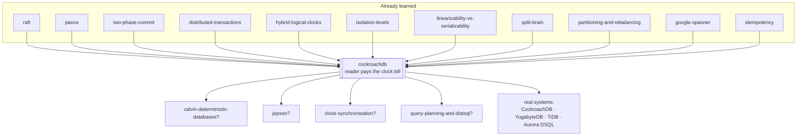

# CockroachDB — the database that refused to buy a clock

> **Tell a friend:** Asha pays a bill in Mumbai and is told it went through. She
> telephones Ben in Ohio, whose clerk looks in his own copy of the same ledger and
> says no such payment exists. Nobody lied and no page was missing: the two
> wristwatches that dated the entries disagree, and one of them called the payment
> "the future". Google's Spanner cured this by buying clocks good enough that a
> writer could sit out their error before answering. CockroachDB cannot buy those
> clocks, so instead it *declares* how far apart the watches may be, acknowledges
> every write immediately, and hands the leftover doubt to whoever reads next.

The trainer for this lab is [`visualization.html`](visualization.html), also
published as [The Reader Pays](https://claude.ai/code/artifact/2119fede-4cbd-44ca-9e82-b4583323640b).
Nothing to install, no code to run. What the lab is made of, where its numbers
come from and where it sits among your other labs are in
[section 17](#17-about-this-lab) at the end.

---

## 1. Why can't a database survive, hold money and speak SQL all at once?

> **In one breath:** You want a database that keeps working when a machine dies,
> never loses track of money, and understands ordinary SQL. Any two of those have
> been easy for decades. All three, on more data than one machine holds, was an
> open problem until about 2012.

You are running a business on a database. Three things have to be true at once.
They fight each other.

The first is **survival**. Not graceful degradation. Not a failover in four
minutes with a page to a human. The database keeps answering while a machine is
on fire.

The second is **money held correctly**. When two things must both happen or
neither, that is what happens — even when the two things live on different
machines.

The third is **SQL**. Your application speaks it. Your reporting stack speaks it.
Every engineer you will hire already speaks it.

Pick any two of the three and the answer has existed for decades. Here is what
each pair costs you.

| Pick these two | What you give up | The shipped product that does it |
|---|---|---|
| Money and SQL | survival | one PostgreSQL box, backed up nightly |
| Survival and SQL | money across machines | shard it yourself, reconcile later |
| Survival and money | SQL | a key-value store with no joins |

Now pick all three, at more data and more traffic than one machine can hold.
Until about 2012 the honest answer was: *you can't. Shard it yourself and give up
transactions across the shards.*

Then Google's Spanner proved you could have all three. The price of admission was
**hardware you cannot buy**: GPS antennas and atomic clocks in every datacentre.
They feed a time service that tells you not what time it is, but how wrong it
might be. That design is the [google-spanner](../66-google-spanner/) lab, and
this lab assumes you have read it.

CockroachDB answers a narrower question. **Can you have all three on ordinary
machines with ordinary clocks, in somebody else's cloud, where you are not
allowed to install an antenna on the roof?**

Suppose nobody solves it. The consequence is the one every large system ends up
living with. A payments ledger sharded by customer ID. An application-level
"distributed transaction" made of retries and reconciliation jobs. And a monthly
meeting about the seventeen accounts that do not balance.

Asha's bill is one line in that ledger, and Ben is waiting to hear about it. The
next section is what goes wrong for the two of them.

## 2. What goes wrong when one ledger book becomes three?

> **In one breath:** One clerk with one book gets order and time for free, because
> one wristwatch dated everything. Split the book across three towns and both
> gifts vanish. A payment can be real, acknowledged, and invisible.

A town has one ledger book and one clerk. Every purchase, payment and transfer is
a line in the book. Every line is dated and timed by the clerk as it is written.

Because there is one book and one clerk, two things are automatically true.
Nobody ever thinks about them.

Everything is written in **one order** — the order the clerk wrote it. And every
line's **time is comparable to every other line's**, because one wristwatch
produced all of them.

Then the clerk goes home with influenza. The town stops.

So the town hires three clerks in three towns. **Meera** works in Mumbai.
**Arjun** works in Frankfurt. **Dev** works in Ohio. Each gets a copy of the
book, so no single illness can stop anything.

And now both of the free gifts are gone.

Three clerks write in three books, so there is no single order. And this next
fact generates everything else in the lab. **Each clerk dates entries by their
own wristwatch, and no two watches agree.**

They are not broken watches. They are ordinary ones, checked against the radio
now and then, drifting a little between checks. Meera's runs a fifth of a second
fast. Dev's runs a tenth of a second slow. Nobody can tell. To know your watch is
fast you would need a watch you already trusted.

Now the damage, in milliseconds, exactly as the simulator runs it. **Asha** pays
a bill in Mumbai. **Ben** is her supplier in Ohio, waiting to hear. Call the true
instant of Asha's payment **1000**.

Read the last column. It is the whole lab.

| True moment | Who acts | What happens | The stamp on it | What the Ohio book says |
|---|---|---|---|---|
| 1000 | Asha, with Meera in Mumbai | the payment is written | **1180** — Meera's watch is 180 ms fast | it exists, dated 1180 |
| 1060 | the system, to Asha | "your payment has gone through" | — | it exists |
| 1070 | Asha, by telephone | *"Ben, it's gone through."* | — | it exists |
| 1080 | Ben, with Dev in Ohio | Dev reads the book "as of now" | his watch says **960** — 120 ms slow | **nothing here** |

Step through the last row slowly. Asha's entry is dated 1180. Dev is reading the
book as of 960. 1180 is *later* than 960. So as far as Dev can tell, the payment
has not happened yet. He tells Ben: *"no payment here."*

Nobody lied. Nobody's watch is broken. No message was lost. Ben has been told
something false about money, twenty milliseconds after Asha was told it was true.

That is the failure this lab is about. **Not lost data, not late data, but data
that is present, acknowledged, and invisible.**

> **🔮 Predict:** Dev has a *copy* of Meera's page. Replication is not the problem
> here — assume the page arrived instantly. Why does having the data not help?
>
> <details><summary>Reveal</summary>
>
> Because the question Dev asks is not "do you have the page?" It is "what did
> the book look like **at my time**?" The entry is dated later than his time, so
> it is filed as *not yet having happened*. The data is right there and is
> deliberately ignored.
>
> **Every problem in this lab is a problem of interpretation, not of delivery.**
> That is worth holding onto. You already have two labs about delivery,
> [quorums-and-replication](../34-quorums-and-replication/) and
> [anti-entropy](../38-anti-entropy/). Neither of them touches this.
>
> If you guessed "the copy must be stale", you are debugging the wrong layer.
> Make replication instant and the bug is unchanged.
>
> </details>

**How far this lab goes.** Stop at any layer and you still have something whole.

| Layer | Sections | After it you can… |
|---|---|---|
| Beginner | 1–9 | tell Asha's story and say why all four obvious fixes fail |
| Intermediate | 10 | trace a two-region transaction, refinement by refinement |
| Engineering | 11–12 | reason about nine failures and name the one assumption |
| Production | 13 | operate it, design a schema, and read Priya's dashboard |

## 3. What does a reasonable person try first?

> **In one breath:** Four fixes, in the order a sensible engineer reaches for
> them. Three of them you have already killed in earlier labs. The fourth is not
> wrong at all — it is simply unavailable to you.

Here are the four, with the three quick ones first.

| # | The fix | Where it dies | Already covered in |
|---|---|---|---|
| 1 | **One bigger machine.** No second clock, no second order. | Works beautifully until the machine dies or the data outgrows it. This is not a distributed-systems failure; it is the absence of the property you paid for. | [cap-theorem](../24-cap-theorem/) |
| 2 | **One writer, several read replicas.** One clock stamps everything, so order is safe. | The single writer is the ceiling and the outage. Promoting a replica loses whatever had not shipped. | [quorums-and-replication](../34-quorums-and-replication/), [split-brain](../42-split-brain/) |
| 3 | **Shard by customer, transactions within a shard only.** | Any invariant spanning two shards — a transfer, a uniqueness constraint, a ledger that must balance — has no home. You counted what happens when you bolt two-phase commit on anyway: **16 fractured audits in 40 runs**, with no crashes at all. | [distributed-transactions](../46-distributed-transactions/) |
| 4 | **Do what Spanner does: buy a clock that admits its own error, and make every writer wait out that error before answering.** | This one is *correct*. It closes the problem completely. It is also the one you cannot have. | [google-spanner](../66-google-spanner/) |

Fix 4 deserves more than a row, because it is not wrong. It is unavailable.

### Why is fix 4 correct and still out of reach?

Start with the thing in the story. Imagine Meera's wall clock has a *band* painted
on its face rather than a single hand. The band is a promise: the true moment is
somewhere inside it. Half the width of that band is how wrong the clock might be,
right now, at worst.

That is the whole of Spanner's clock. Three names, in the order you should meet
them.

| The thing in the story | Said in words | The engineer's name |
|---|---|---|
| the band painted on the clock face | an earliest and a latest, with the truth guaranteed to be between them | `TT.now()`, returning `[earliest, latest]` |
| half the width of that band | how wrong this clock might be, at worst, right now | **ε**, said "epsilon" |
| "has that moment definitely gone past?" | true only when the whole band has moved past the stamp | `TT.after(s)` |

Now the protocol, in one sentence. A writer stamps its transaction with the
*latest* edge of the band. Then it **refuses to acknowledge the client** until
the band has moved entirely past its own stamp. By the time anybody hears the
write is done, its stamp is provably in the past for every machine everywhere.

The Spanner lab put the bill at about **5 ms** added to every write. It also
listed the hardware in every datacentre that keeps ε down to single-digit
milliseconds.

The reason you cannot copy this is not intellectual. It is a loading dock. ε is
small only because there is a GPS receiver on the roof and an atomic clock in the
rack. You cannot install either in a cloud region you rent by the hour.

Without them, ε on ordinary machines disciplined by network time is **hundreds**
of milliseconds. And a design that sleeps for twice ε on every write becomes a
design that sleeps for most of a second on every write.

## 4. Where do all four fixes break?

> **In one breath:** Take Spanner's design, change nothing, and run it on rented
> machines. The protocol still works perfectly. Only the number moves — and the
> number is the product.

This is the most instructive failure in the lab. Nothing about the *protocol*
breaks. One constant does.

Set ε to a realistic commodity value of 250 ms. The writer's wait is twice ε, so
every acknowledgement is held for roughly 500 ms.

| What you changed | ε | The wait on every write | What a payments API answers in |
|---|---|---|---|
| nothing — Google's hardware | ~4 ms | ~8 ms | about **15 ms** |
| the same code, on rented machines | **250 ms** | **≈ 500 ms** | **515 ms** |

You have bought a perfectly correct database that nobody can use. Asha's payment
is now correct and half a second late, every single time, whether or not Ben was
ever going to ask about it.

And you cannot simply declare ε small and carry on. ε is not a preference. Claim
5 ms while your clocks actually disagree by 200 ms, and the writer's wait is too
short. External consistency then dies **with commit wait switched on**, silently.
That is exactly the fourth scenario in the Spanner lab.

So the four fixes leave us here. Fixes 1 to 3 give up one of the three
requirements outright. Fix 4 keeps all three and charges the **writer** an amount
proportional to how bad your clocks are. On Google's hardware that is a few
milliseconds. On rented hardware it ends the business.

What the failure reveals is not "clocks are hard". It is sharper than that.

> The cost of clock uncertainty has to be paid by *somebody*. Spanner charges the
> writer, on every single write, whether or not anyone was ever going to read it.
> That is a **fixed premium on all traffic**, and on commodity hardware the
> premium is unaffordable.

Which raises the question this whole lab turns on. **Is the writer the right
payer?**

> **🔮 Predict:** Suppose you move the bill to the reader instead. Reads are
> usually the *majority* of traffic — often 95% of it. Does that make the total
> bill bigger or smaller?
>
> <details><summary>Reveal</summary>
>
> **Smaller, by a lot, and the reason is not the ratio.** It is that the reader's
> bill is *conditional*. A writer's wait is charged on every write, always,
> whether or not a reader was ever going to look.
>
> A reader only pays when it happens to meet a value stamped inside its own
> window of doubt. On most workloads that is rare. Ninety-five reads that touch
> nothing recent cost nothing at all.
>
> If you guessed "bigger, because there are more readers", you were pricing a
> premium per operation. This is not a premium. It is an excess, paid only on
> claims.
>
> </details>

## 5. What exactly must the ledger promise?

> **In one breath:** Three separate promises hide inside "the database is
> correct". CockroachDB keeps two of them and declines the third on purpose, and
> knowing which is which is most of what a senior engineer knows about it.

Strip away the mechanism. There are three promises, and they are worth separating.

**Promise A — no stale reads.** Once a write has been acknowledged to its client,
every transaction that *begins after that acknowledgement* sees it. This is the
promise Ben's telephone call broke in section 2. It is the one users notice,
because it is the one that makes a database feel like a single machine.

**Promise B — serializable.** However many transactions run at once, the outcome
matches *some* one-at-a-time order of them. No fractured reads, no write skew, no
lost updates. You have the full anomaly taxonomy already from
[isolation-levels](../08-isolation-levels/).

**Promise C — that order matches real time, for everybody.** Not merely "some
serial order exists". The stronger claim is that the serial order never
contradicts the wall clock — even for two transactions that share no data and
never met.

Promise C has three names in this curriculum. They are the same property.

| Where you met it | What it was called there | Applied to |
|---|---|---|
| [linearizability-vs-serializability](../27-linearizability-vs-serializability/) | **strict serializability** | whole transactions |
| [google-spanner](../66-google-spanner/) | **external consistency** | whole transactions |
| this lab, from section 12 onward | strict serializability | the one thing declined |

Here is the honest statement of what this lab builds. It is made now, rather than
sprung on you in section 12.

> **CockroachDB guarantees A and B. It does not guarantee C, and does not claim
> to.** Cockroach Labs' own writing puts it plainly: *"CockroachDB doesn't quite
> offer strict serializability, but we're fairly close to it."*

Three places pay that off. Section 12 shows you exactly what falls through the
gap between B and C. Scenario 8 of the simulator lets you watch it happen with
every clock inside its budget. And section 13 shows you the one table type where
CockroachDB buys C back — by doing exactly what Spanner does.

## 6. What is the key idea, in two sentences?

> **In one breath:** Stop trying to know the time. Declare how wrong your clock
> is allowed to be, and make the reader carry that doubt. Then apply the same
> refusal to be sure everywhere else: never prevent a conflict, just detect it
> afterwards and redo the work.

Two sentences. Read them slowly. The whole lab is inside them.

> **Sentence one: do not try to know the time.** Know instead how wrong your
> clock is allowed to be. That number is one you *declare*, not one you measure.
> Then put the cost of that doubt on the reader.
>
> **Sentence two: never coordinate to *prevent* a conflict.** Proceed
> optimistically, *detect* the conflict afterwards, and retry.

The first sentence inverts Spanner exactly. Cockroach Labs state the inversion in
one line: *"While Spanner always waits after writes, CockroachDB sometimes
retries reads."*

Look at what that trade actually is.

| | Spanner | CockroachDB |
|---|---|---|
| Shape of the cost | certain, small, universal | uncertain, occasionally large, rare |
| Who is billed | the writer | the reader |
| When | every write, always | only when a read meets a recent value |
| What a quiet read costs | nothing | nothing |
| What an unlucky read costs | nothing | its work, done twice |

Writes are acknowledged immediately. Reads that touch nothing recent cost
nothing. The bill only arrives when a reader and a recent writer nearly collide
in time — which, on most workloads, is seldom.

The second sentence is why CockroachDB looks so unlike a lock-based database from
the outside. Almost nothing waits for anything. Writes do not wait for a commit
record. Readers do not wait for writers. Writers do not wait for readers.

Instead the system detects, afterwards, that something incompatible happened.
Then it throws work away.

Meet **Omar**. He writes the application that talks to this cluster, and he is
the third person the bill can be sent to. His code must wrap every transaction in
a retry loop, because the database is entitled to refuse a perfectly reasonable
transaction and ask for it again.

The refusal has a name he will see in his logs. In words it is "I could not
commit this without breaking serializability, so please run it again." The SQL
standard calls that a serialization failure, and the code for it is
**`SQLSTATE 40001`**.

That code is **part of the API contract, not an error path**. An ordinary,
healthy CockroachDB application retries on it several times an hour and nothing
is wrong.

> **Say it back.** Without using the words *timestamp*, *uncertainty* or
> *commit wait*, explain to Omar why Spanner's writes are slow and CockroachDB's
> reads are sometimes done twice.
>
> <details><summary>A good answer sounds like</summary>
>
> "Both systems know their clocks might disagree, and somebody has to absorb
> that. Spanner makes the person filing the document sit still for a moment
> before anyone is told, so by the time a reader turns up there is nothing left
> to absorb. CockroachDB cannot afford that pause, because its clocks disagree by
> too much. So it hands the document over straight away, and occasionally a
> reader finds an entry it cannot place in time and has to start its work again."
>
> </details>
>
> Next: the five words you now need, each one naming something you have already
> watched happen to Asha, Meera, Arjun, Dev or Ben.

## 7. What are these five things called, now that you have earned the words?

> **In one breath:** Five terms, and every one of them names something you have
> already watched happen in the ledger office. The rest of the vocabulary arrives
> in section 10, at the moment it is needed.

### What is a chapter of the book really called?

The book is too big for one town, so cut it up. Not into random handfuls — into
**chapters**, each holding all the entries whose names fall between two
bookmarks. `/accounts/a–m` is one chapter. `/accounts/n–z` is the next. Asha's
row is in the first, Raj's in the second.

Engineers call a chapter a **range**.

Here is the precise version. CockroachDB stores the entire cluster as **one
sorted key-value map**. That means every table, every index and every internal
record, all in one map. It cuts that map into contiguous chunks. Each chunk is a range, and each range is
replicated three times by default. Each range's copies form their own independent
Raft group ([raft](../40-raft/)).

A range is not a fixed size. It grows and shrinks with the data, and two numbers
govern that. Say them in words first: *split when a chapter gets too fat, merge
when it gets too thin.*

| The rule in words | The setting | Its default |
|---|---|---|
| split this chapter in two when it grows past this size | `range_max_bytes` | **512 MiB** |
| merge this chapter into its right-hand neighbour below this size | `range_min_bytes` | **128 MiB** |

Why does the word *range* exist at all, when you already have partitions? To
distinguish this from the **hash** partitioning of
[consistent-hashing](../35-consistent-hashing/). A hash bucket holds keys that
have nothing to do with each other. A range holds keys that are **adjacent in
sort order**.

That is what makes `WHERE id BETWEEN 100 AND 200` a single seek plus a scan,
rather than a question asked of every machine in the cluster. The trade buys you
ordered scans and costs you hot spots on sequential keys. Section 11 makes the
cost concrete.

This is range partitioning with automatic splits, the shape you studied in
[partitioning-and-rebalancing](../36-partitioning-and-rebalancing/). One
consequence to hold onto: a transfer from Asha to Raj crosses two chapters, so it
is a **two-range transaction**.

### Who is allowed to answer, and why is it only one of them?

For each chapter, one of the three clerks is **on duty**. Only the duty clerk may
answer questions about that chapter without consulting the others. The other two
hold copies and stay quiet.

Engineers call that duty the **range lease**, and the clerk holding it the
**leaseholder**.

One replica of each range holds the exclusive right, for a bounded time, to serve
reads from its local copy and to sequence writes. Reads at the leaseholder need
no consensus round at all. That is the difference between a read costing 1 ms and
a read costing a cross-region round trip.

In the simulator, Arjun in Frankfurt holds the lease for `/accounts/a–m`. A
client connected to Frankfurt reads Asha's balance in **1 ms**. The same client
reads Raj's balance in **60 ms**, because Dev in Ohio holds that lease.

Why does the word need to exist next to "Raft leader", which sounds like the same
job? Because it is not the same job, and the difference cost CockroachDB real
production incidents.

Raft leadership is about who appends to the log. The lease is about who may
answer *without* appending. Historically these could drift apart onto different
replicas — a **leader-leaseholder split**. A leaseholder whose Raft log had
fallen behind could render a range unavailable during a partition.

Since **v25.2 the default is leader leases**, which structurally fuse the two.
The Raft leader is always the leaseholder, except briefly during a transfer.

A lease is also a **fencing token**, in exactly the sense of
[split-brain](../42-split-brain/). Its entire job is to make it impossible for two
machines to believe they are in charge at once.

### What is a pencil mark in the ledger?

Asha's transfer touches two chapters. The clerks do not lock them. They write the
new value into the book **in pencil**, with a note beside it saying which
transaction it belongs to. Anyone who finds it then knows where to go and ask
whether it counts.

Engineers call that pencil mark a **write intent**.

The documentation describes it precisely: a write intent is *"a combination of a
replicated lock and a replicated provisional value"*. It is an ordinary MVCC
record carrying a pointer to a **transaction record**. It travels through Raft
like any other write, so it survives machine death.

And it blocks nobody outright, because a reader that meets one can go and resolve
it.

Why keep this idea separate from a lock? Because a lock fuses two things that are
better apart. A lock says *"you may not proceed."* An intent says *"here is the
value, and here is where to find out whether it is real."*

The second is strictly more useful. A reader holding an intent can finish the
writer's transaction on its behalf. You met the ancestor of this idea as
Percolator's staged lock in
[distributed-transactions](../46-distributed-transactions/); section 10.3 makes
one change to it that matters enormously.

In scenario 1 of the simulator, `/accounts/asha` briefly carries an intent
reading `₹1,500 @ ts 1000`, pointing at transaction T1's record, before anything
anywhere says COMMITTED.

### Where is it written down whether a transaction counts?

Every pencil mark says *"see master card #714."* Card #714 lives in one place,
and it is the only thing that decides whether the whole transaction counts. Fill
it in and every pencil mark in the book counts at once — even before anyone has
gone back to ink them in.

Engineers call the card a **transaction record**.

It is a single key-value pair. It lives on the range that contains the
transaction's first written key, and that key has its own name: the **anchor**.
The record's value is the transaction's status.

Read this table as the five states of card #714. The fifth is the one people
forget.

| The card says | In words | How it is decided |
|---|---|---|
| `PENDING` | started, not yet finished | the coordinator is still working |
| `STAGING` | finished, if everything it listed got written | section 10.3 — this is the clever one |
| `COMMITTED` | it counts, permanently | written down, or inferred from `STAGING` |
| `ABORTED` | it does not count, permanently | the coordinator gave up, or recovery killed it |
| *no card at all* | nobody knows yet | compare the intent's timestamp with a liveness threshold |

Every intent in the transaction, on every range, points at this one record.

Why does the word need to exist? Because the record is what makes a multi-range
commit **atomic by construction rather than by protocol**. There is no vote. There
is no agreement about the outcome. There is one shard-local write that a hundred
intents all defer to.

This is the "relocated commit point" from the distributed-transactions lab, and
it is what deletes two-phase commit's blocking problem. Compare it with
[two-phase-commit](../45-two-phase-commit/), where the decision lived in a
coordinator process's memory. Here it is replicated data, and Percolator's
primary key is its direct ancestor.

In scenario 2, Frankfurt dies with the record stuck in `STAGING`. The record
outlives its author, on a different machine, and a stranger reads the outcome off
it.

### What is a reader's window of doubt?

Everyone knows the watches disagree. So everyone agrees on one number in advance:
**no watch is more than half a second away from any other.**

That number is a promise, not a measurement. And it hands the reader a rule. A
clerk reading the book "as of 960" must treat every entry dated between 960 and
1460 as *"I cannot tell whether this is in my past"*, and go and check.

Engineers call that band the **uncertainty interval**.

Said as a rule: a transaction reading at some timestamp treats every committed
value stamped in the next half-second as **ambiguous**. Not visible. Not
invisible. Unresolvable.

Written as notation, and only now that you have the picture:

| The band in words | The band written down | The number it uses |
|---|---|---|
| from just after my read time, up to and including half a second later | `(t, t + max_offset]` | `max_offset`, default **500 ms** |
| the cluster-wide promise about how far two clocks may differ | the `--max-offset` startup flag | **500 ms** by default |

Meeting an ambiguous value raises an error inside the database. In words it says
"I read something I cannot place in time." Its name is
`ReadWithinUncertaintyIntervalError`, and the transaction restarts at a higher
timestamp.

Why does this word have to exist, when Spanner already has ε? Because it names the
same quantity, **relocated**.

| | Spanner's ε | CockroachDB's `max_offset` |
|---|---|---|
| Where the number comes from | measured by the hardware | declared by you |
| Which end of the transaction pays | the writer, before answering | the reader, on collision |
| What kind of statement it is | a fact | an assumption |
| What happens when it is wrong | the wait is too short | the window is too narrow |

Same quantity, opposite ends, and one is a fact while the other is an assumption.
Section 12 is largely about that difference.

Watch it work in scenario 3 at the default settings. Ben's read starts at **960**
with a window ending at **1460**. Asha's payment is stamped **1180**, which is
inside the window. So the read restarts at **1180⁺** and returns SETTLED.

Now drag the max-offset slider to 0. The same read returns PENDING — a wrong
answer about money, with no error raised.

This is the "uncertainty restart" that
[hybrid-logical-clocks](../31-hybrid-logical-clocks/) named and did not build. It
is the same ε as [google-spanner](../66-google-spanner/), with the opposite payer.

### The five words, in one place

| Word | The thing in the ledger office | Where you first met the problem |
|---|---|---|
| **range** | a chapter, cut at two bookmarks | section 2 — one book had to become many |
| **leaseholder** | the clerk on duty for that chapter | section 3, fix 2 — one writer was the outage |
| **write intent** | a pencil mark saying "see card #714" | section 3, fix 3 — 16 fractured audits in 40 runs |
| **transaction record** | card #714 itself | section 3, fix 3 — nowhere to put the decision |
| **uncertainty interval** | the band of dates a clerk cannot place | section 2 — Ben was told "no payment here" |

## 8. Which two pictures should you carry, and where does the nice one lie?

> **In one breath:** Carry a simple picture and a precise one. The simple picture
> is three clerks, a book in chapters, pencil marks and master cards. It is
> accurate enough to reason with, and it lies to you in exactly four places.

### The simple picture: three clerks and a book in chapters

The book is cut into chapters. Every chapter is photocopied to all three towns,
so no town's fire destroys anything. For each chapter one clerk is on duty and
may answer questions about it alone. The others hold copies and stay quiet.

To write a transaction you go round and put **pencil marks** in every chapter you
are changing. Each mark says *"see master card #714."* Then you fill in card
#714. Once card #714 says the transaction counts, every pencil mark counts,
everywhere, at once — even before anyone has inked them in.

And every entry is dated by the duty clerk's own watch. Everyone knows the
watches disagree, and everyone has agreed on one number: **no watch is more than
half a second from any other**. So a clerk reading the book as of 960 treats
every entry dated between 960 and 1460 as *"I cannot tell whether this is in my
past"*, and goes back to check.

### The precise picture: what each part of the office really is

Three small tables rather than one long one, so you can find the row you want.
The right-hand column says where in this lab the thing does its work.

The places and the people:

| In the office | In the machine | Where it works |
|---|---|---|
| the book | one monolithic sorted key-value map holding the whole cluster | 10.1 |
| a chapter | a **range** — a contiguous key span, 512 MiB max by default | 10.1 |
| three photocopies of a chapter | three **replicas**, forming that range's own Raft group | 10.2 |
| the duty clerk for a chapter | the **leaseholder**; since v25.2 always also the Raft leader | 10.2 |

The marks and the card:

| In the office | In the machine | Where it works |
|---|---|---|
| a pencil mark | a **write intent**: an MVCC value plus a pointer to a transaction record | 10.3 |
| master card #714 | the **transaction record**: `PENDING` / `STAGING` / `COMMITTED` / `ABORTED` | 10.3 |
| a note that someone already read this line | the **timestamp cache** | 10.5 |
| proving your earlier reading still stands | a **read refresh** | 10.5 |

Time and doubt:

| In the office | In the machine | Where it works |
|---|---|---|
| the date on an entry | a **hybrid logical clock** stamp — 64-bit wall clock plus a 32-bit counter | 10.4 |
| "no watch is more than half a second out" | the `--max-offset` promise, default **500 ms** | 10.4 |
| "I cannot tell whether this is in my past" | the **uncertainty interval** `(read_ts, read_ts + max_offset]` | 10.4 |
| going back to check | an **uncertainty restart**, raised as `ReadWithinUncertaintyIntervalError` | 10.4 |

### Where the story lies to you

Four places, and each one is load-bearing.

**Lie one: that the duty clerk is elected by a show of hands about the data.** A
lease is not consensus about content. It is a bounded, fenced grant of authority.

Why that matters is [split-brain](../42-split-brain/)'s whole argument. A machine
partitioned away from the others can still *believe* it is the duty clerk, and
the design has to make that belief harmless. Leader leases do it by refusing to
let leadership and duty ever be held by different machines.

**Lie two: that the ink is what makes it real.** "Pencil first, then ink" implies
so. It is false.

In the real design, filling in the master card is not even the commit. The
transaction is committed the instant the card says `STAGING` *and* every mark it
lists has been agreed by a majority. The inking is bookkeeping done afterwards,
by whoever happens to pass. Section 10.3 builds this, and it is the least
intuitive idea in the lab.

**Lie three: that chapters are fixed.** Ranges split and merge continuously as
data grows and shrinks, and the boundaries move under load. There is no moment at
which the shape of the book is settled.

**Lie four: that somebody knows the true time.** The story tempts you to imagine
a narrator who knows it is "really" 1000 when Asha pays.

The simulator has exactly such a narrator, drawn as the top lane of its timeline.
**No component of the real system does.** Every mechanism in this lab is built
out of *relative* comparisons between numbers that are all individually wrong.

## 9. Where can you break it yourself?

> **In one breath:** The simulator draws two lanes — what really happened, and
> what the cluster believes happened. Reading the gap between them is most of the
> lesson. Then you drag one slider and watch a payment vanish.

Open **[The Reader Pays](https://claude.ai/code/artifact/2119fede-4cbd-44ca-9e82-b4583323640b)**,
or `visualization.html` in this directory, which works offline.

### What are you looking at?

The timeline has two lanes on a single shared millisecond scale.

| What you see | What it means |
|---|---|
| **the top lane** | real time — when each transaction actually began and was acknowledged; nothing inside the database can see this lane, and it exists so *you* can |
| **the bottom lane** | what the cluster believes: each key as a row, each committed version as a dot at its timestamp, each write intent as a hollow diamond |
| **the dashed line between them** | connects a transaction's real beginning to the timestamp it was given; its slant is that machine's clock error, drawn to scale, with the millisecond figure on it |
| **the amber band** | the reading transaction's window of doubt |

A right-leaning dashed line is a fast clock inventing the future. A left-leaning
one is a slow clock backdating the present. Meera's line leans right. Dev's leans
left.

Version dots are coloured by where they fall relative to the amber band.

| Dot colour | Where the value sits | What happens to it |
|---|---|---|
| green | in the reader's past | visible |
| amber | inside the band of doubt | ambiguous — about to cause a restart |
| grey | in the reader's future | skipped |

### What should you try, and in what order?

1. **Scenario 3, "The stale read"**, with everything at its defaults. Answer the
   prediction, then press *Run it for me*. Watch the amber band catch the
   payment. Watch the read line jump right while the band's right-hand edge stays
   exactly where it was.
2. **The same scenario, with the max-offset slider dragged to 0.** This is the
   single most valuable ten seconds on the page. The verdict banner turns red, a
   payment that has been acknowledged is reported as not having arrived, and
   **not one log line says anything is wrong**.
3. **Scenario 1 with the parallel-commits switch on, then off.** You have not met
   parallel commits yet, because section 10.3 builds them. You can still see what
   they buy right now. The client's wait goes from 121 ms to 181 ms for exactly
   the same guarantee.
4. **Scenario 5, "Two doctors"**, then turn off *re-check reads when pushed* and
   run it again. That is write skew, live.
5. **Scenario 8, "The causal reverse"** — a name section 12 will earn. Every
   clock inside its budget, no failures at all, and the audit still sees an
   effect without its cause.

Two habits make the page much more useful.

**Predict before you run.** The buttons are there so that you commit to an answer
while being wrong is still cheap.

**Step backwards.** The whole simulation is a pure function of the dials, so the
arrow keys move freely. Nothing is remembered between steps that the screen does
not show you.

---

**CHECKPOINT — end of the beginner model.**

You can now say why this database exists, what breaks without it, and what its
one big idea is. Never be sure what time it is; declare how unsure you are; make
readers carry the doubt.

**What the next layer adds:** how a row becomes a key, and who is allowed to
answer a read. Then how a two-continent commit takes one round trip instead of
two, and how serializability is enforced without a single lock on a reader.

> **Say it back.** Without using the words *timestamp*, *interval* or *offset*,
> explain to a friend why Ben was told the payment had not arrived, and what
> CockroachDB makes Dev do instead.
>
> <details><summary>A good answer sounds like</summary>
>
> "The entry was dated by a watch that runs fast, so it carried a date slightly
> in the future. Dev's watch runs slow, so when he looked at the book 'as of
> now', his now was earlier than the date on the entry, and he filed it as not
> having happened yet. CockroachDB fixes it by making Dev distrust a slice of
> dates just ahead of his own. Anything in that slice he cannot rule out — so he
> starts his search again from a later moment, at which point the entry is
> plainly in his past."
>
> </details>

## 10. How is the mechanism built, one failure at a time?

> **In one breath:** Five parts. Each one starts with the version a sensible
> engineer would build, breaks it, and repairs it. Every odd detail of the real
> design is the scar of one of these breakages.

### 10.1 Where does a row actually live?

Asha (a row in the ledger) has to live on some machine. Which one?

The first design anybody writes hashes the primary key and sends the row to
whichever machine the hash points at. That is
[consistent-hashing](../35-consistent-hashing/). It spreads load perfectly, and
it is what Cassandra and DynamoDB do.

It breaks on the second query you will ever write. `SELECT … WHERE id BETWEEN 100
AND 200` has to be sent to every machine, because a hash scatters adjacent keys
deliberately. So does `ORDER BY id LIMIT 10`. So does any range scan on any
index. You have made single-key lookups perfect and everything else a fan-out.

The repair is to keep the keys in order. CockroachDB stores the whole cluster as
**one sorted key-value map** and cuts it into contiguous ranges. Adjacent keys
are adjacent bytes, in the same range, on the same machine, in the same LSM tree
([btree-and-lsm](../05-btree-and-lsm/)).

A SQL row becomes key-value pairs by an encoding worth seeing once, because two
production problems fall straight out of it. In words: *the table's number, then
the index's number, then the indexed values — and the rest of the row is what
that points at.*

```
   /<table_id>/<index_id>/<indexed column values>  →  <the remaining column values>
```

The primary key always uses index number 1, written in the encoding as
`index_id = 1`. Take a row of `accounts`, which is table 106 here. Its primary
key is `'asha'` and its columns are `(balance, tier)`. It comes out roughly like
this:

```
   /106/1/"asha"   →   (2000, "gold")
```

A secondary index on `tier`, which is index number 2, is another entry in the
same map:

```
   /106/2/"gold"/"asha"   →   —
```

Three consequences follow immediately. You should be able to derive each one from
that single line of encoding.

| What follows from the encoding | Why | Where it bites |
|---|---|---|
| a range scan is a sequential read | every row of `accounts` between `'a'` and `'m'` is contiguous bytes | makes ordered SQL cheap |
| a secondary index is just more rows in the same map, usually in a different range | it is a separate entry with its own sort position | one insert with two indexes is a *multi-range* transaction, so 10.3's saved round trip matters |
| a monotonically increasing primary key is a design fault, not a preference | every new row sorts to the end of the map | every insert hits the same range, one leaseholder, one machine — section 11.6 |

**How does a client find the range it wants?** With a two-level index, held
inside the map itself. The first level, **`meta1`**, tells you which second-level
record to consult. The second, **`meta2`**, addresses every user range.

The location of `meta1` is spread to every node by gossip
([gossip-protocols](../37-gossip-protocols/)), and every node caches the range
descriptors it has used. Two levels address up to 4 EiB, so a lookup is at most
two hops and usually zero.

> **🔮 Predict:** Ranges split when they grow past 512 MiB and merge when they
> shrink below 128 MiB. Why are those two numbers so far apart, rather than both
> being, say, 256 MiB?
>
> <details><summary>Reveal</summary>
>
> Because a single threshold would make the system **oscillate**. A range sitting
> right on the line would split, and each half would immediately be under the
> line, so they would merge, and the merged range would be over the line again.
>
> The gap between 128 MiB and 512 MiB is deliberate slack — engineers call it
> hysteresis. A range has to lose three quarters of its data before a merge is
> even considered.
>
> If you guessed "512 is for performance and 128 is for storage", you are
> thinking about the absolute values rather than the distance between them. The
> distance is the point.
>
> </details>

### 10.2 Who is allowed to answer a read?

The obvious first design is to read through Raft. Every read is proposed to the
range's Raft group and answered once a majority has agreed. This is obviously
correct, and it is what a first implementation does.

It breaks on cost. Every read now costs a consensus round — including the 95% of
your traffic that is reads. Across regions that is tens of milliseconds. You have
built a correct database with the read latency of a write.

The repair is the **range lease**. One replica holds the exclusive right to serve
reads locally for a bounded period. Reads become a local lookup. Arjun in
Frankfurt answers about `/accounts/a–m` without telephoning anybody.

The leaseholder also sequences writes, which is what makes the timestamp cache in
10.5 possible at all.

**And that repair broke, in production, for years.** The lease and the Raft
leadership were separate grants and could land on different replicas — the
**leader-leaseholder split** from section 7. A leaseholder whose Raft log had
fallen behind the others would keep answering reads while being unable to make
progress on writes. Under a network partition this could leave a range
unavailable indefinitely.

The second repair is **leader leases**, the default since **v25.2**. The Raft
leader is always the leaseholder, except briefly during a deliberate transfer.

That change also removed a structural single point of failure. The older
**epoch-based leases** depended on one cluster-wide **node liveness range** that
every node heartbeated. Leader leases replaced it with store-wide failure
detection. Heartbeating still exists for cluster membership, death detection and
replica placement — it is simply no longer on the critical path of holding a
lease.

A third kind, **expiration-based leases**, still covers system ranges. They
expire after a few seconds and are renewed by continued Raft activity.

Three kinds of lease, then, and it is worth keeping them apart.

| Kind of lease | How it stays alive | Where it is used now |
|---|---|---|
| **leader lease** | held by whoever is Raft leader, by construction | the default since v25.2, for user ranges |
| **epoch-based lease** | a cluster-wide node liveness range, heartbeated | legacy; the previous default |
| **expiration-based lease** | a few seconds, renewed by Raft activity | system ranges |

> **🔮 Predict:** The leaseholder answers reads from its own copy without asking
> anybody. A stale or partitioned leaseholder could therefore serve an old value
> forever. What stops it?
>
> <details><summary>Reveal</summary>
>
> The lease is <b>time-bounded</b>, and this is exactly the fencing argument from
> <a href="../42-split-brain/">split-brain</a>. A leaseholder may only answer
> reads while its lease is valid; a partitioned one runs out and stops. A new
> leaseholder cannot be granted until the old lease has provably expired, so two
> machines can never both believe they are on duty at once.
> <br><br>
> The safety property does not come from the leaseholder being well-behaved. It
> comes from time bounding what a misbehaving one can do. Which is the same trick
> as the uncertainty interval, applied to authority instead of to data.
> <br><br>
> If you guessed "the other replicas would correct it", you have imagined a
> conversation that never happens. The whole point of a lease is that no
> conversation is needed.
>
> </details>

### 10.3 How does a transaction write — and why is the commit not an event?

Take the transfer from scenario 1. Move ₹500 from Asha to Raj. Asha's row is in
`/accounts/a–m`, whose leaseholder is Arjun in Frankfurt. Raj's row is in
`/accounts/n–z`, whose leaseholder is Dev in Ohio. Two ranges, two leaseholders,
60 ms apart.

The design you already know is **Percolator**, from
[distributed-transactions](../46-distributed-transactions/). Stage the writes as
intents. Then flip one designated record from pending to committed. Let
secondaries clean up lazily.

CockroachDB's intents and transaction record are exactly Percolator's lock and
primary, generalised — the record is its own key rather than one of the data
keys.

Here is the trace, from the simulator with parallel commits **off**. Read the
last line first.

```
t=1000   BEGIN on Frankfurt · read_ts = HLC(Frankfurt) = 1000
t=1001   GET /accounts/asha  @ Frankfurt (local, 1 ms)  → ₹2,000 @ ts 200
t=1061   GET /accounts/raj   @ Ohio (60 ms)             → ₹500   @ ts 300
t=1061   PUT intent /accounts/asha = ₹1,500 @ 1000
         PUT intent /accounts/raj  = ₹1,000 @ 1000       ← round 1 of consensus
t=1121   both intents agreed by majorities
t=1181   PUT txn record PENDING → COMMITTED              ← round 2 of consensus
         client acknowledged.  Elapsed: 181 ms
```

It breaks on the second round. Look at what was already true at t=1121. Both
values are durable on majorities. Nothing can undo them. No participant can
change its mind.

The outcome was already forced. And yet the client waits another full
cross-region round trip while the coordinator writes down a conclusion nobody
could have contradicted.

It gets worse with schema. Every secondary index entry is another key, often on
another range. A wide table's insert pays this on more ranges.

**The repair is parallel commits, and it works by redefining what "committed"
means.** The documentation puts it exactly:

> *"A transaction is considered committed if its record is in the STAGING state
> and an observer can prove that all of the writes listed in its transaction
> record have successfully achieved consensus."*

Read that twice, because it is the whole trick. Committed stops being an **event
someone performs** and becomes a **condition anyone can check**.

So the coordinator writes the record *at the same time* as the intents, not after
them. The record goes in as `STAGING`, and it lists the keys it is waiting on:

```
   TransactionRecord{ Status: STAGING, Writes: []Key{"/accounts/asha", "/accounts/raj"} }
```

The same trace with parallel commits on:

```
t=1000   BEGIN on Frankfurt · read_ts = 1000
t=1001   GET /accounts/asha  → ₹2,000 @ ts 200
t=1061   GET /accounts/raj   → ₹500   @ ts 300
t=1061   PUT intent /accounts/asha, PUT intent /accounts/raj,
         PUT txn record {STAGING, in-flight:[asha, raj]}   ← all three, in parallel
t=1121   every one of them agreed → the commit condition holds → transaction IS committed
         client acknowledged.  Elapsed: 121 ms
t=1126   record STAGING → COMMITTED; intents resolved to values   ← off the critical path
```

**121 ms instead of 181** — exactly one cross-region round trip saved. The
simulator asserts that identity across its configurations.

Cockroach Labs' own claim is the qualitative version of the same thing. Without
parallel commits, client-perceived latency grows at *twice* the rate of the
round-trip time. With them, at exactly the rate of the round-trip time.

| Parallel commits | Rounds of consensus on the critical path | The client's wait | How latency grows with round-trip time |
|---|---|---|---|
| off | 2 | **181 ms** | at twice the rate |
| on | 1 | **121 ms** | at exactly the rate |

> **🔮 Predict:** Pick the moment t=1122. The client has been acknowledged.
> Nothing anywhere says COMMITTED. Neither pencil mark has been inked. At exactly
> that moment the coordinator machine catches fire. Is the money moved?
>
> <details><summary>Reveal</summary>
>
> <b>Yes, definitively.</b> Not "probably", not "a human must decide". The commit
> condition was satisfied at t=1121, and it is a property of data replicated on
> majorities. Nothing about the coordinator's continued existence was ever part
> of it.
> <br><br>
> The next reader to touch either key finds an intent and follows it to a
> <code>STAGING</code> record. It checks the keys that record lists, finds them
> all present, and concludes the transaction committed. Then it does the tidying
> itself. Run scenario 2 to watch a stranger finish someone else's transaction.
> <br><br>
> Compare this with <a href="../45-two-phase-commit/">two-phase-commit</a>, where
> a coordinator dying between prepare and commit leaves participants holding
> locks with no way to learn the outcome. And with XA in the JVM, where the
> resolution is a human being inventing a <i>heuristic outcome</i> for an
> <i>in-doubt</i> transaction.
> <br><br>
> The blocking problem is not solved here. It is <b>deleted</b>, by making the
> outcome a fact in the data rather than a message from a process. If you guessed
> "it depends whether the coordinator logged anything", you are still imagining
> the decision living in a process.
>
> </details>

**And what if one of the listed writes is missing?** Then somebody has to decide,
and the decision must be permanent. Two readers running recovery a moment apart
must not reach different conclusions.

So when recovery finds a listed key without an agreed intent, it does not simply
abort. It first **makes that write impossible forever**. It does that by raising the
barrier on that key, which is the timestamp cache of 10.5, above the
transaction's timestamp. Only then does it mark the record `ABORTED`.

Any straggling attempt to complete that write now fails. The same procedure
produces both outcomes and both are atomic. Scenario 2's final step walks the
abort branch.

### 10.4 How does a reader avoid a stale answer?

This is the part that is unique to CockroachDB, and it is stage 3 of the
simulator. It is also Asha and Ben's problem from section 2, finally solved.

Every version in the store is stamped with a **hybrid logical clock** value. That
is the timestamp you built in
[hybrid-logical-clocks](../31-hybrid-logical-clocks/): a wall-clock reading plus
a logical counter. In CockroachDB the pair is an `int64` of nanoseconds plus an
`int32`. A transaction takes its read timestamp from the clock of the node its
client connected to.

The obvious first design is to read at your own now. Show every version stamped
at or below your read timestamp. This is textbook MVCC, and on one machine it is
exactly right.

It breaks on the story in section 2. Here is the trace, from the simulator, at
the defaults, with the doubt set to zero. Meera is Mumbai, Dev is Ohio.

```
t=1000  Mumbai (clock +180) commits Asha's payment.  commit_ts = 1180
t=1060  Asha is acknowledged
t=1070  Asha telephones Ben
t=1080  Ohio (clock −120) begins Ben's read.  read_ts = 960
t=1141  value ts 1180 > read_ts 960  →  "in my future"  →  invisible
        Ben is told: PENDING                                  ← STALE READ
```

**The repair is to refuse to answer when you cannot tell.** Give the reader an
**uncertainty interval**: from just after its read timestamp, up to half a second
later. A value inside it is neither visible nor invisible. It is *unresolvable*,
and returning either answer might be a lie.

So the read raises `ReadWithinUncertaintyIntervalError` and restarts at a
timestamp just above the offending value. Same trace, with the doubt at its
default of 500 ms:

```
t=1080  read_ts = 960 · uncertainty interval = (960, 1460]
t=1141  value ts 1180 ∈ (960, 1460]  →  ambiguous  →  ReadWithinUncertaintyIntervalError
        restart at 1180⁺ · ceiling stays 1460 · window is now 280 ms wide, not 500
t=1142  value ts 1180 ≤ read_ts 1180⁺  →  visible
        Ben is told: SETTLED                    ← correct, and it cost one round trip
```

**And that repair looks like it might never terminate.** A busy cluster is
writing all the time. If every value in the window costs a restart, a long report
could restart forever.

Two brakes stop it, and they are independent.

**Brake one: the ceiling never rises.** On restart the read timestamp moves up.
The ceiling does not. It was computed once, when the transaction *began*. So every
restart strictly shrinks the remaining doubt. The documentation states it
directly: *"the upper bound of the uncertainty interval does not change on
restart, so the window of uncertainty shrinks."*

Watch it in the trace above. The window went from 500 ms wide to 280 ms wide,
because its left edge moved and its right edge did not.

**Brake two: observed timestamps.** When a transaction first contacts a node, it
writes down what that node's clock read at that moment. Any value on that node
stamped **above** that reading must have been written *after* the transaction
spoke to it. So it is provably in the transaction's future, not merely possibly.
No restart.

The consequence is a hard bound. A transaction can be forced to restart **at most
once per node**, and never by more than the width of its uncertainty interval.

Scenario 4 is that bound, made visible. Same report, same four rows, one switch.

| Observed timestamps | Restarts | What the report saw for `/payments/p2` |
|---|---|---|
| on, the default | **1** | the older version, `PENDING @ 580` |
| off | **2** | the newer version, `REFUNDED @ 1285` |

Read the second column carefully, because it is a subtlety people miss. The
optimisation does not only make things faster. It changes **which snapshot you
get**.

Both answers are serializable. They are different, equally valid points in the
transaction order. Nothing about correctness depends on which one you get — and
that is precisely why the optimisation is allowed to exist.

> **🔮 Predict:** Dev's clock in Ohio is slow, so writes made in Ohio carry small
> timestamps and look older than they are. Does that hurt Ohio's *own* readers?
>
> <details><summary>Reveal</summary>
>
> No — and working out why is the best test of whether the mechanism has landed.
> A slow clock backdates its writes, so they fall <i>below</i> other readers'
> read timestamps and are plainly visible. Doubt only arises when a value is
> stamped <b>above</b> the reader's timestamp, which needs the <i>writer's</i>
> clock to be ahead of the <i>reader's</i>.
> <br><br>
> Scenario 4 has a row exactly like this. It is Raj's, written on Ohio at true
> time 900 and stamped 780, and it causes no drama at all.
> <br><br>
> The direction matters enormously for a different reason. A fast clock is the
> dangerous one: it invents timestamps in the future, and future timestamps are
> what hide from readers. This is why the failure in 11.3 is asymmetric, and why
> the condition derived there involves the <i>difference</i> between the writer's
> and the reader's offsets, not the absolute error of either.
> <br><br>
> If you guessed "yes, a slow clock hides its own writes", you have the direction
> reversed. A slow clock over-shares; a fast clock hides.
>
> </details>

### 10.5 How is it serializable without ever blocking a reader?

Snapshot isolation comes free with MVCC, and it is not enough.
[isolation-levels](../08-isolation-levels/) counted exactly what it lets through.
[distributed-transactions](../46-distributed-transactions/) showed that **write
skew survives distribution completely untouched**. So something has to close it.

The textbook answer is to lock what you read — distributed strict two-phase
locking. It is correct. It also means readers queue behind writers and writers
behind readers, across regions, and it inherits two-phase commit's blocking.

Rejected for the same reason as everything else in this lab: it makes an ordinary
operation wait for a remote machine.

The real repair has three moving parts.

**Part one — reads leave a mark.** Each leaseholder keeps a **timestamp cache**
in memory. For each span of keys it records the highest timestamp at which
anybody has read it.

When a write arrives, its timestamp is checked against that mark. A write is
never allowed to slip in underneath a read that already happened. If it would,
the write's whole transaction is **pushed**: its commit timestamp moves up above
the mark. Nobody waits. The write simply gets a later position in time than it
asked for.

**Part two — being pushed creates a debt.** A transaction that read at 890 and
now claims to commit at 1000⁺ is claiming its reads were valid at 1000⁺ too.

Under `SERIALIZABLE` that has to be proved, by a **read refresh**: re-check every
span the transaction read for changes in the gap it was pushed across.

| The gap in words | The gap written down |
|---|---|
| from the timestamp the transaction read at, up to and including the one it was pushed to | `(old_ts, new_ts]` |

Clean means the push was free. Dirty means the transaction cannot be salvaged,
and the client gets `RETRY_SERIALIZABLE`, which is Omar's `SQLSTATE 40001` from
section 6.

**Part three — Omar's code retries.** This is not an error path. It is the
contract.

Scenario 5 is the canonical case, traced by the simulator. Two doctors, and a
rule that at least one must stay on call.

```
t=1000  T_A on Frankfurt reads both doctors at 1000 · both ON CALL
        T_B on Ohio      reads both doctors at  890 · both ON CALL
        timestamp cache now marks both rows as read at 1000
t=1200  T_A writes dr_mehta = OFF @ 1000 · nobody else read it higher · COMMITTED
t=1260  T_B writes dr_qureshi = OFF @ 890
        timestamp cache[dr_qureshi] = 1000 ≥ 890  →  push T_B's commit_ts to 1000⁺
t=1265  T_B was pushed → refresh its reads over (890, 1000⁺]
        dr_mehta changed at 1000, inside the gap  →  refresh FAILED
        RETRY_SERIALIZABLE (40001)
t=1330  T_B retried at 1000⁺ → reads dr_mehta = OFF → the application refuses
```

One doctor stays on call, and **not one lock was taken on a reader**.

Turn off the *re-check reads when pushed* switch and the same trace ends with
both doctors off call. That is snapshot isolation. It is also why `READ
COMMITTED` transactions in CockroachDB explicitly *do not* perform read
refreshing. That isolation level has been generally available since v24.1, but it
is not the default.

Two more pieces complete the concurrency picture. They are named here because you
will meet them in error messages.

| The piece | What it does | How long it is held |
|---|---|---|
| **latch manager** | sequences requests inside one replica so two operations on the same key do not interleave; many read latches coexist, a write latch excludes | one request — these are not locks |
| **lock table** | the per-node, in-memory structure holding locks in-progress transactions actually acquired: `SELECT … FOR UPDATE`, and the locks discovered behind write intents | one transaction, each with a wait queue |
| **`TxnWaitQueue`** | kept on the range's Raft leader; tracks transactions that tried to push another and could not | until the push resolves — and it is where distributed deadlocks are broken |

Notice that the timestamp cache is doing **two unrelated jobs** with one
structure. It enforces serializability by pushing writes above reads. And it is
the barrier that parallel-commit recovery raises to kill a missing write for
good.

That economy is worth remembering, because it also explains a failure in section
11. The structure is in memory only, and never replicated.

> **🔮 Predict:** Both T_A and T_B did their work honestly, and each wrote a row
> the other never wrote. Why is refusing one of them *necessary*, rather than an
> over-cautious database being unhelpful?
>
> <details><summary>Reveal</summary>
>
> Because the conflict is not between two writes. It is between one
> transaction's <b>write</b> and another transaction's <b>read</b>.
> <br><br>
> T_B decided it was safe to take Dr Qureshi off call <i>because</i> it had read
> that Dr Mehta was on call. T_A then changed exactly that fact. So T_B's
> decision rests on a reading that is no longer true at the moment T_B wants to
> commit. Serializability says a transaction's whole set of reads must be valid
> at one single point in the order — and T_B's are not.
> <br><br>
> This is write skew, and it is the anomaly snapshot isolation cannot see. The
> two rows never collide; the reasoning does.
> <br><br>
> If you guessed "the database should merge them, since they wrote different
> rows", you are treating serializability as a property of writes. It is a
> property of whole transactions, reads included.
>
> </details>

---

**CHECKPOINT — end of the intermediate model.**

You can now trace a two-region transaction end to end. How its rows are
addressed. Who serves its reads. How its commit becomes a fact rather than a
message. When its reads restart, and why they stop. And how it is refused if
committing would break serializability.

**What sections 11 and 12 add:** what happens when machines and clocks misbehave,
and exactly which promises bend.

> **Say it back.** Without using the words *STAGING*, *consensus* or *intent*,
> explain to Omar why the money is definitely moved even though the coordinator
> died before writing "committed" anywhere.
>
> <details><summary>A good answer sounds like</summary>
>
> "The coordinator had already put a note in the book listing exactly which
> pencil marks this transaction was making, and every one of those marks was
> agreed by a majority of clerks before it died. Anybody who comes along later
> can read the note, check the list, find every mark present, and conclude that
> it counted. Nothing was left in one person's head, so there was nothing to lose
> when that person died."
>
> </details>

## 11. What are the nine ways it fails, and what survives each one?

> **In one breath:** Nine ways this design gets hurt. Eight of them are loud —
> something errors, something is slow, a dashboard turns red. One of them is
> silent, and that is the one to be frightened of.

Meet **Priya**. She is the on-call engineer for this cluster, and she is the one
who gets telephoned. For each failure below, the last thing said is what Priya
actually sees.

### 11.1 What happens when the leaseholder dies?

Create it with scenario 6, or by killing a node in a real cluster with `kill -9`.

The range itself is barely inconvenienced. Three replicas, two survivors, still a
majority. What dies with the machine is the **timestamp cache** — the record of
who read what, which lives only in the leaseholder's memory and is never
replicated.

The surviving replicas elect a new leader, which under leader leases immediately
becomes the new leaseholder. And that new leaseholder has no idea what anybody
read before its lease began.

It cannot afford to assume nothing was read. So it assumes everything was. It
installs a **low-water mark** at the moment its lease started, and refuses any
write from a transaction older than that.

```
t=1000  T_X reads /oncall/dr_mehta at 1000 from Frankfurt (mark recorded in RAM only)
t=1050  Frankfurt dies
t=1410  Mumbai wins the election, takes the lease, sets low-water mark = 1590
t=1470  T_X tries to write → 1590 > 1000 → ABORT_REASON_NEW_LEASE_PREVENTS_TXN
t=1550  T_X retried from BEGIN → COMMITTED
```

Serializability holds throughout, and no incorrect answer was ever returned.
Nothing bends — but liveness for that range pauses for the length of the lease
handover, and in-flight transactions touching it are destroyed.

Priya sees a brief spike in 40001s correlated with a node restart, plus a
range-unavailability blip that resolves itself.

This is the single best argument for why Omar's retry loop is mandatory. *A
rolling restart is the most ordinary event in cluster operation, and it throws
away healthy transactions.*

### 11.2 What happens when the coordinator dies mid-commit?

Create it with scenario 2. The mechanism is covered fully in 10.3.

The property worth naming here is that the recovery procedure is **idempotent and
convergent**. Two different readers running it at the same moment on the same
`STAGING` record reach the same conclusion. Whichever gets there first makes its
conclusion permanent before anyone can contradict it.

Atomicity and durability both survive, on both branches. Nothing bends.

Priya sees nothing at all. There is nothing to page about.

Contrast that with XA and JTA in the JVM tier. The same event there produces an
*in-doubt* transaction and a human being inventing a *heuristic outcome*.

### 11.3 What happens when a clock drifts past the budget?

Create it with scenario 7. Selecting it moves Meera's clock in Mumbai to +600 ms
and Dev's in Ohio to −150 ms. Then toggle *machines shut themselves down*.

**This is the failure that matters most**, because it is the one the whole design
is conditional on.

With the self-check **on**, Meera's node finds it disagrees with its peers by
more than 80% of the 500 ms budget, and **terminates itself**. Its leases move.
The payment is stamped by an honest clock. Ben's read restarts and returns
SETTLED.

With the self-check **off**:

```
t=1000  Mumbai (clock +600) commits Asha's payment.  commit_ts = 1600
t=1060  Asha acknowledged
t=1080  Ohio (clock −150) reads.  read_ts = 930 · uncertainty limit = 1430
        value ts 1600 > 1430  →  "in my future"  →  invisible
        Ben is told: PENDING     ← wrong, with no error, no warning, no log line
```

The condition for this is worth stating in words before you meet it as symbols.
*A stale read is possible exactly when the writer's clock is ahead of the
reader's by more than the declared budget plus however much real time passed
between them.*

The simulator verifies that exhaustively over **1,344** combinations of the two
clock offsets, the budget and the network latency.

| The condition in words | Written down |
|---|---|
| the writer's clock error, minus the reader's clock error, exceeds the declared budget plus the real time between the two stampings | `off_writer − off_reader > max_offset + Δ` |
| the two clock errors, which are the only terms that matter | `off_writer` and `off_reader` |
| the real time between the writer taking its timestamp and the reader taking its own | `Δ` |

Three things fall out of that inequality, and they are worth more than the
mechanism itself.

**One: only the *difference* between two clocks matters.** Every clock in the
cluster being an hour fast is completely harmless.

This is the same shape as the condition derived in the Spanner lab, which also
depended on the difference of two admissions rather than on any clock being
right.

| The Spanner condition in words | Written down |
|---|---|
| the gap between the two events is smaller than the first clock's admitted error, minus the second's, minus the pause | `g < ε₁ − ε₂ − P` |

**Two: Δ helps you, so a *faster* system is a *more exposed* one.** Slow networks
and slow readers give the inequality more slack. Improve your latency and you
shrink your own safety margin.

This is the third time you have met that inversion. The Spanner lab's version was
"making Paxos faster makes the bug more likely."

**Three: lowering `--max-offset` to reduce restart latency is buying performance
with correctness margin.** Cockroach Labs recommend 250 ms for clusters using the
multi-region SQL abstractions. That recommendation is a statement about how good
you believe your clocks are, and nothing in the database will check it for you.

Serializability survives — the history is still equivalent to *some* serial
order. Promise A, no stale reads, is lost.

And what Priya sees is the point: **nothing**. There is no error, no metric that
moves, no log line. The only thing that moved was the clock-offset gauge.

That is why the gauge must be treated as a **correctness alarm rather than a
performance one**. A latency incident with flat CPU, flat disk, flat network and
a raised clock-offset gauge is a *time* incident.

This is the third sighting of the same conditional bound in this curriculum.
[hybrid-logical-clocks](../31-hybrid-logical-clocks/) clocked one +60 ms node
dragging a ±8 ms cluster's bound from 16 to 67. The
[google-spanner](../66-google-spanner/) lab watched external consistency die
*with commit wait switched on*.

> **🔮 Predict:** The self-check evicts a node at 80% of the budget rather than at
> 100%. Why leave 20% on the table, when the guarantee is only broken at 100%?
>
> <details><summary>Reveal</summary>
>
> Because eviction is not instantaneous, and drift does not stop while it
> happens. The node has to notice, decide, shut down, and have its leases moved
> elsewhere. Every one of those steps takes time, and the clock keeps running
> away during all of them.
>
> The 20% margin is the budget for that removal. It exists so that removal
> happens **before** the promise breaks rather than after. A check at 100% would
> fire at the exact moment the first wrong answer became possible, which is
> already too late.
>
> If you guessed "to reduce false positives", you have it backwards — a tighter
> threshold means *more* evictions, not fewer. The margin costs availability to
> buy correctness.
>
> </details>

### 11.4 What happens during a network partition?

Create it by cutting one region off from the others.

A range makes progress only on the side holding a majority of its replicas. The
minority side cannot elect a leader, cannot acquire a lease, and therefore cannot
serve reads or writes for ranges whose majority is elsewhere.

It does not serve stale data. It serves nothing.

Clients on that side see requests hang. Then a **per-replica circuit breaker**
trips and returns `ReplicaUnavailableError` instead of hanging indefinitely.

| The setting in words | The setting | Its default |
|---|---|---|
| how long a replica may be stuck before it starts refusing instead of hanging | `kv.replica_circuit_breaker.slow_replication_threshold` | **`1m0s`** |

Every guarantee survives. What is lost is availability on the minority side.

Priya sees unavailable ranges on the minority and normal service on the majority.
This is textbook CP by [cap-theorem](../24-cap-theorem/) and PC/EC by
[pacelc](../25-pacelc/) — no surprises, and the good news is that the failure is
loud.

### 11.5 What happens to a contended row?

Create it with many transactions writing one row: a counter, a merchant's
balance, a sequence.

Follow the chain. Every writer's read leaves a mark. Every writer's write is
pushed above someone else's mark. Every push forces a refresh. Refreshes that
meet a change fail with 40001.

Throughput does not degrade gracefully. It collapses, because the work is being
done and then thrown away.

Correctness survives entirely. What is lost is throughput — and it is exactly the
optimistic-versus-pessimistic trade you priced in
[optimistic-vs-pessimistic-locking](../10-optimistic-vs-pessimistic-locking/) and
counted in [distributed-transactions](../46-distributed-transactions/).

| Approach | Aborts, in that lab's run | What the aborts were |
|---|---|---|
| Percolator, optimistic | **255** | conflict aborts |
| two-phase locking, pessimistic | **632** | timeout aborts |

Priya sees a rising `RETRY_SERIALIZABLE` rate, and
`crdb_internal.cluster_contention_events` pointing at one index.

Four fixes, in order of preference.

1. Send the statements in one batch, so the whole transaction is one round trip.
2. Take the conflict pessimistically up front with `SELECT … FOR UPDATE`, which
   converts a late refusal into an early wait.
3. Split the hot row into per-shard rows and sum them.
4. Stop writing it that often.

### 11.6 What happens with a sequential primary key?

Create it with `id SERIAL PRIMARY KEY`, or with a primary key beginning with
`created_at`.

This falls straight out of the encoding in 10.1. Every new row sorts to the end
of the map. So every insert in the cluster lands in the last range, which has one
leaseholder, on one machine. You have bought a distributed database and are using
one node of it.

Load-based splitting will split the range. But the *new* last range immediately
becomes the new hot spot. The problem regenerates itself.

Every guarantee survives. What is lost is the entire point of the cluster.

Priya sees one node at 90% CPU while the others idle, and the Hot Ranges page
naming a single range.

Four fixes, and they cost different things.

| Fix | What it does | What it costs you |
|---|---|---|
| a random primary key, `UUID` | scatters inserts across the whole map | no ordered scan on the key |
| a **hash-sharded index**, `USING HASH` | prefixes the key with a hash bucket | the sequence spreads across buckets while staying scannable |
| reorder a composite key | puts the high-cardinality column first | you must have such a column |
| `ALTER … SPLIT AT` | pre-splits the range before the load arrives | you have to know where |

This is the same lesson as the Spanner lab's `bit_reversed_positive` sequences.
The identical failure, in a different database, with the same cause.

### 11.7 What happens when a commit is ambiguous?

Create it by killing the client's connection at the exact moment of
acknowledgement. Or have a lease transfer interrupt a write in flight, which
surfaces as `RETRY_ASYNC_WRITE_FAILURE`.

The transaction may or may not have committed, and the client cannot tell. This
is not a CockroachDB defect. It is a property of every network.

Every guarantee survives — the database knows the answer perfectly well. Omar's
*client* does not.

Priya sees duplicate charges, if the application is careless.

The fix is Omar's. His application must be able to ask "did this already happen?"
and get a definitive answer. That is exactly [idempotency](../49-idempotency/)'s
idempotency key, and exactly the discipline the retry loop already demands.

Notice how the two requirements coincide. A transaction body that is safe to
retry after a 40001 is very nearly a transaction body that is safe to retry after
an ambiguous result.

### 11.8 What happens to a long report versus garbage collection?

Create it with an analytical query, or an `AS OF SYSTEM TIME` read, older than
the retention window.

Old MVCC versions are garbage-collected after a configured age. A read below that
horizon fails, because the versions it needs are gone.

| The setting in words | The setting | Its default |
|---|---|---|
| how long an overwritten version is kept before collection | `gc.ttlseconds` | **14400 seconds — four hours** |

Every guarantee survives. What is lost is the ability to read the past that far
back.

Priya sees `batch timestamp … must be after replica GC threshold`.

Two fixes. Raise `gc.ttlseconds` for the tables in question and pay for the
storage. Or use protected timestamps, which is what backups and changefeeds
([change-data-capture](../52-change-data-capture/)) use to pin the horizon while
they work.

Note the related ceiling from the other end. `RETRY_COMMIT_DEADLINE_EXCEEDED` is
what a transaction gets when it has been pushed forward by other transactions for
so long that it would outlive the closed-timestamp horizon.

### 11.9 What happens to a transaction that spans three continents?

Create it with a single transaction writing rows whose leaseholders are in three
regions.

Nothing is wrong. It is simply expensive. Every range involved needs its own
round of consensus, and consensus needs a majority, which crosses an ocean.

The Spanner lab timed its version of this curve, and the shape is the same here.

| Participants in one two-phase commit | Mean latency |
|---|---|
| 1 | **17.0 ms** |
| 50 | **42.7 ms** |
| 200 | **150.5 ms** |

Parallel commits halve the constant. They do not change the geography.

Every guarantee survives. What is lost is latency.

Priya sees slow transactions with no CPU or disk pressure anywhere.

Three fixes, all of them about touching fewer regions. Use `REGIONAL BY ROW`
tables, so a customer's rows live where the customer is. Carry fewer secondary
indexes on the hot write path. And use `GLOBAL` tables for read-mostly reference
data, whose mechanism is in 13.3.

### The nine, side by side

Read the last column as Priya's dashboard. Row 3 is the one with nothing in it.

| # | The failure | What survives | What bends or is lost | What Priya sees |
|---|---|---|---|---|
| 11.1 | the leaseholder dies | serializability | liveness during handover | 40001 spike at a restart |
| 11.2 | the coordinator dies mid-commit | atomicity, durability | nothing | nothing |
| 11.3 | a clock drifts past the budget | serializability | **no stale reads** | **nothing** |
| 11.4 | a network partition | everything | availability on the minority | unavailable ranges |
| 11.5 | a contended row | correctness | throughput | rising `RETRY_SERIALIZABLE` |
| 11.6 | a sequential primary key | everything | the point of the cluster | one node at 90% CPU |
| 11.7 | an ambiguous commit | everything | the client's certainty | duplicate charges |
| 11.8 | a report older than the horizon | everything | reads of the far past | a GC threshold error |
| 11.9 | a three-continent transaction | everything | latency | slow, with flat hardware |

## 12. What is guaranteed, what is not, and who paid?

> **In one breath:** Three promises kept, one declined on purpose, and a bill.
> Everything on the list is conditional on one number that you declared and
> nobody checks.

### What do you get?

**Serializability, and only serializability, by default.** Every history is
equivalent to some serial order of its transactions.

`READ COMMITTED` exists, and must be asked for explicitly. It has been generally
available since v24.1, gated by `sql.txn.read_committed_isolation.enabled`.
`SERIALIZABLE` remains the default, which is unusual among SQL databases and is a
deliberate position.

**No stale reads.** Once a write transaction has committed, every read
transaction *starting afterwards* sees it. This is the promise the uncertainty
interval exists to buy, and it is the one that makes the cluster feel like one
machine. It is Asha's payment being visible to Ben.

**Atomicity across any number of ranges**, at one round of consensus, with no
blocking window in which a coordinator's death leaves anybody stuck.

**Durability against the loss of a minority of replicas**, from Raft, with no
special casing anywhere in the layers above.

### What do you not get?

**Strict serializability.** Cockroach Labs say so plainly: *"CockroachDB doesn't
quite offer strict serializability, but we're fairly close to it"*. They also say
this: *"even though CRDB guarantees 'no stale reads', it still can produce
transaction histories that are not linearizable."*

The specific hole is the **causal reverse**, and it is scenario 8. Here is the
trace, at default clock settings, with nothing faulty. Ben is running the audit.

```
t=600   an audit begins on Frankfurt.  read_ts = 600 · ceiling = 1100  (fixed, for life)
t=670   audit reads invoice 88 → UNPAID @ ts 100
t=1000  Mumbai (clock +180) marks invoice 88 PAID.  commit_ts = 1180
t=1060  ...and acknowledges the client
t=1080  a person sees that confirmation and, because of it,
        Ohio (clock −120) raises Raj's credit limit.  commit_ts = 960
t=1140  ...and acknowledges
t=1220  audit reads Raj's row → ts 960 is inside its window → restart at 960⁺ → sees ₹5,000
t=1260  audit re-reads invoice 88 → ts 1180 > ceiling 1100 → "in my future" → skipped
        The audit reports: invoice UNPAID, credit limit ₹5,000
```

Ben's audit has observed an effect without its cause. Marking the invoice paid
was **acknowledged at real time 1060**. Raising the limit did not **begin until
1080**. Real time says one strictly preceded the other. The database's order says
the opposite, and the audit reports it.

Three things about this deserve emphasis, because it is easy to over-react and
easy to under-react.

**Nothing is broken.** Every clock is inside its budget. There is a perfectly
valid serial order for these three: raise the limit, run the audit, mark the
invoice paid. Every transaction's reads are consistent with that order.
Serializability holds exactly.

**It takes three transactions, and two of them must share no data.** Had the Ohio
transaction so much as *read* the invoice row, its own uncertainty interval would
have caught the PAID write and pushed it above. The anomaly needs a pair of
transactions with disjoint read and write sets, plus a third that overlaps both.
It is impossible when the transactions touch common data, or when they run on the
same node.

**No stale read occurred.** The audit *started* at real time 600, long before the
invoice write was acknowledged at 1060. Promise A only ever covered transactions
that begin after an acknowledgement, and this one did not.

**Everything above is conditional on `--max-offset` being true.** This is the
honest boundary, and it is worth stating as bluntly as possible.

The correctness argument contains no term for how accurate your clocks actually
are. It contains a term for how accurate you *declared* them to be. Exceed the
declaration and the guarantee ends silently, with a wrong answer and no error —
scenario 7 with the self-check off.

The 80%-of-budget self-termination rule is what makes the assumption
self-enforcing rather than merely hopeful. The 20% margin exists so that removal
happens *before* the promise breaks rather than after.

### What was traded away, and to whom did the bill go?

| Cost | Who pays it | When |
|---|---|---|
| Uncertainty restarts | the **reader** | only when it meets a value in its window |
| Pushes and read refreshes | the **writer** | only under contention |
| `SQLSTATE 40001` retry loops | **Omar**, the application developer | always, as a design constraint |
| Cross-region consensus | **latency** | on every write to a range whose majority is remote |
| Strict serializability | **given up** | except for `GLOBAL` tables, in 13.3 |

That third row is the one people underestimate.

Spanner's read-write transactions are pessimistic and use wound-wait, so aborts
are normal there too. But in CockroachDB the retry loop is load-bearing in a
wider set of ordinary situations, including a rolling restart from 11.1.

**The transaction body must be re-runnable.** That is a constraint the database
imposes on Omar's code, and it is the real price of the optimistic posture in
section 6.

### Safety and liveness, separated

Two different kinds of promise, and it pays to know which one you are relying on.

| | What it means | What it rests on here |
|---|---|---|
| **Safety** | nothing wrong is ever observed | Raft majorities for durability; the lease as a fencing token; the timestamp cache plus read refreshes for serializability; and the uncertainty interval for no-stale-reads |
| **Liveness** | progress eventually happens | a majority of each range being reachable; clocks staying inside the budget so nodes do not evict themselves; contention low enough that retries converge |

Only one item in that whole table has a hardware assumption inside it: the
uncertainty interval, which is conditional on the clock budget. Everything else
is a property of software.

Under a partition, liveness is what is sacrificed — loudly, on the minority side.

---

**CHECKPOINT — end of the engineering model.**

You can now state exactly what CockroachDB promises, construct the specific
history it does not promise, and name the one assumption every promise rests on.

**What the production layer adds:** what the real thing is made of, what Priya watches,
and where the toy in this lab stops.

> **Say it back.** Without using the words *serializable*, *linearizable* or
> *causal*, explain to Priya why Ben's audit is allowed to report an unpaid
> invoice next to a credit limit that was only raised because the invoice was
> paid.
>
> <details><summary>A good answer sounds like</summary>
>
> "The audit picked a moment to look at, and stuck to it for its whole run. The
> payment was dated by a fast watch, so it landed past the far edge of what the
> audit was willing to consider, and the audit skipped it. The credit limit was
> dated by a slow watch, so it landed inside what the audit could see. The two
> entries were never in the same conversation with each other, so nothing forced
> their dates into the right order. The audit's answer is a consistent picture of
> some possible moment — just not the moment that actually happened."
>
> </details>

## 13. What would you actually operate?

> **In one breath:** The simulator has three nodes and a fake network. The real
> thing is five layers deep. This section is what Priya types, what she watches,
> and the one table type where the whole bill flips from the reader back to the
> writer.

### 13.1 How far is the toy from the real thing?

The simulator has three nodes, five ranges, a fake network and no storage. The
real thing is five layers, and every one of them is a place this lab stopped
short.

| Layer | What it does | What this lab showed | What it omits |
|---|---|---|---|
| **SQL** | Parses, plans, and turns rows into keys | the key encoding, 10.1 | the optimiser, distributed execution (DistSQL), vectorised execution, schema changes |
| **Transaction** | Intents, transaction records, timestamp cache, refreshes, uncertainty | most of section 10 | the lock table's full contention handling, transaction priorities, buffered writes |
| **Distribution** | The monolithic sorted map, ranges, `meta1`/`meta2`, splits and merges | 10.1 | load-based splitting and merging, the allocator, rebalancing |
| **Replication** | Raft per range, leases, snapshots, and the closed timestamps of 13.4 | 10.2 | real Raft, snapshot delivery, non-voting replicas, membership changes |
| **Storage** | The on-disk LSM tree (Pebble) and MVCC garbage collection | nothing at all | everything — see [btree-and-lsm](../05-btree-and-lsm/) |

Five things are deliberately faked in the simulator. Consensus is a fixed 60 ms
rather than a real Raft round. There is no persistence, no log and no
snapshotting. The lock table and latch manager do not exist. The SQL layer does
not exist. And node failure is instant and perfectly detected.

Every claim in this document that depends on those is labelled as coming from the
documentation rather than from the simulator.

### 13.2 What shape is a real deployment?

Three nodes minimum, because three is the smallest number that can form a
majority of three.

The replication factor is 3 by default, written `num_replicas = 3`, and system
ranges get 5. Tolerated failures are one less than the replication factor, halved
and rounded down: `(replication factor − 1) / 2`. So 3 replicas survive 1 loss
and 5 survive 2.

Here is the default zone configuration. Three of its four numbers explain a great
deal of behaviour, and it is worth memorising.

```sql
ALTER RANGE default CONFIGURE ZONE USING
    range_min_bytes = 134217728,   -- 128 MiB: merge below this
    range_max_bytes = 536870912,   -- 512 MiB: split above this
    gc.ttlseconds   = 14400,       --   4 hours of MVCC history
    num_replicas    = 3;
```

Read those four names as four questions Priya is answering.

| The setting | The question it answers |
|---|---|
| `range_min_bytes` | when is a chapter too thin to keep on its own? |
| `range_max_bytes` | when is a chapter too fat to leave whole? |
| `gc.ttlseconds` | how far into the past may anyone read? |
| `num_replicas` | how many copies of each chapter? |

**Non-voting replicas** are a fifth idea, available since v21.1 and configured by
`num_voters` alongside `num_replicas`. They follow the Raft log without
participating in the majority.

That gives a distant region local read capacity without enlarging the write
quorum. It is the same idea as Spanner's read-only replicas, under a different
name.

### 13.3 Where does the bill flip back to the writer?

CockroachDB exposes three table localities. They are worth understanding as three
different answers to one question: *where should the leaseholder be?*

| Locality | Where the leaseholders live | Best for |
|---|---|---|
| `REGIONAL BY TABLE` | one named region, for the whole table | the default; fast there, a round trip away everywhere else |
| `REGIONAL BY ROW` | wherever each row's hidden region column says | a customer's rows living where the customer is — the main tool against 11.9 |
| `GLOBAL` | everywhere, effectively | read-mostly reference data — and it inverts the entire lab |

That third row needs spelling out, because it is CockroachDB doing precisely what
Spanner does, in one table.

> The leaseholder closes timestamps a few hundred milliseconds **in the future**.
> A writer arriving at a `GLOBAL` table is told the present is already set in
> stone, and its only option is to write *above* the present. Having done so, it
> must **commit-wait** — hold its acknowledgement until real time has caught up
> with the timestamp it used. So once the client is told the write succeeded, any
> subsequent read is guaranteed to have a high enough timestamp to see it.
> Because timestamps are closed far enough ahead, readers never block on a
> contending writer at all.

That is commit-wait, in CockroachDB, on commodity clocks.

Now look back at the four-row table from the
[google-spanner](../66-google-spanner/) lab — writer pays, reader pays, network
pays, client pays. It turns out **not to be a fixed property of a database at
all. It is a per-table dial.**

CockroachDB's default is reader-pays. `GLOBAL` is writer-pays. You choose per
table, according to your read/write ratio. **That is the single most useful idea
to carry out of this lab.**

One tuning knob to know. For clusters whose round-trip times exceed 150 ms, the
setting that controls how far ahead timestamps are closed should be raised.

| The knob in words | The setting | What to do |
|---|---|---|
| how far in the future a `GLOBAL` table closes its timestamps | `kv.closed_timestamp.lead_for_global_reads_override` | raise above **800 ms**, in **100 ms** steps |
| the point at which you stop tuning and ask for help | the same setting | **1500 ms** — talk to support instead |

**Survival goals** are the orthogonal axis. `SURVIVE ZONE FAILURE` is the
default and the cheaper one. `SURVIVE REGION FAILURE` requires at least three
regions, and places voting replicas so that an entire region can vanish.

### 13.4 How do you read the past on purpose?

The same closed-timestamp machinery gives you cheap historical reads.

Each range tracks a **closed timestamp**: a moment below which no new write can
ever appear. Once a follower replica has applied everything up to it, that
follower can serve reads at or below it **without holding the lease**.

| The setting in words | The setting | Its default |
|---|---|---|
| how far behind the present the closed timestamp aims to sit | `kv.closed_timestamp.target_duration` | **3s** |
| how often an idle range publishes a fresh closed timestamp with no traffic | `kv.closed_timestamp.side_transport_interval` | **200ms** |

Three ways to ask for the past.

| How you ask | What it means | The catch |
|---|---|---|
| `AS OF SYSTEM TIME follower_read_timestamp()` | far enough back to be very likely served by a local follower | the docs recommend at least **4.2 seconds** in the past, to reduce the chance of blocking on a conflicting write |
| `AS OF SYSTEM TIME '-1h'` | exact staleness — you name the moment | subject to the four-hour garbage-collection horizon |
| `with_max_staleness(INTERVAL)` or `with_min_timestamp(TIMESTAMPTZ)` | bounded staleness — the database picks the freshest timestamp it can serve locally within your bound | you get a moment, not the moment |

This is the same job as Spanner's `t_safe` and `MinNextTS`, under different
names. And it is the same trade: reads that cost nothing and cannot block, in
exchange for being a few seconds behind.

### 13.5 What does Priya actually watch?

Six signals, and the first one is not like the others.

**Clock offset per node.** Alert on it as a **correctness** signal, not a
performance one. A node is evicted at 80% of `--max-offset`, so anything
approaching that is an emergency. A latency incident with a raised offset and
flat everything-else is a time incident.

**Transaction retries**, broken down by reason. The reason is the diagnosis.

| The error Priya sees | What it actually means |
|---|---|
| `RETRY_SERIALIZABLE` | contention — section 11.5 |
| `ReadWithinUncertaintyIntervalError` | clock skew has become visible to your workload |
| `ABORT_REASON_NEW_LEASE_PREVENTS_TXN` | leases have been moving — section 11.1 |

**Hot ranges.** One range with far more queries per second than the rest is 11.5
or 11.6.

**Contention events.** `crdb_internal.cluster_contention_events` names the index
and key range where transactions are colliding.

**Unavailable ranges**, and per-replica circuit breakers tripping — the
`kv.replica_circuit_breaker.slow_replication_threshold` setting from 11.4,
default `1m0s`.

**Admission control queueing**, which is how the cluster sheds load rather than
falling over. This lab does not cover it at all.

Two settings Priya will meet at scale and should recognise rather than guess at.

| What it does | The setting | When it runs |
|---|---|---|
| moves leases around to balance load | `kv.allocator.load_based_lease_rebalancing.enabled` | periodically — about every ten minutes in large clusters |
| keeps a transaction's writes on the gateway node until commit, reducing round trips | `kv_transaction_buffered_writes_enabled` | on by default for explicit `SERIALIZABLE` transactions in current versions |

### 13.6 Where does it sit among its peers?

Everything below is a placement, not a recommendation. The details for each come
from that system's own lab or documentation, and none of them were benchmarked
here.

| System | How it handles clock uncertainty | Consequence |
|---|---|---|
| **Spanner** | TrueTime hardware; the **writer** waits (commit wait) | Needs GPS and atomic clocks; reads are lock-free, local and never retry; strict serializability |
| **CockroachDB** | HLC plus a declared budget; the **reader** restarts | Runs anywhere; writes acknowledge immediately; serializable but not strictly so |
| **TiDB / Percolator** | A central timestamp oracle; the **network** pays | No clock assumptions at all; one extra round trip on every transaction; the oracle is a thing to scale |
| **MongoDB** | Signed `clusterTime` tokens; the **client** carries causality | Cheap; gives nothing to two clients who never met |
| **YugabyteDB** | HLC plus leader leases | Closest architectural relative to CockroachDB |

And within CockroachDB itself, the same axis appears again. Default tables charge
the reader. `GLOBAL` tables charge the writer.

The question is never "which database has solved time". It is "for this table,
who should pay?"

---

**CHECKPOINT — end of the production model.**

You can now choose a locality per table, choose a survival goal, read the
retry-reason breakdown as a diagnosis, and say why the clock-offset gauge belongs
on the correctness page rather than the latency page.

> **Say it back.** Without using the words *commit wait*, *closed timestamp* or
> *locality*, explain to Omar what changes about his product catalogue table if
> he marks it `GLOBAL`.
>
> <details><summary>A good answer sounds like</summary>
>
> "Reads of that table stop travelling. Every region answers from its own copy,
> immediately, and never waits behind somebody who is writing. The price lands on
> the merchandising team instead. When they change a price, the database holds
> their confirmation back for a fraction of a second. That way everyone's copy is
> guaranteed to be able to see it afterwards. He has moved the cost from the
> million people reading to the handful of people writing, which is the right way
> round for a catalogue."
>
> </details>

## 14. Where are the exercises?

> **In one breath:** Twenty-four exercises on an eight-rung ladder, from "explain
> it in your own words" to "design a three-region payments ledger". Attempt them
> before reading the answers.

Work through **[EXERCISES.md](EXERCISES.md)** — 24 exercises on the eight-rung
ladder, from "explain it in your own words" to "design a three-region payments
ledger and say what you monitor".

Answers, including worked design discussions for the last two rungs, are in
**[SOLUTIONS.md](SOLUTIONS.md)**. Attempt first. The rungs are ordered so that
each one uses the previous one's answer.

Three are worth doing even if you do nothing else.

| Exercise | What it makes you do |
|---|---|
| **E3.2** | predict the exact restart behaviour from a table of clock offsets |
| **E6.1** | take a plausible variant of the design with one rule removed, and construct the run that breaks it |
| **E8.1** | design the three-region ledger |

## 15. Where does this sit, and what comes next?

> **In one breath:** This lab is where eleven earlier labs collect. Its obvious
> sibling is Spanner. Its obvious successor throws timestamps away entirely.



### What did each prerequisite contribute?

[raft](../40-raft/) and [paxos](../39-paxos/) gave you the replicated log under
every range. [two-phase-commit](../45-two-phase-commit/) gave you the blocking
problem, deleted here a second and different way from Spanner's.

[distributed-transactions](../46-distributed-transactions/) gave you Percolator,
whose staged locks became write intents and whose primary became the transaction
record. [hybrid-logical-clocks](../31-hybrid-logical-clocks/) gave you the
timestamp, and named the reader-pays option that this lab builds.

[google-spanner](../66-google-spanner/) gave you the writer-pays design this one
inverts. [isolation-levels](../08-isolation-levels/) gave you write skew, closed
here by refreshes rather than locks. [split-brain](../42-split-brain/) gave you
the lease as a fencing token.
[partitioning-and-rebalancing](../36-partitioning-and-rebalancing/) gave you range
partitioning and hot spots. [idempotency](../49-idempotency/) gave you the reason
the retry loop is safe.

### What is this commonly confused with?

First, three other databases people put in the same sentence as this one.

| These two | The difference in one line |
|---|---|
| CockroachDB vs Spanner | Same guarantee family, opposite payer: Spanner's writers wait on hardware error their clocks report, CockroachDB's readers restart on a budget you declared. CockroachDB also stops one step short of strict serializability, and Spanner does not |
| CockroachDB vs TiDB | Both are Percolator-shaped over Raft; TiDB keeps a central timestamp oracle (a network round trip, no clock assumptions), CockroachDB has none (no round trip, a clock assumption) |
| CockroachDB vs Vitess or Citus | Those are sharding layers over MySQL or PostgreSQL; CockroachDB is a single distributed store, so cross-shard serializable transactions are the default rather than an add-on |

Then four pairs of internal words that sound interchangeable and are not.

| These two | The difference in one line |
|---|---|
| a range vs a hash partition | A range is a contiguous key span, which makes ordered scans cheap and sequential keys dangerous; a hash partition is the reverse trade |
| a leaseholder vs a Raft leader | Historically different replicas and a real source of incidents; since v25.2 leader leases make them the same replica by construction |
| an uncertainty restart vs a transaction retry | The first is internal, invisible to your client and bounded at one per node; the second surfaces as 40001 and Omar's code has to handle it |
| `max_offset` vs Spanner's ε | Same quantity, but ε is *measured by hardware* and `max_offset` is *declared by you*, which is the entire difference between a fact and an assumption |

### Where should you go next?

In order of value.

- `/learn calvin-deterministic-databases` — the third answer to this problem:
  decide the order first and delete distributed commit entirely. It is the
  natural completion of the set now that you have both timestamp-based designs.
- `/learn jepsen` — how claims like "serializable" actually get falsified, and
  what the Jepsen analyses of CockroachDB and its peers found. The right
  follow-up to section 12.
- `/learn clock-synchronisation` — NTP, PTP, GPS: what `max_offset` and ε are
  actually made of, and how you would know whether your declared budget is true.
- `/learn query-planning-and-distsql` — the one layer of the five this lab did
  not open.

## 16. Glossary: what does every word mean?

> **In one breath:** Every term introduced above, in order of first appearance,
> with one line each. Use it as a lookup, not as reading.

| Term | One line |
|---|---|
| **hybrid logical clock (HLC)** | A timestamp combining a wall-clock reading with a logical counter, so it both orders events correctly and roughly means what a clock means. |
| **`--max-offset`** | The cluster-wide declared bound on how far any two clocks may differ; default 500 ms. Not measured — promised. |
| **range** | A contiguous span of the cluster's single sorted key-value map; splits above 512 MiB, merges below 128 MiB. |
| **replica** | One copy of a range. Three by default, forming that range's own Raft group. |
| **leaseholder** | The one replica currently entitled to serve a range's reads locally and sequence its writes. |
| **leader lease** | The default since v25.2: the lease is held by the Raft leader by construction, so the two can never separate. |
| **epoch-based lease** | The previous default, tied to a cluster-wide node liveness range; now legacy. |
| **expiration-based lease** | A short lease renewed by Raft activity, still used for system ranges. |
| **leader-leaseholder split** | The old failure mode where the lease and Raft leadership sat on different replicas, and a lagging leaseholder could hang a range. |
| **write intent** | A provisional MVCC value carrying a pointer to its transaction record — a replicated lock and a replicated value in one. |
| **transaction record** | The single key holding one transaction's status: `PENDING`, `STAGING`, `COMMITTED`, `ABORTED`, or absent. |
| **anchor key** | The transaction's first written key, whose range hosts the transaction record. |
| **parallel commits** | Writing the `STAGING` record alongside the intents instead of after them, cutting commit from two rounds of consensus to one. |
| **implicitly committed** | The state of a transaction whose record says `STAGING` and all of whose listed writes have achieved consensus — committed as a fact about data, with nothing yet written down. |
| **transaction status recovery** | The procedure a reader runs on a `STAGING` record: prove the listed writes exist and finish the commit, or block the missing one forever and abort. |
| **uncertainty interval** | `(read_ts, read_ts + max_offset]` — the range of timestamps a reader cannot classify as past or future. |
| **`ReadWithinUncertaintyIntervalError`** | The error raised inside the database when a read meets a value in that range; it causes a restart, not a client-visible failure. |
| **uncertainty restart** | Re-running the read at a higher timestamp; the ceiling does not move, so the doubt strictly shrinks. |
| **observed timestamp** | What a node's clock read when this transaction first contacted it; anything that node stamps above it is provably in the transaction's future. |
| **timestamp cache** | The in-memory, per-leaseholder record of the highest timestamp at which each key span has been read. Never replicated. |
| **push** | Moving a write's transaction timestamp up above a read that already happened, instead of making it wait. |
| **read refresh** | Re-verifying a pushed transaction's earlier reads over the gap it was pushed across; required under `SERIALIZABLE`, not performed under `READ COMMITTED`. |
| **`RETRY_SERIALIZABLE` / SQLSTATE 40001** | The client-visible refusal when a read refresh fails; the reason a retry loop is part of the contract. |
| **`RETRY_WRITE_TOO_OLD`** | A write met a committed write at a higher timestamp on the same row. |
| **`ABORT_REASON_NEW_LEASE_PREVENTS_TXN`** | A new leaseholder cannot vouch for reads recorded by the old one, so it refuses older transactions. |
| **`RETRY_ASYNC_WRITE_FAILURE`** | A write could not be replicated because of a lease transfer or partition. |
| **`RETRY_COMMIT_DEADLINE_EXCEEDED`** | A transaction was pushed forward for so long that it ran out of horizon. |
| **latch manager** | Per-replica sequencing of concurrent requests on the same keys; held per request, not per transaction. |
| **lock table** | The per-node in-memory structure holding locks that in-progress transactions have acquired, each with a wait queue. |
| **`TxnWaitQueue`** | The structure on a range's Raft leader tracking transactions that failed to push another, and where distributed deadlocks are broken. |
| **`meta1` / `meta2`** | The two-level index that maps a key to the range holding it; `meta1`'s location is gossiped to every node. |
| **range descriptor** | A range's identity: its ID, its key boundaries, and where its replicas live. |
| **hash-sharded index** | An index whose key is prefixed with a hash bucket, so a sequential column spreads across ranges instead of piling into the last one. |
| **closed timestamp** | A per-range promise that no new write will ever appear at or below it — what makes follower reads safe. |
| **follower read** | A read served by a non-leaseholder replica at or below the closed timestamp; local, cheap, and slightly stale. |
| **bounded staleness** | Asking for the freshest timestamp servable locally within a stated staleness bound, rather than naming a timestamp yourself. |
| **non-blocking transaction** | The `GLOBAL`-table protocol: close timestamps in the future, force writers above the present, and make them commit-wait. |
| **survival goal** | Whether a database is configured to survive the loss of a zone or of an entire region. |
| **`gc.ttlseconds`** | How long overwritten MVCC versions are retained; default 14400 (four hours), and the floor under historical reads. |
| **causal reverse** | The anomaly in which a transaction's effect is ordered before its cause, possible with three transactions two of which share no data — the gap between serializable and strictly serializable. |
| **strict serializability** | Serializability plus the requirement that the serial order never contradicts real time; Spanner's "external consistency"; what CockroachDB declines to guarantee. |

## 17. About this lab

> **In one breath:** What the lab is made of, where every number came from, which
> earlier labs it stands on, and what each section covers. None of it is needed
> to follow Asha's story, which is why it lives back here.

### What is this lab made of?

| File | What it is |
|---|---|
| `README.md` | this document: 16 sections of lesson, plus this appendix |
| `visualization.html` | the interactive simulator, also published as [The Reader Pays](https://claude.ai/code/artifact/2119fede-4cbd-44ca-9e82-b4583323640b) |
| `EXERCISES.md`, `SOLUTIONS.md` | eight rungs and their worked answers |

There is no code to run and nothing to install. The lab is a teaching document,
an interactive simulator, and a set of pencil-and-paper exercises.

### Where do the numbers come from?

Every number in this document comes from one of exactly two places, and the text
says which, every time.

| Source | What it supplies | How to check it |
|---|---|---|
| the simulator on this page | every trace you can step through yourself | its rules are printed at the bottom of the page |
| Cockroach Labs' documentation and engineering blog, v26.2, read August 2026 | every default, setting name, error name and protocol description | the Sources list below |

The simulator's engine was checked headlessly before publication. That was **71
checks** covering all eight scenario traces value by value. On top of those came
property sweeps over its clock settings, running **1,344 combinations** for the
stale-read condition alone. Then **25 further checks** drove the page's DOM,
every dial to both extremes and every switch to both positions.

v26.2 is the current stable release as this is written, in August 2026. Where
this document states something that was not verified against those pages, it says
so in the same sentence.

The simulator is a deliberate simplification and is not a CockroachDB
implementation.

### Where does this sit among your other labs?

You have already built almost all of this, in pieces. This lab does not reteach
any of it.

- [raft](../40-raft/) and [paxos](../39-paxos/) gave you a replicated group that
  agrees on an ordered log. CockroachDB puts one under every shard, and this lab
  treats it as a black box.
- [two-phase-commit](../45-two-phase-commit/) gave you all-or-nothing across
  shards, and a coordinator that can block everyone forever.
- [distributed-transactions](../46-distributed-transactions/) proved that
  two-phase commit alone is not a distributed transaction. You counted **16
  fractured audits in 40 runs** with a perfect 2PC and zero crashes. It also
  taught you Percolator, whose staged locks and relocated commit point are the
  direct ancestor of everything in section 10.
- [hybrid-logical-clocks](../31-hybrid-logical-clocks/) built the timestamp
  CockroachDB stamps on every version. It counted the **86 out of 86 stale
  reads** a fast-clocked writer inflicts on a slow-clocked reader with no causal
  path between them. It also named the three places that bill can be sent: the
  writer, the reader, or the client.
- [google-spanner](../66-google-spanner/) is **the writer-pays design**. It ended
  with a four-row table whose second row said: *CockroachDB — reader pays, HLC
  plus uncertainty restarts, ε ≈ 500 ms on commodity clocks*. **This lab is that
  row, opened up.**
- [isolation-levels](../08-isolation-levels/),
  [linearizability-vs-serializability](../27-linearizability-vs-serializability/),
  [split-brain](../42-split-brain/),
  [partitioning-and-rebalancing](../36-partitioning-and-rebalancing/),
  [quorums-and-replication](../34-quorums-and-replication/),
  [btree-and-lsm](../05-btree-and-lsm/), [idempotency](../49-idempotency/),
  [pacelc](../25-pacelc/) and [cap-theorem](../24-cap-theorem/) supply the rest.

So this lab teaches **one new idea**: a database that never tries to be sure what
time it is, and instead makes its *readers* carry the doubt. Then it shows you
how the same refusal to be sure, applied to commits and to conflicts, generates
the rest of the design.

### What does each section cover?

| | Stage | Depth layer |
|---|---|---|
| 1 | [Why this exists](#1-why-cant-a-database-survive-hold-money-and-speak-sql-all-at-once) | Beginner |
| 2 | [The problem, as a story](#2-what-goes-wrong-when-one-ledger-book-becomes-three) | Beginner |
| 3 | [What a reasonable person tries first](#3-what-does-a-reasonable-person-try-first) | Beginner |
| 4 | [Where all four break](#4-where-do-all-four-fixes-break) | Beginner |
| 5 | [What we actually need to guarantee](#5-what-exactly-must-the-ledger-promise) | Beginner |
| 6 | [The key idea](#6-what-is-the-key-idea-in-two-sentences) | Beginner |
| 7 | [The words you now need](#7-what-are-these-five-things-called-now-that-you-have-earned-the-words) | Beginner |
| 8 | [Two mental models, and where the first one lies](#8-which-two-pictures-should-you-carry-and-where-does-the-nice-one-lie) | Beginner |
| 9 | [The simulator](#9-where-can-you-break-it-yourself) | Beginner |
| 10 | [The actual mechanism](#10-how-is-the-mechanism-built-one-failure-at-a-time) | **Intermediate** |
| 11 | [Failure scenarios](#11-what-are-the-nine-ways-it-fails-and-what-survives-each-one) | **Engineering** |
| 12 | [What is guaranteed, and what is not](#12-what-is-guaranteed-what-is-not-and-who-paid) | **Engineering** |
| 13 | [Production](#13-what-would-you-actually-operate) | **Production** |
| 14 | [Exercises](#14-where-are-the-exercises) | — |
| 15 | [Knowledge map and next steps](#15-where-does-this-sit-and-what-comes-next) | — |
| 16 | [Glossary](#16-glossary-what-does-every-word-mean) | — |
| 17 | This appendix | — |

The depth map in section 2 is the reading plan. Sections 1 to 9 are the beginner
model, section 10 the intermediate model, sections 11 and 12 the engineering
model, and section 13 the production model. Each transition carries a checkpoint
with a Say-it-back box.

### Who is in the story?

| Name | Who they are | Where they first appear |
|---|---|---|
| **Asha** | pays a bill in Mumbai, and is told it went through | section 2 |
| **Ben** | her supplier in Ohio, who is told the opposite — and who runs the audit in section 12 | section 2 |
| **Meera** | the Mumbai clerk, whose watch runs 180 ms fast | section 2 |
| **Arjun** | the Frankfurt clerk, whose watch is right | section 2 |
| **Dev** | the Ohio clerk, whose watch runs 120 ms slow | section 2 |

Two more join later. **Raj** receives the ₹500 transfer in section 10.3, and his
row lives in a different chapter of the book, which is what makes that transfer
interesting. **Omar** writes the application, and is the person the retry loop
belongs to. **Priya** is the on-call engineer, and section 11 is written from her
point of view.

### Sources

**The simulator on this page** — for every number labelled as coming from a
trace. Its rules are printed at the foot of the page; its engine was verified
with 71 headless checks plus 25 DOM and control checks before publication.

**Cockroach Labs documentation and engineering blog** (v26.2, read August 2026) —
for every default, setting name, error name and protocol description:

- [Transaction Layer](https://www.cockroachlabs.com/docs/stable/architecture/transaction-layer) — write intents, transaction record states, parallel commits, timestamp cache, read refreshing, latch manager, lock table, `TxnWaitQueue`, buffered writes, the 80%-of-max-offset self-termination rule
- [Replication Layer](https://www.cockroachlabs.com/docs/stable/architecture/replication-layer) — Raft usage, leader leases (default v25.2+), epoch-based and expiration-based leases, leader-leaseholder splits, non-voting replicas, circuit breakers, lease rebalancing
- [Distribution Layer](https://www.cockroachlabs.com/docs/stable/architecture/distribution-layer) — the monolithic sorted map, ranges, `meta1`/`meta2`, range descriptors, the SQL-to-KV encoding
- [Replication Controls](https://www.cockroachlabs.com/docs/stable/configure-replication-zones) — the default zone configuration and its four numbers
- [Transaction Retry Error Reference](https://www.cockroachlabs.com/docs/stable/transaction-retry-error-reference) — every error name and its documented cause and fix
- [Follower Reads](https://www.cockroachlabs.com/docs/stable/follower-reads) and [Global Tables](https://www.cockroachlabs.com/docs/stable/global-tables) — closed timestamps, staleness functions, non-blocking transactions
- [Living without atomic clocks](https://www.cockroachlabs.com/blog/living-without-atomic-clocks/) — the uncertainty interval, restarts, the shrinking window, and the serializability-not-linearizability position
- [CockroachDB's consistency model](https://www.cockroachlabs.com/blog/consistency-model/) — "no stale reads", the causal reverse, and the explicit statement about strict serializability
- [Parallel Commits](https://www.cockroachlabs.com/blog/parallel-commits/) — the `STAGING` state, the implicit commit condition, and the recovery procedure
- [Operational FAQs](https://www.cockroachlabs.com/docs/stable/operational-faqs) and [Production Checklist](https://www.cockroachlabs.com/docs/stable/recommended-production-settings) — the 500 ms `--max-offset` default and the 250 ms multi-region recommendation
- [Read Committed Transactions](https://www.cockroachlabs.com/docs/stable/read-committed) — general availability in v24.1, and that `SERIALIZABLE` remains the default

**Stated but not checked against those pages**, and flagged here rather than
hidden. Three things.

| The claim | Where it came from instead |
|---|---|
| the storage engine is Pebble | widely documented elsewhere, but the storage-layer page was not opened for this lab |
| the peer comparison table in 13.6 | its non-CockroachDB rows come from the earlier labs, not from fresh reading |
| the Spanner figures quoted throughout | the [google-spanner](../66-google-spanner/) lab's reading of the 2012 OSDI paper |
