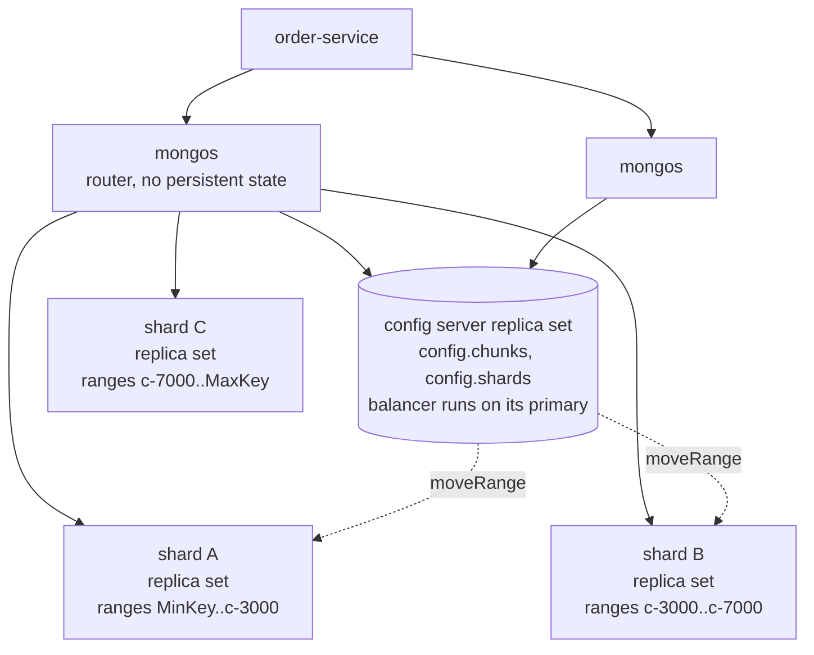
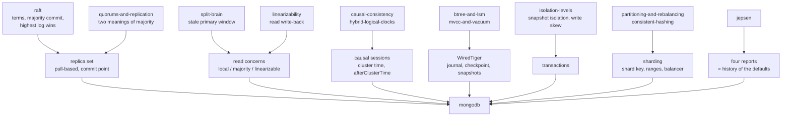

# MongoDB

*The document is the unit of everything. The majority commit point is the line between an opinion and a fact.*

> **Lab format** (no-code): this document + [`visualization.html`](visualization.html)
> (a step-by-step replica-set simulator called *The Order Book*; also published at
> <https://claude.ai/code/artifact/f318abe8-dd80-437b-a77c-c55b788d9b9e>) +
> [`EXERCISES.md`](EXERCISES.md) / [`SOLUTIONS.md`](SOLUTIONS.md). Every behaviour here is shown by a hand-worked trace with real
> timestamps and terms, by the simulator, or by a citation to MongoDB's own documentation and the
> published Jepsen analyses — never by code you have to run. Every default, limit and quoted
> sentence was checked against the **MongoDB 8.3** manual (8.3.0 released 4 May 2026; the "current
> stable" line at the time of writing) or a named paper. Where a version attribution comes from
> memory rather than from a page fetched for this lab, it says so.

> **Where you are.** You have spent two weeks inside the machinery that MongoDB is built from,
> without ever seeing it assembled. This lab assembles it. Almost nothing here is a new
> mechanism; almost everything is a mechanism you own, wearing MongoDB's name for it.
>
> - **A replicated log with a leader, terms, majority commit, and "highest log wins the
>   election"** — `raft`. MongoDB's replication protocol is derived from Raft (the NSDI 2021 paper
>   says so in its first paragraph) with one large change, §10.3, and a smaller one that decides
>   what "committed" means for a client, §10.4. Nothing about terms, quorums or log matching is
>   re-taught.
> - **"A majority has it" and "it can never be removed" are not the same statement** — `raft`'s
>   Figure 8, and the reason a new MongoDB primary writes a no-op entry before its commit point
>   can move (you will watch it do so in the simulator).
> - **R + W > N overlap versus a consensus majority** — `quorums-and-replication`. MongoDB uses
>   *both* words "majority" and you will need the distinction in §7.
> - **The stale-primary window and why "at most one leader" is unachievable** — `split-brain`.
>   Scenario 4 of the simulator is that window, with the three MongoDB read concerns run against
>   it. `linearizability`'s read write-back becomes MongoDB's `"linearizable"` read concern.
> - **Read-your-writes, monotonic reads, `afterClusterTime`, and the hybrid logical clock** —
>   `causal-consistency` and `hybrid-logical-clocks`. MongoDB's cluster time *is* an HLC; the
>   SIGMOD 2019 paper that describes it uses those words. §10.5 shows the session mechanism.
> - **B-trees, WAL-before-ack, checkpoints, MVCC snapshots** — `btree-and-lsm`,
>   `mvcc-and-vacuum`. WiredTiger is a B-tree engine with MVCC; §10.1 states only what differs.
> - **Snapshot isolation, write skew, first-committer-wins** — `isolation-levels`. MongoDB
>   transactions are snapshot isolated, not serializable, and §10.6 says exactly what that
>   buys and what it does not.
> - **Partitions as the unit of ownership, handover protocols, MOVED/ASK, hot partitions from
>   monotonic keys** — `partitioning-and-rebalancing` and `consistent-hashing`. Sharding, §10.7,
>   is that lab with MongoDB's names: shard key, range, `mongos`, balancer, `moveRange`.
> - **Jepsen as a falsification instrument** — `jepsen`. MongoDB has been through it four times
>   (2013, 2015, 2018, 2020); §13.1 tells that story, because every one of the safety knobs you
>   will learn was added after a report.
> - **"Proceed and detect" versus "coordinate and prevent"** — `cockroachdb` and
>   `optimistic-vs-pessimistic-locking`. WiredTiger is on the optimistic side; that decides how
>   MongoDB transactions fail.
>
> If any of those names are cold, skim that lab's knowledge-map entry first. This lab does not
> re-teach them.

---

## Layer guide

| Layer | Sections | What you can do afterwards |
|---|---|---|
| **BEGINNER MODEL** | 1–6 | Say what a document is and why MongoDB makes it the unit of atomicity, storage and distribution; trace a w:1 write through a partition and explain why the customer's confirmation e-mail is a lie |
| **INTERMEDIATE MODEL** | 7–10.5 | Name every knob (write concern, read concern, read preference, causal session) as a position relative to the majority commit point; predict what each returns on a stale primary and on a lagging secondary |
| **ENGINEERING MODEL** | 10.6–12 | Explain what a transaction costs and how it aborts; pick a shard key and predict which queries scatter; read an `explain` plan; state what is guaranteed under which assumptions |
| **PRODUCTION MODEL** | 13–14 | Configure a Spring Boot service correctly, design a schema that will not hit the 16 MB wall, read the four Jepsen reports as a history of the defaults, know what an on-call engineer watches, and refuse the ten wrong models |

§1–§6 is the story. §10 is the machine, built in eight versions, each forced by a concrete
failure in the one before. §11–§14 is what you need before you put a payments ledger in it.

---

## 1. WHY — the shape of the data, and the shape of the failure

Two problems, one database.

**The first problem is shape.** An order in your application is one thing: a customer, an
address, four line items, a payment reference, a delivery status. In a relational database it is
seven rows across four tables, and every read reassembles it with joins, every write is a
transaction across those tables, and every schema change is a migration that touches all of them.
That mismatch has a name — the object–relational impedance mismatch — and for thirty years the
answer was an ORM layer that hid it. MongoDB's answer is to store the order as the one thing it
is: a **document**, a nested JSON-like value with fields, arrays and sub-documents, kept together
on disk and moved together over the network.

**The second problem is failure.** A database that runs on one machine has one machine's
availability. The moment you want to survive that machine dying you need copies, and copies
raise every question the last two weeks of labs answered: which copy is allowed to accept writes,
what "written" means when two of three copies have it, what a client should be told and when, and
what happens to a copy that accepted writes nobody else saw. A database that also wants to grow
past one machine's disk needs to cut the data up, and that raises the other set: which pieces
live together, how a query finds them, what happens when a piece moves.

MongoDB's design is one idea applied to both problems: **the document is the unit**. It is the
unit of atomicity (one document changes all-or-nothing, always, with no transaction needed), the
unit of storage locality (one document is one contiguous value in the storage engine), the unit
of replication (one write becomes one entry in the replication log) and the unit of distribution
(a shard key inside the document decides where the whole document lives). Almost every strength
and every limit in this lab follows from that one choice: embed what you read together and you
get atomicity and locality for free; cross the document boundary and you pay for it with a
transaction; grow a document without bound and you hit a wall at 16 MB.

The second half of the design is about copies, and it is where your prior labs cash in: a
**replica set** is a Raft-derived group with one primary and a replicated operations log, and
every consistency knob MongoDB exposes is a way of saying *where, relative to the majority commit
point, this read or write should stand*. Get that one picture and the eleven-page reference for
read and write concern collapses into a single sentence.

---

## 2. THE PROBLEM — Thali's order book

Thali is a food-delivery marketplace. The service you own is `order-service`, a Spring Boot
application. The data that matters is an order:

```json
{
  "_id": ObjectId("66d9a1e2f3a4b5c6d7e8f901"),
  "customerId": "c-4471",
  "status": "placed",
  "items": [
    { "sku": "dal-tadka", "qty": 2, "price": 180 },
    { "sku": "roti",      "qty": 6, "price": 15 }
  ],
  "payment": { "provider": "rupaya", "ref": "pay_8Ks2", "amount": 450 },
  "delivery": { "address": "14 Lake View, Pune", "courierId": null, "eta": null },
  "placedAt": ISODate("2026-09-05T12:31:07Z")
}
```

Read it once as a shape, not as data. Everything the checkout screen, the kitchen screen and the
courier app need about *this order* is inside the one value. The `items` array is bounded (a
restaurant order has a handful of lines); the `payment` sub-document is one-to-one; the
`_id` is a 12-byte **ObjectId** — 4 bytes of seconds since the epoch, 5 random bytes fixed per
process, a 3-byte counter — so it is roughly, but not exactly, ordered by creation time (the
docs say "approximately ordered … not perfectly ordered", because clients generate them with
their own clocks and one-second resolution).

Four things happen to an order, and each is a demand on the database:

1. **Checkout** creates it. The customer sees "Order placed" and gets an e-mail. That
   confirmation must not turn out to be false.
2. **The kitchen** flips `status` to `cooking`, and the courier later to `delivered`. Two
   different services write the same document; neither may lose the other's change.
3. **The customer refreshes** immediately after checkout. They must see their own order.
4. **Thali grows.** Three cities become thirty; the order collection outgrows one machine.

Hold onto demand 1. It is the one that will fail first, and the way it fails is the whole
lesson.

---

## 3. THE OBVIOUS SOLUTION — one server, a journal, and copies that catch up

A careful engineer's first design is genuinely good:

- **Store the order as one document** on a single server. A write changes the document in
  memory and appends a record to a write-ahead journal; the journal is flushed to disk every
  100 ms and a checkpoint of the whole data set is written every 60 s. (Those are WiredTiger's
  real numbers, §10.1.) A crash loses at most the last 100 ms unless the write asked to wait for
  the flush.
- **Add two copies** that follow the server's log so a dead machine does not mean downtime. The
  primary acknowledges the write as soon as *it* has applied it, and the copies pull the log and
  apply it a heartbeat later. If the primary dies, the copies hold an election and one of them
  takes over — you know exactly how that works from `raft`.

That is a replica set with the write concern `w: 1`. It is fast (one machine's latency), it
survives one dead machine, and it is how MongoDB shipped for its first decade. It has one flaw,
and the flaw is invisible until a specific sequence of events.

---

## 4. FAILURE — the acknowledgement that lied

This is scenario 2 in the simulator. The trace below is copied from it, so open the page and
step alongside if you like. One tick is one heartbeat, two seconds. Members are `m1`, `m2`, `m3`;
`m1` is primary in term 1. An order `ord-1` was placed earlier with a majority write and is on
every member (that gives the rollback a visible common point).

> **🔮 Predict:** at tick 2 the customer's order `ord-2` is acknowledged with `w: 1`. Before the
> next heartbeat, `m1` is cut off from `m2` and `m3` by a network fault; the application servers
> can still reach `m2` and `m3`. After the fault heals, where is `ord-2`? On all three members,
> only on `m1`, or nowhere in the collection?

| Tick | Event | m1 | m2 | m3 |
|---|---|---|---|---|
| 2 | `ord-2` written, `w:1` → **acknowledged immediately** | oplog: ord-1 `ts 100:1 t1`, ord-2 `ts 104:1 t1` | ord-1 | ord-1 |
| 2 | network cuts `m1` off | PRIMARY t1 | SECONDARY | SECONDARY |
| 3–6 | `m2`, `m3` hear no heartbeat; `m1` sees no majority, but its own timer has not fired | PRIMARY t1 (still accepting writes) | waiting | waiting |
| 7 | election timeout (10 s) expires on the majority side | PRIMARY t1 | **PRIMARY t2**, writes no-op `ts 114:1 t2` | votes for m2 |
| 8 | `m1`'s own timer fires; it has not seen a majority for 6 ticks | **steps down** | PRIMARY t2 | pulls no-op |
| 8 | network heals | SECONDARY t1 | PRIMARY t2 | SECONDARY t2 |
| 9 | `m1` syncs from `m2`, compares logs: common point is `ts 100:1 t1`; after it, `m1` has `ord-2` and `m2` has the no-op | **ROLLBACK**: `ord-2` moved to a rollback file, data rebuilt | commit point → `ts 114:1 t2` | |
| 10 | `m1` pulls the no-op and is a healthy secondary | ord-1, no-op | ord-1, no-op | ord-1, no-op |
| 10 | order-service reads `ord-2` from the primary | | **NOT FOUND** | |

The customer has an e-mail that says "Order placed". The restaurant will never see the order.
Nobody crashed, nothing was misconfigured, every component behaved exactly as designed, and the
write is sitting in a file called `removed.2026-09-05T…bson` under `m1`'s data directory. The
docs say it plainly: with `w: 1`, *"data can be rolled back if the primary steps down before the
write operations replicate to any of the secondaries"*.

Three things to notice, because the rest of the lab is built on them.

**The acknowledgement was true and useless.** `w: 1` means "the primary applied it". That
statement was correct at tick 2 and remained correct. What it did not say was whether any future
primary would agree. The failure is not a bug in acknowledgement; it is that the client asked the
wrong question.

**`m1` did nothing wrong by accepting the write, and nothing wrong by discarding it.** A
Raft-style log has exactly one rule for what survives: entries that a majority holds *and* that
a leader of the latest term has committed. `ord-2` was on one member. When `m2` won term 2 with
`m3`'s vote, `m1`'s unreplicated tail became, by definition, the losing branch. Your `raft` lab
called the losing half "harmless"; MongoDB's word for making it harmless is **rollback**.

**There was a window in which two members called themselves primary** (ticks 7–8). Your
`split-brain` lab predicted it and measured it. Scenario 4 of the simulator revisits that window
from the reader's side.

---

## 5. THE REAL REQUIREMENT

Say it in plain words before any vocabulary:

> An acknowledgement must mean *no future failover can undo this write*. A read must be able to
> ask for *only data that no future failover can undo*. And a client that just wrote something
> must be able to read it back, from whichever copy it lands on.

Three demands, and each one is a position relative to a single line in the log: the highest
entry that a majority of the voting, data-bearing members have durably written. MongoDB calls
that line the **majority commit point**. Below it, the Raft argument you already know applies —
any future election is won by a member whose log contains it, so it can never be dropped. Above
it, an entry is one machine's opinion.

- A write should be acknowledged *when it falls below the line*. That is `w: "majority"`.
- A read should be able to return *only what is below the line*. That is read concern
  `"majority"`.
- A read that must be *fresh* — not merely durable — has to check that the member answering is
  still on the majority's side of the world. That is read concern `"linearizable"`.
- A client that must see its own write from a lagging copy has to carry *the position of that
  write* and let the copy wait until it has caught up. That is a **causally consistent
  session**.

Everything in §7–§10.5 is those four sentences in MongoDB's vocabulary.

---

## 6. THE KEY IDEA — two units, one line

MongoDB is two decisions.

**Decision one: the document is the unit.** One document is changed atomically, stored
contiguously, replicated as one log entry, and placed on one shard by a key inside it. Design your
data so that the things you read and write together are *inside* one document, and you never
need a transaction, a join, or a cross-shard query. Design it so they are spread across documents
and you pay for every one of those.

**Decision two: durability is a line in a replicated log, and every consistency knob is a
position relative to that line.** The knobs are not a menu of speeds. They are answers to "how
far below the commit point must this operation stand?" — and once you see them that way, the
tables in the reference manual stop being tables to memorise.

The rest of the lab is the consequences: what happens *inside* a document (WiredTiger,
§10.1), *between* the copies (the replica set, §10.2–10.5), *across* documents (transactions,
§10.6), *across machines* (sharding, §10.7), and *how a query finds a document* (indexes and
planning, §10.8).

> **Checkpoint.** You can now explain why an acknowledged write vanished and what the client
> should have asked for instead. Next: the six words you need to talk about it precisely.

---

## 7. TERMINOLOGY — the terms that carry the rest of the lab

Each is introduced because you have already felt the problem it names.

### Document, collection, BSON

*Plain:* a JSON-like value with named fields, arrays and nested values; a collection is a bag of
them; a database is a set of collections.

*Precise:* documents are stored as **BSON**, a binary encoding of JSON with extra types
(`ObjectId`, `Date`, `Decimal128`, `Binary`, and an internal 64-bit `Timestamp` — 32 bits of
seconds plus a 32-bit counter — which the oplog uses). A document may not exceed **16 mebibytes**
and may not nest deeper than **100 levels**. A collection has no enforced schema unless you add
one (`$jsonSchema` validation, §13.4).

*Why the distinction exists:* the 16 MB limit is not a nuisance to route around, it is the
boundary of the unit. It is what makes "one document is atomic, contiguous, and replicated as one
entry" possible at all.

### Replica set, primary, secondary, arbiter

*Plain:* a group of servers holding the same data; one of them (the primary) takes writes; the
others (secondaries) copy it; an arbiter votes but stores nothing.

*Precise:* up to **50 members, of which at most 7 vote**. Exactly one member is primary per term.
Members with `priority: 0` can never be primary; `hidden` members are invisible to clients;
`secondaryDelaySecs` deliberately lags a member for operator-error recovery. An arbiter has one
vote and no data.

*Connection:* this is Raft's cluster with MongoDB's names — leader/primary, follower/secondary —
and one member type Raft does not have. The arbiter exists to make a 2-data-member set able to
elect, and §11.3 shows the trap it sets.

### Oplog

*Plain:* the replication log — every change, in order, as an idempotent operation.

*Precise:* a capped collection `local.oplog.rs` on every member. Each entry carries `ts` (the
`Timestamp`), `t` (the term), the namespace and the operation. Entries are **idempotent** —
"oplog operations produce the same results whether applied once or multiple times" — which is why
`$inc: 5` is recorded as the resulting value, not the increment (that translation is an
implementation detail; the idempotence is documented). Default size on WiredTiger: 5 % of free
disk, minimum 990 MB, maximum 50 GB; the oplog is allowed to grow past its cap rather than delete
the majority commit point. The time span it covers is the **oplog window**: a secondary that
falls behind by more than the window cannot catch up by replication and must re-copy everything
(initial sync).

*Connection:* Raft's log, but pulled rather than pushed — §10.3.

### Majority commit point

*Plain:* the newest entry that enough members have that no election can ever lose it.

*Precise:* the highest optime `(ts, t)` written to the oplog *and journal* of a **calculated
majority** of voting, data-bearing members, where "calculated majority" is the smaller of
(voting majority) and (number of voting data-bearing members). It can only advance over entries
from the current primary's term — the Raft Figure 8 rule — which is why a new primary writes a
no-op immediately. Visible in `rs.status()` as `lastCommittedOpTime`.

*Why:* it is the line from §5. Every other term in this lab is defined relative to it.

### Write concern

*Plain:* what must be true before the client is told "done".

*Precise:* `{ w: <1 | n | "majority">, j: <bool>, wtimeout: <ms> }`. `w: 1` — the primary applied
it in memory. `w: "majority"` — a calculated majority "have durably written the change to their
local oplog"; because `writeConcernMajorityJournalDefault` is `true` by default, "durably" means
on-disk journal, i.e. `j: true` is implied. **The implicit default since 5.0 is `w: "majority"`**
— unless the set contains an arbiter and the number of data-bearing voters is not greater than
the voting majority, in which case the default silently becomes `w: 1` (§11.3). `wtimeout`
turns a wait into an error; it **never undoes** the write.

### Read concern

*Plain:* how far below the commit point the data you get back must be.

*Precise:* `"local"` (default everywhere — the member's latest state, may be rolled back),
`"available"` (same, plus it skips a sharding safety check, §10.7), `"majority"` (the state at
the member's known commit point — durable, possibly stale), `"linearizable"` (primary only;
reflects every majority-acknowledged write that completed before the read began, and may wait
for in-flight writes to reach a majority; needs `maxTimeMS`), `"snapshot"` (a majority-committed
snapshot at one cluster time, used by transactions and, since 5.0, by some non-transactional
reads).

### Read preference

*Plain:* which member the driver sends a read to.

*Precise:* `primary` (default), `primaryPreferred`, `secondary`, `secondaryPreferred`, `nearest`;
plus tag sets and `maxStalenessSeconds`. The docs' sentence to carry: "All read preference modes
except `primary` may return stale data because secondaries replicate operations from the primary
in an asynchronous process." Read preference chooses *who* answers; read concern chooses *what*
they are allowed to answer with. They are orthogonal, and confusing them is wrong model §14.4.

### Shard key, range (chunk), `mongos`, config server

*Plain:* the field(s) that decide which server a document lives on; a contiguous span of key
values that moves as one piece; the router; the metadata keepers.

*Precise:* see §10.7. They are `partitioning-and-rebalancing`'s partition key, partition, routing
tier and partition map.

---

## 8. TWO MENTAL MODELS, AND WHERE THE FIRST ONE LIES

### The simple model — three clerks and one ledger

Thali's orders are recorded by three clerks — Meera, Raj and Sana — each keeping an identical
ledger. Only one clerk, the *head clerk*, takes dictation from the shop floor; the other two copy
her ledger, line by line, whenever they can see it. Every line is numbered with the page and line
(`ts`) and the head clerk's badge number (`t`, the term).

A line is **in ink** once two of the three clerks have written it. Two of three can always
out-vote one, so no future head clerk can ever be someone who lacks that line. A line only one
clerk has is **in pencil** — real, visible, and erasable.

The shop floor can ask for two kinds of receipt. *"Tell me when you've written it"* (`w: 1`) is
answered as soon as the head clerk's pencil leaves the page. *"Tell me when it's in ink"*
(`w: "majority"`) is answered when a second clerk has it. Anyone reading a ledger can ask for
*whatever is on the page* (`local`) or *only the ink* (`majority`); and if they must have the
*very latest ink*, the head clerk first shouts across the room to check she is still the head
clerk (`linearizable`).

If the head clerk is locked in a back room, the other two wait ten seconds, then elect a new
head clerk — whichever has the longer ledger — and she starts with a fresh badge number. When
the old head clerk is let out, she compares ledgers, finds her pencilled lines are missing from
the new head clerk's book, and rubs them out into a scrap file.

### The engineering model

The same picture as state and rules. This is the model the simulator runs.

| Piece | State | Rule |
|---|---|---|
| Member | `role`, `term`, `oplog[]`, `lastApplied`, `commitPoint`, `sinceHeard` | Secondaries pull from a sync source (the primary if visible, else another member that is ahead); one hop per heartbeat |
| Oplog entry | `{ts, t, op}` | Strictly increasing per member; identical prefix across members up to the common point |
| Commit point | highest optime on a calculated majority, current term only | Advanced by the primary from reported positions; learned by secondaries via heartbeats |
| Election | after `electionTimeoutMillis` (10 s) without a primary; needs majority of voters; candidate must have the highest optime it can see | Winner takes term + 1 and writes a no-op; any reachable older primary steps down |
| Rollback | a member whose oplog diverges from its sync source | Truncate to the common point; write removed documents to `<dbpath>/rollback/<collectionUUID>/removed.<timestamp>.bson`; rebuild; re-sync. Default time limit 24 h (`rollbackTimeLimitSecs`) |
| Client write | `(lsid, txnNumber)`, write concern | Acknowledged when its optime satisfies the concern on the primary that accepted it; if that primary loses its role first, the client gets an error and the outcome is *unknown* |
| Client read | read concern, read preference, optional `afterClusterTime` | See §10.5 |

### Map the models

| Simple model | Engineering model |
|---|---|
| Head clerk / copying clerks | primary / secondaries pulling the oplog |
| Page and line, badge number | `ts`, `t` |
| In ink | at or below the majority commit point |
| In pencil | above it |
| "Tell me when it's in ink" | `w: "majority"` (journaled, because `writeConcernMajorityJournalDefault: true`) |
| "Only the ink" | read concern `"majority"` |
| Shout across the room first | read concern `"linearizable"` |
| Rub out into a scrap file | rollback to `removed.*.bson` |

### Where the analogy lies — read this before it hardens

1. **Clerks never write in pencil by default. MongoDB primaries did for ten years.** Until 5.0
   the implicit default write concern was `w: 1`. The analogy makes ink the obvious choice; the
   history (§13.1) is a decade of people not choosing it, and a P-S-A set still does not (§11.3).
2. **The head clerk knows when a line is in ink; a client does not, unless it asked.** In the
   analogy the ink is visible on the page. In MongoDB a `w: 1` client is told nothing more, ever.
   The state of a write it did not wait for is simply unknown to it.
3. **"Only the ink" is not "the latest ink".** A locked-in head clerk's ledger still has plenty of
   ink in it — old ink. Read concern `"majority"` on a stale primary returns durable data that a
   newer primary has already superseded. Scenario 4 is exactly this, and it is why
   `"linearizable"` exists as a separate level rather than as a stronger `"majority"`.
4. **The ledger has one page order. A sharded cluster has many ledgers.** Nothing in the analogy
   covers the moment a range moves between shards; §10.7 does.
5. **Clerks copy whole lines. WiredTiger writes 100 ms batches.** A `w: 1` acknowledgement on a
   single server is "in memory", and a hard crash inside the journal interval loses it with no
   rollback at all — §10.1.

---

## 9. OPEN THE SIMULATOR NOW — what to look at

Open [`visualization.html`](visualization.html). It is called *The Order Book*, and it runs the
engineering model above with no other rules (they are listed on the page under *Rules the
simulator follows*).

**What is on the screen.** Three member cards. Each shows its role, term, oplog (every entry as
`ts s:i tN`), its known commit point, its orders, and — after a rollback — the rollback file.
Green entries are at or below the commit point; yellow ones are above it. The right-hand panel is
the client: every write and read with its concern, its status, and the tick it was acknowledged.
The narration box explains each tick, and highlighted lines are the *why*.

**Run the seven scenarios in order.** Each has a one-line blurb, and four of them ask you to
predict before you press *Step*:

| # | Scenario | What it shows |
|---|---|---|
| 1 | Two writes, two write concerns | `w:1` acknowledged at tick 0; `w:"majority"` at tick 2 — pull, then position report |
| 2 | The acknowledgement that lied | §4's trace: rollback of an acknowledged `w:1` write |
| 3 | The same partition with `w:"majority"`, and a retry | wtimeout does not undo; an unacknowledged write's fate is decided by the set; a retryable write is deduplicated by `(lsid, txnNumber)` |
| 4 | Reading from a primary that no longer is one | the stale-primary window; `local` and `majority` return the old value, `linearizable` refuses |
| 5 | Read your own write from a lagging secondary | a majority ack does not include the third member; a causal session makes the secondary wait |
| 6 | Primary-Secondary-Arbiter | the implicit default write concern becomes `w:1`; both orders are lost including the acknowledged one |
| 7 | The primary crashes | ~12 s without writes; the driver's single retry lands on the new primary |

**Then use free play.** Any button acts on the current state: write with either concern, read
with any concern and preference (with or without a causal session), cut `m1` off, heal, kill and
restart `m2`, advance a tick. Try to produce a rollback with `w:"majority"` writes only. You
cannot — and the reason is §12.1.

**What the simulator is not.** It has one client and one session, it replicates in whole
heartbeats, and its primary step-down timer fires one heartbeat after the secondaries' timers so
that the stale window is visible for a full tick. Real timers are randomised, real replication is
continuous, and a real primary steps down as soon as its own `electionTimeoutMillis` passes
without a majority. The *ordering* of events is the lesson; the exact tick counts are the
model's.

---

## 10. THE ACTUAL MECHANISM — eight versions

Each version fixes the failure that ended the one before. Every strange detail in the final
machine should arrive as the answer to something you have already watched go wrong.

### 10.1 Version 1 — inside one document: WiredTiger

Start with one server and one question: what does "the document is the unit of atomicity"
cost, and what does a crash lose?

Since 3.2 the default storage engine is **WiredTiger**. What matters for this lab, all from the
manual's WiredTiger and journaling pages:

- **Documents are the unit of concurrency.** "WiredTiger uses *document-level* concurrency
  control for write operations. As a result, multiple clients can modify different documents of
  a collection at the same time." There are only *intent* locks at the global, database and
  collection level. Two writers on the *same* document are resolved optimistically: "When the
  storage engine detects conflicts between two operations, one will incur a write conflict
  causing MongoDB to transparently retry that operation." That is `cockroachdb`'s posture —
  proceed and detect — and it decides how transactions fail in §10.6.
- **Every operation reads a snapshot.** "At the start of an operation, WiredTiger provides a
  point-in-time snapshot of the data to the operation." MVCC, exactly as `mvcc-and-vacuum`
  taught it, with one difference you should register: for a *single* operation. A `find` that
  returns a cursor and iterates over many batches is *not* one snapshot — the read-isolation page
  says a cursor "could return the same document more than once" if a concurrent update moves it
  in the index being scanned, and may see a document updated after the read began. Point-in-time
  reads across a whole cursor need read concern `"snapshot"` or a transaction.
- **Durability is journal-then-checkpoint.** A checkpoint writes the snapshot to disk "at
  intervals of 60 seconds". Between checkpoints, every write goes to the journal (write-ahead
  log), which is buffered in memory and synced "at every 100 milliseconds"
  (`storage.journal.commitIntervalMs`), or immediately when a write carries `j: true`, or on a
  secondary after each applied batch. Read the warning as written: "In between write
  operations, while the journal records remain in the WiredTiger buffers, updates can be lost
  following a hard shutdown of `mongod`." Journaling cannot be turned off since 6.1.
- **Memory.** The internal cache is "the larger of either: 50% of (RAM − 1 GB), or 0.256 GB";
  everything else goes to the filesystem cache in on-disk (compressed) format. Collections are
  block-compressed with snappy by default (zstd for time-series), indexes use prefix
  compression.
- **Layout.** WiredTiger stores collections and indexes as B-trees (that sentence is from
  WiredTiger's own documentation rather than the MongoDB page fetched for this lab). A
  collection's B-tree is keyed by an internal record id, not by `_id`; the `_id` index is a
  separate B-tree that maps to it — so MongoDB is "heap plus index" in your `btree-and-lsm`
  vocabulary, not InnoDB-style clustered, unless you create a *clustered collection* (a 5.3
  feature, from memory, not re-verified here).

So version 1 gives you atomic, snapshot-read documents, with a durability window of up to 100 ms
for a write that did not ask to wait. It fails the moment the machine dies: downtime, and no copy.

> **Checkpoint.** A single-document write is atomic and isolated with no transaction. A crash
> inside the journal interval loses unjournaled writes with no rollback file — they were never
> anywhere. Copies next.

### 10.2 Version 2 — copies that pull the log, acknowledged by one

Add two members that follow the primary's oplog. Every write on the primary becomes an oplog
entry `{ts, t, op}`; secondaries fetch entries and apply them. The primary acknowledges when it
has applied the write: `w: 1`.

You watched this fail in §4. The fix is not "replicate faster" — the write in §4 was cut off a
few milliseconds after acknowledgement, and any asynchronous copy has that window. The fix is
to change what "acknowledged" means, which needs the commit point, which needs elections to be
correct first.

### 10.3 Version 3 — elections, and the one big difference from Raft

The NSDI 2021 paper *Fault-Tolerant Replication with Pull-Based Consensus in MongoDB* (Zhou and
Mu) describes MongoDB's protocol as derived from Raft with one structural change: **replication
is pull-based**. In Raft the leader pushes `AppendEntries` to every follower. In MongoDB "a
replica pulls new data from another replica, which can be initiated by any replica and can
happen between any two replicas". A secondary chooses a **sync source** — the primary, or
another secondary that is ahead of it (`chainingAllowed: true` by default) — and tails its
oplog. The primary does not learn who has what by pushing; secondaries report their positions
back (`replSetUpdatePosition`), and the primary computes the commit point from those reports.
In the simulator that is the one-tick gap between "m2 pulls" and "commit point advances":
scenario 1 acknowledges the majority write at tick 2, not tick 1.

Why pull? Two reasons the paper gives that survive a design review: a sync source can be any
member, which spreads replication fan-out across the set and works across slow links (a
secondary in Mumbai can pull from a secondary in Mumbai); and a member that is far behind or
just restarted can catch up from whoever is convenient rather than loading the primary.

The rest is Raft with MongoDB's numbers, all from the elections and configuration pages:

| Rule | MongoDB |
|---|---|
| Heartbeat | every 2 s |
| Election timeout | `electionTimeoutMillis` = 10 000 ms; a member marks another inaccessible after `heartbeatTimeoutSecs` = 10 |
| Who can call an election | a member that has not heard from a primary for the timeout, has the highest optime of any visible member, has `priority > 0`, and can reach a majority of voters |
| Who wins | majority of votes; a vote goes only to a candidate whose log is at least as up to date |
| Term | `t`, incremented per election; a stale primary that hears a higher term steps down |
| Priority | 0–1000; "best-effort attempt to have the secondary with the highest priority available call an election" |
| Voters | at most 7 of up to 50 members; arbiters vote |
| Writes during election | none: "The replica set cannot process write operations until the election completes successfully." Median time to a new primary "should not typically exceed 12 seconds" |
| Catch-up | a new primary first syncs from members that may have newer (unreplicated `w:1`) entries; `catchUpTimeoutMillis` default −1 (unbounded); the docs frame it as a choice "between faster failovers and preservation of w:1 writes" |
| Mirrored reads | the primary forwards a sample of reads to electable secondaries to warm their cache for the day they win |

One consequence of catch-up deserves a sentence, because it looks like a contradiction of §4:
if `m1` in §4 had been *reachable* when `m2` won, `m2` would have pulled `ord-2` from `m1`
during catch-up and `ord-2` would have survived. `w: 1` writes are lost only when the old
primary is unreachable during the election, which a partition guarantees and a clean crash does
not. This is what the docs mean by "rollbacks … should be rare. When a rollback does occur, it is
often the result of a network partition."

**Flow control.** A primary that races ahead of its secondaries makes the commit point lag, and
every `w: "majority"` write waits behind that lag. Since 4.2 the primary throttles itself: "as
the lag grows close to the `flowControlTargetLagSeconds`, writes on the primary must obtain
tickets before taking locks". Enabled by default; the target's default is 10 s (from memory —
the parameter page could not be fetched in full for this lab).

Version 3 elects correctly and never has two primaries in one term. It still tells clients
"done" one machine too early.

### 10.4 Version 4 — acknowledge below the line: `w: "majority"`

Now the commit point exists, redefine the acknowledgement. `w: "majority"` "requests
acknowledgment that the calculated majority of data-bearing voting members have durably written
the change to their local oplog". Three details carry weight:

1. **Durably.** With `writeConcernMajorityJournalDefault: true` (the default) the ack waits for
   the journal on each of those members — `j: true` is implied. Set it to `false` and "majority
   write operations could possibly roll back in the event of a transient loss (e.g. crash and
   restart) of a majority of nodes".
2. **Calculated.** The count is min(voting majority, number of voting data-bearing members).
   In a P-S-A set that is min(2, 2) = 2 — both data members — and the arbiter is worthless for
   the count. §11.3.
3. **Only the primary that accepted the write can acknowledge it.** If that primary loses its
   role while the client waits, the client gets an error, not an ack, and *does not know* what
   happened. Scenario 3 shows both outcomes from one error: the first write is rolled back, the
   second survives.

> **🔮 Predict:** `ord-2` is written with `w: "majority"` on `m2`; `m1` and `m3` pull it; then
> `m2` crashes *before the acknowledgement reaches the client*. Does `ord-2` survive? What does
> the client see? And when the driver retries the same write against the new primary, how many
> `ord-2` documents exist afterwards?

Here is scenario 3's trace, copied from the simulator, for the write that survives:

| Tick | Event | Client sees |
|---|---|---|
| 8 | `ord-2` written `w:"majority"` on `m2` (primary, t2), entry `ts 116:1 t2` | waiting |
| 9 | `m1` and `m3` pull it — it is now on all three | waiting (positions not yet reported) |
| 9 | `m2` crashes | — |
| 10 | the pending write's primary is gone | **error, outcome unknown** |
| 10–14 | election timeout; `m1` wins term 3 (it has the highest optime), writes a no-op | driver holds one retry |
| 14 | retry of the same write, same `(lsid: s1, txnNumber: 2)`, lands on `m1` | **acknowledged from the stored result — no second order** |

That last row is **retryable writes**: since 3.6, and on by default in drivers compatible with
4.2+, every single-document write carries a logical session id and a per-session transaction
number. The docs: "Retryable writes let drivers retry specific write operations once after
network errors or if they cannot find a healthy primary". The server keeps the outcome of each
`(lsid, txnNumber)` in a replicated table (the manual and driver spec establish the id pair
and the "retry once" rule; that the record lives in `config.transactions` and is carried by the
oplog is an implementation detail from memory), so a retry that reaches a primary which already
applied the write is answered from the record instead of applied twice. This is your
`idempotency` lab's key, built into the protocol. Limits worth knowing: only single-document
writes and bulk writes made of them are retryable — `updateMany`, `deleteMany` are not; writes
inside transactions are not individually retryable; since 6.1 a retry that never performed a
write returns the `NoWritesPerformed` label so the application can tell "nothing happened" from
"unknown".

Two more sentences from the write-concern page that end arguments:

- `wtimeout` "causes write operations to return with a write concern error after the specified
  limit, even if the required write concern will eventually succeed … MongoDB **does not** undo
  successful data modifications". And "If you do not specify the `wtimeout` option and the level
  of write concern is unachievable, the write operation will block indefinitely."
- The implicit default is `w: "majority"` — "Starting in MongoDB 5.0, `{ w: "majority" }` is the
  default write concern for *most* MongoDB deployments". *Most.* §11.3 is the rest.

**What `w: "majority"` does not do.** It does not make a write *visible* to a client reading
somewhere else at any particular moment (scenario 5), and it does not make a read on the old
primary fresh (scenario 4). It only makes the ack true. Version 5 is the read side.

> **Checkpoint.** You can now say precisely what each acknowledgement means and what an error
> means (nothing). Next: what a *read* can ask for.

### 10.5 Version 5 — the read side: concern, preference, and the session

Four readers, four different answers, one line.

**Read concern `"local"`** (default): the member's latest applied state. On a primary, that
includes writes above the commit point; on a secondary, whatever it has pulled. "Data may be
rolled back."

**Read concern `"majority"`**: "the data acknowledged by a majority of the replica set members.
Returned documents are durable, even if a failure occurs." Mechanically, each member keeps a
WiredTiger snapshot at its *known* commit point and serves majority reads from it — no network
round trip, which is why it is cheap and why it can be stale. Since 5.0 the storage support for
this (`enableMajorityReadConcern`) is always on and cannot be disabled, which also retired the
old 300 MB rollback limit: the "recover to a timestamp" rollback algorithm has no size limit.

**Read concern `"linearizable"`**: primary only, single-document filter only, and "unlike
`"majority"`, `"linearizable"` read concern confirms with secondary members that the read
operation is reading from a primary that is capable of confirming writes with `{ w: "majority" }`
write concern." That confirmation is a round trip to a majority before answering (in the
implementation, a no-op write at majority concern — from memory), so "always use `maxTimeMS`" —
a partitioned primary would otherwise wait forever. Cost: the docs say such reads "may be
significantly slower". This is `linearizability`'s write-back made into a read mode: the read
does not return until the world agrees who is primary.

> **🔮 Predict:** the client can only reach `m1`, which still calls itself primary; on the other
> side `m2` has been elected and holds a newer write. Of `local`, `majority` and `linearizable`,
> which returns the newer value, which returns the old one, and which returns nothing at all?

Scenario 4 lines them up on the stale primary. The client is on `m1`'s side of a partition;
`m2` has been elected in term 2 and a courier has marked `ord-1` delivered there:

| Read on `m1` (still says PRIMARY t1) | Returns | Because |
|---|---|---|
| `local` | `{status: "placed"}` | `m1`'s latest state — stale, and could have been dirty if `m1` had taken writes |
| `majority` | `{status: "placed"}` | `m1`'s commit point stopped at `ts 100:1 t1` when the partition began — durable, stale |
| `linearizable` | **times out** | `m1` cannot confirm a majority — refuses rather than answer wrongly |

The 2015 Jepsen post found exactly the first two rows on 2.6 — "not only can 'strictly
consistent' reads see stale versions of documents, but they can also return garbage data from
writes that never should have occurred" — and read concern `"majority"` (3.2) and
`"linearizable"` (3.4) are the response.

**Read preference** decides who answers. `primary` (default) or `primaryPreferred`, `secondary`
or `secondaryPreferred`, `nearest`, with tag sets and `maxStalenessSeconds`. Every non-primary
mode "may return stale data". Since 4.0 (from memory) a secondary serves reads from a snapshot
while it applies oplog batches, so reads on secondaries no longer pause during application; they
are simply behind.

**The session** is what closes demand 3 from §2 — "the customer refreshes and must see their
own order" — when the read lands on a secondary. Scenario 5: `m3` lags three ticks. The
majority ack at tick 2 counts `m1` and `m2`. A plain read on `m3` at tick 2 returns NOT FOUND —
correct, legal, and infuriating. Inside a **causally consistent session** the driver attaches
the cluster time of the last operation (`afterClusterTime`) to the read, and a member that
receives a read with `afterClusterTime` waits until it has applied up to that time. In the
simulator `m3` holds the read until tick 4 and then answers `placed`.

The clock behind `afterClusterTime` is **cluster time**: a `(seconds, counter)` logical clock
that every member and every `mongos` advances and gossips on every message, signed with an HMAC
so a client cannot inject a future time. The SIGMOD 2019 paper (*Implementation of Cluster-wide
Logical Clock and Causal Consistency in MongoDB*, Tyulenev et al.) calls it a hybrid logical
clock — the one from your `hybrid-logical-clocks` lab, with the oplog `ts` as its physical
component.

What a session guarantees depends on the concerns you use. From the causal-consistency page:

| Read concern | Write concern | Read own writes | Monotonic reads | Monotonic writes / Writes follow reads |
|---|---|---|---|---|
| `majority` | `majority` | yes | yes | yes / yes |
| `majority` | `w: 1` | yes | yes | **no** / yes |
| `local` | `w: 1` | no | no | no / no |
| `local` | `majority` | no | no | yes / no |

"Only read operations with `"majority"` read concern and write operations with `"majority"`
write concern can guarantee all four causal consistency guarantees." The 2018 Jepsen report on
3.6.4 is the story of why that table exists: sessions "will happily accept intermediate levels …
users could have reasonably assumed that causal sessions would ensure causal safety for their
sub-majority operations; they do not." (The simulator's scenario 5 uses `local` reads and still
shows the wait — that is the *mechanism*; the *guarantee* needs `majority`, because a `local`
read can still be rolled back later.)

`"linearizable"` cannot be used inside a causal session, and `"snapshot"` is the concern
transactions use — which is the boundary you cross next.

> **Checkpoint.** You own the replica set: every write and read is a position relative to the
> commit point, the session is a position relative to your own last operation, and the three
> Jepsen findings so far each produced one of these knobs. Now cross the document boundary.

### 10.6 Version 6 — crossing documents: transactions, and what they cost

Thali's design keeps an order in one document precisely so that placing, cooking and
delivering it never need a transaction. But the moment a write must touch *two* documents
atomically — reserve stock in `inventory` and create the order — the document boundary is
crossed, and MongoDB has had multi-document transactions since 4.0 on replica sets and 4.2 on
sharded clusters. The manual's own framing, twice on the transactions page, is the right one:
"multi-document transactions are not necessary for many practical use cases" and "the
availability of distributed transactions should not be a replacement for effective schema
design."

**What a transaction is.** A WiredTiger snapshot held open across several operations, with
writes buffered in the storage engine and made visible atomically at commit. The isolation
level is **snapshot isolation** — every read in the transaction sees the same majority-committed
snapshot — and not serializable. Your `isolation-levels` lab's write-skew example applies
unchanged: two transactions each read "courier X has no active order", each assign X, both
commit. Nothing in MongoDB prevents that; you prevent it the way you did there — make the two
writes touch a common document, or use a unique index, or a `findOneAndUpdate` with a
conditional filter on one document.

> **🔮 Predict:** a transaction reads the `dal-tadka` stock document. Before it writes, the
> kitchen service runs a plain `updateOne` on the same document. The transaction then tries its
> update. Which party waits, which party fails, and which party never notices anything?

**How it fails.** Write conflicts are the optimistic engine from §10.1 surfacing, and the
production-considerations page states the two directions exactly:

- "If a transaction is in progress and a write outside the transaction modifies a document that
  an operation in the transaction later tries to modify, the transaction aborts because of a
  write conflict."
- "If a transaction is in progress and has taken a lock to modify a document, when a write
  outside the transaction tries to modify the same document, the write waits until the
  transaction ends."

So a transaction loses to any non-transactional writer that got there first, and blocks any
that come after. Two transactions on the same document: the second to touch it gets a
`WriteConflict`. Transactions "wait up to 5 milliseconds to acquire locks required by the
operations in the transaction" and abort otherwise; a transaction "must have a runtime of less
than one minute" (`transactionLifetimeLimitSeconds`, 60). Every abort carries the
`TransientTransactionError` label, which means "run the whole function again"; a commit whose
outcome is unknown carries `UnknownTransactionCommitResult`, which means "retry the commit
only". Drivers wrap this as the callback API (`withTransaction`), which retries on those labels
for you — and only on those.

**What it costs.** Three things, all documented:

1. **Cache pressure.** A long transaction pins old versions. "If you have an uncommitted
   transaction that causes excessive pressure on the WiredTiger cache, the transaction aborts and
   returns a write conflict error"; a transaction that can never fit returns
   `TransactionTooLargeForCache`. The advice is blunt: abort what you abandon, and never leave a
   transaction open across a user interaction.
2. **Oplog.** Since 4.2 a transaction is written as as many oplog entries as needed, each under
   16 MB — the old 16 MB whole-transaction cap is gone, the per-entry cap is not.
3. **Sharded commit.** "Regardless of the write concern specified for the transaction, the
   commit operation for a sharded cluster transaction includes some parts that use
   `{w: "majority", j: true}`", and "transactions that span multiple shards will error and abort
   if any involved shard contains an arbiter". A multi-shard commit is a two-phase commit
   coordinated by one of the shards (prepare on each participant, then commit) — the coordinator
   design is from MongoDB engineering material rather than the page fetched here. Outside reads
   during that commit: `"snapshot"`/`"linearizable"` reads and causal-session reads wait until
   the whole transaction is visible; other read concerns "read the before-transaction version".
   That is `distributed-transactions`' atomic visibility problem, solved the timestamp way.

**The rule that Jepsen found missing.** Read and write concern inside a transaction are set
*on the transaction*, and the docs say what happens if you get them wrong: with a `w: 1` commit,
"transaction-level `"snapshot"` read concern provides **no** guarantee that read operations in
the transaction used a snapshot of majority-committed data", and the transaction "can be rolled
back if there is a failover". The May 2020 Jepsen report on 4.2.6 tested exactly that: with the
then-defaults (`local`/`w:1`, and transactions ignoring database-level settings) it observed
lost writes and read skew; and even at `snapshot`/`majority` it observed anomalies traced to a
retry bug (SERVER-48307, fixed in 4.2.8). Two things changed as a result: 5.0 made
`w: "majority"` the implicit default, and the manual now carries the sentence above. Set both
concerns on every transaction explicitly; do not rely on inheritance.

Version 6 gives you atomic, snapshot-isolated writes across documents at a real cost. It still
lives on one replica set. Thali has thirty cities.

### 10.7 Version 7 — outgrowing one replica set: sharding

Everything in `partitioning-and-rebalancing` applies; here is the MongoDB vocabulary laid over
it, with the numbers from the sharding pages.



**Shard key.** "Either a single indexed field or multiple fields covered by a compound index
that determines the distribution of the collection's documents among the cluster's shards."
`{ customerId: 1 }` is **ranged** — contiguous key values sit together, so a range query on the
key is targeted; `{ customerId: "hashed" }` is **hashed** — adjacent values scatter, which is the
cure for a monotonically increasing key. The choose-a-shard-key page names the three
properties, and each has a Thali failure attached:

| Property | Bad choice | What goes wrong | Docs' fix |
|---|---|---|---|
| Cardinality | `city` (30 values) | "constrains the number of effective shards" to 30, and each city's range cannot split below one value | compound key `{city, customerId}` |
| Frequency | `restaurantId` where three restaurants take half the orders | those ranges "may become indivisible" — jumbo | compound with a low-frequency field |
| Monotonicity | `_id` (ObjectId) or `placedAt` | "all new inserts are routed to the chunk with `maxKey` as the upper bound … becomes the bottleneck for write operations" | hashed sharding |

And the one that decides latency: **does the query contain the shard key?** "`mongos` routes
queries to only the shards that contain the relevant data if the queries contain the shard key.
When the queries do not contain the shard key, the queries are broadcast to all shards" —
scatter-gather — and such queries "do not scale linearly when more shards are added". For
Thali: `find({customerId})` is targeted; `find({courierId})` scatters to every shard, and
`sort` is performed on each shard before `mongos` merges. A prefix of a compound key targets too.
Single-document updates are stricter: "All `updateOne()`, `replaceOne()` and `deleteOne()`
operations *must* include the shard key or `_id` in the query document"; `updateMany` is always
broadcast unless the full key is present.

**Ranges (chunks).** "Each chunk has inclusive lower and exclusive upper limits based on the
shard key"; the default range size is **128 MB**. Chunks are no longer split as they grow — "a
sharded cluster only splits chunks when chunks must be migrated" (the removal of auto-splitting
is a 6.x change; the exact 6.1 attribution is from memory). A range that cannot be split because
it holds a single key value is **jumbo**.

**The balancer** "runs on the primary of the config server replica set". A collection is
balanced when the largest and smallest shard differ by less than three times the range size —
"for the default range size of 128MB, two shards must have a data size difference … of at least
384MB for a migration to occur". A shard takes part in at most one migration at a time, so a
cluster of *n* shards runs at most ⌊n/2⌋ migrations concurrently. The migration itself is your
handover protocol, in the manual's seven steps: `moveRange` to the source → destination builds
missing indexes → destination copies the documents in the range → destination pulls the
**delta** of changes made during the copy → source enters a critical section and updates the
config metadata → source deletes its copy once no cursor is open on the range. The last step is
asynchronous and queued, so a shard can have **orphaned documents** for a while — and that is why
read concern `"available"` exists: `"local"` on a sharded cluster filters orphans by checking
ownership; `"available"` skips the check and may return them. Since 8.2 a long-running
secondary read may be terminated before orphan deletion runs. `_secondaryThrottle` makes the
migration wait for a write concern per document.

**Changing your mind.** Since 4.2 a document's shard-key *value* may be updated (not if the key
is `_id`); `refineCollectionShardKey` adds suffix fields to an existing key (4.4, from memory)
and is the documented cure for jumbo ranges caused by low cardinality; `reshardCollection`
(5.0) changes the key entirely and rewrites the collection in the background. **8.0** added
`moveCollection` for *unsharded* collections between shards (built on the resharding machinery;
"has a 5 minute minimum duration" and a write block of about two seconds at the end) and
`unshardCollection`; 8.0 also lets a shard double as the config server (**config shard**), which
"combines the config server role into an existing shard's replica set, so your cluster needs
one replica set instead of two". 8.3 restricts DDL on sharded clusters to `mongos` and replaces
`removeShard` with explicit draining commands.

**What the config servers hold, and what breaks without them.** "If the config server replica
set loses its primary and cannot elect a primary, the cluster's metadata becomes read only. You
can still read and write data from the shards, but no chunk migration or chunk splits will
occur"; "if all config servers become unavailable, the cluster can become inoperable". A
`mongos` "has no persistent state" — it caches the routing table and refreshes it when a shard
tells it the version is stale, which is your `MOVED`/`ASK` retry.

Version 7 scales writes and storage. The last version is how any of this finds a document.

### 10.8 Version 8 — finding a document: indexes and the planner

Indexes are B-trees, one per index, with the mechanics `btree-and-lsm` gave you. What is
MongoDB-specific:

- Every collection has a unique index on `_id`. A collection may have at most **64** indexes; a
  compound index at most **32** fields; a sort may use at most 32 keys.
- **Compound indexes obey the ESR rule.** "Ensure that equality fields always come first",
  then sort fields, then range fields. The manual's worked example is
  `find({directors: "David Lynch", runtime: {$lt: 130}}).sort({year: 1})` with the index
  `{directors: 1, year: 1, runtime: 1}`: equality on `directors` narrows to one key prefix, the
  index is already in `year` order so no in-memory sort, and `runtime` is the range that walks
  the tail. Put the range before the sort and the engine must sort in memory (a **blocking
  sort**). Thali's kitchen screen — `find({restaurantId, status: "cooking"}).sort({placedAt: 1})`
  — wants `{restaurantId: 1, status: 1, placedAt: 1}`. Traps the page names: `$ne`, `$nin`,
  `$regex` are *range* operators; `$in` behaves as equality up to 200 elements and as a range
  from 201.
- Other index kinds, one line each: **multikey** (an array field indexes each element),
  **unique**, **partial** (index only documents matching a filter — cheaper than sparse),
  **TTL** (background deletion by a date field; the 8.3 `serverStatus` now reports TTL work),
  **hashed** (for hashed shard keys), **wildcard**, **text**, **2dsphere**. A query answered
  entirely from the index without fetching documents is **covered**.
- **Index builds** since 4.4 run "simultaneously across all data-bearing replica set members",
  hold an exclusive collection lock "only at the start and end of the build", finish when a
  **commit quorum** (default `"votingMembers"`) has built it, use 200 MB of memory per
  `createIndexes` by default, and can resume once after a clean restart.

**How a plan is chosen** is the one place MongoDB differs from every relational planner you
know. The classic engine is *empirical*: for a new query shape it runs the candidate plans for a
short trial and "the winning plan is the query plan that produces the most results during the
trial period while performing the least amount of work". The winner goes into the **plan
cache** for that query shape — first as *Inactive* with a work estimate, promoted to *Active*
when a later planning round confirms it — and is evicted by LRU, on any DDL (index create/drop/
hide), or when its measured work stops meeting the criterion (replanning). **8.3 adds a
cost-based ranker (CBR)**: "multi-planning with a cost-based ranker backup is the default plan
selection mechanism for eligible queries" — the trial runs first, and only if it cannot find a
plan that returns a result in time does CBR score plans by cost and cardinality estimates.
"Currently, MongoDB only invokes the CBR for a small amount of queries." Read the plan with
`explain()`: `COLLSCAN` is the smell, `IXSCAN` then `FETCH` is normal, `SORT` after `FETCH` is
the blocking sort ESR avoids, `totalKeysExamined` versus `nReturned` is the ratio to watch.

**Aggregation** is the read path for anything beyond `find`: a pipeline of stages (`$match`,
`$group`, `$lookup`, `$unwind`, `$project`, `$sort`, …), at most 1 000 stages, each stage
allowed 100 MB of memory before spilling to disk — since 6.0 `allowDiskUseByDefault` is `true`,
so spills happen unless you forbid them. `$lookup` is the join you designed away by embedding;
it exists, it is fine for reporting, and it is the wrong tool for the hot path in a schema that
was built around documents.

> **Checkpoint.** The machine is complete: one atomic document, a pull-replicated Raft log with a
> commit line, four read positions and a session, snapshot-isolated transactions across
> documents, ranges of documents moved between shard replica sets by a config-server balancer,
> and B-tree indexes chosen by trial. Now break it on purpose.

---

## 11. FAILURE SCENARIOS

Each one names what to watch, what the system does, what survives, and what it looks like in
production. The first four are in the simulator.

### 11.1 The primary is partitioned after a `w:1` ack — rollback

Scenario 2, traced in §4. *Watch:* the old primary keeps calling itself PRIMARY for a full
election timeout and keeps accepting writes from anyone who can reach it. *Survives:* every
entry at or below the commit point. *Lost:* every entry above it, into
`<dbpath>/rollback/<collectionUUID>/removed.<timestamp>.bson` — except that "if the operation
to roll back is a collection drop or a document deletion, the rollback … is not written to the
rollback data directory". *In production:* `rs.status()` shows a member in `ROLLBACK`; the log
says so; a rollback that spans more than `rollbackTimeLimitSecs` (24 h) of oplog fails and the
member must be re-synced. The rollback files are your only copy of the acknowledged-and-lost
data, and someone has to decide what to do with them by hand.

### 11.2 A majority write with the majority unavailable — hangs, then lies about nothing

Scenario 3 (first half) and scenario 6. *Watch:* the client waits. Without `wtimeout` it waits
forever; with it, the client gets an error *and the entry stays in the primary's oplog*. *What
the error means:* nothing. The write may replicate a second later and survive, or be rolled
back. *In production:* a spike in write latency, `wtimeout` errors in the application log, and
`replSetGetStatus.optimes.lastCommittedOpTime` frozen. The right client behaviour is a retryable
write (§10.4) or an idempotent retry of your own; the wrong behaviour is "it errored, so it did
not happen".

### 11.3 The Primary-Secondary-Arbiter set — the default silently becomes `w:1`

> **🔮 Predict:** P-S-A, the one secondary is down, and order-service writes with the implicit
> default write concern. Does the write hang, get acknowledged, or get rejected?

Scenario 6. The arbiter is cheap: it votes, it stores nothing, and it lets a two-data-member
set elect a primary when one member dies. The price is in the write-concern page's formula:
"if the number of data-bearing voting members is not greater than the voting majority, the
default write concern is `{ w: 1 }`". With one secondary down, `w: "majority"` cannot be
satisfied at all (the calculated majority is both data members), so MongoDB's 5.0 default would
have made every write hang — and rather than that, it *keeps the old default*. Every write is
then exactly as safe as §4. When the surviving primary dies too and the secondary returns, the
secondary wins the election with the arbiter's vote, and the primary's un-replicated writes —
acknowledged ones included — roll back on rejoin. *In production:* it looks like a healthy
cluster right up to the double failure; the tell is `db.adminCommand({getDefaultRWConcern:
1})` reporting `w: 1` with `defaultWriteConcernSource: "implicit"`. Multi-shard transactions also
refuse to run on a shard with an arbiter. The docs' own advice is three data-bearing members.

### 11.4 The stale primary serves reads

Scenario 4. Client and old primary on the same side of a partition; the driver sees one member
that says PRIMARY and believes it. For up to `electionTimeoutMillis` (plus its own timer's
phase) that member answers reads. `local` returns its latest (possibly about-to-be-rolled-back)
state; `majority` returns its frozen commit point; only `linearizable` refuses, because it must
hear from a majority first. *In production:* a brief window of stale reads during every
partition-induced failover, visible only if you look for it — this is the class of anomaly the
2015 Jepsen post found, and nothing at `local` or `majority` prevents it.

### 11.5 The lagging secondary and the missing write

Scenario 5. *Watch:* the majority ack counted two members; the read went to the third. *What
survives:* everything — nothing is wrong, the read is merely early. *Fix:* a causal session
(the read waits) or `maxStalenessSeconds` (the driver avoids members it estimates as too stale;
the option's floor is 90 s, from memory) or read from the primary. *In production:*
"read-after-write" bug reports that reproduce only under load, when a secondary falls behind.
`rs.printSecondaryReplicationInfo()` and the `replication lag` metric are the watch.

### 11.6 Falling off the oplog

A secondary is down for longer than the oplog window (or the primary writes faster than the
window can absorb). *Watch:* the secondary's last optime is older than the oldest entry the
primary still has. *System response:* replication cannot resume; the member goes to `RECOVERING`
and needs an **initial sync** — a full copy of all data, which on a large set is hours and a
load on the sync source. *Prevention:* the docs' `oplogMinRetentionHours` keeps entries even
past the size cap; `replSetResizeOplog` grows it without a restart. *In production:* the
metric is the oplog window in hours (`rs.printReplicationInfo()`), and the alert is "window
shorter than the longest maintenance you would ever do to one member".

### 11.7 The hot shard from a monotonic key

Sharding on `_id` (an ObjectId) or `placedAt`. *Watch:* every insert lands in the range that
ends at `MaxKey`, so one shard takes every write, the balancer moves that range, the next inserts
go to the new end range, and the cluster is a single-writer system with extra steps. *Fix:*
hashed sharding on that key, or a compound key whose first field spreads writes
(`{customerId, placedAt}`). *In production:* one shard's write ops and CPU pinned, the others
idle; `analyzeShardKey` (7.0+) reports monotonicity directly.

### 11.8 The scatter-gather with sort and limit

`find({courierId: "k-19"}).sort({placedAt: -1}).limit(20)` on a collection sharded by
`customerId`. *Watch:* `mongos` sends the query to every shard, each shard sorts and returns
its top 20, `mongos` merges. Latency is the slowest shard's; adding shards makes it worse, not
better. *Fix:* a shard key that matches the dominant query, or a separate collection/view for
the courier's queue (the `cqrs` move). *In production:* `explain` shows a `SHARD_MERGE` over
every shard; p99 latency tracks the unhealthiest shard.

### 11.9 The unbounded array — the 16 MB wall

Thali embeds every status-change event in the order (fine, bounded) and then someone embeds
every *review* in the *restaurant* document. A popular restaurant's document grows without
bound, each update rewrites the whole document, every read fetches every review, and one day an
insert fails with `BSONObjectTooLarge` (error code 10334 since 8.3). *Fix:* the embedding-versus-
referencing rule from the manual — reference when "your embedded data grows without bounds" —
or the bucket pattern (one document per restaurant per month). *In production:* document size
p99 climbing in the profiler, updates getting slower, then the hard error.

### 11.10 The transaction that loses every race

A transaction that reads a stock document, does a slow external call, and then writes it.
*Watch:* every non-transactional writer that touches the document in the meantime causes the
transaction to abort with `WriteConflict` (the transaction loses to a prior outside write);
every writer that comes *after* the transaction's write blocks on it. Under contention the
transaction retries forever and the callback API's retry loop looks like a hang. *Fix:* no
external calls inside a transaction, keep it under a few milliseconds, or redesign so the hot
document is updated with a single conditional `findOneAndUpdate`. *In production:*
`serverStatus().transactions.totalAborted` climbing, `TransientTransactionError` in logs.

### 11.11 Cache pressure from a long transaction or a lagging majority

Two causes, one symptom. A long-open transaction or snapshot pins history WiredTiger cannot
evict; a lagging majority commit point does the same for majority reads (the storage engine
must keep the state at the commit point). *Watch:* WiredTiger cache "dirty" and "bytes in
cache" climbing toward the cache size, application threads waiting for cache eviction, and
eventually transactions aborted with write conflicts or `TransactionTooLargeForCache`. *In
production:* the cache-pressure metrics in `serverStatus().wiredTiger.cache`, and — for the
lag case — `flowControl` metrics showing the primary being throttled.

### 11.12 Elections you did not ask for

A GC pause, a stalled disk, or a rolling restart makes the primary miss heartbeats for 10 s;
the secondaries elect, the old primary returns, steps down, and any `w:1` tail rolls back. *In
production:* `rs.status()` term numbers climbing, `NotWritablePrimary` errors in the
application (which retryable writes absorb once), and about 12 s per event without writes.
Lowering `electionTimeoutMillis` makes failover faster and makes this *more* frequent; that is
the trade the docs describe under "failover sensitivity".

---

## 12. CORRECTNESS AND GUARANTEES

### 12.1 What is guaranteed

- **A single-document write is atomic**, always, with no transaction: "a read operation will
  never see the document with only some of the fields updated".
- **A write acknowledged with `w: "majority"` (and journaled voting members) is never rolled
  back.** This is the Raft argument: any future primary must hold it. In the simulator's free
  play you cannot make a rollback file appear using only majority writes, and the engine
  asserts that no entry at or below any member's commit point is ever in a rollback file.
- **Read concern `"majority"` never returns data that will be rolled back.**
- **Read concern `"linearizable"` on a single document, combined with `w: "majority"` writes,
  is linearizable:** "enables multiple threads to read and write a single document as if a
  single thread performed these operations in real time".
- **A transaction committed with `w: "majority"` and read concern `"snapshot"` is snapshot
  isolated**, and on a sharded cluster the snapshot "**is** synchronized across shards".
- **A causally consistent session with `majority`/`majority` gives read-your-writes, monotonic
  reads, monotonic writes, and writes-follow-reads.**
- **Change streams emit only majority-committed changes** — "notifications trigger only for
  majority-committed changes that are durable in failure scenarios".
- **At most one primary per term**, and "a replica set member cannot become PRIMARY unless it
  has the highest optime of any visible member".

### 12.2 What is not guaranteed

- Nothing about a `w: 1` write beyond "the primary applied it". Nothing about a write whose
  acknowledgement never arrived.
- Freshness of a `"majority"` read. Freshness of *any* read on a secondary.
- Serializability. Transactions are snapshot isolated; write skew is allowed.
- Atomicity across documents without a transaction, even inside one collection, even for a
  single `updateMany`: it is atomic per document, not as a whole.
- A point-in-time view across a cursor's batches without `"snapshot"` or a transaction.
- Causal guarantees at any concern combination other than `majority`/`majority`.
- The fate of a write that was in flight during a multi-shard migration's critical section:
  it is retried by the client against the new owner, and correctness depends on the write being
  retryable.

### 12.3 The assumptions underneath

- Voting members journal (`writeConcernMajorityJournalDefault: true`). The in-memory storage
  engine or a `false` setting reopens rollback of majority writes on a majority crash.
- A majority of voters can talk to each other. Without it: no primary, no writes, and
  `linearizable` reads time out. That is the CP posture from your `cap-theorem` and `pacelc`
  labs, chosen deliberately.
- Clocks do not matter for safety. Terms, optimes and cluster time are logical. Wall clocks
  affect election *timing* and the `maxStalenessSeconds` *estimate*, never which write wins.
- The application sets its concerns. Every guarantee in §12.1 is conditional on a concern the
  client chose; the defaults get you `majority` writes on a P-S-S set and `local` reads
  everywhere.

### 12.4 The tradeoffs, stated once

| Choice | You gain | You pay |
|---|---|---|
| Document as the unit | atomicity, locality, one-entry replication, no joins on the hot path | 16 MB ceiling; cross-document work needs transactions; duplication to manage |
| `w: "majority"` | an acknowledgement that cannot be undone | one round trip to a second member plus its journal sync; blocked writes when a majority is unreachable |
| Read concern `"majority"` | never see a rollback | staleness up to the commit-point lag |
| Read concern `"linearizable"` | freshness, refusal instead of a wrong answer | a majority round trip per read; primary only; single document |
| Secondary reads | read scale, locality | staleness; causal sessions to get your own writes back |
| Transactions | atomic multi-document writes, snapshot reads | cache pressure, 60 s limit, aborts under contention, majority commit even if you asked for less |
| Sharding | write and storage scale | scatter-gather for non-key queries; a shard key you must choose right, or reshard later |

---

## 13. PRODUCTION — from this lab's model to a running cluster

### 13.1 Read the Jepsen history as the changelog of the defaults

| Year | Version | Finding | What changed |
|---|---|---|---|
| 2013 | 2.4.3 | acknowledged writes lost at every write concern, including `MAJORITY` (bugs of the era) | fixes; the modern replication protocol (pv1, Raft-derived) landed in 3.2 |
| 2015 | 2.6 / 3.0 | reads on the primary with majority writes returned stale and never-committed data during partitions | read concern `"majority"` (3.2), `"linearizable"` (3.4) |
| 2018 | 3.6.4 | causal sessions gave causal consistency only at `majority`/`majority`; sub-majority sessions "do not" | the four-row table in the manual, and its warning |
| 2020 | 4.2.6 | transactions at default concerns lost writes; a retry bug produced anomalies even at `snapshot`/`majority` | SERVER-48307 fixed in 4.2.8; `w: "majority"` implicit default in 5.0; the transaction-concern warnings |

Every knob in §10.4–§10.6 has a row in this table. Your `jepsen` lab said a report is a
falsification instrument, and this is what falsification bought: a database whose *documented*
strongest settings are now defensible, and whose *defaults* took a decade to follow.

### 13.2 Topology

- **Three data-bearing voting members across three failure domains** (availability zones).
  Five if you want to survive a zone loss *and* a maintenance at once. Odd counts; at most seven
  voters; extra members non-voting.
- **No arbiters** unless you have read §11.3 and accepted it.
- **A `hidden` or `secondaryDelaySecs` member** for analytics and for the day someone runs
  `deleteMany({})` — the delayed member is your last un-replicated copy.
- **Sharded only when a replica set genuinely cannot hold the working set or absorb the write
  rate**; shard the collections that need it, leave the rest unsharded on one shard (8.0's
  `moveCollection` can move them later). Config shard for small clusters, dedicated config
  servers when isolation matters.
- **Atlas** runs all of this for you — including election, oplog sizing, backups with
  point-in-time restore from the oplog, and the balancer window — and adds Search and Vector
  Search on top; self-managed is the same server. The knobs in this lab are identical on both.

### 13.3 The Spring Boot service

Spring Data MongoDB, for the learner's stack. The four settings that matter, and where they go:

```yaml
spring:
  data:
    mongodb:
      uri: mongodb://m1,m2,m3/thali?replicaSet=rs0&w=majority&readConcernLevel=majority&retryWrites=true&readPreference=primary
```

- `w=majority` — do not rely on the implicit default; a topology change (someone adds an
  arbiter) must not change your durability.
- `readConcernLevel=majority` — the default is `local` everywhere, including 8.3. If you read
  from secondaries, add a causally consistent `ClientSession` for the read-after-write paths.
- `retryWrites=true` is the driver default; state it anyway so nobody "optimises" it away.
- Transactions: register a `MongoTransactionManager` and use `@Transactional` — but set the
  `TransactionOptions` (read concern `snapshot`, write concern `majority`) on the manager
  explicitly, because the transaction does not inherit the database-level settings; that is the
  exact trap Jepsen 2020 walked into. Keep the method short, no HTTP calls inside, and expect
  `MongoTransactionException` wrapping `TransientTransactionError` — the callback API's retry is
  yours to do in Spring.
- `@Document` entities: the class maps to a document, embedded objects to sub-documents,
  `@DBRef` to references — and `@DBRef` is the join you designed away; prefer a plain id field
  and a second query or a `$lookup` in an aggregation.

### 13.4 Schema design that survives

The embedding-versus-referencing table from the manual, compressed:

| Embed when | Reference when |
|---|---|
| "has-a"/"contains" relationship | the child side has high cardinality |
| read together, updated together, archived together | "your embedded data grows without bounds" |
| you want single-document atomicity for the pair | the child "can exist by itself without a parent" |
| the combined size stays far under 16 MB | data is written at different times in a write-heavy workload |

Patterns worth knowing by name (all standard MongoDB data-modeling guidance): **bucket**
(time-series or events grouped per period per entity), **computed** (store the aggregate,
update it on write), **subset** (embed the ten most recent, reference the rest), **outlier**
(handle the one restaurant with 10 000 reviews differently), **schema versioning** (a
`schemaVersion` field so old and new shapes coexist during migration), and **schema
validation** (`$jsonSchema` on the collection so "schemaless" means "the schema lives in your
code and the validator", not "anything goes").

Native time-series collections (5.0+) implement the bucket pattern for you with zstd
compression; use them for courier GPS pings, not for orders.

### 13.5 What an on-call engineer watches

| Signal | Where | Why it matters here |
|---|---|---|
| Replication lag (seconds behind primary) | `rs.printSecondaryReplicationInfo()`, `replSetGetStatus` | the commit point lags behind it; majority writes and reads feel it |
| `lastCommittedOpTime` vs the primary's optime | `replSetGetStatus.optimes` | the line from §5, in numbers; frozen means no majority |
| Oplog window (hours) | `rs.printReplicationInfo()` | shorter than your longest maintenance = an initial sync in your future |
| Term changes, members in `ROLLBACK` | `rs.status()`, logs | every term change was an election; every rollback was §4 |
| WiredTiger cache used / dirty; tickets available | `serverStatus().wiredTiger`, `queues.execution.*` (8.3) | cache pressure before it aborts transactions |
| Write conflicts and aborted transactions | `serverStatus().metrics`, `.transactions` | §11.10 |
| Balancer state, migrations, jumbo ranges | `sh.status()`, `config.chunks` | imbalance and the hot shard |
| Slow queries and plan shape | profiler, `$queryStats`, `explain` | `COLLSCAN`, blocking `SORT`, scatter-gather |
| Connection counts | `serverStatus().connections`, 8.3 pre-auth limits | pool exhaustion arrives before CPU |

### 13.6 Change streams — the CDC you already have

A **change stream** is a cursor over the oplog, opened on a collection, a database or the whole
deployment, that yields insert/update/replace/delete events with a resume token in each event's
`_id`. Two properties make it more than "tail the oplog": it emits only majority-committed
changes, and it can be resumed after a disconnect (`resumeAfter`) or after an invalidating event
such as a collection drop (`startAfter`) — provided the oplog still holds the token's position.
Since 6.0 you can ask for the document's pre-image and post-image. This is your
`change-data-capture` lab's log-based capture with no external connector, and for a
single-document write it is also your `transactional-outbox`: the order document *is* the
event, atomically written and majority-durable, so the outbox row and the business row are the
same row. The outbox pattern is still the answer when the event to publish is *not* the
document you changed.

### 13.7 When MongoDB is the wrong answer

- The data is genuinely relational — many-to-many, queried from every side, changed by
  transactions that touch five entities routinely. You will spend the document model's savings
  on transactions and `$lookup`.
- You need serializable isolation or cross-document constraints enforced by the database.
- Your dominant access is analytical scans over columns — `database-landscape`'s columnar
  answer.
- You need cross-shard queries that are not on the shard key to be fast at scale.

---

## 14. COMMON WRONG MODELS

### 14.1 "MongoDB acknowledged the write, so it is saved"

Feels right because every database's ack means that. Counterexample: §4, ten lines long. The
ack means what the write concern asked for; `w: 1` asks for one machine. Correct model: **an
acknowledgement is a position relative to the commit point, and only `w: "majority"` puts it
below the line.**

### 14.2 "MongoDB loses data" (the 2013 folklore)

Feels right because it was true, and reports from that era are still linked. Counterexample: the
free-play challenge in §9 — with majority writes on journaled voters you cannot produce a
rollback, and the engine asserts it. Correct model: **the defaults were unsafe for a decade; the
mechanism has been sound since pv1, and the 5.0 default finally matches it — except in P-S-A.**

### 14.3 "`w: "majority"` means my read will see it"

Feels right because "majority" sounds like "everyone". Counterexample: scenario 5 — the ack
counted `m1` and `m2`; the read went to `m3`. Correct model: **write concern is about survival,
not visibility. Visibility from a secondary needs a causal session.**

### 14.4 "Read concern and read preference are the same knob"

Feels right because both have "read" in them and both mention secondaries. Counterexample:
scenario 4 — three read concerns on the same member with the same preference gave three
answers. Correct model: **preference chooses the member; concern chooses what the member may
answer with.**

### 14.5 "`"majority"` reads are the fresh ones"

Feels right because majority is stronger than local. Counterexample: scenario 4's second row —
durable and stale. Correct model: **`majority` is "never rolled back"; `linearizable` is
"fresh, or refuse".**

### 14.6 "An arbiter is a free third vote"

Feels right because it costs nothing to run. Counterexample: scenario 6 — the implicit default
silently becomes `w: 1`, and a double failure loses acknowledged writes. Correct model: **an
arbiter buys elections without buying durability, and MongoDB changes your default to match.**

### 14.7 "Transactions make MongoDB behave like PostgreSQL"

Feels right because they are called transactions and they are ACID-labelled. Counterexample:
write skew commits cleanly; a transaction aborts if any outside writer touched its document
first; it dies at 60 s; its concerns must be set explicitly or the snapshot guarantee is void.
Correct model: **snapshot isolation on an optimistic engine, priced to be rare.**

### 14.8 "Sharding scales every query"

Feels right because there are more machines. Counterexample: §11.8 — a query without the shard
key runs on every shard and gets slower as you add them. Correct model: **sharding scales the
queries that carry the shard key; everything else is scatter-gather.**

### 14.9 "Schemaless means no schema"

Feels right because the server does not enforce one by default. Counterexample: the first
document with `price` as a string breaks the aggregation that sums it. Correct model: **the
schema moved from the database to your code; put it back with `$jsonSchema` validation and a
`schemaVersion` field.**

### 14.10 "The oplog is a log like Kafka's"

Feels right because both are ordered, replicated, and consumed by tailing. Counterexample: the
oplog is capped and idempotent; entries are the *result* of an operation, not the operation;
it is truncated from the head at the size limit regardless of whether anyone has read it.
Correct model: **the oplog is a replication mechanism that change streams make consumable; it is
not a retention-managed event log.** Use change streams into Kafka if you need one.

---

## 15. KNOWLEDGE MAP AND NEXT STEPS



**Builds on:** `raft`, `quorums-and-replication`, `split-brain`, `linearizability`,
`causal-consistency`, `hybrid-logical-clocks`, `btree-and-lsm`, `mvcc-and-vacuum`,
`isolation-levels`, `partitioning-and-rebalancing`, `consistent-hashing`, `jepsen`,
`cockroachdb`, `optimistic-vs-pessimistic-locking`, `idempotency`, `database-landscape`.

**Related:** `change-data-capture` and `transactional-outbox` (change streams), `cqrs`
(read-side collections for scatter-gather queries), `distributed-transactions` (the sharded
commit), `redis` (the other "acknowledged from memory" system), `kafka` (what the oplog is not).

**Commonly confused:**

- *Write concern vs read concern vs read preference* — survival of a write; what a read may
  return; which member answers.
- *`w: "majority"` vs a quorum read* — the first is a consensus majority (an order and a
  commit point); the second, in `quorums-and-replication`, is a set overlap with no order.
  MongoDB has only the first.
- *Rollback (replica set) vs abort (transaction)* — the first discards a former primary's
  unreplicated tail after a failover; the second discards a transaction's buffered writes
  before they were ever visible.
- *Chunk/range vs shard* — a range is the unit of movement; a shard is a replica set that holds
  many ranges.
- *Cluster time vs oplog `ts`* — one HLC; the oplog timestamp is its physical component.

**Next:**

- `/learn mongodb-schema-design-patterns` — bucket, computed, subset, outlier, versioning,
  worked on a real domain
- `/learn mongodb-aggregation` — the pipeline as a query language, `$lookup`, `$facet`,
  window functions
- `/learn wiredtiger-internals` — eviction, the history store, checkpoints under pressure
- `/learn dynamodb` — the other document store, with the opposite consistency defaults
- `/learn cassandra` — masterless, tunable quorums: the `quorums-and-replication` model as a
  product, for contrast with this lab's leader-based one
- `/learn elasticsearch` — the document store that is really an inverted index

---

## 16. GLOSSARY

In order of appearance. One line each; the section number is where it was earned.

| Term | Meaning | § |
|---|---|---|
| Document | A BSON value with fields, arrays and nested documents; the unit of atomicity, storage, replication and distribution | 1 |
| BSON | Binary JSON with extra types; documents max 16 MiB, 100 levels deep | 7 |
| ObjectId | 12-byte id: 4-byte seconds, 5 random bytes per process, 3-byte counter; roughly time-ordered | 2 |
| Collection | A set of documents; no enforced schema unless validation is added | 7 |
| Replica set | A Raft-derived group: one primary, secondaries, optional arbiters; ≤ 50 members, ≤ 7 voters | 7 |
| Primary / secondary | The member that accepts writes / a member that pulls and applies the oplog | 7 |
| Arbiter | A voting member with no data | 7, 11.3 |
| Oplog | `local.oplog.rs`; capped, idempotent operations stamped `ts` and `t` | 7 |
| Oplog window | Time span between the oldest and newest oplog entries; the catch-up budget | 7, 11.6 |
| Initial sync | Full copy of data for a member that cannot catch up from the oplog | 11.6 |
| Term (`t`) | Election counter; one primary per term | 4 |
| Optime | `(ts, t)` of an oplog entry | 8 |
| Majority commit point | Highest optime durably on a calculated majority of voting data members; only advances over current-term entries | 5, 7 |
| Calculated majority | min(voting majority, number of voting data-bearing members) | 7, 10.4 |
| Write concern | `{w, j, wtimeout}`: what must be true before an ack | 7 |
| `w: 1` / `w: "majority"` | Ack when the primary applied it / when a calculated majority journaled it | 7, 10.4 |
| `writeConcernMajorityJournalDefault` | Whether majority implies `j: true`; default true | 10.4 |
| `wtimeout` | Turns a wait into an error; never undoes the write | 10.4 |
| Implicit default write concern | `majority` since 5.0, except `w: 1` when arbiters make data voters ≤ voting majority | 10.4, 11.3 |
| Rollback | A former primary truncating its unreplicated tail into `removed.*.bson` files; 24 h limit | 4, 11.1 |
| Recover-to-timestamp | The rollback algorithm since 4.0; no size limit | 10.5 |
| Election timeout | `electionTimeoutMillis`, 10 s; heartbeats every 2 s | 10.3 |
| Sync source / chaining | The member a secondary pulls from; secondaries may pull from secondaries | 10.3 |
| Catch-up | A new primary pulling newer entries from other members before serving; `catchUpTimeoutMillis` −1 | 10.3 |
| Flow control | Primary throttling to keep majority-commit lag under a target | 10.3 |
| Retryable write | `(lsid, txnNumber)` on single-document writes; retried once; deduplicated by the server | 10.4 |
| Read concern | `local`, `available`, `majority`, `linearizable`, `snapshot`: how far below the commit point a read stands | 7, 10.5 |
| Read preference | `primary`, `primaryPreferred`, `secondary`, `secondaryPreferred`, `nearest`: who answers | 7, 10.5 |
| `maxStalenessSeconds` | Driver-side avoidance of secondaries estimated too far behind | 10.5 |
| Causally consistent session | Carries `afterClusterTime`; members wait to catch up; full guarantees only at `majority`/`majority` | 10.5 |
| Cluster time | A signed hybrid logical clock gossiped on every message | 10.5 |
| WiredTiger | Default storage engine: B-trees, MVCC snapshots, document-level optimistic concurrency, journal + checkpoints | 10.1 |
| Journal | Write-ahead log synced every 100 ms or on `j: true`; always on since 6.1 | 10.1 |
| Checkpoint | Full snapshot to disk every 60 s | 10.1 |
| Write conflict | Two operations on one document; the loser is retried (plain writes) or aborted (transactions) | 10.1, 10.6 |
| Transaction | Multi-document, snapshot isolated; 60 s lifetime, 5 ms lock wait; 4.0 replica sets, 4.2 sharded | 10.6 |
| `TransientTransactionError` / `UnknownTransactionCommitResult` | Retry the whole transaction / retry only the commit | 10.6 |
| Shard / shard key | A replica set holding part of the data / the indexed field(s) that place a document | 10.7 |
| Ranged / hashed sharding | Contiguous key values together / hashed values scattered | 10.7 |
| Range (chunk) | A contiguous span of shard-key values; default 128 MB; unit of migration | 10.7 |
| Jumbo range | A range that cannot split because it holds one key value | 10.7 |
| `mongos` | Stateless router; targets or broadcasts; merges results | 10.7 |
| Config server (CSRS) | Replica set holding cluster metadata; balancer runs on its primary; config shard = combined with a data shard (8.0) | 10.7 |
| Balancer / `moveRange` | Background migration when shards differ by ≥ 3 × range size; ≤ ⌊n/2⌋ concurrent | 10.7 |
| Orphaned document | A migrated document not yet deleted from its source; filtered by `local`, not by `available` | 10.7 |
| Targeted vs scatter-gather | Query with vs without the shard key | 10.7 |
| `reshardCollection` / `refineCollectionShardKey` / `moveCollection` | Change the key (5.0) / extend it / move an unsharded collection (8.0) | 10.7 |
| ESR rule | Compound index order: equality, sort, range | 10.8 |
| Blocking sort | An in-memory sort because the index order does not match | 10.8 |
| Covered query | Answered from the index alone | 10.8 |
| Multi-planner / plan cache / CBR | Trial-run plan selection; cached per query shape; cost-based ranker backup default in 8.3 | 10.8 |
| Commit quorum | Members that must finish an index build; default all voting data members | 10.8 |
| Aggregation pipeline | Staged query language; 100 MB per stage before spilling; `allowDiskUseByDefault: true` | 10.8 |
| Change stream | Resumable cursor over majority-committed oplog events; pre/post-images since 6.0 | 13.6 |
| `$jsonSchema` validation | Server-enforced document shape | 13.4 |

---

## Sources

**MongoDB manual, 8.3 line (fetched September 2026):** release notes index and 8.3 notes;
Write Concern; Read Concern and Read Concern `"linearizable"`; Replica Set Rollbacks; Replica
Set Elections; Replica Set Oplog; Replica Configuration; Replication overview (flow control);
Transactions; Transactions Production Considerations; Transactions and Sharded Clusters;
WiredTiger Storage Engine; Journaling; Limits and Thresholds; Causal Consistency and Read/Write
Concerns; Read Isolation, Consistency, and Recency; Query Plans; The ESR Guideline; Retryable
Writes; Change Streams; Data Partitioning with Chunks; Shard Keys; Choose a Shard Key; Sharded
Cluster Balancer; `mongos`; Config Servers; `moveCollection`; Embedding vs References; BSON
Types; Index Builds on Populated Collections; Read Preference.

**Driver specification:** MongoDB Specifications, *Retryable Writes*.

**Papers:** Zhou & Mu, *Fault-Tolerant Replication with Pull-Based Consensus in MongoDB*, NSDI
2021. Tyulenev et al., *Implementation of Cluster-wide Logical Clock and Causal Consistency in
MongoDB*, SIGMOD 2019. (Both cited from their abstracts and secondary summaries; the full texts
were not fetched for this lab.) Also relevant, not used: Schultz et al., *Tunable Consistency in
MongoDB*, VLDB 2019.

**Jepsen:** *MongoDB stale reads* (Kyle Kingsbury, April 2015, on 2.6.7/3.0); *MongoDB 3.6.4*
(October 2018); *MongoDB 4.2.6* (May 2020); the 2013 analysis of 2.4.3 as referenced by the
2015 post.

**Marked as from memory, not re-verified for this lab:** the 10 s default of
`flowControlTargetLagSeconds`; the 90 s floor of `maxStalenessSeconds`; clustered collections
(5.3); non-blocking secondary reads (4.0); the 6.1 attribution of auto-split removal; the 4.4
attribution of `refineCollectionShardKey`; `config.transactions` as the retryable-write record;
the no-op write inside `"linearizable"` reads; the coordinator/prepare design of multi-shard
commit; B-trees as WiredTiger's structure (from WiredTiger's own docs).
