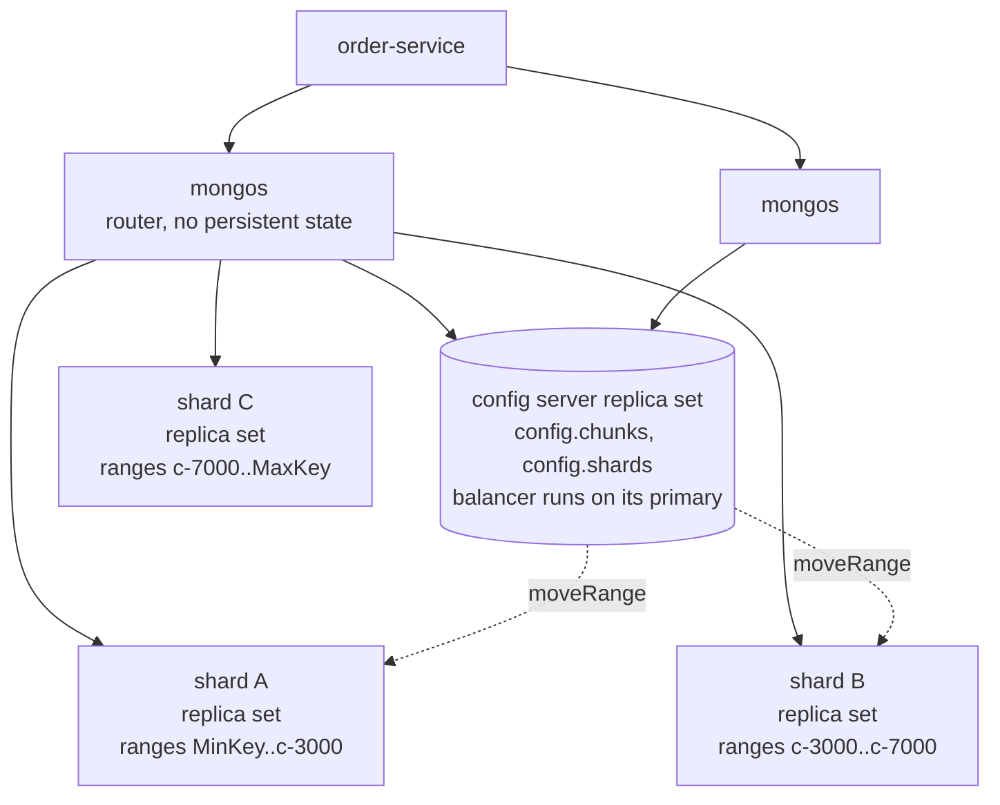
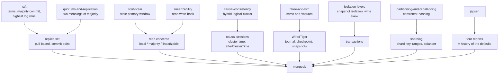

# MongoDB — one document, and the line that decides what is real

> **Tell a friend:** Asha orders a thali on a Tuesday night and gets an e-mail
> saying her order is placed, but Omar's kitchen never sees it and the order is
> gone for good. Nobody crashed and nothing was misconfigured. The copy of the
> order book that took her order was simply cut off from the other two for a few
> seconds. When it came back, the rule said it had to throw away everything the
> others had never seen. MongoDB keeps each order as one *document*, and the
> document is the unit of everything — atomicity, storage, replication and
> distribution. Every safety knob it offers asks one question: where should this
> write or read stand, relative to the line that a majority of the copies have
> agreed on? That line is the majority commit point, and it is the line between
> an opinion and a fact.

The trainer for this lab is [`visualization.html`](visualization.html), a
step-by-step replica-set simulator also published as [The Order
Book](https://claude.ai/code/artifact/f318abe8-dd80-437b-a77c-c55b788d9b9e).
What the lab is made of, where every number came from, and where it sits among
your other labs are in [section 17](#17-about-this-lab) at the end.

---

## 1. Why does MongoDB exist at all?

> **In one breath:** Two problems live inside one database. The first is that
> your data does not look like rows. The second is that the machine holding it
> will one day die.

Thali is a food-delivery marketplace in Pune. Asha orders a thali from Omar's
kitchen. Priya's team runs the service that stores that order.

Hold two problems in your head. They look unrelated. MongoDB answers both with
the same idea, and that is the whole design.

### Why is one order seven rows across four tables?

An order in your application is one thing. A customer, an address, four line
items, a payment reference, a delivery status.

In a relational database it is seven rows across four tables. Every read
reassembles it with joins. Every write is a transaction across those tables.
Every schema change is a migration that touches all of them.

That mismatch has a name. Engineers call it the object–relational impedance
mismatch, and for thirty years the answer was an ORM layer that hid it.

MongoDB's answer is to stop hiding it. Store the order as the one thing it
already is: a **document**, a nested JSON-like value with fields, arrays and
sub-documents, kept together on disk and moved together over the network.

### What does the second problem, failure, ask of you?

A database that runs on one machine has one machine's availability. The moment
you want to survive that machine dying, you need copies.

Copies raise every question the last two weeks of labs answered. Which copy is
allowed to accept writes? What does "written" mean when two of three copies
have it? What should a client be told, and when? What happens to a copy that
accepted writes nobody else saw?

A database that also wants to grow past one machine's disk has to cut the data
up. That raises the other set of questions. Which pieces live together? How
does a query find them? What happens while a piece is moving?

### What single idea answers both problems?

**The document is the unit.** Say it once and the rest follows.

It is the unit of atomicity: one document changes all-or-nothing, always, with
no transaction needed. It is the unit of storage locality: one document is one
contiguous value in the storage engine. It is the unit of replication: one
write becomes one entry in the replication log. It is the unit of distribution:
a shard key inside the document decides where the whole document lives.

Almost every strength and every limit in this lab follows from that one choice.
Embed what you read together and you get atomicity and locality for free. Cross
the document boundary and you pay for it with a transaction. Grow a document
without bound and you hit a wall at 16 MB.

The second half of the design is about copies, and it is where your prior labs
cash in. A **replica set** is a [raft](../40-raft/)-derived group with one
primary and a replicated operations log. Every consistency knob MongoDB exposes
is a way of saying *where, relative to the majority commit point, this read or
write should stand*.

Get that one picture and the eleven-page reference for read and write concern
collapses into a single sentence.

This lab is a capstone. Almost nothing in it is a new mechanism; almost
everything is a mechanism you already own, wearing MongoDB's name for it.
[Section 17](#17-about-this-lab) lists the sixteen labs it assembles, one by
one, and says what each of them contributes.

## 2. What is in Thali's order book, and who is waiting on it?

> **In one breath:** One order is one document. Four different people need
> something from it, and the very first of those four needs is the one that
> breaks.

The service Priya owns is `order-service`, a Spring Boot application. Meet the
cast before the data, because these seven people stay on stage for the whole
lab.

| Who | What they do | Where you meet them |
|---|---|---|
| **Asha** | orders a thali, and gets the "Order placed" e-mail | section 4 |
| **Omar** | runs the kitchen; his screen lists the tickets to cook | section 4 |
| **Dev** | the courier, who marks an order delivered | section 10.5 |
| **Priya** | the engineer on call for `order-service` | section 11 |
| **Meera, Ben, Arjun** | the three clerks who each keep a copy of the order book | section 4 |

The data that matters is Asha's order. Read it once as a shape, not as data.

```json
{
  "_id": ObjectId("66d9a1e2f3a4b5c6d7e8f901"),
  "customerId": "c-4471",
  "status": "placed",
  "items": [
    { "sku": "dal-tadka", "qty": 2, "price": 180 },
    { "sku": "roti",      "qty": 6, "price": 15 }
  ],
  "payment": { "provider": "rupaya", "ref": "pay_8Ks2", "amount": 450 },
  "delivery": { "address": "14 Lake View, Pune", "courierId": null, "eta": null },
  "placedAt": ISODate("2026-09-05T12:31:07Z")
}
```

Everything the checkout screen, Omar's kitchen screen and Dev's courier app
need about *this order* is inside that one value.

Three details of the shape matter later. The `items` array is bounded, because
a restaurant order has a handful of lines. The `payment` sub-document is
one-to-one with the order. And the `_id` is a 12-byte **ObjectId**.

An ObjectId is built from three pieces: 4 bytes of seconds since the epoch, 5
random bytes fixed per process, and a 3-byte counter. So it is roughly, but not
exactly, ordered by creation time. The docs are careful about that word:
"approximately ordered … not perfectly ordered", because clients generate them
with their own clocks and one-second resolution.

### What are the four demands on this one document?

Four things happen to an order, and each one is a demand on the database.

1. **Checkout** creates it. Asha sees "Order placed" and gets an e-mail. That
   confirmation must not turn out to be false.
2. **Omar's kitchen** flips `status` to `cooking`, and Dev later flips it to
   `delivered`. Two different services write the same document, and neither may
   lose the other's change.
3. **Asha refreshes** the page immediately after checkout. She must see her own
   order.
4. **Thali grows.** Three cities become thirty, and the order collection
   outgrows one machine.

Hold onto demand 1. It is the one that will fail first, and the way it fails is
the whole lesson.

### How far do you want to go, and where may you stop?

This is the layer guide. Stop at the end of any layer and you still have
something whole.

| Layer | Sections | What you can do afterwards |
|---|---|---|
| **BEGINNER MODEL** | 1–6 | Say what a document is and why MongoDB makes it the unit of atomicity, storage and distribution; trace a `w: 1` write through a partition and explain why Asha's confirmation e-mail is a lie |
| **INTERMEDIATE MODEL** | 7–10.5 | Name every knob (write concern, read concern, read preference, causal session) as a position relative to the majority commit point; predict what each returns on a stale primary and on a lagging secondary |
| **ENGINEERING MODEL** | 10.6–12 | Explain what a transaction costs and how it aborts; pick a shard key and predict which queries scatter; read an `explain` plan; state what is guaranteed under which assumptions |
| **PRODUCTION MODEL** | 13–14 | Configure a Spring Boot service correctly, design a schema that will not hit the 16 MB wall, read the four Jepsen reports as a history of the defaults, know what an on-call engineer watches, and refuse the ten wrong models |

Sections 1 to 6 are the story. Section 10 is the machine, built in eight
versions, each one forced by a concrete failure in the version before. Sections
11 to 14 are what you need before you put a payments ledger in it.

## 3. What would a careful engineer build first?

> **In one breath:** Keep each order in one place, write it to a journal before
> answering, and keep two copies that follow along. It is a good design. It has
> exactly one flaw.

The obvious solution is genuinely good, and it is what most careful people
build. It is two moves.

**Move one: store the order as one document** on a single server. A write
changes the document in memory and appends a record to a write-ahead journal.
The journal is flushed to disk every 100 ms, and a checkpoint of the whole data
set is written every 60 s. Those are WiredTiger's real numbers, and section
10.1 is where they come from. A crash loses at most the last 100 ms of work,
unless the write asked to wait for the flush.

**Move two: add two copies** that follow the server's log, so a dead machine
does not mean downtime. The first server acknowledges the write as soon as *it*
has applied the change. The copies pull the log and apply it a heartbeat later.
If the first server dies, the copies hold an election and one of them takes
over. You know exactly how that works from [raft](../40-raft/).

That is a replica set with the write concern `w: 1`. Read the symbol as a
sentence: *tell me as soon as one machine has it*. It is fast, because it is
one machine's latency. It survives one dead machine. And it is how MongoDB
shipped for its first decade.

It has one flaw. The flaw is invisible until a specific sequence of events.

> **🔮 Predict:** *One machine has written Asha's order and has told her so.
> Two more copies are pulling the log a heartbeat behind. What sequence of
> events could still leave that order nowhere at all?*
>
> <details><summary>Reveal</summary>
> The machine that said yes has to be cut off from the other two, and then
> stop being the one in charge. If you said "a crash", you are close but not
> there. A crash while everyone can still see each other is survivable,
> because a new leader pulls the missing entries from the old one first
> (section 10.3). What you need is the old leader <em>alive but unreachable</em>
> while the others move on without it. Section 4 is that sequence, tick by
> tick.
> </details>

## 4. How can an acknowledged order simply vanish?

> **In one breath:** The one clerk who said "written" was cut off a moment
> later. The other two carried on without her. When she came back, the rule
> said her lonely line had to go — and Asha's order went with it.

This is the failure the whole lab is built on, and it is scenario 2 in the
simulator. The trace below is copied from it, so open the page and step
alongside if you like.

Three copies of the order book exist. Meera keeps `m1`, Ben keeps `m2`, Arjun
keeps `m3`. Meera is the one taking orders, so she is the **primary**, and she
holds that job in term 1. One tick is one heartbeat, two seconds.

An earlier order, `ord-1`, was placed with a majority write, so every clerk
already has it. That shared line is what makes the damage visible later.

> **🔮 Predict:** *At tick 2 Asha's order `ord-2` is acknowledged with `w: 1` —
> one machine has it. Before the next heartbeat, Meera's copy `m1` is cut off
> from `m2` and `m3` by a network fault. The application servers can still
> reach `m2` and `m3`. After the fault heals, where is `ord-2`? On all three
> copies, only on `m1`, or nowhere in the collection?*
>
> <details><summary>Reveal</summary>
> Nowhere. If you said "only on <code>m1</code>", you have the right instinct
> and the wrong ending: <code>m1</code> does hold it alone for six ticks, and
> then deletes it from the collection itself. If you said "all three", you are
> assuming the copies catch up after the heal — they do catch up, but in the
> other direction, because by then <code>m2</code> is in charge and
> <code>m2</code> never saw <code>ord-2</code>. Step the table.
> </details>

### What happens, tick by tick?

Read the last three columns as three notebooks. The middle column is the event
that changed them.

| Tick | Event | m1 | m2 | m3 |
|---|---|---|---|---|
| 2 | `ord-2` written, `w:1` → **acknowledged immediately** | oplog: ord-1 `ts 100:1 t1`, ord-2 `ts 104:1 t1` | ord-1 | ord-1 |
| 2 | network cuts `m1` off | PRIMARY t1 | SECONDARY | SECONDARY |
| 3–6 | `m2`, `m3` hear no heartbeat; `m1` sees no majority, but its own timer has not fired | PRIMARY t1 (still accepting writes) | waiting | waiting |
| 7 | election timeout (10 s) expires on the majority side | PRIMARY t1 | **PRIMARY t2**, writes no-op `ts 114:1 t2` | votes for m2 |
| 8 | `m1`'s own timer fires; it has not seen a majority for 6 ticks | **steps down** | PRIMARY t2 | pulls no-op |
| 8 | network heals | SECONDARY t1 | PRIMARY t2 | SECONDARY t2 |
| 9 | `m1` syncs from `m2`, compares logs: common point is `ts 100:1 t1`; after it, `m1` has `ord-2` and `m2` has the no-op | **ROLLBACK**: `ord-2` moved to a rollback file, data rebuilt | commit point → `ts 114:1 t2` | |
| 10 | `m1` pulls the no-op and is a healthy secondary | ord-1, no-op | ord-1, no-op | ord-1, no-op |
| 10 | order-service reads `ord-2` from the primary | | **NOT FOUND** | |

Asha has an e-mail that says "Order placed". Omar's kitchen will never see the
order. Nobody crashed, nothing was misconfigured, and every component behaved
exactly as designed.

The write is not destroyed. It is sitting in a file called
`removed.2026-09-05T…bson` under `m1`'s data directory, which is where Priya
will go looking in section 11.1.

The docs say it plainly. With `w: 1`, *"data can be rolled back if the primary
steps down before the write operations replicate to any of the secondaries"*.

Three things are worth noticing here, because the rest of the lab is built on
them.

### Why was the acknowledgement true and useless?

`w: 1` means "the primary applied it". That statement was correct at tick 2 and
it stayed correct forever.

What it did not say was whether any *future* primary would agree. The failure
is not a bug in acknowledgement. It is that `order-service` asked the wrong
question.

### Why was Meera right both times?

Meera (the primary, `m1`) did nothing wrong by accepting the write, and nothing
wrong by discarding it.

A Raft-style log has exactly one rule for what survives: entries that a
majority holds *and* that a leader of the latest term has committed. `ord-2`
was on one member. When Ben's copy `m2` won term 2 with Arjun's vote, Meera's
unreplicated tail became, by definition, the losing branch.

Your [raft](../40-raft/) lab called the losing half "harmless". MongoDB's word
for the act of making it harmless is **rollback**.

### Why did two clerks call themselves head clerk at once?

Look again at ticks 7 and 8. For one full tick, `m1` still says PRIMARY in term
1 while `m2` says PRIMARY in term 2.

Your [split-brain](../42-split-brain/) lab predicted that window and measured
it. Scenario 4 of the simulator revisits the same window from the *reader's*
side, and section 11.4 is what it does to Priya.

## 5. What must an acknowledgement actually promise?

> **In one breath:** "Done" has to mean that no future failover can undo this.
> Say that in plain words first; the vocabulary comes after.

Here is the real requirement, before any MongoDB word is allowed in.

> An acknowledgement must mean *no future failover can undo this write*. A read
> must be able to ask for *only data that no future failover can undo*. And a
> client that just wrote something must be able to read it back, from whichever
> copy it lands on.

Three demands. Each of them is a position relative to a single line in the log.

That line is the highest entry that a majority of the voting, data-bearing
members have durably written. MongoDB calls it the **majority commit point**.

Below the line, the [raft](../40-raft/) argument you already know applies. Any
future election is won by a member whose log contains that entry, so it can
never be dropped. Above the line, an entry is one machine's opinion.

Now let the vocabulary in. Each demand becomes one knob.

- A write should be acknowledged *when it falls below the line*. That is
  `w: "majority"`.
- A read should be able to return *only what is below the line*. That is read
  concern `"majority"`.
- A read that must be *fresh*, not merely durable, has to check that the member
  answering is still on the majority's side of the world. That is read concern
  `"linearizable"`.
- A client that must see its own write from a lagging copy has to carry *the
  position of that write*, and let the copy wait until it has caught up. That
  is a **causally consistent session**.

Everything in sections 7 to 10.5 is those four sentences, in MongoDB's
vocabulary.

## 6. What is the key idea, in two sentences?

> **In one breath:** MongoDB is two decisions. One document is the unit of
> everything. One line in the log is the difference between an opinion and a
> fact.

**Decision one: the document is the unit.** One document is changed atomically,
stored contiguously, replicated as one log entry, and placed on one shard by a
key inside it.

Design your data so that the things you read and write together are *inside*
one document, and you never need a transaction, a join, or a cross-shard query.
Design it so they are spread across documents, and you pay for every one of
those.

**Decision two: durability is a line in a replicated log, and every consistency
knob is a position relative to that line.** The knobs are not a menu of speeds.

They are answers to one question: *how far below the commit point must this
operation stand?* Once you see them that way, the tables in the reference
manual stop being tables to memorise.

The rest of the lab is the consequences. What happens *inside* a document is
WiredTiger, section 10.1. *Between* the copies is the replica set, sections
10.2 to 10.5. *Across* documents is transactions, section 10.6. *Across
machines* is sharding, section 10.7. And *how a query finds a document* is
indexes and planning, section 10.8.

---

> ### ✅ Checkpoint: end of the beginner model
>
> You can now explain why an acknowledged write vanished, and what
> `order-service` should have asked for instead. That is enough to sit in a
> design review and ask the one question that matters.
>
> **Say it back.** Without using the words *replica*, *quorum* or *commit
> point*, explain to Omar why his kitchen never got Asha's order, and what the
> checkout code should have asked the database instead.
> <details><summary>A good answer sounds like</summary>
> "Three clerks keep the same order book, and only one of them takes new
> orders. We asked that one clerk 'have you written it down?' and she said
> yes. A second later she was locked out of the room. The other two carried on
> without her, and when she was let back in, anything she alone had written
> had to be crossed out. We should have asked 'have at least two of you
> written it down?', because that is a question that cannot go back to being
> false."
> </details>
>
> **Next:** the words you need to say all of that precisely — and there are
> only nine of them.

## 7. What are these things called, now that you have felt them?

> **In one breath:** Nine words carry the rest of the lab. Every one of them
> names something you have already watched happen to Asha's order.

This is the lab's terminology, and it is earned rather than dumped. Each word
arrives attached to the moment it was needed. The precise, one-line definitions
of all of them live in the glossary, section 16.

### What exactly is a document, and what is the 16 MB wall for?

Asha's order is a **document**: a JSON-like value with named fields, arrays and
nested values. A **collection** is a bag of documents. A **database** is a set
of collections. That is the entire storage vocabulary.

On disk a document is not JSON. It is **BSON**, a binary encoding of JSON with
extra types that JSON does not have.

| Extra type | What it holds | Where you have already seen it |
|---|---|---|
| `ObjectId` | the 12-byte id, roughly time-ordered | Asha's `_id`, section 2 |
| `Date` | a point in time | `placedAt`, section 2 |
| `Decimal128` | exact decimal money | the `amount` field, section 2 |
| `Binary` | raw bytes | not used by Thali |
| `Timestamp` | an internal 64-bit value: 32 bits of seconds plus a 32-bit counter | the `ts` on every line of the trace in section 4 |

Two hard limits come with the unit. A document may not exceed **16 mebibytes**,
and it may not nest deeper than **100 levels**. A collection has no enforced
schema unless you add one, with `$jsonSchema` validation, section 13.4.

Do not read the 16 MB limit as a nuisance to route around. It is the boundary
of the unit itself. It is what makes "one document is atomic, contiguous, and
replicated as one entry" possible at all. Section 11.9 is what happens to
someone who forgets that.

### Who are Meera, Ben and Arjun to the database?

The three clerks of section 4 are a **replica set**: a group of servers holding
the same data. One of them, the **primary**, takes writes. The others,
**secondaries**, copy from it. A fourth kind of member, an **arbiter**, votes in
elections but stores nothing at all.

The precise limits: a set may have up to **50 members, of which at most 7
vote**. Exactly one member is primary per term. A member with `priority: 0` can
never be primary. A `hidden` member is invisible to clients. A member with
`secondaryDelaySecs` set is deliberately kept behind, so that an operator's
mistake can be recovered from it.

This is [raft](../40-raft/)'s cluster wearing MongoDB's names: leader is
primary, follower is secondary. It adds one member type Raft does not have at
all. The arbiter exists so that a set with only two data members can still
elect. Section 11.3 is the trap that buys.

### What is the oplog, and how can a clerk fall off the end of it?

The **oplog** is the replication log: every change, in order, written as an
operation that can be applied more than once without harm.

Mechanically it is a capped collection called `local.oplog.rs`, present on every
member. Each entry carries `ts` (its Timestamp), `t` (the term it was written
in), the namespace, and the operation itself.

Entries are **idempotent** — "oplog operations produce the same results whether
applied once or multiple times". That is why `$inc: 5` is recorded as the
resulting value rather than as the increment. The translation is an
implementation detail; the idempotence is documented.

The oplog's size on WiredTiger defaults to 5 % of free disk, with a minimum of
990 MB and a maximum of 50 GB. It is allowed to grow past its own cap rather
than delete the majority commit point.

The time span between its oldest and newest entry is the **oplog window**. A
secondary that falls behind by more than the window cannot catch up by
replication at all. It must re-copy everything, which is called an **initial
sync**, and section 11.6 is what that costs.

This is Raft's log, with one change: it is *pulled*, not pushed. Section 10.3
is why.

### Where exactly is the line between an opinion and a fact?

The **majority commit point** is the newest entry that enough members hold for
no election to be able to lose it.

Precisely: it is the highest optime, the pair `(ts, t)`, written to the oplog
*and journal* of a **calculated majority** of voting, data-bearing members.
"Calculated majority" is the smaller of two counts: the voting majority, and the
number of voting data-bearing members.

It can only advance over entries from the current primary's own term. That is
Raft's Figure 8 rule, and it is exactly why a new primary writes a no-op the
moment it wins — you watched `m2` do that at tick 7 in section 4. Priya can see
the line in `rs.status()`, where it is called `lastCommittedOpTime`.

This is the line from section 5. Every other word in this lab is defined
relative to it.

### What may a client ask for before it is told "done"?

**Write concern** is what must be true before the client is told the write
succeeded. It is written as one small object:

`{ w: <1 | n | "majority">, j: <bool>, wtimeout: <ms> }`

Read the two values you will actually use as sentences. `w: 1` means the
primary applied it in memory. `w: "majority"` means a calculated majority "have
durably written the change to their local oplog".

"Durably" is doing real work in that sentence. Because
`writeConcernMajorityJournalDefault` is `true` by default, durably means on the
on-disk journal — so `j: true` is implied and you do not have to ask for it.

**The implicit default since 5.0 is `w: "majority"`.** There is one exception,
and it is the nastiest thing in this lab. If the set contains an arbiter, and the
number of data-bearing voters is not greater than the voting majority, then the
default silently becomes `w: 1`. Section 11.3 is that story.

`wtimeout` turns a wait into an error. It **never undoes** the write, which is a
sentence worth repeating to yourself before section 11.2.

### How far below the line must a read stand?

**Read concern** answers exactly that question, and it has five settings.

| Read concern | In words | The catch |
|---|---|---|
| `"local"` | the member's latest state, whatever it holds | the default everywhere; may be rolled back |
| `"available"` | the same, minus one sharding safety check | may return orphaned documents, section 10.7 |
| `"majority"` | the state at the member's *known* commit point | durable, and possibly stale |
| `"linearizable"` | the freshest majority-committed state, or nothing | primary only; needs `maxTimeMS` |
| `"snapshot"` | one majority-committed snapshot at one cluster time | used by transactions, and since 5.0 by some non-transactional reads |

Two of those rows need a longer sentence. `"linearizable"` reflects every
majority-acknowledged write that completed before the read began, and it may
wait for in-flight writes to reach a majority before answering. `"snapshot"` is
the concern a transaction runs at, which is why it turns up again in section
10.6.

### Who answers the read, and why is that a different question?

**Read preference** decides which member the driver sends a read to:
`primary` (the default), `primaryPreferred`, `secondary`, `secondaryPreferred`
or `nearest`. It can be narrowed further with tag sets and with
`maxStalenessSeconds`.

Carry the docs' own sentence: "All read preference modes except `primary` may
return stale data because secondaries replicate operations from the primary in
an asynchronous process."

Read preference chooses *who* answers. Read concern chooses *what they are
allowed to answer with*. They are orthogonal, and confusing them is wrong model
14.4.

### What are the four sharding words?

These four arrive properly in section 10.7, when Thali reaches thirty cities.
One line each, so the word is not a surprise when it appears.

A **shard key** is the field or fields that decide which server a document
lives on. A **range**, also called a chunk, is a contiguous span of shard-key
values that moves as one piece. **`mongos`** is the router that clients talk to.
The **config servers** keep the metadata that says which range lives where.

If those sound familiar, they should. They are
[partitioning-and-rebalancing](../36-partitioning-and-rebalancing/)'s partition
key, partition, routing tier and partition map, with MongoDB's names on them.

### Where did each of these words come from?

Two small maps back into the story. The first is the machinery.

| Word | In Thali's story it is | Earned in |
|---|---|---|
| Document | one order, kept whole | section 2 |
| Replica set | Meera, Ben and Arjun with identical books | section 4 |
| Oplog | the numbered lines each clerk copies | section 4 |
| Majority commit point | the line two of three clerks have written | section 5 |

The second is the four knobs, which is really one question asked four ways.

| Knob | The question it answers | Earned in |
|---|---|---|
| Write concern | when may I tell Asha "placed"? | sections 4 and 5 |
| Read concern | what may this answer contain? | section 5 |
| Read preference | who is allowed to answer? | section 10.5 |
| Causal session | has this copy caught up with *me* yet? | section 10.5 |

## 8. Which two mental models should you carry, and where does the nice one lie?

> **In one breath:** Carry a picture of three clerks with ink and pencil, and
> carry the precise version underneath it. Then learn the five places where the
> nice picture will quietly mislead you.

### What does the simple model look like?

Thali's orders are recorded by three clerks: Meera, Ben and Arjun. Each of them
keeps an identical ledger.

Only one clerk, the *head clerk*, takes dictation from the shop floor. The other
two copy her ledger, line by line, whenever they can see it. Every line is
numbered with the page and line, which is `ts`, and with the head clerk's badge
number, which is `t`, the term.

A line is **in ink** once two of the three clerks have written it. Two of three
can always out-vote one, so no future head clerk can be someone who lacks that
line. A line only one clerk has is **in pencil**: real, visible, and erasable.

The shop floor can ask for two kinds of receipt. *"Tell me when you've written
it"* is answered as soon as the head clerk's pencil leaves the page — that is
`w: 1`. *"Tell me when it's in ink"* is answered only when a second clerk has it
— that is `w: "majority"`.

Anyone reading a ledger can ask for *whatever is on the page*, which is read
concern `local`, or for *only the ink*, which is `majority`. And if they must
have the *very latest* ink, the head clerk first shouts across the room to check
she is still the head clerk. That shout is `linearizable`.

If the head clerk is locked in a back room, the other two wait ten seconds and
elect a new head clerk. The one with the longer ledger wins, and she starts with
a fresh badge number.

When the old head clerk is let out, she compares ledgers. She finds her
pencilled lines missing from the new head clerk's book, and rubs them out into a
scrap file. That is section 4, told without a single MongoDB word.

### What does the precise model look like?

The same picture, written as state and rules. This is the model the simulator
runs, and nothing more.

Start with what each clerk holds.

| Piece | State | Rule |
|---|---|---|
| Member | `role`, `term`, `oplog[]`, `lastApplied`, `commitPoint`, `sinceHeard` | Secondaries pull from a sync source (the primary if visible, else another member that is ahead); one hop per heartbeat |
| Oplog entry | `{ts, t, op}` | Strictly increasing per member; identical prefix across members up to the common point |
| Commit point | highest optime on a calculated majority, current term only | Advanced by the primary from reported positions; learned by secondaries via heartbeats |

Then the two events that change who is in charge.

| Piece | State | Rule |
|---|---|---|
| Election | after `electionTimeoutMillis` (10 s) without a primary; needs majority of voters; candidate must have the highest optime it can see | Winner takes term + 1 and writes a no-op; any reachable older primary steps down |
| Rollback | a member whose oplog diverges from its sync source | Truncate to the common point; write removed documents to `<dbpath>/rollback/<collectionUUID>/removed.<timestamp>.bson`; rebuild; re-sync. Default time limit 24 h (`rollbackTimeLimitSecs`) |

Then the two things a client does.

| Piece | State | Rule |
|---|---|---|
| Client write | `(lsid, txnNumber)`, write concern | Acknowledged when its optime satisfies the concern on the primary that accepted it; if that primary loses its role first, the client gets an error and the outcome is *unknown* |
| Client read | read concern, read preference, optional `afterClusterTime` | See section 10.5 |

### How do the two models map onto each other?

First the people and the paper.

| Simple model | Engineering model |
|---|---|
| Head clerk / copying clerks | primary / secondaries pulling the oplog |
| Page and line, badge number | `ts`, `t` |
| In ink | at or below the majority commit point |
| In pencil | above it |

Then the four things anyone can ask for.

| Simple model | Engineering model |
|---|---|
| "Tell me when it's in ink" | `w: "majority"` (journaled, because `writeConcernMajorityJournalDefault: true`) |
| "Only the ink" | read concern `"majority"` |
| Shout across the room first | read concern `"linearizable"` |
| Rub out into a scrap file | rollback to `removed.*.bson` |

### Where does the story lie to you?

Read this before the analogy hardens. Five lies, each with the truth that
replaces it.

1. **Clerks never write in pencil by default. MongoDB primaries did for ten
   years.** Until 5.0 the implicit default write concern was `w: 1`. The
   analogy makes ink the obvious choice. The history, section 13.1, is a decade
   of people not choosing it — and a Primary-Secondary-Arbiter set still does
   not, section 11.3.
2. **The head clerk knows when a line is in ink. A client does not, unless it
   asked.** In the analogy the ink is visible on the page. In MongoDB a `w: 1`
   client is told nothing more, ever. The state of a write it did not wait for
   is simply unknown to it.
3. **"Only the ink" is not "the latest ink".** A locked-in head clerk's ledger
   still has plenty of ink in it — old ink. Read concern `"majority"` on a stale
   primary returns durable data that a newer primary has already superseded.
   Scenario 4 is exactly this, and it is why `"linearizable"` exists as a
   separate level rather than as a stronger `"majority"`.
4. **The ledger has one page order. A sharded cluster has many ledgers.**
   Nothing in the analogy covers the moment a range moves between shards.
   Section 10.7 does.
5. **Clerks copy whole lines. WiredTiger writes 100 ms batches.** A `w: 1`
   acknowledgement on a single server is "in memory", and a hard crash inside
   the journal interval loses it with no rollback at all. That is section 10.1.

## 9. Where can you break it yourself?

> **In one breath:** Open the simulator. It runs the precise model above and
> nothing else, so anything you see on the screen is a consequence of a rule you
> have already read.

Open [`visualization.html`](visualization.html). It is called *The Order Book*,
and it runs the model from section 8 with no other rules. They are listed on the
page itself, under *Rules the simulator follows*.

### What is on the screen?

Three member cards, one per clerk. Each card shows its role, its term, its oplog
with every entry as `ts s:i tN`, its known commit point, and its orders. After a
rollback it also shows the rollback file.

Green entries are at or below the commit point. Yellow ones are above it. That
is the ink-and-pencil distinction, in colour.

The right-hand panel is the client. Every write and read appears there with its
concern, its status, and the tick at which it was acknowledged. The narration
box explains each tick, and the highlighted lines are the *why*.

### Which seven scenarios, and in what order?

Run them in order. Each has a one-line blurb, and four of them ask you to
predict before you press *Step*.

| # | Scenario | What it shows |
|---|---|---|
| 1 | Two writes, two write concerns | `w:1` acknowledged at tick 0; `w:"majority"` at tick 2 — pull, then position report |
| 2 | The acknowledgement that lied | section 4's trace: rollback of an acknowledged `w:1` write |
| 3 | The same partition with `w:"majority"`, and a retry | wtimeout does not undo; an unacknowledged write's fate is decided by the set; a retryable write is deduplicated by `(lsid, txnNumber)` |
| 4 | Reading from a primary that no longer is one | the stale-primary window; `local` and `majority` return the old value, `linearizable` refuses |
| 5 | Read your own write from a lagging secondary | a majority ack does not include the third member; a causal session makes the secondary wait |
| 6 | Primary-Secondary-Arbiter | the implicit default write concern becomes `w:1`; both orders are lost including the acknowledged one |
| 7 | The primary crashes | ~12 s without writes; the driver's single retry lands on the new primary |

### What should you try in free play?

Any button acts on the current state. Write with either concern. Read with any
concern and preference, with or without a causal session. Cut `m1` off, heal it,
kill and restart `m2`, or advance a single tick.

Then try the challenge: **produce a rollback using `w:"majority"` writes only.**

You cannot. The reason is section 12.1, and the fact that you cannot is the
whole argument of this lab in one experiment.

The simulator is a deliberate simplification, and section 17 says exactly where
it departs from a real replica set. Read that before you quote a tick count at
anybody.

## 10. How is the actual mechanism built, one failure at a time?

> **In one breath:** Eight versions. Each one fixes the failure that ended the
> version before it, so every strange detail arrives as an answer to something
> you have already watched go wrong.

Nothing in this section is decoration. If a rule looks arbitrary, look one
version back for the failure that forced it.

### 10.1 What does one document cost, and what does a crash lose?

Start where Thali started: one server, one question. What does "the document is
the unit of atomicity" actually buy, and what does a crash take away?

Since 3.2 the default storage engine is **WiredTiger**. Five things about it
matter for this lab, and all five come from the manual's WiredTiger and
journaling pages.

**Documents are the unit of concurrency.** The manual: "WiredTiger uses
*document-level* concurrency control for write operations. As a result, multiple
clients can modify different documents of a collection at the same time." At the
global, database and collection level there are only *intent* locks.

Two writers on the *same* document are resolved optimistically. "When the
storage engine detects conflicts between two operations, one will incur a write
conflict causing MongoDB to transparently retry that operation."

That is [cockroachdb](../67-cockroachdb/)'s posture, proceed and detect, and it
is the posture from
[optimistic-vs-pessimistic-locking](../10-optimistic-vs-pessimistic-locking/).
It decides how transactions fail in section 10.6, so remember it.

**Every operation reads a snapshot.** "At the start of an operation, WiredTiger
provides a point-in-time snapshot of the data to the operation." This is MVCC,
exactly as [mvcc-and-vacuum](../09-mvcc-and-vacuum/) taught it.

Register one difference. The snapshot is for a *single operation*. A `find` that
returns a cursor and iterates over many batches is not one snapshot.

The read-isolation page says a cursor "could return the same document more than
once" if a concurrent update moves it in the index being scanned. It adds that
such a cursor may see a document updated after the read began.

So a point-in-time view across a whole cursor needs read concern `"snapshot"` or
a transaction. Nothing weaker gives it to you.

**Durability is journal, then checkpoint.** A checkpoint writes the snapshot to
disk "at intervals of 60 seconds". Between checkpoints, every write goes to the
journal, which is the write-ahead log. That journal is buffered in memory.

That buffer is synced "at every 100 milliseconds"
(`storage.journal.commitIntervalMs`). It is also synced immediately when a write
carries `j: true`, and on a secondary after each applied batch.

Read the manual's warning exactly as written: "In between write operations,
while the journal records remain in the WiredTiger buffers, updates can be lost
following a hard shutdown of `mongod`." Journaling cannot be turned off at all
since 6.1.

> **🔮 Predict:** *A single MongoDB server loses power 40 ms after
> acknowledging one of Omar's status updates with `w: 1`. When it comes back,
> where is that update — applied, in a rollback file, or gone with no trace?*
>
> <details><summary>Reveal</summary>
> Gone, with no trace at all. If you said "in a rollback file", you are
> applying section 4's ending to the wrong failure: a rollback file exists
> only when a member has to <em>reconcile</em> with a different history. Here
> there is no other history — the update never reached the journal on disk,
> so nothing anywhere ever knew about it. That is the honest difference
> between losing 100 ms to a power cut and losing an acknowledged write to a
> partition.
> </details>

**Memory is mostly cache.** The internal cache is "the larger of either: 50% of
(RAM − 1 GB), or 0.256 GB". Everything else goes to the filesystem cache, in
on-disk compressed format. Collections are block-compressed with snappy by
default, zstd for time-series, and indexes use prefix compression.

**On disk it is B-trees.** WiredTiger stores collections and indexes as B-trees.
A collection's B-tree is keyed by an internal record id, not by `_id`. The `_id`
index is a separate B-tree that maps to it.

So in [btree-and-lsm](../05-btree-and-lsm/)'s vocabulary, MongoDB is "heap plus
index", not InnoDB-style clustered — unless you create a *clustered collection*,
which is a 5.3 feature.

Version 1 gives you atomic, snapshot-read documents, with a durability window of
up to 100 ms for a write that did not ask to wait. It fails the moment the
machine dies: downtime, and no copy.

> **Checkpoint.** A single-document write is atomic and isolated with no
> transaction. A crash inside the journal interval loses unjournaled writes with
> no rollback file, because they were never anywhere. Copies next.

### 10.2 What do copies buy if only one machine answers?

Add Ben and Arjun. Two members that follow Meera's oplog.

Every write on the primary becomes an oplog entry `{ts, t, op}`. Secondaries
fetch entries and apply them. The primary acknowledges as soon as it has applied
the write itself, which is `w: 1`.

You watched this fail in section 4. Now notice what the fix is *not*.

The fix is not "replicate faster". The write in section 4 was cut off a few
milliseconds after acknowledgement, and any asynchronous copy has that window at
any speed.

The fix is to change what "acknowledged" means. That needs the commit point,
which needs elections to be correct first. So elections come next.

### 10.3 How do the copies elect a new head clerk, and what is MongoDB's one big change to Raft?

The NSDI 2021 paper *Fault-Tolerant Replication with Pull-Based Consensus in
MongoDB* (Zhou and Mu) describes MongoDB's protocol as derived from Raft, with
one structural change: **replication is pull-based**.

In Raft the leader pushes `AppendEntries` to every follower. In MongoDB "a
replica pulls new data from another replica, which can be initiated by any
replica and can happen between any two replicas".

So a secondary chooses a **sync source** and tails its oplog. That source is the
primary, or another secondary that is ahead of it, because the default setting
is `chainingAllowed: true`.

The primary does not learn who has what by pushing. Secondaries report their
positions back with `replSetUpdatePosition`, and the primary computes the commit
point from those reports.

In the simulator that is the one-tick gap between "m2 pulls" and "commit point
advances". Scenario 1 acknowledges the majority write at tick 2, not at tick 1.

Why pull at all? The paper gives two reasons that survive a design review.

A sync source can be any member, which spreads replication fan-out across the
set and works across slow links — a secondary in Mumbai can pull from a
secondary in Mumbai. And a member that is far behind, or has just restarted, can
catch up from whoever is convenient rather than loading the primary.

The rest is Raft with MongoDB's numbers. All of these come from the elections
and configuration pages. First, the timers and the votes.

| Rule | MongoDB |
|---|---|
| Heartbeat | every 2 s |
| Election timeout | `electionTimeoutMillis` = 10 000 ms; a member marks another inaccessible after `heartbeatTimeoutSecs` = 10 |
| Who can call an election | a member that has not heard from a primary for the timeout, has the highest optime of any visible member, has `priority > 0`, and can reach a majority of voters |
| Who wins | majority of votes; a vote goes only to a candidate whose log is at least as up to date |
| Term | `t`, incremented per election; a stale primary that hears a higher term steps down |

Then who may stand, and what happens to everyone else meanwhile.

| Rule | MongoDB |
|---|---|
| Priority | 0–1000; "best-effort attempt to have the secondary with the highest priority available call an election" |
| Voters | at most 7 of up to 50 members; arbiters vote |
| Writes during election | none: "The replica set cannot process write operations until the election completes successfully." Median time to a new primary "should not typically exceed 12 seconds" |
| Catch-up | a new primary first syncs from members that may have newer (unreplicated `w:1`) entries; `catchUpTimeoutMillis` default −1 (unbounded); the docs frame it as a choice "between faster failovers and preservation of w:1 writes" |
| Mirrored reads | the primary forwards a sample of reads to electable secondaries to warm their cache for the day they win |

### Why does catch-up not save Asha's order?

That catch-up row looks like it contradicts section 4, and it is worth one
paragraph.

If Meera's copy `m1` had been *reachable* when Ben's copy `m2` won, `m2` would
have pulled `ord-2` from `m1` during catch-up, and `ord-2` would have survived.

So `w: 1` writes are lost only when the old primary is unreachable during the
election. A partition guarantees that. A clean crash does not, because a crashed
member has no writes anyone could have pulled anyway.

This is what the docs mean by "rollbacks … should be rare. When a rollback does
occur, it is often the result of a network partition."

### What stops a fast primary from starving the commit point?

A primary that races ahead of its secondaries makes the commit point lag, and
every `w: "majority"` write then waits behind that lag.

Since 4.2 the primary throttles itself. The manual: "as the lag grows close to
the `flowControlTargetLagSeconds`, writes on the primary must obtain tickets
before taking locks". Engineers call this **flow control**; it is enabled by
default, and the target's default is 10 s.

Version 3 elects correctly and never has two primaries in one term. It still
tells clients "done" one machine too early.

### 10.4 What does it take to make an acknowledgement true?

The commit point now exists. So redefine the acknowledgement around it.

`w: "majority"` "requests acknowledgment that the calculated majority of
data-bearing voting members have durably written the change to their local
oplog". Three words in that sentence carry weight.

**Durably.** With `writeConcernMajorityJournalDefault: true`, which is the
default, the acknowledgement waits for the journal on each of those members.
`j: true` is implied. Set it to `false` and "majority write operations could
possibly roll back in the event of a transient loss (e.g. crash and restart) of
a majority of nodes".

**Calculated.** The count is min(voting majority, number of voting data-bearing
members). In a Primary-Secondary-Arbiter set that is min(2, 2) = 2, meaning both
data members. The arbiter is worthless for the count. Section 11.3.

**Acknowledged by whom.** Only the primary that accepted the write can
acknowledge it. If that primary loses its role while the client waits, the
client gets an error rather than an acknowledgement, and it *does not know* what
happened. Scenario 3 shows both possible outcomes from one identical error: the
first write is rolled back, and the second survives.

> **🔮 Predict:** *`ord-2` is written with `w: "majority"` on `m2`; `m1` and
> `m3` pull it; then `m2` crashes* before *the acknowledgement reaches
> `order-service`. Does `ord-2` survive? What does the client see? And when the
> driver retries the same write against the new primary, how many `ord-2`
> documents exist afterwards?*
>
> <details><summary>Reveal</summary>
> It survives, the client sees an error, and exactly one document exists. If
> you said "the client sees an error, so the write did not happen", that is
> the single most expensive wrong belief in this lab — an error means
> <em>unknown</em>, never <em>no</em>. If you said "two documents, because the
> retry applies it again", you have not met retryable writes yet; the server
> recognises the retry by its session id and answers from the stored result.
> </details>

Here is scenario 3's trace, copied from the simulator, for the write that
survives.

| Tick | Event | Client sees |
|---|---|---|
| 8 | `ord-2` written `w:"majority"` on `m2` (primary, t2), entry `ts 116:1 t2` | waiting |
| 9 | `m1` and `m3` pull it — it is now on all three | waiting (positions not yet reported) |
| 9 | `m2` crashes | — |
| 10 | the pending write's primary is gone | **error, outcome unknown** |
| 10–14 | election timeout; `m1` wins term 3 (it has the highest optime), writes a no-op | driver holds one retry |
| 14 | retry of the same write, same `(lsid: s1, txnNumber: 2)`, lands on `m1` | **acknowledged from the stored result — no second order** |

### Why does the retry not create a second order?

That last row is **retryable writes**, and it has been in MongoDB since 3.6. It
is on by default in drivers compatible with 4.2+.

Every single-document write carries two things: a logical session id, and a
transaction number that counts up within that session. The docs: "Retryable
writes let drivers retry specific write operations once after network errors or
if they cannot find a healthy primary".

The server keeps the outcome of each `(lsid, txnNumber)` pair in a replicated
table. So a retry that reaches a primary which already applied that write is
answered from the record, instead of being applied a second time.

This is your [idempotency](../49-idempotency/) lab's key idea, built into the
wire protocol rather than into your application.

Three limits are worth knowing before you rely on it. Only single-document
writes, and bulk writes made of them, are retryable — `updateMany` and
`deleteMany` are not. Writes inside a transaction are not individually
retryable. And since 6.1, a retry that never performed a write returns the
`NoWritesPerformed` label, so the application can tell "nothing happened" from
"unknown".

Two more sentences from the write-concern page end arguments before they start.

The first is about `wtimeout`. It "causes write operations to return with a
write concern error after the specified limit, even if the required write
concern will eventually succeed … MongoDB **does not** undo successful data
modifications". And: "If you do not specify the `wtimeout` option and the level
of write concern is unachievable, the write operation will block indefinitely."

The second is about the default. "Starting in MongoDB 5.0, `{ w: "majority" }`
is the default write concern for *most* MongoDB deployments". Read that word
*most* twice. Section 11.3 is the rest.

### What does a majority acknowledgement still not give you?

It does not make a write *visible* to a client reading somewhere else at any
particular moment. Scenario 5 is that.

It does not make a read on the old primary fresh. Scenario 4 is that.

It only makes the acknowledgement true. Version 5 is the read side.

> **Checkpoint.** You can now say precisely what each acknowledgement means, and
> what an error means, which is nothing. Next: what a *read* is allowed to ask
> for.

### 10.5 What can a read ask for, and who answers it?

Four readers, four different answers, one line.

**Read concern `"local"`** is the default. It returns the member's latest
applied state. On a primary that includes writes above the commit point; on a
secondary it is whatever that member has pulled. The docs' warning is three
words long: "Data may be rolled back."

**Read concern `"majority"`** returns "the data acknowledged by a majority of
the replica set members. Returned documents are durable, even if a failure
occurs."

Mechanically, each member keeps a WiredTiger snapshot at its *known* commit
point and serves majority reads from it. There is no network round trip, which
is why it is cheap — and why it can be stale.

Since 5.0 the storage support for this, `enableMajorityReadConcern`, is always
on and cannot be disabled. That also retired the old 300 MB rollback limit: the
"recover to a timestamp" rollback algorithm has no size limit.

**Read concern `"linearizable"`** is primary only, and single-document filter
only. The docs: "unlike `"majority"`, `"linearizable"` read concern confirms
with secondary members that the read operation is reading from a primary that is
capable of confirming writes with `{ w: "majority" }` write concern."

That confirmation is a round trip to a majority *before* answering. So "always
use `maxTimeMS`" — a partitioned primary would otherwise wait forever. The cost
is real: the docs say such reads "may be significantly slower".

This is [linearizability](../26-linearizability/)'s write-back, turned into a
read mode. The read does not return until the world agrees who is primary.

> **🔮 Predict:** *`order-service` can only reach `m1`, which still calls itself
> primary. On the other side of the partition `m2` has been elected and holds a
> newer write. Of `local`, `majority` and `linearizable`, which returns the
> newer value, which returns the old one, and which returns nothing at all?*
>
> <details><summary>Reveal</summary>
> None of the three returns the newer value — that value is unreachable from
> where the client is standing. If you expected <code>majority</code> to be the
> fresh one, you are reading "majority" as "everyone agrees right now"; it
> actually means "durable when it was written". Two return the old value and
> one refuses. The table below says which.
> </details>

Scenario 4 lines them up on the stale primary. The client is on `m1`'s side of a
partition. `m2` has been elected in term 2, and on that side Dev the courier has
already marked `ord-1` delivered.

| Read on `m1` (still says PRIMARY t1) | Returns | Because |
|---|---|---|
| `local` | `{status: "placed"}` | `m1`'s latest state — stale, and could have been dirty if `m1` had taken writes |
| `majority` | `{status: "placed"}` | `m1`'s commit point stopped at `ts 100:1 t1` when the partition began — durable, stale |
| `linearizable` | **times out** | `m1` cannot confirm a majority — refuses rather than answer wrongly |

The 2015 Jepsen post found exactly the first two rows on 2.6. Its sentence: "not
only can 'strictly consistent' reads see stale versions of documents, but they
can also return garbage data from writes that never should have occurred".

Read concern `"majority"` in 3.2 and `"linearizable"` in 3.4 are the response to
that post.

### Who is allowed to answer, and how stale may they be?

**Read preference** decides who answers: `primary` (the default) or
`primaryPreferred`, `secondary` or `secondaryPreferred`, or `nearest`. Tag sets
and `maxStalenessSeconds` narrow it further.

Every non-primary mode "may return stale data". Since 4.0 a secondary serves
reads from a snapshot while it applies oplog batches, so reads on secondaries no
longer pause during application. They are simply behind.

### How does Asha see her own order from a lagging copy?

This is demand 3 from section 2, and it is the last one open.

Scenario 5: Arjun's copy `m3` lags three ticks. The majority acknowledgement at
tick 2 counted Meera's `m1` and Ben's `m2`. A plain read on `m3` at tick 2
returns NOT FOUND — correct, legal, and infuriating.

Inside a **causally consistent session** the driver attaches the cluster time of
the client's last operation to the read, as `afterClusterTime`. A member that
receives a read carrying `afterClusterTime` waits until it has applied up to
that time before answering.

In the simulator `m3` holds the read until tick 4, and then answers `placed`.

The clock behind `afterClusterTime` is **cluster time**. In words, it is a
logical clock of seconds plus a counter, written `(seconds, counter)`, which
every member and every `mongos` advances and gossips on every message. It is
signed with an HMAC so a client cannot inject a future time.

The SIGMOD 2019 paper (*Implementation of Cluster-wide Logical Clock and Causal
Consistency in MongoDB*, Tyulenev et al.) calls it a hybrid logical clock. It is
the one from your [hybrid-logical-clocks](../31-hybrid-logical-clocks/) lab,
with the oplog `ts` as its physical component.

What a session guarantees depends on the concerns you use with it. This table is
from the causal-consistency page, and it is the most under-read table in the
manual.

| Read concern | Write concern | Read own writes | Monotonic reads | Monotonic writes / Writes follow reads |
|---|---|---|---|---|
| `majority` | `majority` | yes | yes | yes / yes |
| `majority` | `w: 1` | yes | yes | **no** / yes |
| `local` | `w: 1` | no | no | no / no |
| `local` | `majority` | no | no | yes / no |

The docs' sentence under it: "Only read operations with `"majority"` read
concern and write operations with `"majority"` write concern can guarantee all
four causal consistency guarantees."

The 2018 Jepsen report on 3.6.4 is the story of why that table exists. Sessions
"will happily accept intermediate levels … users could have reasonably assumed
that causal sessions would ensure causal safety for their sub-majority
operations; they do not."

One honest note about the simulator. Its scenario 5 uses `local` reads and still
shows the wait. That is the *mechanism*. The *guarantee* needs `majority`,
because a `local` read can still be rolled back later.

Two combinations are simply not available. `"linearizable"` cannot be used
inside a causal session. And `"snapshot"` is the concern transactions use, which
is the boundary you cross next.

---

> ### ✅ Checkpoint: end of the intermediate model
>
> You own the replica set. Every write and read is a position relative to the
> commit point. The session is a position relative to your own last operation.
> And each of the three Jepsen findings so far produced exactly one of these
> knobs.
>
> **Say it back.** Asha refreshes her page and her order is missing, from a
> database where the write was acknowledged by a majority. Without using the
> words *session*, *concern* or *commit point*, explain to Priya how both facts
> can be true at once.
> <details><summary>A good answer sounds like</summary>
> "Two of the three clerks wrote it down, which is what made the order safe.
> The page happened to ask the third clerk, who had not copied it yet. Safe
> and visible are different questions, and we only asked the first one. If we
> want the third clerk to answer honestly, we have to tell him how far along
> we already are and let him wait until he gets there."
> </details>
>
> **Next:** what it costs to change two documents at once.

### 10.6 What does crossing the document boundary cost?

Thali's design keeps an order in one document precisely so that placing, cooking
and delivering it never need a transaction.

But now Omar wants stock reserved. A write must touch *two* documents
atomically: decrement `dal-tadka` in `inventory`, and create the order. The
document boundary is crossed.

MongoDB has had multi-document transactions since 4.0 on replica sets, and since
4.2 on sharded clusters. The manual's own framing appears twice on the
transactions page, and it is the right framing.

The first: "multi-document transactions are not necessary for many practical use
cases". The second: "the availability of distributed transactions should not be
a replacement for effective schema design."

### What is a MongoDB transaction, exactly?

It is a WiredTiger snapshot held open across several operations, with writes
buffered in the storage engine and made visible atomically at commit.

The isolation level is **snapshot isolation**: every read in the transaction
sees the same majority-committed snapshot. It is not serializable, and the
difference is not academic.

Your [isolation-levels](../08-isolation-levels/) lab's write-skew example
applies unchanged. Two transactions each read "courier Dev has no active order".
Each assigns Dev. Both commit. Dev now has two.

Nothing in MongoDB prevents that. You prevent it the way you did in that lab:
make the two writes touch a common document, or use a unique index, or use a
`findOneAndUpdate` with a conditional filter on one document.

> **🔮 Predict:** *A transaction reads the `dal-tadka` stock document. Before it
> writes, Omar's kitchen service runs a plain `updateOne` on the same document.
> The transaction then tries its update. Which party waits, which party fails,
> and which party never notices anything?*
>
> <details><summary>Reveal</summary>
> The kitchen's plain write never notices anything and succeeds immediately.
> The transaction fails. Nobody waits. If you said "the plain write waits for
> the transaction", that is true only in the <em>other</em> order — a
> transaction that has already taken its lock does block outside writers. Here
> the transaction had only <em>read</em> the document, so it held nothing, and
> it is the one that dies with a write conflict.
> </details>

### How does a transaction fail?

Write conflicts are the optimistic engine from section 10.1 surfacing at a level
you can see. The production-considerations page states both directions exactly.

"If a transaction is in progress and a write outside the transaction modifies a
document that an operation in the transaction later tries to modify, the
transaction aborts because of a write conflict."

"If a transaction is in progress and has taken a lock to modify a document, when
a write outside the transaction tries to modify the same document, the write
waits until the transaction ends."

So a transaction loses to any non-transactional writer that got there first, and
it blocks any that come after. Two transactions on the same document: the second
to touch it gets a `WriteConflict`.

The clocks are tight. Transactions "wait up to 5 milliseconds to acquire locks
required by the operations in the transaction" and abort otherwise. A
transaction "must have a runtime of less than one minute"
(`transactionLifetimeLimitSeconds`, 60).

Every abort carries the `TransientTransactionError` label, which means "run the
whole function again". A commit whose outcome is unknown carries
`UnknownTransactionCommitResult`, which means "retry the commit only". Drivers
wrap this as the callback API, `withTransaction`, which retries on those labels
for you — and only on those.

### What does a transaction cost?

Three costs, all documented, and Priya will meet all three.

**Cache pressure.** A long transaction pins old versions that WiredTiger cannot
evict. "If you have an uncommitted transaction that causes excessive pressure on
the WiredTiger cache, the transaction aborts and returns a write conflict
error". A transaction that can never fit returns `TransactionTooLargeForCache`.
The advice is blunt: abort what you abandon, and never leave a transaction open
across a user interaction.

**Oplog space.** Since 4.2 a transaction is written as as many oplog entries as
needed, each under 16 MB. The old 16 MB whole-transaction cap is gone. The
per-entry cap is not.

**Sharded commit.** "Regardless of the write concern specified for the
transaction, the commit operation for a sharded cluster transaction includes
some parts that use `{w: "majority", j: true}`". And: "transactions that span
multiple shards will error and abort if any involved shard contains an arbiter".

A multi-shard commit is a two-phase commit coordinated by one of the shards:
prepare on each participant, then commit. Outside reads during that commit
split two ways. Reads at `"snapshot"` or `"linearizable"`, and reads in a causal
session, wait until the whole transaction is visible. Other read concerns "read
the before-transaction version".

That is [distributed-transactions](../46-distributed-transactions/)' atomic
visibility problem, solved the timestamp way.

### Which rule did Jepsen find missing?

Read and write concern inside a transaction are set *on the transaction*, not
inherited. The docs say what happens if you get that wrong.

With a `w: 1` commit, "transaction-level `"snapshot"` read concern provides
**no** guarantee that read operations in the transaction used a snapshot of
majority-committed data", and the transaction "can be rolled back if there is a
failover".

The May 2020 Jepsen report on 4.2.6 tested exactly that. The then-defaults were
`local` and `w: 1`, with transactions ignoring database-level settings. Under
those settings it observed lost writes and read skew. Even at `snapshot` and
`majority` it observed anomalies, traced to a retry bug: SERVER-48307, fixed in
4.2.8.

Two things changed as a result. 5.0 made `w: "majority"` the implicit default,
and the manual now carries the sentence above.

The rule for you: set both concerns on every transaction explicitly. Do not rely
on inheritance.

Version 6 gives you atomic, snapshot-isolated writes across documents at a real
cost. It still lives on one replica set. Thali now has thirty cities.

### 10.7 What happens when one replica set is not enough?

Everything in
[partitioning-and-rebalancing](../36-partitioning-and-rebalancing/) applies
here. What follows is the MongoDB vocabulary laid over it, with the numbers from
the sharding pages.

Read the diagram as three tiers: routers on top, metadata in the middle, data
below.



### How do you choose a shard key without regretting it?

A **shard key** is "either a single indexed field or multiple fields covered by
a compound index that determines the distribution of the collection's documents
among the cluster's shards."

There are two flavours. `{ customerId: 1 }` is **ranged**: contiguous key values
sit together, so a range query on the key is targeted. `{ customerId: "hashed" }`
is **hashed**: adjacent values scatter, which is the cure for a monotonically
increasing key.

> **🔮 Predict:** *Thali wants the nightly "orders placed today" report to be
> fast, so someone proposes sharding `orders` on `placedAt`. What happens to the
> write path the day that ships?*
>
> <details><summary>Reveal</summary>
> Every insert goes to one shard: the one holding the range that ends at
> <code>MaxKey</code>. So a three-shard cluster writes at one shard's speed.
> If you said "the balancer will spread it out", the balancer moves the hot
> range away and the <em>next</em> inserts pile into the new end range, so you
> get the same bottleneck plus constant migration traffic. Section 11.7 is the
> full story.
> </details>

The choose-a-shard-key page names three properties. Each one has a Thali failure
attached.

| Property | Bad choice | What goes wrong | Docs' fix |
|---|---|---|---|
| Cardinality | `city` (30 values) | "constrains the number of effective shards" to 30, and each city's range cannot split below one value | compound key `{city, customerId}` |
| Frequency | `restaurantId` where three restaurants take half the orders | those ranges "may become indivisible" — jumbo | compound with a low-frequency field |
| Monotonicity | `_id` (ObjectId) or `placedAt` | "all new inserts are routed to the chunk with `maxKey` as the upper bound … becomes the bottleneck for write operations" | hashed sharding |

Then there is the property that decides latency: **does the query contain the
shard key?**

The manual: "`mongos` routes queries to only the shards that contain the
relevant data if the queries contain the shard key. When the queries do not
contain the shard key, the queries are broadcast to all shards." That broadcast
is scatter-gather, and such queries "do not scale linearly when more shards are
added".

For Thali, `find({customerId})` is targeted. `find({courierId})` scatters to
every shard, and the `sort` is performed on each shard before `mongos` merges. A
prefix of a compound key targets too.

Single-document updates are stricter. "All `updateOne()`, `replaceOne()` and
`deleteOne()` operations *must* include the shard key or `_id` in the query
document." `updateMany` is always broadcast unless the full key is present.

### What is a range, and who decides it should move?

"Each chunk has inclusive lower and exclusive upper limits based on the shard
key", and the default range size is **128 MB**.

Ranges are no longer split as they grow: "a sharded cluster only splits chunks
when chunks must be migrated". A range that cannot be split because it holds a
single key value is **jumbo**.

The **balancer** "runs on the primary of the config server replica set". A
collection counts as balanced when the largest and smallest shard differ by less
than three times the range size. In the manual's numbers: "for the default range
size of 128MB, two shards must have a data size difference … of at least 384MB
for a migration to occur".

A shard takes part in at most one migration at a time, so a cluster of *n*
shards runs at most ⌊n/2⌋ migrations concurrently.

The migration itself is your handover protocol, in the manual's seven steps.
`moveRange` goes to the source. The destination builds missing indexes. The
destination copies the documents in the range. The destination pulls the
**delta** of changes made during the copy. The source enters a critical section
and updates the config metadata. The source deletes its copy once no cursor is
open on the range.

That last step is asynchronous and queued, so a shard can hold **orphaned
documents** for a while. Which is exactly why read concern `"available"` exists:
`"local"` on a sharded cluster filters orphans by checking ownership, and
`"available"` skips the check and may return them.

Two more details. Since 8.2 a long-running secondary read may be terminated
before orphan deletion runs. And `_secondaryThrottle` makes the migration wait
for a write concern per document.

### What if you chose the wrong key?

You are not stuck, but nothing here is free.

Since 4.2 a document's shard-key *value* may be updated, though not if the key
is `_id`. `refineCollectionShardKey` adds suffix fields to an existing key, and
it is the documented cure for jumbo ranges caused by low cardinality.
`reshardCollection`, from 5.0, changes the key entirely and rewrites the
collection in the background.

Version 8.0 added `moveCollection` for *unsharded* collections between shards,
built on the resharding machinery; it "has a 5 minute minimum duration" and ends
with a write block of about two seconds. It also added `unshardCollection`, and
it let a shard double as the config server. That **config shard** "combines the
config server role into an existing shard's replica set, so your cluster needs
one replica set instead of two".

Version 8.3 restricts DDL on sharded clusters to `mongos`, and replaces
`removeShard` with explicit draining commands.

### What breaks without the config servers?

"If the config server replica set loses its primary and cannot elect a primary,
the cluster's metadata becomes read only. You can still read and write data from
the shards, but no chunk migration or chunk splits will occur." And: "if all
config servers become unavailable, the cluster can become inoperable."

A `mongos` "has no persistent state". It caches the routing table and refreshes
it when a shard tells it the version is stale. That is your `MOVED`/`ASK` retry
from [consistent-hashing](../35-consistent-hashing/), under another name.

Version 7 scales writes and storage. The last version is how any of this finds a
document at all.

### 10.8 How does a query actually find a document?

Indexes are B-trees, one per index, with the mechanics
[btree-and-lsm](../05-btree-and-lsm/) gave you. Four things are
MongoDB-specific.

**The limits.** Every collection has a unique index on `_id`. A collection may
have at most **64** indexes, a compound index at most **32** fields, and a sort
may use at most 32 keys.

**Compound indexes obey the ESR rule.** "Ensure that equality fields always come
first", then sort fields, then range fields.

The manual's worked example is the query
`find({directors: "David Lynch", runtime: {$lt: 130}}).sort({year: 1})` with the
index `{directors: 1, year: 1, runtime: 1}`. Equality on `directors` narrows to
one key prefix. The index is already in `year` order, so there is no in-memory
sort. And `runtime` is the range that walks the tail.

Put the range before the sort and the engine must sort in memory, which is a
**blocking sort**. Omar's kitchen screen runs
`find({restaurantId, status: "cooking"}).sort({placedAt: 1})`, and the index it
wants is `{restaurantId: 1, status: 1, placedAt: 1}`.

Three traps the page names: `$ne`, `$nin` and `$regex` are *range* operators,
and `$in` behaves as equality up to 200 elements and as a range from 201.

**The other index kinds**, one line each. **Multikey** indexes each element of
an array field. **Unique** rejects duplicates. **Partial** indexes only
documents matching a filter, and is cheaper than sparse. **TTL** deletes by a
date field in the background, and the 8.3 `serverStatus` now reports TTL work.
**Hashed** backs hashed shard keys. Then **wildcard**, **text** and
**2dsphere**. A query answered entirely from the index, without fetching
documents, is **covered**.

**Index builds**, since 4.4, run "simultaneously across all data-bearing replica
set members". They hold an exclusive collection lock "only at the start and end
of the build". They finish when a **commit quorum** has built the index, and that
quorum defaults to `"votingMembers"`. They use 200 MB of memory per
`createIndexes` by default, and can resume once after a clean restart.

### How does MongoDB choose a plan, and why is that unusual?

This is the one place MongoDB differs from every relational planner you know.

The classic engine is *empirical*. For a new query shape it runs the candidate
plans for a short trial. Then it picks: "the winning plan is the query plan that
produces the most results during the trial period while performing the least
amount of work".

The winner goes into the **plan cache** for that query shape. It arrives as
*Inactive*, carrying a work estimate, and is promoted to *Active* when a later
planning round confirms it. It is evicted by LRU, on any DDL such as an index
create, drop or hide, or when its measured work stops meeting the criterion,
which is called replanning.

**8.3 adds a cost-based ranker.** "Multi-planning with a cost-based ranker
backup is the default plan selection mechanism for eligible queries." The trial
runs first, and only if it cannot find a plan that returns a result in time does
the ranker score plans by cost and cardinality estimates. The manual is candid
about the scope: "Currently, MongoDB only invokes the CBR for a small amount of
queries."

Priya reads the result with `explain()`. `COLLSCAN` is the smell. `IXSCAN` then
`FETCH` is normal. `SORT` after `FETCH` is the blocking sort that ESR avoids.
And `totalKeysExamined` versus `nReturned` is the ratio to watch.

**Aggregation** is the read path for anything beyond `find`: a pipeline of
stages such as `$match`, `$group`, `$lookup`, `$unwind`, `$project` and `$sort`.
At most 1 000 stages, and each stage is allowed 100 MB of memory before spilling
to disk. Since 6.0 `allowDiskUseByDefault` is `true`, so spills happen unless you
forbid them.

`$lookup` is the join you designed away by embedding. It exists, it is fine for
reporting, and it is the wrong tool for the hot path in a schema that was built
around documents.

> **Checkpoint.** The machine is complete. One atomic document, a
> pull-replicated Raft log with a commit line, four read positions and a
> session. Then snapshot-isolated transactions across documents, ranges of
> documents moved between shard replica sets by a config-server balancer, and
> B-tree indexes chosen by trial. Now break it on purpose.

## 11. What are the twelve failure scenarios, and what survives each one?

> **In one breath:** Twelve ways Thali's cluster goes wrong. Priya is on call
> for all of them, and only two of them lose data that was ever acknowledged.

The first four are in the simulator, so you can watch them rather than take my
word for them. Each one below is a short story; the side-by-side comparison is
the table at the end of the section.

### 11.1 What happens when the primary is partitioned after a `w: 1` acknowledgement?

This is scenario 2, traced tick by tick in section 4. Asha's order is gone.

What Priya should watch for: the old primary keeps calling itself PRIMARY for a
full election timeout, and keeps accepting writes from anyone who can still
reach it.

Everything at or below the commit point survives. Everything above it is lost,
into `<dbpath>/rollback/<collectionUUID>/removed.<timestamp>.bson` — with one
exception worth knowing before you go looking. "If the operation to roll back is
a collection drop or a document deletion, the rollback … is not written to the
rollback data directory."

In production `rs.status()` shows a member in `ROLLBACK`, and the log says so
plainly. A rollback that spans more than `rollbackTimeLimitSecs` of oplog fails
outright, and the member must then be re-synced. That limit is 24 h.

Those rollback files are the only copy of the acknowledged-and-lost data.
Somebody, in practice Priya, has to decide by hand what to do with them.
Exercise 7.1 is that runbook.

### 11.2 What happens to a majority write when the majority is unavailable?

This is scenario 3's first half, and scenario 6.

The client waits. Without `wtimeout` it waits forever. With `wtimeout` the client
gets an error — and the entry stays in the primary's oplog.

Now the important part: that error means *nothing*. The write may replicate a
second later and survive, or it may be rolled back. Nobody knows yet, least of
all the client.

Priya sees a spike in write latency, `wtimeout` errors in the application log,
and `replSetGetStatus.optimes.lastCommittedOpTime` frozen at an old value.

The right client behaviour is a retryable write, section 10.4, or an idempotent
retry of your own. The wrong behaviour is the natural one: "it errored, so it
did not happen."

### 11.3 What does an arbiter do to your default write concern?

> **🔮 Predict:** *A Primary-Secondary-Arbiter set. The one secondary is down,
> and `order-service` writes with the implicit default write concern. Does the
> write hang, get acknowledged, or get rejected?*
>
> <details><summary>Reveal</summary>
> Acknowledged — by one machine, with no second copy anywhere. If you said
> "it hangs", you have applied the 5.0 default correctly and missed the
> exception that MongoDB makes precisely to <em>avoid</em> that hang. If you
> said "rejected", nothing in MongoDB rejects a write for being unsafe; it
> quietly redefines what safe means.
> </details>

This is scenario 6, and it is the nastiest configuration in this lab.

The arbiter is cheap. It votes, it stores nothing, and it lets a set with two
data members elect a primary when one of them dies. The price is one clause in
the write-concern page: "if the number of data-bearing voting members is not
greater than the voting majority, the default write concern is `{ w: 1 }`".

Work through it. With one secondary down, `w: "majority"` cannot be satisfied at
all, because the calculated majority is *both* data members. MongoDB's 5.0
default would therefore make every write hang. Rather than hang, it keeps the
old default.

Every write is then exactly as safe as section 4 — which is to say, not.

Then the second failure arrives. The surviving primary dies too, and the
secondary comes back. The secondary wins the election with the arbiter's vote,
and the old primary's un-replicated writes, acknowledged ones included, roll back
on rejoin.

In production this looks like a healthy cluster right up to the double failure.
The tell is `db.adminCommand({getDefaultRWConcern: 1})` reporting `w: 1` with
`defaultWriteConcernSource: "implicit"`.

One more consequence: multi-shard transactions refuse to run on a shard that
contains an arbiter. The docs' own advice is three data-bearing members.

### 11.4 What happens when a stale primary serves reads?

Scenario 4. The client and the old primary are on the same side of a partition.
The driver sees one member that says PRIMARY, and believes it.

For up to `electionTimeoutMillis`, plus its own timer's phase, that member
answers reads. `local` returns its latest and possibly about-to-be-rolled-back
state. `majority` returns its frozen commit point. Only `linearizable` refuses,
because it must hear from a majority before it answers.

In production this is a brief window of stale reads during every
partition-induced failover, visible only if you look for it. It is the class of
anomaly the 2015 Jepsen post found, and nothing at `local` or `majority`
prevents it.

### 11.5 What happens when the read lands on the lagging secondary?

Scenario 5. Asha refreshes, and her own order is not there.

Watch what counted. The majority acknowledgement counted Meera's `m1` and Ben's
`m2`. The read went to Arjun's `m3`.

Everything survives here. Nothing is wrong. The read is merely early, which is
the most infuriating kind of correct.

Three fixes exist. A causal session makes the read wait. `maxStalenessSeconds`
makes the driver avoid members it estimates as too far behind, and its floor is
90 s. Or read from the primary.

In production this arrives as "read-after-write" bug reports that reproduce only
under load, when a secondary falls behind. Priya watches
`rs.printSecondaryReplicationInfo()` and the replication lag metric.

### 11.6 What happens when a secondary falls off the oplog?

A secondary is down for longer than the oplog window. Or the primary writes
faster than the window can absorb.

The tell is that the secondary's last optime is older than the oldest entry the
primary still holds. Replication cannot resume from there at all.

The member goes to `RECOVERING` and needs an **initial sync**: a full copy of
all data, which on a large set is hours of work and a heavy load on whichever
member it syncs from.

Prevention is documented. `oplogMinRetentionHours` keeps entries even past the
size cap, and `replSetResizeOplog` grows the oplog without a restart.

The metric is the oplog window in hours, from `rs.printReplicationInfo()`. The
alert Priya wants is "window shorter than the longest maintenance you would ever
do to one member".

### 11.7 What happens when the shard key only goes up?

Thali shards on `_id`, an ObjectId, or on `placedAt`. Both only ever increase.

Every insert lands in the range that ends at `MaxKey`, so one shard takes every
write. The balancer moves that range away, the next inserts go to the new end
range, and the cluster is a single-writer system with extra steps.

The fix is hashed sharding on that key, or a compound key whose first field
spreads writes, such as `{customerId, placedAt}`.

In production one shard's write ops and CPU are pinned while the others idle.
Since 7.0, `analyzeShardKey` reports monotonicity directly, so you can check
before you commit.

### 11.8 What does a scatter-gather with a sort and a limit cost?

Dev's courier queue runs
`find({courierId: "k-19"}).sort({placedAt: -1}).limit(20)` on a collection
sharded by `customerId`.

`mongos` sends the query to every shard. Each shard sorts and returns its top
20. `mongos` merges them.

Latency is the slowest shard's latency. Adding shards makes this query worse,
not better.

The fix is a shard key that matches the dominant query, or a separate collection
or view for the courier's queue — which is the [cqrs](../51-cqrs/) move.

In production `explain` shows a `SHARD_MERGE` over every shard, and p99 latency
tracks the unhealthiest shard in the cluster.

### 11.9 What happens when an array grows without bound?

Thali embeds every status-change event in the order. That is fine, because it is
bounded.

Then someone embeds every *review* in the *restaurant* document. Omar's
restaurant is popular, so his document grows without bound.

Each update rewrites the whole document. Every read fetches every review. And
one day an insert fails with `BSONObjectTooLarge`, which has been error code
10334 since 8.3.

The fix is the manual's embedding-versus-referencing rule: reference when "your
embedded data grows without bounds". Or use the bucket pattern, one document per
restaurant per month.

In production the warning arrives long before the error: document size p99
climbing in the profiler, updates getting slower, and then the hard failure.

### 11.10 What happens to a transaction that loses every race?

A transaction reads a stock document, makes a slow external call, and then
writes it.

Every non-transactional writer that touches the document in the meantime causes
the transaction to abort with `WriteConflict`, because the transaction loses to
a prior outside write. Every writer that arrives *after* the transaction's write
blocks on it.

Under contention the transaction retries forever, and the callback API's retry
loop looks exactly like a hang.

The fix is to make no external calls inside a transaction, keep it under a few
milliseconds, or redesign so the hot document is updated with a single
conditional `findOneAndUpdate`.

Priya's tells are `serverStatus().transactions.totalAborted` climbing, and
`TransientTransactionError` in the logs.

### 11.11 What causes cache pressure, and what does it look like?

Two causes, one symptom.

A long-open transaction or snapshot pins history that WiredTiger cannot evict. A
lagging majority commit point does the same thing for majority reads, because
the storage engine must keep the state at the commit point available.

The symptom is WiredTiger cache "dirty" and "bytes in cache" climbing toward the
cache size, application threads waiting for cache eviction, and eventually
transactions aborted with write conflicts or `TransactionTooLargeForCache`.

In production the numbers live in `serverStatus().wiredTiger.cache`. For the lag
case, the `flowControl` metrics show the primary being throttled — which is the
cure doing its job, not a second fault.

### 11.12 What causes elections nobody asked for?

A garbage-collection pause. A stalled disk. A rolling restart. Any of them makes
the primary miss heartbeats for 10 s.

The secondaries elect. The old primary returns, steps down, and any `w: 1` tail
it accumulated rolls back.

In production Priya sees `rs.status()` term numbers climbing, and about 12 s per
event with no writes. She also sees `NotWritablePrimary` errors in the
application, which retryable writes absorb once.

There is a trap in the obvious fix. Lowering `electionTimeoutMillis` makes
failover faster *and* makes this happen more often. That is the trade the docs
describe under "failover sensitivity", and exercise 4.1 is where you price it.

### The twelve, side by side

Read the third column first. Only two rows lose data that anyone was ever told
was safe.

| # | Failure | What survives | What Priya does about it |
|---|---|---|---|
| 11.1 | partition after a `w: 1` ack | everything at or below the commit point | write with `w: "majority"`; work the rollback files by hand |
| 11.2 | majority write, no majority | the entry stays in the oplog; fate undecided | retryable writes; never read an error as "it did not happen" |
| 11.3 | arbiter downgrades the default | nothing, after a double failure | three data-bearing members; set `w` explicitly |
| 11.4 | stale primary serves reads | everything; only freshness is lost | `"linearizable"` where freshness is required |
| 11.5 | read hits the lagging secondary | everything; the read was early | causal session, `maxStalenessSeconds`, or read the primary |
| 11.6 | secondary falls off the oplog | everything; the member needs a full re-copy | `oplogMinRetentionHours`; alert on the window |
| 11.7 | monotonic shard key | everything; throughput is lost | hashed key, or a compound key that spreads |
| 11.8 | scatter-gather with sort | everything; latency tracks the worst shard | a matching key, or a CQRS read collection |
| 11.9 | unbounded array | everything until the insert fails | reference, or the bucket pattern |
| 11.10 | transaction loses every race | everything; the transaction did nothing | no external calls; one conditional update |
| 11.11 | cache pressure | everything, until transactions start aborting | shorten transactions; fix the lag |
| 11.12 | elections nobody asked for | everything at or below the commit point | tune the timeout against your worst pause |

## 12. What is correctness here, and what does it cost?

> **In one breath:** Eight promises, seven non-promises, four assumptions
> underneath all of them, and a bill. Every one of the guarantees is conditional
> on something the application had to ask for.

### 12.1 What can you actually rely on?

These are the guarantees, and each one is either something you watched or
something the simulator refuses to break.

- **A single-document write is atomic**, always, with no transaction: "a read
  operation will never see the document with only some of the fields updated".
- **A write acknowledged with `w: "majority"` (and journaled voting members) is
  never rolled back.** This is the Raft argument: any future primary must hold
  it. In the simulator's free play you cannot make a rollback file appear using
  only majority writes. Its engine asserts the stronger form: no entry at or
  below any member's commit point is ever in a rollback file.
- **Read concern `"majority"` never returns data that will be rolled back.**
- **Read concern `"linearizable"` on a single document, combined with
  `w: "majority"` writes, is linearizable:** it "enables multiple threads to
  read and write a single document as if a single thread performed these
  operations in real time".
- **A transaction committed with `w: "majority"` and read concern `"snapshot"`
  is snapshot isolated**, and on a sharded cluster the snapshot "**is**
  synchronized across shards".
- **A causally consistent session with `majority` reads and `majority` writes
  gives read-your-writes, monotonic reads, monotonic writes, and
  writes-follow-reads.**
- **Change streams emit only majority-committed changes** — "notifications
  trigger only for majority-committed changes that are durable in failure
  scenarios".
- **At most one primary per term**, and "a replica set member cannot become
  PRIMARY unless it has the highest optime of any visible member".

### 12.2 What is not guaranteed?

This list is shorter to read and more expensive to forget.

- Nothing about a `w: 1` write beyond "the primary applied it". Nothing at all
  about a write whose acknowledgement never arrived.
- Freshness of a `"majority"` read. Freshness of *any* read on a secondary.
- Serializability. Transactions are snapshot isolated, and write skew is
  allowed.
- Atomicity across documents without a transaction — even inside one collection,
  even for a single `updateMany`. That is atomic per document, not as a whole.
- A point-in-time view across a cursor's batches, without `"snapshot"` or a
  transaction.
- Causal guarantees at any concern combination other than `majority` with
  `majority`.
- The fate of a write that was in flight during a multi-shard migration's
  critical section. It is retried by the client against the new owner, and
  correctness depends on that write being retryable.

### 12.3 What has to be true underneath for any of it to hold?

Four assumptions. Break one and the guarantees above stop being true, quietly.

Voting members journal, because `writeConcernMajorityJournalDefault` is `true`.
The in-memory storage engine, or that setting turned to `false`, reopens
rollback of majority writes on a majority crash.

A majority of voters can talk to each other. Without that there is no primary,
no writes, and `linearizable` reads time out. That is the CP posture from your
[cap-theorem](../24-cap-theorem/) and [pacelc](../25-pacelc/) labs, chosen
deliberately.

Clocks do not matter for safety. Terms, optimes and cluster time are all
logical. Wall clocks affect election *timing* and the `maxStalenessSeconds`
*estimate*, never which write wins.

The application sets its concerns. Every guarantee in 12.1 is conditional on a
concern the client chose. The defaults get you `majority` writes on a
Primary-Secondary-Secondary set, and `local` reads everywhere.

### 12.4 What did each choice cost?

State the bill once, in one place.

| Choice | You gain | You pay |
|---|---|---|
| Document as the unit | atomicity, locality, one-entry replication, no joins on the hot path | 16 MB ceiling; cross-document work needs transactions; duplication to manage |
| `w: "majority"` | an acknowledgement that cannot be undone | one round trip to a second member plus its journal sync; blocked writes when a majority is unreachable |
| Read concern `"majority"` | never see a rollback | staleness up to the commit-point lag |
| Read concern `"linearizable"` | freshness, refusal instead of a wrong answer | a majority round trip per read; primary only; single document |
| Secondary reads | read scale, locality | staleness; causal sessions to get your own writes back |
| Transactions | atomic multi-document writes, snapshot reads | cache pressure, 60 s limit, aborts under contention, majority commit even if you asked for less |
| Sharding | write and storage scale | scatter-gather for non-key queries; a shard key you must choose right, or reshard later |

---

> ### ✅ Checkpoint: end of the engineering model
>
> You can now state what is guaranteed, under which assumptions, and price each
> guarantee. That is enough to review someone else's MongoDB design and find the
> unstated assumption in it.
>
> **Say it back.** Priya proposes turning
> `writeConcernMajorityJournalDefault` off to make writes faster. In two
> sentences, and without the word *journal*, tell her which single failure now
> loses acknowledged data, and why it takes two things going wrong rather than
> one.
> <details><summary>A good answer sounds like</summary>
> "Right now two clerks have to get the line onto paper before we answer; with
> the change they only have to have it in their heads. One clerk fainting is
> still fine, because the other one remembers. But if the power goes out for
> both of them at the same moment, the line was never on paper anywhere, and
> it is gone even though we promised it was safe."
> </details>
>
> **Next:** what all of this looks like on a Tuesday, in a running cluster.

## 13. What would you actually run in production?

> **In one breath:** Three data-bearing members, majority everywhere, a schema
> that keeps documents bounded, and a dashboard with the commit-point lag on it.
> The rest of this section is why.

### 13.1 Why read the four Jepsen reports as the changelog of the defaults?

Every safety knob in this lab was added after somebody proved it was missing.
Read this table as a history, not as a scoreboard.

| Year | Version | Finding | What changed |
|---|---|---|---|
| 2013 | 2.4.3 | acknowledged writes lost at every write concern, including `MAJORITY` (bugs of the era) | fixes; the modern replication protocol (pv1, Raft-derived) landed in 3.2 |
| 2015 | 2.6 / 3.0 | reads on the primary with majority writes returned stale and never-committed data during partitions | read concern `"majority"` (3.2), `"linearizable"` (3.4) |
| 2018 | 3.6.4 | causal sessions gave causal consistency only at `majority`/`majority`; sub-majority sessions "do not" | the four-row table in the manual, and its warning |
| 2020 | 4.2.6 | transactions at default concerns lost writes; a retry bug produced anomalies even at `snapshot`/`majority` | SERVER-48307 fixed in 4.2.8; `w: "majority"` implicit default in 5.0; the transaction-concern warnings |

Every knob in sections 10.4 to 10.6 has a row in that table.

Your [jepsen](../44-jepsen/) lab said a report is a falsification instrument.
This is what falsification bought: a database whose *documented* strongest
settings are now defensible, and whose *defaults* took a decade to follow.

### 13.2 What shape should the deployment be?

Five decisions, and the reasons behind each.

**Three data-bearing voting members across three failure domains**, meaning
availability zones. Use five if you want to survive a zone loss *and* a
maintenance window at the same time. Keep the count odd, keep voters at seven or
fewer, and make extra members non-voting.

**No arbiters**, unless you have read section 11.3 and accepted every word of
it.

**A `hidden` member, or one with `secondaryDelaySecs`**, for analytics and for
the day someone runs `deleteMany({})`. The delayed member is your last
un-replicated copy, and it is the only thing between Thali and a very bad
afternoon.

**Shard only when a replica set genuinely cannot hold the working set or absorb
the write rate.** Shard the collections that need it and leave the rest
unsharded on one shard; 8.0's `moveCollection` can move them later. Use a config
shard for small clusters, and dedicated config servers when isolation matters.

**Atlas** runs all of this for you: election, oplog sizing, backups with
point-in-time restore from the oplog, and the balancer window. It adds Search
and Vector Search on top. Self-managed is the same server, and every knob in
this lab is identical on both.

### 13.3 What does Priya put in the Spring Boot service?

Spring Data MongoDB, for the learner's stack. Four settings matter, and they all
live in one line of configuration.

```yaml
spring:
  data:
    mongodb:
      uri: mongodb://m1,m2,m3/thali?replicaSet=rs0&w=majority&readConcernLevel=majority&retryWrites=true&readPreference=primary
```

`w=majority` is first because it is the one from section 4. Do not rely on the
implicit default: a topology change, such as somebody adding an arbiter, must
not be allowed to change your durability.

`readConcernLevel=majority` matters because the default is `local` everywhere,
including 8.3. If you read from secondaries, add a causally consistent
`ClientSession` for the read-after-write paths.

`retryWrites=true` is already the driver default. State it anyway, so that
nobody "optimises" it away in a review.

For transactions, register a `MongoTransactionManager` and use `@Transactional`.
Then set the `TransactionOptions` on the manager explicitly: read concern
`snapshot`, write concern `majority`. A transaction does not inherit the
database-level settings, and that is the exact trap Jepsen walked into in
2020.
Keep the method short, make no HTTP calls inside it, and expect
`MongoTransactionException` wrapping `TransientTransactionError`; the callback
API's retry is yours to write in Spring.

For entities, `@Document` maps a class to a document and embedded objects to
sub-documents. `@DBRef` maps to a reference — and `@DBRef` is the join you
designed away. Prefer a plain id field with a second query, or a `$lookup` in an
aggregation.

### 13.4 What schema survives three years?

Start with the manual's embedding-versus-referencing table, compressed to the
decision you actually make.

| Embed when | Reference when |
|---|---|
| "has-a"/"contains" relationship | the child side has high cardinality |
| read together, updated together, archived together | "your embedded data grows without bounds" |
| you want single-document atomicity for the pair | the child "can exist by itself without a parent" |
| the combined size stays far under 16 MB | data is written at different times in a write-heavy workload |

Then learn six patterns by name, all of them standard MongoDB data-modeling
guidance.

**Bucket** groups time-series or events per period per entity. **Computed**
stores the aggregate and updates it on write. **Subset** embeds the ten most
recent and references the rest. **Outlier** handles the one restaurant with
10 000 reviews differently from the other thousand. **Schema versioning** adds a
`schemaVersion` field so old and new shapes can coexist during a migration. And
**schema validation** puts `$jsonSchema` on the collection, so that "schemaless"
means "the schema lives in your code and the validator", not "anything goes".

Native time-series collections, from 5.0, implement the bucket pattern for you
with zstd compression. Use them for Dev's courier GPS pings, not for orders.

### 13.5 What does Priya watch at three in the morning?

Nine signals. The second row is the one this whole lab was about.

| Signal | Where | Why it matters here |
|---|---|---|
| Replication lag (seconds behind primary) | `rs.printSecondaryReplicationInfo()`, `replSetGetStatus` | the commit point lags behind it; majority writes and reads feel it |
| `lastCommittedOpTime` vs the primary's optime | `replSetGetStatus.optimes` | the line from section 5, in numbers; frozen means no majority |
| Oplog window (hours) | `rs.printReplicationInfo()` | shorter than your longest maintenance = an initial sync in your future |
| Term changes, members in `ROLLBACK` | `rs.status()`, logs | every term change was an election; every rollback was section 4 |
| WiredTiger cache used / dirty; tickets available | `serverStatus().wiredTiger`, `queues.execution.*` (8.3) | cache pressure before it aborts transactions |
| Write conflicts and aborted transactions | `serverStatus().metrics`, `.transactions` | section 11.10 |
| Balancer state, migrations, jumbo ranges | `sh.status()`, `config.chunks` | imbalance and the hot shard |
| Slow queries and plan shape | profiler, `$queryStats`, `explain` | `COLLSCAN`, blocking `SORT`, scatter-gather |
| Connection counts | `serverStatus().connections`, 8.3 pre-auth limits | pool exhaustion arrives before CPU |

### 13.6 What is a change stream, and why is it the CDC you already have?

A **change stream** is a cursor over the oplog. You open it on a collection, a
database, or the whole deployment, and it yields insert, update, replace and
delete events, each carrying a resume token in its `_id`.

Two properties make it more than "tail the oplog". It emits only
majority-committed changes. And it can be resumed after a disconnect, with
`resumeAfter`, or after an invalidating event such as a collection drop, with
`startAfter` — provided the oplog still holds the token's position.

Since 6.0 you can also ask for the document's pre-image and post-image.

This is your [change-data-capture](../52-change-data-capture/) lab's log-based
capture, with no external connector to run.

For a single-document write it is also your
[transactional-outbox](../48-transactional-outbox/). The order document *is* the
event, atomically written and majority-durable, so the outbox row and the
business row are the same row. The outbox pattern is still the answer when the
event you must publish is *not* the document you changed.

### 13.7 When is MongoDB the wrong answer?

Four honest cases.

The data is genuinely relational: many-to-many, queried from every side, changed
by transactions that touch five entities routinely. You will spend the document
model's savings on transactions and `$lookup`.

You need serializable isolation, or cross-document constraints enforced by the
database itself.

Your dominant access is analytical scans over columns. That is
[database-landscape](../04-database-landscape/)'s columnar answer, not this one.

You need cross-shard queries that are not on the shard key to be fast at scale.
Nothing here makes that true.

---

> ### ✅ Checkpoint: end of the production model
>
> You can now configure a service, design a schema that stays bounded, read the
> Jepsen history as a changelog, and name the nine signals worth alerting on.
>
> **Say it back.** In two sentences, and without the words *concern* or
> *majority*, explain to Omar why Thali's connection string spells out the
> durability setting instead of trusting the database's default.
> <details><summary>A good answer sounds like</summary>
> "The database picks a default based on how many machines are in the group,
> and that number can change when someone adds a cheap voting machine that
> stores nothing. If we write the rule down ourselves, the guarantee we tested
> is the guarantee we keep, whatever anyone changes later."
> </details>

## 14. Which ten common models feel right and are wrong?

> **In one breath:** Ten sentences you will hear in a corridor. Every one of
> them is reasonable, and every one of them is contradicted by something you
> have already watched happen to Asha's order.

Each one below is the belief, why an intelligent person holds it, and the exact
place it breaks. The replacement models are collected in one table at the end,
so you can cover it and test yourself first.

### 14.1 "MongoDB acknowledged the write, so it is saved" — why not?

This feels right because every database's acknowledgement means that. It is the
one assumption nobody thinks to state.

The counterexample is section 4, and it is ten lines long. The acknowledgement
meant what the write concern asked for, and `w: 1` asks for one machine.

### 14.2 "MongoDB loses data" — is the 2013 folklore still true?

This feels right because it *was* true, and the reports from that era are still
linked in arguments today.

The counterexample is the free-play challenge in section 9. With majority writes
on journaled voters you cannot produce a rollback, and the simulator's engine
asserts it.

### 14.3 "`w: "majority"` means my read will see it" — why not?

Here the word does the damage. "Majority" sounds like "everyone", and "everyone
has it" sounds like "anyone can show it to me".

Scenario 5 separates the two. The acknowledgement counted Meera's `m1` and Ben's
`m2`. Asha's refresh went to Arjun's `m3`.

### 14.4 Are read concern and read preference the same knob?

They both have "read" in the name and both mention secondaries, so people treat
them as one dial with different labels.

Scenario 4 settles it: three read concerns, on the same member, with the same
preference, gave three different answers.

### 14.5 "`"majority"` reads are the fresh ones" — are they?

The reasoning is that majority is stronger than local, and stronger ought to
mean more current.

Look at scenario 4's second row again. The answer was durable *and* stale, which
is not a contradiction — it is the definition.

### 14.6 "An arbiter is a free third vote" — what does it actually cost?

It costs nothing to run, which is exactly why people add one.

Scenario 6 is the bill. The implicit default silently becomes `w: 1`, and a
double failure loses acknowledged writes.

### 14.7 Do transactions make MongoDB behave like PostgreSQL?

They are called transactions and they are labelled ACID, so the expectation is
reasonable.

Then write skew commits cleanly. A transaction aborts if any outside writer
touched its document first. It dies at 60 s. And its concerns must be set
explicitly or the snapshot guarantee is void.

### 14.8 "Sharding scales every query" — which ones does it not?

More machines, more throughput. It is true of the queries that carry the shard
key.

Section 11.8 is the rest: a query without the shard key runs on every shard, and
gets slower as you add them.

### 14.9 Does "schemaless" mean there is no schema?

The server does not enforce one by default, so it is easy to believe there is
none to enforce.

The first document that stores `price` as a string breaks the aggregation that
sums it. The schema was always there; only the enforcement was missing.

### 14.10 Is the oplog a log like Kafka's?

Both are ordered, replicated, and consumed by tailing. The word "log" carries
the wrong promises across.

The oplog is capped and idempotent. Its entries are the *result* of an
operation, not the operation. And it is truncated from the head at the size
limit regardless of whether anyone has read it.

### What replaces each of the ten?

Cover the third column, work down the first, and see how many you can say
yourself.

| # | The belief | The model that replaces it |
|---|---|---|
| 14.1 | an ack means saved | **an acknowledgement is a position relative to the commit point, and only `w: "majority"` puts it below the line** |
| 14.2 | MongoDB loses data | **the defaults were unsafe for a decade; the mechanism has been sound since pv1, and the 5.0 default finally matches it — except in P-S-A** |
| 14.3 | a majority ack means visible | **write concern is about survival, not visibility. Visibility from a secondary needs a causal session** |
| 14.4 | concern and preference are one knob | **preference chooses the member; concern chooses what the member may answer with** |
| 14.5 | majority reads are fresh | **`majority` is "never rolled back"; `linearizable` is "fresh, or refuse"** |
| 14.6 | an arbiter is free | **an arbiter buys elections without buying durability, and MongoDB changes your default to match** |
| 14.7 | transactions equal PostgreSQL | **snapshot isolation on an optimistic engine, priced to be rare** |
| 14.8 | sharding scales everything | **sharding scales the queries that carry the shard key; everything else is scatter-gather** |
| 14.9 | schemaless means no schema | **the schema moved from the database to your code; put it back with `$jsonSchema` validation and a `schemaVersion` field** |
| 14.10 | the oplog is Kafka | **the oplog is a replication mechanism that change streams make consumable; it is not a retention-managed event log** |

For the last one there is a practical corollary. If you need a
retention-managed event log, feed change streams into
[kafka](../53-kafka/) and keep the two jobs separate.

## 15. Where does this sit, and where do you go next?

> **In one breath:** This lab is sixteen earlier labs assembled into one
> product. The map below shows which piece each of them became.

Read the diagram bottom-up: prior labs on the left, MongoDB's name for each in
the middle, the product at the bottom.



**Builds on:** [raft](../40-raft/),
[quorums-and-replication](../34-quorums-and-replication/),
[split-brain](../42-split-brain/), [linearizability](../26-linearizability/),
[causal-consistency](../29-causal-consistency/),
[hybrid-logical-clocks](../31-hybrid-logical-clocks/),
[btree-and-lsm](../05-btree-and-lsm/),
[mvcc-and-vacuum](../09-mvcc-and-vacuum/),
[isolation-levels](../08-isolation-levels/),
[partitioning-and-rebalancing](../36-partitioning-and-rebalancing/),
[consistent-hashing](../35-consistent-hashing/), [jepsen](../44-jepsen/),
[cockroachdb](../67-cockroachdb/),
[optimistic-vs-pessimistic-locking](../10-optimistic-vs-pessimistic-locking/),
[idempotency](../49-idempotency/) and
[database-landscape](../04-database-landscape/). Section 17 says what each one
contributed.

**Related:** [change-data-capture](../52-change-data-capture/) and
[transactional-outbox](../48-transactional-outbox/) for change streams,
[cqrs](../51-cqrs/) for read-side collections that answer scatter-gather
queries, [distributed-transactions](../46-distributed-transactions/) for the
sharded commit, [redis](../13-redis/) as the other "acknowledged from memory"
system, and [kafka](../53-kafka/) for what the oplog is not.

### What is this commonly confused with?

Five pairs. If you can say each difference in one sentence, the lab has landed.

- *Write concern vs read concern vs read preference* — survival of a write; what
  a read may return; which member answers.
- *`w: "majority"` vs a quorum read* — the first is a consensus majority, with
  an order and a commit point. The second, in
  [quorums-and-replication](../34-quorums-and-replication/), is a set overlap
  with no order at all. MongoDB has only the first.
- *Rollback (replica set) vs abort (transaction)* — the first discards a former
  primary's unreplicated tail after a failover. The second discards a
  transaction's buffered writes before they were ever visible.
- *Chunk/range vs shard* — a range is the unit of movement; a shard is a replica
  set that holds many ranges.
- *Cluster time vs oplog `ts`* — one hybrid logical clock; the oplog timestamp
  is its physical component.

### Where should you go next?

Six directions, in the order that builds on this one best.

- `/learn mongodb-schema-design-patterns` — bucket, computed, subset, outlier,
  versioning, worked on a real domain
- `/learn mongodb-aggregation` — the pipeline as a query language, `$lookup`,
  `$facet`, window functions
- `/learn wiredtiger-internals` — eviction, the history store, checkpoints under
  pressure
- `/learn dynamodb` — the other document store, with the opposite consistency
  defaults
- `/learn cassandra` — masterless, tunable quorums: the
  [quorums-and-replication](../34-quorums-and-replication/) model as a product,
  for contrast with this lab's leader-based one
- `/learn elasticsearch` — the document store that is really an inverted index

And the exercises for this lab are in [`EXERCISES.md`](EXERCISES.md), with
worked answers in [`SOLUTIONS.md`](SOLUTIONS.md). Eight rungs, from "explain it
to a product manager" to "design Thali's ledger".

## 16. Glossary — what does every word mean?

> **In one breath:** Every term in the lab, in the order you met it, with the
> section where it was earned. Use it as a map back into the story, not as a
> list to memorise.

In order of appearance. One line each; the section number is where it was
earned.

| Term | Meaning | § |
|---|---|---|
| Document | A BSON value with fields, arrays and nested documents; the unit of atomicity, storage, replication and distribution | 1 |
| BSON | Binary JSON with extra types; documents max 16 MiB, 100 levels deep | 7 |
| ObjectId | 12-byte id: 4-byte seconds, 5 random bytes per process, 3-byte counter; roughly time-ordered | 2 |
| Collection | A set of documents; no enforced schema unless validation is added | 7 |
| Replica set | A Raft-derived group: one primary, secondaries, optional arbiters; ≤ 50 members, ≤ 7 voters | 7 |
| Primary / secondary | The member that accepts writes / a member that pulls and applies the oplog | 7 |
| Arbiter | A voting member with no data | 7, 11.3 |
| Oplog | `local.oplog.rs`; capped, idempotent operations stamped `ts` and `t` | 7 |
| Oplog window | Time span between the oldest and newest oplog entries; the catch-up budget | 7, 11.6 |
| Initial sync | Full copy of data for a member that cannot catch up from the oplog | 11.6 |
| Term (`t`) | Election counter; one primary per term | 4 |
| Optime | `(ts, t)` of an oplog entry | 8 |
| Majority commit point | Highest optime durably on a calculated majority of voting data members; only advances over current-term entries | 5, 7 |
| Calculated majority | min(voting majority, number of voting data-bearing members) | 7, 10.4 |
| Write concern | `{w, j, wtimeout}`: what must be true before an ack | 7 |
| `w: 1` / `w: "majority"` | Ack when the primary applied it / when a calculated majority journaled it | 7, 10.4 |
| `writeConcernMajorityJournalDefault` | Whether majority implies `j: true`; default true | 10.4 |
| `wtimeout` | Turns a wait into an error; never undoes the write | 10.4 |
| Implicit default write concern | `majority` since 5.0, except `w: 1` when arbiters make data voters ≤ voting majority | 10.4, 11.3 |
| Rollback | A former primary truncating its unreplicated tail into `removed.*.bson` files; 24 h limit | 4, 11.1 |
| Recover-to-timestamp | The rollback algorithm since 4.0; no size limit | 10.5 |
| Election timeout | `electionTimeoutMillis`, 10 s; heartbeats every 2 s | 10.3 |
| Sync source / chaining | The member a secondary pulls from; secondaries may pull from secondaries | 10.3 |
| Catch-up | A new primary pulling newer entries from other members before serving; `catchUpTimeoutMillis` −1 | 10.3 |
| Flow control | Primary throttling to keep majority-commit lag under a target | 10.3 |
| Retryable write | `(lsid, txnNumber)` on single-document writes; retried once; deduplicated by the server | 10.4 |
| Read concern | `local`, `available`, `majority`, `linearizable`, `snapshot`: how far below the commit point a read stands | 7, 10.5 |
| Read preference | `primary`, `primaryPreferred`, `secondary`, `secondaryPreferred`, `nearest`: who answers | 7, 10.5 |
| `maxStalenessSeconds` | Driver-side avoidance of secondaries estimated too far behind | 10.5 |
| Causally consistent session | Carries `afterClusterTime`; members wait to catch up; full guarantees only at `majority`/`majority` | 10.5 |
| Cluster time | A signed hybrid logical clock gossiped on every message | 10.5 |
| WiredTiger | Default storage engine: B-trees, MVCC snapshots, document-level optimistic concurrency, journal + checkpoints | 10.1 |
| Journal | Write-ahead log synced every 100 ms or on `j: true`; always on since 6.1 | 10.1 |
| Checkpoint | Full snapshot to disk every 60 s | 10.1 |
| Write conflict | Two operations on one document; the loser is retried (plain writes) or aborted (transactions) | 10.1, 10.6 |
| Transaction | Multi-document, snapshot isolated; 60 s lifetime, 5 ms lock wait; 4.0 replica sets, 4.2 sharded | 10.6 |
| `TransientTransactionError` / `UnknownTransactionCommitResult` | Retry the whole transaction / retry only the commit | 10.6 |
| Shard / shard key | A replica set holding part of the data / the indexed field(s) that place a document | 10.7 |
| Ranged / hashed sharding | Contiguous key values together / hashed values scattered | 10.7 |
| Range (chunk) | A contiguous span of shard-key values; default 128 MB; unit of migration | 10.7 |
| Jumbo range | A range that cannot split because it holds one key value | 10.7 |
| `mongos` | Stateless router; targets or broadcasts; merges results | 10.7 |
| Config server (CSRS) | Replica set holding cluster metadata; balancer runs on its primary; config shard = combined with a data shard (8.0) | 10.7 |
| Balancer / `moveRange` | Background migration when shards differ by ≥ 3 × range size; ≤ ⌊n/2⌋ concurrent | 10.7 |
| Orphaned document | A migrated document not yet deleted from its source; filtered by `local`, not by `available` | 10.7 |
| Targeted vs scatter-gather | Query with vs without the shard key | 10.7 |
| `reshardCollection` / `refineCollectionShardKey` / `moveCollection` | Change the key (5.0) / extend it / move an unsharded collection (8.0) | 10.7 |
| ESR rule | Compound index order: equality, sort, range | 10.8 |
| Blocking sort | An in-memory sort because the index order does not match | 10.8 |
| Covered query | Answered from the index alone | 10.8 |
| Multi-planner / plan cache / CBR | Trial-run plan selection; cached per query shape; cost-based ranker backup default in 8.3 | 10.8 |
| Commit quorum | Members that must finish an index build; default all voting data members | 10.8 |
| Aggregation pipeline | Staged query language; 100 MB per stage before spilling; `allowDiskUseByDefault: true` | 10.8 |
| Change stream | Resumable cursor over majority-committed oplog events; pre/post-images since 6.0 | 13.6 |
| `$jsonSchema` validation | Server-enforced document shape | 13.4 |

---

## 17. About this lab

> **In one breath:** What the lab is made of, where every number came from,
> which sixteen labs it assembles, and who is in the story. None of it is needed
> to follow Asha's order, which is exactly why it lives back here.

### What is this lab made of?

| File | What it is |
|---|---|
| `README.md` | this document: 16 sections of lesson, plus this appendix |
| `visualization.html` | the step-by-step replica-set simulator *The Order Book*, also published at <https://claude.ai/code/artifact/f318abe8-dd80-437b-a77c-c55b788d9b9e> |
| `EXERCISES.md`, `SOLUTIONS.md` | eight rungs of exercises and their worked answers |

This is a no-code lab. Every behaviour in it is shown by a hand-worked trace
with real timestamps and terms, by the simulator, or by a citation to MongoDB's
own documentation and the published Jepsen analyses. Never by code you have to
run.

### Where do the numbers come from?

Every default, limit and quoted sentence in this document was checked against
the **MongoDB 8.3** manual, or against a named paper. Version 8.3.0 was released
on 4 May 2026, and it is the "current stable" line at the time of writing.

Where a version attribution comes from memory rather than from a page fetched
for this lab, it is listed below rather than hidden in the prose.

### Which facts came from memory rather than the manual?

Ten claims. They are stated in the lab as fact because they are almost certainly
right, and they are collected here because "almost certainly" is not the same as
"checked".

| The claim | Where it came from instead |
|---|---|
| the 10 s default of `flowControlTargetLagSeconds` | memory; the parameter page could not be fetched in full |
| the 90 s floor of `maxStalenessSeconds` | memory |
| clustered collections as a 5.3 feature | memory, not re-verified here |
| non-blocking secondary reads arriving in 4.0 | memory |
| the 6.1 attribution of auto-split removal | memory; the change itself is documented as 6.x |
| the 4.4 attribution of `refineCollectionShardKey` | memory |
| `config.transactions` as the retryable-write record, carried by the oplog | memory; the manual and driver spec establish only the id pair and the "retry once" rule |
| the no-op write inside a `"linearizable"` read | memory; the manual states the majority confirmation, not its implementation |
| the coordinator-and-prepare design of a multi-shard commit | MongoDB engineering material, not the transactions page fetched here |
| B-trees as WiredTiger's structure | WiredTiger's own documentation, not the MongoDB page fetched here |

### How faithful is the simulator?

It has one client and one session. It replicates in whole heartbeats. And its
primary's step-down timer fires one heartbeat after the secondaries' timers, so
that the stale-primary window is visible for a full tick.

Real timers are randomised. Real replication is continuous. And a real primary
steps down as soon as its own `electionTimeoutMillis` passes without a majority.

So the *ordering* of events is the lesson. The exact tick counts are the model's
own, and quoting them at a colleague as MongoDB's numbers would be wrong.

### Where does this lab sit among your other labs?

You have spent two weeks inside the machinery MongoDB is built from, without
ever seeing it assembled. This lab assembles it. Almost nothing here is a new
mechanism; almost everything is a mechanism you own, wearing MongoDB's name for
it.

- **A replicated log with a leader, terms, majority commit, and "highest log
  wins the election"** — [raft](../40-raft/). MongoDB's replication protocol is
  derived from Raft, and the NSDI 2021 paper says so in its first paragraph. It
  makes one large change, in section 10.3, and a smaller one that decides what
  "committed" means for a client, in section 10.4. Nothing about terms, quorums
  or log matching is re-taught.
- **"A majority has it" and "it can never be removed" are not the same
  statement.** That is [raft](../40-raft/)'s Figure 8. It is also the reason a
  new MongoDB primary writes a no-op entry before its commit point can move, and
  you watch it do so in the simulator.
- **R + W > N overlap versus a consensus majority** —
  [quorums-and-replication](../34-quorums-and-replication/). MongoDB uses *both*
  words "majority", and you need the distinction in section 7.
- **The stale-primary window and why "at most one leader" is unachievable** —
  [split-brain](../42-split-brain/). Scenario 4 of the simulator is that window,
  with the three MongoDB read concerns run against it.
  [linearizability](../26-linearizability/)'s read write-back becomes MongoDB's
  `"linearizable"` read concern.
- **Read-your-writes, monotonic reads, `afterClusterTime`, and the hybrid
  logical clock** — [causal-consistency](../29-causal-consistency/) and
  [hybrid-logical-clocks](../31-hybrid-logical-clocks/). MongoDB's cluster time
  *is* an HLC; the SIGMOD 2019 paper that describes it uses those words. Section
  10.5 shows the session mechanism.
- **B-trees, WAL-before-ack, checkpoints, MVCC snapshots** —
  [btree-and-lsm](../05-btree-and-lsm/) and
  [mvcc-and-vacuum](../09-mvcc-and-vacuum/). WiredTiger is a B-tree engine with
  MVCC; section 10.1 states only what differs.
- **Snapshot isolation, write skew, first-committer-wins** —
  [isolation-levels](../08-isolation-levels/). MongoDB transactions are snapshot
  isolated, not serializable, and section 10.6 says exactly what that buys and
  what it does not.
- **Partitions as the unit of ownership, handover protocols, MOVED/ASK, hot
  partitions from monotonic keys** —
  [partitioning-and-rebalancing](../36-partitioning-and-rebalancing/) and
  [consistent-hashing](../35-consistent-hashing/). Sharding, section 10.7, is
  that lab with MongoDB's names: shard key, range, `mongos`, balancer,
  `moveRange`.
- **Jepsen as a falsification instrument** — [jepsen](../44-jepsen/). MongoDB has
  been through it four times, in 2013, 2015, 2018 and 2020. Section 13.1 tells
  that story, because every one of the safety knobs you learned was added after
  a report.
- **"Proceed and detect" versus "coordinate and prevent"** —
  [cockroachdb](../67-cockroachdb/) and
  [optimistic-vs-pessimistic-locking](../10-optimistic-vs-pessimistic-locking/).
  WiredTiger is on the optimistic side, and that decides how MongoDB
  transactions fail.

If any of those names are cold, skim that lab's knowledge-map entry first. This
lab does not re-teach them.

### What does each section cover?

| | Section | Depth layer |
|---|---|---|
| 1 | Why MongoDB exists: the shape of the data and the shape of the failure | Beginner |
| 2 | The problem: Thali's order book | Beginner |
| 3 | The obvious solution, and its one flaw | Beginner |
| 4 | The failure: the acknowledgement that lied | Beginner |
| 5 | The real requirement | Beginner |
| 6 | The key idea: two units, one line | Beginner |
| 7 | Terminology, earned in the story | **Intermediate** |
| 8 | Two mental models, and where the first one lies | **Intermediate** |
| 9 | The simulator | **Intermediate** |
| 10 | The actual mechanism, in eight versions | **Intermediate** |
| 11 | Twelve failure scenarios | **Engineering** |
| 12 | Correctness, guarantees and the bill | **Engineering** |
| 13 | Production | **Production** |
| 14 | Ten common wrong models | **Production** |
| 15 | Knowledge map and next steps | — |
| 16 | Glossary | — |
| 17 | This appendix | — |

The layer guide in section 2 is the reading plan. Each transition between layers
carries a checkpoint with a Say-it-back box.

### Who is in the story?

| Name | Who they are | Where they first appear |
|---|---|---|
| **Asha** | the customer; orders a thali and gets the "Order placed" e-mail | section 2 |
| **Omar** | runs the kitchen whose ticket never arrives | section 2 |
| **Meera** | keeps the copy of the order book called `m1`, and is the head clerk in term 1 | section 4 |
| **Ben** | keeps `m2`, and becomes head clerk in term 2 | section 4 |
| **Arjun** | keeps `m3`, votes in the election, and lags in scenario 5 | section 4 |
| **Priya** | the engineer on call for `order-service` | section 2 |
| **Dev** | the courier; marks orders delivered, and owns the scatter-gather query | section 10.5 |

### Sources

**MongoDB manual, 8.3 line (fetched September 2026):** release notes index and
8.3 notes; Write Concern; Read Concern and Read Concern `"linearizable"`;
Replica Set Rollbacks; Replica Set Elections; Replica Set Oplog; Replica
Configuration; Replication overview (flow control); Transactions; Transactions
Production Considerations; Transactions and Sharded Clusters; WiredTiger Storage
Engine; Journaling; Limits and Thresholds; Causal Consistency and Read/Write
Concerns; Read Isolation, Consistency, and Recency; Query Plans; The ESR
Guideline; Retryable Writes; Change Streams; Data Partitioning with Chunks;
Shard Keys; Choose a Shard Key; Sharded Cluster Balancer; `mongos`; Config
Servers; `moveCollection`; Embedding vs References; BSON Types; Index Builds on
Populated Collections; Read Preference.

**Driver specification:** MongoDB Specifications, *Retryable Writes*.

**Papers:** Zhou & Mu, *Fault-Tolerant Replication with Pull-Based Consensus in
MongoDB*, NSDI 2021. Tyulenev et al., *Implementation of Cluster-wide Logical
Clock and Causal Consistency in MongoDB*, SIGMOD 2019. Both are cited from their
abstracts and secondary summaries; the full texts were not fetched for this lab.
Also relevant, and not used: Schultz et al., *Tunable Consistency in MongoDB*,
VLDB 2019.

**Jepsen:** *MongoDB stale reads* (Kyle Kingsbury, April 2015, on 2.6.7/3.0);
*MongoDB 3.6.4* (October 2018); *MongoDB 4.2.6* (May 2020); and the 2013
analysis of 2.4.3, as referenced by the 2015 post.
