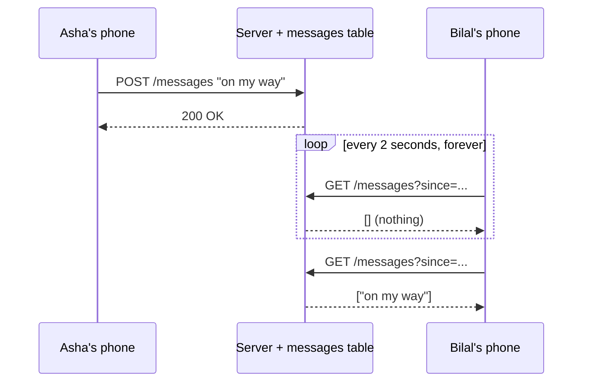
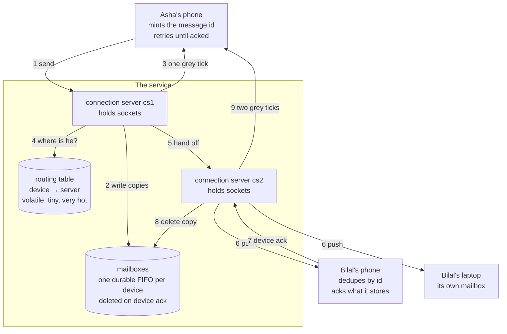
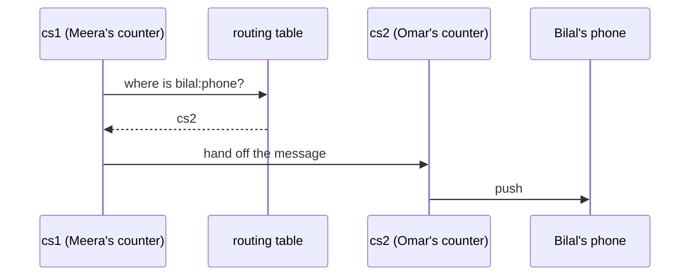
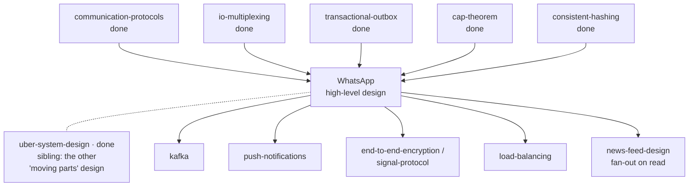

# WhatsApp — how do you hand a letter to someone who is not there?

> **Tell a friend:** Asha stands outside a restaurant in London and types "on
> my way" to Bilal, who is four stops down the Tube with no signal at all.
> That one sentence is the whole difficulty of building a chat app: the person
> you are writing to is usually not there to catch it. So the middle of the
> system is not a database of your conversations. It is a post office with one
> pigeonhole per phone, which holds the letter, hands it over the moment the
> phone walks in, and shreds its own copy the second the phone signs for it.
> Every tick on Asha's screen, every retry, every duplicate Bilal never sees,
> and every number in this lab falls out of that one fact.

Play with the simulator while you read. It draws the pigeonholes live:
<https://claude.ai/code/artifact/bfde5919-ecab-45e9-a03a-e4c468e36d47>

## 1. Why is the easiest-looking app in the world one of the hardest to build?

> **In one breath:** Two people want to talk. One is underground with no
> signal. The other has a phone that falls asleep to save battery. The product
> is the feeling that neither of those things is happening.

Asha wants to tell Bilal she is on her way. Bilal wants to know. Between them
sit a tunnel, a sleeping radio, and a few thousand miles of other people's
cables.

Nobody wants to think about any of that. That is the entire product: the
feeling that messages just work.

When it goes wrong, the failures are the kind users never forgive. A message
silently vanishes. A message appears twice. A "delivered" mark turns out to
have been a lie. Or a conversation's lines land in the wrong order, so the
argument reads backwards.

And the system must do all of that for **billions of people at once**. Most of
them are holding a cheap phone on a bad network.

So the promise is small and the conditions are terrible. That gap is the lab.

## 2. Where does Asha's message physically go?

> **In one breath:** Asha presses send while Bilal is unreachable. The message
> has to be *somewhere* for the next forty minutes, and it cannot be on either
> of their phones.

Asha is standing outside the restaurant. Bilal is on the Tube, four stops
away, with no signal at all. Asha types **"on my way"** and hits send.

Right now, at this exact moment, ask yourself the awkward question.

**Where does that message physically go?**

It cannot go to Bilal. Bilal is unreachable, and no amount of trying changes
that. It cannot stay only on Asha's phone either. Her battery might die. And
when Bilal finally surfaces she may be underground herself, so her phone will
not be awake to hand it over.

Somebody in the middle has to hold it.

### Why a post office, and not a library?

That somebody is a **post office**. Not a library. Not a database of your
conversations. A post office.

The clerk takes the letter. She puts it in a pigeonhole with Bilal's name on
it. She hands it over the moment Bilal walks in. Once Bilal has it, she throws
her copy away, because she was never in the business of keeping your letters.

Give the clerk a name, because you will meet her in every section from here
on. **Meera** works the counter Asha hands letters to. **Omar** works the
counter Bilal is standing at, whenever Bilal is standing anywhere. The two of
them never see the same customer at the same time. That is the job.

Two more people join later. **Priya** also messages Bilal, from a different
conversation. **Arjun** runs a 256-person group that will cost us dearly in
section 10. **Ben** carries the pager in section 15, and **Dev** is the
engineer who makes an entirely reasonable change that breaks everything in
failure F10.

Hold on to the picture of the pigeonhole wall. Everything in this lab is the
post office learning, the hard way, what it takes to never lose a letter and
never hand one over twice.

### How deep does this lab go?

Stop at any checkpoint and you still have something whole.

| Layer | Sections | After it you can… |
|---|---|---|
| **Beginner model** | 1–9 | explain why a chat app cannot just be a web app, and what the ticks really mean |
| **Intermediate model** | 10 | walk the delivery path packet by packet, and say why each odd detail exists |
| **Engineering model** | 11–14 | reason about crashes, partitions, duplicates and ordering, and run them |
| **Production model** | 15 | size the system, name what real WhatsApp does differently, and answer this in an interview |

Checkpoints between the layers tell you what you have earned and what comes
next.

## 3. What would any web developer build first?

> **In one breath:** You already know how to build a web app, so you build the
> obvious chat app. It works. Then you multiply it by two billion.

You know this shape by heart:

- Asha's phone does `POST /messages` with the text.
- The server writes a row into a `messages` table.
- Bilal's phone asks, every two seconds: `GET /messages?since=...`
- Anything new comes back and gets drawn on his screen.

This works. You can build it in an afternoon. For a demo with four users it is
genuinely fine.

The technique has a name. The receiver repeatedly asks "anything for me yet?",
and engineers call that **polling**.

Here is one message travelling that path. Read Bilal's side: he is the one
doing all the work, and almost all of it is wasted.



> **🔮 Predict 1:** Two billion phones, each polling every 2 seconds. Ignore
> everything else. How many requests per second does that alone create, and
> what does each one cost even when the answer is "nothing"?
>
> <details><summary>Reveal</summary>
>
> 2,000,000,000 ÷ 2 = **one billion requests per second**, and the answer to
> almost all of them is an empty list.
>
> Each one is a full network round trip. It wakes the phone's radio. It does a
> TLS handshake if the connection was not kept alive. It hits your servers, it
> queries a database, and it returns nothing.
>
> For comparison, all of WhatsApp's actual message traffic is on the order of
> ~1.2 million messages per second. The polling for *no* messages would be
> roughly a thousand times more expensive than the messages themselves.
>
> If you guessed "a few million", you were pricing the *messages*. The trap is
> that this design's cost has nothing to do with how much anyone talks.
> </details>

## 4. What breaks, and which break is the deep one?

> **In one breath:** Three things break. Two of them are bills you could
> argue about. The third is a fact the design can never learn, and no amount
> of tuning will teach it.

### Break one: it costs the wrong thing

You just did the arithmetic. The overwhelming majority of the work is asking a
question whose answer is "no". You are paying for silence.

### Break two: battery and speed pull in opposite directions

Polling has exactly one knob, the interval, and it is a straight trade.

Set it to 2 seconds and the phone's radio never sleeps. That is a real,
measurable battery drain, and it is the reason early chat apps were
notorious. Set it to 60 seconds to save the battery and Asha's "on my way"
arrives up to a minute late. A minute late is not a messaging app.

There is no setting of this knob that is good. When every value of a knob is
wrong, the shape is wrong, not the tuning.

### Break three: the design cannot ever learn the truth

Look again at that sequence diagram and ask what Asha knows.

She got `200 OK`. What does that mean? It means a server took her message. It
says *nothing* about whether Bilal has it.

And there is no way in this design for her to ever find out. Information only
flows when Bilal asks a question, and Bilal is on the Tube asking nobody
anything.

> **🔮 Predict 2:** Two of those three breaks could be argued away by a
> sufficiently clever engineer with a big enough budget. Which one cannot, and
> why?
>
> <details><summary>Reveal</summary>
>
> The third. Cost and battery are *quantities*. Buy more machines, tune the
> interval, compress the requests, and you move the numbers around.
>
> The third break is not a quantity. It is **missing information**. The design
> has no channel over which the truth about Bilal could ever travel back to
> Asha, because every byte in this system moves only when Bilal speaks first.
>
> If you picked break one, you were reading a bill. The interesting failure is
> not that the design is expensive. It is that the design is *silent*.
> </details>

You met the pull-versus-push distinction in the
[communication-protocols](../02-communication-protocols/) lab, and the reason
idle connections are cheap in the [io-multiplexing](../03-io-multiplexing/)
lab. This is what that choice looks like when it *is* the whole product.

## 5. What exactly must this system promise?

> **In one breath:** Write the promises down in plain words now. Everything
> after this section is the pursuit of exactly this list, and every strange
> detail in the final design is one of these six lines refusing to bend.

Asha does not want a distributed system. She wants six things, and she has
never said any of them out loud.

**One. Never lose a message.** Not even if Bilal is unreachable for days. Not
even if any single machine dies at any moment, including the one holding the
message.

**Two. Never show a message twice.** This is harder than it sounds, because
the only honest promise a network can make is "I might deliver this more than
once".

**Three. Keep each conversation in order.** Line 5 must not appear above line
4. An argument that reads backwards is a broken product.

**Four. Report the truth back to Asha.** Stored, delivered to the device, read
by the human. Three different facts, and the screen must never claim a
stronger one than is true.

**Five. Be fast when both people are online, and cheap when they are not.**
Fast means tens of milliseconds, not seconds. Cheap means an idle phone costs
almost nothing.

**Six. Do all of it while the servers cannot read the messages.** Meera the
clerk carries a sealed box. She is not allowed to open it, and the design must
still work.

Now notice what is *not* on that list. "Store the user's chat history" is
missing. WhatsApp deliberately does not.

That single omission changes the entire storage design. We come back to it in
section 15, where it turns out to be the reason the storage bill is an
afterthought.

## 6. What is the invention, in two sentences?

> **In one breath:** Turn the connection around so the server can speak first.
> Then make the server a queue rather than a database, so nothing is ever
> "sent" until somebody has confirmed holding it.

Two sentences. Everything else in this lab falls out of them.

**Turn the connection around.** Instead of Bilal's phone repeatedly asking the
server for news, the phone opens *one* connection and holds it open. The
server writes down it the instant something arrives. An idle open connection
costs almost nothing. A question asked a billion times costs everything.

**Make the server a queue, not a database.** For every device there is a small
durable queue. A message goes into that queue *before* Asha is told anything.
It comes out *only* when that device confirms it has it. Delivery is not "the
server sent it". Delivery is "the queue emptied".

Read those two sentences again and notice what each one fixes. The first kills
breaks one and two from section 4, the cost and the battery. The second kills
break three, the silence, because now there is a thing whose emptiness means
something and can be reported back.

The ticks, how repeats get discarded, ordering, group delivery: all of it is
consequence. You will watch each one arrive as a scar in section 10.

## 7. What do engineers call the things you have already met?

> **In one breath:** Eight words. Not one of them is new information. Each one
> names something that already happened to Asha or Bilal in the last five
> sections.

A word earns its place only when you have already felt the need for it. You
have felt all of these.

**The line Bilal keeps open.** Bilal's phone dials in once, when he unlocks it,
and stays on the line for six hours, exchanging a few bytes of keepalive.
Engineers call that a **persistent connection**: a long-lived TCP connection,
in practice carrying a framed binary protocol, or WebSocket, held open for
hours. Either side may send at any time without a new request.

The word exists to distinguish it from the request/response connection of a normal web call,
which exists only for the duration of one question. The difference is about who
is allowed to speak first. On a persistent connection, **the server can**. That
is exactly the WebSocket versus long-poll choice from
[communication-protocols](../02-communication-protocols/), and the reason one
machine can hold a million such lines at once is the event loop from
[io-multiplexing](../03-io-multiplexing/).

**The machine at the other end of the line.** Something has to physically hold
Bilal's open line. In this lab those machines are called `cs1`, `cs2` and `cs3`.
In production they are a fleet of a few hundred boxes, each holding around a
million connections. Engineers call one a **connection server**: a process that
owns a very large number of live sockets and moves small packets between them,
and stores nothing durable. The word matters because this box is *not* an
application server. Its scaling limit is memory-per-socket and file
descriptors, not CPU per request.

Different limit, different machine, different failure modes.

**The note saying which machine Bilal is plugged into.** With one server there
is no question to ask. With ten thousand, delivering anything *starts* with the
question "where is Bilal's phone right now?". The answer lives in a **routing
table**, also called a session registry: a small, extremely hot, volatile
key-value map from device to connection-server id, written on every connect and
every disconnect. Today it says `bilal:phone → cs2`. Thirty seconds later, when
he walks out of the Tube onto wifi, it says `bilal:phone → cs7`.

This is a **session** store, not a user store. It describes right now, not who somebody
is. It is a cache of a fact that is only briefly true. That is why the staleness
lessons from [caching](../11-caching/) apply here. It is also why this lab's
nastiest failure is a routing row that has quietly become a lie.

**The pigeonhole with Bilal's name on it.** While Bilal is underground, his
messages have to sit somewhere. That somewhere is a **mailbox**: a durable
FIFO queue, one per **device**, holding messages accepted from a sender but not
yet confirmed by that device. In the lab you will see it written
`mailbox[bilal:phone] = [m1, m2, m3]`. The word exists to separate *accepted*
from *delivered*. Without a name for that in-between state, you cannot even
describe what happens while Bilal is on the Tube.

It is the same shape as the outbox in [transactional-outbox](../48-transactional-outbox/): write it durably
first, deliver later, delete on confirmation.

Those four are the whole machinery. Read the last column, which is the reason
each word had to be invented rather than borrowed.

| In the story | Engineers say | What it holds | Why a new word was needed |
|---|---|---|---|
| The line Bilal keeps open for six hours | **persistent connection** | nothing; it is a pipe | on a normal web call only the client may speak first |
| The machine at the far end of that line | **connection server** | live sockets, nothing durable | it is limited by sockets and memory, not by CPU |
| The note saying where Bilal is plugged in | **routing table** (session registry) | `bilal:phone → cs2`, rewritten on every network change | with one server there was no question to ask |
| The pigeonhole with his name on it | **mailbox** | a durable queue, one per device | "accepted" and "delivered" are different states |

### What does each of Asha's ticks actually prove?

> **In one breath:** A tick is a receipt, and each one is signed by a different
> party. Confusing the signatures is the classic bug in this whole design.

Asha watches her screen. Something comes back and her clock turns into a tick.
What she just received is an **acknowledgement**, or ack: a message sent back
along the path confirming receipt *at a specific point*. There are **two
different ones** in this system, and mixing them up is the classic bug.

The *server ack* says the service has stored it. The *device ack* says Bilal's
phone has written it to its own disk. The word matters because "sent" is
meaningless on its own. An ack names which point in the path has taken
responsibility. Asha's first grey tick is a server ack. Her second grey tick is
caused by a device ack.

Now the ticks, stated precisely. The third column is the one people get wrong.

| On screen | Caused by | What it actually proves |
|---|---|---|
| Clock ◷ | nothing yet | the message has not left Asha's phone |
| One grey ✓ | server ack | the service has it durably. Says **nothing** about Bilal |
| Two grey ✓✓ | device ack | a device of Bilal's physically holds it |
| Two blue ✓✓ | read receipt | a human opened the chat |

### Why can nobody promise to deliver a message exactly once?

> **In one breath:** A lost message and a lost receipt look identical from the
> sender's chair. So anything that guarantees delivery must be willing to
> deliver twice, and the receiver has to clean up afterwards.

Suppose the server pushes to Bilal, Bilal's phone stores it, and Bilal's ack
dies on the way back. The server sees exactly what it would see if the message
itself had been lost. It has one safe move: send again. Engineers call this
**at-least-once** delivery. You keep trying until the other side confirms, so
the other side may get it twice. The phrase exists to be honest that
exactly-once is not something a network can offer. It is only ever
manufactured, at the very edge, by the receiver.

That is the same idempotent-consumer rule you met in
[transactional-outbox](../48-transactional-outbox/), except that here the
consumer is a phone.

How does the phone clean up? It remembers which letters it has already opened.
Formally, the receiving device keeps the set of message ids it has accepted and
silently drops repeats. This is **deduplication by message id**, and it works
for one reason only: the id is **minted by the sending device**, never by a
server. A retry therefore carries the same id and is provably the same message,
not a new one. In the lab, `m1` arrives three times and one line appears.

**And what happens when Arjun posts to his 256-person group?** The post office
photocopies the letter once per recipient at the moment it is posted. At send
time the service writes one copy into each recipient device's mailbox. That is
**fan-out on write**.

The alternative is real: store one shared copy that
readers come and fetch, which is **fan-out on read**, and it is what a forum or
a social timeline does. Chat chooses write-fan-out because each recipient needs
independent delivery state, meaning their own acks, their own offline queue and
their own retries. One message into Arjun's group of 256 becomes 255 mailbox
writes, a figure the lab produces for you in section 10 v7.

**And the box the post office cannot open.** With **end-to-end encryption**,
the message is encrypted on Asha's device with keys only Bilal's devices hold.
Servers route ciphertext and metadata. The word exists to distinguish it from
**transport encryption** (TLS), which protects each hop but leaves the server
holding plaintext at the ends. You saw exactly that distinction in the
[tls](../14-tls/) lab: TLS secures the wire, not the endpoint.

Four delivery words, four consequences. The last column says which of your
other labs each one came from.

| In the story | Engineers say | What it buys you | Met before in |
|---|---|---|---|
| Keep trying until Bilal confirms | **at-least-once** | a guarantee a real network can actually keep | transactional-outbox |
| The phone remembers the letters it opened | **deduplication by message id** | exactly-once on the screen, built at the edge | transactional-outbox |
| Photocopy once per recipient at posting time | **fan-out on write** | private delivery state per recipient | this lab, and its mirror in news feeds |
| A sealed box the clerk cannot open | **end-to-end encryption** | privacy that survives the server itself | tls |

## 8. Which two pictures should you carry, and where do they disagree?

> **In one breath:** Carry the post office for intuition and the nine-step
> diagram for engineering. Then learn the five places the post office lies to
> you, because every hard failure in this lab lives in one of them.

### The simple picture: what does the post office do?

A post office with a wall of pigeonholes. Asha hands in a letter. The clerk
photocopies it once per recipient, drops each copy in the right pigeonhole, and
hands her a receipt (**one tick**). When Bilal walks in and takes his copy, he
signs for it, the clerk shreds the office copy, and posts Asha a note saying it
was collected (**two ticks**). If Bilal opens it in front of the clerk, Asha
gets a second note (**blue ticks**).

### What does the same picture look like in real boxes?

Read the diagram top to bottom, and follow the numbers 1 to 9. That order is
the whole delivery path. Every failure later in this lab is one of these nine
steps going wrong.



### How do the two pictures line up, part by part?

Read these as translation tables, left to right. Nothing in the right-hand
column is new; you met all of it in section 7. First the things that sit still.

| Post office, the furniture | Engineering |
|---|---|
| the counter clerk | connection server |
| pigeonhole with a name on it | per-device mailbox |
| "which branch is this person registered at?" | routing table lookup |
| a sealed box the clerk cannot open | end-to-end encryption |

Then the things that happen, in the order Asha experiences them.

| Post office, the paperwork | Engineering |
|---|---|
| photocopying per recipient | fan-out on write |
| the receipt you get at the counter | server ack → one grey tick |
| signing for your post | device ack → two grey ticks |
| shredding the office copy | mailbox delete on ack |

### Where does the story lie to you?

Every analogy is a loan, and this one comes due here. Five lies, and each one
is a failure you will meet by name in section 11.

1. **A pigeonhole is per person; a mailbox is per _device_.** Bilal's phone and
   his laptop have separate queues and acknowledge separately. The post office
   has no equivalent. This is not a detail. It is why "delivered" becomes
   ambiguous the moment somebody owns two devices.
2. **The clerk does not know which branch you are at until they look it up, and
   the answer expires constantly.** A real post office registration is stable
   for years. A routing row is valid only while a phone stays on one network,
   which is sometimes seconds. Almost every hard failure in this lab is a
   routing row that went stale.
3. **The post office never hands you the same letter twice.** The network does,
   routinely, and by design. Exactly-once is not something the middle can
   promise. It is reconstructed at the very end, by the receiving phone.
4. **The clerk never posts anything on their own initiative.** Here the server
   *pushes*. That reversal is the whole reason the design works at all.
5. **Real post offices keep records.** This one shreds every letter the moment
   it is collected, on purpose. That is why the storage bill turns out to be an
   afterthought.

## 9. What should you do in the simulator before reading the mechanism?

> **In one breath:** Four experiments, under a minute each. Each one is a stage
> of the mechanism you are about to read, so doing them first means the
> mechanism explains something you have already watched.

**→ <https://claude.ai/code/artifact/bfde5919-ecab-45e9-a03a-e4c468e36d47>**
(also `visualization.html` in this folder; it works offline)

The page lays out exactly the diagram above. Asha is on the left. The service
is in the middle, with its routing table and mailboxes visible as live tables.
Bilal's two devices are on the right. Packets travel as chips in the lanes
between them.

**Do these four things, in this order.**

1. Press **Send a message**, then press **Step** repeatedly. Watch the mailbox
   table gain a row *before* Asha's tick appears, and lose it only when a
   device acknowledges. Read the sentence in the log at each step.
2. Press **Bilal's phone: online** to take him offline, send two messages, and
   watch them pile up in the mailbox while Asha stays at one grey tick. Bring
   him back and watch the catch-up.
3. Crash **cs2** from the dropdown while it holds Bilal's connection, then
   send. The routing row turns red and is labelled a lie. Nothing is lost.
4. Drag **drop** to 40%, send four messages, then set **drop** back to 0. Now
   do it again with the switch labelled **Mailbox sweeper** turned off. The
   second time, some messages never arrive, on a perfectly healthy network.
   What that switch is and why it has to exist is stage 10 v5 below. For now,
   just note that it changes the outcome.

Each of the four cards at the bottom asks you to **predict before it runs**.
Answer first. Being wrong there is the point.

---

> ### ✅ Checkpoint — you now have the BEGINNER MODEL
> You can explain why a chat app cannot be a normal request/response web app,
> what each tick actually proves, and why the servers hold a queue rather than
> a chat history. **Next:** the delivery path packet by packet, and where the
> obvious version of it quietly loses your messages.

> **Say it back.** Without using the words *queue*, *acknowledgement* or
> *persistent connection*, explain to a friend why Asha's first grey tick tells
> her nothing at all about Bilal.
> <details><summary>A good answer sounds like</summary>
> "The tick came from the post office, not from Bilal. It means a clerk took
> her letter and dropped it in his pigeonhole. Bilal is still on the Tube and
> has not walked in yet. The only person who can tell her Bilal has it is
> Bilal's phone, and it has not said anything at all."
> </details>

## 10. How does a message actually get from Asha to Bilal?

> **In one breath:** We build the delivery path the way you would really build
> it. Simplest thing first, then let one concrete disaster force the next
> piece. Every strange-looking detail in the final design is the scar of one of
> these.

Eight versions. Each one is a perfectly sensible chat server, and each one is
killed by a specific thing happening to Asha, Bilal, Meera or Omar. Read them
in order. The point is not the final design. The point is the sequence of
funerals that produced it.

### v1 — what happens when you just write to the socket?

Both phones are connected to the same machine. Meera is the only clerk in the
building. Asha's message arrives, the server looks up Bilal's socket in a hash
map, and writes to it. Done.

```java
// v1, roughly
Socket s = sockets.get("bilal:phone");
s.write(message);
```

This is a completely reasonable chat server. It works up to the number of
users one machine can hold.

**And it dies the moment you open a second counter.** Asha is connected to
`cs1`, which is Meera's counter. Bilal is connected to `cs2`, which is Omar's.
Meera looks in *her* socket map, finds nothing, and concludes Bilal is
offline. That conclusion is false, and it is false in the worst possible way:
confidently.

So the first new piece appears, and it is a **routing table**. Every connect
writes one row saying `bilal:phone → cs2`. Every disconnect deletes it.
Delivery now begins with a lookup, and if the answer is another counter, the
message is handed across.

Read the four steps below as Meera's morning. She never touches Bilal. She
asks where he is, and passes the letter to whoever is standing with him.



Now a fact that surprises everybody, and it is worth sitting with.

> This tiny table is the busiest thing in the entire system. The reason is
> counter-intuitive. It is written not when people *talk* but when people's
> *networks change*. A phone moving from mobile data to wifi rewrites a row
> without a single message being sent. In the `storm` experiment in section
> 11, 50,000 phones reconnecting produce 50,000 routing writes and only
> 150,000 message pushes. The connection churn *is* the load.

### v2 — what do you do when Bilal is on the Tube?

The lookup returns nothing. Bilal is not at any counter. v1 has exactly one
option available to it: throw the message away.

That is obviously unacceptable, so the **mailbox** appears. If the lookup says
offline, the message waits in a durable per-device queue until that device
comes back and drains it.

The pigeonhole wall from section 2 has just been built in software.

> **🔮 Predict 3:** We now have a mailbox. When should the server write the
> message into it, before or after it tells Asha "stored"? Does the order
> matter?
>
> <details><summary>Reveal</summary>
>
> It is the whole ballgame. **Write first, acknowledge second.**
>
> Suppose you acknowledge first and the server dies before the write. Asha now
> has a tick for a message that no longer exists anywhere except her own
> screen. She will never retry, because as far as she knows it was accepted.
> The message is lost, silently, and the screen actively lies about it.
>
> Suppose instead you write first and the server dies before acknowledging.
> Asha simply never gets her tick, so she retries. Because the id was minted
> on her phone, the retry is recognisably the same message. The worst case is
> a duplicate, which Bilal's phone already knows how to throw away.
>
> If you answered "it does not matter, the window is tiny", you have found the
> most expensive assumption in messaging. The window is tiny and the system
> runs a billion of them a second.
>
> **The rule: never acknowledge something you have not yet made durable.** In
> the code, `Server.onSend` does the mailbox writes and only then sends the
> ack, and the comment above it says exactly this.
> </details>

### v3 — why did Asha's second tick turn out to be a lie?

v2 pushes to Bilal's socket. Having done so, it deletes the mailbox copy and
tells Asha "delivered". Two grey ticks.

Watch it break. The push goes out. Bilal's phone receives the bytes, and its
battery dies before it writes anything to storage. Or the app is killed by the
operating system. Or the phone loses signal mid-write.

The mailbox copy is already gone. Asha has already been told it was delivered.
When Bilal charges his phone, the message does not exist anywhere in the
world.

So the design grows **two different acknowledgements**, and keeping them apart
is the difference between an honest screen and a lying one. "The server sent
it" is not an event worth telling anyone about. The event that matters is the
receiving device confirming it has the message on its own disk. That
confirmation is what deletes the mailbox copy, and it is what turns Asha's
tick into two.

This is the single line in the whole design that one test exists to protect:
`mailboxCopy_survivesUntilTheDEVICEAcks_notWhenTheServerSends`. Kill the phone
right after the push and the copy is still sitting there.

```
PASS  durability: the copy is STILL in the mailbox after the push
PASS  durability: nothing was deleted on send
```

### v4 — why must the system be willing to deliver twice?

Now the acknowledgement itself can be lost. The server pushed. The device
stored it. The device's ack died on the way back. The server waits, times out,
and pushes again.

There is no way out of this. A lost message and a lost acknowledgement look
identical to the sender. So any system that guarantees delivery *must* be
willing to deliver twice. That is **at-least-once**, and it is not a
compromise. It is the ceiling.

So exactly-once gets manufactured at the very last step instead. Bilal's phone
keeps the set of ids it has already accepted. A repeat is dropped before it
ever reaches the screen, but it is *still acknowledged*, or the server would
retry it forever.

```java
// Device.onDeliver -- the load-bearing four lines of the client
if (!seen.add(m.id())) {          // seen is a Set<String> of accepted ids
    duplicatesSuppressed++;
    ackTo(m);                     // ack anyway, or the server retries for ever
    return;                       // never reaches the screen
}
```

That works for one reason only. The earlier decision that **the sending device
mints the id** is what makes it possible. If a server generated the id, every
retry would look like a brand-new message, and the deduplication set would be
useless furniture.

Force every packet to be delivered twice, send ten messages, and count what
arrives against what Bilal sees.

```
messages typed by asha        : 10
copies that reached the device: 80
duplicates suppressed by id   : 70
messages shown to the human   : 10
```

Eighty copies reached the phone. Ten lines appeared. Bilal has no idea any of
this happened, which is the point.

### v5 — why is a message stuck on a perfectly healthy network?

Here is the version we had after v4: mailbox, device acks, retry timers,
deduplication. It looks complete. It looks like a finished design you could
draw on a whiteboard and defend.

Run it on a network dropping 30% of packets, then repair the network
completely, and this happens.

```
PASS  no-sweeper: 4 message(s) stranded even on a now-perfect network
PASS  no-sweeper: bilal saw only 16/20
```

Four messages out of twenty stuck in a mailbox forever, *after* the network
was restored to perfect, with both phones online the whole time. That was a
real bug in this lab. The test found it. It was not invented to make a point.

> **🔮 Predict 4:** The retry timer fires every 500ms until the device
> acknowledges. Both phones are online. The network is now perfect. So why is
> anything stuck?
>
> <details><summary>Reveal</summary>
>
> **Because the retry timer lives on the wrong machine.**
>
> The push retry is created inside `deliverToSocket`, on the server that holds
> the recipient's connection. That is Omar's counter, `cs2`. If the packet
> that dies is the *server-to-server hand-off*, `cs1 → cs2`, Meera's counter to Omar's,
> then Omar never learned a push was owed. No timer was ever created, on any
> machine. Meera has moved on. The message is sitting in a mailbox, perfectly
> safe and perfectly invisible.
>
> If you guessed "the retry backoff got too long", you were looking at a timer
> that does exist. The bug is a timer that does not. Every retry in the system
> was guarding a hop, and no retry was guarding *the thing that actually needs
> delivering*.
> </details>

So the fix inverts what the design thinks it is doing. **The queue is the
mechanism; the push is only an optimisation.** Each connection server
periodically re-scans the mailboxes of every device it currently holds, and
re-pushes anything still sitting there.

```java
// Server.startSweeper -- the box everyone forgets to draw on the whiteboard
for (String deviceId : sockets.keySet())
    for (var e : boxes.box(deviceId))
        if (!inFlight.contains(key(deviceId, e.msg().id())))
            deliverToSocket(deviceId, e.msg());     // try again, from the queue
```

Same seed, same 30% loss, sweeper switched on.

```
PASS  lossy: all 20 messages eventually arrived (delivered=20/20)
PASS  lossy: none was shown twice (window=20)
PASS  lossy: the client had to suppress duplicates (14)
```

This is the most transferable idea in the lab, so it is worth saying without
any chat vocabulary at all. **Any design whose delivery guarantee depends on a
message being pushed successfully has a hole in it.** The guarantee has to
come from durable state that somebody periodically re-examines. Pushes make it
fast. The scan makes it true.

### v6 — nothing sorts anything, so why is the chat in order?

Bilal was offline for an hour. He reconnects and twelve messages arrive at
once, in one burst. What keeps them in order?

Go and look at the design. There is no sequencer. There is no timestamp
comparison. There is no reordering buffer. No server sorts anything, anywhere.

> **🔮 Predict 5:** With no sorting code in the entire system, where does
> per-conversation ordering actually come from?
>
> <details><summary>Reveal</summary>
>
> From two things, and both of them are free.
>
> 1. The mailbox is a **FIFO queue**, drained front to back.
> 2. Everything travels over **one connection**, and a TCP connection is a
>    byte stream. What is written first arrives first. Nothing can overtake.
>
> Take away either one and ordering is gone. The lab lets you take away the
> second: `java src/Experiments.java ordering`
>
> ```
> one ordered connection (real TCP): out-of-order arrivals = 0,
>     screen order = [1, 2, 3, 4, 5, 6, 7, 8, 9, 10, 11, 12]
> packets free to overtake       : out-of-order arrivals = 11,
>     screen order = [12, 2, 5, 1, 4, 7, 8, 6, 10, 11, 3, 9]
> ```
>
> If you guessed "the server sorts by timestamp", ask whose clock. There is no
> shared clock here, and there does not need to be one.
>
> This is why a device is **pinned to one connection** rather than having its
> packets load-balanced across servers, which would otherwise be the obvious
> thing to do. The ordering guarantee is a consequence of that pinning.
> </details>

Now notice carefully what is *not* guaranteed. There is no ordering **between**
different conversations. If Asha and Priya both message Bilal, the relative
order of the two chats is whatever the mailbox happened to receive.

Nobody needs it, so nobody pays for it. That refusal is a large part of why
the system scales.

### v7 — is a group message a new feature, or the same loop?

A group message looks like it needs a new concept. A shared conversation
object that everybody reads from, perhaps. It does not need one.

Arjun runs a group of 256 people. In the code, his group is the *same loop* as
a one-to-one chat, with a longer list.

```java
Set<String> targets = new HashSet<>();
for (String member : cluster.recipientsOf(m.toUser()))   // one person, or 256
    targets.addAll(reg.devicesOf(member));
```

One typed message becomes one mailbox copy per recipient device. That is
**fan-out on write**, and here is what it costs, measured at two group sizes.

```
group of   5 : 1 typed message ->   4 mailbox writes,   22 network packets
group of 256 : 1 typed message -> 255 mailbox writes, 1244 network packets
```

**Why not keep one shared copy that everyone reads?** Because every recipient
needs their own delivery state. Their own position in the queue. Their own
acknowledgement. Their own offline period. Their own retries. A shared copy
would have to track all of that per member anyway. You would have rebuilt the
mailboxes, and added a coordination problem on top.

The price is real and it is linear. Every message to Arjun's 256-person group
is 255 writes and 255 delivery state machines, paid on *every* message.

That is why group size is capped at all. The cap is a product constraint
driven purely by fan-out cost. It is also why "broadcast to 100,000 people" is
a completely different system rather than a bigger group.

> **🔮 Predict 6:** Every message is end-to-end encrypted, so only the
> recipient devices can read it. Arjun types one line into his group of 256.
> How many separate encryptions must his phone do?
>
> <details><summary>Reveal</summary>
>
> Naively, 255. One per recipient device, because each device holds different
> keys. That is a phone doing hundreds of public-key operations for one line of
> text, on every line of text.
>
> Real WhatsApp avoids it with **sender keys**. Arjun's phone generates one
> symmetric key for the group and distributes it once, pairwise-encrypted, so
> 255 encryptions happen *once*. Every later message is encrypted a single
> time with that key. The server still fans out 255 copies of the same
> ciphertext.
>
> If you answered "one, because the server re-encrypts", that is the design
> end-to-end encryption exists to forbid. The server has no keys and never
> will.
>
> *(This is the publicly documented Signal-protocol group design; I have not
> implemented it here. The lab's `ciphertext` field is a stand-in.)*
> </details>

### v8 — Bilal has a laptop too, so what does "delivered" even mean?

Bilal has a phone and a laptop. The change is smaller than you would expect,
because the mailbox was per-device from the very start.

```
PASS  multi-device: bilal's phone got it
PASS  multi-device: bilal's laptop got it
PASS  multi-device: asha's OWN laptop got a copy too
PASS  multi-device: 3 mailbox copies were written for 1 typed message
```

Three copies for one typed message. One of them goes back to *Asha's own other
device*, which is how her laptop shows the chat she typed on her phone.

The genuinely hard part here is not delivery. It is **meaning**.

What should two grey ticks mean when Bilal has a phone, a laptop and a tablet?
First device to acknowledge? All of them? The phone specifically?

Every product answers this differently, and every answer is defensible. There
is no correct one, because the underlying reality is "some subset of his
devices has it", and that does not fit into a two-tick screen. In this lab,
the first device to acknowledge deletes the copy that triggers the receipt.

End-to-end encryption makes it harder still. Each device has its own key pair,
so Asha's phone must encrypt for *each device*. Adding a device becomes a
key-distribution event, not just a login.

---

> ### ✅ Checkpoint — you now have the INTERMEDIATE MODEL
> You can walk a message from a phone to a queue to another phone and back, and
> justify each step by the failure that forced it: routing tables because of
> Omar's counter, mailboxes because of the Tube, device acks because of the
> dead battery, deduplication because of at-least-once, sweepers because of the
> lost hand-off, connection pinning because of ordering.
> **Next:** what happens when whole machines and networks fail, and exactly
> which promises survive.

> **Say it back.** Without using the words *idempotent*, *at-least-once* or
> *deduplication*, explain to a friend why Bilal's phone received eighty copies
> of ten messages and Bilal never noticed.
> <details><summary>A good answer sounds like</summary>
> "The post office cannot tell the difference between a letter that never
> arrived and a receipt that never came back. So when in doubt it sends the
> letter again. Bilal's phone writes down the reference number of every letter
> it opens. When the same number turns up a second time, it says thank you and
> drops it in the bin without showing him."
> </details>

## 11. What breaks when machines and networks fail?

> **In one breath:** Ten things go wrong, and you can run every one of them.
> Nine of them lose *time* and keep the message. Only one loses the message,
> and the system chose that loss on purpose.

Each failure below is a short story about somebody. Asha keeps typing. Bilal
keeps disappearing. Omar's counter falls over. Dev makes a change that seems
obviously good. Read the story first, then the one comparison table at the end
of the section, which lines all ten up side by side.

Here is how to make each one happen on your own machine.

| # | The failure, in one line | Make it happen |
|---|---|---|
| F1 | Bilal's phone is off for a week | `java src/Experiments.java offline` · toggle *Bilal's phone: online* |
| F2 | The counter holding Bilal's line crashes | `java src/Experiments.java crash` · *Crash cs2* |
| F3 | The network splits Asha from Bilal | `java src/Experiments.java partition` · *Cut the network* |
| F4 | Every packet is delivered twice | `java src/Experiments.java dup` · *duplicate* slider to 100% |
| F5 | A push that nobody remembers to retry | the `withoutTheSweeper_...` test · *Mailbox sweeper: off* + 40% drop |
| F6 | Fifty thousand phones reconnect at once | `java src/Experiments.java storm` |
| F7 | Asha never hears "stored" | the `droppedServerAck_...` test, 35% drop on the uplink |
| F8 | Arjun's 256-person group during a big match | `java src/Experiments.java group` |
| F9 | A mailbox nobody ever collects from | the retention rule, discussed below |
| F10 | Dev "optimises" the connection layer | `java src/Experiments.java ordering` |

### F1 — what if Bilal is offline for a week?

Asha sends twelve messages while Bilal's phone is switched off. All twelve
land in his mailbox. Asha sits at one grey tick on each.

When he reconnects, the catch-up drains all twelve in order. Each one is
acknowledged. Each mailbox row is deleted. Asha's ticks all turn to two, in a
little cascade, seven days late.

Nothing was lost because the mailbox write happens *before* the sender is
acknowledged. "Accepted" and "durable" are the same instant, so there is no
moment when the message existed only in flight.

The queue is not infinite, though. WhatsApp publicly states undelivered
messages are held ~30 days and then dropped. That is a real, user-visible loss
boundary, chosen deliberately over unbounded storage.

### F2 — the counter crashed, so is the message lost?

Omar's counter, `cs2`, is holding Bilal's socket. The machine dies.

> **🔮 Predict 7:** The routing table still says Bilal is at that counter, and
> the counter no longer exists. Asha sends. Is her message lost, and what does
> her screen say?
>
> <details><summary>Reveal</summary>
>
> Nothing is lost, and her screen tells the truth: one grey tick, and it stays
> there.
>
> The reason is the ordering from v2. The mailbox copy was written before the
> ack, and nothing deletes a mailbox copy except a device acknowledgement.
> The hand-off to the dead counter simply evaporates.
>
> If you answered "lost, because the routing row is wrong", you spotted the
> real bug and stopped one step early. The routing row *is* wrong. The design
> survives it by never treating a successful push as the guarantee.
> </details>

Here is the run. Read the line marked `<-- a lie`, then read the last line.

```
bilal's socket lives on cs1; the registry says so too.
registry still points at cs1: cs1   <-- a lie
[   40ms] cs3 stored asha:phone-asha-bilal-1 into 1 mailbox(es)
[   68ms] LOST (node down) -> cs1
[   79ms] asha:phone got server-ack   [one grey tick]

bilal saw            : 0 messages
safe in the mailbox  : 1
asha's tick          : one grey tick   <-- honest
```

What actually broke is subtle. The sockets died with the machine, but the
*routing rows pointing at it did not*. For a window of time the table
confidently returns a dead address, and messages routed there evaporate.

Why can nobody clean up? Because the routing table is updated by the server
that owns the session, and a crashed server cannot clean up after itself. Say
the general form out loud, because it is true far beyond chat: **a distributed
registry always lags reality by at least one failure-detection interval.**

Production fixes this with leases. Sessions carry a TTL and are refreshed by
heartbeat, so stale rows expire on their own. That is the identical mechanism
the [uber-system-design](../70-uber-system-design/) lab uses for a driver's
position and a ride offer, which is a good sign you are looking at a general
tool rather than a chat trick. Clients also reconnect aggressively with
backoff. And the whole design assumes connection servers are disposable, which
is precisely why they hold no durable state.

### F3 — the network splits in two, so who wins?

Asha and Meera's `cs1` are on one side. Bilal and Omar's `cs2` are on the
other. Asha's message is stored and acknowledged, so she gets one grey tick.
The hand-off across the split is dropped. The message waits.

When the partition heals, the sweeper re-pushes and the ticks complete.

Why is this not a disaster? Because this system never needed both sides to
agree on anything. There is no consensus in the delivery path. No quorum, no
leader, no commit protocol. Each mailbox has exactly one owner.

Read it through [cap-theorem](../24-cap-theorem/): during a partition the
system stays **available** for writes, because Asha can keep sending. What it
gives up is timeliness, not correctness.

Compare that to the [two-phase-commit](../45-two-phase-commit/) lab, where a
partition at the wrong moment blocks participants outright. Chat gets an easy
ride, and the reason is worth naming. The guarantee it needs is "this queue
eventually empties", and that is not an agreement between machines.

The casualty is presence. "Last seen" is wrong on both sides for the duration.

### F4 — eighty copies arrive and ten lines appear. How?

Set the duplicate slider to 100%, and Asha's ten messages reach Bilal's phone
eighty times.

It happens because a lost acknowledgement is indistinguishable from a lost
message. Retrying is the only safe response, and duplication is the price of
that safety.

Bilal's phone drops ids it has already accepted, and *still acknowledges*
them. Skip that ack and the server retries forever, which turns a cosmetic
problem into a permanent one.

Nothing is lost, but the work is real. Those seventy extra pushes cost
bandwidth and battery on a phone somebody is paying for.

This is the same shape as an idempotent consumer in
[transactional-outbox](../48-transactional-outbox/). The difference is where
the deduplication set lives. Here it lives on a phone with limited storage, so
it is bounded: a recent window of ids, not all history. A message duplicated
*after* it falls out of that window would show twice, which is why the window
is generous.

### F5 — the push nobody remembered to retry

You already met this one as v5: 4 of 20 messages stranded on a healthy
network.

The retry timer was created by the receiving server, and the packet that died
was the one that would have told it to create the timer. After the fix, a
periodic sweep of every connected device's mailbox finds the strays.

Before the fix, those four were silently lost while Asha showed one confident
grey tick. That combination, silent loss plus a confident screen, is the worst pairing in
the whole lab.

Every real messaging system has this box under some name. A delivery sweeper.
A retry scanner. A reconciliation job. If you sketch this design in an
interview without it, "what if the internal hand-off is lost?" is the question
that finds the hole.

### F6 — fifty thousand phones reconnect in the same second

A data-centre failover, a mobile network blip, or an app update makes a large
population reconnect simultaneously. Nobody sent a message. Look at where the
work lands.

```
sockets per server (mean)  : 2500
mailbox reads triggered    : 50000
catch-up packets pushed    : 300000
registry writes in 1 second: 50000   <-- the registry, not the mailbox, is the hot spot
```

What breaks is not the message path. It is the *session* path. Each reconnect
is a routing-table write plus a mailbox scan.

It is dangerous because it is self-amplifying. Overloaded servers time out,
clients reconnect harder, load rises further. Engineers call that a
**thundering herd**.

The client-side answer is exponential backoff with jitter. The lab's
`Device.scheduleRetry` doubles its delay each attempt for exactly this reason.
The server-side answer is connection admission control.

In production, clients spread reconnects over a randomised window. Load
balancers shed connections rather than accepting them and collapsing. And
capacity is planned for the reconnect spike, not the steady state. The peak
that sizes your fleet is a failover, not a busy evening.

### F7 — what if Asha never hears "stored"?

Her uplink drops 35% of packets, so the server ack never reaches her. She
retries with the same id.

The server appends to the mailbox a second time and pushes again. Bilal's
phone recognises the id and drops it. Asha's screen is right, Bilal's screen
is right, and a little storage and bandwidth were burned in between.

Here is the subtle point. A *server-side* deduplication check would save that
work, and real systems do keep a short-lived recent-id set per sender for
exactly this. It is an optimisation, not a correctness requirement. The
correctness lives on the phone, and it never moved.

### F8 — Arjun's group during a big match

`group of 256 : 1 typed message -> 255 mailbox writes, 1244 network packets`

Nothing breaks correctness-wise. The *cost* breaks. A busy 256-person group
generates two orders of magnitude more work than a one-to-one chat, and it
arrives in bursts, because everybody replies to the same goal.

The saving grace is that the work is linear and parallel. Each recipient's
mailbox is independent, so there is no lock and no shared hot row. That is the
payoff for fan-out on write.

Production adds group size caps, plus rate limits per sender and per group
(see [distributed-rate-limiting](../60-distributed-rate-limiting/)). Anything
broadcast-shaped gets separate treatment, because a "group" of 100,000 is a
different product with a different design.

### F9 — the letter nobody ever collects

A phone is lost, or the app is uninstalled. Its mailbox grows and is never
drained.

Time-based expiry ends it. WhatsApp drops undelivered messages after roughly
30 days, and the sender is simply never upgraded past one grey tick.

Be honest about what this is. It is the one place the system deliberately
loses data. The loss is bounded and well understood, and it is what keeps
storage from being unbounded, which is the trade that makes the whole storage
layer cheap.

### F10 — Dev's entirely reasonable optimisation

Dev notices that a device's packets all queue behind one connection. He
load-balances them across several connections for throughput. Every test
passes. Nothing errors.

```
packets free to overtake : out-of-order arrivals = 11,
    screen order = [12, 2, 5, 1, 4, 7, 8, 6, 10, 11, 3, 9]
```

Asha's conversation now reads backwards for Bilal.

Why? Because the ordering guarantee was never implemented anywhere. It was
inherited from having exactly one ordered stream. Remove the stream and the
guarantee goes with it, with no error and no test failing unless somebody
wrote one.

The lesson generalises, and it is the most quietly useful sentence in this
lab. **Know which of your guarantees are implemented and which are
inherited.** Inherited ones are the ones that vanish silently during a
refactor.

### All ten side by side

Read the second column first. Nine of these ten rows lose only time.

| # | What actually broke | What still held | What was lost meanwhile | What production adds |
|---|---|---|---|---|
| F1 | nothing; Bilal was simply away | no loss, no duplicates, order | any bound on latency | ~30 day retention, then a real drop |
| F2 | sockets died; routing rows survived them | durability, no duplicates, order | liveness, for the detection window | session leases with a TTL, heartbeat refresh |
| F3 | the hand-off between the two sides | everything except promptness | delivery latency, presence accuracy | regional homing; the sweeper heals it |
| F4 | the acknowledgement, not the message | the exactly-once illusion on screen | bandwidth and battery, briefly | short-lived server-side recent-id set |
| F5 | the packet that would have created the timer | nothing, before the fix | 4 of 20 messages, silently | a sweeper, under some name, in every real system |
| F6 | the session path, not the message path | every message guarantee | server headroom; it self-amplifies | backoff with jitter, admission control |
| F7 | the server ack on Asha's uplink | exactly-once on screen | a little storage and bandwidth | per-sender duplicate suppression |
| F8 | cost, at two orders of magnitude | correctness; the work is parallel | headroom during bursts | group caps and rate limits |
| F9 | nobody collected the mail | the storage budget | the message itself, deliberately | expiry sweep; sender stays at one tick |
| F10 | an inherited guarantee, silently | durability and deduplication | per-conversation ordering | pin a device to one ordered connection |

## 12. What is promised, what is not, and what was sold to get it?

> **In one breath:** Five rules hold the whole thing up. Each one buys a
> promise, and each promise was paid for by giving something else away. This
> section is the receipt.

### Which five rules hold everything up?

These are the invariants. Break any one of them and something Asha can see
goes wrong. Rung 6 of the exercises plants a bug behind each of the first
four, so you can watch it happen.

1. **Nothing is acknowledged before it is durable.** The mailbox write comes
   first, then the server ack. So a tick never over-promises.
2. **Nothing is deleted before the recipient device confirms it.** So any
   crash between push and confirmation costs a retry, never a message.
3. **Message identity belongs to the sending device.** So a retry is provably
   the same message, which is the only thing that makes deduplication possible
   at all.
4. **A device accepts each id at most once.** So at-least-once transport
   becomes an exactly-once experience.
5. **A device's messages travel over exactly one ordered connection, drained
   from a FIFO queue.** So per-conversation order arrives free, with no code.

### What is Asha actually guaranteed?

Every device that is registered will **eventually** receive the message, as
long as it reconnects within the retention window. However many times the
network delivers, **no duplicate is ever shown to a human**. Each device sees
its **conversations in order**. Each tick on Asha's screen means something
specific and is never reached early, which is what makes her feedback honest.
And during a partition the system stays **available** for accepting and
queueing messages.

### What is deliberately not guaranteed?

There is no bound on delivery latency, and there cannot be, because Bilal's
phone may simply be off.

There is no ordering across different conversations. Nobody needs it, so it
was never paid for.

There is no single global order of all messages. No such clock exists and no
such need exists. Contrast [paxos](../39-paxos/), where agreeing an order *is*
the entire problem.

There is no server-side history. Once delivered, the service has nothing. Lose
your phone without a backup and the messages are gone. That is a product
promise, not a bug.

There is no delivery after the retention window closes at roughly 30 days.

There is no exactly-once at the transport layer. Only at the screen.

And presence is not accurate. "Last seen" and "online" are best-effort, and
during a partition they are simply wrong.

### What was traded away, and what did it buy?

Read the right-hand column as the reason somebody agreed to the left-hand one.

| Given up | Bought |
|---|---|
| Server-side chat history | A tiny storage footprint, and a strong privacy claim |
| Global ordering | No coordination in the delivery path at all — no consensus, no leader |
| Bounded latency | Correctness under arbitrary offline periods |
| Transport-level exactly-once | A guarantee a network can actually keep |
| Unbounded queues | Predictable storage, at the cost of a real 30-day loss boundary |
| Cheap huge groups | Independent per-recipient delivery state |

Here is the through-line, and it is the sentence to remember from the whole
lab. This system is fast and enormous precisely because it **refuses to agree
on anything**.

Every mailbox has one owner. Every message has one identity, chosen at the
edge, on a phone. No two machines ever have to reach a decision together.

Compare the coordination cost you measured in
[two-phase-commit](../45-two-phase-commit/) and [paxos](../39-paxos/). Chat is
the design you get when you successfully *avoid* needing them.

## 13. Which lines of code carry the design?

> **In one breath:** Nine small files, no dependencies, no build tool. Four
> places in them are load-bearing, and everything else is scaffolding around
> those four.

Everything runs with no dependencies and no build tool. `java src/Tests.java`
compiles the directory in place, on JDK 25.

Read the right-hand column for what each file is really for.

| File | What it is |
|---|---|
| [`src/Msg.java`](src/Msg.java) | the message; note `id` is minted by the device and the payload is called `ciphertext` on purpose |
| [`src/Net.java`](src/Net.java) | a deterministic event-driven fake network: drop, duplicate, delay, partition, kill — every fault in the lab funnels through `Net.send` |
| [`src/Registry.java`](src/Registry.java) | the routing table, plus `leaveStaleEntriesFor` — the crash that leaves lies behind |
| [`src/MailboxStore.java`](src/MailboxStore.java) | per-device durable FIFO queues |
| [`src/Server.java`](src/Server.java) | connection server: fan-out, push, retry, the sweeper, ack handling |
| [`src/Device.java`](src/Device.java) | the phone: id minting, deduplication, acks, ticks, backoff |
| [`src/Cluster.java`](src/Cluster.java) | wiring, groups, stats |
| [`src/Tests.java`](src/Tests.java) | 31 scenario checks, readable as documentation |
| [`src/Experiments.java`](src/Experiments.java) | nine runnable failure experiments |

### Which four places would you defend in review?

All four are commented in the source with the invariant they enforce.

`Server.onSend` does the mailbox writes and *then* the sender ack. Reversing
those two lines makes Asha's ticks lie, which is invariant 1.

`Server.onDeviceAck` is the only place a mailbox row is ever deleted, and it
is driven by the *device*, not by a successful send. That is invariant 2.

`Device.onDeliver` holds `if (!seen.add(m.id()))` and then acknowledges
anyway. Three lines on Bilal's phone that convert at-least-once into
exactly-once, which is invariant 4.

`Server.startSweeper` is the periodic re-scan. It is the difference between
`16/20` and `20/20` under packet loss, and it is the box nobody draws.

What the code deliberately does **not** have: real sockets, real threads, real
persistence, encryption, authentication, media, presence, or a real database.
Each of those is named in section 15 with what production does instead.

## 14. What do the nine experiments show?

> **In one breath:** Nine commands. Answer the question in the third column
> before you run each one, because being wrong is where the learning is.

```bash
java src/Experiments.java            # lists all nine
```

| # | Command | Predict before running |
|---|---|---|
| 1 | `trace` | How many network packets does one message and its read receipt cost, end to end? |
| 2 | `offline` | While Bilal is away, what does Asha see, and where do the messages live? |
| 3 | `crash` | The routing row still points at the dead server. Is the message lost? |
| 4 | `partition` | Which side can still make progress, and what does Asha's screen say? |
| 5 | `dup` | Every packet is delivered twice. How many lines appear on screen? |
| 6 | `group` | One message to 256 people — how many mailbox writes? How many packets? |
| 7 | `ordering` | Nothing sorts anything. What actually keeps a burst in order? |
| 8 | `storm` | 50,000 phones reconnect at once. Which subsystem is the hot spot? |
| 9 | `capacity` | At 100 billion messages a day, is this a storage problem or a connection problem? |

Answers, with the numbers, are in the sections above and in
[SOLUTIONS.md](SOLUTIONS.md).

Here is experiment 1 worked through. Read the timestamps down the left, and
watch how much of the elapsed time is Asha waiting for news about somebody
else's phone.

```
[    0ms] asha:phone connected to cs3 (registry updated)
[    0ms] bilal:phone connected to cs1 (registry updated)
--- send ---
[   40ms] cs3 stored asha:phone-asha-bilal-1 into 1 mailbox(es)
[   79ms] asha:phone got server-ack   [one grey tick]
[  115ms] bilal:phone SHOWED message to the user
[  146ms] cs1 got device-ack -> mailbox copy deleted
[  209ms] asha:phone -> two grey ticks (device has it)
--- bilal opens the chat ---
[  916ms] asha:phone -> two blue ticks (human read it)

packets: sent=10 delivered=10 dropped=0 dup=0
mailbox: appends=1 deletes=1 stillQueued=0
```

Ten packets for one "on my way" and its receipts. The mailbox row existed for
106 milliseconds. That row is the entire storage cost of a delivered message,
and it is why section 15 opens by telling you this is not a storage problem.

---

> ### ✅ Checkpoint — you now have the ENGINEERING MODEL
> You can name the invariants, say which guarantees survive each failure, and
> run every one of them. **Next:** the numbers, what real WhatsApp does that
> this toy does not, and how to say all of this in an interview.

> **Say it back.** Without using the words *invariant*, *durable* or *sweeper*,
> explain to a friend why this design never has to make two computers agree on
> anything.
> <details><summary>A good answer sounds like</summary>
> "Every pigeonhole belongs to exactly one phone, and only that phone can empty
> it. The reference number on the letter was written by the person who sent it,
> so nobody has to decide whose number wins. There is nothing for two clerks to
> argue about, so there is never a vote."
> </details>

## 15. What does the real thing do that this toy does not?

> **In one breath:** Do the arithmetic first, because it tells you which
> problem you are actually solving. Then meet the seven things the toy is
> missing, the largest of which is that phones cannot stay connected at all.

### 15.1 What do the numbers say before you draw a single box?

Run it and read the last three lines hardest.

```bash
java src/Experiments.java capacity
```
```
users                                : 2,000,000,000
messages/day                         : 100,000,000,000
average messages/second              : 1,157,407
peak (x3)                            : 3,472,221/s
concurrently connected (1 in 4)      : 500,000,000
connection servers @ 1,000,000 sockets  : 500
undelivered queue, 1% of a day's mail: 200 GB
```

> **🔮 Predict 8:** Half a billion phones online at once, and 100 billion
> messages a day. Which layer do you build first: the one that stores the
> messages, or the one that holds the connections?
>
> <details><summary>Reveal</summary>
>
> The connections, and it is not close.
>
> The pending queue is 200 GB. That would fit on one reasonably large machine.
> The 500,000,000 open connections would not fit on ten thousand.
>
> **This is a connection problem wearing the costume of a database problem.**
> The storage layer is small because you throw everything away as soon as it
> is delivered.
>
> If you answered "storage, at 100 billion a day", you priced the messages
> that arrive rather than the ones still waiting. A design that opens with "we
> shard the messages table across 500 nodes" has already misread the question,
> and that is a genuinely common way to lose this interview.
> </details>

Two derived numbers are worth having ready before anyone asks.

The first is **1.2M messages/second average, and around 3.5M at peak**. But
the fan-out multiplier matters more than the message count. With groups,
*deliveries* per second are several times higher than *messages* per second.

The second is that **the reconnect rate sizes your fleet, not the message
rate**. Phones change networks constantly. A data-centre failover reconnects a
whole region at once, which is experiment 8.

Where these figures come from, and which of them are assumptions rather than
published facts, is set out in section 19.

### 15.2 How does each toy piece become a real one?

Read the middle column as the honest implementation, and the right-hand one as
what a company operating at this size actually did.

| This lab | Real implementation | Production reality |
|---|---|---|
| `Net` event loop | real TCP sockets with epoll/kqueue | see [io-multiplexing](../03-io-multiplexing/) — this is that lab, applied |
| `Server` object | a connection server process holding ~1M sockets | WhatsApp famously ran these on FreeBSD in **Erlang**, a runtime built for millions of cheap concurrent processes; reported ~1–2M connections per box |
| custom `Packet` types | a compact binary protocol | WhatsApp began from **XMPP** (via ejabberd) and evolved a compressed binary variant often called *FunXMPP*; the wire format is not the interesting part |
| `Registry` HashMap | a replicated in-memory session store with leases | Redis-like or purpose-built; every row is a lease refreshed by heartbeat, so crashes self-heal ([redis](../13-redis/)) |
| `MailboxStore` HashMap | a write-heavy, delete-heavy durable store | WhatsApp used Erlang's **Mnesia**; the workload shape (append, read once, delete, short lifetime) is a poor fit for a B-tree and a decent fit for an LSM — though the delete rate makes tombstones a real operational concern ([btree-and-lsm](../05-btree-and-lsm/)) |
| `Cluster.homeFor` = hash | a load balancer + client reconnect logic | which device lands on which server changes constantly, which is exactly why the registry exists rather than a formula |
| plaintext `ciphertext` field | the **Signal protocol** | E2E since 2016, with sender keys for groups |
| always-connected phones | **push notifications** | see 15.3 — the biggest single omission |

### 15.3 What does this toy get most wrong?

Everything above assumes Bilal's phone holds an open connection. On iOS, an
app in the background **cannot**. The operating system suspends it, and the
socket dies.

So there is a whole extra hop. When a message arrives for a device with no
live connection, the service sends a small notification through **APNs**
(Apple) or **FCM** (Google). That is a single system-level connection the
operating system maintains on behalf of every app. It wakes the app, the app
reconnects, and *then* the mailbox drains exactly as in this lab.

Three consequences are worth knowing.

There is now a delivery path outside your control, with its own retries, rate
limits and failure modes. You cannot debug it and you cannot page anyone about
it.

With end-to-end encryption the notification cannot contain the message text,
because the server does not have it. The phone must wake up and fetch.

And it changes what "delivered" means. On iOS a message may be sitting in a
mailbox while the phone is perfectly online, just suspended.

### 15.4 What else did the toy leave out?

Eleven things, and each one is a lab of its own. Read the right-hand column
for what a real system puts there instead.

| Omitted here | What production does |
|---|---|
| **Persistence** | mailboxes are a `HashMap`; real ones are on disk, replicated, and fsynced before the sender ack |
| **Authentication** | phone-number registration, device identity keys, session establishment |
| **End-to-end encryption** | Signal protocol; per-device sessions; sender keys for groups; key-change notifications |
| **Media** | photos and videos never travel the message path: the client encrypts the blob, uploads it to a separate store, and sends a small pointer + key. Media is a CDN problem, not a messaging problem |
| **Presence / typing** | ephemeral, best-effort, never queued and never durable — the opposite policy from messages, deliberately |
| **Voice & video calls** | a completely separate path (peer-to-peer where possible, relayed otherwise); the messaging system is used only for signalling |
| **Backpressure** | a slow phone must not force a server to buffer without limit; real servers bound per-connection queues and shed |
| **Sharding of the queue store** | by device id, typically consistent hashing — this lab uses a plain modulo, which is exactly the bug [consistent-hashing](../35-consistent-hashing/) measures: 100→101 machines moves 99% of keys when 1% had to move |
| **Multi-datacentre** | users are homed near their region; mailboxes are regional; cross-region delivery is an extra hop and the main source of tail latency |
| **Retention & deletion** | ~30 day queue TTL; delete-for-everyone; disappearing messages |
| **Abuse, spam, rate limits** | per-sender and per-group limits ([distributed-rate-limiting](../60-distributed-rate-limiting/)) |
| **Backups** | the reason your history survives a lost phone is a *user-controlled cloud backup*, not the service |

### 15.5 What does Ben watch when he is on call?

Ben carries the pager. He does not watch "messages per second", because that
number is almost never the first thing to move. He watches these six.

**Concurrent connections per server, and the reconnect rate.** A rising
reconnect rate is the earliest signal of nearly every incident.

**Mailbox depth, and more importantly the _age_ of the oldest undelivered
message.** Depth is normal, because people are offline. Age climbing for
*online* devices means delivery is broken.

**Sweeper backlog**, meaning how much work the periodic re-scan is finding. It
should be near zero. If the sweeper is delivering a lot, pushes are failing.

**Ack latency at the 99th percentile**, from push to device ack, split by
region.

**Stale-session rate**, meaning routing rows pointing at servers that no
longer hold the socket. Spikes here mean failure detection is lagging.

**Fan-out amplification**, meaning deliveries per message. A sudden rise means
group traffic is shifting and the capacity arithmetic changes.

The pager Ben least wants to receive reads *"undelivered age p99 rising,
connection count flat"*. Flat connections rule out a mass disconnect. Rising
age with users online means delivery itself is stuck. That is the F5 shape,
and Ben should go and look at the sweeper first.

### 15.6 Why does Slack look nothing like this?

One question separates all of these products: **does the server keep your
history?** Everything else follows from the answer.

| System | Server keeps history? | Consequence |
|---|---|---|
| **WhatsApp** | No — deleted on delivery | Tiny storage; history tied to the device; strong privacy story; new device starts empty unless you restore a backup |
| **Signal** | No, and even less metadata | Same shape, stricter |
| **Messenger / Instagram DM** | Yes | Search, multi-device sync and web login are easy; storage and privacy costs are large |
| **Slack / Teams** | Yes, as the product | The message store *is* the value; search and retention are first-class; scale is per-workspace, not global |
| **Discord** | Yes, channel-shaped | Fan-out on **read** for big channels — thousands of readers pull from one shared log rather than each getting a copy. The opposite choice to chat's fan-out on write, and correct for their shape |

That last row deserves a pause. Fan-out on write versus read is not a right
answer. It is a function of the ratio between recipients and readers.

### 15.7 How would you answer this in an interview?

Dev has 45 minutes and a whiteboard. Here is the structure, which follows this
lab exactly.

**Requirements (5 min).** One-to-one and group text. Delivery and read
receipts. Offline delivery. Multi-device. Then ask explicitly: *do we store
history server-side?* Get that answered early, because it changes everything.
Non-functional: billions of users, low latency when online, never lose or
duplicate, ordering per conversation.

**Capacity (5 min).** Do the arithmetic from 15.1 out loud and land the
punch line: **connection-bound, not storage-bound**.

**High-level design (10 min).** Persistent connections, then connection
servers, then the routing table, then per-device mailboxes, then acks. Draw
the nine-step diagram from section 8.

**The delivery walk (10 min).** Sender-minted ids. Store before ack. Delete
on device ack. At-least-once plus device deduplication. Ticks meaning exactly
three different things.

**Deep dives (10 min).** Pick from: group fan-out and its cost;
multi-device and what "delivered" means; the sweeper and why push alone is not
a guarantee; ordering as an inherited property of one connection; reconnect
storms.

**Failure and operations (5 min).** Server crash and stale sessions.
Partition. Queue TTL. What Ben watches.

Three things make an answer stand out, and all three are in this lab. Saying
**store before you acknowledge**, and explaining why. Volunteering that **the
push is not the guarantee, the queue is**. And being precise that **one grey
tick says nothing about the recipient**.

---

> ### ✅ Checkpoint — you now have the PRODUCTION MODEL
> You can size the fleet, name what the toy is missing, say what an on-call
> engineer watches, and defend the design for 45 minutes at a whiteboard.

> **Say it back.** Without using the words *capacity*, *fleet* or *fan-out*,
> explain this to a friend. Why is the first thing you build the part that
> holds the phones, rather than the part that stores the messages?
> <details><summary>A good answer sounds like</summary>
> "All the letters still waiting would fit in one cupboard, because each one is
> thrown away the second it is collected. But half a billion people are
> standing at the counter at the same time, and no building holds that many
> counters. So the hard part is the counters, not the cupboard."
> </details>

## 16. Where do you practise this?

> **In one breath:** Eight rungs, easiest first. The first four you can answer
> from this page. The last four are the ones an interviewer would actually
> ask.

[EXERCISES.md](EXERCISES.md) runs from "explain it in your own words" to
"design it for three datacentres". Rung 1 asks you to explain Asha's ticks to
somebody non-technical. Rung 3 makes you predict what Bilal sees before you run
the experiment. Attempt each rung before opening [SOLUTIONS.md](SOLUTIONS.md).

Rungs 7 and 8 are design discussions, not single answers. The solution file
argues a position there rather than handing you one.

## 17. What does this connect to, and where do you go next?

> **In one breath:** This lab is five earlier labs assembled into a product.
> The two it points forward to are the shared-log model it deliberately is not,
> and the wake-up path it pretends does not exist.

Read the diagram top to bottom. Everything above the middle box you have
already done. Everything below it is a lab this one has earned you.



### What did this lab build on?

[communication-protocols](../02-communication-protocols/) gave you push versus
pull, WebSocket and framing. This lab is that one choice made into a product.

[io-multiplexing](../03-io-multiplexing/) explained how one box holds a million
idle sockets, which is the only reason section 15's arithmetic works.

[transactional-outbox](../48-transactional-outbox/) is the mailbox, under a
different name, with the phone playing the idempotent consumer.

[cap-theorem](../24-cap-theorem/) gave you the partition reading in F3, and why
chat gets such an easy ride.

[caching](../11-caching/) explains the routing table, which is a cache of a
fact that is only briefly true.

[btree-and-lsm](../05-btree-and-lsm/) is the write-then-delete workload shape
of the mailbox store, and [tls](../14-tls/) is where you learned transport
encryption from end-to-end encryption.

[distributed-rate-limiting](../60-distributed-rate-limiting/) is what stands
between Arjun's group and abuse, and
[consistent-hashing](../35-consistent-hashing/) is how a device id maps to a
shard of the queue store, and why plain modulo is the wrong answer.

Finally [two-phase-commit](../45-two-phase-commit/) and
[paxos](../39-paxos/) are the coordination this design proudly avoids.

### Which lab is this one's sibling?

[uber-system-design](../70-uber-system-design/). Read them together, because
they are the same genre with opposite hard parts.

Uber's problem is *claiming* a single moving resource before anyone else does,
so its core is a compare-and-set and a lease with a deadline. This lab's
problem is *never losing* a message aimed at somebody who is not there, so its
core is a durable queue and an acknowledgement.

Both end up at at-least-once plus an idempotent receiver. Both hit the same
hot-key shape. Both put payment on a saga pivot. The techniques rhyme; the
pressure does not.

### What is this commonly confused with?

A **message queue** such as Kafka or RabbitMQ. A mailbox is a queue, but a
consumer in Kafka reads at its own offset from a *shared* log. Here every
recipient gets a private copy, and the copy is destroyed on delivery.

**Push notifications.** That is the operating-system wake-up path, not the
delivery system. It tells a phone to come and get its mail. It does not carry
the mail.

**News-feed or timeline fan-out.** Same word, opposite default. Feeds usually
fan out on *read* for popular accounts, because readers vastly outnumber
writes. Chat fans out on write because each recipient needs private delivery
state.

**Presence.** A separate, deliberately unreliable subsystem. Never queue it.

### What should you learn next?

```
/learn kafka                   # the shared-log model this design deliberately isn't
/learn push-notifications      # APNs/FCM: the missing half of mobile delivery
/learn load-balancing          # how a device picks a connection server
/learn news-feed-design        # fan-out on read, the mirror image of this lab
/learn end-to-end-encryption   # the sealed box: Signal protocol and sender keys
```

## 18. Glossary — which word meant what?

> **In one breath:** Twenty-five words, grouped the way you met them. If a word
> here still feels like a definition rather than a thing that happened, go back
> to the section named in the last column.

Five small tables, grouped the way the ideas arrived. The last column says
where in this lab you met the thing.

### The connection layer

| Term | One line | Met in |
|---|---|---|
| **Polling** | the receiver repeatedly asks "anything new?" — simple, and hopeless at scale | 3 |
| **Persistent connection** | one long-lived connection held open so the *server* can speak first | 6, 7 |
| **Connection server** | a machine whose job is holding a huge number of open connections; stores nothing durable | 7, Meera and Omar's counters |
| **Routing table / session registry** | device → which connection server currently holds its socket; tiny, volatile, extremely hot | 10 v1 |
| **Session** | the fact that a specific device is connected right now, usually held as a lease with a TTL | 11 F2 |
| **Stale session row** | a routing entry pointing at a server that no longer holds the socket — a lie the system must survive | 11 F2 |

### The queue and the receipts

| Term | One line | Met in |
|---|---|---|
| **Mailbox** | a durable FIFO queue, one per device, of messages accepted but not yet confirmed | 2, 10 v2 |
| **Server ack** | "the service has stored it" — causes one grey tick | 7, 10 v2 |
| **Device ack** | "the recipient's device has it on disk" — deletes the mailbox copy, causes two grey ticks | 10 v3 |
| **Read receipt** | "a human opened the chat" — blue ticks | 7 |
| **Catch-up / drain** | replaying a device's whole mailbox when it reconnects | 11 F1 |
| **Retention window** | how long an undelivered message is kept before being dropped (~30 days) | 11 F9 |

### Getting it exactly once

| Term | One line | Met in |
|---|---|---|
| **At-least-once** | retry until acknowledged, therefore possibly deliver twice; the best a network can promise | 10 v4 |
| **Deduplication** | the receiver drops ids it has already accepted, turning at-least-once into exactly-once on screen | 10 v4 |
| **Sender-minted id** | the message id is created by the sending device, which is what makes a retry recognisable | 10 v4, 12 |
| **Delivery sweeper** | a periodic re-scan of mailboxes that re-pushes anything still queued; the actual delivery guarantee | 10 v5, 11 F5 |

### Copies and crowds

| Term | One line | Met in |
|---|---|---|
| **Fan-out on write** | one stored copy per recipient device, written at send time | 10 v7 |
| **Fan-out on read** | one shared copy that readers pull from — the opposite choice, right for feeds and big channels | 15.6 |
| **Thundering herd / reconnect storm** | a large population reconnecting simultaneously, self-amplifying under load | 11 F6 |
| **Exponential backoff** | doubling the retry delay so clients do not synchronise into a storm | 11 F6 |

### Secrecy, presence and devices

| Term | One line | Met in |
|---|---|---|
| **Presence** | online / last-seen state; ephemeral and best-effort by design | 11 F3, 15.4 |
| **End-to-end encryption** | only the endpoint devices can read the content; servers route ciphertext | 7, 10 v7 |
| **Transport encryption (TLS)** | protects each hop; the server still sees plaintext — a different guarantee | 7 |
| **Sender key** | one symmetric group key distributed once, so group messages are encrypted once rather than per recipient | 10 v7 |
| **Multi-device** | one user, several devices, each with its own mailbox, keys and acknowledgements | 10 v8 |

## 19. About this lab — how was it built, and where do its numbers come from?

> **In one breath:** A chat app looks like the simplest thing in the world:
> you type, they read. It is one of the hardest system design problems there
> is, and this lab builds the delivery system from nothing, breaking each
> version until the real design is the only thing left standing.

### How do you run everything in this folder?

```bash
java src/Tests.java                        # 31 scenario checks
java src/Experiments.java                  # list the failure experiments
java src/Experiments.java trace offline crash partition dup group ordering storm capacity
open visualization.html                    # or the published link below
```

**Interactive simulator:** <https://claude.ai/code/artifact/bfde5919-ecab-45e9-a03a-e4c468e36d47>

### Which numbers are facts, and which are my assumptions?

Section 15.1's capacity table mixes both, so here is the split. Never quote a
number from the right-hand column as a published figure.

| Figure | Value | Where it comes from |
|---|---|---|
| Users | 2,000,000,000 | WhatsApp's own public statement, around 2020; since reported higher |
| Messages per day | 100,000,000,000 | WhatsApp's own public statement, around 2020 |
| Share online at once | 1 in 4 | my assumption, stated so you can argue with it |
| Peak multiplier | 3× | my assumption, stated so you can argue with it |
| Sockets per box | 1,000,000 | WhatsApp's published engineering talks on their FreeBSD/Erlang servers; I have not measured it |
| Retention window | ~30 days | WhatsApp's public statement about undelivered messages |

The Signal-protocol sender-key design in section 10 v7 is publicly documented,
but it is not implemented here. The lab's `ciphertext` field is a stand-in for
a real encrypted payload.

Everything else comes from the deterministic simulator in `src/`, run with a
fixed seed. That covers packet counts, mailbox writes, tick timings and the
4-of-20 stranded messages. Re-run any of it and you will get the same numbers.

### Who is in the cast, and what are they really?

The story names are not decoration. Each one is a component you will draw on a
whiteboard one day.

| Name | In the story | In the design |
|---|---|---|
| Asha | sends "on my way" from outside a restaurant | the sending device: mints ids, retries, shows ticks |
| Bilal | on the Tube, then on wifi, with a phone and a laptop | two receiving devices, each with its own mailbox |
| Meera | the clerk at the counter Asha hands letters to | connection server `cs1` / `cs3` |
| Omar | the clerk holding Bilal's open line | connection server `cs2` |
| Priya | also messages Bilal, from a different chat | the second conversation, which has no ordering with the first |
| Arjun | runs the 256-person group | the fan-out multiplier |
| Ben | carries the pager | the on-call engineer of section 15.5 |
| Dev | load-balances a device across connections | the refactor that removes an inherited guarantee, F10 |

### What is deliberately not in the code?

No real sockets, no real threads, no real persistence, no encryption, no
authentication, no media, no presence, and no real database. Section 15 names
what production puts in each of those places.

The point of the simulator is that every fault is deterministic and every
number is reproducible. A real socket would give you neither.
