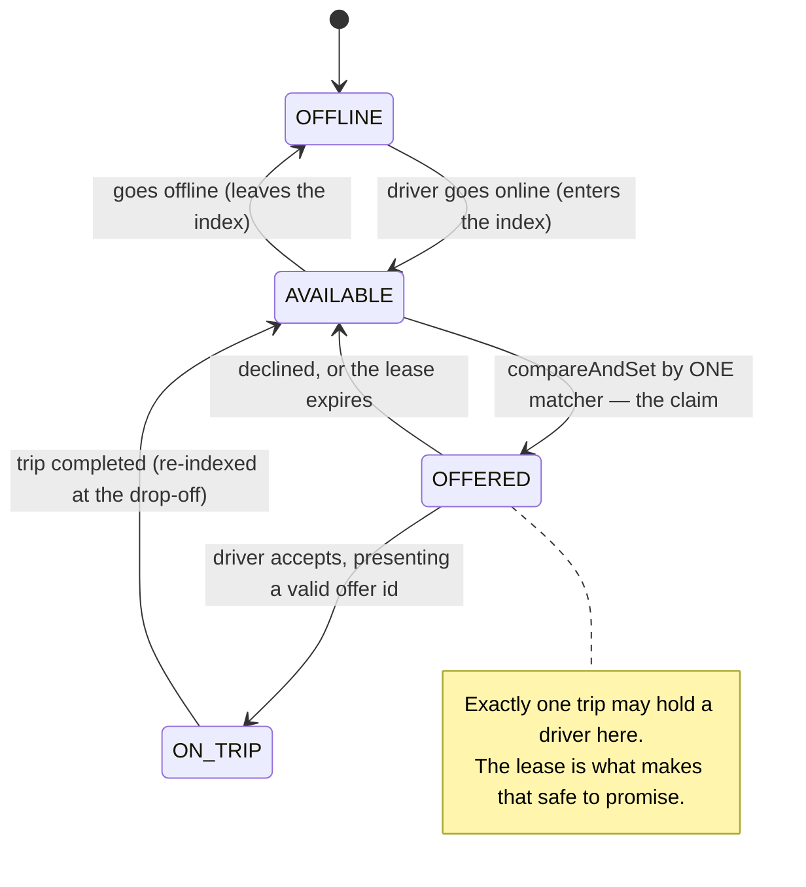
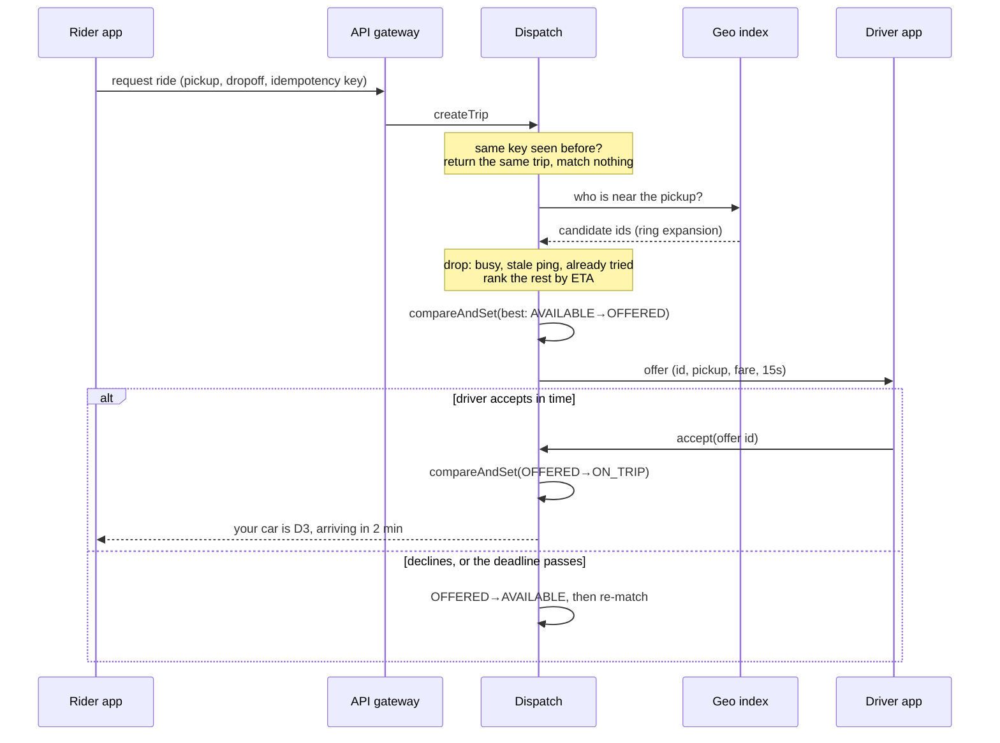
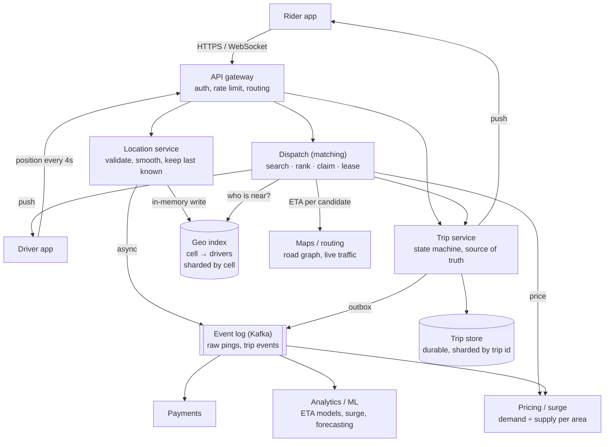
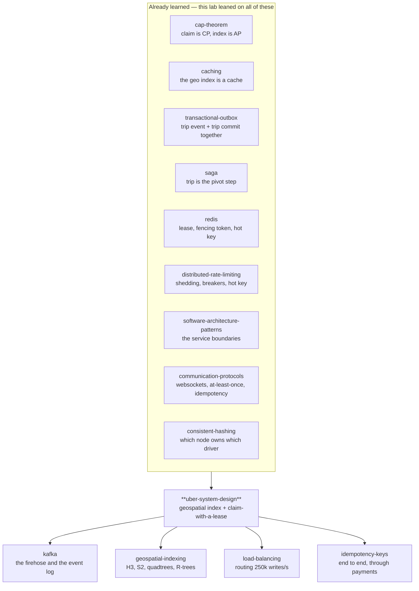

# Uber — how a moving city full of cars meets a moving city full of people

> **Tell a friend:** Meera is standing outside a metro station at nine at
> night. Dev is sitting in an empty car eight hundred metres away. Neither of
> them can find the other, and that is the whole business. Two ideas solve it.
> File every car by which square of the map it is standing in, so "who is near
> me?" becomes a lookup instead of a search. Then treat a match not as an
> answer you looked up but as a car you *grab*. Only one person can win that
> grab, and a timer takes the car back if nobody confirms. Payments, ratings
> and receipts are ordinary backend work you already know. The one thing you
> may never do is promise the same car to two people.

**Go and break it yourself:** [`visualization.html`](visualization.html) is the
Dispatch Console, also published at
<https://claude.ai/code/artifact/7c601922-ea5c-4d46-946a-79bf6a489ff0>.

---

## 1. Why is *finding each other* the whole business?

> **In one breath:** A car with nobody in it is parked near a person with
> nowhere to sit. Neither of them can see the other. Every hard thing in this
> lab is that one sentence.

Meera comes out of the metro station at 9 p.m. Somewhere within two kilometres
of her there is a car with nobody in it. Dev is behind the wheel. He would very
much like to earn her fare.

Neither of them can find the other.

That is the entire business. Not the app. Not the map. Not the payment. The
**finding**.

Before anyone solved it, Meera phoned a taxi office. A person with a paper map
guessed who was closest. That person radioed a driver. Meera waited twenty
minutes to discover the guess was wrong. Meanwhile Dev spent something like a
third to a half of his working hours driving around empty, looking for her.

If nobody solves this, three things go wrong at once. Riders wait too long.
Drivers earn too little for each hour on the road. And the number of cars a
city needs, to move the same number of people, goes up.

Those three are not three problems. They are one problem wearing three faces.

## 2. What comes apart in Rani's evening?

> **In one breath:** One clever person with a paper map is better than any app
> when there are five cars. At five hundred cars she breaks, and she breaks in
> four separate ways that never go away.

Meet **Rani**. She works at a taxi office. On the wall is a paper map of the
city, and beside it a box of coloured pins. Every driver radios in when they
move, and Rani moves their pin. When the phone rings, she looks at the map,
finds the pin nearest the caller, and radios that driver.

With five cars this works beautifully. Rani is faster and kinder than any app.

Then the company grows to five hundred cars. Rani's evening comes apart in four
separate ways, all in the same hour.

**One: she cannot look at five hundred pins.** Finding the nearest pin to a
caller means her eyes crossing the whole map, on every call, while the pins
keep moving.

**Two: Meera and Priya ring at the same moment.** Rani is halfway through
promising car 47 to Meera when Priya's call comes in. She promises car 47 to
Priya as well. Both women are told a car is coming. One of them is wrong, and
neither of them knows which one.

**Three: a pin lies.** Omar drove home an hour ago and forgot to radio in. His
pin is still on the map. It is still the nearest pin to somebody. It is still
being sent to people who then wait for a car that is not coming.

**Four: car 47 never answers the radio.** Ben is driving it, and his radio is
off. Rani has mentally set his car aside for Meera, so nobody else may have it.
It stays set aside until Rani remembers, which she does not, because the phone
is ringing again.

Hold on to all four. Every serious idea in this lab is one of Rani's four
problems, solved once, at a size where you cannot solve it by paying attention.

> **🔮 Predict:** *Asha, an engineer, buys Rani a computer and types every
> driver's position into a table. Which of the four problems does that fix?*
> <details><summary>Reveal</summary>
> **The first one only, and only for a while.** A computer scans five hundred
> rows far faster than Rani's eyes cross a map.
>
> It fixes nothing else. It still has to be told what to do when Meera and
> Priya arrive in the same millisecond (problem two). It still has no idea that
> Omar's row is a lie (problem three). And it will happily leave Ben's car set
> aside forever (problem four).
>
> If you guessed "all four, that is what computers are for", you have made the
> most common mistake in this subject. The scan is the problem people expect.
> The other three are the problems that actually bite. They get *worse*, not
> better, when the system gets faster and more concurrent.
> </details>

**Where this lab takes you.** Stop at any checkpoint and you still have
something whole.

| Layer | Sections | After it you can… |
|---|---|---|
| Beginner | 1–9 | say in plain words why dispatch is hard, and name the two core ideas |
| Intermediate | 10 | walk the matching mechanism step by step, and justify every odd detail |
| Engineering | 11–15 | draw the whole system, reason about its failures, defend its invariants |
| Production | 16 | say what the real thing does differently, and what belongs on a dashboard |

## 3. What is the naive program, and is it actually wrong?

> **In one breath:** Asha computerises Rani exactly as Rani works. Fifteen
> lines. It is the right thing to write first, and it is broken in three places.

Here is what any competent engineer writes first, Asha included. Writing it is
not a mistake. Not measuring it is.

```
one table:  driver_id | latitude | longitude | is_free

when a ride is requested:
    best = null
    for every row in the table:                 # look at all of them
        if row.is_free and distance(row, rider) < distance(best, rider):
            best = row
    mark best.is_free = false                   # take it
    tell the rider about best
```

Read that as English. Look at every car. Keep the nearest free one. Mark it
taken. Tell the rider.

On a whiteboard it is correct. Every rider gets the nearest free car. It is
about fifteen lines. Ship it.

## 4. Where do the three cracks show up when you measure Asha's program?

> **In one breath:** The loop is too slow, the pins lie, and "check it is free,
> then take it" hands the same car to two people. The third crack is the one
> that has no error message.

Asha runs her program against a city, three times, changing one thing each
time. Three cracks open. They are Rani's problems one, three and two, in that
order.

### The first crack: what does looking at every car actually cost?

`java src/Experiments.java 1` builds a city with **100,000 drivers** and asks it
1,000 ride-request questions.

```
                        total     per request    drivers measured
  full scan        :   3370 ms       3.37 ms           100,000
```

Read the middle column. 3.37 ms of pure arithmetic for one request. That is one
process, with all the data already in memory, and no network anywhere in the
picture. It is the *floor*. A real request has to fetch those rows first.

(That command prints two more rows, which are the two fixes. They use ideas
nobody has introduced yet, so section 10 holds them back.)

But the reading is not the expensive half. **The writing is.** Dev's app reports
his position every four seconds. A city with 1,000,000 drivers online at peak is
**250,000 position updates per second**, forever, whether or not a single person
is asking for a ride. Every one of those updates makes some row in Asha's table
stale the moment it lands.

### The second crack: what does it cost when a pin lies?

`java src/Experiments.java 4` takes 300 drivers and lets 100 of them go dark for
two minutes. Omar is one of the hundred. Then it sends 200 ride requests.

```
  NO freshness rule:           offers sent to a dark driver : 65
  30 s freshness rule:         offers sent to a dark driver : 0   (3 requests found nobody)
```

Sixty-five riders out of two hundred were sent a car that is not where the
system says it is. Now notice the *shape* of this failure. **No error is raised
anywhere.**

Arjun is one of the sixty-five. He watches a car icon that never moves. He waits
out the timeout, cancels, and requests again. On Asha's dashboards that arrives
as wait time and cancellations. It looks like a demand problem. It never looks
like an error rate.

### The third crack: how do two riders end up with the same car?

`java src/Experiments.java 3` puts 200 riders on one corner and races 8 threads
for 200 cars. Think of a taxi rank, a stadium gate, an airport queue.

> **🔮 Predict:** *Two hundred riders, two hundred free cars, and a matcher that
> checks `is_free` and then writes. How many riders are promised a car that
> somebody else also got? Guess a number, not a range.*
> <details><summary>Reveal</summary>
> About a hundred. Half.
>
> If you guessed "one or two, it is a rare race", that is the intuition this
> experiment exists to destroy. The gap between the check and the write is not
> a narrow window that a request occasionally slips through. Under contention
> it is where *most* requests live.
>
> If you guessed zero because there are exactly as many cars as riders, you
> have assumed the riders take turns. Nothing in the code makes them.
> </details>

```
  READ-THEN-WRITE:   riders told "your car is on the way" : 200
                     cars actually reserved               : 102
                     riders promised a car someone else has:  98
```

```
  COMPARE-AND-SET:   riders told "your car is on the way" : 200
                     cars actually reserved               : 200
                     riders promised a car someone else has:   0
```

**Roughly half of the riders were promised a car that belonged to somebody
else.** 98 in the run above, 100 in the next run. The exact count depends on
thread scheduling. It is never small.

Now look at Asha's code again. The bug is not *in* a line. It checks `is_free`,
and then it writes. Those two lines are simply not one action. Another request
fits perfectly in the gap between them.

Three different things volunteer to create that gap: a thread switch, a garbage
collection pause, or a network round trip to the database.

This is Rani promising car 47 to Meera and to Priya, mechanised, and running a
thousand times a second.

## 5. What has to be true, whatever technology you pick?

> **In one breath:** Strip away every product name and five sentences are left.
> The second one is the sentence that makes this lab different from every
> "find nearby things" tutorial you have read.

Asha closes her laptop and writes on paper. No databases, no frameworks. Just
what must be true for Meera to get a car and for Dev to get paid.

1. **"Who is near here?" must be answerable in single-digit milliseconds**,
   while positions change hundreds of thousands of times per second.
2. **Each car is handed to at most one rider at a time.** This must hold even
   when Meera's tap and Priya's tap land in the same millisecond, on two
   different machines.
3. **No car is ever stuck reserved.** The reservation must release itself,
   whatever it is waiting on: Ben's thumb, Ben's phone, or the server that
   asked him.
4. **A position is trusted only as long as it is fresh.** Omar's car stopped
   reporting, and a car that stopped reporting is not a car you can send.
5. **All of that keeps holding while pieces fail**, because at this size
   something is always failing.

Requirement 2 is the one that separates this from every "find nearby things"
tutorial. Everything after this point is the pursuit of these five sentences.

Here is how the five requirements line up with Rani's evening, so you can see
that nothing new has been invented, only made precise.

| Requirement | Rani's problem it answers | The crack in section 4 it closes |
|---|---|---|
| 1. answer "who is near?" fast | her eyes crossing five hundred pins | the first crack: 3.37 ms per scan |
| 2. one car, one rider | car 47 promised to Meera and Priya | the third crack: 98 of 200 riders |
| 3. nothing held forever | Ben's radio never answering | not yet visible; section 10 finds it |
| 4. only fresh positions count | Omar's pin, an hour out of date | the second crack: 65 ghost offers |
| 5. it all survives failure | Rani going home ill | the whole of section 12 |

## 6. What are the two ideas everything else follows from?

> **In one breath:** Stop searching for nearness and file by it instead. And
> stop treating a match as something you compute, because a match is something
> you *take*.

Two sentences. The whole rest of the lab is their consequences.

> **Idea one: stop searching for nearness, index by it.** Chop the map into
> fixed squares. Keep a set of cars per square. "Who is near me?" stops being a
> scan over the city and becomes a lookup of a handful of keys.
>
> **Idea two: a match is not a query result, it is a claim.** "The nearest free
> car" is a fact that stops being true the instant somebody else acts on it. So
> the match is not computed and then applied. It is **taken**, in one
> indivisible step that exactly one request can win, and it is taken **on a
> deadline** so nothing can hold it forever.

Idea one answers the first crack. Idea two answers the third crack, and its
deadline answers Rani's fourth problem, the one where Ben's car sits set aside
all evening.

Freshness answers the second crack. A position becomes a fact with an expiry
date. That falls out of idea two the moment you stop seeing supply as something
*stored* and start seeing it as something *leased*.

> **Say it back.** Without using the words *index*, *atomic* or *lease*, tell a
> friend why "find the nearest free car and mark it busy" is two mistakes, not
> one.
> <details><summary>A good answer sounds like</summary>
> "The first mistake is looking at every car in the city to find the near ones.
> That is like reading every name in the phone book to find your neighbour.
> Instead, file the cars by which part of town they are in.
>
> The second mistake is looking and then grabbing. In between the looking and
> the grabbing, somebody else grabbed. So you have to grab in a way that either
> succeeds or tells you plainly that you lost. And you have to let go by
> yourself, on a timer, in case you forget."
> </details>

## 7. Which words do you need now, and what did each one cost to earn?

> **In one breath:** Ten words. You have already watched every one of them
> matter, which is the only reason they are worth learning.

Terminology dumped in a block is a wall. So these come in three groups, in the
order the story needed them. First, the words for the two sides of the market.
Then the words for the filing cabinet. Last, the words for taking a car without
lying to anybody.

### Group one: what do you call the two sides?

Rani does not own the cars. That sounds obvious and it changes everything.

Dev can decline a trip. He can go offline in the middle of a thought. He can
accept a rival company's fare while Rani's radio call is still in the air. The
cars are **supply**, the waiting riders are **demand**, and a system in which
neither side is under your control is a **marketplace**.

The word exists to stop you modelling Dev as a row in a table. A row does what
you write to it. Supply does not.

You can watch the difference in the concert scene of `Sim.java`. Nine people
request a ride. Zero cars are claimable. No amount of correct code creates a
tenth car.

The act of choosing which car goes to which rider is **dispatch**, also called
**matching**. Uber's own system for it is called DISCO. Dispatch is a
*decision*, and it is deliberately kept separate from the *state* of where the
cars are. The index knows where Dev is. Dispatch decides what to do about it.
Those two things fail differently and scale differently, so they get different
names and, in section 11, different services.

| The word | In Rani's office it is | Stated precisely | Where you first felt it |
|---|---|---|---|
| supply / demand | the cars, and the people ringing | two populations, neither owned by the system | section 2, when Omar drove home |
| marketplace | drivers who can say no | inventory with a veto and its own incentives | the concert scene in `Sim.java` |
| dispatch / matching | Rani choosing a pin and radioing it | the decision service: search, rank, offer, bookkeep | section 3, the naive loop |
| DISCO | — | Uber's published name for its dispatch system | section 16, the production chain |

### Group two: what do you call the filing cabinet?

A **geospatial index** is a filing system where things are filed by *where they
are*. Said precisely, it maps a region of space to the set of entities inside
it, with cheap updates and proximity queries whose cost is bounded.

Why does this need its own word? Because an ordinary database index answers
"which rows have this value?" Nearness is not a value. Meera and Dev can be
close without sharing a single column.

One square of the map is a **cell**. Its id is the key a driver is filed under,
and a driver is in exactly one cell at a time. This is the whole trick, and it
is worth saying slowly: a cell turns a *continuous* question ("who is within
500 metres?") into a *discrete* one ("who is in these nine keys?").

Looking in your own square, then the ring of squares around it, then the next
ring out, is **ring search**, or neighbour search. It exists because searching
only the rider's own cell is a bug that looks reassuring. Section 10 puts a
number on it: 44.9% of requests find nobody at all while a car sits just across
the line.

Last in this group is the one that catches people out. **ETA** is the estimated
time of arrival: how many minutes until the car is actually at the kerb. It is
the ranking key, and it comes from a road graph and live traffic, not from
straight-line distance.

Time is what Meera experiences. Distance is what the geometry gives you free. A
car 200 m away across a river is not 200 m away.

| The word | Picture it as | Stated precisely | Where it earns its keep |
|---|---|---|---|
| geospatial index | a filing cabinet with a drawer per neighbourhood | space → the set of things in it, cheap to update | `CellIndex`, a 500 m grid over Bengaluru |
| cell | one square drawn on the map | the key a driver is filed under, exactly one at a time | cell `(25,155)` holds `{D1, D7, D9}` |
| ring search | your square, then the ring around it | widen outward until the radius is covered or enough found | experiment 2, and section 10's v2 and v3 |
| ETA | minutes, not metres | ranking key from roads and traffic, not geometry | `Sim.java`: D2 is 292 m and 122 s; D4 is 430 m and 57 s |

Read that last row again. Rank by distance and Meera gets D2, the nearest car
and the slowest one. Ben is driving it, and the flyover between him and the
metro station costs him a minute.

### Group three: what do you call taking a car without lying to anybody?

An **offer** is "this car is being held for you, briefly". Precisely: a lease
over one driver, with an expiry, carrying an id that later actions must present.

The word earns itself against its rival. An *assignment* is permanent. An offer
is not, because Ben has not agreed yet and might never agree. A plain `is_free`
boolean cannot represent "held, pending a human", and that missing state is
exactly why Rani lost car 47 for a whole evening.

A **claim** is taking something in a way that fails loudly if somebody else took
it first. Precisely: an atomic conditional state change from `AVAILABLE` to
`OFFERED`, applied only if the current state is still `AVAILABLE`, with the
caller told whether it won. Engineers call the primitive **compare-and-set**.

The word names the difference between *reading a fact* and *acting on it*.
Read-then-write has a gap. A claim has none. In `Dispatch.java` it is one line,
`d.state.compareAndSet(AVAILABLE, OFFERED)`, and that line is the whole
distance between 98 double-bookings and 0.

A **heartbeat** is Dev's car saying "still here" every few seconds. **Freshness**,
or TTL, is the age past which the system stops believing the last thing it
heard. Supply is a lease that a location ping renews, and a record older than
the TTL is simply not offered to anybody.

Why bother? Because "is this driver online?" is a question no distributed
system can answer. "Did this driver report in the last 30 seconds?" is a
question every node can answer on its own, from data it already holds. Swapping
the first question for the second is the entire move.

Finally, **surge**. Prices go up where too many people want cars at once. It is
a per-area multiplier from local demand over local supply, applied to the fare.

It is easiest to understand as a control signal that happens to be delivered as
a price. With a fixed price, an under-supplied area has exactly one behaviour
available to it: an unbounded queue. A queue does not create cars.

| The word | The everyday version | Stated precisely | The moment it mattered |
|---|---|---|---|
| offer | a shop holding an item under the counter for you | a lease over one driver, with an id and an expiry | `Offer[O4, trip=T1, driver=D3, expires=t+15s]`, meaning offer O4 holds driver D3 for trip T1 until fifteen seconds from now |
| claim | grabbing the last umbrella from the stand | `compareAndSet(AVAILABLE, OFFERED)`: one winner, loser told | section 4's third crack: 98 versus 0 |
| heartbeat / freshness | a night watchman ringing a bell each round | supply as a lease renewed by pings; stale records excluded | Omar's pin, and the 30 s rule in experiment 4 |
| surge | a market stall raising prices when the crowd arrives | demand ÷ supply per area, applied to the fare | `surgeAt()`, and the concert scene in `Sim.java` |

### Which of these words have you already met under another name?

Several of these are old friends in new clothes. Naming the resemblance is
worth more than memorising the definitions.

The **geospatial index** does the same job as the structures in
[`btree-and-lsm`](../05-btree-and-lsm/): stop the scan. It answers a different
question. A B-tree orders one dimension and answers ranges over it. Nearness is
two-dimensional, and no ordering of a single column captures it.

The **cell** is the hash slot from [`redis`](../13-redis/) Cluster and the ring
position from [`consistent-hashing`](../35-consistent-hashing/), in a different
space. A key's slot is fixed by hashing. Dev's cell is fixed by geography. Both
exist so a lookup costs one hop.

One difference between them matters enormously. Hash space is deliberately
*uniform*. Geography is emphatically not. That is why the hot cell in section
12 has no equivalent of virtual nodes to save it.

The **offer** is the lease and the fencing token from [`redis`](../13-redis/)
§4, living in their natural habitat. An offer id fences a stale accept exactly
the way a fencing token fences a stale lock holder.

The **claim** is the compare-and-set of
[`java-memory-model`](../17-java-memory-model/), except across machines rather
than across threads in one JVM. It is also Redis's single-threaded `INCR`: the
same indivisibility, bought a different way. And it is the cheap cousin of
`two-phase-commit`. There is one resource here, so there is no coordinator to
run.

**Freshness** is the TTL from [`caching`](../11-caching/), and it is the central
point of [`cap-theorem`](../24-cap-theorem/) restated for cars. You cannot tell
"gone" from "slow", so you decide by the clock and accept that the clock is
sometimes wrong.

**Supply that can refuse you** is the over-admission problem from
[`distributed-rate-limiting`](../60-distributed-rate-limiting/). Both are about a
scarce resource that several requesters reach for at the same instant.

**Ring search** is the one genuinely new thing here. Nothing you have learned
so far has it.

## 8. What two pictures should you keep in your head?

> **In one breath:** A wooden pegboard with a hook for every square of the map,
> and a state machine with four states. They are the same machine. One of them
> you can hold; the other one is true.

### The simple picture: what did Rani leave behind?

Rani retires. In the back room she leaves a **pegboard**.

The city map is drawn on it, divided into 500-metre squares, and every square
has a hook. Each car has a wooden token. A car's token hangs on the hook for
the square that car is standing in. When Dev drives into a new square, his
token moves from one hook to the next.

Now watch four things become physical.

Asha asks "who is near Meera?" She looks at Meera's hook, then the eight hooks
around it, then outward, until she has enough tokens. She never looks at the
whole board.

Asha makes a match. She physically *takes the token off the hook*. You cannot
take a token that is not there. Two clerks reaching for Dev's token is settled
by whose hand arrives first, and the loser plainly sees an empty hook.

Asha makes an offer. The taken token goes into a small tray with a 15-second
sand timer. If the timer runs out and nobody has confirmed, the token goes back
on its hook. That happens whether or not anyone is watching the tray.

Asha deals with Omar's dark car. Every token must be re-stamped every 30
seconds. Unstamped tokens are ignored, even though they are still hanging
there in plain sight.

### The engineering picture: what are the four states?

Same machine, said precisely. A driver is always in exactly one of four states,
and the arrows are the only legal ways to move between them.



The whole system is three pieces of state, six kinds of message, and four
rules that must never be broken.

- **State:** `cellId → Set<driverId>`, `driverId → (position, lastPing, state,
  offer)`, `tripId → (rider, pickup, state, driver)`. In words: which cars are
  in each square, everything known about one car, and everything known about
  one trip.
- **Messages:** location ping, ride request, offer, accept or decline, expiry
  tick, trip events.
- **Invariants:** four rules that may never break.
  - (i) A driver is in at most one cell.
  - (ii) A driver is in `OFFERED` for at most one trip.
  - (iii) Every `OFFERED` has an expiry in the future, or is reclaimed.
  - (iv) A trip has at most one driver.

### How does the pegboard map onto the code?

Two tables, because the pegboard does two different jobs. The first is about
finding.

| On the pegboard | In the code | Why it matters |
|---|---|---|
| A hook per square | `cellId → Set<driverId>` | Makes "near" a key, not a scan |
| Moving a token between hooks | `index.update()` — leave one cell, join another | The hot write path; most pings move nothing |
| Re-stamping tokens | heartbeat / ping TTL | A position is a fact with an expiry |

The second is about taking, and about letting go again.

| On the pegboard | In the code | Why it matters |
|---|---|---|
| Taking the token off the hook | `compareAndSet(AVAILABLE, OFFERED)` | Exactly one taker; the loser is told |
| Empty hook | claim returns `false` | Losing is normal, not an error |
| Sand timer on the tray | offer TTL + `expireOffers()` | Nothing is held forever |
| Token back on its hook | `OFFERED → AVAILABLE` | Supply recovers without a human |

### Where does the pegboard lie to you?

> **🔮 Predict:** *You have the pegboard in your head. Name the single thing
> about it that is most dangerously untrue of a real system.*
> <details><summary>Reveal</summary>
> **It is in one room, with one pair of hands.** Everything comfortable about
> the pegboard comes from that.
>
> If you said "the squares are too regular", you are right and it is the second
> answer below. It costs you performance. The one-room assumption costs you
> correctness, which is worse.
> </details>

Read these four before you trust the pegboard anywhere important.

The board is not in one room. A real index is spread across many machines, and
taking a token is a network round trip. So the indivisibility has to live
*where the state lives*, in the store or in a single owner process per driver.
A `compareAndSet` on your service's local copy of a remote driver proves
nothing at all.

Tokens never lie; pins do. A token on a hook is unarguably there. Dev's last
position is a claim made by a phone, on a mobile network, seconds ago, possibly
out of order. Freshness rules exist because of that gap, and the pegboard
cannot show it to you.

One clerk becomes hundreds. The pegboard's safety comes from physics and from
Asha having only two hands. The real thing has hundreds of matchers running at
once, which is why every safe step has to be *made* indivisible on purpose.

Squares are not neighbourhoods. A hook holds a fixed square. Real cities are
wildly uneven. Experiment 5 puts 6,399 cars in one 500-metre square at an
airport and zero in the square next to it. The pegboard quietly suggests a
uniformity that does not exist.

## 9. Can you go and break it with your own hands?

> **In one breath:** Twelve cars, one city, and every rule the matcher follows
> turned into a switch. Each switch breaks something specific, and you should
> break all of them.

Open [`visualization.html`](visualization.html), which is also published at
<https://claude.ai/code/artifact/7c601922-ea5c-4d46-946a-79bf6a489ff0>.

Do these five things in this order. Each one takes about a minute.

1. Press **Request a ride** and read the verdict panel. Note *which* car was
   reserved, and why the log says it beat a closer one.
2. Switch ranking to **Shortest straight line** and request again. A different
   car is chosen: the one that arrives later.
3. Switch searching to **Rider's own square**. Click the map to stand just past
   a boundary, and request. Watch the system confidently find nobody.
4. Run situation **3** with the reserving rule set to *"Check it's free, then
   take it"*. Two riders, one car, and no error anywhere.
5. Click a car and press **loses signal**. Turn the freshness rule off and
   request next to it. You have just dispatched a car that is not there.

Step 3 is Meera standing forty metres from a boundary. Step 4 is Meera and
Priya at the same corner. Step 5 is Omar, still pinned to the map, already
home.

The **Step back** button undoes one event at a time, so you can replay any
moment as many times as you like. Each situation asks you to guess before it
runs, and the guess is what makes the answer stick.

> **CHECKPOINT — end of the beginner model.** You can now explain what dispatch
> is, why a scan and a read-then-write both fail, and what the two core ideas
> are. What is missing is the *mechanism*. How does a real matcher go from a tap
> to a reserved car, step by step? And why does it carry several details that
> look strange until you watch them get invented?

> **Say it back.** Explain to a non-engineer why finding the nearest available
> car gets hard once there are a hundred thousand cars. You may not use the
> words index, cell, shard or database.
> <details><summary>A good answer sounds like</summary>
> "Imagine a wall map with a hundred thousand pins in it, and every pin moves
> every four seconds. Two things go wrong. Finding the nearest pin means
> looking at all of them, and by the time you have finished looking, they have
> all moved.
>
> And you are not the only person looking. Somebody else is reaching for the
> same pin at the same moment, and unless there is a rule about who gets it,
> you both walk away thinking you have it."
> </details>

## 10. How does Meera's tap become a reserved car?

> **In one breath:** Eight versions. Each one is the obvious next thing to
> write, each one breaks in a specific way, and every strange detail in the
> finished design is the scar of one of those breaks.

Asha does not design the matcher. She grows it. Write the obvious version, let
it break, fix exactly what broke, and look at what you have.

Throughout this section, Meera is standing at the Indiranagar metro station and
five cars are online. Here is the board.

| car | who is driving | straight-line distance | roads factor | driving time |
|---|---|---|---|---|
| D2 | Ben | 292 m | 3.5× (flyover) | 122 s |
| D4 | Dev | 430 m | 1.1× | 57 s |
| D1 | — | 632 m | 1.3× | 99 s |
| D3 | — | 1,140 m | 1.2× | 164 s |
| D5 | — | 2,997 m | 1.2× | 432 s |

Read the last two columns together. Ben is closest and slowest. Keep that in
mind; version four is about him.

### v1 — is the rider's own square good enough?

File cars by square. The index is `cell → set of cars`. A ping moves a car
between two sets and touches nothing else. A request reads one key.

It is fast, it demos beautifully, and it is wrong.

**🔮 Predict:** *Meera is 40 m from the edge of her square. The nearest car is
150 m away, just across that edge. What does v1 return?*

<details><summary>Reveal</summary>

Nothing at all. Or, if her square happens to hold some other car, a worse one.

Over 5,000 random requests against 5,000 drivers (`java src/Experiments.java 2`):

```
  own cell only : 2,246 requests found NO driver at all (44.9%)
                    665 requests got a worse driver than the true nearest (13.3%)
                  average extra distance when wrong: 116 m, worst: 445 m
  ring search   : 0 disagreements with the full-scan oracle out of 1,000
```

Nearly half of all requests find nobody while cars sit one square away.

The 13.3% is the more dangerous number, and if you predicted "it just misses
some cars" you missed it. Those requests **succeed**. They return a car, log
no error, and Meera simply waits longer, forever. Every cell boundary has this
bug, and every point in a cell is near one.
</details>

### v2 — what if you search the whole circle?

Cover the search circle properly. Walk out `ceil(radius / cellSize)` rings, then
filter by real distance, because a cell is a square and the query is a circle.

Correct. Zero disagreements with a full-scan oracle.

Now look at the cost in a dense city. Covering 3 km with 500 m cells is
**169 squares**. In a 100,000-driver city that hands the matcher **1,659
candidates per request**, when the matcher was only ever going to rank the best
ten.

### v3 — why not widen ring by ring and stop early?

Start in Meera's own square. Widen one ring at a time. Stop as soon as you hold
enough candidates.

```
  full 3 km cover : 4 drivers found, 169 cells visited
  ring expansion  : 3 drivers found,   9 cells visited (stopped once it had 3)
```

| Search rule | Cost per request at 100,000 drivers | Against the full scan |
|---|---|---|
| full scan | 3.37 ms | — |
| ring expansion, stop early | 0.01 ms | 674× faster |

The bigger prize is not in that table. It is that the cost now tracks *how much
supply is nearby*, not how big the city is. Downtown, the search stops at ring
zero. On the outskirts it keeps widening.

The honest trade: stopping early can miss a car one ring further out that would
have arrived sooner. You are buying a bounded search cost with a small amount of
match quality.

### v4 — should the nearest car win, or the soonest?

v3 still sorts candidates by distance. So it sends Meera to Ben: **nearest at
292 m, and the slowest at 122 s.** Dev is 430 m away and arrives 65 seconds
earlier.

> **🔮 Predict:** *You switch the ranking from distance to arrival time. Which
> service does the matcher now depend on that it did not need before, and what
> happens to dispatch when that service is down?*
> <details><summary>Reveal</summary>
> It now needs a routing engine: a live road graph with traffic on it. Distance
> is free, because geometry is free. Time is not.
>
> When that service is down, the honest answer is to fall back to distance
> ranking and say so, rather than to fail the request. That is failure F9 in
> section 12, and rung 7.3 of `EXERCISES.md` asks you to design the fallback.
>
> If you answered "nothing, it is just a different sort key", you have missed
> that the sort key comes from another machine.
> </details>

This lab models the routing engine with a per-driver `roadFactor`, which is a
stand-in and nothing more. The test that pins the behaviour down is
`nearest_by_eta_beats_nearest_by_distance`.

### v5 — why offer a car instead of assigning it?

v4 computes the best car and writes "taken". Two problems arrive together.

The first is Meera and Priya again. Around 98 of 200 riders were promised
somebody else's car in experiment 3, and the count varies run to run while the
half does not. The fix is to make the write *be* the decision:
`compareAndSet(AVAILABLE → OFFERED)`. Exactly one request wins. Losing is
ordinary, and the loser simply re-ranks and takes the next candidate.

The second is Ben. He has not agreed to anything yet. He may decline, or leave
the phone face-down in his pocket. So the taken state is not `BUSY`. It is
`OFFERED`: a reservation belonging to one trip, held on behalf of a human who
has not answered.

### v6 — what if the matcher dies holding the reservation?

> **🔮 Predict:** *A matcher offers Meera's trip to Ben, and one millisecond
> later that matcher process is killed. What happens to Ben's car?*
> <details><summary>Reveal</summary>
> With v5 exactly as written: it stays `OFFERED` forever. It is invisible to
> every future match, and no code path exists to release it, because the only
> thing that knew about the offer has died.
>
> Do that a few thousand times a day and supply quietly bleeds away. Rani's
> fourth problem, at machine speed.
>
> The fix is not "make the matcher not crash". If you answered that, you are
> designing for the failure instead of around it. The fix is to make the
> reservation **expire by itself**: an offer carries `expiresAt`, and a
> housekeeping tick returns any expired offer to `AVAILABLE`.
>
> Now notice what one mechanism bought. The *same* code path recovers from Ben
> ignoring the popup, from Ben's phone having no signal, from Ben's app
> crashing, and from the matcher dying. Whenever one deadline covers four
> unrelated failures, you have found the right abstraction.
> </details>

The offer also carries an **id**, and `accept` must present it. Without that,
Ben tapping a stale popup from a previous request starts a trip that no longer
exists. Stale popups are not exotic; they are what a patchy network produces
every day.

The test is `an_offer_from_an_old_popup_cannot_start_a_trip`. This is the
fencing token from the [`redis`](../13-redis/) lab, in its natural habitat.

### v7 — why not show the request to every nearby driver?

The obvious way to fill a car fast is to buzz every nearby driver and let the
first tap win.

It is also how you get every phone in the neighbourhood buzzing for every
request, nine drivers driving toward a fare that eight of them will lose, and a
race on every single accept.

Sequential offers with a short deadline give up a little speed and buy
predictability. Real systems do sometimes broadcast on purpose, when supply is
desperate, but as a deliberate degraded mode rather than as the normal path.

### v8 — is serving each rider immediately actually optimal?

Everything so far serves each request the instant it arrives. That is *locally*
optimal. It also leaves value on the table globally, because Meera takes the
only good car two seconds before Priya asks for one.

`java src/Experiments.java 6` runs 300 riders and 300 cars.

```
  greedy, in arrival order : mean pickup distance   4,080 m
  batched, shortest first  : mean pickup distance   3,555 m
  improvement              : 12.9%
```

Nobody made a mistake in the greedy run. Every rider got the best car available
*at that instant*. The loss is structural, not a bug.

Waiting a few seconds and matching the whole batch buys a choice the system
cannot otherwise have. It costs every rider those seconds. Both answers are
honest. They differ in *whose* wait you are minimising.

This lab's `Dispatch` is greedy. The batch version is
`Experiments.greedyVsBatch`, and exercise 8 asks you to argue for a window size.

### What does the finished request path look like?

Five actors, one request. Read it top to bottom; the two branches at the bottom
are Ben answering and Ben not answering.



> **CHECKPOINT — end of the intermediate model.** You can now walk the mechanism
> and justify every part of it: ring expansion, ETA ranking, the claim, the
> lease, the offer id, sequential offers. Next you zoom out to the same decision
> as a system of services with real numbers attached, and then break it on
> purpose.

> **Say it back.** In two sentences, say why "find the nearest free car, then
> mark it busy" is wrong. Your answer may not contain the word "slow".
> <details><summary>A good answer sounds like</summary>
> "Finding and marking are two separate moments, and another rider fits between
> them. So two people are told they have the same car, and neither is told
> anything is wrong.
>
> The fix is to make taking the car one single action that either succeeds or
> reports plainly that somebody else got there first."
> </details>

## 11. What does the whole system look like on one page?

> **In one breath:** One number in the next table decides the entire
> architecture. The cars talk 150 times more than the riders do, so the thing
> that listens to cars and the thing that answers riders cannot be the same
> thing.

Everything so far has been one process on Asha's laptop. Here is the
architecture that the mechanism forces, and the numbers that force it.

### What do the back-of-the-envelope numbers say?

These are round numbers chosen to be *plausible*. They are not reported
figures. The point is which number forces which design decision.

| Quantity | Assumption | What it forces |
|---|---|---|
| Drivers online at peak | 1,000,000 | index holds ~1 M entries ≈ 100 MB — memory is not the problem |
| Location ping interval | 4 s | **250,000 writes/s**, constant, whether or not anyone rides |
| Ping payload | ~100 B | ~25 MB/s ingest; ~2 TB/day if kept raw |
| Trips per day | 25,000,000 | ~290/s average |
| Peak factor | ~5× | **~1,500 dispatch decisions/s** at peak |
| Offers per trip | ~1.5 (declines happen) | ~2,200 offers/s |
| Index query per dispatch | 1 | 1,500 reads/s against 250,000 writes/s |

> **🔮 Predict:** *One row in that table decides more about the architecture
> than all the others together. Which one, and what does it decide?*
> <details><summary>Reveal</summary>
> The last one. **The location firehose is roughly 150× the dispatch rate.**
>
> That asymmetry decides two things immediately. The hot path must never write
> a ping to durable storage while the request waits. And the durable trip store
> must never sit behind the ping load.
>
> If you picked "1,000,000 drivers", that is the row people expect to matter
> and it is the row that matters least. A million entries is 100 MB. Memory
> was never the problem here.
> </details>

### Which boxes exist, and why exactly these?



Do not read that as eleven boxes. Read it as four paths.

The firehose runs down the left. Dev's phone reaches the gateway, then the
location service, then the in-memory geo index. A copy goes asynchronously to
the event log for everything that is not time-critical. Nothing on this path
waits for a disk.

The decision runs down the middle. Meera's tap reaches dispatch, which asks the
index, asks maps, claims a car, and creates a trip. This is the
millisecond-sensitive path, and it touches as few durable stores as it can get
away with.

The record runs down the right. The trip is the thing that must survive
everything, so it lives in a durable, sharded store. Everything downstream is
fed from a log of trip events rather than by calling those services inline.
That is the [`transactional-outbox`](../48-transactional-outbox/) pattern doing
exactly the job it was invented for: the trip and its "trip completed" event
commit together or not at all.

The learning loop sits at the bottom right. Every event feeds models that
produce the ETAs and the surge multipliers the decision path will consume next
minute. Yesterday's data is today's ranking.

### Why these boundaries and not others?

Location is split from dispatch because their loads differ by 150× and their
durability needs are opposite. Dev's ping is worthless in ten minutes. Meera's
trip is worth keeping for seven years.

The index is sharded by cell, so a query for one area hits one shard and Dev's
pings hit one shard. That is also its weakness, which failure F4 below is
about.

Dispatch owns the claim. If two services could move Dev's state, the invariant
would need distributed agreement to hold. Instead Dev's state has exactly one
owner, and "which node owns which driver?" is the ownership question from
[`consistent-hashing`](../35-consistent-hashing/) applied to driver ids.

Both answers from that lab are live options here. A **ring with gossip** suits
a fleet of matcher nodes that changes often with no coordinator to ask; Uber's
Ringpop is this, packaged. **Fixed slots published by a coordinator** is the
Redis Cluster shape, and it suits you when you want exact, hand-movable
placement. The trade is the one that lab put numbers on: coordination bought
with control.

Trip state is not in the index. The index is a fast, lossy, rebuildable cache
of where things are. The trip store is the durable truth. Losing the whole
index costs you thirty seconds of degraded matching while the pings refill it.
Losing the trip store loses money.

That last point deserves the vocabulary of your earlier labs. **The geo index
is a cache** in the exact sense of [`caching`](../11-caching/): a derived copy,
cheap to rebuild, allowed to be stale. **The trip record is the source of
truth.**

> **CHECKPOINT.** You can now draw the system and defend every boundary in it
> with a number. Next: what happens when each of these boxes fails, because at
> 250,000 writes per second, something always is.

> **Say it back.** Someone asks why the geo index and the trip store are not
> just one database. Answer in two sentences, using the words *cache* and
> *truth*.
> <details><summary>A good answer sounds like</summary>
> "The index is a cache of where cars are right now. If we lose it, the phones
> refill it in about thirty seconds, so it is allowed to be fast, in memory,
> and occasionally wrong.
>
> The trip record is the truth about money and a legal document. If we lose it,
> nothing refills it, so it gets durability and sharding and none of the ping
> traffic anywhere near it."
> </details>

## 12. What actually goes wrong, and what survives each time?

> **In one breath:** Nine failures. In every single one of them, no car is ever
> promised to two people. In almost every one, somebody waits longer. That
> trade is the design.

Read these as nine short stories. Each one names who it happens to, what the
system does about it, and how it reaches Asha's screen. The comparison table
comes after all nine, so you can see the shape they share.

### F1 — what happens when Omar's phone goes dark?

Omar parks, opens a sandwich, and his phone loses signal in the underground car
park. His last pin stays on the map, and it stays the nearest thing to
somebody.

Run `java src/Experiments.java 4`, or in the console click a car, press *loses
signal*, turn the freshness rule off, and request nearby. Sixty-five of two
hundred requests were dispatched to a dark car.

The reason is a sentence worth memorising: **absence of a message is not a
message.** Nothing distinguishes "parked with the app open" from "phone in a
tunnel" from "went home an hour ago".

So supply becomes a lease. A ping renews it, and thirty seconds without one
takes Omar out of matching entirely. The test is
`a_driver_who_stopped_pinging_is_not_dispatched`.

In production this never appears as an error. It appears as rider wait time, as
cancellation rate, and as "the driver never moved" complaints. Teams watch the
*stale-pin ratio* per area precisely because every other symptom is so
indirect.

### F2 — what happens when the matcher dies holding Ben's car?

Between the moment dispatch offers Ben's car to Meera and the moment Ben
answers, the matcher process is killed. Conceptually this sits between
`matchOnce` and `accept`; SCENE 5 of `Sim.java` walks the same code path
through the deadline.

Without a deadline, Ben is stuck `OFFERED` forever and vanishes from supply.
The only actor that knew about the reservation is gone.

The lease expires. A housekeeping tick returns Ben to `AVAILABLE` and re-matches
Meera's trip. The test is
`expired_offer_returns_the_driver_and_rematches_the_trip`.

Expiry reclaims with the same compare-and-set the claim used, so an expiry
racing an accept cannot corrupt anything. Ben is never handed to two trips.

This is *why* the offer TTL is ten to twenty seconds and not two minutes. The
TTL is a direct trade between how long a crashed matcher strands a car and how
long a real driver gets to reach for their phone.

### F3 — what happens when Priya double-taps?

Priya's screen freezes, so she taps request again. Or her phone times out and
the network layer retries on her behalf. She does not know which.

Without an idempotency key, that is two trips, two matches, two cars and two
charges. Every mobile network delivers *at least once*, and a request that timed
out on the client may well have succeeded on the server.

So Priya's app generates one key per intent. The server maps key to trip and
returns the existing trip for a repeat. SCENE 8 of `Sim.java` shows it, and the
test is `double_tapping_request_creates_one_trip`.

Nothing is lost to this fix. It costs one map lookup, which is exactly why it
belongs in the first version of the system rather than the fifth.

In production the same key must cover the whole chain, payments included. This
is straight out of
[`communication-protocols`](../02-communication-protocols/) and
[`transactional-outbox`](../48-transactional-outbox/): at-least-once delivery,
plus consumers that do not mind hearing it twice.

### F4 — what happens when everybody is in the same square?

It is midnight at the airport. Arjun has just landed. So have four flights, and
Omar is one of two thousand drivers waiting on the same stretch of kerb.

**🔮 Predict:** *The whole fleet parks in one cell. The index is still
perfectly correct. Within a factor of two, how much slower does a nearby query
get?*

<details><summary>Reveal</summary>

About twenty times slower.

```
  fleet spread over the city : 112 us per query,     485 drivers measured per query
  fleet parked at one airport: 2,442 us per query, 20,000 drivers measured per query
  slowdown: 22x     drivers in the busiest 500 m cell: 6,399
```

The slowdown lands between 15× and 25× depending on the machine. The driver
counts are exact.

If you predicted "no change, the index is correct", you are right about
correctness and that is the trap. The grid did not break. It stopped
*narrowing*, which is the only thing it was ever for.
</details>

The index narrows by space, and at an airport everybody is in the same space.
If the index is sharded by cell, one shard now carries all of the traffic too.

Four responses, and real systems use all of them. Cap the candidates returned
per ring. Sub-divide hot cells, which is exactly what H3's multiple resolutions
are for. Spread a hot cell across replicas. And manage the demand side with
surge.

Every answer the system gives is still correct. What bends is latency, at
exactly the moment and place where demand peaks.

You have met this shape before. It is the hot-key and hot-partition problem
from [`redis`](../13-redis/) and
[`distributed-rate-limiting`](../60-distributed-rate-limiting/), where the
average looks healthy and one key carries the world. Airports get dedicated
handling and virtual queues as much for this reason as for the chaos at the
kerb.

### F5 — what happens when the firehose falls behind?

This one is not modelled in code, because the lab is a single process with no
queue. It is stated, not run.

The index starts lagging reality by seconds, then by minutes. Every pin is
stale. Here is the nasty part: if the lag is inside the freshness TTL, *none* of
the pins is stale enough to be excluded. Matching keeps working and quietly gets
worse. ETAs are wrong. Drivers are offered fares they have already driven past.

250,000 writes per second has no slack in it. A garbage collection pause, a
redeploy, or one slow shard turns into a backlog immediately.

The response is to refuse to queue pings for durability on the hot path. Drop
instead of lag, because a lost ping is replaced four seconds later. Shed load by
lengthening the ping interval under pressure. And watch *ingest lag*, not ingest
rate.

Safety holds throughout. Nobody is double-booked. What degrades is match
quality, smoothly and invisibly, which is the worst way for anything to degrade.

Location ingest is deliberately best-effort in production. Note the trap in the
other direction: the freshness TTL must be comfortably larger than normal ingest
lag, or a routine blip excludes your entire fleet at once. That is a
self-inflicted outage, and it is worth designing against explicitly.

### F6 — what happens when the cluster splits in two?

Also stated rather than run. The network partitions, and two halves of the
dispatch cluster can each see a subset of drivers.

If both halves may claim Dev, you have section 4's third crack again, at cluster
scale: Meera and Priya, one car, two machines, no error. The reason is
[`cap-theorem`](../24-cap-theorem/), unchanged and unarguable.

The response is a split decision, and it is the most interesting design choice
in this lab.

**The claim is CP.** Dev's state has exactly one owning node, chosen by hashing
his driver id onto the ring from
[`consistent-hashing`](../35-consistent-hashing/). If that node is unreachable,
Dev simply cannot be matched by anyone. Refusing to match is a mild failure.
Matching twice is a severe one.

**The location index is AP.** A stale or partial view of where cars are yields a
worse match, not a wrong one, so it stays available.

Safety holds: one car, one rider. It is bought by giving up availability for
that one driver. Liveness is genuinely lost for the drivers owned by the
unreachable node, until ownership moves.

Ownership rebalancing needs a ring, gossip and a handover protocol. That is why
it is a first-class part of the design and never an afterthought. That lab put
a number on the disagreement window too. While membership propagates, different
nodes hold different views of who owns what, bounded at roughly 1/n of the
keyspace for a ring. During that window, two nodes must not both believe they own Dev.
Every ride-hailing dispatch system is, underneath, a membership problem.

### F7 — what happens when the payment fails after the ride?

Meera is standing on the pavement. The trip is finished. The card is declined.

Stated, not run. The money and the trip live in different systems, and the trip
cannot be rolled back, because Meera has already been moved across the city.

So the trip is the **pivot step** of a [`saga`](../47-saga/). Everything before
it can be compensated. Once it is complete, the system may only move forward:
retry the charge, fall back to another payment method, or carry a debt on the
account.

Payment is driven off the trip-completed event through the
[`transactional-outbox`](../48-transactional-outbox/), so "trip completed" and
"a payment will be attempted" commit together. Exactly one charge attempt
lineage exists per trip, because the idempotency key from F3 is still doing its
work.

The interesting engineering here is not the retry. It is the policy about what a
rider with a failed payment is allowed to do next.

### F8 — what happens when pings arrive in the wrong order?

Dev's ping from 09:00:04 lands after his ping from 09:00:08. On the map, his car
jumps backwards.

Stated, not run. If the index takes last-write-wins by arrival time, Dev can
appear to teleport into a cell he already left. Mobile networks reorder. Retries
replay. Phone clocks are not trustworthy.

The response is to carry a device timestamp *and* a monotonic sequence number
per driver, then drop any update older than the one already stored.

Dispatch still claims correctly, so safety holds. What bends is quality: a stale
position is briefly authoritative, and somebody gets a slightly worse car.

This is an out-of-order event stream wearing a map, so it gets the same answer:
version the writes and make the consumer idempotent. That is the projection rule
from [`cqrs`](../51-cqrs/).

### F9 — what happens when slowness feeds itself?

It is 2 a.m. and Asha is looking at a graph that will not come down.

Stated, not run. Dispatch p99 rises. Rider apps time out and retry. The retries
add load. Dispatch gets slower. The system does not recover when the original
trigger goes away, because the retry load is now the cause. Engineers call this
a **metastable failure**.

The response is the whole toolkit from
[`software-architecture-patterns`](../06-software-architecture-patterns/) and
[`distributed-rate-limiting`](../60-distributed-rate-limiting/). Bound the
retries, with backoff and jitter. Keep idempotency keys, so retries are
harmless. Shed load at the gateway. Put circuit breakers around maps and
pricing. Degrade gracefully: if the ETA service is down, rank by distance and
say so, rather than failing the request.

Safety holds. Liveness is deliberately sacrificed for a subset of requests so
that the rest survive.

The fallback ladder is written down in advance, per dependency, because nobody
invents one at 2 a.m.

### The nine failures side by side

Now read them as one shape. Notice that the third column never changes.

| # | The failure | What still holds | What gives way | What Asha actually sees |
|---|---|---|---|---|
| F1 | Omar's phone goes dark | no double-booking, nobody charged | 3 of 200 requests find nobody, honestly | wait time and cancellations, never an error |
| F2 | matcher dies holding an offer | the driver is never handed to two trips | that rider waits up to the offer TTL longer | a small, steady rate of re-matched trips |
| F3 | Priya double-taps | one trip, one car, one fare | nothing at all — this fix is free | duplicate requests collapsing onto one key |
| F4 | the airport hot cell | every answer is still correct | latency, at the worst possible moment | p99 spikes in one area while the mean is fine |
| F5 | the firehose falls behind | no double-booking | match quality, smoothly and invisibly | ingest lag rising while ingest rate looks healthy |
| F6 | the cluster partitions | one car, one rider | drivers on the unreachable node are unmatchable | match rate falling for one slice of the fleet |
| F7 | payment fails after the ride | exactly one charge attempt per trip | the money, until a retry or a fallback works | a queue of trips in a payment-pending state |
| F8 | pings arrive out of order | dispatch still claims correctly | quality; a stale position is briefly believed | drivers reporting offers for places they left |
| F9 | slow dispatch feeds retries | safety, throughout | liveness, on purpose, for a subset of requests | a graph that will not come down on its own |

Two of those nine you can trigger with a command. Two more happen inside
`Sim.java`. The last five are argued rather than run, and section 19 says
exactly which is which.

## 13. What is guaranteed, and what was traded away for it?

> **In one breath:** Seven promises, each one held up by a named line of code
> and a named test. And a longer list of things this lab deliberately does not
> promise, because pretending otherwise would be the real lie.

### Which seven things can never happen?

Every row below is a sentence that stays true no matter what fails. The second
column is the code that makes it true. The third is the test that would fail if
somebody deleted that code.

| # | The promise | Held up by | Test |
|---|---|---|---|
| I1 | A driver is filed under exactly one cell | `CellIndex.update` leaves the old cell before joining the new one | `a_moving_driver_changes_cells_and_stays_findable` |
| I2 | A driver is reserved for at most one trip at a time | `state.compareAndSet(AVAILABLE, OFFERED)` | `a_driver_is_offered_to_at_most_one_trip_under_concurrency` |
| I3 | No reservation is held forever | `Offer.expiresAtMs` + `expireOffers()` | `expired_offer_returns_the_driver_and_rematches_the_trip` |
| I4 | Only a current offer can start a trip | offer-id check in `accept`, a fencing token | `an_offer_from_an_old_popup_cannot_start_a_trip` |
| I5 | One rider intent produces at most one trip | idempotency key mapped to a trip id | `double_tapping_request_creates_one_trip` |
| I6 | A trip is completed and charged once | `completeTrip` returns early if already `COMPLETED` | `completing_the_same_trip_twice_charges_once` |
| I7 | Only fresh supply is dispatched | ping-age check in `matchOnce` | `a_driver_who_stopped_pinging_is_not_dispatched` |

I2 is the one that carries the lab. Everything else is housekeeping around it.

### What does this lab refuse to promise?

An honest list of what is missing is worth more than a longer list of what is
present. Nothing below is an oversight.

| Not promised | Why not, precisely |
|---|---|
| the optimal match | greedy, per request, over a candidate set that stops early; experiment 6 measures the gap at ~13%, and even that is against a *heuristic* batch matcher rather than the true optimum |
| a current position | every pin is up to one ping interval old *before* network delay; the freshness TTL bounds the lie, it does not remove it |
| a real ETA | `distance × roadFactor / speed` is a stand-in for a routing engine, honest about the shape and useless as a number |
| durability | everything here is in memory; a restart forgets every trip |
| fairness | no driver-earnings balancing, no rider queue priority, no anti-starvation for drivers who keep declining |
| scale and safety features | not multi-region, not sharded, not secured |

### Which promises bend, and which never do?

Two words carry this, and they are worth separating carefully.

**Safety** means nothing bad ever happens. Here that is: no car is promised to
two riders, no double charge, no trip without a driver. Every one of those is
preserved in *every* failure in section 12, the partition included.

**Liveness** means something good eventually happens. Here that is: a rider
eventually gets a car. This is what bends, every time. The stale driver is
skipped. The partitioned driver is unmatchable. The shed request is rejected.

That is the deal the whole design makes, and it is the same deal
[`cap-theorem`](../24-cap-theorem/) describes. **When a car cannot be safely
claimed, refuse to match it rather than risk matching it twice.**

Meera waiting ten more seconds is annoyed. Meera watching her car drive to
somebody else has been lied to. Those are not the same size of wrong.

### What does each operation cost?

| Operation | Cost | What that means in practice |
|---|---|---|
| location ping | O(1) | two set operations, usually zero, because most pings do not change cell |
| ring search | O(cells visited + drivers in them) | independent of city size; degrades with density, which is F4 |
| ranking | O(k log k) | k is the number of candidates kept, deliberately small |
| claim | O(1) | one compare-and-set; contention is a retry, not a lock |
| expiry sweep | O(drivers with live offers) | in production a timer wheel or a sorted set, never a scan |

## 14. Which four lines of code carry the whole lab?

> **In one breath:** Eleven small files, no build tool, no dependencies. Four
> lines do the real work, and each one is the answer to a section you have
> already read.

### Which line makes 250,000 pings per second affordable?

From [`src/CellIndex.java`](src/CellIndex.java):

```java
if (oldKey != null && oldKey == newKey) return;
```

Dev moved twenty metres and stayed inside his square, so nothing changes. Most
pings take this branch and do no work at all. That is the entire reason the
firehose is survivable.

### Which line makes the search cost track supply instead of city size?

Also from [`src/CellIndex.java`](src/CellIndex.java):

```java
for (int k = 0; k <= maxRing; k++) {
    collectRing(centre, k, maxRadiusM, out);
    if (out.size() >= minCandidates) break;      // enough is enough
}
```

The `break` is the whole of v3. Downtown it fires at ring zero. On the
outskirts the loop keeps widening.

### Which line stops Meera and Priya getting the same car?

From [`src/Dispatch.java`](src/Dispatch.java):

```java
return d.state.compareAndSet(DriverState.AVAILABLE, DriverState.OFFERED);
```

This is the load-bearing line of the lab. Two threads that both read
`AVAILABLE` cannot both proceed past it.

Its buggy twin sits directly above it, behind `unsafeClaim`, so you can measure
the difference rather than take anyone's word for it.

### Which line gets a car back when everything else has failed?

Also from [`src/Dispatch.java`](src/Dispatch.java):

```java
if (o == null || d.state.get() != OFFERED || now <= o.expiresAtMs) continue;
if (d.state.compareAndSet(DriverState.OFFERED, DriverState.AVAILABLE)) { ... rematch ... }
```

One loop, four recoveries: Ben ignoring the popup, Ben's phone losing signal,
Ben's app crashing, and the matcher dying. Note that it reclaims with a
compare-and-set too, so expiry racing an accept cannot corrupt anything.

The remaining files are the supporting cast. `Loc` does distance.
`Driver`, `Trip`, `Offer`, `DriverState` and `TripState` are the nouns.
`Index` and `NaiveIndex` give you an oracle to check against. `Sim` is the
narrated evening, `Experiments` the measurements, and `Tests` the assertions.

## 15. What do the six experiments prove?

> **In one breath:** Six commands. Write your guess down before each one,
> because being wrong is what makes the number stick.

Each experiment is one question with one command. The middle column is the part
that matters: commit to an answer before you press enter.

| # | The question it answers | Guess this first | What you should see |
|---|---|---|---|
| 1 | How much does the index actually buy? `java src/Experiments.java 1` | a multiple, against a full scan | ~5–6× for full-cover search, ~600× for early-stopping search |
| 2 | Is "search my own square" good enough? `java src/Experiments.java 2` | the percentage of requests that find nobody | 44.9% find nobody; another 13.3% quietly find a worse car |
| 3 | Does the claim matter, or is the race theoretical? `java src/Experiments.java 3` | how many of 200 riders get somebody else's car | around 98, about half, varying with thread scheduling |
| 4 | What does trusting an old pin cost? `java src/Experiments.java 4` | which is worse: 65 ghost dispatches, or 3 honest "no cars found" | 65 ghosts without the rule, 0 with it |
| 5 | What happens at the airport? `java src/Experiments.java 5` | the slowdown when the whole fleet parks in one cell | 15–25×, with 6,399 drivers in the busiest 500 m square |
| 6 | Is greedy matching leaving money on the table? `java src/Experiments.java 6` | the improvement from batching | ~13% on mean pickup distance |

Three of those deserve a sentence more.

In experiment 1, ask yourself why the second multiple is a hundred times the
first. Both use the same grid. The difference is that full-cover search still
*returns* 1,659 candidates that the matcher will never look at.

In experiment 2, the lesson is not the size of 44.9%. It is that the other
13.3% succeed. They return a car, log nothing, and never tell you.

In experiment 3, run it, then set `unsafeClaim = false` for the second half of
the run. Watch 98 become 0, with no lock anywhere in the program. Those 98 are
Meera and Priya, two hundred times over, each pair told the same car is coming.

Experiment 6 is the one to argue with. Thirteen per cent is real, and so are the
seconds every rider spends waiting for the batch. Decide whose seconds you are
spending before you decide who is right.

And the whole thing end to end: `java src/Sim.java` walks one narrated evening.
A decline, an expiry, a stale accept, a ghost car, a double-tap, a surge, and a
completion, in order.

> **CHECKPOINT — end of the engineering model.** You can now defend the design
> under failure and state what it does and does not guarantee. What remains is
> the distance between this lab and the real thing.

> **Say it back.** Name the one invariant you would defend hardest in a design
> review, and say what you would give up to keep it.
> <details><summary>A good answer sounds like</summary>
> "I2: a driver is reserved for at most one trip at a time. I would give up
> availability for it. If I cannot reach the node that owns a driver, I would
> rather that driver be unmatchable for a few seconds than risk two riders being
> told the same car is coming.
>
> A rider who waits is annoyed. A rider who watches their car drive away to
> somebody else has been lied to, and that is the failure people leave over."
> </details>

## 16. What does the real thing do that this lab does not?

> **In one breath:** Every toy in this lab has a production-grade twin. The
> mechanism does not change. What changes is that each piece now has to survive
> a globe, a million drivers, and a Tuesday.

### What replaces each toy?

Read this table as three columns of the same sentence: here is the toy, here is
what it becomes, here is what forced the change.

| This lab | What a real system uses | Why the toy is not enough |
|---|---|---|
| `CellIndex`, a flat 500 m grid pinned to one latitude | **H3** (Uber's hexagonal grid) or **S2** (Google's spherical cells) | A flat grid cannot cover a globe; hexagons have uniform neighbour distance (a square's diagonal neighbour is 1.41× further than its edge neighbour); both offer multiple *resolutions*, so dense areas can be indexed finer than empty ones |
| One `ConcurrentHashMap` | A sharded, replicated in-memory service, one owner per key | 1 M drivers fit in memory on one box; 250 k writes/s with high availability do not fit in one *process* |
| "the matcher" | A dispatch service whose nodes own driver ids by [**consistent hashing**](../35-consistent-hashing/), with membership by gossip (Uber's Ringpop / DISCO) | The claim needs a single owner per driver; ownership must survive nodes joining and leaving |
| `roadFactor` | A routing engine over a live road graph, plus learned ETA models | Straight-line time is wrong exactly where cities are interesting: rivers, one-ways, flyovers |
| `AtomicReference` CAS | A conditional write in the store, or a single-writer actor per driver | A CAS on a local copy of remote state proves nothing |
| `expireOffers()` scanning all drivers | A timer wheel, or a sorted set keyed by expiry | You cannot scan a million drivers every tick |
| `events` list | Kafka: raw pings, trip events, everything downstream | Analytics, payments, ML and audit all need the same events, replayable |
| `trips` map | A durable sharded store (Uber published **Schemaless** over MySQL, later Docstore); Cassandra for high-write timelines | A trip is money and a legal record |
| `surgeAt()` | A streaming pipeline computing supply/demand per hex per minute, smoothed and capped | A raw ratio is jumpy, gameable, and occasionally absurd |
| `idempotency` map | Idempotency keys carried end-to-end, through payments | Retries exist at every layer, not just the first |

### What has this lab left out on purpose?

A long list, and every item on it is a real system in its own right.

Persistence and recovery. Replication and leader election. Geo-sharding and
request routing across cities and regions. Driver-to-rider messaging and push
delivery. ETA and route computation. Pooled rides, where several riders share
one car, which is a genuinely harder optimisation than anything here. Driver
incentives and earnings. Ratings, safety and fraud. Payments, wallets and
refunds. Privacy of location data, which is some of the most sensitive data any
consumer app holds. Authentication. Rate limiting. Deployment, canaries and
rollbacks.

None of those changes the dispatch mechanism. That is exactly why it was worth
isolating it.

### What does Asha actually watch at three in the morning?

Not CPU. These eight, and the second column is why each one earns its place on
the screen.

| Signal | Why this one and not the obvious alternative |
|---|---|
| Dispatch **p99 latency** | Meera is staring at a spinner; the mean hides the airport |
| **Match rate**, meaning requests that got a car | The business metric that every failure in section 12 eventually degrades |
| **Offer acceptance rate** | Falls when ETAs are wrong, fares are wrong, or ghosts are being dispatched |
| **Time to first offer**, and **offers per trip** | Rising offers-per-trip means the matcher is picking badly |
| **Stale-pin ratio** per area | The only direct signal for F1; everything else is a downstream symptom |
| **Location ingest lag**, not rate | Rate looks healthy while lag is minutes; that is F5 exactly |
| **Supply-over-demand ratio per hex** | The input to surge and the early warning for a hot cell |
| **Cancellation rate**, split by who cancelled | Where ghost dispatches and bad ETAs actually surface |

### Which knobs can you turn, and who pays when you do?

Six knobs. None of them has a globally right setting, which is the point.

| # | The knob | Turned down or short | Turned up or long |
|---|---|---|---|
| 1 | cell size | precise, but many cells to visit and more churn as drivers cross boundaries | fewer lookups, more candidates to filter, worse hot-cell behaviour |
| 2 | search stop rule | stop early: fast and bounded, slightly worse matches | cover fully: optimal within the radius, cost scales with area and density |
| 3 | offer TTL | supply recovers fast from crashes, real drivers miss offers | patient with drivers, strands cars when things break |
| 4 | freshness TTL | no ghosts, but a network blip un-matches your fleet | robust to blips, sends cars that are not there |
| 5 | greedy versus batched | greedy: this rider's seconds are protected | batched: the average rider's seconds are protected |
| 6 | claim consistency | refuse to match a driver you cannot safely claim: the CP choice | match anyway: two riders, one car, which is never acceptable |

Knob 5 is the one to say out loud. You are not choosing between fast and slow.
You are choosing *whose* seconds you are spending.

Knob 6 is not really a knob. It is written here as one so you can see that the
system deliberately refuses to turn it.

Multi-resolution grids such as H3 exist precisely because knob 1 has no single
right answer. Rather than pick one cell size for the whole world, you pick a
finer one where the drivers are.

> **CHECKPOINT — production model.** You can now read a real ride-hailing
> architecture talk and know which parts are the dispatch core, which are the
> firehose, and which are ordinary backend plumbing wearing a map.

> **Say it back.** You must pick one number to define whether dispatch is
> healthy, and it will be on a screen in front of your director. Which number,
> and what does it miss?
> <details><summary>A good answer sounds like</summary>
> "Match rate: the share of ride requests that ended with a car on the way.
> Every failure in section 12 eventually pushes it down, so it is the one number
> that notices everything.
>
> What it misses is *how long* the match took. A city where everyone gets a car
> after four minutes has a perfect match rate and a terrible product. So it
> needs p99 time-to-first-offer standing next to it."
> </details>

## 17. Where does this sit, and what should you learn next?

> **In one breath:** This lab is a junction. Nine earlier labs feed into it, and
> four later ones open out of it.

### What did this lab lean on, and what does it open up?



### Which pairs of ideas get confused, and what separates them?

Each row is one sentence you can use to end the confusion on the spot.

| Confused pair | The sentence that separates them |
|---|---|
| dispatch versus a job queue | A queue hands work to whichever worker is free; dispatch must choose a *specific* driver, because which one it is decides Meera's wait. |
| geospatial index versus a normal database index | A B-tree orders one dimension; nearness is two-dimensional and cannot be a range over one column, and the whole point of a cell id is that it fakes one. |
| surge versus rate limiting | Rate limiting *rejects* excess demand; surge *reprices* it, so some of it leaves voluntarily and more supply arrives. |
| offer versus assignment | An offer is a lease Ben may refuse and time will revoke; an assignment is a fact. |
| matching versus routing | Matching picks *who*; routing picks *which roads*, and the second one feeds the first. |

### What should you type next?

```bash
/learn kafka                  # the firehose and the event log, twice referenced above
/learn geospatial-indexing    # H3, S2, quadtrees, R-trees — how the grid gets smart
/learn load-balancing         # how 250,000 writes/s find the right shard
/learn idempotency-keys       # the retry-safety story, end to end through payments
```

The exercises are in [`EXERCISES.md`](EXERCISES.md), with worked answers in
[`SOLUTIONS.md`](SOLUTIONS.md). Eight rungs, from "explain it to a
non-engineer" to "design it for three cities". Rung 6 hides a single planted bug
in [`src/BrokenIndex.java`](src/BrokenIndex.java) and asks which invariant from
section 13 it breaks.

## 18. Glossary — which word means what?

> **In one breath:** Every word this lab introduced, in four groups, each row
> pointing back at the moment you met the thing.

### The market and the decision

| Term | In one line | Where you met it |
|---|---|---|
| **dispatch** | Deciding which car goes to which rider, and doing the bookkeeping around it. | section 3, Asha's naive loop |
| **supply / demand** | The cars and the riders, neither of which the system owns or controls. | section 7, group one |
| **marketplace** | A system whose inventory can say no: drivers decline, riders cancel. | the concert scene in `Sim.java` |
| **surge multiplier** | A local demand-over-supply price signal that reshapes both sides of the market. | section 7, group three |
| **batched matching** | Holding requests for a few seconds to match a whole group at once. | section 10, v8 |

### The filing cabinet

| Term | In one line | Where you met it |
|---|---|---|
| **geospatial index** | A structure that files entities by where they are, so proximity is a lookup. | section 6, idea one |
| **cell** | One square (or hexagon) of the map; the key under which a driver is filed. | section 8, the pegboard hooks |
| **ring search** | Widening the cell search outward one ring at a time from the rider's own cell. | section 10, v2 and v3 |
| **ETA** | Estimated time of arrival: the ranking key, computed from roads, not straight lines. | section 10, v4, where Ben loses to Dev |
| **hot cell** | One cell holding a huge share of the fleet, so the index stops narrowing anything. | section 12, F4, the airport |
| **H3 / S2** | Production cell systems: hexagonal (Uber) and spherical (Google), multi-resolution. | section 16, the production chain |

### Taking a car without lying to anybody

| Term | In one line | Where you met it |
|---|---|---|
| **offer** | A reservation of one driver for one trip, carrying an id and an expiry. | section 10, v5 and v6 |
| **lease** | A right that must be renewed to stay valid; both an offer and a driver's "I'm online". | section 6, idea two |
| **claim (compare-and-set)** | Taking a resource in one indivisible step that exactly one caller wins. | section 4, the third crack |
| **fencing (offer id)** | Requiring the current reservation's id, so a stale popup cannot act. | section 10, v6 |
| **idempotency key** | A client-generated id making a repeated request a no-op instead of a second trip. | section 12, F3, Priya's double tap |
| **pivot step** | The point in a saga after which you can only go forward: here, the completed trip. | section 12, F7 |

### Supply that lies, and systems that wobble

| Term | In one line | Where you met it |
|---|---|---|
| **heartbeat / ping** | The periodic location report that renews a driver's presence. | section 8, re-stamping the tokens |
| **freshness TTL** | The age past which a reported position stops being trusted. | section 4, the second crack |
| **ghost driver** | A car whose pin is on the map and whose driver is not there. | Omar, from section 2 onward |
| **firehose** | The constant, high-volume stream of location pings, 150× the dispatch rate here. | section 11, the capacity table |
| **metastable failure** | A system kept down by the retries its own slowness caused. | section 12, F9 |
| **DISCO / Ringpop** | Uber's published dispatch system and its consistent-hashing membership library. | section 16, the production chain |

## 19. About this lab: what is it made of, and where do the numbers come from?

> **In one breath:** A document, a console you can break, eleven small Java
> files and an exercise ladder. Every number above came from running those
> files, and this section says exactly how.

### What is it made of, and how do you run it?

```bash
java src/Sim.java           # one narrated evening in Bengaluru
java src/Experiments.java   # six ways to break it, measured
java src/Tests.java         # 14 guarantees, asserted
```

There is no build tool and there are no dependencies. Alongside the code sits
[`visualization.html`](visualization.html), the Dispatch Console, published at
<https://claude.ai/code/artifact/7c601922-ea5c-4d46-946a-79bf6a489ff0>. Every
rule the matcher follows is a switch you can flip there, and each switch breaks
something specific.

The exercise ladder is [`EXERCISES.md`](EXERCISES.md) with worked answers in
[`SOLUTIONS.md`](SOLUTIONS.md).

### Where do the numbers come from?

Every figure in sections 4, 10, 12 and 15 was produced by running
`src/Experiments.java` on one ordinary laptop, one representative run each.

Timings vary by machine. The ratios are the lesson, not the absolute
milliseconds. Two figures move between runs, so they are quoted as ranges. The
double-booking count in experiment 3 lands near 98 or 100, depending on thread
scheduling. The airport slowdown in experiment 5 lands between 15× and 25×. The
driver counts, including the 6,399 in the busiest cell, are exact.

The capacity table in section 11 is different in kind. Those are round numbers
chosen to be *plausible*, not measurements and not reported figures. They exist
to show which order of magnitude forces which design decision.

The nine failures in section 12 are not all of the same kind. Two of them run
from a command: F1 and F4. Two more play out in scenes of `Sim.java`, F2 in
SCENE 5 and F3 in SCENE 8. The last five, F5 through F9, are argued rather than
run.

Each of those five says so at the point where it is introduced. A single
process with no queue and no network cannot demonstrate a partition or a
backlog, and pretending otherwise would be worse than admitting it.

The named Uber components (DISCO, Ringpop, H3, Schemaless and Docstore) come
from Uber's published engineering talks and blog posts. Treat them as "how a
system like this has been built", not as a current internal diagram. Real
architectures churn, and today's has not been verified here.

### What is in the folder?

```
README.md              this document
EXERCISES.md           eight rungs, from "explain it" to "design it for three cities"
SOLUTIONS.md           worked answers — try first
visualization.html     the Dispatch Console (also published as an artifact)
src/Loc.java           distance, and how wide a metre is in longitude
src/Driver.java        the driver, and the AtomicReference that carries the lab
src/DriverState.java   OFFLINE / AVAILABLE / OFFERED / ON_TRIP
src/Offer.java         a reservation with a deadline
src/Trip.java          the rider's side of the story
src/TripState.java     REQUESTED / MATCHED / IN_PROGRESS / COMPLETED / CANCELLED / NO_DRIVERS
src/Index.java         the interface both indexes implement
src/NaiveIndex.java    full scan — the correctness oracle
src/CellIndex.java     the grid: cheap writes, bounded reads, ring expansion
src/BrokenIndex.java   the same grid with one planted bug (exercise 6)
src/Dispatch.java      search, rank, claim, lease, idempotency, surge
src/Sim.java           one narrated evening in Indiranagar
src/Experiments.java   six measured failures
src/Tests.java         fourteen guarantees, asserted (`java src/Tests.java broken` for exercise 6)
```
