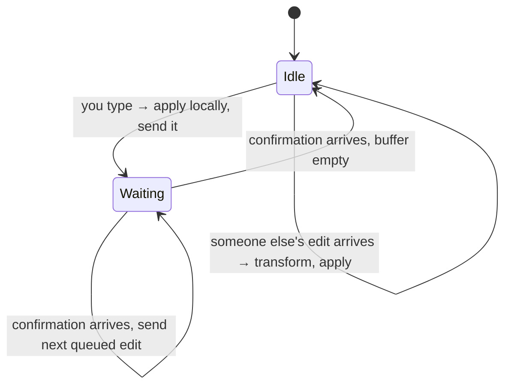
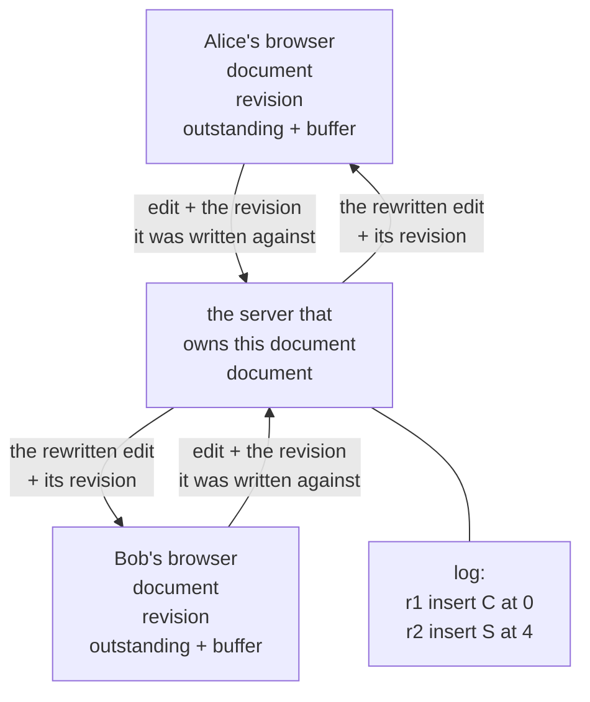
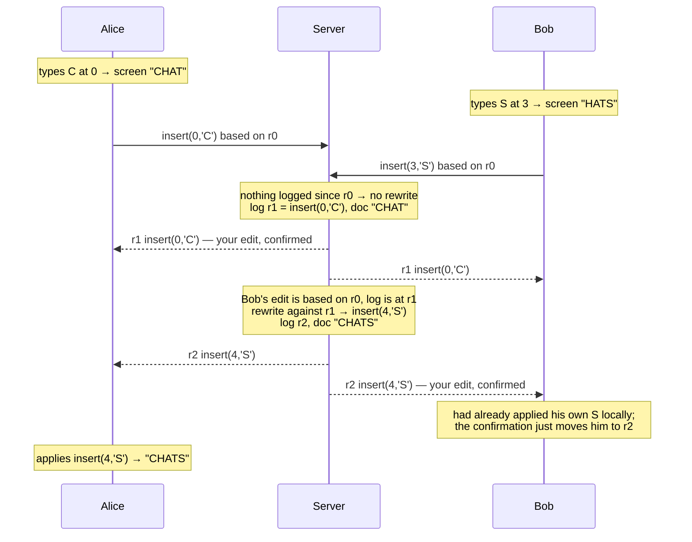
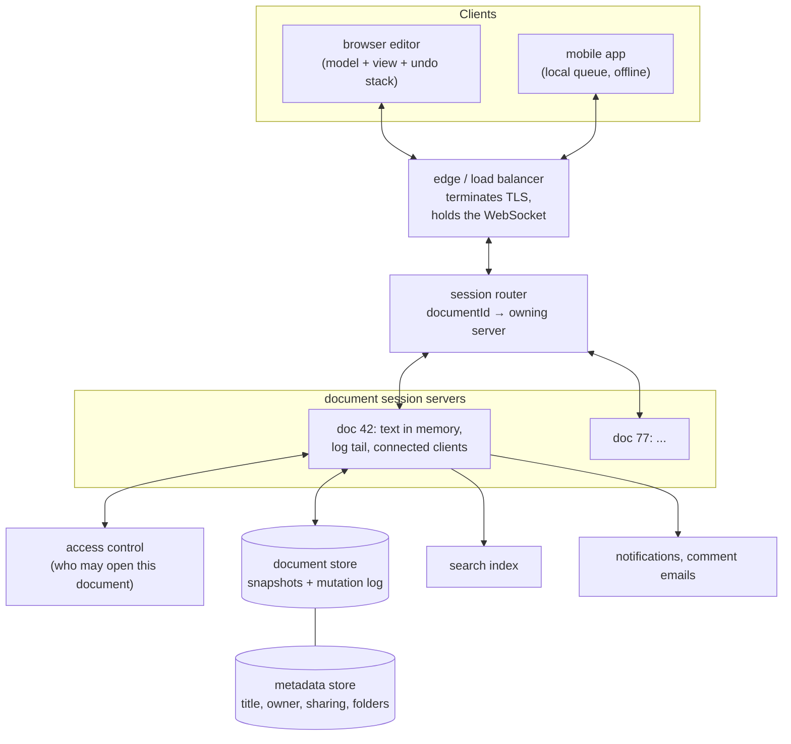
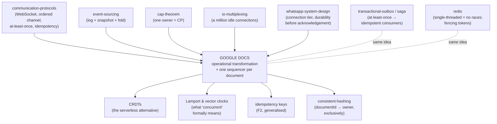

# Google Docs — how a hundred people type into one sentence without losing a word

> **Tell a friend:** Alice and Bob edit the same shopping list from two cities,
> and both change it at the same moment. Simple designs either lose one person's
> letter, or leave the two screens showing different text with nobody told. The
> fix is to stop sending the document and to send the change instead: "put an S
> at position 3". Every machine then rewrites that instruction before running
> it, so it still means what its author meant on a page that has moved on. One
> product decision forces all of this. Your keystroke appears on your own screen
> before any server has agreed to it, and everything else in this lab is the
> bill for that decision.

**Play with it:** [`visualization.html`](visualization.html) — *[Two Cursors, One
Sentence](https://claude.ai/code/artifact/279bb5b7-a1d4-4cfb-9fda-7f803f1fd25e)*.

---

## 1. Why does emailing the document round lose somebody's work?

> **In one breath:** When everyone edits their own copy, someone has to merge
> the copies later. Somewhere in that merge, one person's work quietly
> disappears. Nobody is told.

Alice and Bob work on the same team. They are writing a plan together, and the
plan goes round by email.

Three people edit their own copy on the same afternoon. Then somebody spends an
evening merging four files, one of which is called
`plan_final_v2_REALLY_FINAL.docx`. You have almost certainly lived this.

Somewhere in that merge, an edit is lost. Not deleted with a warning. Just gone,
because a later save overwrote an earlier one.

Now change the product. Put every one of those people inside one document at the
same time. Show them each other's cursors. Let their letters appear on each
other's screens as they type.

That is Google Docs. The entire engineering problem is three words from the
sentence you just read: **at the same time**.

Everything else is ordinary web engineering you have built before. Storage,
sharing, comments, version history: none of that is new. The concurrent editing
is new, and it is where this lab spends almost all of its time.

What happens if nobody solves it? You ship one of two bad products.

The first locks the document, so only one person may type. That is a fancier
shared drive. The second lets two people type at once, and silently produces
text that neither of them wrote.

This lab builds the second product properly. Alice and Bob carry the story the
whole way. Carol joins in section 11 with a terrible Wi-Fi connection, and Meera
takes the pager in section 15.

---

## 2. What should the fridge list say when Alice and Bob both change it?

> **In one breath:** Two people, one three-letter list, one change each. Nearly
> everybody agrees on the right answer. Delivering it is the hard part.

Alice and Bob share a shopping list stuck to a fridge. It says:

```
HAT
```

It is a strange shopping list. It is also short enough that you can follow every
single character, which is exactly why we are using it.

Alice thinks it should say **CHAT**. Bob thinks it should say **HATS**.

They are in different cities. Each is looking at their own photo of the list.
They both make their change at the same moment.

> **🔮 Predict:** What should the fridge say afterwards? Commit to one word
> before you read on.
> <details><summary>Reveal</summary>
> Almost everybody answers <code>CHATS</code>: Alice's C at the front, Bob's S
> at the end, both there, nothing lost. If you answered <code>CHAT</code> or
> <code>HATS</code>, you picked a winner between two people who were not even
> arguing. Picking a winner is the failure this whole lab exists to avoid. Hold
> on to <code>CHATS</code>. It is the specification for everything that follows,
> and it is surprisingly hard to deliver.
> </details>

---

## 3. What does a reasonable person try first, and what does it cost?

> **In one breath:** Everybody edits their own copy and sends the whole document
> back to a server. Whoever saves last wins, and the other person's letter is
> gone with no error at all.

This is not a strawman. It is exactly how a file on a shared drive works. It is
also how the first generation of document-sync products worked.

Run it:

```bash
java src/Demo.java
```

```
DESIGN 1 — send the whole document, last save wins
   everybody starts at "HAT"
   Alice types 'C'          her copy: "CHAT"
   Bob types 'S'            his copy: "HATS"
   Alice saves              server: "CHAT"
   Bob saves                server: "HATS"

   Final document: "HATS"
```

> **🔮 Predict:** Alice's C is gone. What does Alice's screen show at this
> moment, and when will she find out?
> <details><summary>Reveal</summary>
> Her screen still says <code>CHAT</code> — her own copy was never touched. She
> finds out the next time she reloads, or never. There was no error, no
> conflict, no prompt. The system did exactly what it was told: store the most
> recent document it was given. This failure mode has a name we will keep using:
> a <b>lost update</b>. Two people read the same starting value, both changed it,
> and one change vanished under the other.
> <br><br>
> If you guessed her screen would jump to <code>HATS</code>, you are imagining a
> system that pushes the truth back to her. Nothing in this design does that.
> Nobody told her anything, because nobody noticed anything.
> </details>

A lost update is the worst shape a bug can take. It is silent, it is
unrecoverable, and the only person who could notice is the one who is no longer
looking.

---

## 4. Why does sending just the change break too?

> **In one breath:** Locking and merging both fail for a text editor. So you
> send the change instead of the whole document. That breaks for a new reason:
> the change was written for a page that has since moved underneath it.

The lost update is the visible failure. Two familiar fixes both fail as well,
and watching them fail is what uncovers the real problem.

**The first fix is a lock.** One person edits, everybody else is read-only.
Microsoft Word did this for years, with a message reading "Locked for editing by
Ravi". It works, and it produces a product nobody wants. The whole point is that
four people can work on one document during a meeting.

A lock also inherits the blocking problem you already met in the
[two-phase-commit lab](../45-two-phase-commit/). If the lock holder's laptop
dies, the document is stuck until something times out.

**The second fix is to merge on save, the way Git does.** Send both versions,
compute a diff, merge them.

That is a real answer for source code. Merges happen a few times a day there,
and a human is standing by to resolve conflicts. In a document, edits happen
several times *per second* per person. Nobody is going to resolve a three-way
merge conflict between keystrokes.

So the deeper problem is not "how do we merge?". It is this:

> We have to merge **continuously**, many times a second, and **with no human
> involved**. We also have to do it **without anybody ever waiting**, because a
> text editor that pauses after each letter is not a text editor.

Now try the honest version of that. Instead of sending the whole document, send
only what changed: *"put an S at position 3."*

That is far less data. It also looks like it should merge naturally, because two
different instructions do not obviously overwrite each other. Run it:

```
DESIGN 2 — send the change (position + character), apply it as sent
   Alice typed insert('C' at 0)         her screen: "CHAT"
   Bob typed   insert('S' at 3)         his screen: "HATS"
   server accepted insert('C' at 0)     server: "CHAT"
   server accepted insert('S' at 3)     server: "CHAST"
   Alice received insert('S' at 3)      her screen: "CHAST"
   Bob received   insert('C' at 0)      his screen: "CHATS"

   server="CHAST"  Alice="CHAST"  Bob="CHATS"
```

> **🔮 Predict:** Every instruction in that run is correct. Every instruction was
> delivered to everybody. So why are Alice's screen and Bob's screen different,
> and which of them is right?
> <details><summary>Reveal</summary>
> Neither is right, and that is the point. Alice's screen says
> <code>CHAST</code>, which nobody typed and nobody wanted. Bob's says
> <code>CHATS</code>, which is the answer we want but arrived by luck. If you
> guessed that the server would referee the disagreement, look again: the server
> itself holds <code>CHAST</code>. Everybody followed the rules and the rules
> were wrong.
> </details>

Here is the whole bug in one sentence. Bob wrote *"put an S at position 3"*
while looking at `HAT`, where position 3 was the end of the word.

By the time that instruction reached Alice, her own C had pushed every letter
one place to the right. Position 3 now sat between the A and the T.

**The instruction was correct when it was written and wrong when it was run**,
because the document underneath it had changed.

Notice the second thing, which is worse than the first. Alice and Bob's screens
now show different text, and neither of them will ever be told. There is no
error to catch. The system is confidently wrong.

---

## 5. What exactly must the system promise?

> **In one breath:** Four promises. Your letter appears instantly, everyone ends
> up with the same text, what each person meant survives, and nobody ever waits
> for anybody else.

Every design decision in the rest of this lab exists to keep one of these four.
Read the last column first: it says what Alice or Bob would actually experience
if that promise were dropped.

| # | The promise | In plain words | What its absence feels like |
|---|---|---|---|
| 1 | Instant local response | your letter is on your screen before any server hears about it | a 200 ms stutter on every single keystroke |
| 2 | Convergence | when the typing stops, every copy holds identical text | Alice reads `CHAST`, Bob reads `CHATS`, forever |
| 3 | Intention preservation | Alice's C lands at the front, Bob's S at the end | the merge is tidy and the sentence is not what anyone wrote |
| 4 | Nobody waits | no locks, no turn-taking, no "your edit is pending approval" | one person types and three people watch |

Promise 1 is the product decision that creates the whole problem. A round trip
to a server is 50 to 300 ms. You would feel that on every letter, so the letter
has to be drawn before the server has agreed to anything.

Promises 2 and 3 are separate, and the difference matters more than it looks. A
design can satisfy one and fail the other. Design 2 in section 4 failed promise
2 outright. A design that resolved every conflict by blanking the document would
keep promise 2 perfectly and destroy promise 3.

You need words for that difference, which is what section 7 is for.

Promise 4 is invisible until it breaks. It rules out the lock from section 4,
and it rules out every scheme where the server has to approve an edit before you
may see it.

---

## 6. What is the one key idea?

> **In one breath:** Send the change, not the document. Then, before you run
> somebody else's change, rewrite it to account for everything it was written
> without knowing about.

Two sentences carry the whole lab.

> **Send the change, not the document** — an instruction like *insert 'S' at
> position 3*, so two people's work can be combined instead of overwriting each
> other.
>
> **Before running somebody else's instruction, rewrite it** to account for the
> changes it was written without knowing about. Bob's *"S at 3"* becomes *"S at
> 4"* once you know a character was inserted in front of it.

That rewriting step is the invention. Everything else in this lab is bookkeeping
in service of doing the rewriting correctly, in the right order, on every
machine. The servers, the numbering, the queues and the retries are all bill,
not idea.

Here is where the lab goes, and what you can do at the end of each stretch.

| Layer | Sections | After it you can… |
|---|---|---|
| Beginner | 1–9 | say why sending documents cannot work, and what a lost update is |
| Intermediate | 10 | trace one concurrent edit through every machine, by hand |
| Engineering | 11–14 | reason about nine failures and state what is guaranteed |
| Production | 15 | draw the architecture, size it, and argue OT against CRDTs |

Each of those four stretches ends with a checkpoint and a **Say it back** box.
If you cannot say it back, the next stretch will not stick.

---

## 7. Which words do you now need, and what does each name?

> **In one breath:** Ten words carry the rest of the lab. Every one of them
> names something that has already happened to Alice and Bob, so nothing here is
> new. Only the labels are.

This is the whole vocabulary you need to read a real paper or a real codebase on
this subject. Each word arrives at the moment you have already felt the thing it
names.

### What is an operation, and why is it not a document?

Bob typed an S at the end of `HAT`. There are two ways to tell the world about
that.

Design 1 sent the *result*: the four characters `HATS`. Design 2 sent the
*description*: put an S at position 3. Engineers call that description an
**operation**.

Precisely, an operation is a small immutable value describing one edit. In this
lab there are exactly two kinds, `insert(position, character)` and
`delete(position)`. An operation can be sent over a network, stored in a log and
applied to a document. It can also be rewritten, which is the ability the rest
of this lab is built on.

The word exists to keep the description of a change apart from the result of a
change. Results can only overwrite each other. Descriptions can be combined.

Bob's keystroke becomes the operation `insert(3, 'S')`, which is roughly 30
bytes on the wire instead of the whole document.

You have made this exact move before. In the
[event-sourcing lab](../50-event-sourcing/) you stored what happened rather than
what is. A document here *is* a fold over its operations, in the same way that
an account balance is a fold over its transactions.

### What does it mean to apply an operation?

To **apply** an operation is to actually carry it out on some text. Written as
code it is a pure function: `apply(document, operation) → document`. In this lab
it is nine lines of `String` surgery in [`src/Ot.java`](src/Ot.java).

Purity is doing real work here. The function looks at nothing but its two
arguments. So the same operation applied to the same document gives the same
answer on Alice's laptop, on Bob's laptop and on the server, always.

That is what makes the whole design testable. Every disagreement between two
machines must come from a difference in the *inputs*, never from the function.

### What is a revision number really counting?

A **revision** is how many edits the document has been through. It is an integer
counter, and nothing more.

The server assigns revision *n* to the *n*-th operation it accepts. Each client
remembers the revision it has caught up to, and stamps every operation it sends
with that number. The stamp reads: *"this was written against revision 4."*

The word exists to turn a vague question into a number. The question is "what
did this person know when they wrote that?", and the number is the input to the
rewriting rule.

Watch it happen. Bob sends `insert(3,'S')` stamped revision 0. The server's log
is already at revision 1, because Alice's C arrived first.

The gap between those two numbers, revisions 0 to 1, is exactly the set of edits
Bob had not seen. It is also exactly what his operation must be rewritten
against. The whole protocol lives in that gap.

### Why is the log the document?

The **log** is the official list of everything that has happened to this
document, in order. It is an append-only sequence of operations, held by the
server.

The document is *defined* as the log replayed from the beginning. Revision
numbers are simply positions in it. There is no other definition of "the truth"
anywhere in the design.

This is the event store from the [event-sourcing lab](../50-event-sourcing/)
again, right down to the reason snapshots exist. Nobody wants to replay a
million operations just to open a document, so the folded-up result is stored
from time to time. Section 15 does that properly.

If you find yourself thinking "this is just an event log with a projection", you
are correct.

### Why does "everybody agrees" need two words, not one?

Because two very different things can go wrong, and you need to be able to say
which one did.

**Convergence** means everybody's screen ends up the same. Once every operation
has been delivered everywhere, every copy of the document is byte-identical, no
matter what order things arrived in.

The word exists because "consistent" is overloaded to the point of uselessness.
Convergence says nothing at all about *what* the final text is. It only says
there is one of it. Design 2 failed convergence: `CHAST` on one screen, `CHATS`
on the other.

**Intention preservation** means what you meant still happened. Precisely: the
effect of each operation in the final document matches the effect it would have
had on the document its author was looking at when they wrote it.

That word exists exactly because convergence alone is not enough. Here is the
cheapest proof. "When two people edit at once, delete the whole document"
converges beautifully. It is also useless.

Intention preservation is much harder to state formally than convergence, which
is why real papers state convergence as a theorem and intention as a design
goal.

Look at our two candidate answers through both words. Alice meant *"a C at the
front"*. In `CHATS` there is a C at the front, and Bob's S is at the end: both
intentions preserved. In `CHAST`, Bob's S is not at the end, so his intention was
lost even though nothing crashed and nobody complained.

### What does it mean to transform an instruction?

To **transform** is to rewrite an instruction so that it still does the right
thing on a document that has moved on.

Written as code it is a function, `transform(a, b) → a′`. It answers one
question: operation `a` was written for a document that does not contain `b`, so
what must `a` become to have the same effect on a document that does contain `b`?

The word exists because "merge" implies combining two results. This combines
nothing. It produces a modified instruction, which is then applied completely
normally.

Bob's edit is the worked example. `transform(insert(3,'S'), insert(0,'C'))` is
`insert(4,'S')`. In words: something was inserted in front of me, so I shift
right by one.

The whole family of techniques built on that function is called **operational
transformation**, usually shortened to **OT**. When you see "OT" in a paper
about editors, this is it. Its rival, which gives every character a permanent
name instead of rewriting positions, is the [CRDT](../32-crdts/) family, and
section 15 argues the two against each other properly.

### Who goes first when Alice and Bob type in the same spot?

Somebody has to, and every machine has to pick the same somebody. That rule is
the **tie-break**.

For two concurrent inserts at exactly the same position, transformation orders
them by a value that is identical on every machine. Here it is the site id, the
per-client name, and `"Alice" < "Bob"` decides it.

The rule is arbitrary. It must not be *random*, and it must not be arrival time,
because those differ from machine to machine.

It matters far more than it looks. Delete this one rule and the system diverges
in 493 of 500 random runs. That experiment is
[`src/BrokenOt.java`](src/BrokenOt.java), and it is exercise 6.

### What does each client keep in its pocket?

Two things: the edit it has sent and not heard back about, and everything it has
typed since.

The first is called the **outstanding** operation. Each client holds at most one
of them in flight to the server, ever.

The second is the **buffer**: operations typed while waiting, in order. When the
confirmation for the outstanding operation arrives, the next queued one is sent.

This rule is not a design flourish. It was discovered by failure, and you will
watch it be discovered in section 10. With two operations in flight, the client
and the server disagree about what each one was written against, and
transformation is then applied against the wrong history.

### Who decides the official order?

One place, and only one. That place is the **sequencer**.

A single server owns a given document, and it is the only thing that appends to
that document's log. "Concurrent" edits become "ordered" edits the moment they
pass through it.

Why does it have to be one? Suppose two servers both accepted edits for one
document. There would be two logs and two revision-4s. The sentence "written
against revision 4" would stop having a meaning, and every guarantee in this lab
is stated over one log.

Section 15 covers what that costs. It is the single most important architectural
constraint in the whole design, and most of the production complexity is its
bill.

### The ten words on two cards

Read these as a map back into the story, not as a dictionary. The last column
says where the thing happened to Alice and Bob.

Words for what is sent and what is stored:

| Word | In plain words | Where you met it |
|---|---|---|
| **operation** | one change described rather than performed | Bob's `insert(3,'S')`, section 4 |
| **apply** | actually carry an operation out on some text | every screen update since section 3 |
| **revision** | how many edits the document has been through | the stamp on Bob's edit, section 7 |
| **the log** | the append-only official list; the document is it, replayed | the server's side of section 4 |
| **transformation** | rewriting an operation for a document that moved on | `insert(3,'S')` becoming `insert(4,'S')` |

Words for the promises and for the plumbing that keeps them:

| Word | In plain words | Where you met it |
|---|---|---|
| **convergence** | every copy ends up holding identical text | broken by `CHAST` vs `CHATS`, section 4 |
| **intention preservation** | each edit still does what its author meant | Alice's C at the front of `CHATS`, section 2 |
| **tie-break** | the fixed rule for who goes first in a dead heat | `"Alice" < "Bob"`, section 7 |
| **outstanding / buffer** | the one edit in flight, and the queue behind it | the client's pocket, section 10 |
| **sequencer** | the single process that decides the official order | the one server that owns this document |

---

## 8. Which two mental models should you carry, and where does the story lie?

> **In one breath:** Picture a room with a noticeboard and a clerk who corrects
> every slip of paper before pinning it up. That picture is right about almost
> everything, and it lies to you in three specific places.

### What does the room look like?

There is a **noticeboard** at the front of a room. Everyone has their own copy
of the list on their own desk.

When you make a change, you write it on a slip of paper. The slip says something
like *"add an S after the T"*. You post it to a **clerk** who stands at the
noticeboard.

The clerk does three things with every slip, always in this order:

1. Looks at what has been pinned up since the slip was written.
2. **Corrects the slip** so that it still means the right thing now. *"After the
   T"* might have to become *"the fifth character"*.
3. Pins the corrected slip up, numbers it, and posts a copy of the *corrected*
   slip to everybody.

Meanwhile you never wait for the clerk. You made your change on your own desk
copy the instant you wrote the slip.

That last sentence is promise 1 from section 5, and it is the reason the clerk
has any work to do at all.

### What does each machine actually hold?

Now the same room in real names. Each client holds four things.

| What the client holds | In words |
|---|---|
| `doc` | its own copy of the text |
| `revision` | the last server revision it has incorporated |
| `outstanding` | the one operation sent and not yet confirmed, or none |
| `buffer` | operations typed since then, in order |

The server holds two things: `doc`, and `log`, the ordered list of operations.
Its revision is simply the log's length.

Three rules run the whole protocol, and this diagram is all three. Follow the
arrows out of `Waiting`: they are the reason your fast typing does not turn into
twenty messages.



### How does the room map onto the system?

Two small tables. The first is the furniture, the second is the paperwork in
motion.

| In the room | In the system |
|---|---|
| noticeboard | the server's document and log |
| clerk | the server process that owns this document |
| slip of paper | an operation |
| your desk copy | the client's local document |
| the number the clerk writes on it | the revision number |

| In the room | In the system |
|---|---|
| "what was pinned since you wrote this" | operations from your `revision` to the log's end |
| correcting the slip | `transform` |
| a slip you posted but haven't seen pinned | `outstanding` |
| slips in your pocket, waiting | `buffer` |

### Where the story lies to you

Three places. Each lie hides a real property of the system, so each one is worth
replacing carefully.

**The clerk corrects the slip once. In the system, every desk corrects it
again.** In the room, the clerk's corrected slip is final. In the system, a
client that receives that operation may have to transform it a second time,
against its own outstanding and buffered edits, which the server has never seen.
Transformation happens on both ends, for different reasons.

**There is no queue at the noticeboard.** Slips do not politely line up. They
cross in the post, arrive out of order relative to other people's slips, get
lost, and sometimes arrive twice. The clerk sees whatever arrives, in whatever
order it arrives.

**Everyone posting to one clerk is a design constraint, not a convenience.** In
a real room, a second clerk would obviously help. In this system, a second clerk
for the same noticeboard destroys the design. Section 11 shows why, under F8,
and it is why the whole architecture is shaped around one document with one
owner.

---

## 9. What should you watch on the page before reading the mechanism?

> **In one breath:** Everything so far is running live on one page, and nothing
> on it moves unless you move it. You type on Alice's screen and Bob's, and you
> decide when each message crosses the network.

Everything above is running, live, here:

**▶ [Two Cursors, One Sentence](https://claude.ai/code/artifact/279bb5b7-a1d4-4cfb-9fda-7f803f1fd25e)**
(also saved locally as [`visualization.html`](visualization.html) — open it in a
browser, no server needed)

That is the point of the page: every race condition in this lab is one you
schedule by hand, and can therefore watch happen.

Three things to do first, in this order.

**One.** Leave the mode on "Send the whole document" and play the first
scenario. Watch a keystroke disappear with no error. That is section 3.

**Two.** Switch to "Send edits, apply as sent" and run the second scenario.
Watch the two screens end up different. That is section 4. Look at the event
feed: the sentence *"Bob received Alice's edit"* is where it goes wrong.

**Three.** Switch to "Send edits, rewrite them" and run the third. Same typing,
same delivery order. Watch the server's log: the line that reads
`Bob: insert 'S' at 4`, when Bob's finger pressed S at position 3, is the whole
lesson.

Then start breaking things. Drop a message. Take Bob offline and keep typing.
Deliver messages in an order you choose. Each of the five scenarios asks you to
predict before it runs.

Here is the same system as a picture, so that the shapes on that page and the
shapes in this document are the same shapes. Read it top to bottom: edits go up
to the middle, rewritten edits come back down.



> **CHECKPOINT — end of the BEGINNER model.**
> You can now explain why collaborative editing cannot be done by sending
> documents, what a lost update is, and why an edit has to be rewritten before
> it is applied. If you stopped here you could hold a conversation about it.
> What is missing is the mechanism: exactly what each machine does, message by
> message, and why the details are the shape they are. That is next.

> **Say it back.** Without using the words *operation*, *transform* or
> *convergence*, explain to a friend why Alice's screen ended up saying `CHAST`
> when both instructions were correct and both were delivered.
> <details><summary>A good answer sounds like</summary>
> "Bob wrote down a place, not a letter: third along. That was the right place
> on his copy. By the time his note reached Alice, she had already stuck a
> letter in front, so everything had shifted and third along was somewhere else.
> Nobody made a mistake. His note just went stale on the way."
> </details>

---

## 10. How does the mechanism get invented, one broken design at a time?

> **In one breath:** The finished protocol has four rules that look arbitrary
> until you watch each one get invented. So we build it wrong four times, and
> each time the breakage hands us the next rule.

### v1 — what if the server does the rewriting?

The obvious home for transformation is the server. It is the one machine that
knows the official order, so let it correct every slip.

> **Rule 1.** Every edit is stamped with the revision it was written against.
> When the server receives an edit, it rewrites it against every log entry from
> that revision onwards, then appends it, numbers it, and broadcasts the
> *rewritten* version to everyone.

Here is that rule doing its job. The document is `HAT`, the log is empty, and
the revision is 0. Read the last two columns as the server's own memory after
each step.

| step | what happens | server log | server doc |
|---|---|---|---|
| 1 | Alice types C at 0. Her screen: `CHAT`. She sends `insert(0,'C')`, based on revision 0. | — | `HAT` |
| 2 | Bob types S at 3. His screen: `HATS`. He sends `insert(3,'S')`, based on revision 0. | — | `HAT` |
| 3 | Alice's edit arrives first. Nothing logged since revision 0, so no rewriting. Logged as revision 1. | `r1: insert(0,'C')` | `CHAT` |
| 4 | Bob's edit arrives, based on revision 0. The log has moved to 1, so it is rewritten against `r1`: something was inserted at 0, which is before 3, so `insert(3,'S')` becomes **`insert(4,'S')`**. Logged as revision 2. | `r1, r2: insert(4,'S')` | `CHATS` |
| 5 | Everyone is sent the rewritten `insert(4,'S')` and Alice's `insert(0,'C')`. | | `CHATS` |

Both screens end at `CHATS`, which is the answer everybody wanted back in
section 2. Run it yourself with `java src/Demo.java`, third block.

So we are done? Change one thing: the order in which the two edits reach the
server.

> **🔮 Predict:** Now run the *same* two edits, but let Bob's reach the server
> first. Alice's screen already says `CHAT` (her own C, not yet confirmed by
> anyone). The server broadcasts Bob's `insert(3,'S')` untouched — because when
> it processed that edit, Alice's C did not exist anywhere it could see. What
> does Alice's screen show if she just applies what she was sent?
> <details><summary>Reveal</summary>
> <code>CHAST</code> — the exact corruption from section 4, back again. The
> server did nothing wrong: it correctly rewrote Bob's edit against everything
> it knew, and it did not know about Alice's C. The missing piece is that
> <b>Alice knows something the server does not</b> — her own un-confirmed edit.
> Nobody but Alice can do that rewriting.
> <br><br>
> If you guessed <code>CHATS</code>, you assumed the server could see Alice's
> screen. It cannot, and promise 1 is the reason: her C was drawn before anyone
> else heard about it.
> </details>

That reveal is worth pausing on. Promise 1 is what created the gap. Alice's
screen contains a letter that exists nowhere else in the world, so Alice's
screen is the only place that particular correction can be made.

### v2 — so the client rewrites too, in both directions

> **Rule 2.** When an edit arrives from the server, the client transforms it
> against its own outstanding and buffered edits — and transforms those against
> it. Both sides move.

That second half is easy to miss, so say it slowly. Alice's incoming
`insert(3,'S')` becomes `insert(4,'S')` because of her C. Her own C, once it
reaches the server, will need to have been transformed against Bob's S.

Every operation in the system ends up expressed against the same document state,
approached from two directions.

```bash
java src/Demo.java     # fourth block: "why the CLIENT transforms too"
```

```
   Alice received Bob:insert('S' at 3) from Bob
       (their own editor rewrote it to Bob:insert('S' at 4), against their un-confirmed edit)
       their screen now reads "CHATS"
```

Now break it again. This time Alice types fast.

> **🔮 Predict:** Alice types two letters quickly. First an S at the end of
> `HAT`, then a `!` after it, and she sends both immediately without waiting.
> Both say "written against revision 0", because no confirmation has come back
> yet to move her revision on. What does the server do with the second one?
> <details><summary>Reveal</summary>
> It rewrites it against the first one — <i>again</i>. Alice's second edit was
> typed on a screen that already contained the S, so it needs no adjustment at
> all; but its stamp says revision 0, which claims it has never seen the S. Run
> <code>java src/Experiments.java two-in-flight</code>:
> <pre>server applied Alice:insert('S' at 3)  -> "HATS"  (revision 1)
> server THREW: insert at 5 but doc is only 4 long: "HATS"</pre>
> Here it happens to crash, which is lucky. With different positions it would
> silently put the character in the wrong place.
> <br><br>
> If you guessed "nothing, the second edit is already correct", you are right
> about the edit and wrong about the stamp. The server trusts the stamp, not the
> edit.
> </details>

### v3 — one edit in flight, everything else queues

The stamp "written against revision *r*" is only true under one condition. The
client's document must be exactly the log up to *r*, plus at most one
un-confirmed edit that the server is about to see.

Two edits in flight breaks that arithmetic, which is what you just watched.

> **Rule 3.** A client keeps at most one edit in flight. Anything typed while
> waiting goes into a local buffer and is sent when the confirmation arrives —
> after being transformed against everything that arrived in the meantime.

This is why the visualization shows "waiting for confirmation: 1" and "queued
behind it: 3". Typing fast does not send faster. It makes the queue longer.

Real editors turn that into an advantage. They *compose* the queue into one
bigger operation before sending it, which is why a burst of typing arrives as
one message rather than twenty.

One case is still undecided, and it is the one that looks harmless.

> **🔮 Predict:** Alice and Bob both type at exactly the same position — Alice an
> S at position 3 of `HAT`, Bob a `!` at position 3. Neither is "before" the
> other in any meaningful sense. What has to be decided, and what happens if each
> machine decides it for itself?
> <details><summary>Reveal</summary>
> Somebody's character has to come first, and every machine must pick the same
> somebody. If each machine simply keeps its own edit where it is, Alice ends at
> <code>HAT!S</code> and Bob at <code>HATS!</code> — forever. Run
> <code>java src/BrokenOt.java</code>: that one missing rule diverges in
> <b>493 of 500</b> random runs. The fix is one line: order concurrent inserts at
> the same position by site id. It is arbitrary — Alice's letter goes first
> because "Alice" &lt; "Bob" — but it is <i>identically</i> arbitrary everywhere.
> <br><br>
> If you guessed "whoever reached the server first wins", look at what each
> machine can see. Alice's laptop never learns the arrival order of its own
> un-confirmed edit, so it cannot use one.
> </details>

> **Rule 4.** Concurrent inserts at the same position are ordered by a
> tie-break. That tie-break is a fixed function of the operations themselves.
> Never arrival time, and never a random number.

### What are the four rules, side by side?

Four rules, four failures that produced them. The last column is what you saw
with your own eyes before the rule existed.

| Rule | In words | Without it |
|---|---|---|
| 1 | stamp each edit with its revision; the server rewrites it against the log since then | Design 2's `CHAST`: correct instructions, wrong positions |
| 2 | the receiving client rewrites too, against its own unsent edits, in both directions | `CHAST` again, on the screen of whoever is holding an unconfirmed edit |
| 3 | at most one edit in flight per client; the rest wait in a buffer | `insert at 5 but doc is only 4 long` — the stamp is a lie |
| 4 | concurrent inserts at one position are ordered by site id, not by arrival | `HAT!S` and `HATS!`, permanently, in 493 of 500 runs |

### What is the protocol still quietly assuming?

One thing is still being assumed silently: that each client receives the
server's broadcasts **in log order**. Break it and watch.

```bash
java src/Experiments.java out-of-order
```

```
   messages waiting for Bob, in log order:
      server -> Bob  Alice:insert('C' at 0)  (revision 1)
      server -> Bob  Alice:insert('S' at 4)  (revision 2)
   delivering them BACKWARDS (revision 2 before revision 1):
      Bob's editor threw: insert at 4 but doc is only 3 long: "HAT"
```

Revision 2 assumes revision 1 has already happened. This is not something the
protocol fixes. It is something the protocol **requires**.

You buy it by giving each client exactly one ordered connection: a WebSocket
over TCP, from the
[communication-protocols lab](../02-communication-protocols/). Load-balance one
client's messages across two sockets and you have re-created this bug yourself.

### The whole protocol, on one page

Here are Alice, Bob and the server for one full round. Read the notes over the
server: they are the two rewriting decisions that make the whole thing work.



The same thing in twelve lines. The server, on receiving an edit, its base
revision and its sender, which together are written `(op, base, from)`:

```
for each entry in log[base .. end]:  op = transform(op, entry)
append op to log; doc = apply(doc, op)
broadcast (op, revision = log.length, origin = from) to everyone
```

And the client, on receiving an edit, its revision and who wrote it, written
`(op, revision, origin)`:

```
if origin is me:
    revision = revision
    outstanding = buffer.pop()        # and send it, stamped with the new revision
else:
    if outstanding: op, outstanding = transform(op, outstanding), transform(outstanding, op)
    for each b in buffer:  op, b = transform(op, b), transform(b, op)
    doc = apply(doc, op); revision = revision
```

That is the entire algorithm. It is about forty lines in
[`src/Collab.java`](src/Collab.java).

It is also, with richer operations, what Google's published design does. That
design is the Wave protocol, itself a descendant of the 1995 Jupiter system.

> **CHECKPOINT — end of the INTERMEDIATE model.**
> You can now trace a concurrent edit through the system by hand, and say what
> every machine holds at each step. You also know why each of the four rules
> exists, because you watched the system break without it. What is missing is
> everything that happens when the network and the machines misbehave — which
> is most of the work in a real system.

> **Say it back.** Without using the words *outstanding*, *buffer* or
> *revision*, explain why the server's rewriting is not enough on its own, and
> why Alice's own laptop has to rewrite Bob's edit a second time.
> <details><summary>A good answer sounds like</summary>
> "Alice's screen has a letter on it that nobody else has seen yet, because it
> was drawn the moment she pressed the key. The clerk cannot correct Bob's note
> for a letter he does not know exists. Only Alice can, so she does it herself
> just before she uses the note."
> </details>

---

## 11. Which nine failures should you be able to name?

> **In one breath:** Nine things go wrong. Four of them turn out to be nothing
> much, which is the design working. The other five are where the real
> engineering is, and two of them corrupt the document silently.

Every one of these is runnable, except the last two. Each is told the same way:
what happens to Alice, Bob or Carol, what you would see, why it happens, and
which of the four promises from section 5 bends.

### F1 — what if the edit never reaches the server?

```bash
java src/Experiments.java lost-request
```

Alice types C, and the network eats the message. She keeps typing, and her queue
grows. The experiment prints `Alice pending edits: 2`.

Her screen is fine and self-consistent. The server and Bob simply never hear
from her.

**Convergence is not violated. It is postponed.** Nothing is corrupted, because
a client that never gets a confirmation never advances its revision and never
sends its queue. The design is stuck rather than wrong, which is the good kind
of broken.

The fix is a timeout and a retry, which the experiment then runs:
`Alice heard nothing back and re-sent insert('C' at 0)`, and everything
converges to `CHHATS`.

In production, this same event happens on every laptop that closes its lid.

### F2 — what if the edit arrives but the confirmation is lost?

```bash
java src/Experiments.java lost-ack
```

This is the dangerous one, and it is the reason retries are not free.

> **🔮 Predict:** Alice's edit reached the server and was applied. Only the
> confirmation was lost, so Alice re-sends the same keystroke. What is in the
> document now, and is it the same on every screen?
> <details><summary>Reveal</summary>
> Her single keystroke happened <i>twice</i>, and the screens disagree about it.
> The run is printed below, with duplicate suppression off and then on. If you
> guessed the retry was harmless because the network lost something, notice what
> the server lost: nothing at all. From the server's side, "Alice typed C" and
> "that C again" are the same bytes.
> </details>

```
duplicate suppression OFF : server="CCHAT"  Alice="CHAT"  Bob="CCHAT"   converged=false
duplicate suppression ON  : server="CHAT"   Alice="CHAT"  Bob="CHAT"    converged=true
```

The fix has three parts, and all three are needed. Each client numbers its
edits. The server remembers the last number it saw from each client, and ignores
anything at or below it. Then the server **re-sends the original confirmation**,
because the same edit must not get a second revision number.

That is an idempotency key in its smallest possible form. You have met the same
mechanism in the [transactional-outbox](../48-transactional-outbox/) and
[saga](../47-saga/) labs, where at-least-once delivery forces every consumer to be
idempotent. Same physics, different content.

### F3 — what if messages arrive out of order?

You caused this one yourself in section 10. `java src/Experiments.java
out-of-order` throws `insert at 4 but doc is only 3 long`.

Here is the distinction worth carrying out of this lab. The guarantee the
protocol *assumes* is per-client ordered delivery. The guarantee it *provides*
is convergence, and it provides that only while the assumption holds.

Two consequences follow directly. The transport is one persistent ordered
connection per client. And reconnect logic must resume from a revision number,
never from "start listening again".

### F4 — what if a client goes away and comes back?

```bash
java src/Experiments.java offline-burst
```

Bob edits on a plane while 200 edits land without him. Read the third row: it is
the price of the healing, not the size of the document.

```
   server log length      : 220
   Bob's offline edits    : 20
   transformations to heal: 8200
   converged              : true, document length 223
```

Nobody was asked to resolve anything. Nobody saw a conflict prompt. But look at
the cost, which is roughly *(edits you missed) × (edits you made)*.

Twenty edits against two hundred is 8,200 transformations, which is nothing.
Twenty edits against a million is not nothing. **The guarantee holds. The
liveness does not scale.**

That is why real clients that have been away too long throw their local state
away and re-download the document. It is also why servers keep a bounded log
tail plus snapshots, which section 15 builds properly.

### F5 — what if the server confirms an edit it has not written down?

```bash
java src/Experiments.java stale-server
```

```
   before the crash: server="CHATS!?" ... revision 4
   after the restart: server="CHATS" revision 2 but Alice still believes she is at revision 4
   server="CXHATS"  Alice="CXHATS!?"  Bob="CXHATS!?"   converged=false
```

Follow what happened. The server acknowledged revisions 3 and 4 while they were
still only in memory. Then it restarted from a snapshot that had two entries.

Now every client's revision number refers to a history that no longer exists.
Their edits are transformed against the wrong set of operations. The corruption
is silent, and it is permanent.

**The rule that prevents it: never confirm an edit you have not durably written
down.** A confirmation is a promise about the log, so the log write has to come
first.

You have arrived at this rule from three other directions already. The
[WhatsApp lab](../69-whatsapp-system-design/) reached it as "never acknowledge
what is not yet durable". It is the same discipline as a write-ahead log in the
[b-tree/LSM lab](../05-btree-and-lsm/), and as `appendfsync` in the
[redis lab](../13-redis/). "We accepted it" and "it survives a crash" are two
different moments. Users forgive you for conflating them only until the first
crash.

### F6 — what does one slow client cost everybody else?

Carol joins the document from a café with terrible Wi-Fi. Her connection stalls.

```bash
java src/Experiments.java slow-client
```

```
   edits made while Carol was stalled : 100
   messages queued for Carol alone    : 100
```

Everyone else keeps working. The design has no shared lock, so one slow
participant cannot block anybody. Promise 4 holds even for Carol's neighbours.

But somebody is holding Carol's backlog, and that somebody is the server. Put
200 people in a document, each on their own flaky café Wi-Fi, and that is 200
backlogs in one process's heap.

Production answers with a cap on the per-client queue. When it overflows, the
server disconnects that client and makes them reload the document from a
snapshot. That is backpressure, from the
[io-multiplexing](../03-io-multiplexing/) and
[communication-protocols](../02-communication-protocols/) labs, in its
document-shaped form.

### F7 — what happens when everybody edits the same word?

A hundred people in one document, all typing in the same paragraph, is not a
correctness problem. The tie-break rule handles it exactly as it handles two.

It is a *hot key* problem, and this is the shape a hot key takes here: one
document, one owning process, one CPU.

You cannot shard a document by user, because every edit must pass through the
same sequencer. That is the constraint from section 7 collecting its bill.

Google's answer is a hard limit. Docs stops accepting new editors past a
documented cap, and read-only viewers are served from a different path
altogether. The general lesson is the one from the
[distributed-rate-limiting lab](../60-distributed-rate-limiting/): sharding
spreads keys, and it does nothing at all for one hot key.

### F8 — what if two servers own one document?

This is the one failure the lab does not simulate, because the fix is
architectural rather than algorithmic.

If two servers both accept edits for the same document, there are two logs and
two revision-4s. The phrase "written against revision 4" stops having a meaning.
Every guarantee in section 12 is stated over one log.

So the document's owning process must be unique. That turns out to be the
central architectural constraint of the whole system. Section 15 pays for it,
with routing by document id, sticky sessions, careful handover on deploy, and a
fencing mechanism.

The fencing mechanism deserves its own sentence. A server that *thinks* it still
owns a document, but has been replaced, must not be able to keep appending.

You met that exact hazard in the [redis lab](../13-redis/) with expiring locks,
and it needs the same answer here. A fencing token, checked by the thing being
written to, not by the thing that believes it holds the lease.

### F9 — which conflict can nothing fix?

Alice changes "shall" to "must". Bob deletes the sentence.

The system converges on a sentence that does not exist, containing an edit that
no longer means anything. No transformation rule can help. The conflict is in
the meaning, not in the positions.

This is the honest limit of the whole approach. The product answer is social
rather than technical: you can see each other's cursors, so you do not type in
the same sentence.

### The nine, side by side

One table, so you can compare them without re-reading nine stories. "Bends"
names the promise from section 5 that gives way.

| # | What goes wrong | Which promise bends | How you cause it |
|---|---|---|---|
| F1 | the request is lost | 2, and only until the retry | `java src/Experiments.java lost-request` |
| F2 | the confirmation is lost, the retry duplicates a keystroke | 2 and 3 | `java src/Experiments.java lost-ack` |
| F3 | broadcasts arrive out of order | 2, by breaking an assumption | `java src/Experiments.java out-of-order` |
| F4 | a client returns after 200 edits | none; the cost is time | `java src/Experiments.java offline-burst` |
| F5 | a confirmed edit was never durable | 2, silently and permanently | `java src/Experiments.java stale-server` |
| F6 | one client stalls and the server holds its backlog | none, until memory runs out | `java src/Experiments.java slow-client` |
| F7 | a hundred editors in one paragraph | 1, as the owning process saturates | not simulated; it is a capacity limit |
| F8 | two servers own one document | all of them | not simulated; prevented by architecture |
| F9 | both edits land and the sentence is nonsense | 3, and no rule can save it | not simulated; it is a limit, not a bug |

---

## 12. What is guaranteed, what is not, and what did it cost?

> **In one breath:** Five things are true no matter how the network behaves.
> Five things are explicitly not promised, and one of them surprises people.
> Four costs were paid to get here, and you can see all four in the
> architecture.

### What is true, always?

These five hold whatever order messages arrive in, and whoever is offline.

**One order.** There is exactly one log per document, and its order is the
definition of what happened. Everything else is derived from it.

**Convergence.** Once the network is quiet, every replica's text equals the log
replayed from the start. The test suite runs 3 clients making 30 edits each,
over 1,000 different random delivery schedules, and finds **0 divergences**
(`java src/Tests.java`). The naive design, under the identical harness, diverges
in **500 of 500** runs (`java src/Experiments.java raw-vs-ot`).

**Intention preservation, for the operations we support.** An insert lands
between the same two characters its author saw. A delete removes the same
character its author saw, or nothing at all if it is already gone. This is not a
theorem here. It is a design property that the tests check case by case.

**Local responsiveness.** No operation ever waits for a network round trip
before appearing on its author's screen. That is promise 1, and it is the one
that never bends.

**At most one edit in flight per client.** That is what makes the revision
stamps arithmetically true, and it is Rule 3 restated as an invariant.

Those two numbers deserve to sit next to each other, because the gap between
them is the whole argument for this lab.

| Design | Divergences | Out of | What the number means |
|---|---|---|---|
| operational transformation | 0 | 1,000 random schedules | the rewriting holds under every order the harness could invent |
| apply as sent (Design 2) | 500 | 500 runs | not "risky under load"; broken on essentially every run |
| no tie-break (Rule 4 removed) | 493 | 500 runs | one missing line, and the copies disagree forever |

### What is explicitly not guaranteed?

**Any particular final text when two people type at the same spot.** You get *a*
deterministic answer, ordered by site id. You do not get the "right" one, and
there is no right one.

**Meaningful merges.** That is F9. Positions merge. Meaning does not.

**Real-time ordering.** "Alice typed first" by wall clock has no standing here.
The log order is the arrival order at the server, which is a race, and the system
is correct either way. If you need wall-clock fairness, this is the wrong
architecture.

**Undo as the inverse of your last operation.** Once other people's edits have
been transformed into your document, "undo my last edit" is a fresh operation
that must itself be transformed. Selective undo in a collaborative editor is a
research-grade problem, and real editors implement a restricted version of it.

**Availability during a partition.** The document has exactly one owner. If you
cannot reach it, you edit locally and cannot see anyone else. That is the
[CAP](../24-cap-theorem/) trade made per document: **CP for the shared document,
and AP for your own copy.** That combination is only possible because the read
everyone cares about is their *own* screen.

### What did it cost to get here?

Four bills, and every one of them shows up again in section 15.

**A single point of ordering per document.** Simple, and the source of F7, F8
and every deployment complication in the production section.

**Transform work proportional to how far behind you are.** That is F4's 8,200
transformations, and it is why snapshots and forced reloads exist.

**Every client needs the algorithm.** The rewriting is not a server feature. It
is a protocol, so browser, Android, iOS and the export pipeline must all agree,
forever, including for documents written years ago.

**A case matrix that grows as the square of the number of operation types.** Two
types here means four cases. Add "apply bold to a range" and "insert a table",
and the matrix is where real OT implementations earn their reputation for being
hard. This is the single strongest argument for the alternative in section 15.

> **CHECKPOINT — end of the ENGINEERING model.**
> You can now state the guarantees precisely, name what was traded for them, and
> reason about the failure modes. What is left is the product around the
> algorithm: storage, connections, scale, deployment, and what a real
> architecture diagram looks like.

> **Say it back.** Imagine a system that deletes the whole document whenever two
> people clash. Without using the words *convergence* or *intention*, explain to
> a friend why it passes one of this lab's two big tests and fails the other.
> <details><summary>A good answer sounds like</summary>
> "Everybody's screen would definitely agree, because everybody's screen would
> be empty. So it passes the 'do the copies match' test perfectly. It fails the
> other one, which is 'did what each person meant actually happen', because
> nothing anybody meant survived at all."
> </details>

---

## 13. In what order should you read the code?

> **In one breath:** Start with the fifteen lines that do the rewriting, because
> everything else in the lab exists to feed them. Then read the client, which is
> the only place two machines disagree on purpose.

There is no build tool and there are no dependencies. `java src/Foo.java`
compiles the whole directory and runs it, on JDK 22 or later.

Two files hold the idea:

| file | what it is |
|---|---|
| [`src/Ot.java`](src/Ot.java) | operations, `apply`, and `transform` — the entire idea, ~60 lines of logic |
| [`src/Collab.java`](src/Collab.java) | server, client, and a network you drive by hand |

Four files hold things to run, break and finish:

| file | what it is |
|---|---|
| [`src/Demo.java`](src/Demo.java) | the four designs from sections 3, 4 and 10, narrated |
| [`src/Tests.java`](src/Tests.java) | 10 scenario tests, named after the scenarios |
| [`src/Experiments.java`](src/Experiments.java) | the eight failure experiments |
| [`src/BrokenOt.java`](src/BrokenOt.java) | one line changed, for exercise 6 |

And two more that exist for the exercises and for the argument in section 15:

| file | what it is |
|---|---|
| [`src/YourTransform.java`](src/YourTransform.java) | the same file with the rules blanked out, for exercise 5 — it self-checks |
| [`src/Crdt.java`](src/Crdt.java) | the other design, with no server at all |

```bash
java src/Demo.java          # the story, in four runs
java src/Tests.java         # 10 passed, 0 failed
java src/Experiments.java   # all eight failure experiments
java src/Crdt.java          # the CRDT alternative
java src/BrokenOt.java      # the planted bug
java src/YourTransform.java # exercise 5: write transform() yourself, self-checking
```

### Which lines actually carry the design?

Everything load-bearing is in `transform`. Here is the case where both people
insert, which is Alice's C meeting Bob's S:

```java
if (a.kind == Kind.INSERT && b.kind == Kind.INSERT) {
    if (b.pos < a.pos) return a.withPos(a.pos + 1);   // something appeared before me → shift right
    if (b.pos > a.pos) return a;                      // it appeared after me → I am unaffected
    // Exact same spot. Somebody has to go first, and BOTH sides must pick the same
    // somebody or the two copies end up with the letters in opposite orders.
    return a.site.compareTo(b.site) < 0 ? a : a.withPos(a.pos + 1);
}
```

Three lines, three situations: before me, after me, and the dead heat that
needs Rule 4.

Now the case people forget, where both people delete:

```java
if (b.pos < a.pos) return a.withPos(a.pos - 1);
if (b.pos > a.pos) return a;
// We both deleted the SAME character. It is already gone; deleting again
// would eat an innocent neighbour. My op becomes nothing at all.
return Op.noop(a.site);
```

That `noop` is not tidiness. Without it, two people deleting the same letter of
`CHATS` produce `CHA`. The T disappears as well as the S, because the second
delete removes whatever slid into the vacant position.

The test named `ot_two_people_delete_the_same_character` is what catches that.

On the client, four lines implement Rule 2, and they are worth reading slowly:

```java
if (outstanding != null) {
    Ot.Op newOutstanding = xform.apply(outstanding, incoming);
    incoming = xform.apply(incoming, outstanding);
    outstanding = newOutstanding;
}
```

Note the temporary variable. Transforming `incoming` first, then using the *new*
`incoming` to transform `outstanding`, would transform against an operation that
never existed in that form. Both results must be computed from the originals.

That is the smallest bug in this lab and one of the hardest to see.

### What do the tests say, and what do they quietly admit?

```
PASS  lww_silently_loses_an_edit
PASS  raw_operations_diverge_when_two_people_type_at_once
PASS  ot_converges_and_keeps_both_intentions
PASS  ot_insert_next_to_a_delete
PASS  ot_two_people_delete_the_same_character
PASS  ot_same_position_inserts_land_in_the_same_order_everywhere
PASS  ot_typing_a_burst_faster_than_the_round_trip
PASS  ot_client_edits_while_offline_then_reconnects
PASS  ot_late_joiner_catches_up
PASS  ot_converges_under_1000_random_schedules
        3 clients x 30 edits x 1000 different delivery schedules, diverged 0 times

10 passed, 0 failed
```

The test names are the documentation. Read them as a list of sentences about
Alice and Bob, because that is what they are.

Five simplifications are deliberate, and every one of them is a thing a real
editor has to do that this lab does not.

**One character per operation.** Real editors send *deltas*, such as "keep 40
characters, insert this string, delete 3". One operation per keystroke is far
too many messages. The transform rules are the same idea over ranges, with much
fiddlier arithmetic.

**Plain text only.** No formatting, no tables, no images, and no comments
anchored to a range of text. Each of those adds operation types, and the
transform case matrix grows as the square of the number of types.

**No persistence.** Everything is in memory, and F5 shows exactly what that
costs.

**No cursors and no presence,** meaning who else is in the document and where
they are typing. No access control either.

**Time only moves when a test calls `deliver()`.** There are no threads, so
there is no concurrency in the Java sense anywhere in this lab. That is exactly
why every race in it can be replayed exactly.

---

## 14. Which experiments break it, and can you call them first?

> **In one breath:** Eight commands. Each one is a question with a number for an
> answer, and the point is to commit to your number before you run it.

Read the question, commit to an answer out loud, then run the command.

Two experiments ask whether the algorithm is needed at all:

| # | command | the question to answer first |
|---|---|---|
| E0 | `java src/Experiments.java two-in-flight` | If a client sends two edits without waiting, and both say "based on revision 0", what does the server do with the second? |
| E1 | `java src/Experiments.java raw-vs-ot` | Skipping transformation is a bug — but how often does it actually bite? One run in fifty? |

Six ask what the network and the machines can do to it:

| # | command | the question to answer first |
|---|---|---|
| E2 | `java src/Experiments.java lost-request` | The network eats Alice's edit. Is the document corrupted, or just stuck? |
| E3 | `java src/Experiments.java lost-ack` | The edit arrived; the *confirmation* was lost, so Alice retries. What is in the document now? |
| E4 | `java src/Experiments.java out-of-order` | Two broadcasts reach Bob in the wrong order. Does the algorithm cope? |
| E5 | `java src/Experiments.java offline-burst` | Bob makes 20 edits offline while 200 land without him. Does it heal, and what does healing cost? |
| E6 | `java src/Experiments.java stale-server` | The server confirmed two edits it had not written to disk, then restarted. What do the clients believe? |
| E7 | `java src/Experiments.java slow-client` | Carol's connection stalls for 100 edits. Who pays — Carol, everyone, or the server? |

The answers, with their numbers, are in section 11. Three of them are worth
arguing about with somebody.

E1 is the one that changes minds: the naive design fails 500 times out of 500,
not "rarely, under load". E3 shows a retry duplicating a keystroke unless the
server can recognise a repeat. E6 shows silent, permanent corruption produced by
a single premature acknowledgement.

---

## 15. What does the real Google Docs add on top of this?

> **In one breath:** The algorithm from section 10 survives untouched. Around it
> go storage, one long-lived connection per open tab, and a way to guarantee
> that exactly one process owns each document. Then a plan for the day a deploy
> drops a million connections at once.

### What is the chain from this lab to the product?

Three steps, and the first two are closer together than they look.

| | |
|---|---|
| **This lab** | one document, in memory, one process, plain text, single-character operations |
| **A real OT library** | ShareDB / ot.js (JavaScript), the Wave protocol; range-based deltas, rich text, presence, undo. Same four rules |
| **Production** | millions of concurrent sessions, documents that must outlive any machine, offline clients, access control, exports, mobile |

Operational transformation itself dates to the 1989 GROVE paper. The
client/server form used here is the 1995 **Jupiter** system, which is what Google
Wave's published protocol was built on. Google Docs' editor is publicly
described as using operational transformation.

Section 19 says which parts of this section are cited and which are ordinary
architecture for this problem shape.

### What does the architecture look like?

Read this diagram from the top down. The only line that cannot be moved is the
one out of the session router.



The one non-negotiable line in that diagram is **`documentId → owning server`**.
Everything else is replaceable. That line is what makes the algorithm in section
10 legal at all, and F8 is what happens when it fails.

### What does each piece actually do?

**The browser editor** holds the document model, the view, the local undo stack,
and the client half of section 10. That is `outstanding`, `buffer` and
`transform`, exactly as Alice's laptop held them. It composes rapid keystrokes
into one operation before sending, typically one message per 50 to 200 ms of
typing rather than one per key.

**The edge layer** terminates TLS ([tls lab](../14-tls/)) and holds one
long-lived WebSocket per open tab. It is the same connection-server tier you met
in the [WhatsApp lab](../69-whatsapp-system-design/): sockets, no durable state.
Its scaling problem is idle connections, which is the
[io-multiplexing lab](../03-io-multiplexing/) exactly. A million connections that
are silent 95% of the time is that lab's whole subject.

**The session router** maps a document id to the one process that owns it right
now. That is the placement problem from the
[consistent-hashing lab](../35-consistent-hashing/), with one extra requirement:
ownership here is exclusive, not merely a preference.

You get exclusivity from a lease in a strongly consistent store, of the
etcd/Chubby/Spanner class, with [Paxos](../39-paxos/) underneath. Two properties
matter. Only one owner at a time, and a **fencing token** so that a replaced
owner's writes are rejected by the store rather than merely discouraged. F8 is
the failure this prevents.

**The document session server** holds the document in memory, appends to the
log, transforms, broadcasts, and tracks who is connected and where their cursors
are. Everything is per-document and single-threaded per document, which makes
the whole section 10 algorithm race-free without a lock.

That is the trick the [redis lab](../13-redis/) taught. The fastest way to make
concurrency correct is to not have any.

**The document store** holds the log and periodic **snapshots**. This is the
storage pattern from the [event-sourcing lab](../50-event-sourcing/), for the
same reason. Replaying a million operations to open a document would be absurd,
so you fold them into a snapshot and keep only the tail.

Version history is free here, because the log *is* the history. "Restore to
yesterday 4pm" is a position in it. That is also why the log is trimmed by
snapshotting rather than by deletion.

**The metadata store** holds the title, the owner, the sharing rules and the
folder location. It has a different access shape, queried by user rather than by
document, so it is usually a different store from the document content. The
search index is projected off it, which makes it a [CQRS](../51-cqrs/) read
model.

### Which three flows should you be able to draw?

**Opening a document.** The client asks for document 42, and access control runs
first. The router then finds or elects the owning session server, which loads
the newest snapshot plus the log tail and folds them into the current text. The
client receives `{text, revision}`, then opens a WebSocket. Every later message
is a delta, which is why the connection is worth its cost.

**Typing.** That is section 10, with one addition. The server writes the
operation to durable storage **before** confirming it, batching writes across
operations for throughput. F5 is what the addition buys.

**Reconnecting.** The client says "I am at revision 812". If the server still has
812 in its log tail, it replays 813 onwards. If not, because the client slept for
a week or a snapshot has moved past it, the answer is "your revision is too old".
The client then discards its local state and re-opens. That is F4's cost turned
into a product decision.

### How do you size this in an interview?

Google has never published these numbers, so what follows is the method. Every
input is an assumption you should say out loud before you use it.

Start from two assumptions: 100M daily active editors, each with a document open
for about 20 minutes a day.

| Quantity | How you get it | Number | What the number means |
|---|---|---|---|
| Concurrent sessions | 100M × 20 / (24 × 60) | **1.4M** open tabs | the fleet is sized by tabs, not by users |
| Edge nodes | 1.4M / 50k WebSockets per node | ~30, call it 100+ | connections alone, before headroom and regional spread |
| Edit rate | 1.4M × 10% typing × 5 operations/second | **700k** operations/second | the number an interviewer will push on; sanity-check it both ways |
| Fan-out | 700k × 1.5 collaborators per document | ~**1M** messages/second outbound | small messages, high count: the cost is syscalls and wakeups |
| Text storage | 1B documents × 20 KB of text | **20 TB**, plus logs | logs dominate unless snapshotted |
| Session memory | 1M open documents × 200 KB each | **200 GB** across the fleet | a few hundred machines, sized by document count not bytes |

A note on two of those rows. Most open tabs are being read, not typed into,
which is where the 10% comes from. And a live document costs its text plus
per-client state, which is 100 to 300 KB in practice.

The point of the exercise is never the number. It is that you now know which
resource binds first, which is connections and wakeups rather than storage or
bandwidth. You also know where the cliff is: documents with hundreds of
concurrent editors, which is F7.

### What does the on-call engineer watch?

Meera carries the pager for this service. Here are her six panels, and what each
one looks like when it is going wrong.

| Signal | Why it matters | What bad looks like |
|---|---|---|
| p99 keystroke to confirmation | the user-visible number | "the document feels laggy", said in a support ticket |
| per-client outbound backlog | F6, Carol's café Wi-Fi | one rising backlog is one doomed client; a fleet-wide rise means the server is slow |
| ownership churn | each handover is a moment where F8 could happen | steady churn means a deploy, or a flapping lease |
| reconnect rate | a deploy that drops 1.4M WebSockets | a thundering herd, fixed by jittered backoff and connection draining |
| snapshot age per document | old snapshots make opens slow | a long recovery after any crash |
| confirmed but unpersisted operations | F5 | should be 0 by construction; if it can be non-zero, the design has a hole |

The reconnect row has a lab of its own behind it. The thundering herd is from
[communication-protocols](../02-communication-protocols/), and the two
mitigations are jittered backoff on the client and connection draining rather
than dropping.

### What is the other design, and why did Google not pick it?

There is a second answer to the same problem. It is worth knowing precisely,
because it changes the architecture rather than only the algorithm.

A **CRDT**, short for conflict-free replicated data type, gives every character a
permanent identity at the moment it is typed. The identity is a counter plus a
site id. An edit then refers to that identity instead of a position: *"put 'C'
after the character named 3@Alice"*.

Identities never shift. So there is nothing to rewrite, and therefore **no need
for a central server to order anything**. The [CRDT lab](../32-crdts/) builds
this properly, including the sequence type that a text editor needs.

```bash
java src/Crdt.java
```

```
   Alice's op says: put 'C' after the start of the document
   Bob's op says:   put 'S' after '3@Alice'
   after swapping ops: Alice="CHATS"  Bob="CHATS"

   500 random delivery orders, 3 people, no server, duplicates included
   diverged in 0 of 500 runs

   visible characters : 100
   cells still stored : 1000  (of which 900 are tombstones)
```

Read the last two lines together. A hundred visible characters cost a thousand
stored cells, because 900 of them are **tombstones**: deleted characters that
must be kept so later operations can still refer to them.

> **🔮 Predict:** Same product, but offline-first on a phone, and a user has been
> away for a week. Which design would you choose, and what is the bill?
> <details><summary>Reveal</summary>
> The CRDT, and the bill is memory. OT has to transform a week of your edits
> against a million operations you missed, which is F4's cost with the numbers
> turned up until it stops being trivial. A CRDT merges them with no replay at
> all. If you guessed OT because it is what Google Docs uses, notice the
> difference in the requirement: Docs assumes you are online and connected to
> the one owner, and the offline-first product assumes you are not. Exercise 8.2
> is exactly this argument.
> </details>

The trade, one line each:

| | operational transformation | CRDT |
|---|---|---|
| needs a central sequencer | yes — one owner per document | no; peer-to-peer works |
| document size on the wire and in memory | one byte per character | tens of bytes per character, plus **tombstones** for every deleted character, forever until garbage-collected |
| duplicate delivery | must be suppressed (F2) | harmless: applying an operation twice changes nothing |
| where the difficulty lives | the transform case matrix, which grows as the square of the number of operation types | the data structure and its garbage collection |
| what it is used by | Google Docs, Google Wave, ShareDB, Etherpad | Yjs, Automerge, Figma's multiplayer, Apple Notes, Redis CRDTs |

Note what the CRDT does *not* remove. It still needs causal delivery, because an
insert whose anchor has not arrived must wait, and that buffering is in
`Crdt.java`. A hosted product also still puts a server in the middle, for
persistence, access control and fan-out.

What it removes is the requirement that the server be the *only* place ordering
is decided. That is why offline-first and peer-to-peer products reach for it.

So why does Google Docs use OT? Two reasons, and neither is about elegance.

History: Docs predates practical sequence CRDTs by years. Cost: a document that
costs 30× its text in memory is a real bill at their scale, and they already had
to run a central server for sharing and persistence. The sequencer was free.

### What does this lab leave out, and who does it for real?

Five gaps in the document itself:

| omitted here | how a real system handles it |
|---|---|
| persistence | log + snapshots in a replicated store; confirm only after the durable write (F5) |
| rich text, tables, images, comments anchored to text | more operation types, a much larger transform matrix, or a rich-text CRDT |
| range operations | deltas (`retain 40, insert "hi", delete 3`) instead of one character at a time |
| undo | a per-user undo stack of transformed inverse operations, restricted to make it tractable |
| version history | naming and pinning points in the log the system already keeps |

Five gaps in the product around it:

| omitted here | how a real system handles it |
|---|---|
| presence and cursors | a separate, *unreliable* channel — cursor positions are lossy on purpose; nobody replays them |
| access control | checked at open, re-checked on change; revocation must be able to close live connections |
| offline | local operation queue + service worker; on reconnect, F4's cost with a "your version is too old, reloading" fallback |
| the export pipeline | a separate renderer that reads a snapshot, not the live session |
| security of the transport | TLS ([tls lab](../14-tls/)) and per-document authorization on every connection |

### How do you answer "design Google Docs" in 45 minutes?

Arjun is interviewing you, and he has 45 minutes. Here is the structure that
fits, with the minutes each part deserves.

The first half is about proving you found the real problem:

| Time | Step | What you actually say |
|---|---|---|
| 5 min | Requirements | multiple people edit one document at once, see changes within a second, see cursors, nobody loses work, history is recoverable, sharing is controlled |
| 3 min | Name the hard part | "the interesting problem is concurrent edits to the same text; everything else is standard web architecture — shall I go deep on that first?" |
| 5 min | The naive design and its failure | whole-document saves lose updates; position-based edits diverge |
| 10 min | The core mechanism | operations, revision stamps, one owning server, transform on both ends, one edit in flight, deterministic tie-break |

Under non-functional requirements, ask Arjun for one number: how many concurrent
editors per document? It is the question that determines the architecture, and
F7 is why.

For the naive design, use the `HAT` to `CHATS` example. It fits on a whiteboard
and it makes the problem undeniable in about forty seconds.

The second half is about proving you can run it:

| Time | Step | What you actually say |
|---|---|---|
| 8 min | Architecture | the diagram above; emphasise `documentId → owning server` and say why |
| 5 min | Storage | snapshots plus log; version history falls out; confirm only after the durable write |
| 7 min | Failure and scale | replay from a revision; ownership handover with fencing; slow-client backpressure; the hot document limit; deploy and reconnect storms |
| 2 min | Trade-offs | OT against CRDT in the terms of the table above, and what you would choose for an offline-first product |

Naming the hard part early is the move that separates a good answer from a
component inventory. Most candidates draw boxes for an hour and never reach the
one problem the interviewer is listening for.

Two sentences reliably impress and cost nothing to say. *"I would confirm the
edit only after the log write, because a confirmation is a promise about the
log."* And: *"retries need an edit sequence number per client, or a lost
acknowledgement duplicates a keystroke."*

Both are section 11. Both generalise far outside documents, which is why they
are worth carrying out of this lab.

> **CHECKPOINT — end of the PRODUCTION model.**
> You can now design this system on a whiteboard, and defend the one
> architectural constraint that makes it work. You can estimate its load, name
> its failure modes, and argue OT against CRDT with numbers rather than taste.

> **Say it back.** Without using the words *sequencer*, *lease* or *fencing*,
> explain to a friend why one document must be handled by exactly one machine.
> Then say what would go wrong on Alice's screen if two machines shared the job.
> <details><summary>A good answer sounds like</summary>
> "Every note people send says which version of the page they were looking at,
> and that only means something if one machine is doing the numbering. Two
> machines would each start their own count, so both would hand out a number
> four. Alice's note would then be corrected against the wrong list of changes,
> and her letter would land in the wrong place with nobody able to tell."
> </details>

---

## 16. Which exercises should you attempt now?

> **In one breath:** Eight rungs, from "explain it to your manager" to "design it
> for three datacentres". Write your answer down before you look, because the
> value is in being wrong on paper first.

[`EXERCISES.md`](EXERCISES.md) holds all eight rungs. The answers are in
[`SOLUTIONS.md`](SOLUTIONS.md), and the ladder only works if you try first.

Four are worth doing even if you skip the rest.

**Rung 4, modify.** Delete the site-id tie-break and predict which property
breaks, safety or liveness, before you run it.

**Rung 5, implement.** [`src/YourTransform.java`](src/YourTransform.java) has the
four transform rules blanked out. It checks your version against four named
scenarios and 1,000 random schedules, and it starts at `0 passed, 5 failed`.

**Rung 6, debug.** `java src/BrokenOt.java` diverges in 493 of 500 runs. Which
test in `Tests.java` catches it, and which guarantee does it violate?

**Rung 8, design.** The same product, offline-first on mobile. Which parts of
this architecture survive?

---

## 17. Where does this sit, and what should you learn next?

> **In one breath:** This lab is where five earlier labs meet. It hands you on
> to CRDTs, to clocks, and to the payments idea hiding inside F2.

Read this diagram as an inheritance: everything above the middle box is
something you already learned, and everything below is what this lab makes you
ready for.



### What is this commonly confused with?

Five pairs, each separated by one sentence.

**Operational transformation against event sourcing.** Both are append-only logs
of changes. Event sourcing replays operations that were written against the
state they are replayed onto; OT replays operations that were written against a
*different* state, which is why it needs `transform` and event sourcing does not.

**Convergence against consistency.** Convergence says every copy ends up the
same. It says nothing about *when*, or about what any single read returns, so a
system can converge and still show you stale text for a second.

**OT against CRDT.** Both guarantee convergence. OT rewrites operations and
needs a single ordering authority; a CRDT makes operations commute by giving
every character an identity, and needs none.

**Collaborative editing against multiplayer game state.** Games mostly need the
*latest* value of each thing, so last-writer-wins is often fine. Documents need
every intermediate operation preserved, because the text is the accumulation of
them.

**A lost update against a conflict.** A lost update is silent and
unrecoverable; a conflict is at least visible. Design 1's failure is the worse
kind.

### What should you read next?

```
/learn crdt                      # the alternative design, properly: RGA, Yjs, tombstone GC
/learn lamport-clocks            # "concurrent" and "happened-before", made precise
/learn idempotency-keys          # F2 generalised — and directly relevant to payments
/learn websocket-at-scale        # a million connections, deploys, reconnect storms
```

Two of those are already in your workspace. The alternative design is
[32-crdts](../32-crdts/), which builds the RGA sequence type this lab only
sketches. What "concurrent" formally means is
[29-causal-consistency](../29-causal-consistency/), which is where
happened-before is made precise.

Three more are worth re-reading next to this one.
[consistent-hashing](../35-consistent-hashing/) shows how
`documentId → owning server` is actually routed.
[whatsapp-system-design](../69-whatsapp-system-design/) has the same connection
tier and the same never-acknowledge-what-is-not-durable rule, for messages
instead of characters. [uber-system-design](../70-uber-system-design/) is the
other "one owner per moving entity" design.

If your next stop is the payments track rather than the collaboration track,
take `/learn idempotency-keys` first. F2 in this lab is exactly the
duplicate-charge problem in a different costume.

---

## 18. Glossary — what does each word mean, precisely?

> **In one breath:** In order of first appearance, with the place in Alice and
> Bob's story where each one was earned.

| term | one line |
|---|---|
| **lost update** | two people changed the same thing and one change vanished with no error — section 3 |
| **operation** | one change described rather than performed — `insert(3,'S')`, section 4 |
| **apply** | run an operation against a document: `apply(doc, op) → doc` |
| **revision** | how many operations the server has accepted; a position in the log |
| **the log** | the append-only official list of operations; the document is the log replayed |
| **convergence** | once the network is quiet, every copy holds identical text |
| **intention preservation** | each edit still does what its author meant, in the final text |
| **transformation (OT)** | rewriting an operation so it has the same effect on a document that has moved on |
| **site id** | the per-client name used as the deterministic tie-break — `"Alice" < "Bob"` |
| **tie-break** | the fixed rule that orders two inserts at the same position identically everywhere |
| **outstanding** | the one operation a client has sent and not yet had confirmed |
| **buffer** | operations typed after the outstanding one, queued locally |
| **sequencer** | the single process that decides the official order for one document |
| **no-op** | an operation that does nothing — what a delete of an already-deleted character becomes |
| **late joiner** | a client that opens the document mid-session and starts from a snapshot plus a revision |
| **duplicate suppression** | the server remembering the last edit number per client, so a retry is not applied twice — F2 |
| **idempotency key** | the general name for that: an identifier that makes "do this again" mean "make sure this happened once" |
| **backpressure** | what you do when a consumer cannot keep up — here, cap the queue and force a reload, F6 |
| **hot document** | one document with so many editors that its single owning process is the bottleneck — F7 |
| **fencing token** | a number carried with a write so a storage layer can reject a replaced owner's writes — F8 |
| **snapshot** | the folded-up document at some revision, so you never replay the log from zero |
| **delta** | a range-based operation (`retain 40, insert "hi", delete 3`) — what real editors send |
| **presence** | who else is here and where their cursors are; deliberately unreliable |
| **CRDT** | a data type whose operations commute, so replicas converge with no central ordering |
| **tombstone** | a deleted character a CRDT must keep, so later operations can still refer to it |
| **causal delivery** | the rule that an operation is not applied before the operations it depends on |
| **semantic conflict** | two edits that are both applied correctly and together mean something nobody intended — F9 |
| **thundering herd** | every client reconnecting at once after a deploy or an outage — section 15 |

---

## 19. About this lab — what is in it, and where do the numbers come from?

> **In one breath:** The hardest small problem in system design is two people,
> one line of text, and a network in between. Everything quoted above was
> printed by the Java in `src/`, and everything about Google's own internals is
> flagged below.

### What is in the lab?

Four things. An interactive simulation you drive by hand. A working
implementation in Java, with no build tool and no dependencies. Eight failure
experiments. And the full high-level design of the product around the algorithm.

The depth layers run BEGINNER (sections 1–9), then INTERMEDIATE (section 10),
then ENGINEERING (sections 11–14), then PRODUCTION (section 15). Each transition
carries a checkpoint and a Say-it-back box.

### Where do the numbers come from?

Every command printed in this document was run, and every number quoted is from
its own output. The lab was built and verified on JDK 25, on macOS, with one
representative run per experiment. Nothing was estimated by hand.

Two families of numbers behave differently, and it is worth keeping them apart.

| Kind of number | Examples | How to read it |
|---|---|---|
| measured by the code | 493 of 500, 500 of 500, 0 of 1,000, 8,200 transformations | reproducible: run the command and you get it |
| assumed for sizing | 100M editors, 20 minutes, 10% typing, 50k sockets per node | inputs you state out loud and an interviewer may change |

The capacity table in section 15 is entirely the second kind. Google has never
published those figures. The method is the deliverable there, never the answer.

### Which claims about Google are public?

Three, and no more. Operational transformation dates to the 1989 GROVE paper.
The client/server form is the 1995 Jupiter system, which Google Wave's published
protocol was built on. And Google Docs' editor is publicly described as using
operational transformation.

Everything else in section 15 is standard architecture for this problem shape.
It is not a claim about Google's code, and the current internals are not public.

### What did this lab assume you already had?

Five labs feed into this one, and the diagram in section 17 draws them.

The two that matter most are [event-sourcing](../50-event-sourcing/), which is
where the log-plus-snapshot pattern comes from, and
[communication-protocols](../02-communication-protocols/), which is where the
one-ordered-connection-per-client requirement comes from. Break either and this
lab's guarantees stop holding, as F3 and F5 show from opposite directions.

---

*Alice's C and Bob's S both survive. That is the entire product, and everything
in this lab was the bill.*
