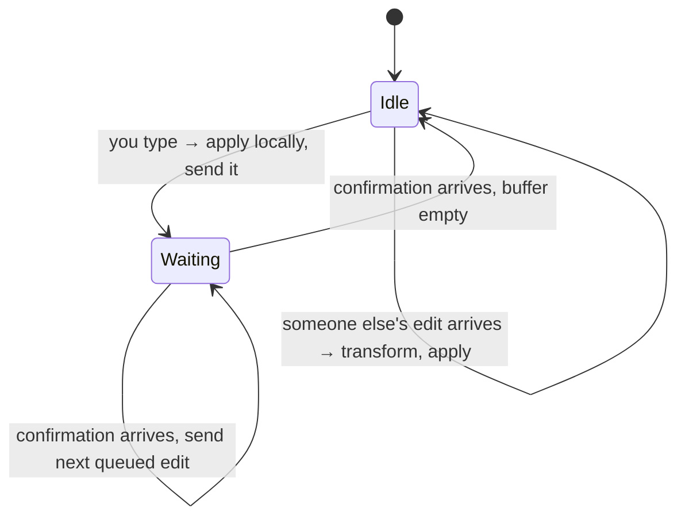
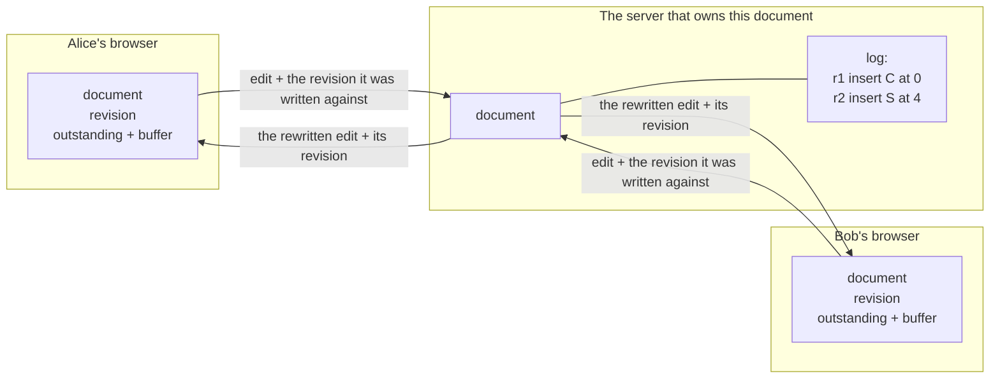
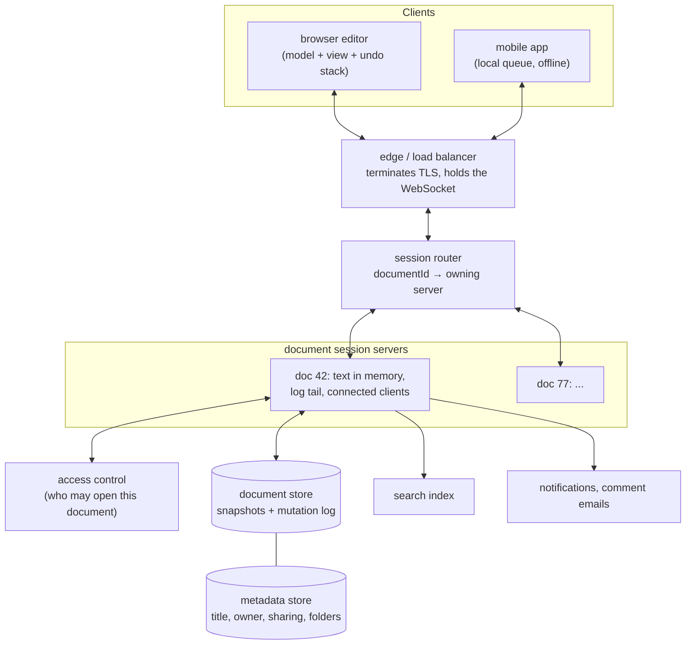
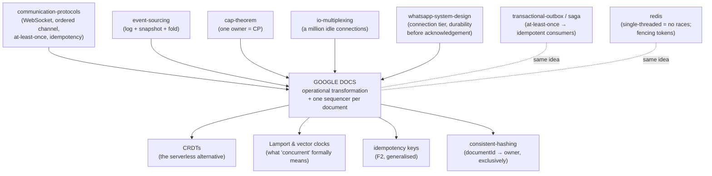

# Google Docs — how a hundred people type into one sentence without losing a word

> A lab about the hardest small problem in system design: two people, one line of
> text, and a network in between.
>
> **What you get:** an interactive simulation you drive by hand, a working
> implementation in Java (no build tool, no dependencies), seven failure
> experiments, and the full high-level design of the product around it.
>
> **Depth layers:** BEGINNER (§1–9) → INTERMEDIATE (§10) → ENGINEERING (§11–14)
> → PRODUCTION (§15). Checkpoints tell you where you are.

---

## 1. Why this exists

You have almost certainly lived this: a document is emailed round a team, three
people edit their copy, and somebody spends an afternoon merging four versions
named `plan_final_v2_REALLY_FINAL.docx`. Somewhere in that merge, an edit is
quietly lost — not deleted with a warning, just gone, because a later save
overwrote an earlier one.

Now put every one of those people in the same document at the same time, with
their cursors visible to each other, and let their letters appear on each
other's screens as they type. That is the product. The entire engineering
problem is the sentence you just read: **at the same time**. Everything else —
storage, sharing, comments, version history — is ordinary web engineering that
you have built before. The concurrent editing is not, and it is where this lab
spends most of its time.

If nobody solves it, you get one of two bad products: a document that locks so
only one person can type (a fancier shared drive), or a document where two
people typing at once silently produces text that neither of them wrote.

---

## 2. The problem, without any jargon

Alice and Bob share a shopping list stuck to the fridge. It says:

```
HAT
```

(It is a strange shopping list. It is also short enough to follow every
character, which is exactly why we are using it.)

Alice thinks it should say **CHAT**. Bob thinks it should say **HATS**. They are
in different cities, each looking at their own photo of the list, and they both
make their change at the same moment.

What should the fridge say afterwards? Almost everybody answers **CHATS** — the
C that Alice wanted at the front, the S that Bob wanted at the end, both there,
nothing lost. Hold on to that answer. It is the specification for the rest of
this lab, and it is surprisingly hard to deliver.

---

## 3. What a reasonable person tries first

The obvious design: everybody edits their own copy, and when they are done they
send the whole document to a server, which stores it. Whoever sends last wins.

This is not a strawman. It is exactly how a file on a shared drive works, and
how the first generation of document-sync products worked.

Run it:

```bash
java src/Demo.java
```

```
DESIGN 1 — send the whole document, last save wins
   everybody starts at "HAT"
   Alice types 'C'          her copy: "CHAT"
   Bob types 'S'            his copy: "HATS"
   Alice saves              server: "CHAT"
   Bob saves                server: "HATS"

   Final document: "HATS"
```

> **🔮 Predict:** Alice's C is gone. What does Alice's screen show at this
> moment, and when will she find out?
> <details><summary>Reveal</summary>
> Her screen still says <code>CHAT</code> — her own copy was never touched. She
> finds out the next time she reloads, or never. There was no error, no
> conflict, no prompt. The system did exactly what it was told: store the most
> recent document it was given. This failure mode has a name we will keep using:
> a <b>lost update</b>. Two people read the same starting value, both changed it,
> and one change vanished under the other.
> </details>

---

## 4. Why that breaks, and what it reveals

The lost update is the visible failure. Two familiar fixes both fail too, and
watching them fail is what uncovers the real problem.

**Fix 1: lock the document.** One person edits, everybody else is read-only.
Microsoft Word did this for years ("Locked for editing by Ravi"). It works, and
it produces a product nobody wants: the whole point is that four people can work
on one document during a meeting. It also inherits the blocking problem you
already met in the [two-phase-commit lab](../45-two-phase-commit/) — if the lock
holder's laptop dies, the document is stuck until something times out.

**Fix 2: merge on save, like Git.** Send both versions, compute a diff, merge.
This is a real answer for source code, where merges happen a few times a day and
a human is standing by to resolve conflicts. In a document, edits happen several
times *per second* per person. Nobody is going to resolve a three-way merge
conflict between keystrokes.

So the deeper problem is not "how do we merge?" It is:

> We have to merge **continuously**, many times a second, **with no human
> involved**, and **without anybody ever waiting** — because a text editor that
> pauses after each letter is not a text editor.

Now try the honest version of that. Instead of sending the whole document, send
just what changed: *"put an S at position 3."* That is far less data, and it
looks like it should merge naturally. Run it:

```
DESIGN 2 — send the change (position + character), apply it as sent
   Alice typed insert('C' at 0)         her screen: "CHAT"
   Bob typed   insert('S' at 3)         his screen: "HATS"
   server accepted insert('C' at 0)     server: "CHAT"
   server accepted insert('S' at 3)     server: "CHAST"
   Alice received insert('S' at 3)      her screen: "CHAST"
   Bob received   insert('C' at 0)      his screen: "CHATS"

   server="CHAST"  Alice="CHAST"  Bob="CHATS"
```

Look at Alice's screen: **CHAST**. Nobody typed that. Nobody wanted it.

Here is the whole bug in one sentence. Bob wrote *"put an S at position 3"* while
looking at `HAT`, where position 3 was the end of the word. By the time that
instruction reached Alice, her own C had pushed every letter one place to the
right, so position 3 now sat between the A and the T. **The instruction was
correct when it was written and wrong when it was run**, because the document
underneath it had changed.

And notice the second, worse thing: Alice and Bob's screens now show *different
text*, and neither of them will ever be told. There is no error to catch. The
system is confidently wrong.

---

## 5. What we actually need to guarantee

Three promises. Every design decision in the rest of this lab exists to keep one
of them.

1. **Instant local response.** When you press a key, the letter appears on your
   screen immediately. Not after a round trip to a server 200 ms away — you
   would feel that on every letter.
2. **Everyone ends up with the same text.** When the typing stops and the
   network goes quiet, every copy of the document must be identical. This is the
   promise that Design 2 broke.
3. **What each person meant survives.** Alice's C ends up at the front, Bob's S
   at the end. It is not enough to be *identical* — a system that resolves every
   conflict by throwing both edits away is perfectly identical and useless.

Promises 2 and 3 are separate, and the difference matters. A design can satisfy
one and fail the other, and you need words for that, which is what §7 is for.

There is also a fourth promise, invisible until it breaks: **nobody waits for
anybody.** No locks, no turn-taking, no "your edit is pending approval".

---

## 6. The key idea

Two sentences.

> **Send the change, not the document** — an instruction like *insert 'S' at
> position 3*, so two people's work can be combined instead of overwriting each
> other.
>
> **Before running somebody else's instruction, rewrite it** to account for the
> changes it was written without knowing about. Bob's *"S at 3"* becomes *"S at
> 4"* once you know a character was inserted in front of it.

That rewriting step is the invention. Everything else in this lab — the servers,
the numbering, the queues, the retries — is bookkeeping in service of doing that
rewriting correctly, in the right order, on every machine.

---

## 7. Now the vocabulary

The words below are the ones you need to read a real paper or a real codebase.
Each one is introduced at the moment you have already felt the thing it names.

### operation

**Plain meaning:** one change, described rather than performed.

**Technical meaning:** a small immutable value describing an edit — here
`insert(position, character)` or `delete(position)` — that can be sent over a
network, stored in a log, applied to a document, and (crucially) *rewritten*.

**Why the word exists:** to separate the *description* of a change from the
*result* of a change. Design 1 sent results (whole documents) and could only
overwrite. Once you send descriptions, two changes can be combined.

**Example:** Bob typing S at the end of `HAT` produces the operation
`insert(3, 'S')`. Roughly 30 bytes on the wire instead of the whole document.

**Connects to:** this is the same move as [event sourcing](../50-event-sourcing/) —
store what happened, not what is. A document here *is* a fold over its
operations, exactly as an account balance is a fold over its transactions.

### apply

**Plain meaning:** actually carry out an operation on some text.

**Technical meaning:** a pure function `apply(document, operation) → document`.
In this lab it is nine lines of `String` surgery in [`src/Ot.java`](src/Ot.java).

**Why it matters:** because it is pure and total, the same operation applied to
the same document always gives the same result on every machine — which is what
makes the whole design reproducible.

### revision

**Plain meaning:** how many edits the document has been through.

**Technical meaning:** an integer counter. The server assigns revision *n* to the
*n*-th operation it accepts. A client stores the revision it has caught up to,
and stamps every operation it sends with it: *"this was written against
revision 4."*

**Why the word exists:** to make "what did this person know when they wrote
that?" a number instead of a guess. That number is the input to the rewriting
rule.

**Example:** Bob sends `insert(3,'S')` stamped *revision 0*. The server's log is
already at revision 1, because Alice's C arrived first. The gap — revisions 0 to
1 — is exactly the set of edits Bob had not seen, and exactly what his operation
must be rewritten against.

### the log

**Plain meaning:** the official list of everything that has happened to this
document, in order.

**Technical meaning:** an append-only sequence of operations held by the server.
The document is defined as the log replayed from the beginning. Revision
numbers are positions in it.

**Connects to:** the event store from the [event-sourcing lab](../50-event-sourcing/),
right down to the reason snapshots exist (§15) — nobody wants to replay a million
operations just to open a document, so the folded-up result is stored
periodically. If you find yourself thinking
"this is just an event log with a projection", you are correct.

### convergence

**Plain meaning:** everybody's screen ends up the same.

**Technical meaning:** once all operations have been delivered everywhere, every
replica's document is byte-identical — regardless of the order they arrived in.

**Why the word exists:** because "consistent" is overloaded. Convergence says
nothing about *what* the final text is, only that there is one of it. Design 2
failed convergence: `CHAST` vs `CHATS`.

### intention preservation

**Plain meaning:** what you meant still happened.

**Technical meaning:** the effect of each operation in the final document
matches the effect it would have had on the document its author was looking at
when they wrote it.

**Why the word exists:** exactly because convergence alone is not enough. "When
two people edit at once, delete the whole document" converges beautifully.
Intention preservation is the property that rules that out, and it is much
harder to state formally than convergence — which is why real papers state
convergence as a theorem and intention as a design goal.

**Example:** Alice meant *"a C at the front"*. In the final `CHATS` there is a C
at the front. Intention preserved. In `CHAST`, Bob's S is not at the end;
his intention was lost even though nothing crashed.

### transformation

**Plain meaning:** rewriting an instruction so it still does the right thing on
a document that has moved on.

**Technical meaning:** a function `transform(a, b) → a′` answering: *operation
`a` was written for a document that does not contain `b`; what must `a` become
to have the same effect on a document that does contain `b`?*

**Why the word exists:** because "merge" implies combining two results, and this
combines nothing — it produces a *modified instruction* which is then applied
normally.

**Example:** `transform(insert(3,'S'), insert(0,'C'))` = `insert(4,'S')`.
Something was inserted in front of me, so I shift right by one.

**Connects to:** the whole family of techniques is called **operational
transformation**, usually shortened to **OT**. When you see "OT" in a paper about
editors, this is it.

### the tie-break

**Plain meaning:** when two people insert at exactly the same spot, somebody has
to go first, and everybody has to agree on who.

**Technical meaning:** for two concurrent inserts at the same position,
transformation orders them by a value that is identical on every machine — here
the site id (`"Alice" < "Bob"`). It is arbitrary. It must not be *random*.

**Why it matters more than it looks:** delete this one rule and the system
diverges in 493 of 500 random runs. That experiment is [`src/BrokenOt.java`](src/BrokenOt.java),
and it is exercise 6.

### outstanding, and the buffer

**Plain meaning:** the edit you have sent and not heard back about, and
everything you have typed since.

**Technical meaning:** each client holds at most **one** operation in flight to
the server (*outstanding*) and queues later ones locally (*buffer*). When the
confirmation for the outstanding operation arrives, the next queued one is sent.

**Why it exists:** it is a rule discovered by failure in §10 — with two
operations in flight, the client and server disagree about what each was written
against, and transformation is applied against the wrong history.

### the sequencer

**Plain meaning:** the one place that decides the official order of events.

**Technical meaning:** a single server owns a given document and is the only
thing that appends to its log. "Concurrent" edits become "ordered" edits the
moment they pass through it.

**Why it exists:** if two servers both accepted edits for one document, there
would be two logs, two revision-4s, and no shared meaning for "what did you know
when you wrote that?". §15 covers what this costs — it is the single most
important architectural constraint in the whole design.

---

## 8. Two mental models, and the map between them

### The simple model (carry this around)

A room with a **noticeboard** at the front. Everyone has their own copy of the
list on their desk. When you make a change you write it on a slip of paper —
*"add an S after the T"* — and post it to a **clerk** standing at the
noticeboard.

The clerk does three things, in this order, for every slip:

1. Looks at what has been pinned up since the slip was written.
2. **Corrects the slip** so it still means the right thing now — *"after the T"*
   might have become *"the fifth character"*.
3. Pins the corrected slip up, numbers it, and posts a copy of the *corrected*
   slip to everybody.

Meanwhile you never wait for the clerk. You made your change on your own desk
copy the instant you wrote the slip.

### The engineering model (this is what actually runs)

**Each client holds:**

| | |
|---|---|
| `doc` | its own copy of the text |
| `revision` | the last server revision it has incorporated |
| `outstanding` | the one operation sent and not yet confirmed (or none) |
| `buffer` | operations typed since then, in order |

**The server holds:** `doc`, and `log` — the ordered list of operations. Its
revision is the log's length.

**Three rules run the whole protocol:**



### The map between them

| In the room | In the system |
|---|---|
| noticeboard | the server's document and log |
| clerk | the server process that owns this document |
| slip of paper | an operation |
| "what was pinned since you wrote this" | operations from your `revision` to the log's end |
| correcting the slip | `transform` |
| the number the clerk writes on it | the revision number |
| your desk copy | the client's local document |
| a slip you posted but haven't seen pinned | `outstanding` |
| slips in your pocket, waiting | `buffer` |

### Where the analogy breaks

Three places, and each one is a real property of the system:

- **The clerk corrects the slip once; every desk corrects it again.** In the
  room, the clerk's corrected slip is final. In the system, a client receiving
  that operation may have to transform it *again* — against its own outstanding
  and buffered edits, which the server has never seen. Transformation happens on
  both ends, for different reasons.
- **There is no queue at the noticeboard.** Slips do not politely line up; they
  cross in the post, arrive out of order relative to *other people's* slips, get
  lost, and sometimes arrive twice. The clerk sees whatever arrives, in whatever
  order it arrives.
- **Everyone posting to one clerk is a design constraint, not convenience.** In
  the room a second clerk would obviously help. In this system a second clerk for
  the same noticeboard destroys the design (§11, F8) — which is why the whole
  architecture is shaped around "one document, one owner".

---

## 9. Watch it move

Everything above is running, live, here:

**▶ [Two Cursors, One Sentence](https://claude.ai/code/artifact/279bb5b7-a1d4-4cfb-9fda-7f803f1fd25e)**
(also saved locally as [`visualization.html`](visualization.html) — open it in a
browser, no server needed)

Nothing on that page moves by itself. You type on Alice's screen and Bob's, and
you decide when each message crosses the network. That is the point: every race
condition in this lab is one you schedule by hand and can therefore watch.

Three things to do first, in this order:

1. **Leave the mode on "Send the whole document" and play the first scenario.**
   Watch a keystroke disappear with no error. That is §3.
2. **Switch to "Send edits, apply as sent" and run the second scenario.** Watch
   the two screens end up different. That is §4. Look at the event feed: the
   sentence *"Bob received Alice's edit"* is where it goes wrong.
3. **Switch to "Send edits, rewrite them" and run the third.** Same typing, same
   delivery order. Watch the server's log: the line that reads
   `Bob: insert 'S' at 4` when Bob's finger pressed S at position 3 is the whole
   lesson.

Then start breaking things: drop a message, take Bob offline and keep typing,
deliver messages in an order you choose. Each of the five scenarios asks you to
predict before it runs.

Here is the same system as a picture, so the shapes on that page and the shapes
in this document are the same shapes:



> **CHECKPOINT — end of the BEGINNER model.**
> You can now explain why collaborative editing cannot be done by sending
> documents, what a lost update is, and why an edit has to be rewritten before
> it is applied. If you stopped here you could hold a conversation about it.
> What is missing is the mechanism: exactly what each machine does, message by
> message, and why the details are the shape they are. That is next.

---

## 10. The mechanism, told as the story of its own design

The finished protocol has four rules that look arbitrary until you watch each
one get invented. So we will build it wrong, four times.

### v1 — the server does the rewriting

The obvious home for transformation is the server: it is the one machine that
knows the official order.

> **Rule 1.** Every edit is stamped with the revision it was written against.
> When the server receives an edit, it rewrites it against every log entry from
> that revision onwards, then appends it, numbers it, and broadcasts the
> *rewritten* version to everyone.

Worked example. The document is `HAT`, the log is empty, revision 0.

| step | what happens | server log | server doc |
|---|---|---|---|
| 1 | Alice types C at 0. Her screen: `CHAT`. She sends `insert(0,'C')`, based on revision 0. | — | `HAT` |
| 2 | Bob types S at 3. His screen: `HATS`. He sends `insert(3,'S')`, based on revision 0. | — | `HAT` |
| 3 | Alice's edit arrives first. Nothing logged since revision 0, so no rewriting. Logged as revision 1. | `r1: insert(0,'C')` | `CHAT` |
| 4 | Bob's edit arrives, based on revision 0. The log has moved to 1, so it is rewritten against `r1`: something was inserted at 0, which is before 3, so `insert(3,'S')` becomes **`insert(4,'S')`**. Logged as revision 2. | `r1, r2: insert(4,'S')` | `CHATS` |
| 5 | Everyone is sent the rewritten `insert(4,'S')` and Alice's `insert(0,'C')`. | | `CHATS` |

Both screens end at `CHATS`. Run it yourself: `java src/Demo.java`, third block.

> **🔮 Predict:** Now run the *same* two edits, but let Bob's reach the server
> first. Alice's screen already says `CHAT` (her own C, not yet confirmed by
> anyone). The server broadcasts Bob's `insert(3,'S')` untouched — because when
> it processed that edit, Alice's C did not exist anywhere it could see. What
> does Alice's screen show if she just applies what she was sent?
> <details><summary>Reveal</summary>
> <code>CHAST</code> — the exact corruption from §4, back again. The server did
> nothing wrong: it correctly rewrote Bob's edit against everything it knew, and
> it did not know about Alice's C. The missing piece is that <b>Alice knows
> something the server does not</b> — her own un-confirmed edit. Nobody but Alice
> can do that rewriting.
> </details>

### v2 — so the client rewrites too, in both directions

> **Rule 2.** When an edit arrives from the server, the client transforms it
> against its own outstanding and buffered edits — and transforms those against
> it. Both sides move.

That second half is easy to miss. Alice's incoming `insert(3,'S')` becomes
`insert(4,'S')` because of her C; her own C, once it reaches the server, will
need to have been transformed against Bob's S. Every operation in the system
ends up expressed against the same document state, from two directions.

```bash
java src/Demo.java     # fourth block: "why the CLIENT transforms too"
```

```
   Alice received Bob:insert('S' at 3) from Bob
       (their own editor rewrote it to Bob:insert('S' at 4), against their un-confirmed edit)
       their screen now reads "CHATS"
```

> **🔮 Predict:** Alice types two letters quickly — S at the end of `HAT`, then
> `!` after it — and sends both immediately, without waiting. Both say "written
> against revision 0", because no confirmation has come back yet to move her
> revision on. What does the server do with the second one?
> <details><summary>Reveal</summary>
> It rewrites it against the first one — <i>again</i>. Alice's second edit was
> typed on a screen that already contained the S, so it needs no adjustment at
> all; but its stamp says revision 0, which claims it has never seen the S. Run
> <code>java src/Experiments.java two-in-flight</code>:
> <pre>server applied Alice:insert('S' at 3)  -> "HATS"  (revision 1)
> server THREW: insert at 5 but doc is only 4 long: "HATS"</pre>
> Here it happens to crash, which is lucky. With different positions it would
> silently put the character in the wrong place.
> </details>

### v3 — one edit in flight, everything else queues

The stamp "written against revision *r*" is only true if the client's document
is exactly the log up to *r* plus at most one un-confirmed edit that the server
is about to see. Two in flight breaks that arithmetic.

> **Rule 3.** A client keeps at most one edit in flight. Anything typed while
> waiting goes into a local buffer and is sent when the confirmation arrives —
> after being transformed against everything that arrived in the meantime.

This is why the visualization shows "waiting for confirmation: 1" and "queued
behind it: 3". Typing fast does not send faster; it makes the queue longer. Real
editors exploit this by *composing* the queue into one bigger operation before
sending, which is why a burst of typing arrives as one message rather than
twenty.

> **🔮 Predict:** Alice and Bob both type at exactly the same position — Alice an
> S at position 3 of `HAT`, Bob a `!` at position 3. Neither is "before" the
> other in any meaningful sense. What has to be decided, and what happens if each
> machine decides it for itself?
> <details><summary>Reveal</summary>
> Somebody's character has to come first, and every machine must pick the same
> somebody. If each machine simply keeps its own edit where it is, Alice ends at
> <code>HAT!S</code> and Bob at <code>HATS!</code> — forever. Run
> <code>java src/BrokenOt.java</code>: that one missing rule diverges in
> <b>493 of 500</b> random runs. The fix is one line: order concurrent inserts at
> the same position by site id. It is arbitrary — Alice's letter goes first
> because "Alice" &lt; "Bob" — but it is <i>identically</i> arbitrary everywhere.
> </details>

> **Rule 4.** Concurrent inserts at the same position are ordered by a
> tie-break that is a fixed function of the operations themselves — never by
> arrival time, never by a random number.

### The last assumption, made explicit

One thing is still being assumed silently: that each client receives the
server's broadcasts **in log order**. Break it and watch:

```bash
java src/Experiments.java out-of-order
```

```
   messages waiting for Bob, in log order:
      server -> Bob  Alice:insert('C' at 0)  (revision 1)
      server -> Bob  Alice:insert('S' at 4)  (revision 2)
   delivering them BACKWARDS (revision 2 before revision 1):
      Bob's editor threw: insert at 4 but doc is only 3 long: "HAT"
```

Revision 2 assumes revision 1 has already happened. This is not something the
protocol fixes; it is something the protocol **requires**, and it is bought by
giving each client exactly one ordered connection — a WebSocket over TCP, from
the [communication-protocols lab](../02-communication-protocols/). Load-balance one
client's messages across two sockets and you have re-created this bug.

### The whole protocol, on one page

```mermaid
sequenceDiagram
    participant A as Alice
    participant S as Server
    participant B as Bob
    Note over A: types C at 0 → screen "CHAT"
    Note over B: types S at 3 → screen "HATS"
    A->>S: insert(0,'C') based on r0
    B->>S: insert(3,'S') based on r0
    Note over S: nothing logged since r0 → no rewrite<br/>log r1 = insert(0,'C'), doc "CHAT"
    S-->>A: r1 insert(0,'C') — your edit, confirmed
    S-->>B: r1 insert(0,'C')
    Note over S: Bob's edit is based on r0, log is at r1<br/>rewrite against r1 → insert(4,'S')<br/>log r2, doc "CHATS"
    S-->>A: r2 insert(4,'S')
    S-->>B: r2 insert(4,'S') — your edit, confirmed
    Note over B: had already applied his own S locally;<br/>the confirmation just moves him to r2
    Note over A: applies insert(4,'S') → "CHATS"
```

Server, on receiving `(op, base, from)`:

```
for each entry in log[base .. end]:  op = transform(op, entry)
append op to log; doc = apply(doc, op)
broadcast (op, revision = log.length, origin = from) to everyone
```

Client, on receiving `(op, revision, origin)`:

```
if origin is me:
    revision = revision
    outstanding = buffer.pop()        # and send it, stamped with the new revision
else:
    if outstanding: op, outstanding = transform(op, outstanding), transform(outstanding, op)
    for each b in buffer:  op, b = transform(op, b), transform(b, op)
    doc = apply(doc, op); revision = revision
```

That is the entire algorithm. It is about forty lines in
[`src/Collab.java`](src/Collab.java), and it is what Google's published design
(the Wave protocol, itself a descendant of the 1995 Jupiter system) does, with
richer operations.

> **CHECKPOINT — end of the INTERMEDIATE model.**
> You can now trace a concurrent edit through the system by hand and say what
> every machine holds at each step, and you know why each of the four rules
> exists because you watched the system break without it. What is missing is
> everything that happens when the network and the machines misbehave — which
> is most of the work in a real system.

---

## 11. Failure scenarios

Every one of these is runnable. The pattern is the same each time: what to run,
what happens, why, and which of the three promises from §5 bends.

### F1 — the edit never reaches the server

```bash
java src/Experiments.java lost-request
```

Alice types C; the network eats the message. She keeps typing, and her queue
grows: `Alice pending edits: 2`. Her screen is fine and self-consistent; the
server and Bob simply never hear from her. **Convergence is not violated —
it is postponed.** Nothing is corrupted, because a client that never gets a
confirmation never advances its revision and never sends its queue.

The fix is a timeout and a retry, which the experiment then runs:
`Alice heard nothing back and re-sent insert('C' at 0)`, and everything converges
to `CHHATS`. In production the same event happens on every laptop that closes
its lid.

### F2 — the edit arrives but the confirmation is lost

```bash
java src/Experiments.java lost-ack
```

This is the dangerous one, and it is the reason retries are not free:

```
duplicate suppression OFF : server="CCHAT"  Alice="CHAT"  Bob="CCHAT"   converged=false
duplicate suppression ON  : server="CHAT"   Alice="CHAT"  Bob="CHAT"    converged=true
```

Alice's keystroke happened *twice*. From the server's side, "Alice typed C" and
"that C again" are the same bytes. The fix is for each client to number its
edits and for the server to remember the last number it saw from each client,
ignore anything at or below it, and **re-send the original confirmation** —
the same edit must not get a second revision number.

That is an idempotency key in its smallest possible form. You have met the same
mechanism in the [transactional-outbox](../48-transactional-outbox/) and
[saga](../47-saga/) labs, where at-least-once delivery forces every consumer to be
idempotent. Same physics, different content.

### F3 — messages arrive out of order

Covered in §10: `java src/Experiments.java out-of-order` throws
`insert at 4 but doc is only 3 long`. The guarantee the protocol *assumes* is
per-client ordered delivery; the guarantee it *provides* is convergence, and it
provides it only while the assumption holds. This is why the transport is one
persistent ordered connection per client and why reconnect logic must resume
from a revision number rather than "start listening again".

### F4 — a client goes away and comes back

```bash
java src/Experiments.java offline-burst
```

Bob edits on a plane while 200 edits land without him:

```
   server log length      : 220
   Bob's offline edits    : 20
   transformations to heal: 8200
   converged              : true, document length 223
```

Nobody was asked to resolve anything. But look at the cost: roughly *(edits you
missed) × (edits you made)* transformations. Twenty edits against two hundred is
8,200 operations — trivial. Twenty edits against a million is not. **The
guarantee holds; the liveness does not scale.** Which is why real clients that
have been away too long throw their local state away and re-download the
document, and why servers keep a bounded log tail plus snapshots (§15).

### F5 — the server confirms an edit it has not written down

```bash
java src/Experiments.java stale-server
```

```
   before the crash: server="CHATS!?" ... revision 4
   after the restart: server="CHATS" revision 2 but Alice still believes she is at revision 4
   server="CXHATS"  Alice="CXHATS!?"  Bob="CXHATS!?"   converged=false
```

The server acknowledged revisions 3 and 4 while they were still only in memory,
then restarted from a snapshot that had two entries. Now every client's revision
number refers to a history that no longer exists, so their edits are transformed
against the wrong set of operations. The corruption is silent and permanent.

**Rule: never confirm an edit you have not durably written down.** The
confirmation is a promise about the log, so the log write has to come first.
This is the same rule the [WhatsApp lab](../69-whatsapp-system-design/) arrived at
from the other direction — never acknowledge what is not yet durable — and the
same discipline as a write-ahead log in the [b-tree/LSM lab](../05-btree-and-lsm/)
and `appendfsync` in the [redis lab](../13-redis/) — "we accepted it" and "it survives a crash" are two
different moments, and users only forgive you for conflating them until the
first crash.

### F6 — one slow client

```bash
java src/Experiments.java slow-client
```

```
   edits made while Carol was stalled : 100
   messages queued for Carol alone    : 100
```

Everyone else keeps working — the design has no shared lock, so one slow
participant cannot block anybody. But *somebody* is holding Carol's backlog, and
that somebody is the server. With 200 people in a document and a flaky café
Wi-Fi each, that is 200 backlogs in one process's heap. Production answers: cap
the per-client queue, and when it overflows, disconnect them and make them
reload the document from a snapshot. This is backpressure, from the
[io-multiplexing](../03-io-multiplexing/) and
[communication-protocols](../02-communication-protocols/) labs, in its
document-shaped form.

### F7 — everybody edits the same word

A hundred people in one document all typing in the same paragraph is not a
correctness problem — the tie-break rule handles it — but it is a *hot key*
problem, and it is the shape a hot key takes here: one document, one owning
process, one CPU. You cannot shard a document by user, because every edit must
pass through the same sequencer. Google's answer is a hard limit (Docs stops
accepting new editors past a documented cap) plus read-only viewers served from
a different path. The lesson is the general one from the
[distributed-rate-limiting lab](../60-distributed-rate-limiting/): sharding spreads
keys, and it does nothing at all for one hot key.

### F8 — two servers for one document

The one failure this lab does not simulate, because the fix is architectural
rather than algorithmic. If two servers both accept edits for the same document,
there are two logs and two revision-4s, and "written against revision 4" stops
having a meaning. Every guarantee in §12 is stated over one log.

So the document's owning process must be unique — and that turns out to be the
central architectural constraint of the whole system (§15): routing by document
id, sticky sessions, careful handover on deploy, and a fencing mechanism so that
a server which *thinks* it still owns a document but has been replaced cannot
keep appending. That last hazard is the same one you measured in the
[redis lab](../13-redis/) with expiring locks, and it needs the same answer: a
fencing token checked by the thing being written to, not by the thing that
believes it holds the lease.

### F9 — the semantic conflict nothing can fix

Alice changes "shall" to "must". Bob deletes the sentence. The system converges
on a sentence that does not exist, containing an edit that no longer means
anything. No transformation rule can help: the conflict is in the meaning, not
the positions. This is the honest limit of the whole approach, and the product
answer is social (you can see each other's cursors, so you don't type in the
same sentence) rather than technical.

---

## 12. What is guaranteed, what is not, and what it cost

### Invariants the design maintains

1. **One order.** There is exactly one log per document, and its order is the
   definition of what happened. Everything else is derived from it.
2. **Convergence.** Once the network is quiet, every replica's text equals the
   log replayed from the start. Measured: 3 clients × 30 edits over 1,000
   different random delivery schedules, `java src/Tests.java`, **0 divergences**.
   The naive design under the identical harness diverges in **500 of 500** runs
   (`java src/Experiments.java raw-vs-ot`).
3. **Intention preservation, for the operations we support.** An insert lands
   between the same two characters its author saw; a delete removes the same
   character its author saw, or nothing if it is already gone. Not a theorem
   here — a design property that the tests check case by case.
4. **Local responsiveness.** No operation ever waits for a network round trip
   before appearing on its author's screen.
5. **At most one edit in flight per client**, which is what makes the revision
   stamps arithmetically true.

### What is explicitly NOT guaranteed

- **Any particular final text when two people type at the same spot.** You get
  *a* deterministic answer (site-id order), not the "right" one. There isn't one.
- **Meaningful merges.** F9. Positions merge; meaning does not.
- **Real-time ordering.** "Alice typed first" (by wall clock) has no standing.
  The log order is the arrival order at the server, which is a race — and the
  system is correct either way. If you need wall-clock fairness, this is the
  wrong architecture.
- **Undo as the inverse of your last operation.** Once other people's edits have
  been transformed into your document, "undo my last edit" is a fresh operation
  that must itself be transformed. Selective undo in a collaborative editor is
  a research-grade problem, and real editors implement a restricted version.
- **Availability during a partition.** The document has exactly one owner. If
  you cannot reach it, you edit locally and cannot see anyone else — the
  [CAP](../24-cap-theorem/) trade, made per-document: this design is **CP for the
  shared document and AP for your own copy.** That combination is only possible
  because the "read" everyone cares about is their *own* screen.

### What it cost to get here

- **A single point of ordering per document.** Simple, and the source of F7, F8,
  and every deployment complication in §15.
- **Transform work proportional to how far behind you are** (F4), which is why
  snapshots and forced reloads exist.
- **Every client needs the algorithm.** The rewriting is not a server feature;
  it is a protocol, so browser, Android, iOS and the export pipeline must all
  agree, forever, including for documents written years ago.
- **The number of transform cases grows as the square of the number of operation
  types.** Two types here means four cases. Add "apply bold to a range" and
  "insert a table" and the case matrix is where real OT implementations get
  their reputation for being hard. This is the single strongest argument for the
  alternative in §15.

> **CHECKPOINT — end of the ENGINEERING model.**
> You can now state the guarantees precisely, name what was traded for them, and
> reason about the failure modes. What is left is the product around the
> algorithm: storage, connections, scale, deployment, and what a real
> architecture diagram looks like.

---

## 13. The code

Four files, no build tool, no dependencies. `java src/Foo.java` compiles the
whole directory and runs it (JDK 22+; this lab was built and run on JDK 25).

| file | what it is |
|---|---|
| [`src/Ot.java`](src/Ot.java) | operations, `apply`, and `transform` — the entire idea, ~60 lines of logic |
| [`src/Collab.java`](src/Collab.java) | server, client, and a network you drive by hand |
| [`src/Demo.java`](src/Demo.java) | the four designs from §3, §4, §10 narrated |
| [`src/Tests.java`](src/Tests.java) | 10 scenario tests, named after the scenarios |
| [`src/Experiments.java`](src/Experiments.java) | the eight failure experiments |
| [`src/BrokenOt.java`](src/BrokenOt.java) | one line changed, for exercise 6 |
| [`src/YourTransform.java`](src/YourTransform.java) | the same file with the rules blanked out, for exercise 5 — it self-checks |
| [`src/Crdt.java`](src/Crdt.java) | the other design (§15), with no server at all |

```bash
java src/Demo.java          # the story, in four runs
java src/Tests.java         # 10 passed, 0 failed
java src/Experiments.java   # all eight failure experiments
java src/Crdt.java          # the CRDT alternative
java src/BrokenOt.java      # the planted bug
java src/YourTransform.java # exercise 5: write transform() yourself, self-checking
```

### The lines that matter

Everything load-bearing is in `transform`. Here is the insert/insert case:

```java
if (a.kind == Kind.INSERT && b.kind == Kind.INSERT) {
    if (b.pos < a.pos) return a.withPos(a.pos + 1);   // something appeared before me → shift right
    if (b.pos > a.pos) return a;                      // it appeared after me → I am unaffected
    // Exact same spot. Somebody has to go first, and BOTH sides must pick the same
    // somebody or the two copies end up with the letters in opposite orders.
    return a.site.compareTo(b.site) < 0 ? a : a.withPos(a.pos + 1);
}
```

and the delete/delete case, which is the one people forget:

```java
if (b.pos < a.pos) return a.withPos(a.pos - 1);
if (b.pos > a.pos) return a;
// We both deleted the SAME character. It is already gone; deleting again
// would eat an innocent neighbour. My op becomes nothing at all.
return Op.noop(a.site);
```

That `noop` is not tidiness. Without it, two people deleting the same letter of
`CHATS` produce `CHA` — the T *and* the S — and the test
`ot_two_people_delete_the_same_character` is what catches it.

On the client, the four lines that implement Rule 2 (transform in both
directions) are worth reading slowly:

```java
if (outstanding != null) {
    Ot.Op newOutstanding = xform.apply(outstanding, incoming);
    incoming = xform.apply(incoming, outstanding);
    outstanding = newOutstanding;
}
```

Note the temporary. Transforming `incoming` first and then using the *new*
`incoming` to transform `outstanding` would be transforming against an operation
that never existed in that form. Both results must be computed from the
originals.

### The tests are the documentation

```
PASS  lww_silently_loses_an_edit
PASS  raw_operations_diverge_when_two_people_type_at_once
PASS  ot_converges_and_keeps_both_intentions
PASS  ot_insert_next_to_a_delete
PASS  ot_two_people_delete_the_same_character
PASS  ot_same_position_inserts_land_in_the_same_order_everywhere
PASS  ot_typing_a_burst_faster_than_the_round_trip
PASS  ot_client_edits_while_offline_then_reconnects
PASS  ot_late_joiner_catches_up
PASS  ot_converges_under_1000_random_schedules
        3 clients x 30 edits x 1000 different delivery schedules, diverged 0 times

10 passed, 0 failed
```

**Honest simplifications, all of them deliberate:**

- **One character per operation.** Real editors send *deltas* — "keep 40
  characters, insert this string, delete 3" — because one operation per keystroke
  is far too many messages. The transform rules are the same idea over ranges,
  with much fiddlier arithmetic.
- **Plain text only.** No formatting, no tables, no images, no comments anchored
  to a range of text. Each of those adds operation types, and the transform case
  matrix grows as the square of the number of types.
- **No persistence.** Everything is in memory; F5 shows exactly what that costs.
- **No cursors, no presence** (who else is in the document and where they are
  typing), **no access control.**
- **Time only moves when a test calls `deliver()`.** No threads, so there is no
  concurrency in the Java sense anywhere in this lab — which is exactly why every
  race is reproducible.

---

## 14. The experiments

Each one is predict-first. Read the question, commit to an answer, then run it.

| # | command | the question to answer first |
|---|---|---|
| E0 | `java src/Experiments.java two-in-flight` | If a client sends two edits without waiting, and both say "based on revision 0", what does the server do with the second? |
| E1 | `java src/Experiments.java raw-vs-ot` | Skipping transformation is a bug — but how often does it actually bite? One run in fifty? |
| E2 | `java src/Experiments.java lost-request` | The network eats Alice's edit. Is the document corrupted, or just stuck? |
| E3 | `java src/Experiments.java lost-ack` | The edit arrived; the *confirmation* was lost, so Alice retries. What is in the document now? |
| E4 | `java src/Experiments.java out-of-order` | Two broadcasts reach Bob in the wrong order. Does the algorithm cope? |
| E5 | `java src/Experiments.java offline-burst` | Bob makes 20 edits offline while 200 land without him. Does it heal, and what does healing cost? |
| E6 | `java src/Experiments.java stale-server` | The server confirmed two edits it had not written to disk, then restarted. What do the clients believe? |
| E7 | `java src/Experiments.java slow-client` | Carol's connection stalls for 100 edits. Who pays — Carol, everyone, or the server? |

Answers, with the numbers, are in §11. The interesting ones are E1 (the naive
design fails 500 times out of 500, not "rarely under load"), E3 (a retry
duplicates a keystroke unless the server can recognise a repeat), and E6 (silent
permanent corruption from a single premature acknowledgement).

---

## 15. From this lab to Google Docs

### The chain

| | |
|---|---|
| **This lab** | one document, in memory, one process, plain text, single-character operations |
| **A real OT library** | ShareDB / ot.js (JavaScript), the Wave protocol; range-based deltas, rich text, presence, undo. Same four rules |
| **Production** | millions of concurrent sessions, documents that must outlive any machine, offline clients, access control, exports, mobile |

Operational transformation itself dates to the 1989 GROVE paper; the
client/server form used here is the 1995 **Jupiter** system, which is what
Google Wave's published protocol was built on, and Google Docs' editor is
publicly described as using operational transformation. The *current* internals
are not public — everything in this section that is not cited is standard
architecture for this problem shape, not a claim about Google's code.

### The architecture



The one non-negotiable line in that diagram is **`documentId → owning server`**.
Everything else is replaceable; that is what makes the algorithm in §10 legal.

### What each piece does

**Browser editor.** Holds the document model, the view, the local undo stack,
and the client half of §10 (`outstanding`, `buffer`, transform). Composes rapid
keystrokes into one operation before sending — typically one message per 50–200
ms of typing, not one per key.

**Edge layer.** Terminates TLS ([tls lab](../14-tls/)) and holds one long-lived
WebSocket per open tab — the same connection-server tier, holding sockets and no
durable state, as the [WhatsApp lab](../69-whatsapp-system-design/). Its scaling problem is idle connections, which is the
[io-multiplexing lab](../03-io-multiplexing/) exactly: a million connections that
are silent 95% of the time.

**Session router.** Maps a document id to the one process that owns it right
now — the placement problem from the
[consistent-hashing lab](../35-consistent-hashing/), with the extra requirement
that ownership is exclusive, not merely a preference — a lease in a strongly consistent store (etcd/Chubby/Spanner-class,
i.e. [Paxos](../39-paxos/) underneath). Two properties matter: only one owner at a
time, and a **fencing token** so a replaced owner's writes are rejected by the
store rather than merely discouraged (F8).

**Document session server.** Holds the document in memory, appends to the log,
transforms, broadcasts, tracks who is connected and where their cursors are.
Everything is per-document and single-threaded per document, which makes the
whole §10 algorithm race-free without a lock — the same trick the
[redis lab](../13-redis/) taught: the fastest way to make concurrency correct is to
not have it.

**Document store.** The log and periodic **snapshots**. This is the storage
pattern from the [event-sourcing lab](../50-event-sourcing/), and for the same
reason: replaying a million operations to open a document would be absurd, so
you fold them into a snapshot and keep only the tail. Version history —
"restore to yesterday 4pm" — is free, because the log *is* the history; and
that is why the log is trimmed by snapshotting rather than deleted.

**Metadata store.** Title, owner, sharing rules, folder location. Different
access shape (queried by user, not by document), so usually a different store
from the document content, with the search index projected off it — a
[CQRS](../51-cqrs/) read model.

### The three flows worth being able to draw

**Opening a document**

1. Client asks for document 42. Access control check.
2. Router finds or elects the owning session server; it loads the newest
   snapshot plus the log tail and folds them into the current text.
3. Client receives `{text, revision}` and opens a WebSocket. Every later message
   is a delta, which is why the connection is worth its cost.

**Typing** — §10, plus: the server writes the operation to durable storage
**before** confirming (F5), batching writes across operations for throughput.

**Reconnecting** — client says "I am at revision 812". If the server still has
812 in its log tail it replays 813 onwards. If not (asleep for a week, or a
snapshot has moved past it), the answer is "your revision is too old", and the
client discards its local state and re-opens — which is F4's cost made into a
product decision.

### Capacity estimation — the method, not the answer

Google has never published these numbers. What follows is how you would derive
them in an interview; every input is an assumption you should state out loud.

*Assume* 100M daily active editors, each with a document open for ~20 minutes a
day:

- **Concurrent sessions** = 100M × 20 / (24 × 60) ≈ **1.4M open tabs** at a
  typical moment. At 50k WebSockets per edge node that is ~30 nodes for
  connections alone; call it 100+ for headroom and regional spread.
- **Edit rate.** Most open tabs are being read, not typed into. Assume 10% are
  actively typing, and a typing client sends ~5 batched operations per second:
  1.4M × 10% × 5 ≈ **700k operations/second** globally. Sanity-check that in the
  other direction before you quote it — this is the number an interviewer will
  push on.
- **Fan-out.** Average 1.5 collaborators per active document, so ~1M outbound
  messages/second. Small messages, high count: the cost is syscalls and wakeups,
  not bandwidth.
- **Storage.** 1B documents averaging 20 KB of text ≈ **20 TB** of text, plus
  logs. Logs dominate unless snapshotted, which is the argument for snapshots
  independent of open latency.
- **Session server memory.** A document costs its text plus per-client state,
  say 100–300 KB live. 1M concurrently-open documents at 200 KB ≈ 200 GB spread
  over the fleet — a few hundred machines, sized by document count rather than
  bytes.

The point of this exercise is never the number. It is that you now know which
resource binds first (connections and wakeups, not storage or bandwidth) and
where the cliff is (documents with hundreds of concurrent editors, F7).

### What an on-call engineer watches

- **p99 time from keystroke to confirmation.** The user-visible number. It is
  what "the document feels laggy" actually means.
- **Per-client outbound backlog.** F6. A rising backlog is a client about to be
  disconnected, and a fleet-wide rise means the server is the slow one.
- **Ownership churn.** Documents changing owning server. Steady churn means a
  deploy or a flapping lease, and each handover is a moment where F8 could
  happen.
- **Reconnect rate.** A deploy that drops 1.4M WebSockets produces a
  thundering-herd reconnect ([communication-protocols](../02-communication-protocols/));
  the mitigations are jittered backoff on the client and connection draining
  rather than dropping.
- **Snapshot age per document.** An old snapshot is a slow document open and a
  long recovery.
- **Confirmed-but-unpersisted operations.** Should be zero by construction (F5).
  If this metric can be non-zero, the design has a hole.

### The other design: CRDTs

There is a second answer to the same problem, and it is worth knowing precisely
because it changes the architecture, not just the algorithm.

A **CRDT** (conflict-free replicated data type) gives every character a
permanent identity when it is typed — a counter plus a site id — and an edit
refers to that identity instead of a position: *"put 'C' after the character
named 3@Alice"*. Identities never shift, so there is nothing to rewrite, and
therefore **no need for a central server to order anything**.

```bash
java src/Crdt.java
```

```
   Alice's op says: put 'C' after the start of the document
   Bob's op says:   put 'S' after '3@Alice'
   after swapping ops: Alice="CHATS"  Bob="CHATS"

   500 random delivery orders, 3 people, no server, duplicates included
   diverged in 0 of 500 runs

   visible characters : 100
   cells still stored : 1000  (of which 900 are tombstones)
```

The trade, in one line each:

| | operational transformation | CRDT |
|---|---|---|
| needs a central sequencer | yes — one owner per document | no; peer-to-peer works |
| document size on the wire and in memory | one byte per character | tens of bytes per character, plus **tombstones** for every deleted character, forever until garbage-collected |
| duplicate delivery | must be suppressed (F2) | harmless: applying an operation twice changes nothing |
| where the difficulty lives | the transform case matrix, which grows as the square of the number of operation types | the data structure and its garbage collection |
| what it is used by | Google Docs, Google Wave, ShareDB, Etherpad | Yjs, Automerge, Figma's multiplayer, Apple Notes, Redis CRDTs |

Note what the CRDT does *not* remove: it still needs causal delivery (an insert
whose anchor has not arrived must wait — that buffering is in `Crdt.java`), and
a hosted product still puts a server in the middle for persistence, access
control and fan-out. What it removes is the requirement that the server be the
*only* place ordering is decided, which is why offline-first and peer-to-peer
products reach for it.

Why does Google Docs use OT? History (Docs predates practical sequence CRDTs by
years) and cost (a document that costs 30× its text in memory is a real bill at
their scale, and they already had to have a central server for sharing and
persistence, so the sequencer was free).

### What this lab leaves out, and who does it for real

| omitted here | how a real system handles it |
|---|---|
| persistence | log + snapshots in a replicated store; confirm only after the durable write (F5) |
| rich text, tables, images, comments anchored to text | more operation types, a much larger transform matrix, or a rich-text CRDT |
| range operations | deltas (`retain 40, insert "hi", delete 3`) instead of one character at a time |
| presence and cursors | a separate, *unreliable* channel — cursor positions are lossy on purpose; nobody replays them |
| access control | checked at open, re-checked on change; revocation must be able to close live connections |
| offline | local operation queue + service worker; on reconnect, F4's cost with a "your version is too old, reloading" fallback |
| undo | a per-user undo stack of transformed inverse operations, restricted to make it tractable |
| version history | naming and pinning points in the log the system already keeps |
| the export pipeline | a separate renderer that reads a snapshot, not the live session |
| security of the transport | TLS ([tls lab](../14-tls/)) and per-document authorization on every connection |

### Answering "design Google Docs" in 45 minutes

The structure that fits the time, with the minutes it deserves:

1. **Requirements (5 min).** Functional: multiple people edit one document
   simultaneously, see each other's changes within a second, see cursors, nobody
   loses work, history is recoverable, sharing is controlled. Non-functional:
   local edits feel instant; converge within a second; survive machine loss;
   support N concurrent editors per document (ask for N — it is the question
   that determines the architecture).
2. **The hard part, named early (3 min).** "The interesting problem here is
   concurrent edits to the same text. Everything else is standard web
   architecture. Shall I go deep on that first?" This is the move that separates
   a good answer from a component inventory.
3. **The naive design and its failure (5 min).** Whole-document saves lose
   updates; position-based edits diverge. Use the `HAT` → `CHATS` example — it
   fits on a whiteboard and makes the problem undeniable.
4. **The core mechanism (10 min).** Send operations, stamp them with a revision,
   one server owns the document and orders them, transform on both ends, one
   edit in flight per client, deterministic tie-break.
5. **Architecture (8 min).** The diagram above. Emphasise `documentId → owning
   server` and say why.
6. **Storage (5 min).** Snapshots + log; version history falls out; confirm only
   after the durable write.
7. **Failure and scale (7 min).** Reconnect and replay from a revision; server
   death and ownership handover with fencing; slow-client backpressure; the hot
   document limit; deploy and reconnect storms.
8. **Trade-offs (2 min).** OT vs CRDT, in the terms of the table above, and what
   you would choose for an offline-first product instead.

Two things that reliably impress and are cheap to say: *"I'd confirm the edit
only after the log write, because a confirmation is a promise about the log"*,
and *"retries need an edit sequence number per client or a lost acknowledgement
duplicates a keystroke."* Both are §11, and both generalise to work far outside
documents — which is why they are worth carrying out of this lab.

> **CHECKPOINT — end of the PRODUCTION model.**
> You can now design this system on a whiteboard, defend the one architectural
> constraint that makes it work, estimate its load, name its failure modes, and
> argue OT against CRDT with numbers rather than taste.

---

## 16. Exercises

[`EXERCISES.md`](EXERCISES.md) — eight rungs, from "explain it in your own
words" to "design it for three datacentres". Answers in
[`SOLUTIONS.md`](SOLUTIONS.md); try first, the ladder only works that way.

The three worth doing even if you skip the rest:

- **Rung 4 (modify):** delete the site-id tie-break and predict which property
  breaks — safety or liveness — before running it.
- **Rung 5 (implement):** `src/YourTransform.java` has the four transform rules
  blanked out and checks your version against four named scenarios and 1,000
  random schedules. It starts at `0 passed, 5 failed`.
- **Rung 6 (debug):** `java src/BrokenOt.java` diverges in 493 of 500 runs.
  Which test in `Tests.java` catches it, and which guarantee does it violate?
- **Rung 8 (design):** the same product, but offline-first on mobile. Which
  parts of this architecture survive?

---

## 17. Where this sits, and what to learn next



**Commonly confused with this, and the sentence that separates them:**

- **Operational transformation vs event sourcing.** Both are append-only logs of
  changes. Event sourcing replays operations that were *written against the
  state they are replayed onto*; OT replays operations that were written against
  a *different* state, which is why it needs `transform` and event sourcing does
  not.
- **Convergence vs consistency.** Convergence says every copy ends up the same.
  It says nothing about *when*, or about what any single read returns — a system
  can converge and still show you stale text for a second.
- **OT vs CRDT.** Both guarantee convergence. OT rewrites operations and needs a
  single ordering authority; a CRDT makes operations commute by giving every
  character an identity, and needs none.
- **Collaborative editing vs multiplayer game state.** Games mostly need the
  *latest* value of each thing (last-writer-wins is often fine). Documents need
  every intermediate operation preserved, because the text is the accumulation
  of them.
- **A lost update vs a conflict.** A lost update is silent and unrecoverable; a
  conflict is at least visible. Design 1's failure is the worse kind.

**Next, in the order I would take them:**

```
/learn crdt                      # the alternative design, properly: RGA, Yjs, tombstone GC
/learn lamport-clocks            # "concurrent" and "happened-before", made precise
/learn idempotency-keys          # F2 generalised — and directly relevant to payments
/learn websocket-at-scale        # a million connections, deploys, reconnect storms
```

Already in your workspace, and worth re-reading next to this one:
[consistent-hashing](../35-consistent-hashing/) (how `documentId → owning server`
is actually routed), [whatsapp-system-design](../69-whatsapp-system-design/) (the
same connection tier and the same never-ack-what-isn't-durable rule, for
messages instead of characters), and [uber-system-design](../70-uber-system-design/)
(the other "one owner per moving entity" design).

If your next stop is the payments track rather than the collaboration track,
take `/learn idempotency-keys` first: F2 in this lab is exactly the duplicate-
charge problem in a different costume.

---

## 18. Glossary

In order of appearance.

| term | one line |
|---|---|
| **lost update** | two people changed the same thing and one change vanished with no error |
| **operation** | one change described rather than performed — `insert(3,'S')` |
| **apply** | run an operation against a document: `apply(doc, op) → doc` |
| **revision** | how many operations the server has accepted; a position in the log |
| **the log** | the append-only official list of operations; the document is the log replayed |
| **convergence** | once the network is quiet, every copy holds identical text |
| **intention preservation** | each edit still does what its author meant, in the final text |
| **transformation (OT)** | rewriting an operation so it has the same effect on a document that has moved on |
| **site id** | the per-client name used as the deterministic tie-break |
| **tie-break** | the fixed rule that orders two inserts at the same position identically everywhere |
| **outstanding** | the one operation a client has sent and not yet had confirmed |
| **buffer** | operations typed after the outstanding one, queued locally |
| **sequencer** | the single process that decides the official order for one document |
| **no-op** | an operation that does nothing — what a delete of an already-deleted character becomes |
| **late joiner** | a client that opens the document mid-session and starts from a snapshot plus a revision |
| **duplicate suppression** | the server remembering the last edit number per client, so a retry is not applied twice |
| **idempotency key** | the general name for that: an identifier that makes "do this again" mean "make sure this happened once" |
| **backpressure** | what you do when a consumer cannot keep up — here, cap the queue and force a reload |
| **hot document** | one document with so many editors that its single owning process is the bottleneck |
| **fencing token** | a number carried with a write so a storage layer can reject a replaced owner's writes |
| **snapshot** | the folded-up document at some revision, so you never replay the log from zero |
| **delta** | a range-based operation (`retain 40, insert "hi", delete 3`) — what real editors send |
| **presence** | who else is here and where their cursors are; deliberately unreliable |
| **CRDT** | a data type whose operations commute, so replicas converge with no central ordering |
| **tombstone** | a deleted character a CRDT must keep, so later operations can still refer to it |
| **causal delivery** | the rule that an operation is not applied before the operations it depends on |
| **semantic conflict** | two edits that are both applied correctly and together mean something nobody intended |
| **thundering herd** | every client reconnecting at once after a deploy or an outage |

---

*Lab built and verified on JDK 25, macOS. Every command in this document was
run; every number quoted is from its output.*
