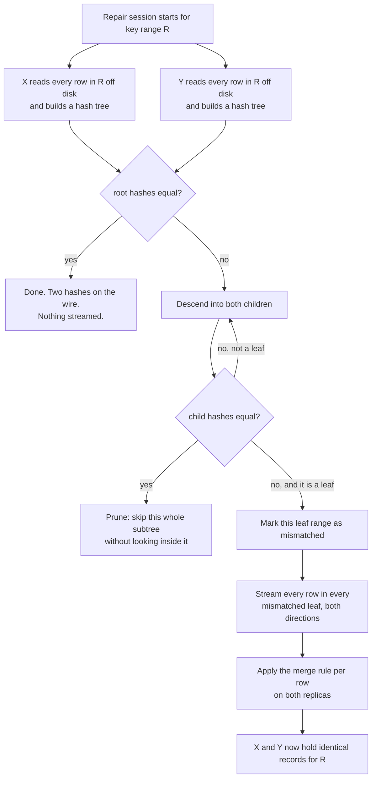
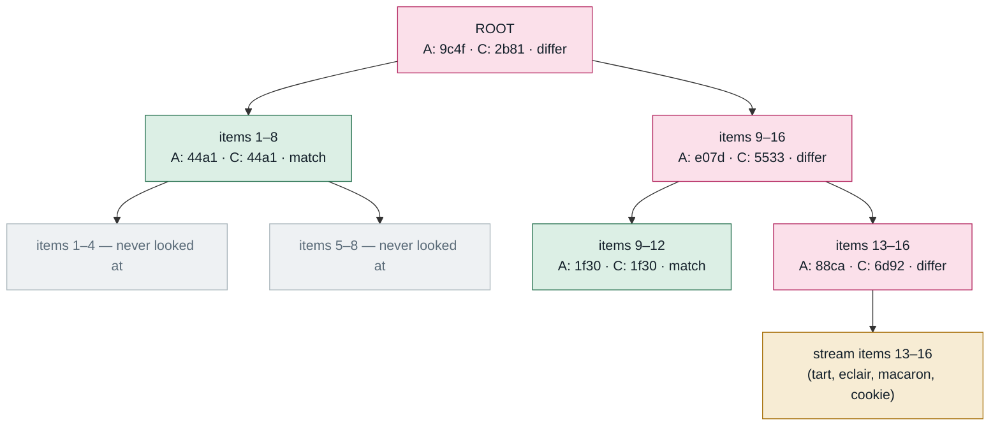
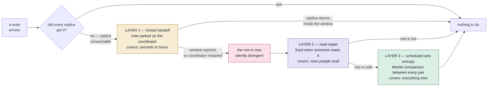
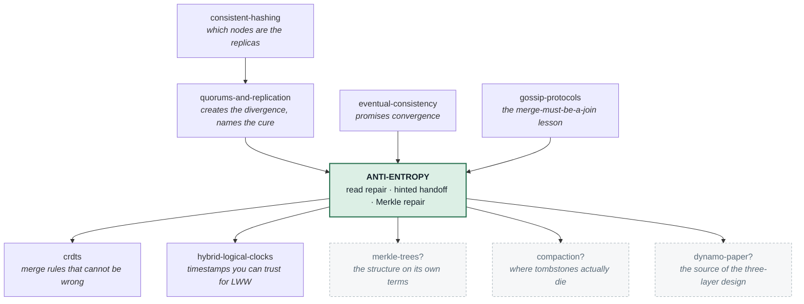

# Anti-Entropy

### The background job that makes "eventually consistent" eventually true

---

**What this lab is.** A teaching document, an interactive repair simulator
(`visualization.html`), and a set of pencil-and-paper exercises. There is no code to
run and nothing to install. Every number quoted in this document was produced by the
simulator's engine, which is the same engine the visualization page runs. Scenarios 1
to 10 are buttons on that page, so you can reproduce those directly. Engine runs 11 and
12 are longer runs of the same engine that the page does not script — a 300-write
week, and a repair with a write landing between the two tree builds — and they are
labelled as such wherever they appear.

**Where you are in the sequence.** Three labs you have already done all pointed at
this one and then walked past it:

- [quorums-and-replication](../quorums-and-replication/) ended by listing
  *"read repair, anti-entropy, Merkle tree"* among its key terms — three names, no
  mechanism.
- [eventual-consistency](../eventual-consistency/) told you the replicas converge.
  It did not tell you what does the converging.
- [gossip-protocols](../gossip-protocols/) taught you, the hard way, that a merge
  rule must be a **join** — you built one that wasn't, and forty orderings of the
  same five facts produced two permanently different states.

Those three labs describe a system that creates divergence (quorum writes),
promises it will go away (eventual consistency), and has one rule about how to
combine two versions (the join). **Nothing in them ever goes and looks.** That
missing piece is this lab.

---

## Table of contents

| | Stage | Depth layer |
|---|---|---|
| 1 | [Why this exists](#1-why-this-exists) | Beginner |
| 2 | [The problem, as a story](#2-the-problem-as-a-story) | Beginner |
| 3 | [The obvious fix](#3-the-obvious-fix) | Beginner |
| 4 | [Where the obvious fix breaks](#4-where-the-obvious-fix-breaks) | Beginner |
| 5 | [What we actually need](#5-what-we-actually-need) | Beginner |
| 6 | [The key idea](#6-the-key-idea) | Beginner |
| 7 | [The vocabulary, now that you have earned it](#7-the-vocabulary-now-that-you-have-earned-it) | Beginner |
| 8 | [Two mental models, and where the nice one lies to you](#8-two-mental-models-and-where-the-nice-one-lies-to-you) | Beginner |
| 9 | [Go and break it yourself](#9-go-and-break-it-yourself) | Beginner |
| 10 | [The mechanism, built one failure at a time](#10-the-mechanism-built-one-failure-at-a-time) | Intermediate |
| 11 | [The failure scenarios in full](#11-the-failure-scenarios-in-full) | Engineering |
| 12 | [What is guaranteed, what is not, and what it cost](#12-what-is-guaranteed-what-is-not-and-what-it-cost) | Engineering |
| 13 | [Production](#13-production) | Production |
| 14 | [Exercises](#14-exercises) | — |
| 15 | [Where this sits, and what to learn next](#15-where-this-sits-and-what-to-learn-next) | — |
| 16 | [Glossary](#16-glossary) | — |

---

## 1. Why this exists

You keep three copies of every row so that one machine dying does not lose your data.
The instant you do that, you have created a new thing that can go wrong: **the three
copies can stop being the same.**

Here is the part that surprises people. This is not caused by a bug. It is caused by
the system working exactly as designed. A write that reached two of the three copies
is a *successful* write — you configured it that way on purpose, so that one sick
machine cannot stop your service from accepting orders. It returns success to the
customer. And the third copy is now holding last week's value.

Now ask the obvious question: **what part of the system goes back and fixes that
third copy?**

In the write path, nothing. The write is finished; it was a success. In the read
path, nothing — a read that happens to touch the stale copy might notice, but only
if it touches it, and only for the one row it asked about. There is no other code
running. The third copy holds a wrong value for as long as nobody happens to look,
which for most rows in most databases means *forever*.

So divergence is not a rare accident to be handled. It is the continuous, normal
residue of a system that keeps serving while machines come and go — and it
accumulates. Anti-entropy is the name for the background work that goes looking for
those differences and removes them. Without it, "eventually consistent" is a promise
with no machinery behind it.

---

## 2. The problem, as a story

A chain of three bakeries: **shop A**, **shop B**, **shop C**. Head office sets the
prices, but each shop keeps its own printed price list — the whole list, all sixteen
items — because a shop has to be able to sell when the office phone is engaged.

Monday morning, head office puts the price of a croissant up to £4.00 and rings
round. Shop A answers and writes it down. Shop B answers and writes it down. Shop C's
line is busy — the manager is out at the back signing for a flour delivery.

Head office's rule is: **two shops confirmed means the change is live.** Two shops
confirmed. The office ticks the job off the list and moves on to the scones.

Nobody is coming back for shop C.

Shop C sells croissants at £2.40 on Tuesday. And next month. And next year. Not
because anything broke — the phone worked, the rule was followed, the change was
recorded as successful. The only thing that happened is that no part of the process
was responsible for going back to check.

> Measured in the simulator (**Scenario 1**): after that one price change, **1 of the
> 16 rows** differs between the shops. A customer served by shop C is told **2.40**.
> The price everyone else believes is **4.00**.

One row. Now run the chain for a week, with the usual mix of a machine rebooting for
a kernel patch, a network switch dropping packets for ninety seconds, and a
maintenance window.

> Measured (**engine run 11**, a 300-write week on a 64-row catalogue, with shop C
> going away for a few short blips and one five-hour outage): **16 of the 64 rows**
> end up different between the shops. Three of them are rows customers ask about
> often. Thirteen of them are rows nobody has looked at in weeks.

That ratio — 3 rows where someone is watching, 13 where nobody is — is the shape of
the whole problem, and it is worth holding on to for the next two stages.

---

## 3. The obvious fix

If the trouble is that one shop is out of date, then check when it matters: **when a
customer actually asks the price, ring two shops instead of one, take the newer of
the two answers, and while you have them on the phone, correct the one that was
behind.**

This is genuinely a good idea, and every real system does it. It costs almost
nothing, because you were making the phone call anyway. It fixes the row the customer
cares about at the exact moment they care about it. And it needs no new background
process, no schedule, no extra machine.

It is also, on its own, close to useless. Three separate reasons, and it is worth
seeing all three, because each one teaches a different thing about what a repair
mechanism has to do.

> **🔮 Predict:** Five price changes have missed shop C. A customer now asks about one
> of the five. After that phone call, how many of the five rows are still wrong on
> shop C?
> <details><summary>Reveal</summary>
>
> **Four.** The call fixed exactly the one row it was about. There is no mechanism by
> which asking about croissants tells you anything about scones. Measured
> (**Scenario 2**): divergent rows went from 5 to 4.
>
> This sounds obvious when stated this baldly, and it is — but it is worth noticing
> that the fix rate is tied to the *read* rate, and in every real catalogue the vast
> majority of rows are read approximately never.
> </details>

---

## 4. Where the obvious fix breaks

**Limit one: it only fixes rows somebody reads.** Covered above. Five rows wrong, one
read, four still wrong. In the week-long run this is the difference between the 3
divergent hot rows and the 13 divergent cold rows: fixing-on-read attacks exactly the
3, and cannot touch the 13.

**Limit two — and this is the one people do not expect — it only fixes the shops you
happened to ring.** You keep three copies but you only ring two, because ringing two
is what makes the system fast and available. Which two? Whichever two answer first,
which in practice means the two that are healthy and nearby. The stale copy is
usually the one that has just come back from being sick — which is to say, *the one
least likely to be in the group you rang.*

> Measured (**Scenario 2**): shop C is behind on the croissant price. A customer's
> read goes through shop A, asking two shops. It asks A and B. Both are correct, so
> the answer is correct, the customer is happy, and nothing is repaired. **Divergence
> after the read: unchanged.** The mechanism designed to notice the problem never
> looked at the shop that had it.

> **🔮 Predict:** So we lower the number of shops we ring to one — faster, cheaper.
> What does fixing-on-read do now?
> <details><summary>Reveal</summary>
>
> **Nothing at all, ever.** Measured (**Scenario 2**, R=1): the read went to shop C,
> was answered **2.40** when the true price was 9.00, and repaired nobody.
>
> The reason is worth saying precisely, because it is the seed of the whole lab:
> **you cannot detect a disagreement with one copy.** Repair is not something a
> replica can do by looking at itself. It requires *comparison*, and comparison
> requires at least two. A single replica has no way to know it is wrong; from the
> inside, being stale looks exactly like being right.
> </details>

**Limit three: it costs the customer.** Every repair on the read path is work done
while somebody is waiting. Do it synchronously and reads get slower; do it
asynchronously and the read that triggered the repair may still return the stale
answer. Neither is a disaster, but it means you cannot solve the problem by simply
turning this dial up: repairing hard on the read path degrades the very thing you
built replicas for.

Put the three together and you get the deeper problem, the one this lab is actually
about:

> **The rows most likely to be silently wrong are exactly the rows nobody is
> looking at — and any repair mechanism that lives on the read path is, by
> construction, blind to them.**

That is a nasty shape. It means your monitoring will look fine. It means the problem
is invisible right up until the day somebody runs a report, or a row that was cold
for a year suddenly becomes hot, or you fail over to the replica that was wrong.

---

## 5. What we actually need

Say it in plain words first, then we will go and build it.

We need a process that:

1. **Runs whether or not anyone reads the data.** Its trigger is a schedule, not a
   customer.
2. **Compares whole replicas, not single rows.** It must be able to find a difference
   in a row nobody has named.
3. **Reaches every replica, not a fast subset.** It must go and look at the sick one
   specifically.
4. **Costs in proportion to the differences, not to the data.** If two replicas
   holding 500 GB differ in three rows, finding those three rows must not cost
   500 GB of network. This requirement is the one that generates the interesting
   engineering; without it the whole lab would be one paragraph long.
5. **Ends in a defined, order-independent answer.** When it finds A saying 4.00 and C
   saying 2.40, it needs a rule that both sides can apply and get the same result —
   and the result must not depend on which pair repaired first.

Requirement 5 should look familiar. It is the **join** property from the
[gossip-protocols](../gossip-protocols/) lab — a combining rule that gives the same
answer no matter what order you apply it in — arriving here as a hard prerequisite
rather than a nicety. Stage 10 measures what happens when you break it.

---

## 6. The key idea

Two sentences.

> **Compare summaries instead of data — one hash for the whole range. If the summaries
> match, you are done and you have transferred one number. If they do not, split the
> range in half and ask the same question about each half, recursively, until you have
> cornered the differences.**

And the second half, which is about *when* rather than *how*:

> **Run this on a schedule, in the background, between every pair of replicas —
> independent of what anyone is reading.**

That is the whole invention. The first sentence gives you requirement 4 (cost
proportional to differences): matching halves are eliminated wholesale, without
looking inside them. The second gives you requirements 1, 2 and 3.

Everything in the rest of this lab is either a detail of making that work, or a
failure caused by getting one of those details wrong. And there are more of those
than you would expect, including one that quietly resurrects deleted data.

---

## 7. The vocabulary, now that you have earned it

Each of these has been shown to you as a problem before it is given a name.

### Entropy, and anti-entropy

**Plain meaning.** Entropy is the tendency of things left alone to become
disordered. Anti-entropy is the work you do to push them back.

**Technical meaning.** In a replicated store, **entropy** is the accumulating
difference between replicas that should be identical. **Anti-entropy** is the family
of background mechanisms that detect and remove that difference.

**Why the term exists.** It was chosen (Demers et al., Xerox PARC, 1987 — the same
paper that gave us gossip) to make a specific point: divergence is not an *event*
that happens and then is over. It is a continuous pressure, like heat leaking out of
a house. There is no state called "repaired" that you arrive at and stay in. There is
only a pump you keep running. That is why the mechanism is a scheduled sweep and not
an error handler.

**Example.** In the week-long run, entropy reached 16 divergent rows out of 64.
Running the anti-entropy pass took it to 0. Next week it will be non-zero again.

**Connects to.** This is the engine underneath the promise made in
[eventual-consistency](../eventual-consistency/): "eventual" is exactly "as soon as
the anti-entropy pass gets to it".

### Divergence (or drift)

**Plain meaning.** The replicas disagree.

**Technical meaning.** For a given row, at least two replicas hold different records
for it. Worth splitting in two, because the simulator reports both:
*stored divergence* (the replicas hold different bytes) and *visible divergence* (a
customer would be told different things). They are not the same — two replicas can
hold a deletion marker and an absence, which are different bytes but the same answer.
That gap is where stage 11's worst failure lives.

**Connects to.** This is the thing R+W>N from
[quorums-and-replication](../quorums-and-replication/) does *not* remove. Quorum
overlap makes a single read return a fresh value; it never removes the stale copy
underneath.

### Read repair

**Plain meaning.** While answering a question, fix what you notice.

**Technical meaning.** During a read, the coordinator compares the responses from the
replicas it contacted; if they differ, it writes the winning version back to the ones
that were behind, before (blocking) or after (asynchronous) answering the client.

**Why the term exists.** To distinguish repair that is *triggered by* and *scoped to*
a read from repair that runs on its own schedule. The distinction is exactly the
three limits of stage 4.

**Example.** Measured: read repair over a week fixed **3 of the 3** divergent hot
rows and **0 of the 13** divergent cold rows.

### Hinted handoff

**Plain meaning.** If the shop's phone is engaged, leave a note to ring them back.

**Technical meaning.** When a coordinator cannot reach a replica that should have
received a write, it stores the write locally as a **hint** — a parcel addressed to
that replica — and replays it when the replica returns.

**Why the term exists.** "Hint" rather than "queued write" is deliberate and load-
bearing: it is *advisory*. It may be dropped. It is not part of the write's durability
guarantee. Systems that treat it as a guarantee have a bug, and we will measure two
distinct ways it silently fails.

**Example.** Measured over a week: **24 hints delivered, 35 expired unused, 10 lost
when the machine holding them restarted.**

### Hint window

**Plain meaning.** How long the note is worth keeping before you bin it.

**Technical meaning.** The maximum age of a hint. Past it, the hint is discarded
without being delivered, on the grounds that a replica gone that long has too much to
catch up on to do it one write at a time. Cassandra's default is 3 hours
(`max_hint_window_in_ms`). The simulator uses the same figure.

**Connects to.** This is the seam between the two mechanisms: hinted handoff covers
short absences, anti-entropy covers everything longer. Getting the window wrong does
not lose data — it just shifts work from the cheap mechanism to the expensive one.

### Merkle tree

**Plain meaning.** A pyramid of checksums, where each checksum covers everything
below it.

**Technical meaning.** A binary tree whose leaves are hashes of contiguous ranges of
the data, and whose internal nodes are hashes of their two children. Two replicas
compare roots; equal roots mean the whole dataset matches. Unequal roots mean descend
into the children and repeat, following only the branches that differ.

**Why the term exists.** Named for Ralph Merkle (1979). The reason it needs its own
name rather than being called "checksums" is the *tree* part: a flat checksum tells
you whether you differ; only the tree tells you **where**, and it does so at
logarithmic cost. It is a binary search for disagreement.

**Example.** Measured (**Scenario 5**): with one row differing out of 16, comparing
16-leaf trees costs **18 hashes** and streams **1 row**. Shipping everything costs
**16 rows** each way. In bytes: **976 vs 6,400**.

### Leaf range, and over-streaming

**Plain meaning.** Each checksum at the bottom of the pyramid covers a *bundle* of
rows, not one row — so when one row is wrong you have to resend the whole bundle.

**Technical meaning.** A leaf covers a contiguous slice of the key space. A single
differing row makes its whole leaf mismatch, and repair transfers every row in that
leaf. The wasted transfer is **over-streaming**.

**Why the term exists.** Because in production it is the dominant cost of repair, and
it has nothing to do with how much data is actually wrong. It is the reason repair
can move a hundred gigabytes to fix a hundred rows.

**Example.** Measured (**Scenario 6**), one differing row: with 1 row per leaf,
1 row streamed. With 8 rows per leaf, **8 rows streamed to fix 1** — an eightfold
waste.

### Tombstone

**Plain meaning.** A deletion leaves a headstone saying "this was deleted, at this
time", rather than leaving nothing.

**Technical meaning.** A marker record written in place of the deleted row, carrying
the deletion's timestamp, so that the deletion is a *fact that can be replicated*
rather than an absence.

**Why the term exists.** Because of a hole you cannot otherwise close. If deletion
means absence, then when repair sees "A has no row, C has a row", it cannot tell
apart two completely different situations: *A deleted it* and *C received a write A
never got*. The two demand opposite responses. The tombstone is what makes them
distinguishable.

**Example.** Measured (**Scenario 7**): delete an item while shop C is offline, with
deletion implemented as plain removal. Repair puts the item back. It is on sale again.

### gc_grace, and resurrection

**Plain meaning.** Headstones are eventually cleared away — and anything not told
about the death before the clearance will believe the deceased is alive.

**Technical meaning.** `gc_grace_seconds` is how long a tombstone is kept before
compaction discards it. **Resurrection** (or a **zombie**) is a deleted row that
comes back because a replica that never saw the tombstone was repaired after the
tombstone was purged.

**Why the term exists.** Because it converts a storage-reclamation setting into a
hard operational deadline: *every replica must be repaired at least once within
`gc_grace_seconds`, or deleted data returns.* That single sentence is the most
consequential thing anti-entropy imposes on the people who operate the cluster.
Cassandra's default is 10 days, and it is 10 days because it is a repair deadline,
not because tombstones are expensive to keep for 10 days.

**Example.** Measured (**Scenario 8**), with a 6-hour grace: repair 2 hours after the
delete → the item stays deleted. Repair 8 hours after the delete → **the item is back
on sale on all three replicas.**

### Merge rule (and why it must be a join)

**Plain meaning.** When two copies disagree, the rule for picking the answer.

**Technical meaning.** A function combining two records into one. For the result to
be independent of the order repairs happened in, it must be a **join**: commutative,
associative and idempotent. Last-write-wins by timestamp is one. "Take whatever
arrived most recently" is not.

**Why the term exists here.** To separate two things that get confused: anti-entropy
is *transport* — it finds differences and moves rows. The merge rule is *semantics* —
it decides what the answer is. A perfect transport with a broken merge rule converges
to nonsense, reliably and quickly.

**Example.** Measured (**Scenario 9**): the same three facts, repaired in two
different orders, with a non-join merge rule. One order leaves every replica saying
**4.40**; the other leaves every replica saying **8.50**. Both are stable. Both are
final. Only one of them is the price the customer was charged.

**Connects to.** This is precisely the bug you shipped and caught in the
[gossip-protocols](../gossip-protocols/) lab, and precisely what
[crdts](../crdts/) exists to guarantee by construction.

### Repair (the noun)

**Plain meaning.** The scheduled job that runs the comparison.

**Technical meaning.** A session between replicas of a key range: build Merkle trees
on each, exchange and compare them, stream the mismatched ranges, apply the merge
rule on both sides. In Cassandra this is `nodetool repair`, and the tree-building
half has its own name — **validation compaction** — because it reads every row in the
range off disk.

**Example.** Measured (press *Compare and repair* on a freshly reset bench):
repairing two replicas that are *perfectly in sync* costs **2 hashes and 64 bytes** on the wire — and still reads **all 32 rows**
off disk to build the two trees. Anti-entropy makes the *network* cost proportional
to the differences. It does not make the *disk* cost proportional to anything.

---

## 8. Two mental models, and where the nice one lies to you

### The simple model: the stocktake

Once a month the shop closes early and two members of staff walk the shelves with the
stock book. They do not read every line of the book against every shelf — that would
take all night. They work in sections: count the total for the bread section, compare
it against the book's total for the bread section. If the totals match, the whole
section is fine and they move on without looking at a single individual line. If the
totals disagree, they split the section and count the halves, and keep splitting until
they find the line that is wrong.

Everything important about anti-entropy is in that paragraph: it is scheduled, it is
comparison-based, it summarises before it inspects, and its cost is driven by how many
disagreements there are rather than by how big the shop is.

### The engineering model

Two replicas, X and Y, each holding a set of records over the same key range. A record
is `(key → {timestamp, value, deleted})`.



Two things in that diagram are the entire engineering content, and they pull in
opposite directions:

- **The `prune` branch** is why this is cheap. A matching subtree is dismissed
  wholesale, at the cost of one comparison, no matter how many rows are underneath it.
- **The `stream every row in every mismatched leaf` box** is why it is not as cheap as
  you think. The unit of transfer is the leaf, not the row.

### Mapping the two models

| Stocktake | Replicated store |
|---|---|
| The stock book and the shelves | Two replicas, X and Y |
| One line in the book | One row: `key → {timestamp, value, deleted}` |
| "The bread section" | A leaf range: a contiguous slice of the key space |
| The section total | A leaf hash |
| The grand total on the front page | The root hash |
| Splitting a section that does not add up | Descending into the children of a mismatched node |
| Closing early once a month | The repair schedule |
| Deciding which record to believe | The merge rule |
| A line crossed out in the book | A tombstone |

### Where the analogy breaks

Three places, and each one is load-bearing.

**1. A stocktake has an authority. Replication does not.** The stock book is *right*;
the shelf is *checked against it*. Between two replicas there is no book. Neither
copy is the master, neither is more trustworthy, and "repair" does not mean "restore
the correct value" — it means "make both sides equal by applying an agreed rule".
If that rule picks wrong, repair spreads the wrong value to the healthy replica with
exactly the same enthusiasm it would have spread the right one. Stage 11 measures
this happening.

**2. A stocktake happens when the shop is shut. Repair happens while you are
trading.** Rows are being written throughout, which means the two trees are built
from two slightly different moments in time. Differences appear that were never
faults.

> Measured (**engine run 12**, which the page does not script): two *identical*
> replicas, one single write landing
> between the moment X's tree was built and the moment Y's was. Result: **1 row
> streamed to fix 0 genuine differences.** With coarse leaves (8 rows each), the same
> one write causes **8 rows streamed to fix 0 differences.**

**3. In a stocktake, a missing item means it is gone. In a replicated store, a missing
row is ambiguous.** The shelf being empty and the book having no line for the item
look identical, but they mean opposite things — "we deleted it" versus "you never
heard about it". This is the ambiguity the tombstone exists to remove, and it is the
subject of the worst failure in this lab.

---

## 9. Go and break it yourself

Open `visualization.html`, or the published version at
**<https://claude.ai/code/artifact/f8ee9833-c3e8-4c29-9796-c2c68b8954b2>**. It runs the
same engine that produced every number in this document.

What is on the screen: three replicas (A, B, C), each holding the sixteen-item price
list; a **divergence meter** counting rows the replicas disagree about; the controls
to write, delete, read, kill a machine, advance the clock, and run a repair; and a
Merkle panel that shows both trees and lets you walk the comparison down one level at
a time, with a running count of hashes compared and rows streamed.

If you press nothing else, press these three, in order:

1. **Close C**, then **Set this price** (croissant, 4.00). Watch the log report the
   change as *done* while the number at the top of the page goes to 1. That single
   screen is stage 1 of this document.
2. **Reopen C**, then **Compare and repair** with A ↔ C selected. Watch fifteen of the
   sixteen ranges get pruned in green and one turn red, and read the five cost tiles.
3. Scenario **7 · The delete that came back**, in the right-hand column. Predict
   first — the page makes you.

Everything after this stage will make more sense if you have watched the divergence
meter move at least once.

---

## ▸ Checkpoint — end of the beginner model

You can now say what anti-entropy is for and why fixing-on-read is not enough: the
rows most likely to be wrong are the rows nobody reads, and repair on the read path
is blind to exactly those. You know the key idea — compare summaries, split where
they differ — and you have a vocabulary for the pieces.

What comes next is the mechanism itself, built the way it was actually invented:
start with the version a sensible engineer builds first, break it, and let each
refinement be the scar of a specific failure.

---

## 10. The mechanism, built one failure at a time

### v1 — Leave a note (hinted handoff)

The first thing anyone builds. When head office rings shop C and gets no answer, the
office writes the change on a sticky note addressed to C. When C rings back to say it
is open again, the office reads the notes out.

This is genuinely excellent, and it should be the first line of defence in any real
system, because it is nearly free and it covers the overwhelmingly common case: a
machine that was away for ninety seconds.

> Measured (**Scenario 3**): three price changes while C is offline. C comes back one
> hour later. Hints replay. **Divergence: 0.** No repair job needed, no comparison
> done, no disk read.

Now break it. Two ways, and they fail differently.

> **🔮 Predict:** Same three price changes, but C is away for four hours instead of
> one, and the hint window is three. What is the divergence when C comes back?
> <details><summary>Reveal</summary>
>
> **3 rows divergent** — every one of the three changes is lost. The hints were
> discarded at the three-hour mark, unread. (**Scenario 3**, second half.)
>
> The important part is not that the number is 3. It is that *nothing reported an
> error*. The writes succeeded. C rejoined the cluster and started serving reads
> immediately, with three wrong prices and no indication anywhere that it was
> carrying them.
> </details>

And the second way, which is nastier because it does not even need an unusual
duration:

> Measured (**Scenario 4**): three changes while C is offline; the hints sit on shop
> A, because A was the coordinator that took the writes. Before C returns, **A**
> restarts — an ordinary deploy. **Divergence when both are back: 3.**

That is the structural problem with hints: they are held on one machine, which is
itself a machine that can fail. Over the week-long run: **24 hints delivered, 35
expired past the window, 10 lost with a restarting coordinator.** Fewer than a third
of the hints ever did their job.

**What v1 teaches.** Hinted handoff is an optimisation, not a guarantee. It reduces
how much work the real repair mechanism has to do. It never removes the need for one.

### v2 — Fix it when you notice (read repair)

Stage 3 and 4, in one line: real, cheap, and structurally blind to cold data.

> Measured (**engine run 11**): over the same week, read repair alone left **16 of 64
> rows divergent** — *exactly the same as doing nothing at all*, because the reads
> went to the two healthy replicas and never asked the sick one. Configured to digest
> all three replicas (which is what Cassandra's old `read_repair_chance` did), it got
> to **13 of 64: it fixed all 3 divergent hot rows and 0 of the 13 cold ones.**

Layered together, the two cheap mechanisms take the week from 16 divergent rows to
**8**. Half the problem, for almost no cost. And then they stop, permanently, because
the remaining 8 are rows in a cold part of the catalogue that a replica missed while
it was away for longer than the hint window.

### v3 — Just send everything

The honest first answer to the remaining 8. On a schedule, each replica ships its
entire dataset to its neighbours, and each side merges.

It is *correct*. It has none of the blind spots. It is also the reason the rest of
this stage exists:

> Measured (**Scenario 5**): with exactly one of sixteen rows differing, a full sync
> streams **32 rows** (16 in each direction) and **6,400 bytes**. Scale that honestly:
> a 500 GB replica set, differing in three rows, moves a terabyte over the network to
> fix 600 bytes of data. Do that nightly and you have built a system whose repair
> traffic dwarfs its real traffic.

### v4 — Send a checksum instead

Obvious improvement: hash the entire range on both sides and compare the two numbers.
64 bytes on the wire.

This fails in an interesting way. It answers the wrong question. It tells you
**whether** you differ, with no information about **where**, so the only thing you can
do with a mismatch is fall back to v3 and send everything anyway. And in a busy
system the answer is essentially always "yes, you differ" — so v4 costs you one extra
round trip and then does v3.

**The lesson that generates the real design:** you do not need one summary. You need
a *hierarchy* of summaries, so that a mismatch at the top can be localised by
descending.

### v5 — The Merkle tree

Hash each small slice of the key range. Then hash pairs of those hashes. Then pairs of
those. You get a tree whose root covers everything.

Here are the sixteen items with one row (`macaron`) differing between A and C, drawn
as a 4-leaf tree so it fits on the page. Green means the two replicas' hashes matched
and the branch was pruned; red means they differed and the comparison descended.



Read the picture as a search: eight of the sixteen items were eliminated by a single
comparison at the second level, without either replica reading or sending any of
them. That elimination is the whole trick.

The costs, measured (**Scenario 5**), one differing row out of sixteen:

| Method | Hashes compared | Rows streamed | Bytes on the wire |
|---|---|---|---|
| Full sync (v3) | 0 | 32 | 6,400 |
| Merkle, 2 leaves (8 rows each) | 6 | 16 | 3,392 |
| Merkle, 4 leaves (4 rows each) | 10 | 8 | 1,920 |
| Merkle, 8 leaves (2 rows each) | 14 | 4 | 1,248 |
| Merkle, 16 leaves (1 row each) | 18 | 2 | 976 |

And the cost of finding one difference grows with the *depth* of the tree, not the
*size* of the data: 6, 10, 14, 18 hashes for depths 1, 2, 3, 4 — exactly
`2 + 4·depth`. Since depth is `log₂(leaves)`, the search cost is logarithmic in the
dataset while the saving is proportional to it. That is the good news, and it is why
every system in this space uses this structure.

> **🔮 Predict:** So is the Merkle tree always the cheaper choice? Same 16 rows — but
> now suppose *all sixteen* differ, because shop C was restored from a week-old
> backup. Merkle or full sync?
> <details><summary>Reveal</summary>
>
> **Full sync wins.** Measured (scenario 5 repeated with more rows made to differ —
> close C, change *n* prices, reopen C, repair; 16-leaf trees):
>
> | Rows differing | Hashes | Leaves mismatched | Rows streamed | Bytes |
> |---|---|---|---|---|
> | 0 | 2 | 0/16 | 0 | 64 |
> | 1 | 18 | 1/16 | 2 | 976 |
> | 2 | 18 | 2/16 | 4 | 1,376 |
> | 4 | 22 | 4/16 | 8 | 2,304 |
> | 8 | 34 | 8/16 | 16 | 4,288 |
> | 16 | 62 | 16/16 | 32 | **8,384** — against full sync's 6,400 |
>
> When everything differs, the tree comparison finds nothing to prune, so you pay for
> the entire tree *and then* stream everything anyway. The tree is a bet that
> replicas are mostly similar. It is a very good bet almost all of the time, and it
> is a losing bet in exactly the situation where you need repair most urgently — a
> replica rebuilt from a backup, or a node that has been down for a week.
>
> This is why real operators do not repair a long-dead node. They wipe it and
> **bootstrap** it — stream the whole range from scratch, deliberately choosing v3.
> </details>

### v6 — The leaf is bigger than a row, and that is the bill

In the table above, the 16-leaf tree had one row per leaf. Real trees never do. A
Cassandra Merkle tree has a bounded depth (15 by default, so 32,768 leaves) covering
a token range that may hold *millions* of rows. So a leaf is not a row — it is a
bucket of thousands of rows, and the unit of repair is the bucket.

> Measured (**Scenario 6**), one single differing row:
>
> | Rows per leaf | Rows streamed | To fix | Waste |
> |---|---|---|---|
> | 1 | 1 | 1 | 1× |
> | 2 | 2 | 1 | 2× |
> | 4 | 4 | 1 | 4× |
> | 8 | 8 | 1 | 8× |

The waste factor is just "rows per leaf". At production scale, with 32,768 leaves over
a range holding 30 million rows, that is roughly 900 rows moved to fix one — and
since a leaf is contiguous in the key space, they are 900 *large* rows if you happen
to keep large rows together. **This is over-streaming, and it is the single biggest
operational cost of anti-entropy in a real cluster.**

The obvious response — make the tree deeper — runs into memory: the tree must be held
in RAM while it is compared, and it doubles in size per level. The real fix arrived
later and is a different mechanism entirely; ScyllaDB's row-level repair exchanges
per-row checksums within a mismatched range instead of streaming the range, which
trades more small messages for far less data. Stage 13 comes back to this.

### v7 — Two trees, two moments

The trees are built by reading rows off disk, which takes time, and the two replicas
do not finish at the same instant. Any write landing in between shows up as a
difference that was never a fault.

> Measured (**engine run 12**): identical replicas, one write between the two builds →
> **1 row streamed to fix 0 real differences** with fine leaves, **8 rows to fix 0**
> with coarse ones. On a busy cluster this is not a rounding error; it is a constant
> background tax, and it is why Cassandra can take a snapshot before validating, and
> why repairing during peak write load is a bad idea.

### v8 — The rule that decides the winner

Everything so far is *transport*: finding differences and moving rows. It says nothing
about what the answer should be. That is the merge rule, and it is a separate decision
with separate consequences.

The requirement, from stage 5, is that repairing in a different order must not give a
different answer. Here is what that looks like when it holds and when it does not.
Same starting state every time — A and B hold `tart = 8.50`, C holds the old `4.40`,
because C was offline for the change — repaired twice, in four different orders:

| Repair order | Merge rule = last-write-wins | Merge rule = "whoever received it, wins" |
|---|---|---|
| A→C then B→C | 8.50 everywhere | 4.40 everywhere |
| B→C then A→C | 8.50 everywhere | 4.40 everywhere |
| C→A then C→B | 8.50 everywhere | **8.50 everywhere** |
| C→B then C→A | 8.50 everywhere | **8.50 everywhere** |

(**Scenario 9**.) The right-hand column converges — quickly, stably, and to a value
determined entirely by *which machine happened to be on the receiving end of the last
repair*. Two of those four runs permanently charge customers a price nobody set.

Note carefully what did **not** happen: it did not oscillate, it did not error, it did
not fail to converge. **Convergence is not correctness.** A broken merge rule gives
you a system that agrees with itself perfectly and is wrong, which is far harder to
notice than one that disagrees.

This is the same failure you already made once, in
[gossip-protocols](../gossip-protocols/), where taking the max heartbeat and
separately the worse status gave two permanently different states from forty
orderings of five facts. Same bug, different mechanism: **the merge rule must be a
join.**

### The finished shape: three layers, not one mechanism



Each layer is cheap where it applies and blind where it does not, and each one hands
its blind spot to the next. The week-long run is the same picture in numbers:

| Defence in place | Divergent rows, of 64 | of the 8 rows people read | of the 56 rows nobody reads |
|---|---|---|---|
| Nothing | 16 | 3 | 13 |
| Read repair, asking only the 2 replicas the read used | 16 | 3 | 13 |
| Read repair, digesting all 3 replicas | 13 | 0 | 13 |
| Hinted handoff only | 10 | 2 | 8 |
| Hinted handoff + read repair | 8 | 0 | 8 |
| …plus one scheduled Merkle repair pass | **0** | 0 | 0 |

That last row is the point of the lab. The two cheap layers halve the problem and then
stop dead. The third layer is the only one that reaches zero — and it did so by
streaming **8 rows where a full sync would have moved 192**, using 118 hashes.

---

## ▸ Checkpoint — end of the intermediate model

You can now describe the whole mechanism: three layers with complementary blind
spots, a hash tree that turns "find the differences" into a logarithmic search, a
leaf size that decides how much you over-send, and a merge rule that decides what the
answer means. You have seen each refinement arrive as the fix to a specific measured
failure.

Next: the failure modes in full, including the one where repair deletes nothing and
still ruins your day.

---

## 11. The failure scenarios in full

Ten failures. For each: how to create it, where to watch it, what happens and why,
how the system responds, which guarantee survives, which is temporarily lost, and how
it shows up in production.

### 11.1 The successful write that left a replica behind

**Create it.** Kill C. Write `croissant = 4.00` with W=2. **Watch it:** scenario 1 on
the page, or press *Kill C* then *Write*. **What happens:** the write reports success
with 2 of 3 replicas storing it; the divergence meter goes to 1. **Why:** W=2 means
"two replicas is enough to call this durable", which is a deliberate availability
choice, not a fault. **Response:** hinted handoff parks a note; if C returns inside
the window it is fixed for free. **Intact:** durability at the level you configured —
two copies exist. A read at R=2 still returns 4.00, so quorum overlap holds.
**Lost:** the claim that all replicas hold the same thing. A read at R=1 from C
returns **2.40**. **In production:** invisible. There is no metric that fires. This is
the base-rate event that everything else in the lab responds to.

### 11.2 The hint window expires

**Create it.** Kill C, write three rows, advance the clock past the hint window
(3 hours by default), revive C. **Watch it:** scenario 3. **What happens:**
**3 rows divergent** where a one-hour outage left 0. **Why:** hints past the window
are discarded on the grounds that a long-absent replica has too much backlog to
replay write-by-write. **Response:** none automatic — this drift now waits for
scheduled repair. **Intact:** everything the quorum promised; C is a valid replica
holding valid old data. **Lost:** the cheap repair path. **In production:** you see it
as `HintsNotStored` / dropped-hint counters climbing, and as a repair that suddenly
has real work to do. The window is not a safety setting — moving it only shifts work
between layer 1 and layer 3.

### 11.3 The coordinator holding the hints restarts

**Create it.** Kill C, write three rows via A, restart A, then revive C.
**Watch it:** scenario 4. **What happens:** **3 rows divergent**, with no outage
longer than a few minutes anywhere. **Why:** hints are stored on the coordinator that
took the write. That machine is not special and not protected; a rolling deploy takes
it out. **Response:** none. **Intact:** durability — the writes are on A and B.
**Lost:** hinted handoff's coverage, silently. **In production:** this is why hinted
handoff is *never* counted as part of a durability or consistency guarantee. Over the
measured week: 24 hints delivered, **35 expired, 10 lost with a restart**.

### 11.4 The cold row nobody reads

**Create it.** Any of 11.1–11.3, on a row that gets no read traffic.
**Watch it:** the week table at the end of stage 10 (engine run 11). **What happens:** with hinted
handoff and read repair both on, the hot rows reach 0 divergence and **8 cold rows
stay wrong indefinitely**. **Why:** both cheap layers are triggered by activity —
a write for one, a read for the other — and a cold row has neither. **Response:** only
scheduled repair. **Intact:** every guarantee that is stated per-operation.
**Lost:** any belief that "the replicas agree" without a repair having run.
**In production:** this is the reason `nodetool repair` is on a cron. It is also why
the damage surfaces at the worst moment — an analytics scan, a restore, a failover, or
the day a dormant customer logs back in.

### 11.5 Reading from one replica

**Create it.** Set R=1, read the stale row from the stale replica.
**Watch it:** scenario 2, third case. **What happens:** the read answers **2.40**
against a true 9.00, and repairs nobody. **Why:** repair requires comparison, and one
response is not a comparison. **Response:** none possible at R=1. **Intact:**
availability and latency — this is the fastest read the system offers. **Lost:**
detection, entirely. **In production:** R=1 (Cassandra `ONE`) is extremely common for
latency-sensitive paths, and it is fine — provided you understand that on those paths
*all* your convergence comes from layer 3, and none from layer 2.

### 11.6 The delete that comes back — the zombie

The most consequential failure in this lab, so it gets the most room.

**Create it, version A (no tombstones).** Kill C. Delete `eclair` — implemented as
simply removing the row. Revive C. Repair A ↔ C. **Watch it:** scenario 7.

**What happens:** repair sees A with no row and C with a row. It cannot distinguish
"A deleted it" from "C got a write A missed", and the only sensible default for
"one side has data the other lacks" is *copy the data over*. So `eclair` is back on
sale at **4.60**, on every replica, permanently. The deletion is gone, and **no
error occurred at any point**.

**Version B (tombstones, repaired promptly).** Same thing, but a delete writes a
marker carrying its timestamp. Repair now compares a tombstone at t=101 against a live
row at t=0, applies last-write-wins, and the tombstone wins. Measured: `eclair` stays
gone. This is why tombstones exist — not for bookkeeping, but because **a deletion has
to be a fact that can be replicated, and an absence cannot be replicated.**

> **🔮 Predict:** Tombstones are on. `eclair` was deleted while C was offline.
> C stays offline for longer than `gc_grace_seconds`, during which compaction runs on
> A and B. Then C returns and you repair. What does the customer see?
> <details><summary>Reveal</summary>
>
> **`eclair` is back on sale at 4.60, on all three replicas.** Measured
> (**Scenario 8**, 6-hour grace): repaired at 2 hours → stays deleted. Repaired at
> 8 hours → resurrected.
>
> The mechanism, step by step, with real values:
>
> 1. `t=1` — A and B write a tombstone for `eclair` with timestamp 1. C is offline and
>    knows nothing.
> 2. `t=1..360` — the tombstone sits on A and B. Any repair in this window would
>    carry it to C, and C's live row (timestamp 0) would lose to it.
> 3. `t=480` — compaction runs on A and B. The tombstone is older than the 6-hour
>    grace, so it is **discarded**. A and B now have *no row at all* for `eclair` —
>    byte-for-byte the same state as version A above.
> 4. `t=481` — C returns, still holding `eclair = 4.60 @ t=0`.
> 5. Repair compares "A: nothing" against "C: a live row". The tombstone that would
>    have settled it no longer exists. The row is copied to A and B.
>
> Nothing malfunctioned. Compaction did its job, repair did its job, the merge rule
> did its job. The failure is entirely in the *scheduling*: the grace period ran out
> before the repair ran.
> </details>

**Why:** deletion is the one operation where "I have less data than you" is the
correct end state, and the marker proving it is deliberately temporary.

**Response:** none automatic — the system cannot detect a resurrection, because after
the tombstone is purged there is no evidence the row was ever deleted.

**Intact:** convergence. All three replicas agree perfectly. **Lost:** correctness.
This is the sharpest illustration in the lab that *convergence and correctness are
different properties*, and anti-entropy only delivers the first.

**In production:** this converts a storage setting into an operational deadline:

> **Every replica must be repaired at least once every `gc_grace_seconds`, or deleted
> data comes back.**

Cassandra's default is 10 days for exactly this reason, and the standard operational
practice is to complete a full repair cycle well inside it (a week is typical). The
common mistakes are lowering `gc_grace_seconds` to reduce tombstone-scan latency
without shortening the repair cycle to match, and letting repair silently fail for a
fortnight on a cluster nobody is watching. The second one is more common.

### 11.7 Over-streaming

**Create it.** One differing row, coarse leaves. **Watch it:** scenario 6, then the same repair again with the
checksum-range setting changed. **What happens:** 8 rows moved to fix 1, an eightfold waste; at
production tree sizes, hundreds of rows per real difference. **Why:** the leaf is the
unit of transfer, and a leaf covers a range, not a row. **Response:** deeper trees
(bounded by memory), sub-range repair, or a different mechanism entirely (row-level
repair). **Intact:** correctness — over-streaming sends redundant *correct* data.
**Lost:** nothing correctness-wise; you lose network, disk and time. **In
production:** this is what makes repair the most disruptive routine job in a
Cassandra cluster, and why teams throttle streaming and repair one sub-range at a
time.

### 11.8 Trees built at different moments

**Create it.** Repair while writes are flowing. **Watch it:** engine run 12 — the page's
controls do not expose a write landing mid-repair, so this one is in the document only.
**What happens:** **1 row streamed to fix 0 real differences** with fine leaves,
**8 rows to fix 0** with coarse ones. **Why:** the two trees are snapshots of two
different instants; an in-flight write is a difference by construction. **Response:**
snapshot-based repair (validate against a frozen snapshot on both sides), or accept
the tax. **Intact:** everything — the extra streaming is harmless data movement.
**Lost:** the assumption that "repair streamed data" means "something was broken".
**In production:** it means repair metrics always show non-zero streaming on a busy
cluster, which trains people to ignore them.

### 11.9 A merge rule that is not a join

**Create it.** Switch the merge rule to "whoever received the row wins" and repair in
two different orders. **Watch it:** scenario 9. **What happens:** two of the four
orders leave every replica on **4.40**, the other two on **8.50**. All four converge.
**Why:** the rule is not commutative, so the result depends on repair order, and
repair order is scheduling noise. **Response:** none — the system cannot tell it has
done this. **Intact:** convergence, availability, everything a dashboard measures.
**Lost:** the meaning of the data. **In production:** this is the class of bug that
CRDTs exist to make impossible; see [crdts](../crdts/). It is also the exact bug you
hit and caught in [gossip-protocols](../gossip-protocols/), which is why it is worth
recognising the shape rather than the instance: *if two different orderings of the
same facts can give two different answers, you do not have a merge rule, you have a
race.*

### 11.10 Last-write-wins meeting a clock that is wrong

**Create it.** Give C a clock 2 hours fast. Have C write `scone = 3.00`, then have A
write `scone = 3.50` two minutes later. **Watch it:** scenario 10.
**What happens:** every replica keeps **3.00**. The genuinely newer write was
discarded by every replica the moment it arrived, because its timestamp was two hours
in the past relative to what was already stored. **Why:** last-write-wins means
*highest timestamp wins*, and a timestamp is a claim, not a measurement.
**Response:** none — this is the merge rule working as specified. **Intact:**
convergence. **Lost:** the intuitive meaning of "last". And note what anti-entropy
does here: it takes the wrong value and propagates it *authoritatively* to every
replica, cementing it. Measured variant: A writes 3.50 while C is down; C returns and
writes 3.10 with its fast clock; after repair every replica says **3.10**.
**In production:** NTP skew of even a few hundred milliseconds silently loses writes
under LWW. This is the entire motivation for
[hybrid-logical-clocks](../hybrid-logical-clocks/), and for Cassandra's advice to
supply client-side timestamps from a single source when ordering matters.

### 11.11 (bonus) The replica that came back from a backup

**Create it.** Restore C from a week-old snapshot, then repair. **What happens:**
essentially every leaf mismatches; the Merkle comparison finds nothing to prune, pays
for the whole tree, and then streams everything. Measured at 16 of 16 rows differing:
**8,384 bytes against a full sync's 6,400** — Merkle is *worse*. **Response:** do not
repair a badly-behind replica. Wipe it and bootstrap it, which is a deliberate choice
of v3 over v5. **In production:** the operational rule is a threshold, usually stated
as a time: a node down longer than the hint window gets repaired; a node down longer
than a few hours to a day gets replaced and re-streamed.

---

## 12. What is guaranteed, what is not, and what it cost

### The guarantee

> **If a repair session between replicas X and Y completes over key range R, and the
> merge rule is a join, then at the moment it completes X and Y hold identical
> records for every key in R.**

Extend it pairwise across all replicas and you have convergence for the whole
replica set. That is the entire safety claim, and it is worth noticing how narrow it
is.

### The invariants underneath it

1. **Comparison requires two.** No replica can detect its own staleness. Everything
   in this lab is a consequence of that.
2. **A deletion must be representable.** Absence is ambiguous; a tombstone makes
   deletion a positive fact with a timestamp. Any system where "gone" means "no bytes"
   will resurrect data under repair.
3. **The merge rule must be a join** — commutative, associative, idempotent — or the
   final state depends on repair order, which is scheduling noise.
4. **The tombstone must outlive the slowest replica's repair interval.** This is the
   `gc_grace` deadline, and it is the only invariant in the list that is enforced by
   an operator rather than by code.

### What is explicitly *not* guaranteed

- **No ordering.** Anti-entropy makes replicas *equal*; it says nothing about the
  order writes were applied in, and it never will. Ordering is a different problem
  with different machinery — see [raft](../raft/) and [paxos](../paxos/).
- **No linearizability, and no help toward it.** A read can still see a value that a
  later read does not; see [linearizability](../linearizability/).
- **No recovery of lost updates.** Under last-write-wins, the losing concurrent write
  is *gone*, and repair propagates the loss rather than repairing it. Recovering both
  needs version vectors and siblings, or a CRDT; see
  [quorums-and-replication](../quorums-and-replication/) and [crdts](../crdts/).
- **No time bound.** Repair is a *liveness* property: it happens eventually, where
  "eventually" is whatever your cron says. There is no bound on how stale a replica
  can be between passes, and the system will not tell you it is stale.
- **No protection against a write that reached zero replicas.** Anti-entropy
  reconciles what exists. It cannot invent a write nobody stored.
- **No correctness of the converged value.** Sections 11.6, 11.9 and 11.10 each
  produce a cluster in perfect agreement about the wrong thing.

### What it cost

| You bought | You paid |
|---|---|
| Convergence for cold data | A full disk scan of every range on every replica, every pass (validation compaction) |
| Network cost proportional to differences | Over-streaming: whole leaf ranges moved for single-row differences |
| Deletions that survive replication | Tombstones on disk, tombstone scans on reads, and a hard repair deadline |
| Order-independent results | The obligation to design the merge rule as a join, which for real business data usually means version vectors or CRDTs rather than LWW |
| A repair you can schedule | A repair that competes for the same disk and network as your traffic |

The honest summary of the trade: **anti-entropy converts an unbounded, invisible
correctness problem into a bounded, visible operational cost.** That is a very good
trade. It is not a free one, and the bill arrives as disk I/O and on-call pages rather
than as wrong answers.

---

## ▸ Checkpoint — end of the engineering model

You can now state exactly what a completed repair guarantees, name the four
invariants it rests on, and list the things it explicitly does not do — in particular
the three distinct ways it can leave you with replicas in perfect agreement about a
value that is wrong.

Next: what any of this looks like on a real cluster at three in the morning.

---

## 13. Production

### The bridge, one step at a time

**This lab's model → a real implementation.** Replace "16 rows" with a token range
owned by a node; replace "shop A" with a node holding several such ranges (Cassandra
defaults to 16 virtual nodes per machine, so a single machine participates in dozens
of independent repair sessions); replace "repair A ↔ C" with `nodetool repair`, which
runs a session per range per replica pair. The Merkle tree becomes a bounded-depth
tree — 15 levels, 32,768 leaves — over a range that may hold tens of millions of rows,
which is where over-streaming stops being a curiosity and becomes the dominant cost.

**Real implementation → production architecture.** The three-layer structure is
Dynamo's, from the 2007 paper, and it is the shape almost everyone adopted:

| Layer | Cassandra | Riak | DynamoDB |
|---|---|---|---|
| 1 — during the write | Hinted handoff, 3h window (`max_hint_window_in_ms`) | Hinted handoff | Internal, not exposed |
| 2 — during the read | Blocking read repair on the replicas the read touched (the probabilistic `read_repair_chance` that also digested the others was **removed in 4.0**) | Read repair | Internal |
| 3 — on a schedule | `nodetool repair` — full, incremental, or sub-range; commonly driven by Cassandra Reaper | Active anti-entropy (AAE) with **persistent** hash trees updated as writes land | Continuous background anti-entropy |

Riak's choice is worth pausing on because it attacks the cost this lab measured as
"32 rows read off disk even when nothing was wrong": its hash trees are maintained
incrementally on write and stored on disk, so a repair does not need a full scan to
build them. The trade is complexity and the risk of the persisted tree itself drifting
from the data — Riak ships an expiry that periodically rebuilds them from scratch for
that reason.

ScyllaDB went at the *other* cost — over-streaming — with **row-level repair**:
instead of streaming a whole mismatched range, the two replicas exchange per-row
checksums within it and transfer only genuinely differing rows. That is v6's problem
solved by giving up the "one hash per bucket" simplification.

**And the systems that need none of this.** Kafka partitions and PostgreSQL streaming
replicas do not run anti-entropy, and the reason is instructive: they have a single
leader and an ordered log, so a follower's state is defined as "the log up to offset
N". A lagging follower is not *divergent*, it is *behind*, and catching up is
replaying the log from its offset. Anti-entropy is the price of **leaderless writes**
— once any replica may accept a write, there is no log that defines the truth, and
comparison is the only tool left.

### What the on-call engineer actually sees

- **"Repair has not completed on this keyspace for 9 days."** Against a 10-day
  `gc_grace_seconds`, this is a data-correctness page, not a housekeeping ticket. The
  clock in 11.6 is running.
- **"Read 2,000 live rows and 91,000 tombstone cells."** Cassandra's tombstone warning
  and then its abort threshold. Usually means a workload that deletes heavily, and the
  temptation is to cut `gc_grace_seconds`. Doing that without shortening the repair
  cycle to match is exactly how you buy 11.6.
- **Latency spikes on a schedule.** Validation compaction reads everything; streaming
  writes everything. Repair competing with peak traffic looks like a mysterious
  recurring p99 cliff.
- **Repair that never finishes.** A session stalls on one unreachable replica, and
  because repair is pairwise, the range stays unrepaired. Reaper exists largely to
  make this visible and resumable.

### What to tune, and what it does

| Knob | Effect | The trap |
|---|---|---|
| `max_hint_window_in_ms` | How much layer 1 covers | Raising it does not improve safety; it just moves work off layer 3 for longer outages |
| Merkle tree depth | Over-streaming vs memory | Deeper trees cost RAM per session, and sessions run concurrently |
| Repair cadence | The staleness window, and the `gc_grace` deadline | Must be strictly shorter than `gc_grace_seconds`, with slack for failed runs |
| `gc_grace_seconds` | How long tombstones live | It is a repair deadline wearing a garbage-collection name |
| Sub-range / incremental repair | Smaller, resumable sessions | Incremental repair keeps per-SSTable repaired state; its early implementations had well-documented problems, which is why many teams ran full sub-range repair for years |
| Streaming throughput limits | Repair's impact on live traffic | Throttle too hard and repair no longer finishes inside `gc_grace` |

### What this lab deliberately leaves out

- **Token ranges and virtual nodes.** Here every replica holds every row. Really,
  each node holds many ranges with different replica sets — see
  [consistent-hashing](../consistent-hashing/) and
  [partitioning-and-rebalancing](../partitioning-and-rebalancing/).
- **Multi-datacentre repair**, where the expensive question is which pairs you repair
  across a WAN and how often.
- **Incremental repair state.** Real clusters track which data has already been
  repaired so passes get cheaper; this lab repairs everything every time.
- **Digest reads and speculative retry**, the machinery that decides which replicas a
  read actually contacts — which, per 11.5, is what determines whether read repair
  sees anything at all.
- **Real hashing and real streaming costs.** The simulator counts hashes and rows, not
  CPU and bytes on a socket.
- **Sibling values and version vectors.** The simulator's merge rule is
  last-write-wins so that 11.10 can be shown cleanly. A production store that cares
  about concurrent writes keeps both versions instead; that is
  [quorums-and-replication](../quorums-and-replication/) and [crdts](../crdts/).

---

## 14. Exercises

They live in [`EXERCISES.md`](EXERCISES.md), with worked answers in
[`SOLUTIONS.md`](SOLUTIONS.md). They climb eight rungs — explain it back, identify
pieces on the simulator, predict outcomes, change a setting and say what breaks, trace
a repair by hand, find a planted flaw in a described design, extend a design to
survive a failure it currently does not, and finally a production design prompt.

Rungs 3 to 5 are all checkable on the visualization page, which is the point of
having one. Do them there rather than in your head; the failures in this topic are
the kind where your intuition is confidently wrong.

---

## 15. Where this sits, and what to learn next



**Commonly confused with — the one sentence that separates them:**

- **Anti-entropy vs gossip.** Gossip spreads *new* information to everyone quickly;
  anti-entropy finds *old* information that failed to arrive. Same paper, same
  authors, opposite direction of travel: gossip is push, anti-entropy is compare.
- **Anti-entropy vs quorum reads.** A quorum read makes *this* answer fresh by
  overlapping sets; anti-entropy makes *the replicas* equal. R+W>N does not remove a
  stale copy; it just avoids being fooled by one.
- **Anti-entropy vs consensus.** Consensus ([raft](../raft/),
  [paxos](../paxos/)) makes replicas agree on an *order* before anything is applied;
  anti-entropy makes them agree on a *set* after the fact. Consensus prevents
  divergence; anti-entropy cleans it up.
- **Anti-entropy vs replication lag catch-up.** A Kafka or PostgreSQL follower catches
  up by replaying a log from an offset; that is not anti-entropy, because there is a
  leader and an authoritative order. Anti-entropy is what you need precisely when
  there is no such log.
- **Repair vs bootstrap.** Repair compares and fixes differences; bootstrap streams a
  whole range from scratch. Past a certain amount of drift, bootstrap is cheaper —
  measured in 11.11.

**What to learn next, in the order I would do it:**

```
/learn merkle-trees        # the structure by itself: proofs, blockchains, git, IPFS
/learn compaction          # LSM compaction, where tombstones are actually purged
/learn dynamo-paper        # the 2007 paper this three-layer design comes from
/learn vector-clocks       # the alternative to LWW that keeps concurrent writes
```

Of those, `compaction` is the one that most directly closes a gap this lab left open:
section 11.6 depends entirely on when compaction discards a tombstone, and this lab
treats that as a button you press.

---

## 16. Glossary

In order of first appearance.

| Term | In one line |
|---|---|
| **Replica** | One of the N machines holding a copy of a row. |
| **Divergence (drift)** | Two replicas holding different records for the same key. |
| **Stored divergence** | The replicas hold different bytes. |
| **Visible divergence** | The replicas would give a customer different answers. |
| **Entropy** | The accumulating difference between replicas that should be identical. |
| **Anti-entropy** | The background work that finds and removes that difference. |
| **Read repair** | Fixing the replicas a read touched, using the versions that read returned. |
| **Hinted handoff** | Parking an undeliverable write on the coordinator and replaying it when the target returns. |
| **Hint** | The parked write. Advisory: it may be dropped without notice. |
| **Hint window** | The maximum age of a hint before it is discarded unread (Cassandra: 3 hours). |
| **Coordinator** | The node handling a client request; here, also the node that holds hints. |
| **Full sync** | Repairing by shipping every row. Correct, and proportional to the data. |
| **Merkle tree** | A tree of hashes over ranges, letting two replicas binary-search for their differences. |
| **Root hash** | The top of that tree; equal roots mean the whole range matches. |
| **Leaf range** | The contiguous slice of key space one leaf hash covers. |
| **Pruning** | Dismissing a whole subtree because its two hashes matched. |
| **Over-streaming** | Transferring a whole leaf range because one row in it differed. |
| **Validation compaction** | Cassandra's name for the full disk scan that builds a Merkle tree. |
| **Streaming** | Moving the rows of mismatched ranges between replicas. |
| **Repair session** | One pairwise comparison-and-reconcile over one key range. |
| **Merge rule** | The function deciding which of two conflicting records wins. |
| **Join** | A merge rule that is commutative, associative and idempotent — so order does not matter. |
| **Last-write-wins (LWW)** | The merge rule "highest timestamp wins". A join, and frequently the wrong one. |
| **Tombstone** | A deletion marker with a timestamp, making a delete a replicable fact rather than an absence. |
| **gc_grace_seconds** | How long a tombstone survives before compaction discards it — in practice, a repair deadline. |
| **Resurrection (zombie)** | A deleted row that returns because a replica was repaired after its tombstone was purged. |
| **Bootstrap** | Streaming an entire range to a node from scratch, instead of repairing it. |
| **Sub-range repair** | Repairing one slice of a node's range at a time, to keep sessions small. |
| **Incremental repair** | Repairing only data not marked as already repaired. |
| **Row-level repair** | ScyllaDB's alternative: exchange per-row checksums inside a mismatched range instead of streaming it. |
| **Active anti-entropy (AAE)** | Riak's version, with hash trees kept up to date on write rather than rebuilt per repair. |

---

*Lab built 2026-08-30. Simulator engine, teaching document, and exercises are the
whole lab; there is nothing to install and no code to run.*
