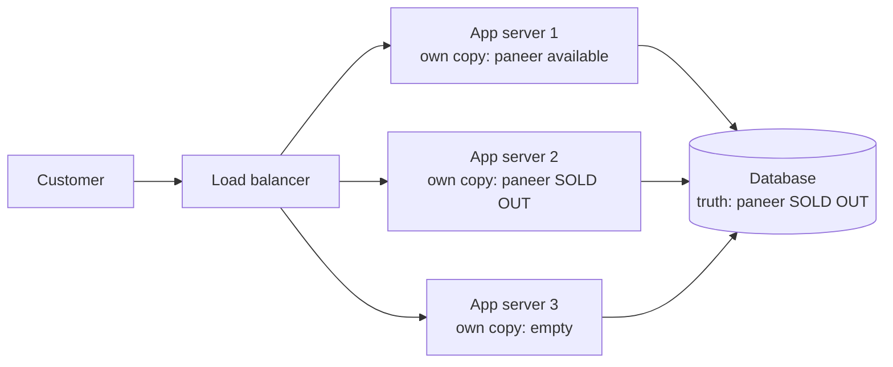
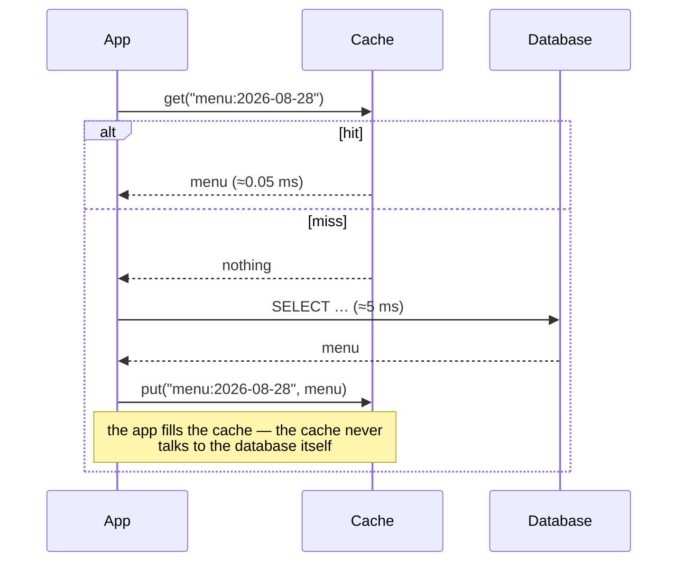
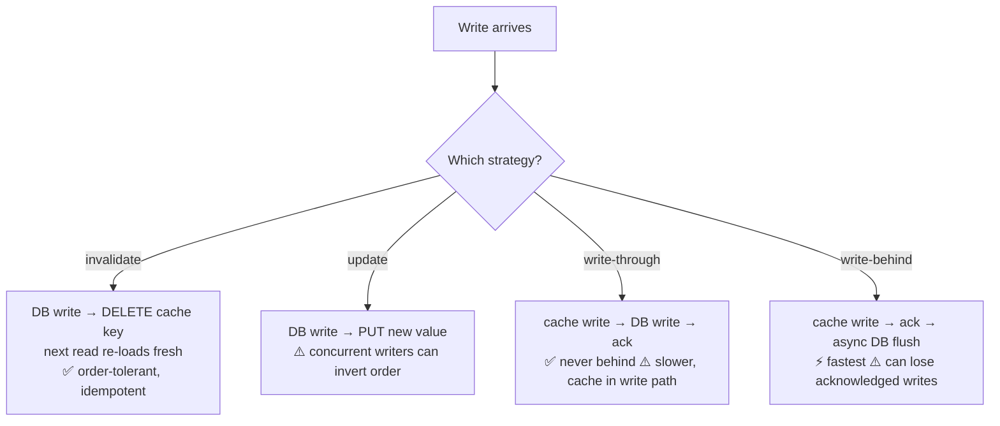
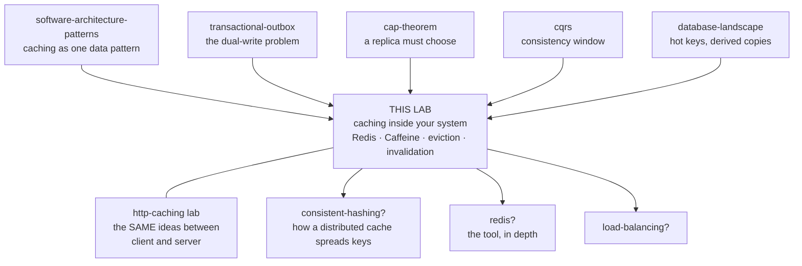

# Caching — from "remember the answer" to production

> **Depth layers in this doc:**
> **BEGINNER MODEL** (stages 1–9) → **INTERMEDIATE MODEL** (stage 10) →
> **ENGINEERING MODEL** (stages 11–14) → **PRODUCTION MODEL** (stage 15)
>
> Files in this lab: `CachingLab.java` (runnable — five scenarios, zero
> dependencies), `visualization.html` (interactive), `EXERCISES.md`,
> `SOLUTIONS.md`.
>
> **Every number in this document was produced by running the code in this
> folder.** Where I state a behavior I have not executed, I say so.

In the [software-architecture-patterns](../software-architecture-patterns/)
lab, caching appeared twice in passing: as one entry in the data-pattern
family, and as failure **F6, "cache inconsistency as a product bug"** — one
paragraph about a customer seeing their old address. This lab is that
paragraph, opened all the way up. It also collects the debt that lab left:
it called caching "the hardest data pattern" and moved on.

**You already have a caching lab — this is its other half.**
[http-caching](../http-caching/) covers the copies that live *between you
and the outside world* (browsers, CDNs, `Cache-Control`, `ETag`) — copies
you can only advise, never delete. This lab covers the cache *inside your
own system* (Redis, Memcached, Caffeine) — the one you fill, size, evict
from, and invalidate yourself. Stage 17 draws the line between them
precisely; you do not need that lab first.

---

## 1. WHY — why does this exist?

Computers answer the same question over and over. A restaurant's menu page
is built by asking the database for the same twelve dishes, fifty thousand
times a lunchtime — and every one of those trips takes a few milliseconds
that the customer waits through, and costs a slice of a database server
that is far more expensive than the machine asking. Do nothing about it and
two things happen: pages feel slow, and the database becomes the wall the
whole product hits — you cannot add users, because the one machine holding
the truth is already answering as fast as it can. Nearly every fast system
you have used is fast because it stopped re-computing answers it already
had. And nearly every strange bug where a website shows you something that
is *no longer true* comes from the same mechanism, done imperfectly.

---

## 2. THE PROBLEM — Meera's menu page

Meera runs **TiffinBox**, the lunch-delivery service from the previous lab.
Her database is one machine holding every dish, order, and customer.

The menu page is the first thing every customer sees. Building it asks the
database: *give me today's twelve dishes, with prices, photos, and the
kitchen's current availability.* That question takes about **5 milliseconds**
to answer.

At 200 lunches a day, nobody notices. Then TiffinBox grows: **50,000 menu
views between 12:00 and 13:00**. That is roughly 14 views every second, all
asking the identical question, and getting the identical answer, because
the menu changed once — at 9 a.m., when the kitchen set it.

Dev, her engineer, watches the database at 12:30. It is at 90% CPU. The page
that used to load instantly now takes over a second, because requests are
queuing behind each other for a database that is doing the same work
thousands of times. Nothing is broken. Nothing is buggy. The system is just
**answering a settled question, again and again, at full price.**

---

## 3. THE NAIVE SOLUTION — "remember the answer"

Dev's instinct is exactly right, and it is the seed of everything in this
lab. In the application, he keeps a variable:

```java
Map<String, Menu> remembered = new HashMap<>();

Menu getMenu(String day) {
    Menu m = remembered.get(day);        // did we already ask this?
    if (m == null) {
        m = database.loadMenu(day);      // no — ask once
        remembered.put(day, m);          // and keep the answer
    }
    return m;                             // yes — answer from memory
}
```

The first customer after each deploy pays the 5 ms. The next 49,999 get
their answer from memory in microseconds. Database CPU drops from 90% to
almost nothing. Dev ships it at 2 p.m. and it works beautifully.

> **🔮 Predict:** This code is genuinely good and genuinely broken. Three
> different things go wrong with it, on three different timescales — hours,
> days, and immediately-but-invisibly. What are they?
> <details><summary>Reveal</summary>
>
> 1. **Within hours (memory):** `remembered` only ever grows. Menus are keyed
>    by day, so that's slow — but Dev will reuse this trick for *customers*
>    and *dish photos* next week, and then the map grows with every customer
>    who ever visits. The app runs out of memory and crashes. A store that
>    never forgets is not a cache; it is a memory leak that starts out
>    looking helpful.
> 2. **Within a day (wrongness):** at 3 p.m. the kitchen marks paneer
>    sold-out. The database is updated. The map is not. Every customer keeps
>    seeing paneer available, ordering it, and getting a refund call. The
>    remembered answer was correct when it was remembered; nothing told it
>    the world had moved.
> 3. **Immediately, invisibly (disagreement):** TiffinBox runs on **three**
>    app servers behind a load balancer. Each has its own `remembered` map,
>    filled at a different moment. Three customers refreshing the same page
>    get three different menus, and refreshing bounces you between them.
>    Nobody can reproduce it, because the answer depends on which machine
>    you land on.
> </details>

---

## 4. THE FAILURE — watching all three happen

Take them in the order Meera's team actually met them, because each one
teaches a different lesson.

**Failure 1 — the memory ceiling.** Dev extends the trick to dish photos.
Memory climbs all afternoon and the process dies at 23:14. The lesson is
not "photos were too big." It is that **memory is finite and the set of
possible questions is not.** Any store that keeps everything must eventually
choose between crashing and *forgetting something* — and if you do not
choose what to forget, the operating system chooses for you, by killing the
process.

**Failure 2 — the wrongness window.** Paneer stays "available" for four
hours after it sold out. Notice what the naive code assumed: that an answer,
once true, stays true. Every remembered answer is a *copy* of something that
lives somewhere else and can change without warning. The moment you keep a
copy, you have signed up for the question **"how wrong am I willing to be,
and for how long?"** — and if you never answer it deliberately, the answer
is "infinitely wrong, forever."

**Failure 3 — three machines, three truths.** This is the one that ruins
afternoons, because it is invisible in development (one machine) and
unreproducible in production (which machine answered you?).

Here is the shape of all three, and it is worth seeing that they are one
shape: **you made a second copy of the truth, and copies need rules.**



Look at the three app boxes: same instant, three different answers, and only
one of them matches the database underneath.

---

## 5. THE REAL REQUIREMENT

Strip away the mechanism and what Meera needs is:

> **Serve repeated questions fast, out of a fixed amount of memory, being
> wrong by no more than a knowable amount of time — and know which
> questions to keep when the memory is full.**

Read that sentence again, because it has four demands in it and each one
becomes a section of this lab: *fast* (why the trick works at all), *fixed
memory* (how much to keep), *wrong by no more than a knowable amount* (how
the copy finds out the world moved), and *which questions to keep* (how to
choose what gets thrown away). Everything from here is the pursuit of that
one sentence.

---

## 6. THE KEY IDEA

> **Keep a small, bounded copy of the answers you are asked most often, and
> decide in advance both what to throw away when it is full and how stale
> you will let it get.**

Two decisions, made deliberately, are what separate a cache from a memory
leak that lies to your customers. The rest of this lab is what those two
decisions cost and how real systems make them.

---

## 7. TERMINOLOGY — the professional words, now that you have felt them

Seven load-bearing terms. Each gets: plain meaning, precise meaning, why the
word exists, a real example, and what it connects to.

**Cache** — plain: a small fast store of answers you already worked out.
Precise: a bounded store holding copies of data whose authoritative version
lives elsewhere, used to avoid recomputing or re-fetching. The word (from
French *cacher*, to hide) exists to distinguish it from a **database**: a
database is *responsible* for your data, a cache is *not* — you must be able
to delete a cache entirely and lose nothing but speed. That test is the
sharpest one in this lab: **if wiping it loses data, it is not a cache**, it
is a database you are treating carelessly. Example: Meera's `remembered` map
holds a copy of the menu; the menu's home is Postgres.

**Source of truth** — plain: the copy that is right by definition. Precise:
the authoritative store; when a cache and the source of truth disagree, the
cache is wrong, always, by definition. The term exists because with copies
around, "correct" needs an owner. Example: Postgres says paneer is sold out;
the app's map says available; the map is wrong — not "differently right."

**Hit / miss / hit ratio** — plain: found it / didn't / how often you find
it. Precise: a **hit** is a lookup served from the cache, a **miss** is one
that had to go to the source of truth; the **hit ratio** is hits ÷ total
lookups. These exist because hit ratio is the single number that decides
whether a cache is worth having, and it is the first thing you put on a
dashboard. Example: from `java CachingLab.java hit-rate` in this folder, a
1,000-entry cache over a 10,000-key workload got **67.3%** — two of every
three menu views never touched the database.

**Working set** — plain: the handful of things actually being asked for
right now. Precise: the set of keys accessed within a given time window,
which is almost always far smaller than the total keyspace. The term exists
(from 1960s virtual-memory research) to name *why caching works at all*:
access is **skewed**, not uniform. If every key were equally likely, a cache
holding 10% of keys would hit 10% of the time and be nearly worthless. In
the measured run above, 10% of the keyspace captured 67.3% of the traffic —
that gap between 10% and 67.3% is the entire business case for caching.

**Eviction / eviction policy** — plain: throwing something out to make room,
and the rule for choosing the victim. Precise: when a bounded cache is full,
the policy selects which entry to remove. The word exists because *removal
is not deletion of stale data* — the evicted entry may be perfectly valid;
it is being sacrificed for space. Example: a policy might remove whatever was
used longest ago — stage 10 builds four such rules and measures them against
each other. Connects to failure 1: eviction is the mechanism that makes
"fixed memory" possible.

**Staleness** — plain: how out-of-date your copy might be. Precise: the time
window between the source of truth changing and the cache reflecting that
change; during it, the cache serves values that are wrong. The term exists
so the wrongness can be *budgeted* rather than denied — the engineering
question is never "is it stale?" (it is) but "**bounded by what?**" Example:
a 60-second time limit means a price change can be invisible to customers for
up to 60 seconds, and you decide whether that is acceptable *before* the
incident. This is the same idea as the **consistency window** from your
[cqrs](../cqrs/) lab, at a different layer.

**TTL (time to live)** — plain: an expiry date on each stored answer.
Precise: a per-entry duration after which the entry is treated as absent and
must be re-fetched. It exists as the cheapest possible staleness bound: with
no other machinery at all, a 60-second TTL guarantees the cache cannot be
wrong for longer than 60 seconds. Example: `SET menu:2026-08-28 <json> EX 60`
in Redis. Connects to eviction — but note the difference, because it is
constantly muddled: **TTL is about correctness (this copy is too old to
trust); eviction is about space (I need room).** An entry can be evicted
while perfectly fresh, and can expire while the cache is half empty.

Smaller terms are defined at first use; all of them land in the
[GLOSSARY](#18-glossary).

---

## 8. MENTAL MODELS — carry two

**The simple model: a chef's prep counter.** The walk-in fridge (the
database) holds everything, but it is across the kitchen and every trip
costs time. So the chef keeps a small counter beside the stove with the
ingredients this hour's orders need. The counter is small on purpose — a
counter the size of the fridge would defeat the point. When it fills, the
chef pushes something aside to make room, and which thing they push aside is
a real decision. The counter holds *portions taken from* the fridge, not the
only portions in existence: if the counter is knocked over, service slows
while the chef fetches from the fridge again, but no food is lost.

**The engineering model: a bounded map plus three policies and one
equation.** A cache is:

- a **bounded key→value map** (`size ≤ capacity`, always — the invariant that
  makes memory finite);
- an **eviction policy**: given a full cache, choose a victim;
- a **staleness policy**: TTL, and/or invalidation on write — how the copy
  learns the truth moved;
- a **concurrency policy**: what happens when many readers miss the same key
  at the same moment (stage 11 makes this a headline event, not a footnote);
- governed by the **average latency equation**:

  `avg = hit_ratio × cache_latency + (1 − hit_ratio) × source_latency`

  This one line runs the entire field. With the measured 67.3% hit ratio,
  0.05 ms cache and 5 ms database: `0.673×0.05 + 0.327×5 = 1.67 ms` — versus
  5 ms uncached. Verified: that is exactly what `hit-rate` prints.

| Prep counter | Engineering model |
|---|---|
| The walk-in fridge | Source of truth (the database) |
| The counter beside the stove | The cache (bounded map) |
| Counter size | Capacity |
| Ingredient is already on the counter | Hit |
| Trip to the fridge | Miss → load from source of truth |
| Pushing something aside for room | Eviction, chosen by policy |
| "This cream smells off now" | Staleness / TTL expiry |
| Knocking the counter over | Cache flush — slow, not lossy |
| Three chefs, three counters | Multiple app servers, each with a local cache |

**Where the analogy breaks — three places, and they are exactly the hard
parts:**

1. **Ingredients on a counter do not silently become different
   ingredients.** But the database can change *while your copy sits there
   looking fine*, and nothing about the copy reveals it — this is failure 2,
   and no kitchen intuition prepares you for it. The engineering model says:
   a cached value carries no evidence of its own freshness; freshness must be
   imposed from outside (TTL) or announced (invalidation).
2. **A counter is one chef's.** A real system has many app servers, each
   with its own copy, plus possibly a shared remote cache and a CDN — the
   truth can be *differently stale in several places at once* (failure 3).
   The kitchen picture quietly implies a single observer; production never
   has one.
3. **Taking an ingredient from the fridge removes it from the fridge.** A
   cache read *copies*; the original stays and keeps evolving. Nearly every
   caching bug lives in that gap between copy and original.

Hold onto point 1 especially: the prep-counter picture is genuinely useful
for *speed* reasoning and genuinely misleading for *correctness* reasoning.

---

## 9. VISUALIZATION — watch the mechanism move

Open **`visualization.html`** in this folder (also published as an
interactive artifact — link in the session summary). It is the mechanism of
stage 10 made clickable:

- send reads and watch hits, misses, evictions, and the hit ratio move;
- switch the eviction policy live and watch which entry gets sacrificed;
- run a report that reads every dish once, and watch it push the popular
  dishes out — then switch the throw-away rule and watch that stop happening;
- fire many simultaneous readers at one key that has just been removed, and
  watch how many of them each go to the database (stage 11 names this one);
- step **backward** through any sequence to re-watch the moment something
  changed.

Every event is narrated in a full sentence saying what happened and why.
Use it alongside stage 10 rather than after it.

---

> **✅ CHECKPOINT — you now hold the BEGINNER MODEL.** You can say what a
> cache is (a bounded copy you could delete without loss), why it works
> (skewed access — a small working set absorbs most traffic), and the two
> deliberate decisions it demands (what to evict, how stale to allow). Next
> layer: the actual mechanism, one design decision at a time — each one
> arriving after the version before it visibly fails.

---

## 10. THE ACTUAL MECHANISM

### 10.1 The read path, v1: cache-aside

The pattern Dev wrote by instinct in stage 3 has a name — **cache-aside**
(also "lazy loading"): the application, not the cache, orchestrates.



Follow the `alt` block: the hit path touches one system, the miss path
touches three. Two properties fall out, and they are why cache-aside is the
default everywhere: only requested data is ever cached (no guessing), and
**if the cache dies the application still works**, just slowly — the
database is still reachable on the miss path. That resilience is exactly
the "you could delete it and lose nothing" test from stage 7, cashed in.

The cost is that the *first* request for every key pays full price (a **cold
cache**: immediately after a start or a restart, every single request misses
and the database receives the full, unprotected load), and the application
code must remember to do the caching correctly at every call site.

### 10.2 Why it works at all — the numbers

Signpost: this table is `java CachingLab.java hit-rate` — 200,000 requests
over 10,000 keys with realistic skew, 5 ms database, 0.05 ms cache. Read
the first column against the last.

```
cache size   hit ratio  avg latency    DB calls     (% of keyspace held)
100          38.8%      3.077 ms       122,307      (1%)
500          58.5%      2.107 ms        83,092      (5%)
1000         67.3%      1.670 ms        65,456      (10%)
2000         76.4%      1.217 ms        47,154      (20%)
5000         88.7%      0.611 ms        22,661      (50%)
```

Three things to take from it. **(1)** Holding 1% of the keyspace already
serves 38.8% of traffic — that is skew, the working set doing its job; with
uniform access, 1% of keys would buy 1% of hits and caching would be
pointless. **(2)** The database call column is the real prize: at size 1000,
134,544 of 200,000 queries never happened. Caching is a *capacity* strategy
at least as much as a latency one. **(3)** Diminishing returns are brutal
and universal — 100→500 buys +19.7 points, 2000→5000 buys +12.3 points for
six times the memory. There is always a knee, and past it you are buying
RAM to shave microseconds.

### 10.3 What to throw away — eviction, four attempts

Now the second deliberate decision. The cache is full; something must go.

**v1 — FIFO (first in, first out):** evict whatever has been in the cache
longest. Simple, obvious, and it ignores the only signal that matters.

> **🔮 Predict:** The menu key is requested 10,000 times an hour. Under FIFO,
> with a busy cache, what happens to it?
> <details><summary>Reveal</summary>
> It gets evicted, on schedule, no matter how hot it is — because FIFO
> measures *age since insertion*, not usefulness. Then the next request
> misses, re-loads it from the database, and the clock starts again. Your
> most valuable entry is thrown out on a timer. `CachingLab` asserts exactly
> this in `fifo_evicts_hot_key_anyway` (run `java CachingLab.java test`).
> </details>

**v2 — LRU (least recently used):** evict the entry nobody has touched for
the longest. One line of difference — *every hit promotes the entry to
most-recent* — and it captures the actual signal: recently used things tend
to be used again. This is the default in most systems, and the data structure
is a small classic: a hash map for O(1) lookup, plus a doubly-linked list for
O(1) recency ordering (`LruCache` in `CachingLab.java`; neither structure
works alone — the map has no order, the list has no fast lookup).

**v2 breaks — scan pollution.** Meera adds a nightly report that reads every
dish row once. Each row is "most recently used" the instant it is read, so
the report's one-time reads march through the cache and evict the genuinely
hot menu entries. The report gains nothing (it never re-reads anything) and
lunch service pays for it.

**v3 — LFU (least frequently used):** evict the entry used the *fewest*
times. A row the scan touched once has frequency 1 and cannot displace the
menu key with frequency 10,000. Scan resistance, solved.

> **🔮 Predict:** LFU wins the scan case decisively. Where does counting
> frequency-over-all-history go wrong? (Think about Meera launching in a new
> city.)
> <details><summary>Reveal</summary>
> When popularity *changes*. Yesterday's hot keys carry enormous accumulated
> counts; today's genuinely hot keys start at 1 and can never win an eviction
> contest against a stale champion. The cache fills with entries that *used
> to* matter — **cache squatting** — and the new working set can't get
> established. LFU's strength (long memory) becomes its disease the moment
> the future stops resembling the past.
> </details>

Signpost: this is `java CachingLab.java eviction` — the same cache and
workload under three conditions. Column C is where the prediction above gets
tested.

```
policy     A: skewed      B: + scan      C: shifting
FIFO       62.8%          56.8%          66.7%
LRU        67.3%          61.9%          74.9%
LFU        75.2%          75.1%          48.9%
Random     62.8%          56.9%          66.6%
```

Read it as three verdicts. **A (stable popularity):** LRU beats FIFO and
Random by ~4.5 points — promoting on hit is worth real money; LFU leads
outright at 75.2% because when popularity never changes, history predicts
the future perfectly. **B (a scan runs):** LRU and FIFO each lose ~5 points
of *user* hit ratio to pollution; LFU loses 0.1 — untouched, exactly as
predicted. **C (the hot set moves):** LFU collapses to 48.9%, worst of all
four, below even Random, while LRU rises to 74.9%. The policy that won A and
B loses C by 26 points.

The lesson is not "use LRU" or "use LFU." It is that **no eviction policy
wins everywhere, because each one is a bet about how the future resembles
the past** — recency bets that what was just used will be used again;
frequency bets that what was used often will be used often. Production
caches (Caffeine's W-TinyLFU on the JVM, Redis's sampled-LRU/LFU modes) take
the obvious way out: *combine both signals, and age the frequency counts so
old champions decay.* Every weird detail in those designs is a scar from
column B or column C.

### 10.4 The write path — where correctness lives

Reads were about speed. Writes are where the wrongness from failure 2 gets
decided. The kitchen marks paneer sold out; the database row changes. What
happens to the copy?

Four strategies, and the differences are consequential:

**(a) Invalidate on write (delete the key).** Write the database, then
delete the cached entry. The next reader misses and re-loads fresh. Simple,
and the standard partner for cache-aside — you never have to make the cache
and database agree on *content*, only on *absence*.

**(b) Update on write (write the new value into the cache).** Tempting —
avoids the next miss — and more dangerous: two concurrent writers can land
in the cache in the opposite order to how they landed in the database,
leaving the cache holding the older value permanently. Delete is idempotent
and order-tolerant; update is neither. **Prefer invalidate to update** is
about as close to a rule as this field gets.

**(c) Write-through.** The application writes to the cache, which
synchronously writes to the database before acknowledging. The cache is
never behind — at the cost of latency on every write, and a cache that is
now in the write path (if it is down, writes fail — you have given up
cache-aside's independence).

**(d) Write-behind (write-back).** Write to the cache, acknowledge
immediately, flush to the database asynchronously. The fastest writes here,
and the only option in this lab that **can lose acknowledged data**: for a
window, the cache holds the only copy. That is the cache becoming a database
without being built like one — use it only where losing that window is
genuinely acceptable (view counters, telemetry), never for orders or money.



### 10.5 TTL — the safety net you always want

Even with perfect invalidation, put a TTL on entries. Why, if invalidation
already handles updates? Because **invalidation is a message that can be
missed** — a deploy bug, a dropped event, a race (stage 11 shows one), a
key you forgot to invalidate when you added a new write path six months
later. A TTL converts *"wrong forever, silently"* into *"wrong for at most
60 seconds."* It costs a small amount of hit ratio and buys a bound on your
worst case. Choose it from the business: menu prices at 60s, a currency
rate at 5s, a country list at 24h.

The one caution: identical TTLs on many keys created at the same moment
(a deploy, a cache warm-up) make them all expire *simultaneously*, so every
one of those keys misses at the same instant and the database takes the whole
surge at once — a flood you inflicted on yourself, and the subject of F1
below. Add **jitter** (`60s ± 10%`) so the expiries spread out, exactly as
you learned to jitter retries in the
[architecture lab](../software-architecture-patterns/).

---

> **✅ CHECKPOINT — you now hold the INTERMEDIATE MODEL.** You can design a
> cache: cache-aside reads, invalidate-on-write, a jittered TTL, an eviction
> policy chosen against your workload's shape, and the latency equation to
> justify it. What you cannot yet do is survive it in production, because
> everything so far assumed one reader at a time and no failures. That
> assumption is where caches actually hurt people.

---

## 11. FAILURE SCENARIOS

Six failure modes that matter. Each: how to create it, where to watch it,
what happened and why, how the system responds, and which guarantee bends.

### F1 — Cache stampede (thundering herd on one key)

You met this name in the [database-landscape](../database-landscape/) lab
and again at the HTTP layer in [http-caching](../http-caching/). Here is the
mechanism itself, with the cost measured.

**Create it:** `java CachingLab.java stampede` — 200 concurrent readers, one
key that just expired, a 50 ms database read.

**What happened** (verified output):

```
WITHOUT protection:          DB calls: 200    wall time: 68 ms
WITH single-flight lock:     DB calls: 1      wall time: 57 ms
```

**Why:** between the expiry and the first successful fill, *every* arriving
request sees a miss, and each independently decides to ask the database. The
cache's protection disappears exactly when load is highest. On a real hot
key at lunch peak this is a coordinated denial-of-service that your own
system performs on your own database — and it self-amplifies: the database
slows under 200× load, so the fill takes longer, so more requests pile into
the same window.

**The fix — single-flight:** the first request to miss a key takes a
per-key lock and loads; concurrent missers *wait for that same load* rather
than starting their own. In the code, the loser of `putIfAbsent` joins the
winner's `CompletableFuture`:

```java
CompletableFuture<Integer> existing = inFlight.putIfAbsent(1, mine);
if (existing != null) return existing.join();   // join the flight already in the air
```

**Guarantee kept:** correctness — every caller still gets a correct value.
**Guarantee bent:** latency fairness — 199 callers now wait on one loader
(bounded by that loader's timeout, which is why single-flight needs a
timeout). **In production:** Caffeine's `LoadingCache` does this per key by
default; Redis users implement it with a short-lived lock key, or with
**probabilistic early refresh** (refresh a hot key slightly *before* expiry,
in the background, so it never expires under load).

### F2 — The stale-fill race (invalidation done right, still wrong)

**Create it:** `java CachingLab.java stale-race`.

**What happened** (verified output):

```
NAIVE fill:              cache says: ₹100     DB truth: 120   → STALE — cache and truth disagree
WITH version check:      cache says: (empty)  DB truth: 120   → consistent
```

**Why — the interleaving, step by step.** A reader misses and fetches ₹100
from the database. Before it can fill the cache, it stalls (GC pause, slow
network — anything). Meanwhile a writer sets the price to ₹120, commits, and
deletes the cache key — textbook invalidation, executed perfectly. *Then*
the stalled reader wakes and writes its ₹100 into the now-empty cache. The
delete happened before the fill, so the delete accomplished nothing. The
cache now serves ₹100 until the next write or TTL — **and no line of code
was wrong.**

This is the deepest idea in the lab: cache + database is a **dual write** —
the same problem your [transactional-outbox](../transactional-outbox/) lab
was built around, wearing different clothes. Two stores, no shared
transaction, therefore an interleaving exists where they disagree.

**The fix — prove the truth did not move.** The reader records the version it
read and fills only if the version is unchanged:

```java
if (dbVersion.get() == seen) { cache.put(1, value); }  // else discard the fill
```

**Guarantee kept:** bounded staleness, *if* you also have a TTL.
**Guarantee bent:** none formally — you cannot eliminate this race without a
protocol, only shrink its window. **In production:** memcached **leases**
(Facebook's published fix: the cache hands a miss-token to one reader and
rejects fills carrying a stale token), Redis `WATCH`/CAS fills, or the
common honest choice — accept the race, keep the TTL short, and know the
worst case.

### F3 — Unbounded growth (the memory leak wearing a cache costume)

**Create it:** delete the capacity check from `LruCache.put` and run any
workload with many distinct keys. **Why:** the set of possible keys (every
customer, every search term) is unbounded; memory is not. **Response:**
in a JVM, rising heap → longer GC pauses → latency climbs → eventually
`OutOfMemoryError`; the pauses usually hurt before the crash does, which is
why this is often misdiagnosed as "a GC problem." **Guarantee bent:** the
capacity invariant `size ≤ capacity` — the one thing that made memory
finite. **In production:** always set a maximum size *or* a maximum weight;
never cache an unbounded keyspace without one; alert on cache memory and on
eviction rate (a sudden eviction spike means your working set outgrew the
cache). `CachingLab`'s `lru_capacity_bound_holds` test exists precisely to
pin this invariant.

### F4 — The hot key

**Create it:** point 30% of all traffic at a single key (a celebrity
restaurant, a flash-sale item). This is the **hot key / hot partition** you
met in [database-landscape](../database-landscape/), now on the cache tier.
**Why it is a cache problem:** in a *distributed* cache, keys are spread
across nodes by hash, so one key lives on exactly one node — that node
saturates while the rest idle, and you cannot fix it by adding nodes (the
hash sends the key to the same place).
**Response/fixes:** a small local in-process cache in front of the remote
one (**near cache** / L1-L2 — the hot key gets served from every app server
without a network hop), or key-splitting (`item:42#1..#8`, read a random
shard). **Guarantee bent:** the assumption that load spreads with keys.
**In production:** Netflix's EVCache and most CDN designs are, in part,
answers to this; watch for per-node hit-rate and CPU skew on your cache
dashboard, not just the fleet average.

### F5 — Cache penetration (caching the absence)

**Create it:** request keys that *do not exist* in the database — a scraper
walking `/dish/999999`, or a bug requesting null IDs. **Why:** a miss on a
nonexistent key can never be filled by a successful load, so every such
request reaches the database, every time. The cache provides zero protection
against exactly the traffic most likely to be hostile. **Fix:** **negative
caching** — store a tombstone ("no such dish") with a short TTL, so repeats
are absorbed; plus a **bloom filter** in front for very large keyspaces —
the same structure that let LSM engines skip 98.2% of disk reads for absent
keys in your [btree-and-lsm](../btree-and-lsm/) lab, doing the identical job
one layer up.
**Guarantee bent:** the implicit assumption that a cached key exists.
**Careful:** negative entries need *shorter* TTLs than positive ones — a
dish that gets created should not stay invisible for an hour.

### F6 — Cold start / mass eviction

**Create it:** restart the cache (or deploy, or fail over) at 12:30.
**Why:** every request misses simultaneously; the database receives full
uncached production load, which — by the numbers in 10.2 — is roughly **3×**
what it was sized for at a 67% hit ratio, and often far more. Systems that
have run comfortably for months fall over in the first minute after a cache
restart, and the restart looks innocent in the timeline. **Response:**
never flush a whole production cache at peak; warm caches before taking
traffic (replay top keys); stagger restarts across nodes; keep single-flight
on so the herd collapses to one load per key; and size the database for
*some* survivable fraction of uncached load. **Guarantee bent:** the hidden
one — that your database can serve your actual traffic. It usually cannot,
and the cache has been quietly hiding that fact.

---

## 12. CORRECTNESS — what a cache does and does not guarantee

Time to be precise, because the honest answer surprises people.

**A cache guarantees nothing about freshness by itself.** There is no
invariant like Paxos's "only one value is ever chosen." A cache is a
*replica*, and by the [cap-theorem](../cap-theorem/) reasoning you already
have, a replica that answers during a partition (or just during the gap
between a write and an invalidation) answers *possibly-stale*. Caching is
therefore an availability/latency choice paid for in consistency — you have
made the AP-flavored trade, usually without noticing.

**What you *do* get, and only if you engineer it:**

- **Bounded staleness** — from TTL. This is the only freshness property you
  get for free-ish, and it is a *bound*, not a promise of freshness.
- **Eventual consistency** — with invalidation-on-write plus TTL, the cache
  converges to the truth after each change. (Same idea as your
  [cqrs](../cqrs/) read models converging behind the write model.)
- **The capacity invariant** — `size ≤ capacity`, always. This one *is*
  absolute, and it is what makes a cache a cache rather than a leak.
- **Loss-free deletion** — you can drop the entire cache and lose only
  speed. If that is not true of your system, you are running a database.

**What you explicitly do NOT get:**

- **Read-your-own-writes** — Meera updates a price and immediately reloads;
  a different app server serves her its own stale copy. You must *engineer*
  this (invalidate before responding to the write, route the writer's reads
  past the cache for a few seconds, or version the key).
- **Monotonic reads** — two consecutive reads can go to two servers with
  differently-stale copies, so a customer can watch a price go ₹120 → ₹100 →
  ₹120. Time can appear to run backwards. This is failure 3 from stage 4,
  and it is why "just refresh the page" sometimes fixes things and sometimes
  makes them worse.
- **Atomic cache+database updates** — impossible without a distributed
  transaction; this is the dual write of F2. Every real system shrinks the
  window rather than closing it.

**What you traded away to get the speed:** simplicity (a second store with
its own failure modes), debuggability (the answer now depends on invisible
state), and a class of correctness bugs that are rare, unreproducible, and
land as customer complaints rather than exceptions. That is the honest bill.
The reason to pay it is stage 10.2's third column — the queries that never
happened.

---

## 13. CODE — the load-bearing lines

`CachingLab.java` is ~330 lines, zero dependencies, five scenarios. The
lines that matter, and what each one enforces:

**The capacity invariant** (`LruCache.put`) — the difference between a cache
and a leak:
```java
if (map.size() == capacity) {
    Node victim = tail.prev;            // least-recently-used lives at the tail
    unlink(victim); map.remove(victim.key);
}
```

**The LRU promotion** (`LruCache.get`) — one line, worth 4.5 points of hit
ratio over FIFO in the measured run:
```java
unlink(n); linkAtHead(n);   // every hit promotes to most-recent
```

**Single-flight** (`runStampede`) — turns 200 database calls into 1:
```java
CompletableFuture<Integer> existing = inFlight.putIfAbsent(1, mine);
if (existing != null) return existing.join();
```

**The version-checked fill** (`runStaleRace`) — the dual-write mitigation:
```java
if (dbVersion.get() == seen) { cache.put(1, value); }   // fill only if truth hasn't moved
```

The concurrency scenarios use **virtual threads**
(`Executors.newVirtualThreadPerTaskExecutor()`, `Thread.ofVirtual()`) from
your [java-virtual-threads](../java-virtual-threads/) lab — 200 blocking
loaders is exactly the "waiting is nearly free" case, and it keeps the
stampede demo to one process with no thread-pool tuning.

## 14. EXPERIMENTS — predict first, then run

Each: the question, the command, what you should see, and why.

1. **How much memory do you actually need?** — *Predict: to serve two-thirds
   of traffic from cache, what fraction of the keyspace must you hold?* →
   `java CachingLab.java hit-rate` → 10% holds 67.3%. Skew is doing the work,
   not size.
2. **Does eviction policy matter?** — *Predict: which policy wins?* →
   `java CachingLab.java eviction` → it depends entirely on the workload;
   LFU wins two columns by a mile and loses the third by 26 points.
3. **What does one expired hot key cost?** — *Predict: how many database
   calls will 200 simultaneous readers make?* →
   `java CachingLab.java stampede` → 200 without protection, 1 with.
4. **Can correct invalidation still leave stale data?** — *Predict: yes or
   no?* → `java CachingLab.java stale-race` → yes: ₹100 cached against ₹120
   truth.
5. **Break it yourself:** remove the capacity check (F3), or the version
   check (F2), or set every TTL identical and watch synchronized expiry.
   `java CachingLab.java test` should fail loudly for the first one — the
   tests exist as executable statements of the invariants.

---

> **✅ CHECKPOINT — you now hold the ENGINEERING MODEL.** You can name what a
> cache guarantees (bounded staleness, capacity, loss-free deletion) and what
> it never does (read-your-own-writes, monotonic reads, atomic updates), and
> you have watched the two failures that cause most real incidents. Last
> layer: what this looks like when it is somebody's on-call rotation.

---

## 15. PRODUCTION

**The chain from this lab to a real system.** `CachingLab`'s `LruCache` →
**Caffeine** (the JVM standard: W-TinyLFU admission, per-entry TTLs,
`LoadingCache` with single-flight built in, async refresh) → a **remote
cache** (Redis or Memcached: shared by all app servers, so failure 3
disappears, at the cost of a ~0.5 ms network hop and a new tier to operate)
→ a **multi-tier arrangement** (L1 in-process Caffeine for the hottest keys,
L2 Redis for shared state, plus a CDN in front for public assets) →
**invalidation plumbing** (an event stream or CDC from your
[outbox](../transactional-outbox/) lab firing cache deletes when rows
change).

**Redis vs Memcached, in one line each:** Memcached is a pure multi-threaded
LRU key→bytes cache — simpler, excellent at exactly one job; Redis adds data
structures, persistence, replication, and scripting, which makes it more
useful and also makes people mistake it for a database (write-behind by
accident). Both are correct choices; the mistake is assuming the second one
is a durable store.

**What an on-call engineer actually watches** — the four numbers, in order
of diagnostic value: **hit ratio** (a sudden drop means a deploy changed key
names, a TTL, or the working set — it is usually the *first* symptom of a
caching incident, before latency moves); **eviction rate** (rising = the
working set outgrew the cache, so the hit ratio is about to fall);
**p99 latency of the cache itself** (a slow cache is worse than no cache —
you pay the cache latency *and* the database latency on every miss); and
**cache memory / key count**. Add an alert for *hit ratio dropping below
your latency budget's requirement*, computed from the stage-8 equation:
that is the alert that catches problems while they are still small.

**The tuning dials and their tradeoffs:** capacity (hit ratio vs memory cost
— find the knee from 10.2), TTL (staleness bound vs hit ratio vs stampede
risk), eviction policy (match it to whether your popularity is stable or
shifting — column A vs column C), and single-flight timeouts (herd
protection vs one slow loader blocking many callers).

**What this lab intentionally omits, and how real systems handle each:**

| Omitted here | Reality |
|---|---|
| Network, serialization | A remote cache costs ~0.2–1 ms per call and requires serializing values; a fat object can make caching *slower* than the query. Measure before assuming. |
| Distribution across nodes | **Consistent hashing** so adding a node re-maps ~1/N keys instead of all of them (a `/learn` topic of its own). |
| Cache-node failure | Redis Cluster/Sentinel failover; the load shifting to the database is F6 in miniature — size for it. |
| Multi-region | Region-local caches with independent staleness; cross-region invalidation is a distributed-systems problem, not a caching one. |
| Security & isolation | Multi-tenant key prefixes, encryption in transit, and never caching another tenant's data under a shared key (a real breach class). |
| Cost | RAM is roughly 100× the price of disk per byte; caching is a *spend*, justified by the DB-calls-avoided column, not by taste. |
| CPU caches, HTTP caching | Same principles, other layers: L1/L2/L3 hardware caches below, and browser/CDN caching above — the latter is your [http-caching](../http-caching/) lab, which is where `Cache-Control`, `ETag` and `304` live. |

**Anchors worth remembering:** Facebook's *Scaling Memcache at Facebook*
(NSDI 2013) — the paper that named leases and documented stampedes at
enormous scale; Caffeine's W-TinyLFU work (the answer to columns B and C);
Netflix's EVCache (near-cache + replication for hot keys); and the industry's
favorite joke, which you can now read as a lab summary: *there are only two
hard things in computer science — cache invalidation and naming things.*

---

## 16. EXERCISES

The eight-rung ladder is in [`EXERCISES.md`](EXERCISES.md), with worked
answers in [`SOLUTIONS.md`](SOLUTIONS.md). Rungs 5–6 are code against
`CachingLab.java` (implement a TTL cache; find the planted bug); rungs 7–8
are design work (make invalidation survive a dropped message; design the
cache tier for TiffinBox at 3M orders/day).

## 17. KNOWLEDGE MAP & NEXT STEPS



**Your two caching labs, and the line between them.** This lab is the cache
**you operate inside your system** — a Redis or Caffeine instance you fill,
size, evict from, and invalidate, where the failure modes are stampedes,
stale fills, and memory. [http-caching](../http-caching/) is the cache
**you negotiate with strangers** — `Cache-Control`, `ETag`, `304`, browsers
and CDNs you do not control, where the failure mode is a copy you cannot
reach to delete. Same physics (a bounded copy that can go stale), opposite
control: here you hold the delete button; there you only get to *suggest*
an expiry, which is why that lab's hardest lesson is versioned URLs.

**Commonly confused, one sentence each:** *cache vs database* — deleting a
cache loses only speed; deleting a database loses data. *Cache vs read
replica* — a replica holds the *whole* dataset kept in sync by the database
itself; a cache holds an arbitrary bounded subset kept in sync by you.
*Cache vs [CQRS](../cqrs/) read model* — a read model is a purpose-built,
authoritative-for-reads projection you rebuild deliberately; a cache is an
opportunistic copy of whatever was asked for. *Eviction vs expiry* — space
vs age. *Application cache vs HTTP cache* — see the paragraph above: who
can delete the copy. *Memoization vs caching* — memoization is caching a
pure function's result (no staleness problem, because the truth cannot
move); caching in this lab is copying *mutable* state, and all the hard
parts come from that one difference.

**Next steps, ready to type:** `/learn consistent-hashing` (the natural
sequel, and already queued by three of your labs — how a distributed cache
decides which node holds a key, and why adding a node re-maps only 1/N of
them instead of everything), `/learn redis` (the tool in depth), or
`/learn load-balancing`. If you have not read the sibling
[http-caching](../http-caching/) lab yet, read it next — together the two
cover the whole path from browser to disk.

## 18. GLOSSARY

In order of appearance.

- **Cache** — a bounded store of copies whose authoritative version lives elsewhere; deleting it must lose nothing but speed.
- **Source of truth** — the authoritative store; when it and a cache disagree, the cache is wrong by definition.
- **Hit / miss** — a lookup served from the cache / one that had to go to the source of truth.
- **Hit ratio** — hits ÷ total lookups; the single number that says whether a cache is earning its keep.
- **Working set** — the keys actually being accessed in a time window; far smaller than the keyspace, which is why caching works.
- **Skew** — the unevenness of access (a few keys get most traffic).
- **Eviction** — removing a valid entry to make room; chosen by an **eviction policy**.
- **Staleness** — the window during which a cached copy no longer matches the truth.
- **Eventual consistency** — the cache converges to the truth after each change (via invalidation and/or TTL) rather than matching it at every instant.
- **TTL (time to live)** — a per-entry expiry that bounds staleness without any other machinery.
- **Capacity invariant** — `size ≤ capacity`, always; what makes a cache bounded rather than a leak.
- **Cache-aside (lazy loading)** — the app checks the cache, loads from the source on a miss, and fills the cache itself.
- **Cold cache** — a cache with nothing useful in it yet; every request misses.
- **FIFO / LRU / LFU / Random** — evict oldest-inserted / least-recently-used / least-frequently-used / an arbitrary entry.
- **Scan pollution** — a one-pass read of many cold keys evicting the genuinely hot ones (LRU's weakness).
- **Cache squatting** — old high-frequency entries blocking a new working set (LFU's weakness).
- **W-TinyLFU** — a modern admission policy combining frequency and recency with aging; Caffeine's default.
- **Invalidate on write** — delete the cached key after writing the source of truth; order-tolerant and idempotent.
- **Write-through** — write cache and source synchronously before acknowledging.
- **Write-behind (write-back)** — acknowledge from the cache, flush to the source asynchronously; can lose acknowledged writes.
- **Jitter** — randomizing TTLs (or retries) so many entries don't expire simultaneously.
- **Cache stampede (thundering herd)** — many concurrent misses on one key all loading from the source at once.
- **Single-flight** — deduplicating concurrent loads of the same key so only one reaches the source.
- **Probabilistic early refresh** — refreshing a hot key shortly before expiry, in the background, so it never expires under load.
- **Stale-fill race** — a slow reader writing a pre-update value into the cache after a correct invalidation.
- **Dual write** — updating two stores with no shared transaction; the root of the stale-fill race (see the outbox lab).
- **Lease** — a miss-token issued to one reader so late fills carrying an old token can be rejected (Facebook's memcache fix).
- **Hot key** — a single key taking a large share of traffic; saturates one node in a distributed cache.
- **Near cache (L1/L2)** — a small in-process cache in front of a shared remote cache.
- **Cache penetration** — repeated misses for keys that do not exist, giving the source no protection.
- **Negative caching** — caching "not found" with a short TTL to absorb penetration.
- **Bloom filter** — a compact probabilistic structure answering "definitely absent / possibly present."
- **Cold start** — the post-restart period when an empty cache passes full load to the source of truth.
- **Read-your-own-writes** — a reader seeing their own update immediately; not automatic with a cache.
- **Monotonic reads** — never seeing time run backwards across successive reads; not automatic with a cache.
- **Consistent hashing** — distributing keys so adding/removing a node re-maps only a small fraction of them.
- **Memoization** — caching a pure function's result; no staleness problem, because the truth cannot move.
