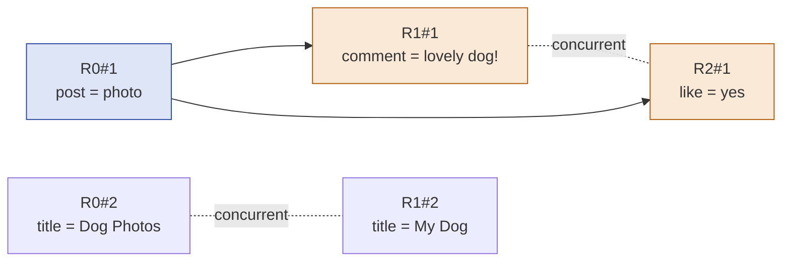
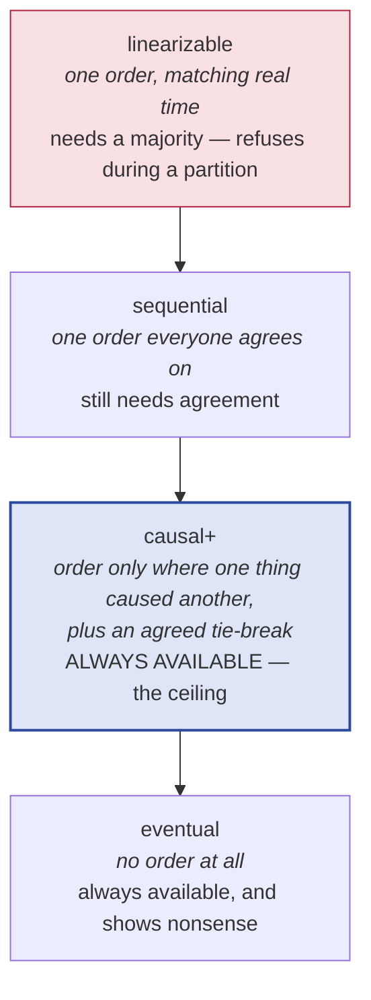
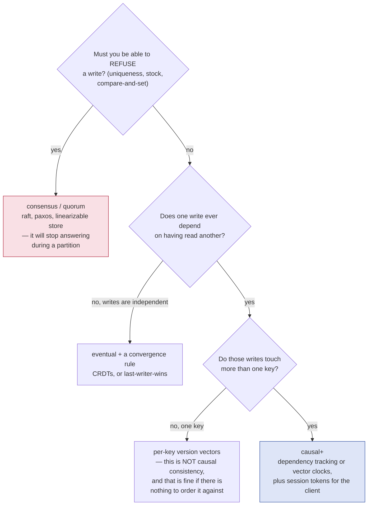
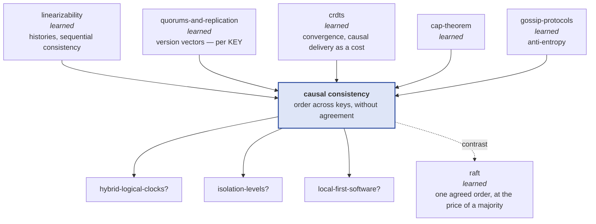

# Causal consistency

> Somebody replies to a message you cannot see. Somebody's photo appears
> without the privacy setting that was supposed to arrive first. Nothing
> crashed, no replica misbehaved, and every component did exactly what it was
> told.
>
> This lab is about the one rule that stops that, what it costs, and the
> precise line where it stops helping.

**Run it:**

```bash
java src/Sim.java             # one narrated afternoon across three regions
java src/Tests.java           # 32 guarantees, asserted
java src/Tests.java broken    # three plausible, wrong versions of the rule
java src/Experiments.java     # ten measurements
java src/Experiments.java 4   # ...or just experiment 4
java src/YourCheck.java       # exercise 5: write the rule yourself (2/6 -> 6/6)
```

No build tool, no dependencies — JDK 22+ compiles the whole `src/` directory
straight from source.

**Play with it:** [`visualization.html`](visualization.html) —
*The Comment Before the Post*
(<https://claude.ai/code/artifact/497ca160-d05d-4b21-8e7e-dca6e71a732e>).
Three regions on a space-time diagram; click any change to light up everything
that caused it and everything it caused. Six guess-first situations.

**Depth layers:**

| Layer | Stages | You will be able to |
|---|---|---|
| **Beginner model** | 1–9 | Explain how an effect overtakes its cause, and what "wait for what it was based on" buys |
| **Intermediate model** | 10 | Derive every real implementation — from naming what a change was based on, to compressing that into counters, to the piece that has to live on the client — each from the failure of the one before it |
| **Engineering model** | 11–14 | State the guarantee and its exact edge, and cost it in latency rather than adjectives |
| **Production model** | 15 | Read the COPS and Bayou papers and MongoDB's causal-consistency docs and know what you are looking at |

**Where this sits in what you already know.** The
[`linearizability`](../linearizability/) lab defined the strongest useful
consistency model and showed you how to weaken it once: delete the real-time
rule and you get sequential consistency. **This lab deletes the second rule** —
the requirement that everybody agree on *one* order — and lands on the weakest
model that still makes sense to a human. The
[`quorums-and-replication`](../quorums-and-replication/) and
[`crdts`](../crdts/) labs both gave you machinery for keeping one key's copies
in agreement; the thing neither of them addressed is ordering *across* keys,
which is exactly what this property is.

---

## 1. WHY — the problem, before any technology

Your product runs in several regions so that people everywhere get fast
answers. A region answers immediately from its own copy and passes the change
along to the others in the background. This is the design almost everyone
ships, and for one user changing one thing it is perfect.

It stops being perfect the moment one change is a *response* to another.
A comment is a response to a post. A reply is a response to a message. "Publish
this photo" is a response to "stop letting my manager see my photos". When the
two changes travel by different routes at different speeds, the second one can
arrive first — and a user somewhere is shown a reply to something that, as far
as that region is concerned, has not happened.

The damage runs from confusing (a comment on a missing post) to serious (a
photo published under the privacy setting it was meant to replace). And the
worst part is that nothing is broken: every machine did its job.

---

## 2. PROBLEM — three people, one afternoon

Amira is in London, Ben is in Frankfurt, Cara is in Singapore. All three use
the same app, each served by their nearest region.

1. **Amira posts a photo.** London shows it to her instantly and starts sending
   a copy to Frankfurt and Singapore.
2. **Ben reads the post** — the copy reached Frankfurt in a moment — **and
   leaves a comment**: "lovely dog!". Frankfurt shows it to him instantly and
   starts sending copies out.
3. **Cara opens the app in Singapore.**

The London→Singapore route is having a bad afternoon; the Frankfurt→Singapore
route is fine.

Here is the thing to hold on to: **Ben's comment only exists because he read
Amira's post.** A human can see that. Nothing in the system can, because
nothing recorded it.

---

## 3. NAIVE SOLUTION — show each change as soon as it arrives

The obvious design, and the fastest one:

> When a region receives a copy of a change, apply it and start showing it.

There is nothing to wait for, so nothing is ever slow. Every region converges
on the same content eventually. This is what an ordinary asynchronous
replicated store does.

---

## 4. FAILURE — what Cara actually sees

> **🔮 Predict:** Ben's comment took the fast route; Amira's post is still
> crawling. What does Cara's screen show, and who gets told about it?
>
> <details><summary>Reveal</summary>
>
> `comment = "lovely dog!"` and no post at all. Nobody is told anything, because
> nothing went wrong: Singapore received one change and applied it, exactly as
> designed.
>
> Run it: `java src/Sim.java`, scene 1. The lab's own words for it:
>
> ```
> Cara reads comment :  lovely dog!
> Cara reads post :     null
> t=6 cara [CAUSALITY] sees comment=lovely dog! (R1#1) but post still reads
>       <absent> — the cause post=photo-of-a-dog (R0#1) is invisible here
> ```
>
> Now the deeper problem, which is not about speed at all. **The message Ben's
> region sent contains no trace of the fact that his comment was written after
> reading Amira's post.** It says "set comment to 'lovely dog!'" and nothing
> else. Singapore could not have waited for the post even if it had wanted to,
> because it had no way of knowing there was anything to wait for.
>
> The information was destroyed at the moment the message was built. This is the
> same shape of failure as the crdts lab's opening (a whole list sent where an
> individual change was meant) and the google-docs lab's (a position sent where
> an identity was meant): *the wire format threw away what the receiver needed*.
>
> </details>

Two things make this worse than a one-off:

- **It is not rare, it just needs an unequal network.** `java
  src/Experiments.java 2` runs the identical design at six levels of route
  slowness. At no extra delay, 30 of 300 runs hit the anomaly. At 20 ticks of
  extra delay, **214 of 300**. The design never changed. *A consistency test on
  a calm network proves nothing* — the same lesson the
  [`linearizability`](../linearizability/) lab measured from the other side.
- **It is not fixed by the tools you already have.** A version vector per key
  (from [`quorums-and-replication`](../quorums-and-replication/)) keeps *one
  key's* copies in order. The post and the comment are different keys. A CRDT
  merge (from [`crdts`](../crdts/)) makes each key converge. Neither says a word
  about the order between two keys, and this problem lives entirely between
  keys.

---

## 5. THE REAL REQUIREMENT

State it in plain words, with no technology in it:

> **If one change was made after seeing another, then no replica may ever show
> the second without also showing the first.**

And, because we are not willing to give up the thing that made this
architecture worth building:

> Every region must still answer immediately, from its own copy, even while
> cut off from the others.

Notice what we are *not* asking for. We are not asking that everybody see
changes in the same order — only that nobody sees an effect before its cause.
Two changes that had nothing to do with each other may appear in either order,
on different machines, and that is fine.

That deliberate weakening is the whole idea, and it is best understood against
what you already know:

| Model | The rule you delete | What you keep |
|---|---|---|
| **Linearizability** | — | one order, and it matches real time |
| **Sequential consistency** | real-time order | one order everybody agrees on |
| **Causal consistency** | one agreed order | order only where one thing caused another |
| **Eventual consistency** | causal order too | nothing about order at all |

Each step down buys availability and latency and sells guarantees. This lab is
about the third row, and §12 explains why it is a more interesting place to
stand than it first appears.

---

## 6. KEY IDEA

> **Make each change carry a record of what its author had already seen, and
> make a replica hold a change back until it has applied all of that.**

Two halves, both load-bearing:

- **Record the reason.** The message must say more than "set comment to 'lovely
  dog!'". It must say "…and the author had already seen the post". Everything
  in §10 is a different way of writing that sentence compactly.
- **Wait, rather than show something wrong.** The receiving region already has
  the comment sitting in memory. The rule does not make it arrive sooner — it
  makes the region *decline to show it* until the post lands. Consistency here
  is bought entirely with latency.

---

## 7. TERMINOLOGY

Six terms carry the lab. Smaller ones are defined at first use and collected in
the glossary.

### happens-before

- **Plain meaning:** "this thing could have influenced that thing".
- **Technical meaning:** the smallest relation `→` on events such that
  (a) if `a` and `b` are by the same client and `a` came first, then `a → b`;
  (b) if `b` read what `a` wrote, then `a → b`; and (c) it is transitive —
  `a → b` and `b → c` implies `a → c`. Lamport defined it in 1978, and it is the
  only notion of "before" that survives having no shared clock.
- **Why the term exists:** to separate *could have influenced* from *happened
  earlier on a wall clock*. The second is unknowable across machines and, as the
  quorums and crdts labs both measured, actively harmful when you rely on it —
  a clock 60 seconds fast destroyed 1,000 of 1,000 genuinely newer writes.
- **Example:** Amira's post `R0#1` → Ben's comment `R1#1`, because Ben read the
  post before commenting. Verified in
  `Tests.reading_a_write_puts_it_in_your_causal_past`, and transitively across
  three clients in `happens_before_is_transitive_across_three_clients`.
- **Connects to:** it is the distributed twin of *happens-before* in the
  [`java-memory-model`](../java-memory-model/) lab — same name, same job (say
  which writes a reader must see), one machine instead of many.

### concurrent

- **Plain meaning:** neither one could have influenced the other.
- **Technical meaning:** `a ∥ b` when neither `a → b` nor `b → a`. Note this is
  a statement about *knowledge*, not about time: two writes an hour apart are
  concurrent if neither author had seen the other's.
- **Why the term exists:** because `→` is a **partial order** — some pairs
  simply are not comparable, and the model needs a word for that gap. Every
  design decision in §10 is about what to do in that gap.
- **Example:** Amira sets `title = "Dog Photos"` while Ben sets
  `title = "My Dog"`; neither had seen the other. `java src/Experiments.java 9`
  counts 17,163 such pairs across 300 workloads.

### causal consistency

- **Plain meaning:** you never see an effect before its cause.
- **Technical meaning:** every replica applies writes in an order consistent
  with `→`. Formally: for every replica, there is a serialization of the writes
  it has applied that respects happens-before and explains every value it
  returned. Concurrent writes may be serialized differently at different
  replicas — that freedom is the definition, not a loophole.
- **Why the term exists:** to name the strongest guarantee that costs no
  coordination. §12 gives the formal result; the practical version is that
  everything stronger has to stop answering during a partition.
- **Example:** with the rule on, Cara sees *neither* the post nor the comment,
  rather than the comment alone — `Tests.causal_delivery_holds_the_effect...`.

### causal delivery

- **Plain meaning:** the implementation of the above — hold a received change
  until everything it depended on is applied.
- **Technical meaning:** a replica applies write `w` only once every `d` with
  `d → w` has been applied. Causal consistency is the *property*; causal
  delivery is the *mechanism* that gives it to you.
- **Why both words exist:** you can get the property without the mechanism (a
  single-copy store is trivially causal) and you can implement the mechanism and
  still not have a usable system (see causal+ below).
- **Connects to:** you met this exact requirement in the [`crdts`](../crdts/)
  lab as the price of op-based CRDTs — delivered out of causal order, an
  add/remove pair diverged permanently. This lab is that requirement, promoted
  from footnote to subject.

### causal+ (causal consistency with convergent conflict handling)

- **Plain meaning:** causal consistency, plus an agreed rule for the pairs that
  causality has no opinion about.
- **Technical meaning:** causal consistency plus the requirement that replicas
  which have received the same writes are in the same state — achieved by
  resolving concurrent writes the same way everywhere (a timestamp tie-break, or
  a CRDT merge).
- **Why the term exists:** because causal consistency alone does **not** promise
  the replicas end up the same. Measured in `java src/Experiments.java 7`:
  **400 of 400** runs left the replicas disagreeing with no messages in flight
  to fix it. COPS coined the "+" for exactly this.
- **Connects to:** the "+" is where the [`crdts`](../crdts/) lab plugs in. Its
  strong eventual consistency is a convergence guarantee with no ordering; this
  is an ordering guarantee with no convergence. Together they are the whole
  package, and real systems ship both.

### session guarantees

- **Plain meaning:** four smaller promises made to one user rather than to the
  whole system.
- **Technical meaning** (Terry et al., Bayou, 1994):
  **read-your-writes** — a read reflects your own earlier writes;
  **monotonic reads** — you never see the store go backwards;
  **monotonic writes** — your writes are applied everywhere in the order you
  made them;
  **writes-follow-reads** — a write you based on something you read is never
  applied before that thing.
- **Why they exist:** they are what users actually notice, and they are far
  cheaper than the full property — the first two are free if a user always talks
  to the same replica. Measured in `java src/Experiments.java 5`: with a sticky
  client, read-your-writes and monotonic reads are violated **0** times even on
  the completely unordered design.
- **The theorem worth knowing:** all four together **are** causal consistency.
  That is why the four are worth memorising: they are the property, taken apart
  into pieces you can implement and test one at a time.

---

## 8. MENTAL MODELS

### The simple model: a letter with a reading list on the envelope

Every change is a letter. On the envelope the author writes the list of letters
they had already read when they wrote it. A post office may only deliver a
letter to your desk once every letter on its envelope is already on your desk;
otherwise it goes in a tray behind the counter.

- Amira's letter has an empty list, so it is delivered anywhere immediately.
- Ben's letter says "I had read Amira's letter #1", so Singapore holds it in the
  tray until Amira's arrives.
- Two letters with each other's names absent from both envelopes have no
  relationship — either may be delivered first, and nobody can complain.

### The engineering model: a partial order you may not violate

Writes form a **directed acyclic graph** under `→`. Every replica's applied set
must be **causally closed** — downward-closed in that graph. Reading is then
safe by construction: whatever you return, everything below it is already there.



Read the solid arrows as "must be applied before". The dotted lines are not
edges — they mark pairs with no edge at all, and every replica is free to order
them however it likes.

Three regions of the graph, relative to any chosen write:

- its **causal past** — everything that must already be visible;
- its **causal future** — everything that must not be visible before it;
- everything else — **concurrent**, and unconstrained.

Clicking a circle in [the visualization](visualization.html) paints exactly
those three regions, which is the fastest way to feel that `→` is a partial
order and not a timeline.

### Mapping the two

| Letters | Engineering | In the Java |
|---|---|---|
| a letter | a write | `Write` |
| the reading list on the envelope | the causal past | `Write.deps` |
| the tray behind the counter | held writes | `Replica.pending` |
| "is every listed letter on the desk?" | causal closure check | `Cluster.deliverable` |
| delivered to the desk | applied and visible | `Replica.store` / `applied` |
| two letters that never mention each other | concurrent writes | neither in the other's `deps` |

### Where the analogy breaks

Three places, each a later section:

1. **The reading list grows forever.** A person's list of "letters I have read"
   only gets longer, so the envelope eventually costs more than the letter.
   Measured: **102.5** dependency entries per write after 320 operations. §10 v5
   and v6 are two different fixes.
2. **The post office does not resend.** Holding a letter in the tray is not the
   same as noticing one was lost. A letter destroyed in transit is simply gone,
   and every letter behind it waits forever. Causal delivery is a *when* rule,
   never a *whether* rule — the resending is anti-entropy's job, from the
   [`gossip-protocols`](../gossip-protocols/) lab. `Tests` asserts both halves:
   healing a partition delivers nothing; an anti-entropy round delivers
   everything.
3. **The reader may walk to a different post office.** All of this orders
   *regions* against each other. It says nothing about a user whose next request
   is routed elsewhere — measured: **334 of 500** roaming clients failed to see
   their own write. §10 v8.

---

## 9. VISUALIZATION — watch the order before you read the mechanism

**[`visualization.html`](visualization.html) — *The Comment Before the Post***
(<https://claude.ai/code/artifact/497ca160-d05d-4b21-8e7e-dca6e71a732e>)

Time runs left to right, one lane per region. Filled circles are changes,
hollow rings are reads, arrows are copies in flight, and a thick dashed tail
means a copy arrived and is being deliberately held.

What to do, in order:

1. Start on **Show it the moment it lands** (the default) and run the first
   guess-first situation, *The comment with no post*. Watch the arrow from
   Frankfurt reach Singapore before the arrow from London.
2. **Click Amira's circle.** Everything caused by it turns amber, everything
   that caused it turns indigo, and everything unrelated goes grey. That single
   gesture is the definition of happens-before; the grey is the part causality
   has no opinion about.
3. Switch to **One counter per region** and replay the same situation. Nothing
   arrives sooner — a dashed tail appears instead, and the verdict changes from
   "somebody saw an effect whose cause was invisible" to "one change is being
   deliberately held back". That trade is the entire subject.
4. Then break the assumptions: change **which route is slow** and by how much,
   cut a region off, turn **users stay in their region** off, and press *Repair*
   after a partition to see that healing alone delivers nothing.

Every outcome on the page matches a test in `src/`; the six scripted situations
were verified headlessly against the Java before publishing.

---

> ### ✅ Checkpoint — end of the beginner model
>
> You can now explain how an effect overtakes its cause, why the fix has to
> change the message rather than add a repair step, and what the rule costs
> (latency, not throughput). **Next:** the actual implementations — and every
> odd detail in them will arrive as the fix to something you just watched break.

---

## 10. THE ACTUAL MECHANISM — eight designs, each fixing the last

Nothing below is presented as finished. Each version is what a careful engineer
would build next, given what just broke.

### v1 — apply on arrival

Already done, already broken: **160 of 300** random workloads produce an
anomaly (`java src/Experiments.java 1`). Diagnosis from §4: the message carries
no record that one write was based on another.

The naive repair is to put *something* in the message that says "later". The
next three versions are three different somethings.

### v2 — stamp each write with the wall clock, apply in timestamp order

Every write carries `System.currentTimeMillis()`. A replica applies writes in
timestamp order.

> **🔮 Predict:** Does this fix the comment-before-post problem?
>
> <details><summary>Reveal</summary>
>
> No, twice over.
>
> First, **clocks disagree**. You already have the number: the
> [`quorums-and-replication`](../quorums-and-replication/) and
> [`crdts`](../crdts/) labs both measured a replica whose clock was 60 seconds
> fast destroying **1,000 of 1,000** genuinely newer writes. If Ben's machine is
> slightly behind Amira's, his comment gets the smaller timestamp and the
> ordering is inverted — with no error anywhere.
>
> Second, and more fundamental: **a replica cannot know when it is safe to
> apply.** It holds a write with timestamp 14:32:09 — but is something stamped
> 14:32:07 still in flight? A timestamp tells you where a write goes in the
> order; it does not tell you the order is complete. Every design from here on
> has to answer that second question too.
>
> This is why the lab has no wall-clock design to run: it fails for a reason you
> have already measured twice, and repeating it would only teach you that clocks
> are still bad.
>
> </details>

### v3 — a Lamport counter instead of a clock

Replace the clock with a counter that cannot lie: **a Lamport clock**. Each
replica keeps an integer; every write increments it; every message carries it;
on receiving a message you set your counter to `max(yours, theirs)`. The result
has the property a wall clock does not: **if `a → b` then `a`'s counter is
strictly smaller**. (`Cluster` maintains this on every write and receive.)

So order by the counter, and hold anything that would apply out of order. Two
problems, one small and one fatal.

> **🔮 Predict:** Ordering by a counter that respects happens-before *must* be
> causal, surely?
>
> <details><summary>Reveal</summary>
>
> Only if every link delivers in send order. Measured, `java
> src/Experiments.java 1`:
>
> ```
> Lamport order, reordering links      3/300 runs      3 anomalies
> Lamport order, FIFO links            0/300 runs      0 anomalies
> ```
>
> Here is the leak. A region decides it is safe to apply a write stamped 7 once
> it has heard from every other region at 7 or higher. But "heard from" is
> whatever arrived — and if a later write from London (stamped 9) overtakes an
> earlier one from London (stamped 4) on the same link, the receiver's evidence
> says "London is at 9", so it releases the write, while London's write 4 is
> still in the air.
>
> **Ordering by a single counter is causal only over FIFO channels.** That is a
> real dependency on your transport, and it is quietly violated by UDP, by
> multi-path routing, and — most commonly — by sharding, where two keys travel
> on different connections. Scene 3 of `Sim.java` is exactly that case.
>
> </details>

And the fatal problem, which no amount of FIFO fixes: **"safe to apply" requires
hearing from everyone.** A region that goes quiet — because it is idle, slow, or
partitioned — stalls every other region's queue. Measured in `java
src/Experiments.java 4`:

| design | held on arrival | write-ticks hidden |
|---|---|---|
| apply on arrival | 0 | 0 |
| causal, full dependencies | 2,014 | 7,428 |
| causal+, one counter per region | 2,995 | 16,279 |
| **Lamport order** | **9,583** | **89,509** |

Twelve times the invisibility of the best causal design, for the same
guarantee. A single counter forces a *total* order — it makes everyone wait for
everyone, including for writes they never depended on. `java
src/Experiments.java 9` puts a number on that: of 17,163 pairs where neither
author had seen the other's write, the Lamport counter puts **87.2%** in a
definite order.

### v4 — name the dependencies explicitly

Stop inferring. Have each write carry **the actual set of writes its author had
already seen**, and hold it until all of them are applied.

```java
// Cluster.deliverable, case DEPS — the whole idea, three lines
Set<Dot> need = rule.nearestOnly() ? w.nearest() : w.deps();
for (Dot d : need) if (!r.applied.contains(d)) return false;
return true;
```

Each write is named by a **dot** — `(which replica, how many writes that
replica has accepted)`, e.g. `R0#1` — minted with no coordination. You have used
this exact record in the [`crdts`](../crdts/) lab.

This is correct with no assumptions about the network at all: **0 anomalies in
300 runs**, no FIFO requirement, no waiting on silent regions. It is also what
COPS does.

The cost is in the envelope. `java src/Experiments.java 3`:

| operations | Lamport | **full deps** | nearest deps | vector clock |
|---|---|---|---|---|
| 20 | 1.0 | 4.1 | 1.1 | 3.0 |
| 40 | 1.0 | 10.0 | 1.3 | 3.0 |
| 80 | 1.0 | 22.5 | 1.4 | 3.0 |
| 160 | 1.0 | 49.0 | 1.4 | 3.0 |
| 320 | 1.0 | **102.5** | 1.4 | 3.0 |

A client's causal past only ever grows, so the dependency list grows without
bound. At 320 operations each write ships 102 dependency ids to set one value.

### v5 — ship only the nearest dependencies

Most of that list is redundant. If Ben's comment depends on Amira's post, and
Cara's like depends on Ben's comment, then Cara's like does not need to name the
post — the comment already implies it, and the comment cannot be applied without
it. Keep only the **nearest dependencies**: the ones no other dependency
already covers.

```java
// Cluster.nearest — a dep is redundant if another dep has it in ITS past
for (Dot other : deps)
    if (allWrites.get(other).deps().contains(d)) { covered = true; break; }
```

The table above is the result: **1.4 entries per write, flat**, versus 102.5.
And `Tests.full_deps_and_nearest_deps_give_the_same_visibility` asserts over 100
workloads that the two produce identical replica states — this is a pure saving,
not a weakening. It is COPS's central optimisation.

### v6 — one counter per region

There is a still more compact encoding. Instead of naming writes, say **how
much of each region's history the author had seen**: a **vector clock**, one
integer per region.

```java
// Cluster.deliverable, case VV
int src = w.id().replica();
if (w.vv()[src] != r.vv[src] + 1) return false;      // exactly the next write from its author
for (int j = 0; j < r.vv.length; j++)
    if (j != src && w.vv()[j] > r.vv[j]) return false;  // nothing else it saw is missing
return true;
```

The first line is the "no gaps" check and the second is the "nothing missing"
check, and both are needed — `java src/Tests.java broken` plants the version
with the first line removed.

> **🔮 Predict:** A vector clock is 3 numbers where the dependency list was 1.4
> ids. Does the vector clock hold writes back for *less* time, or *more*?
>
> <details><summary>Reveal</summary>
>
> **More.** Experiment 4's table again: 16,279 hidden write-ticks for the vector
> clock versus 7,428 for the explicit list — more than double, for the same
> guarantee.
>
> The reason is a distinction worth carrying: the two designs answer different
> questions.
>
> - The dependency list records **what the client saw** — exact.
> - A vector clock records **what the client's region had applied** when the
>   write was accepted — which includes plenty the client never looked at.
>
> The second is a safe over-approximation: it never under-orders, so it is
> always correct, but it invents dependencies. `java src/Experiments.java 9`
> measures the invention: of 17,163 pairs where neither author had seen the
> other's write, the per-region counter still puts **68.9%** in an order.
>
> ```
> what the CLIENT saw   — exact.        0% false ordering.   list, ~1.4 entries
> what the REGION had   — safe superset. 68.9% false ordering. 3 counters
> a single counter      — total order.   87.2% false ordering. 1 counter
> ```
>
> That is the real trade: **precision costs bytes, imprecision costs latency.**
> Both columns are correct; neither ever shows an effect before its cause.
>
> </details>

### v7 — causal is not enough: causal+

Turn the rule on, then have Amira and Ben set the same key at the same instant,
neither having seen the other.

> **🔮 Predict:** With causal delivery working perfectly, do the three regions
> end up showing the same value?
>
> <details><summary>Reveal</summary>
>
> Not necessarily — and in this lab's measurement, never. `java
> src/Experiments.java 7`:
>
> ```
> causal only (no convergence rule)     replicas left disagreeing: 400 / 400
> causal+, one counter per replica      replicas left disagreeing:   0 / 400
> ```
>
> Causality has **no opinion** about concurrent writes, so each region keeps
> whichever arrived last — and arrival order differs per region. Every message
> has been delivered, nothing is in flight, and the regions permanently disagree.
>
> The fix is one line, and it is not an ordering rule at all: resolve concurrent
> writes the *same way everywhere*. This lab uses a `(lamport, replicaId)`
> tie-break; a real system might use a CRDT merge instead, which is what the
> [`crdts`](../crdts/) lab built. Causal consistency plus that rule is
> **causal+**, and it is what every production system actually means when it
> says "causal".
>
> ```java
> // Cluster.wins — the "+" in causal+
> if (current.deps().contains(incoming.id())) return false;  // ordered: incoming is the past
> if (incoming.deps().contains(current.id())) return true;   // ordered: incoming is later
> if (!rule.convergent()) return true;                       // concurrent: arrival order — diverges
> return incoming.lamport() > current.lamport() ...;          // concurrent: agreed tie-break
> ```
>
> </details>

### v8 — the client is the part you forgot

Everything so far orders *regions* against each other. Now move the user.

Amira writes to her profile in London; a load balancer routes her next request
to Frankfurt before the copy arrives. `java src/Experiments.java 6`:

```
stays on one replica     reads that did NOT see the client's own write:   0 / 500
roams between replicas   reads that did NOT see the client's own write: 334 / 500
```

Causal delivery between regions does not help at all here, because nothing is
out of order — the write is simply still in flight. What is missing is that the
*client* has a position in history too, and it did not travel with her.

The fix is to give the client a token describing what it has seen, and have it
present that token with every request; the region then waits until it has caught
up to that point before answering. MongoDB calls that token `afterClusterTime`;
Bayou called the general idea session guarantees. Exercise 7.1 builds it.

The full picture, and the reason the session guarantees are worth memorising:

| Guarantee | What it needs |
|---|---|
| read-your-writes | the client's own position, carried with it |
| monotonic reads | the client's own position, carried with it |
| monotonic writes | per-author ordering between regions |
| writes-follow-reads | cross-author ordering between regions — the hard one |

`java src/Experiments.java 5` shows the split cleanly:

```
design                              R-Y-W   mono-R   mono-W      WFR
async, client stays put                 0        0      834     2075
async, client roams                  3359     1243      884     2340
causal, client stays put                0        0        0        0
causal, client roams                 3759     1611        0      356
```

Read the first and third rows together: **session stickiness gives you the two
guarantees users actually notice, for free, with no ordering machinery at all.**
That is why a sticky load balancer papers over so much, and why removing
stickiness "for better balancing" is a consistency change disguised as an
infrastructure change.

---

> ### ✅ Checkpoint — end of the intermediate model
>
> You can now derive every real implementation from the failure of the one
> before it, and explain why a vector clock — the cheapest encoding — is also
> the slowest. **Next:** the failure modes, and the precise sentence describing
> what causal consistency does not promise.

---

## 11. FAILURE SCENARIOS

Ten things that go wrong. For each: how to cause it, where to watch, what
happens and why, which guarantee survives, and what it looks like on call.

**1 · An effect overtakes its cause.**
*Cause:* `java src/Sim.java` scene 1, or the first situation on the page.
*What happens:* Cara reads a comment on a post that is absent — **160 of 300**
random workloads hit this on the unordered design. *Why:* the message carried no
record of the dependency. *Intact:* every replica is internally fine and will
converge. *Lost:* causal consistency, visibly, to a user. *In production:* it
arrives as a bug report you cannot reproduce ("the reply showed up before the
message") because on a calm network it happens 30 times in 300 rather than 214.

**2 · The same design, on a calm network.**
*Cause:* `java src/Experiments.java 2`. *What happens:* at zero extra route
delay, 30/300; at 20 ticks, 214/300. *Why:* the anomaly needs an unequal
network, and staging environments have equal ones. *Intact:* nothing changes
about the design between rows. *In production:* this is the single most useful
thing in the lab — **a consistency test without injected asymmetry is close to
worthless.** Jepsen's entire method is built on this.

**3 · Ordering by a single counter over reordering links.**
*Cause:* `java src/Experiments.java 1`, rows 3 and 4. *What happens:* 3/300
runs leak with reordering links, 0/300 with FIFO links. *Why:* a later write
from a region raises the receiver's evidence about that region past an earlier
write of its own still in flight. *Intact:* it is still correct if every link is
FIFO. *Lost:* the guarantee, silently, the moment two keys travel on different
connections. *In production:* this is why "we use TCP, so we're causal" is
wrong — TCP is FIFO per connection, and a sharded store uses many.

**4 · A quiet region stalls everyone.**
*Cause:* the Lamport row of `java src/Experiments.java 4`. *What happens:*
89,509 hidden write-ticks versus 16,279 for the vector clock, same guarantee.
*Why:* a total order needs to hear from everybody before anything is safe.
*Intact:* correctness. *Lost:* liveness of visibility — an idle region is
indistinguishable from a slow one. *In production:* systems that need this
send heartbeats purely so that silence cannot be mistaken for lag, exactly as
Raft's empty AppendEntries does.

**5 · The dependency list outgrows the data.**
*Cause:* `java src/Experiments.java 3`. *What happens:* **102.5** dependency
entries per write after 320 operations, growing without bound. *Why:* a client's
causal past never shrinks. *Intact:* correctness. *Lost:* nothing logical — this
is a cost. *In production:* COPS's nearest-dependency pruning takes it to 1.4,
and beyond that you switch to a vector clock and pay in latency instead.

**6 · One slow shard makes unrelated writes invisible.**
*Cause:* `java src/Experiments.java 10`. *What happens:* hidden write-ticks go
351 → 1,443 → 5,613 → 16,697 → 31,659 as the slow route goes 0 → 4 → 8 → 16 → 32.
*Why:* everything causally after a delayed write must wait, and dependency
chains propagate the delay to writes about entirely different keys. *Intact:*
correctness, throughout. *Lost:* visibility latency, non-locally. *In
production:* this is the **slowdown cascade**, and it is the reason causal
stores did not become the default. Facebook's *Existential Consistency* paper
measured their eventually-consistent store and found it was already causal
99.9%+ of the time — so they declined to pay this bill for the remaining 0.1%.

**7 · A client is moved to another replica.**
*Cause:* `java src/Experiments.java 6`. *What happens:* **334 of 500** roaming
clients fail to see their own write. *Why:* the write is still in flight;
nothing is out of order. *Intact:* causal ordering between regions — genuinely
intact, and genuinely not helping. *Lost:* read-your-writes and monotonic reads.
*In production:* the fix is a session token the client presents
(`afterClusterTime` in MongoDB); until then, session stickiness is load-bearing
and turning it off is a data-correctness change.

**8 · Concurrent writes leave the replicas disagreeing forever.**
*Cause:* `java src/Experiments.java 7`. *What happens:* **400 of 400** runs end
with different values at different regions, wire empty. *Why:* causality has no
opinion about concurrent writes, and arrival order differs per region.
*Intact:* causal consistency — this is fully legal. *Lost:* convergence.
*In production:* you never ship this; you ship causal+, with either a timestamp
tie-break (and its lost updates) or a CRDT merge (and its metadata).

**9 · A partition, and then a heal that heals nothing.**
*Cause:* `java src/Sim.java` scene 5;
`Tests.anti_entropy_is_what_repairs_a_partition_not_causal_delivery`.
*What happens:* during the outage every operation on the isolated side succeeds
(**600 of 600** in experiment 8) on stale data; after healing, the writes made
during the outage are **still missing** until an anti-entropy round runs.
*Why:* causal delivery is a rule about *when* a received write may be shown,
never about *whether* it arrives. *Intact:* availability, throughout, and causal
consistency, throughout. *Lost:* recency, and — until repair runs — durability
of cross-region visibility. *In production:* the background repair loop from
[`gossip-protocols`](../gossip-protocols/) is not optional; without it, a causal
store is a store that quietly forgets.

**10 · Per-key causality mistaken for causal consistency.**
*Cause:* `java src/Tests.java broken`, bug `same-key-only`. *What happens:*
anomalies in **99 of 200** runs, and the comment-before-post story reproduces
exactly. *Why:* the rule waits only for dependencies on the *same key* — which
is precisely what a per-object version vector gives you, and precisely what the
[`quorums-and-replication`](../quorums-and-replication/) lab taught you to
build. *Intact:* every individual key's history. *Lost:* the whole property.
*In production:* this is the most common misunderstanding in the whole area.
**Causality is a statement across keys.** A per-key version vector is a
convergence tool, not an ordering one.

---

## 12. CORRECTNESS

### What is guaranteed

- **Causal consistency:** no replica ever shows a write without also showing
  everything that happened before it. Verified 0/300 anomalies for all three
  dependency-based designs.
- **All four session guarantees**, provided the client keeps its position:
  read-your-writes, monotonic reads, monotonic writes, writes-follow-reads —
  all four measured at 0 violations for causal + sticky.
- **Total availability.** Every replica answers every read and write
  immediately, alone, partitioned, forever: 600/600 operations on the isolated
  side of a partition.
- **Your own writes are never delayed.** A replica applies its own clients'
  writes with no waiting at all — `Tests.a_replica_never_delays_its_own_clients_write`.
- **With the "+": convergence.** Replicas that have received the same writes are
  in the same state: 0/400 divergence with a tie-break.

### What is explicitly NOT guaranteed

- **No agreed order for concurrent writes.** Two regions may serialize them
  differently, and without a convergence rule they can disagree permanently.
- **No recency.** A causal read may be arbitrarily stale and still be perfectly
  legal — `Tests.a_causal_read_can_be_arbitrarily_stale` returns a value 100
  ticks out of date with zero violations. There is no bound. Compare
  [`linearizability`](../linearizability/), where "already answered" pins a
  read to real time; here nothing does.
- **No compare-and-set, no uniqueness, no global invariant.** You cannot
  implement "reserve this seat" or "this username is unique". Deciding requires
  agreeing, agreeing requires coordination, coordination is the thing we gave
  up. Same wall the [`crdts`](../crdts/) lab hit at −2 bags of flour.
- **No transactions.** Two writes are ordered if one caused the other; they are
  never *atomic*. A reader can see the first without the second — legally.
  (COPS's follow-up, Eiger, adds read-only and write-only transactions on top;
  that is extra machinery, not a consequence of causality.)
- **No delivery.** Causal delivery orders what arrives. Loss needs anti-entropy.
- **Nothing about the client.** Ordering between replicas says nothing about a
  client that moves between them.

### What was traded away

Agreement on the concurrent pairs, and any relationship to real time. In
exchange you keep answering during a partition — which is the whole point, and
brings us to the result that makes this model interesting rather than merely
weak:

> **Causal consistency is the strongest consistency model that can be
> implemented in a system that remains available under network partition.**

Two papers make it precise: Attiya & Welch show that stronger models require
communication proportional to network delay (so they cannot be available), and
Mahajan, Alvisi & Dahlin show causal consistency is the ceiling for
always-available, one-way-convergent systems. This is not "eventual consistency
with extra steps" — it is the top of the available half of the
[`cap-theorem`](../cap-theorem/) picture.

### Where it sits on the ladder



### Which one do you need?



### Cost, briefly

| Design | metadata per write | over-orders | correctness needs |
|---|---|---|---|
| apply on arrival | 0 | — | nothing (and gives nothing) |
| single counter | 1 | 87.2% | **FIFO links** + hearing from everyone |
| full dependencies | grows: 102.5 at 320 ops | 0% | nothing |
| nearest dependencies | 1.4, flat | 0% | nothing |
| vector clock | 1 per region | 68.9% | nothing |

The "over-orders" column is latency you pay for nothing: writes waiting on
things their author never looked at.

---

## 13. CODE — what to read, in what order

Eight files, no dependencies.

| File | What it is | The line that matters |
|---|---|---|
| `Dot.java` | a unique name for one write | `record Dot(int replica, long seq)` |
| `Write.java` | a write and everything known about its place in history | the `deps` field — the whole subject |
| `Rule.java` | the design under test | `Ordering { NONE, LAMPORT, DEPS, VV }` |
| `Cluster.java` | replicas, clients, and a network you can abuse | **`deliverable()`** — everything else is scaffolding |
| `Sim.java` | the narrated afternoon | five scenes |
| `Tests.java` | 32 asserted guarantees | `an_effect_can_arrive_before_its_cause` |
| `Experiments.java` | ten measurements | `workload()` — note it *reads before writing*, which is what creates causality |
| `YourCheck.java` | exercise 5 — the rule blanked out | self-checking, 2/6 → 6/6 |

The three lines that carry the concept, all in `Cluster.java`:

```java
// 1. a write records what its author had already seen
Set<Dot> deps = new TreeSet<>(c.context);

// 2. a replica may not show it until all of that is applied
for (Dot d : need) if (!r.applied.contains(d)) return false;

// 3. reading a write puts it, and everything it depended on, in your past
c.context.add(w.id());
c.context.addAll(w.deps());
```

There is no conflict-resolution step and no repair pass anywhere in the
ordering path. The property is entirely a consequence of line 2.

One deliberate choice worth flagging: `Experiments.workload()` makes each client
**read before it writes**. A workload of independent writes has no causality in
it and cannot demonstrate any of this — if you build a consistency test that
never reads before writing, it will pass on every design including the broken
ones.

Actual output of `java src/Tests.java`:

```
== The anomaly, and the rule that stops it
  PASS  apply-on-arrival: Cara sees the comment
  PASS  ...while the post is still absent
  PASS  causal delivery: Cara sees neither, not the wrong one
  PASS  ...the comment is received but deliberately held
== What causal consistency does NOT give you
  PASS  causal ordering alone leaves replicas disagreeing (100/100)
  PASS  causal+ (one agreed tie-break) converges 100/100
  PASS  a legal causal read returns a value 100 ticks out of date
32 passed, 0 failed
```

---

## 14. EXPERIMENTS — predict, then run

| # | Answer before you run it | Command | What you should see |
|---|---|---|---|
| 1 | Which designs let an effect overtake its cause? | `java src/Experiments.java 1` | apply-on-arrival **160/300**; all dependency designs **0/300**; Lamport **3/300** without FIFO links, **0** with |
| 2 | Does a calm network hide a broken design? | `…2` | **30/300** at no delay vs **214/300** at 20 ticks — same design |
| 3 | What does each encoding cost per write? | `…3` | full deps **102.5** and rising; nearest **1.4** flat; vector clock **3.0** flat |
| 4 | What does the guarantee cost in latency? | `…4` | hidden write-ticks: 0 / **7,428** / **16,279** / **89,509** |
| 5 | Which promises does stickiness give you free? | `…5` | read-your-writes and monotonic reads at **0** even with no ordering at all |
| 6 | What breaks when a client changes replica? | `…6` | **334/500** miss their own write |
| 7 | Does causal ordering make replicas agree? | `…7` | **400/400** disagree without a tie-break, **0/400** with |
| 8 | Can the isolated side keep working? | `…8` | **600/600** operations answered; a linearizable store answers 0 |
| 9 | How much does each design over-order? | `…9` | vector clock **68.9%**, Lamport **87.2%** of genuinely concurrent pairs |
| 10 | How far does one slow route reach? | `…10` | hidden write-ticks 351 → **31,659** as the route slows 0 → 32 |

Two worth doing by hand:

- Run `java src/Tests.java broken` and, **before reading the output**, predict
  which of the three plausible rules is the one that reproduces the exact
  comment-before-post story. (Two of them do.)
- In `Experiments.workload()`, delete the `c.get(...)` line that precedes each
  `c.put(...)`, and re-run experiment 1. Apply-on-arrival drops from **160/300**
  to **28/300** — measured. Predict *before you run it* whether it will drop to
  zero, then explain the number you actually get. (It does not reach zero, and
  the reason is the point: causality is created by reading, and the workload
  still has one other read path left in it.)

---

> ### ✅ Checkpoint — end of the engineering model
>
> You can now name the failure modes, state the guarantee and its exact edge,
> and cost the whole thing in latency rather than adjectives. **Next:** what
> real systems ship, and everything this lab left out.

---

## 15. PRODUCTION — from this lab to a real system

### The chain: toy → real → architecture → operations

**This lab** is one JVM, three replicas, one key-value map each, a tick-driven
network, and one design at a time. It exists to make `deliverable()` visible.

**A real implementation** adds five things, roughly in this order:

1. **Sharding, and the fact that it breaks FIFO.** A real store has thousands of
   partitions, and two keys travel on different connections. This is why the
   single-counter design is not usable in practice and why dependency tracking
   has to be explicit — see failure 3.
2. **Dependency pruning.** COPS's nearest-only rule, plus a "these are old
   enough that everyone certainly has them" cut-off, plus batching. Without it,
   experiment 3's 102.5 becomes unbounded.
3. **Session tokens.** The client-side half from §10 v8: a compact record of the
   client's position, presented with each request, so a client that moves is
   still ordered. MongoDB's `afterClusterTime` over a hybrid logical clock.
4. **Anti-entropy.** Causal delivery orders; it does not deliver. The background
   repair loop from [`gossip-protocols`](../gossip-protocols/) does.
5. **A convergence rule.** The "+" — a timestamp tie-break, or CRDTs from the
   [`crdts`](../crdts/) lab, chosen per data type rather than globally.

**A production architecture** is then: regions, each internally a sharded and
locally-consistent store; asynchronous replication between regions carrying
dependency metadata; a dependency-check queue on the receiving side; a repair
loop underneath; sticky routing plus session tokens at the edge; and — for the
small set of operations that must be able to say *no* — a completely separate
coordinated path.

**Operational concerns.** What an on-call engineer actually watches:

| Signal | Why | What bad looks like |
|---|---|---|
| dependency-queue depth per replica | writes received but not yet showable | a queue that grows instead of oscillating: something upstream is stuck |
| write visibility lag, p99 | the real user-facing number | a step change after a routing or sharding deploy |
| metadata bytes per write | the pruning is working or it is not | steady growth, no plateau |
| the oldest blocked dependency | one lagging shard delaying everything | a single write id sitting at the head of many queues |
| session-token rejections | clients arriving ahead of the replica | spikes right after a load-balancer change |
| stickiness rate | the two cheap guarantees | a drop here is a consistency regression, not an infra tweak |

The one alarm to have if you have only one: **oldest blocked dependency age.**
It catches the slowdown cascade before users do, and it is the failure mode that
is unique to this design.

### Who actually uses this

| System | What it does | Note |
|---|---|---|
| **MongoDB** (3.6+) | causally-consistent sessions: `afterClusterTime` over a hybrid logical clock | the mainstream implementation you are most likely to meet; **per-session, opt-in**, not automatic |
| **Azure Cosmos DB** | offers *Consistent Prefix* and *Session* as named levels | Session ≈ the four session guarantees; Consistent Prefix ≈ never see writes out of order |
| **COPS / Eiger** (research) | the origin of "causal+" and nearest-dependency pruning | Eiger adds read-only and write-only transactions on top |
| **AntidoteDB** | causal+ with CRDTs and transactions, geo-replicated | the clearest working example of this lab's design end to end |
| **Bayou** (Xerox PARC, 1994) | where the four session guarantees were named | still the best paper to read on the client-side half |
| **Riak / Dynamo** | per-key version vectors and siblings | **not** causal consistency — no ordering across keys. See failure 10 |
| **Cassandra** | none of this | `QUORUM` gives overlap, not order — the quorums lab's distinction |
| **Facebook TAO** | eventually consistent, measured to be causal 99.9%+ anyway | *Existential Consistency* (2015): the honest reason most people never buy this |

Note the pattern. Causal consistency is *offered as an option* far more often
than it is *the default*, and the reason is failure 6: nobody wants their
unrelated writes delayed by somebody else's slow shard.

### What this lab deliberately leaves out

| Omitted | Why it matters | How real systems do it |
|---|---|---|
| **sharding** | one map per replica here; real stores have thousands of partitions, which is what breaks FIFO | explicit dependency metadata, per-partition queues |
| **dependency garbage collection** | the lists here are kept forever | prune to nearest, then drop anything provably everywhere |
| **session tokens** | the client-side half of the property | `afterClusterTime`, Bayou session state |
| **hybrid logical clocks** | this lab uses a pure Lamport counter | HLC keeps a physical-time component so timestamps are human-readable and bounded |
| **transactions** | writes are ordered, never atomic | Eiger's read-only/write-only transactions; Antidote's interactive ones |
| **persistence and recovery** | everything is in memory | log + snapshot; a recovered replica must not go backwards |
| **membership changes** | three fixed regions | the vector-clock encoding is sized by membership, so adding a region is a schema change — a real reason systems prefer explicit dependencies |
| **Byzantine faults** | every replica is trusted to report its dependencies honestly | out of scope for this family entirely |

The membership row deserves a sentence: **a vector clock's width is your replica
count**, so "add a region" means rewriting every stored clock. That is a real
operational cost the compact encoding hides, and it is one more reason
dependency lists survive in systems that reshard often.

---

## 16. EXERCISES

[`EXERCISES.md`](EXERCISES.md) — eight rungs, from explaining the anomaly in
your own words, through implementing the delivery rule and finding a planted
bug, up to designing a multi-region product and saying precisely which parts
must *not* be causal. Answers in [`SOLUTIONS.md`](SOLUTIONS.md) — attempt first.

---

## 17. KNOWLEDGE MAP & WHAT TO LEARN NEXT



**Commonly confused with — one sentence each:**

- **vs eventual consistency.** Eventual consistency promises the replicas end up
  the same and says nothing about what you see on the way; causal consistency
  constrains the journey and — on its own — promises nothing about the
  destination. You want both, which is causal+.
- **vs a per-key version vector.** A version vector orders writes *to one key*
  and detects conflicts on it. Causal consistency orders writes *across all
  keys*. Confusing the two is the most common mistake in this area, and
  `java src/Tests.java broken` reproduces it: **99 of 200** runs anomalous.
- **vs sequential consistency.** Sequential consistency requires one order that
  everybody agrees on; causal consistency lets different replicas order
  concurrent writes differently. Sequential needs coordination; causal does not.
- **vs "consistent prefix".** Consistent prefix says you see some prefix of a
  single agreed write order — it is stronger than causal (it implies one order)
  and is what a single-master system with async replicas naturally gives you.
- **vs causal *delivery*.** Delivery is the mechanism (hold a message until its
  dependencies are applied); consistency is the property. You can have the
  property without the mechanism, and the mechanism without a usable system.
- **vs read-your-writes.** Read-your-writes is one of the four session
  guarantees — a quarter of the property, and the one stickiness gives you free.

**Suggested next:**

```
/learn hybrid-logical-clocks   the clock MongoDB and CockroachDB actually ship
/learn isolation-levels        the same ladder for transactions, where the words all differ
/learn local-first-software    what you build once you accept this model
/learn jepsen                  how any of these claims gets tested for real
```

---

## 18. GLOSSARY

In order of first appearance.

| Term | One line |
|---|---|
| **region / replica** | one machine's independently updatable copy, answering its own clients |
| **happens-before (`→`)** | "could have influenced": same-client order, plus read-from, plus transitivity |
| **concurrent (`∥`)** | neither write is in the other's past — a statement about knowledge, not time |
| **partial order** | an order in which some pairs are simply not comparable; `→` is one |
| **causal past / future** | everything that must be visible before a write / everything that must not be visible before it |
| **causal consistency** | no replica ever shows a write without everything that happened before it |
| **causal delivery** | the mechanism: hold a received write until its dependencies are applied |
| **causally closed** | a replica's applied set contains the whole past of everything in it |
| **dot** | a unique name for one write: `(replica, sequence number)`, e.g. `R0#1` |
| **dependencies (`deps`)** | the set of writes the author had already seen |
| **nearest dependencies** | the dependencies not already implied by another dependency — COPS's pruning |
| **Lamport clock** | one counter per replica, maxed on receive; `a → b` implies smaller, but not the reverse |
| **vector clock** | one counter per replica, kept as a vector; detects concurrency, which a Lamport clock cannot |
| **version vector** | the same structure applied to one object's replicas — a *convergence* tool, not an ordering one |
| **FIFO channel** | a link that delivers in send order; what single-counter ordering silently requires |
| **over-ordering** | treating concurrent writes as ordered — always safe, always extra latency |
| **causal+** | causal consistency plus an agreed rule for concurrent writes, so replicas converge |
| **convergent conflict handling** | that agreed rule: a timestamp tie-break, or a CRDT merge |
| **session guarantees** | read-your-writes, monotonic reads, monotonic writes, writes-follow-reads |
| **read-your-writes** | a read reflects your own earlier writes |
| **monotonic reads** | you never see the store go backwards |
| **monotonic writes** | your writes are applied everywhere in the order you made them |
| **writes-follow-reads** | a write based on something you read is never applied before that thing |
| **sticky session** | a client always talks to the same replica; gives the first two guarantees free |
| **session token** | a compact record of a client's position, presented with each request (`afterClusterTime`) |
| **slowdown cascade** | one lagging shard delaying writes that never depended on it |
| **anti-entropy** | the background loop that resends what was lost; causal delivery does not do this |
| **hybrid logical clock (HLC)** | a Lamport counter with a physical-time component, so timestamps stay meaningful |
| **existential consistency** | Facebook's measurement of how often an eventually-consistent store is causal anyway |
