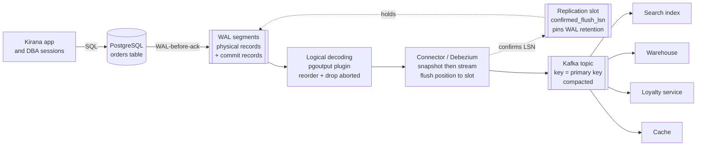
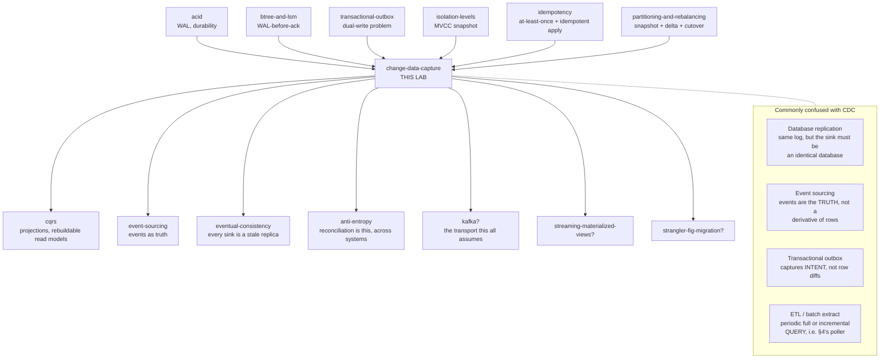

# Change Data Capture — reading the log the database already writes

> **Lab type:** pattern + the storage mechanism underneath it ·
> **No runnable code** (doc + interactive visualization + exercises).
>
> **Honesty note up front.** This lab measures nothing itself. Every number
> in it is either (a) cited from one of your earlier labs, which is said
> explicitly at the point of use, or (b) taken from vendor documentation and
> named as such. Where I describe behaviour I have not personally executed,
> the sentence says so. The one executable artifact is
> `visualization.html`, whose simulation engine was checked headlessly
> (see the bottom of this file for what was checked).

---

## Where you are

> **Depth layers in this doc:**
> **BEGINNER MODEL** (§1–§9) → **INTERMEDIATE MODEL** (§10) →
> **ENGINEERING MODEL** (§11–§12) → **PRODUCTION MODEL** (§13)
>
> At each transition there is a checkpoint telling you what you can do if
> you stop reading there, and what the next layer adds.

**What you already own, and will not be re-taught.** Four earlier labs did
most of the groundwork, and this lab treats their vocabulary as known:

| From this lab | What you already know | Where it gets used here |
|---|---|---|
| [transactional-outbox](../transactional-outbox/) | The dual-write problem; a relay drains an outbox table; consumers must be idempotent. That lab mentioned "CDC/Debezium" in passing as an alternative relay. | §3 (why not just dual-write), §12 (CDC **vs** outbox — the argument they were saving for you), §13 (the hybrid that uses both) |
| [acid](../acid/) + [btree-and-lsm](../btree-and-lsm/) | Durability is bought by a **write-ahead log**: the change is written to a durable, ordered log *before* the page is changed and *before* the client is told "committed". | §6 — this is the whole key idea |
| [idempotency](../idempotency/) | Retries are mandatory; duplicates are unavoidable; the fix is a key plus an atomic claim, and "exactly-once processing" = at-least-once delivery + idempotent processing. | §10 v4, §11 F5, §12 |
| [partitioning-and-rebalancing](../partitioning-and-rebalancing/) | Moving live data = consistent snapshot + a **delta log** + catch-up + cutover; the naive copy-then-flip shreds writes that land behind the cursor. | §10 v3 — CDC's cold start is that exact protocol, and this lab explains why it *has* to be |

If any of those four is fuzzy, skim its README first. The rest of this lab
assumes them.

---

## §1 — WHY: one place holds the truth, and five places need to know

**BEGINNER MODEL starts here.**

Meera runs **Kirana**, a grocery ordering app. When Asha places an order, one
row appears in one PostgreSQL table called `orders`. That table is the truth:
if the row says the order is paid, the order is paid.

The problem is that five other things in Meera's company need to know about
that row, and none of them is that table:

- the **search box** in the app, which is an Elasticsearch index, so Asha can
  find "the paneer order from last Tuesday";
- the **warehouse**, a BigQuery dataset that finance uses to count revenue;
- the **loyalty service**, another team's system, which awards points when an
  order is paid;
- a **cache** in Redis that the order-status screen reads, because reading
  Postgres on every screen refresh is too expensive;
- a **fraud model** that wants to see status transitions as they happen.

None of these can just read the `orders` table. Elasticsearch cannot join to
Postgres. BigQuery is in a different cloud. The loyalty team is not allowed
credentials to Meera's database, and would not want them.

So somebody has to *tell* them. And here is what goes wrong if nobody solves
this properly, in the concrete: search shows Asha an order that was cancelled
an hour ago; finance's revenue number for March is ₹40,000 short and nobody
can say which orders are missing; the loyalty service awards Asha points for
an order that was rolled back and never existed; and — the one that actually
ends careers — the difference is *silent*. Nothing errors. Nothing alerts. The
numbers are simply wrong, and stay wrong, and the person who eventually
notices is a customer or an auditor.

That is the problem. **How does a change in one database reliably become an
event in five other systems, without losing any change, without inventing
changes that never happened, and without the application having to remember
to do anything?**

---

## §2 — PROBLEM: the shopkeeper and the five people who keep asking

Forget databases for a moment.

Meera has a physical shop with one till (a cash register). All day, sales
happen: Asha buys paneer, Ben returns a broken egg tray, Asha's order gets
upgraded from 1 kg to 2 kg of rice, Ben cancels.

Five people need to know what is happening at that till:

- **Sunil** keeps the shop's *catalogue of recent sales* on a whiteboard out
  front, so customers can see what moved today.
- **the accountant** needs the day's total, exactly, to the rupee.
- **the loyalty clerk** stamps a card every time somebody *pays*.
- **the window display** shows "12 orders today!" and must not be stale.
- **the security guard** watches for a suspicious *pattern* — an order that
  goes paid, then refunded, then paid again in four minutes.

None of them can stand at the till all day. So how do they find out?

The obvious answer — the one every one of them will try — is: **walk over
every few minutes and look in the cash drawer.**

Hold that thought. It is going to fail, and the way it fails is the whole
lesson.

---

## §3 — NAIVE SOLUTION: two things a reasonable person tries first

### Naive attempt A: have the application tell everybody

When the app writes the order row, it also publishes a message. In Java this
is the shape everybody writes first:

```java
// ILLUSTRATION ONLY — read it, don't run it. This is the shape of the bug.
@Transactional
public void payOrder(long orderId) {
    orderRepo.markPaid(orderId);              // 1. write to Postgres
    kafka.send("orders", new OrderPaid(orderId)); // 2. tell everybody
}
```

**You already know why this is broken** — it is the *dual-write problem*, and
the [transactional-outbox](../transactional-outbox/) lab took it apart in
detail. One-line refresher: those are two physical acts against two systems,
the world can crash between them, and there is no transaction spanning both.
Crash after 1 → the order is paid and nobody knows. Crash after 2 (or roll
back after 2) → five systems believe in a payment that never happened, and
`kafka.send` cannot be un-sent.

The outbox lab's fix was: write the row *and* the outgoing message in one
local transaction, then have a **relay** drain the outbox table. That works.
Keep it in your pocket; §12 compares it to what we build here, and the
comparison is not the one most people expect.

But notice what the outbox demands: **the application must remember**. Every
code path that changes an order must also write an outbox row. A migration
script that fixes 400 rows by hand writes nothing. A second service that
writes to the same table writes nothing. A `DELETE` issued by a DBA at 2 a.m.
writes nothing. The outbox captures *what the application intended to
announce*, which is only as complete as the application's discipline.

So let us ask the harder question — the one this lab exists to answer:

> Can we capture **every** change to a table, **including** ones the
> application never thought to announce, **without changing the application
> at all**?

### Naive attempt B: poll the table for recent changes

Here is what everyone tries, and it looks completely reasonable. Add a column:

```sql
-- ILLUSTRATION ONLY.
ALTER TABLE orders ADD COLUMN updated_at timestamptz NOT NULL DEFAULT now();
```

…and have a job that wakes up every 5 seconds and asks:

```sql
-- ILLUSTRATION ONLY. This query has three separate bugs in it.
SELECT * FROM orders
WHERE updated_at > :last_seen        -- the "high-water mark"
ORDER BY updated_at;
```

It remembers the largest `updated_at` it has seen (the **high-water mark**) and
next time asks for everything newer. Ship it, and it appears to work
immediately: you make a change, five seconds later the search index has it.

This is the walk-over-and-look-in-the-drawer plan. It is the most common
change-feed design in the world, it is in production in thousands of
companies, and it is quietly wrong.

---

## §4 — FAILURE: five ways polling loses data, and none of them raises an error

Watch them one at a time. Every one of these is visible in **Tab 1** of
`visualization.html`, which runs the poller and a log reader side by side over
the same writes and counts what each one saw.

### F-a. Deletes are invisible

Ben cancels; the row is deleted. The poller's query is `SELECT ... FROM
orders` — it can only see rows that *exist*. A deleted row does not show up in
any `SELECT`, at any high-water mark, ever.

So the search index keeps Ben's order forever. Finance keeps counting it.

**You have met this exact shape three times before.** The
[eventual-consistency](../eventual-consistency/) lab: a delete implemented as
row-removal resurrects on every replica, because *absence cannot be
propagated*. The [anti-entropy](../anti-entropy/) lab's zombie: repair cannot
tell "A deleted it" from "C got a write A missed", so it copies the row back.
The [partitioning-and-rebalancing](../partitioning-and-rebalancing/) lab,
failure F9: a delta log that records "dirty keys" instead of *operations*
resurrects deletes at cutover. Same law, fourth costume:

> **Absence is not a value. A feed built from queries can only report what
> exists, and "gone" is not a thing that exists.**

The standard patch is a **soft delete** — never `DELETE`, set `deleted_at`
instead. That works, and it is a real design choice, but read what it costs:
every consumer must now understand your deletion convention; every query
everywhere must filter it; the rows never leave; and it only works if *every*
writer obeys, which brings back exactly the discipline problem that made us
suspicious of the outbox. And a `TRUNCATE` still vanishes silently.

### F-b. Intermediate states are lost

Asha's order goes `PENDING → PAID → REFUNDED` in eleven seconds. The poller
sleeps 30 seconds. It wakes up and sees one row: `REFUNDED`.

The window display is fine — it only wants current state. The **security
guard** is blind: the pattern she was hired to watch for is precisely the
sequence, and the sequence is gone. The **loyalty clerk** never stamps a card,
because he never saw `PAID`.

> **A poll returns state. A feed of states is not a feed of changes.** You can
> reconstruct state from changes; you cannot reconstruct changes from states.

That asymmetry is the same one the [event-sourcing](../event-sourcing/) lab is
built on — store the passbook, compute the box. Polling stores the box.

This one has no patch. Polling faster shrinks the window; it never closes it,
because two changes can always land inside one poll interval. (SQL Server
makes this distinction an actual product boundary: **Change Tracking** tells
you *which rows changed* — net changes only — while **Change Data Capture**
gives you *every change*. Two features, same vendor, and the reason they are
two features is this paragraph. Source: Microsoft's SQL Server documentation.)

### F-c. The high-water mark silently skips late-committing transactions

This is the deep one, and it is the reason this lab exists.

> **🔮 Predict.** A transaction begins at 10:00:00, updates Asha's order (so
> `updated_at = now()`), does some slow work, and commits at 10:00:09. The
> poller runs every 5 seconds: at 10:00:05, then 10:00:10. Which poll picks up
> Asha's row?
>
> <details><summary>Reveal</summary>
>
> **Neither. The row is skipped, permanently, and nothing reports an error.**
>
> Step by step, with real values:
>
> | time | what happens |
> |---|---|
> | 10:00:00 | Txn T begins. `UPDATE orders SET status='PAID', updated_at=now() WHERE id=7`. In PostgreSQL `now()` is **transaction start time**, so the row's new `updated_at` is `10:00:00`. The row is *not visible* to anyone else yet — T has not committed. |
> | 10:00:05 | Poller runs. Asks `WHERE updated_at > 09:59:55`. T's row is invisible (uncommitted), so it is not returned. The poller sees other rows and advances its high-water mark to **10:00:05**. |
> | 10:00:09 | T commits. Row 7 becomes visible to everyone, carrying `updated_at = 10:00:00`. |
> | 10:00:10 | Poller runs. Asks `WHERE updated_at > 10:00:05`. Row 7 has `10:00:00`, which is **not** greater than `10:00:05`. Not returned. |
> | forever | Row 7 is never returned again, because the high-water mark only moves forward. Asha's payment never reaches search, finance, or loyalty. |
>
> The bug is not the clock and not `now()`. Swap in `clock_timestamp()`
> (PostgreSQL's real wall-clock-at-this-instant function) and the window
> shrinks from "transaction duration" to "time between the UPDATE statement
> and COMMIT" — still non-zero, still silent. Swap the timestamp for a
> monotonic `bigint` sequence and use `WHERE id > :last_id`: identical bug,
> because sequence values are also allocated at *write* time, so a transaction
> that grabs id 5000 and commits ten seconds later is skipped by a poller that
> already reached 5100.
>
> The generalization is worth memorizing:
>
> > **Any column the application writes is stamped at write time. Rows become
> > visible at commit time. A cursor over write-time values will skip every
> > transaction whose commit lands after the cursor has passed its stamp.**
>
> </details>

Is there a patch? Two partial ones, and it is worth knowing why neither is a
fix:

1. **Lag the cursor.** Only poll up to `now() - 30s`, on the theory that no
   transaction lasts 30 seconds. This trades 30 seconds of latency for a
   *guess*, and the guess is wrong on the day a lock wait or a slow batch job
   runs for 45 seconds — which is exactly the day the data mattered.
2. **Ask the database what is still in flight.** PostgreSQL can tell you the
   oldest transaction id that has not finished
   (`pg_snapshot_xmin(pg_current_snapshot())`), so you can refuse to advance
   the cursor past it. This is genuinely correct in principle, and it is a
   real technique — but notice what just happened: **to make polling safe you
   had to start reading the database's internal transaction state.** You are
   one step away from the idea in §6, and doing it the hard way.

### F-d. Ties at the boundary: `>` loses rows, `>=` duplicates them

Two transactions commit in the same millisecond, both stamped `10:00:07.412`.
The poller returns one of them (the page ended), records high-water
`10:00:07.412`, and next time asks `> 10:00:07.412`. The other row is gone.

Use `>=` instead and you re-deliver the same row on every single poll forever
until something else changes. So the polling designer must choose between
losing rows and duplicating them, and the correct choice is `>=` plus
idempotent consumers — which is the right answer, and is worth noticing
because **at-least-once is going to turn out to be the answer here too**, for
better reasons.

### F-e. The interval is a lose-lose dial

Poll every 100 ms and you run that query 864,000 times a day against your
production database, mostly to learn that nothing changed; on a big table with
a poor index that is a real load. Poll every 5 minutes and your search index
is 5 minutes stale and F-b eats nearly every intermediate state.

There is no setting that is both cheap and fresh, because **the poller is
guessing when something happened, and the database already knows.**

> **The score after §4.** Polling loses deletes (F-a), loses intermediate
> states (F-b), silently skips late-committing transactions (F-c), must choose
> between losing and duplicating at ties (F-d), and cannot be both cheap and
> fresh (F-e). Four of those five failures are **silent** — no exception, no
> log line, no metric moves. That is what makes this the most expensive
> pattern in the list.

---

## §5 — THE REAL REQUIREMENT

Write down what we actually need, in plain words, before inventing anything.
Everything after this section is the pursuit of these six properties:

1. **Changes, not states.** Every individual change, including the ones that
   were immediately overwritten.
2. **Deletes included.** Removal is an event, not an absence.
3. **Commit order.** Events arrive in the order the database made them real —
   not statement order, not timestamp order.
4. **Only committed changes.** A rolled-back transaction must produce nothing.
5. **Complete and resumable.** No gaps, ever; and after a crash the reader can
   say exactly where it stopped and continue from there.
6. **Zero application cooperation.** It must capture a DBA's manual `UPDATE`
   just as faithfully as the app's, because the truth is the table, not the
   code path.

Look at that list and notice something uncomfortable: properties 3, 4 and 5
are about the database's *internal* notion of commits and ordering. No query
you can write from the outside has access to that.

So either we give up, or we find something on the inside.

---

## §6 — KEY IDEA: the perfect change feed already exists, and it is not for you

> **🔮 Predict.** Somewhere in a PostgreSQL server there is already a durable,
> strictly ordered, complete, gap-free, replayable, resumable record of every
> single change ever made, including deletes and including changes the
> application never announced. What is it, and — more interestingly — *why*
> does it already exist?
>
> <details><summary>Reveal</summary>
>
> It is the **write-ahead log** (WAL), and it exists because of the **D in
> ACID**.
>
> Recall the mechanism from the [acid](../acid/) and
> [btree-and-lsm](../btree-and-lsm/) labs: before the database modifies a data
> page, and before it answers "committed" to the client, it appends a
> description of the change to a sequential log and makes *that* durable. If
> the machine loses power one microsecond later, recovery replays the log and
> the change survives. `WAL-before-ack` was the phrase.
>
> Now read the six requirements from §5 against the WAL, one by one:
>
> | §5 requirement | Why the WAL already has it |
> |---|---|
> | changes, not states | The log records *operations*. Three updates to one row are three records. It could not do recovery otherwise. |
> | deletes included | A delete is a change that must survive a crash, so it is in the log like any other. |
> | commit order | Recovery must not resurrect a transaction that was rolled back, nor apply effects out of order. The log carries commit records and an ordering. |
> | only committed | Recovery's whole job is deciding this. The information is in the log by construction. |
> | complete, resumable | If the log had a single gap, crash recovery would produce a corrupt database. Every record has a position, so "resume from here" is the log's native operation. |
> | zero app cooperation | The DBA's 2 a.m. `UPDATE` must survive a crash too. It is in the log. The application is not consulted. |
>
> **Six out of six.** Not because anyone designed the WAL for us — because a
> log complete enough to survive a power cut is automatically complete enough
> to feed a search index.
> </details>

So here is the idea, in one sentence:

> **Change Data Capture (CDC): stop asking the database what its tables
> currently contain, and instead read the log the database already writes for
> its own crash recovery, turning each record into a change event other
> systems can consume.**

And the second sentence, which is the part people miss:

> The reason this is *trustworthy* rather than merely clever is that the
> database's own survival depends on that log being complete and correctly
> ordered. You are not building a change feed. You are **tapping one whose
> correctness is already load-bearing for something the vendor cares about far
> more than they care about your search index.**

That is the whole concept. Everything from here is (a) the vocabulary, (b) the
four things that go wrong when you actually try it, and (c) what the resulting
machine looks like in production.

---
## §7 — TERMINOLOGY: the words, now that you have earned them

Each of these is introduced here because §6 just made it necessary. Terms that
arrive later in the doc are defined at their first use, under the same
contract. All of them are collected in the glossary (§16).

### 7.1 Change data capture (CDC)

- **Plain meaning:** watching a database's own change log so that every
  insert, update and delete becomes a message other systems can read.
- **Technical meaning:** a process that consumes a database's transaction log,
  decodes each record into a row-level change event `{table, operation,
  before-image, after-image, position, transaction metadata}`, and publishes
  those events in commit order to a durable stream.
- **Why the term exists:** to name the distinction from *querying data*. A
  query captures **data**; CDC captures **change**. The phrase was coined to
  make it impossible to say "we'll just poll the table" and think you have
  said the same thing. (§4 is the argument for why the distinction is not
  pedantic.)
- **Example:** Asha's order 7 goes PAID at log position `16/B374D848` (that
  position has a name — §7.3). CDC emits
  `{table: orders, op: u, before: {status: PENDING}, after: {status: PAID},
  lsn: 16/B374D848}`.
- **Connects to:** the [transactional-outbox](../transactional-outbox/) relay
  — same job (get changes out of the database and into a broker), opposite
  source of truth (the outbox reads a table the app wrote on purpose; CDC
  reads a log the database wrote for itself).

### 7.2 Write-ahead log — and its four vendor names

- **Plain meaning:** the file the database appends to before changing
  anything, so a crash cannot lose work.
- **Technical meaning:** an append-only, sequentially written, durably flushed
  record of every modification, ordered, and positioned.
- **Why the term exists:** "write-ahead" names the *ordering constraint* that
  makes it work — the log write must be durable **ahead of** the data page
  write and ahead of the client's acknowledgement. Drop the ordering and the
  file is just a file.
- **The names you will meet, because CDC tooling is vendor-specific:**

  | System | Name of the log | Position identifier |
  |---|---|---|
  | PostgreSQL | WAL (write-ahead log) | **LSN** — log sequence number, e.g. `16/B374D848` |
  | MySQL / MariaDB | **binlog** (binary log) — note this is *separate* from InnoDB's redo log | file + offset, or **GTID** (global transaction id) |
  | Oracle | redo log | **SCN** — system change number |
  | SQL Server | transaction log | LSN |
  | MongoDB | **oplog** (a capped collection) | **resume token** |
  | DynamoDB | DynamoDB Streams | shard iterator / sequence number |

  A wrinkle worth having straight, because it confuses everybody once:
  **MySQL has two logs.** InnoDB's *redo log* is the crash-recovery WAL and is
  physical and private; the **binlog** is a separate server-level log written
  for replication, and it is the binlog that CDC reads. PostgreSQL has one log
  doing both jobs. This is why MySQL CDC requires you to *turn the binlog on*
  and configure its format, while PostgreSQL CDC requires you to change the
  WAL's *verbosity* — different-shaped configuration, same underlying idea.

- **Connects to:** [acid](../acid/) (the log is how A and D are kept) and
  [btree-and-lsm](../btree-and-lsm/) (`WAL-before-ack`; an LSM's memtable is
  only safe because the WAL was written first).

### 7.3 Log position — LSN, GTID, SCN, resume token

- **Plain meaning:** a bookmark. "I have read up to here."
- **Technical meaning:** a monotonically increasing identifier of a location in
  the log, comparable and durable, such that "everything strictly after
  position P" is a well-defined, gap-free set.
- **Why the term exists:** because this single value is what makes CDC
  *resumable*, and resumability is the property §4's polling cursor could not
  have. The high-water mark in §4 was a bookmark over **application-written
  values**; an LSN is a bookmark over **the database's own commit sequence**.
  Those look similar and behave completely differently — the LSN cannot skip a
  late-committing transaction, because the position *is* the commit ordering
  rather than a proxy for it.
- **Example:** the connector stores `16/B374D848`; it restarts; it asks the
  server to stream from `16/B374D848` and receives every commit after that
  point, in order, with nothing missing.
- **Connects to:** the checkpoint in [cqrs](../cqrs/) (a projection's "I have
  applied up to event N") — an LSN is that checkpoint, with the database
  issuing the numbers.

### 7.4 Physical vs logical replication, and *logical decoding*

- **Plain meaning:** physical = "copy my bytes exactly"; logical = "tell me
  which rows changed and how".
- **Technical meaning:** PostgreSQL's WAL records are *physiological* — they
  say things like "on relation 16384, block 42, apply this tuple image". They
  reference on-disk layout, not table and column names. **Physical
  replication** ships those records to a standby that is byte-for-byte
  identical and replays them. **Logical decoding** is a server feature that
  reads the same WAL, consults the system catalogs, and reconstructs
  *row-level* events: `table orders, UPDATE, before {...}, after {...}`.
- **Why the term exists:** to name the thing that makes CDC possible at all.
  A physical WAL record is useless to Elasticsearch — it is a byte patch for a
  page that Elasticsearch does not have. Everything valuable about CDC lives
  in the decoding step. In PostgreSQL, the decoder is a plugin: **`pgoutput`**
  (built in since PG10, what most tools use now), `wal2json`, `decoderbufs`.
- **Example (illustration, not runnable):** the setting that switches the WAL
  from "enough to recover" to "enough to decode" is
  `wal_level = logical` in `postgresql.conf`, which requires a restart. It
  makes the WAL bigger, because reconstructing a row change needs more
  information than replaying a page patch does. That extra volume is CDC's
  standing tax on the source database.
- **Connects to:** [quorums-and-replication](../quorums-and-replication/) — the
  replicas in that lab were physical; a CDC consumer is a *logical* replica
  that happens not to be a database.

### 7.5 Replication slot

- **Plain meaning:** a named bookmark **that the server promises to respect**,
  by refusing to delete log the bookmark still needs.
- **Technical meaning:** a persistent server-side object holding a consumer's
  confirmed position, which pins WAL retention: the server will not recycle
  WAL segments beyond the oldest slot's `confirmed_flush_lsn`, and will not
  vacuum away row versions the slot may still need to decode.
- **Why the term exists:** without it, CDC has no durability story. The WAL is
  recycled aggressively — it is scratch space for recovery, sized for
  recovery, not an archive. A consumer that is offline for an hour would come
  back to find its position no longer exists. The slot converts "the log
  happens to still be there" into "the log is *guaranteed* still there".
- **Example:** `pg_create_logical_replication_slot('kirana_cdc', 'pgoutput')`.
  From that moment the server keeps WAL for `kirana_cdc` until `kirana_cdc`
  confirms it has consumed it.
- **The teeth, stated now because it is the single most common CDC outage:**
  that promise is unconditional. A slot whose consumer is dead does not expire.
  It holds WAL forever, the disk fills, and **the production database stops
  accepting writes.** CDC's most dangerous property is that a broken *consumer*
  can take down the *source*. §11 F1 walks it through; Tab 4 of the
  visualization lets you cause it.
- **Connects to:** [distributed-locking](../distributed-locking/) — a slot is a
  lease that nothing revokes. That lab's entire warning about leases held by
  dead holders applies here, with the twist that the resource being held is
  *disk space on your primary*.

### 7.6 Snapshot vs streaming

- **Plain meaning:** "here is everything that exists right now", followed by
  "and here is everything that happens from now on".
- **Technical meaning:** the **snapshot** (or initial load) is a consistent
  read of the current table contents taken at a known log position; the
  **streaming** phase is the decoded log from exactly that position onward.
- **Why the term exists:** because the log only holds recent history. Your
  table has five years of orders; the WAL has twenty minutes. Streaming alone
  gives a search index that knows about changes but not about the world.
- **Example:** snapshot 4.1 million `orders` rows as of LSN `16/B300000`, then
  stream from `16/B300000`.
- **Connects to:** [partitioning-and-rebalancing](../partitioning-and-rebalancing/)
  — snapshot + delta log + catch-up is that lab's migration protocol, and §10
  v3 shows they are the same protocol for the same reason.

### 7.7 Before-image and after-image

- **Plain meaning:** what the row looked like before the change, and after.
- **Technical meaning:** the `before` and `after` payloads of a change event.
  An INSERT has only `after`; a DELETE has only `before`; an UPDATE ideally has
  both.
- **Why the term exists:** because *ideally* is doing a lot of work in that
  sentence, and the term lets you ask the question that matters — "do I get the
  before-image, and how complete is it?" — instead of assuming. In PostgreSQL
  the answer is controlled by **`REPLICA IDENTITY`**, and the default gives you
  only the primary key. §11 F7.
- **Example:** with the default setting, Ben's cancelled order emits
  `{op: d, before: {id: 91, customer: null, status: null, total: null}}`. The
  id is there. Everything else is `null`, and `null` here means *"not
  captured"*, not *"was null"*. A consumer that cannot tell those apart will
  write nulls into your warehouse.
- **Connects to:** [event-sourcing](../event-sourcing/) — an event stream that
  carries only after-images can rebuild state but cannot answer "what changed
  and by how much" without keeping its own copy.

### 7.8 Connector

- **Plain meaning:** the program that does all this.
- **Technical meaning:** the process that opens a replication connection to the
  source, decodes, snapshots when needed, converts events to the sink's format,
  publishes them, and periodically **commits its position** back to the source
  slot. **Debezium** is the dominant open-source implementation; it usually
  runs inside **Kafka Connect**.
- **Why the term exists:** to name the fact that this is a *separate deployed
  process with its own failure modes*, not a database feature you switch on. Its
  liveness, its lag, its restarts and its position-flushing are things you now
  operate. Half of §11 is failures of the connector rather than of the idea.

### 7.9 Tombstone and log compaction

- **Plain meaning:** a "this key is gone" marker, and a cleanup rule that keeps
  only the newest message per key.
- **Technical meaning:** **log compaction** (a Kafka topic setting) retains, per
  message key, at least the most recent value, discarding older ones. A
  **tombstone** is a message with a key and a `null` value, which tells
  compaction to eventually drop the key entirely.
- **Why the term exists:** it makes a change stream double as a *complete
  snapshot of current state* — replay a compacted topic from the beginning and
  you get one message per key with its latest value. That is why a downstream
  system can be rebuilt from the topic without re-snapshotting the source. The
  tombstone exists because, once again, **absence cannot be represented by
  omission** (F-a, third appearance — you have now met this law in
  eventual-consistency, partitioning, and here).
- **Connects to:** [btree-and-lsm](../btree-and-lsm/) — an LSM tombstone and a
  Kafka tombstone are the same object solving the same problem, and both have
  a retention deadline you can violate.

### 7.10 Transaction boundaries

- **Plain meaning:** markers saying "these five row changes were one
  transaction".
- **Technical meaning:** BEGIN/COMMIT metadata carried alongside the row events
  (transaction id, total event count, per-table counts).
- **Why the term exists:** because once you fan five row events out to three
  topics and twelve partitions, the fact that they were **atomic at the source**
  is destroyed unless something carries it. If Asha's payment updated `orders`
  and inserted into `payments` in one transaction, a downstream consumer that
  reads two topics can absolutely see the payment before the order. The
  transaction metadata is what lets a careful consumer buffer until the
  transaction is complete. Most consumers do not, and mostly get away with it —
  §11 F8 is about when they do not.

---

## §8 — MENTAL MODELS: two pictures, mapped, and where the nice one lies

### The simple model: the till roll

Meera's shop till prints a continuous paper roll. Every sale, every refund,
every void, printed in order, as it happens.

The roll is **not printed for Sunil, the accountant, or the loyalty clerk.**
It is printed because the shop's owner needs to reconstruct the day if the cash
drawer is stolen or the till is dropped. It exists for **recovery**.

But look at what the roll is: a complete, ordered, gap-free record of every
change to the drawer, including the ones that were immediately reversed,
including the removals, written before the money moved, and numbered so you can
say "I have read up to line 4,182."

So the five people stop walking over to look in the drawer, and start reading
the roll from wherever they left off. That is change data capture.

And the cold-start problem is right there in the analogy: the roll only goes
back to when the paper was last changed. A new accountant on Tuesday needs a
**count of the drawer** (snapshot) *plus* the roll from that moment (streaming).

### The engineering model



Read it as: the app writes only to Postgres and knows nothing about any of the
rest. The WAL is written for durability. The decoder turns physical records
into row events. The slot is a promise not to delete log the connector still
needs — note the arrow points *backwards*, from consumer to source, which is
the coupling that makes F1 possible. The connector emits events keyed by
primary key. Consumers are independent and can be added, removed, or rebuilt
without the application changing at all.

### Mapping the two

| Till roll | Engineering model |
|---|---|
| the paper roll | the write-ahead log |
| printed before the cash drawer opens | WAL-before-ack |
| line number on the roll | LSN / log position |
| the cash drawer's current contents | the table's current state |
| counting the drawer at 9 a.m. | the initial snapshot |
| "read the roll from line 4,182" | streaming from an LSN |
| a clip on the roll saying "don't bin past here" | the replication slot |
| a "VOID" line, printed like any other | a tombstone / delete event |
| the roll is in shop-code, not English | physical records need logical decoding |

### Where the analogy breaks — four places

**1. The roll only shows completed sales. The WAL does not.** This is the
important one. A real WAL contains records from transactions that are still
open, and from transactions that were **rolled back**. Nothing on a WAL record
says "this one counts". The decoder must buffer a transaction's changes and
emit them only when it sees the COMMIT record — and drop them entirely on
ABORT. §10 v2 is this. If the till printed a line *the moment the cashier
scanned an item*, before the customer paid or walked out, the roll would look
like the WAL, and Sunil's whiteboard would advertise sales that never happened.

**2. The roll is in commit order because the shop has one till. The WAL is not
naturally in commit order.** Records from concurrently open transactions are
interleaved in the file in the order the statements ran. Transaction T1 may
write records at positions 100 and 400 while T2 writes at 200 and commits at
300. The output must be `T2 (commit at 300), then T1 (commit at 500)` —
so the decoder **reorders** by commit position. What you consume is in commit
order; what is on disk is not. (PostgreSQL does this reordering for you. That
is a large part of what "logical decoding" buys.)

**3. Nobody throws the roll away while the accountant is on holiday. The
database absolutely will.** WAL is recycled on a schedule sized for recovery,
not for you — which is why the slot exists, and why the slot's promise is
dangerous rather than merely useful. In the analogy the shop would have to stop
selling because the storeroom is full of paper nobody has read. That is
precisely F1.

**4. The roll says *why*: "REFUND — damaged eggs".** The WAL says
`status: 'CANCELLED'` and nothing else. The database records **what the rows
now say**, never **what the business meant**. This is the single most
consequential limitation of CDC and §12 is built on it — a row diff cannot tell
you whether Ben cancelled, or a fraud rule cancelled, or a batch job cancelled
14,000 orders because someone fat-fingered a WHERE clause.

---

## §9 — VISUALIZATION: watch the poller lose things

Open **`visualization.html`** — also published at
<https://claude.ai/code/artifact/8014f89b-38c0-44d4-a6ac-6dd215a0dfd5>. It has
four tabs and each one exists to make one section of this doc
visible rather than merely stated.

Before the mechanism section, spend five minutes on **Tab 1**. Here is what to
look at:

> **What to look at on Tab 1.** The middle column is the WAL, growing
> downwards with an LSN on every record. The right column has two consumers
> watching the same writes: a **Poller** with a high-water mark, and a **Log
> reader** with an LSN. The bar at the bottom is the verdict. Press
> **"Run the five failures"** and then watch only two numbers: *changes the
> poller saw* and *changes the log reader saw*. They will diverge, and the
> event log will say in a full sentence which of §4's five failures caused
> each divergence.

The other three tabs come up as the mechanism needs them:

- **Tab 2 — The Decoder.** Two interleaved transactions and a rollback,
  with a switch between decoder v1 (emit as decoded) and v2 (buffer to commit).
  Use it at §10 v2.
- **Tab 3 — Cold Start.** Three snapshot protocols, with writes happening
  *during* the snapshot. Use it at §10 v3.
- **Tab 4 — The Slot.** A log-retention disk gauge, a connector you can stop,
  and a switch for the periodic empty event that §11 F2 explains. Use it at
  §11 F1.

Every scenario asks you to predict before it runs.

---
> ### ✅ Checkpoint — end of the BEGINNER MODEL
>
> **You can now:** explain why polling a table is not a change feed (deletes,
> intermediate states, the late-commit skip), say what CDC is in one sentence,
> and explain why reading the database's recovery log is trustworthy rather
> than a hack. In a design discussion you can say "we should CDC that table
> instead of polling it" and defend it.
>
> **What you cannot yet do:** build one, or debug one. You do not yet know what
> the connector actually has to do between the WAL and the topic — and the
> four things it does are all *fixes for failures*, which is what §10 walks
> through.
>
> **Next (§10, INTERMEDIATE MODEL):** the mechanism, built the way you would
> build it, broken four times, and repaired each time. Every strange detail of
> a real CDC connector is the scar of one of these four breakages.

---

## §10 — ACTUAL MECHANISM: four versions, three of them wrong

**INTERMEDIATE MODEL starts here.**

We are going to build the connector. The rule for this section is the one from
the [partitioning-and-rebalancing](../partitioning-and-rebalancing/) lab: do
not present the finished machine. Present the version a competent engineer
builds first, break it with a concrete trace, and let the repair explain
itself.

Throughout, the concrete setting is Meera's `orders` table:

```
orders(id bigint PK, customer text, status text, total_paise bigint, updated_at timestamptz)
```

with two rows to start: `(7, 'asha', 'PENDING', 48000)` and
`(91, 'ben', 'PENDING', 12500)`.

### v1 — "Just read the WAL and publish what you find"

The design: open the WAL files, read records in order, publish each one to
Kafka.

Here is a faithful sketch of what three consecutive PostgreSQL WAL records
actually look like in spirit (not byte-exact — the point is the *shape*):

```
LSN 16/B374D810  rmgr=Heap  op=HOT_UPDATE  rel=16384  blk=42  off=3
                 → new tuple image: <opaque 61 bytes>
LSN 16/B374D848  rmgr=Btree op=INSERT_LEAF rel=16391  blk=7   off=12
LSN 16/B374D890  rmgr=Xact  op=COMMIT      xid=90211  ts=2026-08-30 10:00:09
```

> **🔮 Predict.** You are the search index. You receive record 1 above. What
> can you do with it?
>
> <details><summary>Reveal</summary>
>
> **Nothing at all.** Read what it says: *relation 16384, block 42, offset 3,
> here are 61 bytes.*
>
> - `16384` is an **OID** — an internal number. It is not the string `orders`.
>   To learn that it means `orders` you must read the `pg_class` catalog table.
> - `blk=42, off=3` is a physical address in a file. Meaningful only to a
>   replica whose files are byte-identical to the primary's.
> - the 61 bytes are a tuple in on-disk format: column values packed according
>   to the *current* table definition, with no column names, with NULL bitmap
>   and alignment padding, and possibly with large values replaced by
>   references to another table entirely (TOAST — §11 F9).
> - record 2 is an index-page update. It is not a change to your data at all;
>   it is bookkeeping. Publishing it is pure noise.
>
> This is why **physical replication only works to an identical replica.** The
> standby can replay "block 42, offset 3, these bytes" because it has the same
> block 42. Elasticsearch does not have a block 42.
> </details>

**The repair: logical decoding.** Between the WAL and you sits a decoder that
knows the catalogs. It maps OID 16384 to `public.orders`, unpacks the tuple
using the table definition, drops the index-maintenance records because they
are not logical changes, and emits:

```json
{"table": "public.orders", "op": "u",
 "after": {"id": 7, "customer": "asha", "status": "PAID", "total_paise": 48000},
 "lsn": "16/B374D810"}
```

Now `after` is a row a search index can index. Note carefully that the decoder
must consult the catalog **as of the time the record was written**, not as of
now — a point that comes back in v5 and hurts a lot in MySQL.

### v2 — "Decode and emit as you go"

The design: decode each record and publish immediately. Low latency, no
buffering, obviously correct — the log is in order, so the output is in order.

Watch it on a trace. Two transactions run concurrently. **T1** is Asha paying;
**T2** is Ben, who starts a cancellation and then his session errors and rolls
back.

| WAL LSN | record | v1/v2 decodes it as |
|---|---|---|
| `…D810` | T1 (xid 90211): UPDATE orders id=7 status PENDING→PAID | `u {id:7, status:PAID}` |
| `…D830` | T2 (xid 90212): UPDATE orders id=91 status PENDING→CANCELLED | `u {id:91, status:CANCELLED}` |
| `…D850` | T2: INSERT refunds (order 91, ₹125.00) | `c {order:91, amount:12500}` |
| `…D870` | **T2: ABORT** | — |
| `…D890` | T1: INSERT payments (order 7, ₹480.00) | `c {order:7, amount:48000}` |
| `…D8B0` | **T1: COMMIT** | — |

> **🔮 Predict.** v2 publishes each row event the instant it decodes it. What
> does the loyalty service see, and what does the warehouse's refund report
> say at the end of this trace?
>
> <details><summary>Reveal</summary>
>
> The loyalty service and the warehouse both see **Ben's cancellation and a
> ₹125 refund that never happened.** T2 rolled back. In the database, order 91
> is still `PENDING` and there is no refund row. In every downstream system,
> order 91 is cancelled and finance is reporting a refund.
>
> Worse: nothing will ever correct it. There is no "un-publish" record in the
> WAL — the abort record simply means those changes are dead, and v2 already
> shipped them. Requirement 4 from §5 ("only committed changes") is violated,
> silently, permanently.
>
> There is a second, quieter bug in the same trace. T1's two events were
> published at `…D810` and `…D890`, with T2's events *interleaved between
> them*. So even for successful transactions, v2's output is in **statement
> order**, not **commit order** — a consumer sees fragments of several
> transactions interleaved and can never tell where one atomic change ends.
> Requirement 3 is violated too.
> </details>

**The repair: buffer per transaction, emit at COMMIT, ordered by commit
position.** The decoder keeps an in-memory (spilling to disk if large) buffer
per transaction id. On `COMMIT`, it flushes that transaction's events in order,
stamped with the commit LSN. On `ABORT`, it **discards the buffer** and emits
nothing.

The correct output of the trace above is therefore, in full:

```
(nothing at all for T2 — it aborted)
u {id:7, status: PENDING→PAID}     lsn 16/B374D8B0   xid 90211
c {payments: order 7, 48000}       lsn 16/B374D8B0   xid 90211
```

Two events, both stamped with the **commit** LSN, adjacent, in the order they
happened inside the transaction, with nothing of T2's in between.

**This is what PostgreSQL logical decoding does for you by default, and it is
most of the value of the feature.** Two honest refinements:

- The buffering is why a huge transaction (a 10-million-row `UPDATE`) creates
  a latency spike and memory/disk pressure in the decoder: nothing can be
  emitted until the COMMIT arrives, so CDC lag for a 20-minute batch job is
  ~20 minutes and then a flood. This is a real operational characteristic, not
  a bug.
- PostgreSQL 14+ added an **opt-in** mode to stream in-progress transactions
  before commit (`streaming = on`, and two-phase support), precisely to avoid
  that spike. It moves the problem rather than removing it: the consumer now
  receives events that might be aborted, and must be told to discard them. If
  you turn it on, you have re-accepted v2's problem in exchange for latency,
  deliberately. (Documentation-sourced; I have not run it.)

### v3 — "Buffer to commit. Ship it."

We now emit only committed changes, in commit order, decoded into row events.
Requirements 1, 2, 3, 4 and 6 from §5 are met. Turn it on in production.

> **🔮 Predict.** The connector starts at 10:00 on a Tuesday against a table
> with 4.1 million orders going back five years. Asha searches for her March
> order. What does she get?
>
> <details><summary>Reveal</summary>
>
> **Nothing.** The search index is empty and stays empty except for orders that
> happen to change after 10:00 on Tuesday. The stream gives you *changes from
> now*; it never mentioned the 4.1 million rows that were already there,
> because their changes happened years ago and that WAL was recycled long
> before you existed.
>
> This is requirement 5's other half — "complete" does not just mean "no gaps
> going forward", it means the consumer eventually holds the whole truth.
> </details>

So we need an **initial snapshot**: read the current table, emit one event per
existing row (Debezium calls these `op: r`, for *read* — deliberately a
different operation code from `c`/`u`/`d`, so a consumer can tell "this row
exists" from "this row just changed"), then start streaming.

And here the trap opens. There are three ways to do the handover and two of
them are wrong.

**Protocol A — snapshot, then start streaming from "now".**

```
10:00:00  begin reading orders …
10:03:40  … 4.1M rows emitted, snapshot done
10:03:40  start streaming from current LSN 16/C100000
```

Trace what happens to one row. At `10:01:15`, while the snapshot's cursor is
somewhere around id 900,000, Asha pays for order **7** — an order the snapshot
already read and emitted, at `10:00:04`, as `PENDING`.

- The snapshot emitted `r {id:7, status: PENDING}` at 10:00:04.
- The change happened at 10:01:15 and is in the WAL at LSN `16/C0A1234`.
- Streaming starts at `16/C100000`, which is **after** `16/C0A1234`.
- The payment event is never delivered. Order 7 is `PAID` in the database and
  `PENDING` in the search index, in the warehouse, and in the loyalty
  service — **forever**, or until someone re-snapshots.

**You have seen this exact failure before.** It is the
[partitioning-and-rebalancing](../partitioning-and-rebalancing/) lab's v1
copy-then-flip, which "silently shreds every acknowledged write landing behind
the copy cursor — no crash needed, protocol-design data loss." Same protocol,
same bug, different problem domain. The generalization worth carrying:

> **Any time you copy a live dataset while it is being written, the copy and
> the change stream must be joined at a *single agreed point*, and the copy
> must be taken *as of* that point. Otherwise the gap between them is silent
> data loss whose size equals the copy duration.**

**Protocol B — lock the table, snapshot, unlock, stream.**

Take a table lock so nothing can change during the copy, so there is no gap.

Correct! And a production outage. The snapshot took 3 minutes 40 seconds; for
3 minutes 40 seconds nobody could write an order. On a 2 TB table it is hours.
(Debezium's MySQL connector historically defaulted to a global read lock for
exactly this reason, and the `snapshot.locking.mode` setting exists so you can
refuse it — the option's existence is the fossil record of this problem.)

**Protocol C — snapshot inside a repeatable-read transaction, at a known LSN.**

This is the real answer, and it works because of a mechanism you already own
from [isolation-levels](../isolation-levels/): **MVCC**. A transaction at
`REPEATABLE READ` sees a *snapshot* of the database as of its start, unaffected
by concurrent commits, and — critically — **without blocking any writer**.

```
10:00:00  BEGIN TRANSACTION ISOLATION LEVEL REPEATABLE READ;
10:00:00  … record the current LSN, 16/C000000, as the handover point
10:00:00  SELECT * FROM orders;   -- sees the world as of 16/C000000, blocks nobody
10:03:40  COMMIT;
10:03:40  start streaming from 16/C000000
```

Now Asha's 10:01:15 payment is at LSN `16/C0A1234`, which is **after**
`16/C000000`, so it *is* streamed. And the snapshot's copy of row 7 was
`PENDING`, taken as of `16/C000000`, which is *before* the payment. The two
pieces meet exactly, with no gap.

They also **overlap** in one direction, which is the last piece: any row that
changed between the transaction's start and the moment the snapshot's cursor
reached it is delivered twice — once as `r` (the pre-change value, from the
snapshot) and once as `u` (the change, from the stream). Order 7 arrives as
`r {status: PENDING}` and then `u {status: PAID}`.

That is **fine, and only fine because the events are keyed by primary key and
applied as upserts**, so the later one wins and the state converges. Deliver
them out of order and you would end up with `PENDING`. Which brings us to v4.

*(In practice the connector needs the snapshot transaction and the replication
slot to agree on that LSN. PostgreSQL provides exactly this: creating a logical
slot exports a snapshot the reading transaction can adopt, so "the slot's
starting position" and "what the snapshot sees" are the same instant by
construction. Documentation-sourced. Debezium's `snapshot.mode` controls the
whole behaviour: `initial` (snapshot then stream — the default),
`never`/`no_data` (stream only, for when the sink is already populated),
`when_needed`, `initial_only`.)*

### v4 — "Snapshot at an LSN, then stream. Ship it."

Correct on paper. Now the connector process dies, because processes die.

Concretely: the connector emitted Asha's payment event to Kafka at 10:04:02,
and was going to flush its position (`16/C0A1234`) back to the replication slot
at 10:04:05 — it batches those flushes, because confirming every single event
to the source is expensive. At 10:04:03 the pod is evicted.

> **🔮 Predict.** The connector restarts at 10:04:30. Its last *confirmed*
> position is `16/C0A0000`, which is before Asha's payment. What happens, and
> what does the warehouse's revenue figure look like afterwards?
>
> <details><summary>Reveal</summary>
>
> The connector resumes from `16/C0A0000` and **re-delivers every event
> between there and where it actually got to**, including Asha's ₹480 payment,
> which is now in the topic twice.
>
> What that costs depends entirely on the consumer:
>
> - The **search index** does `PUT /orders/7 {...}` — an upsert keyed by id.
>   Applying it twice is identical to applying it once. No harm.
> - The **cache** does `SET order:7 {...}`. Same. No harm.
> - The **warehouse** does `INSERT INTO revenue ... ` or
>   `UPDATE totals SET revenue = revenue + 480`. **March is now ₹480 too
>   high**, and no error was raised anywhere.
> - The **loyalty service** awards points a second time.
>
> The duplicate is not the bug. **The duplicate is guaranteed** — it is the
> unavoidable consequence of "emit, then confirm" being two acts with a crash
> window between them, which is the dual-write problem *again*, now inside the
> connector. Moving the confirm before the emit does not help; it converts
> duplicates into **losses**, which is strictly worse.
> </details>

There is no version of this that delivers exactly once, and you already know
why from the [idempotency](../idempotency/) lab: exactly-once *delivery* is
impossible, and what honest vendors mean by "exactly-once" is **at-least-once
delivery plus idempotent processing**. So v4 does not try. Instead it makes two
commitments that let consumers be idempotent cheaply:

1. **Every event carries the primary key as the message key.** In Kafka terms,
   `key = {id: 7}`. This gives per-key ordering for free (all events for one
   key hash to one partition, and a partition is ordered), and it makes the
   natural consumer operation an **upsert**, which is idempotent by
   construction. This is [idempotency](../idempotency/)'s "natural
   idempotency" — you do not need a dedup table if the operation is a blind
   overwrite of the whole value.
2. **Every event carries its source position** (`source.lsn`, `source.txId`,
   `source.ts_ms`). A consumer that *cannot* be naturally idempotent — the
   warehouse's running total — has the tool to become idempotent: store the
   last applied LSN per key (or per stream) in the same transaction as the
   effect, and skip anything not greater. That is precisely the idempotency
   lab's "one-transaction shape", and its
   Kafka-offset-stored-in-your-own-database pattern, verbatim.

So the design rule, which is the thing to remember from all of v4:

> **CDC is at-least-once. Keyed upserts are safe by construction; anything
> accumulative (`+=`, `INSERT` into a fact table, awarding points, sending an
> email) needs an explicit idempotency mechanism, and the LSN in the event is
> what you build it from.**

Here is a real Debezium event, so the vocabulary lands on something concrete
(shortened; the actual envelope has more `source` fields):

```json
{
  "before": {"id": 7, "customer": "asha", "status": "PENDING", "total_paise": 48000},
  "after":  {"id": 7, "customer": "asha", "status": "PAID",    "total_paise": 48000},
  "source": {"db": "kirana", "schema": "public", "table": "orders",
             "lsn": 375211158, "txId": 90211, "ts_ms": 1788141609000,
             "snapshot": "false"},
  "op": "u",
  "ts_ms": 1788141609412
}
```

`op` is one of **`c`** create, **`u`** update, **`d`** delete, **`r`** read
(snapshot), **`t`** truncate. `ts_ms` at the top is when the *connector*
processed it; `source.ts_ms` is when the *database committed* it. The gap
between those two numbers is your CDC lag, and it is the number you page on.

### v5 — the one more thing: the schema changes underneath you

The four repairs above give you a working connector. This last one is not a
repair of a *design* flaw so much as the thing that breaks CDC deployments in
month three.

On Thursday somebody ships `ALTER TABLE orders ADD COLUMN coupon_code text`.

- **PostgreSQL:** the decoder consults the catalog, so new events simply have
  a `coupon_code` field. Your consumers must tolerate an unexpected field —
  which is a schema-evolution problem, not a CDC problem, and Avro/Protobuf
  with a **schema registry** is the standard answer. But note the hard
  boundary: **DDL is not delivered as an event.** Logical decoding emits row
  changes, not `ALTER TABLE`. Downstream systems whose own schema must change
  (the warehouse's table) do not find out from the stream.
- **MySQL:** worse, and worth knowing because it explains a Debezium component
  that otherwise looks bizarre. Binlog row events identify columns **by
  position**, not by name — the names live in a separate `TABLE_MAP` event
  and, ultimately, in the server's schema *at that moment*. So to decode an
  event from last Tuesday you need the schema **as it was last Tuesday**. This
  is why the Debezium MySQL connector maintains a **database schema history
  topic**: a durable record of every DDL it has seen, so that a connector
  restarting from an old offset can rebuild the historical schema and decode
  correctly. Lose that topic and the connector cannot resume — it must
  re-snapshot. (Documentation-sourced.)

The general statement, which is the useful one:

> **A change event is only interpretable against the schema in force when it
> was written. A CDC pipeline therefore has two streams — data and schema —
> and the second one is easy to forget until you need to replay.**

> ### ✅ Checkpoint — end of the INTERMEDIATE MODEL
>
> **You can now:** describe what a CDC connector actually does, in order —
> decode physical to logical, buffer per transaction and emit at commit,
> snapshot at a known LSN inside a repeatable-read transaction and stream from
> that same LSN, key by primary key, tolerate duplicates — and say which
> failure each of those steps exists to prevent. You can read a Debezium event
> and explain every field.
>
> **What you cannot yet do:** operate one. Everything above assumed the parts
> stay up. The next layer is what happens when they do not — including the
> failure where CDC takes down the database it is reading.
>
> **Next (§11–§12, ENGINEERING MODEL):** nine failure modes, then the
> invariants — what CDC guarantees, what it explicitly does not, and the one
> architectural question (CDC or outbox?) that the answer to changes how you
> use it.

---
## §11 — FAILURE SCENARIOS

**ENGINEERING MODEL starts here.**

Nine failures. Each is written the same way: **make it → watch it → what
happened → why → how the system responds → what stays true → what breaks →
what it looks like in production.** Where the visualization can reproduce it,
the tab and scenario are named.

---

### F1 — The replication slot fills the disk and stops the database

**Make it.** Tab 4, scenario "Stop the connector". Start the connector, let
traffic flow, then press **Stop connector** and keep the write traffic
running. In production: a Kafka Connect pod that CrashLoops, or a connector
you paused on Friday for a migration and forgot.

**What happens.** The WAL disk gauge climbs and never falls. At 100 % the
source database stops accepting writes — in PostgreSQL, running out of space
in `pg_wal` is a PANIC-class condition, and the database goes down. **The
Kirana app is now offline because a search-index feeder crashed.**

**Why.** §7.5: a slot is an unconditional promise to retain WAL until the
consumer confirms it. The server cannot distinguish "this consumer will be back
in 30 seconds" from "this consumer's Kubernetes deployment was deleted in
March". So it retains, and retention is bounded only by disk.

**What stays true / what breaks.** No change is ever lost — the guarantee holds
perfectly, which is exactly the problem: the system chose completeness over the
availability of the source. Requirement 5 (completeness) is upheld at the cost
of the database being up.

**In production.** Three things, in this order:

1. **Alarm on slot lag in bytes, not on connector health.** The query is
   `SELECT slot_name, active, pg_wal_lsn_diff(pg_current_wal_lsn(),
   confirmed_flush_lsn) AS retained_bytes FROM pg_replication_slots;` —
   page on `retained_bytes` growing, and separately on `active = false`. Note
   the shape of this alarm, which is the
   [partitioning-and-rebalancing](../partitioning-and-rebalancing/) lab's rule
   again: **alarm on the backlog's size and age, never on activity**, because
   the dangerous state is silent.
2. **`max_slot_wal_keep_size`** (PostgreSQL 13+). Sets a ceiling; past it the
   server **invalidates the slot** instead of dying. This is a deliberate,
   explicit trade — the database survives, and the connector can never resume
   from its old position and must re-snapshot the whole table. That is a bad
   day, and it is a much better day than an outage. Set it.
3. **Drop slots you are not using.** Every abandoned experiment slot is a
   loaded gun. `SELECT * FROM pg_replication_slots WHERE NOT active` should be
   empty and boring.

---

### F2 — The low-traffic table that fills the disk anyway (the heartbeat trap)

**Make it.** Tab 4, scenario "Quiet table, busy database", heartbeat **off**.
The connector is healthy, running, and consuming — but it is configured to
capture only `orders`, and `orders` gets one write an hour, while the rest of
the database is doing 3,000 writes a second.

**What happens.** The disk gauge climbs exactly as in F1, with a **green,
healthy, actively-connected connector**. Turn the heartbeat on and it drains.

**Why.** This is the subtle one. The connector confirms its position to the
slot when it *emits and flushes an event*. If every WAL record it decodes
belongs to a table it was told to ignore, it emits nothing, so it flushes
nothing, so `confirmed_flush_lsn` never moves — while `pg_current_wal_lsn`
races ahead on all the other tables' traffic. The retained gap is the whole
database's write volume, held open by a connector that is working perfectly.

**What stays true / what breaks.** Nothing is lost or wrong; only availability
of the source is at risk. But your *connector health metrics are all green*,
which makes this materially harder to diagnose than F1.

**In production.** `heartbeat.interval.ms` in Debezium exists for precisely
this. The connector emits a periodic heartbeat event, which gives it an
occasion to advance and flush its confirmed position even when nothing
interesting happened. There is also `heartbeat.action.query` — a statement the
connector runs against the source on each heartbeat (typically a write to a
tiny dedicated table), used when the captured tables are so quiet that even the
position needs something to move it. If you take one operational fact from this
lab into your next design review, take this one: **a CDC connector on a
low-traffic table in a high-traffic database needs heartbeats, and the failure
without them looks like a healthy system.**

---

### F3 — Aborted transactions published (the v2 bug in the wild)

**Make it.** Tab 2, switch the decoder to **v1 (emit as decoded)** and run the
"Ben rolls back" scenario.

**What happens.** A cancellation and a ₹125 refund that do not exist in the
database appear downstream and are never retracted.

**Why.** §10 v2: the WAL contains records for transactions that later abort;
"is this real?" is decided by a commit record that arrives later.

**How the system responds.** With PostgreSQL logical decoding you do not have
to do anything — the server buffers and drops aborted transactions for you.
This failure is only reachable if you (a) write your own WAL reader, (b) turn
on pre-commit streaming (`streaming = on`, PG14+) and mishandle the abort
signal, or (c) use a tool that reads the log at a lower level.

**What stays true / what breaks.** Ordering is still fine; *validity* is
broken. And note the direction of the damage — CDC's other failures lose data,
this one **invents** it, which is worse because reconciliation cannot find it
(you can diff two sets to find what is missing; a downstream record with no
source is only findable if you diff in both directions).

**In production.** This is mostly a "don't build your own" lesson. The relevant
real setting is Debezium's pre-commit streaming support and Kafka's
`read_committed` isolation level on the consumer side, which is the same idea
one layer up: do not show the reader records from transactions that have not
committed.

---

### F4 — Failover: the slot does not come with you

**Make it.** Not simulated (it needs two servers). In production it is the
ordinary event of a primary failing over to a standby.

**What happens.** Historically: the standby is promoted, and the replication
slot — which lived only on the old primary — is not there. The connector
reconnects, finds no slot, and depending on configuration either fails hard or
**creates a fresh slot and starts from "now"**, which is F2-from-§10-v3 all
over again: every change between the failover and the reconnect is lost,
silently.

**Why.** A slot is server-local state about a consumer. Physical replication
ships the WAL, not the bookkeeping around it.

**In production.** This has been actively closing over recent PostgreSQL
versions — PostgreSQL 16 added logical decoding **on** standbys, and
PostgreSQL 17 added **failover slots** that are synchronized to standbys
(`failover` slot property, `pg_sync_replication_slots()`). Both are
documentation-sourced; I have not run either. Many production estates are older
than both, so the practical rules remain: know what your failover does to the
slot **before** the failover, prefer a connector configuration that **fails
loudly** rather than silently creating a new slot, and treat "connector started
from a fresh slot" as a page, not an info log. Managed services differ — AWS
DMS, Aurora and Cloud SQL each have their own answer, and "it's managed" is not
one of them.

---

### F5 — Duplicates become wrong numbers

**Make it.** Tab 1, scenario **"Restart the connector"**, with the consumer
switched from *upsert by order id* to *add to a running total*.

**What happens.** The warehouse's revenue total for the day is higher than the
sum of the orders. Search and the cache are unaffected.

**Why.** §10 v4: emit-then-confirm has a crash window; at-least-once is the
only thing on offer. The *consumer's* operation decides whether that matters.

**What stays true / what breaks.** Completeness and order are intact. What
breaks is any consumer whose apply function is not idempotent. Note this is a
**consumer-side** bug that presents as a CDC bug, and the misattribution is
common enough that it is worth saying plainly: if your CDC numbers are too
high, look at the apply function before you look at the connector.

**In production.** Keyed upserts wherever possible. Where impossible, the
[idempotency](../idempotency/) lab's mechanism: store the applied position (per
key, or per partition) in the **same transaction** as the effect and skip
anything not strictly greater. For warehouses, the standard shape is to land
the raw stream in an append-only staging table and then `MERGE` into the target
keyed by primary key with a "keep the highest LSN" rule — which makes the
whole pipeline idempotent at the merge, not at the ingest.

---

### F6 — The changes that never reach the log at all

**Make it.** Not simulated; this is a configuration and process failure.

**What happens.** Rows change in the database and no event is produced, ever.

**Why — five separate causes, and they are worth knowing individually:**

1. **`binlog_format = STATEMENT` (MySQL).** The binlog stores the SQL text
   rather than the resulting row images. `UPDATE orders SET priority = rand()
   > 0.5` is not reproducible from its text, and there are no row images to
   emit. Debezium requires `binlog_format = ROW`; you also want
   `binlog_row_image = FULL`, because the `MINIMAL` setting stores only changed
   columns plus the key, which quietly turns into F7.
2. **Unlogged tables (PostgreSQL).** `CREATE UNLOGGED TABLE` skips the WAL by
   design — it is faster and it does not survive a crash. It also cannot be
   captured. Someone optimizing a "temporary" staging table can silently
   remove it from your pipeline.
3. **`TRUNCATE`.** Historically invisible; modern PostgreSQL decodes it
   (PG11+, if the publication includes the `truncate` operation) and Debezium
   emits `op: t`. But a `t` event is not a per-row delete — a consumer that
   handles `c`/`u`/`d` and ignores unknown ops will keep every truncated row
   forever, and this is a *default-shaped* bug.
4. **Restores and bulk loads.** `pg_restore`, a physical file copy, a replica
   promotion, `ALTER TABLE ... SET UNLOGGED` and back. Anything that changes
   data by a route other than ordinary transactions.
5. **DDL.** No `ALTER TABLE` event is produced (§10 v5). A dropped column stops
   appearing; nothing announces it.

**What stays true / what breaks.** The invariant CDC actually offers is
narrower than people assume, and it is worth stating exactly: *every change
that goes through the log is captured*. It is not *every change*. Cause 1 and
cause 2 are the ones that make people believe CDC lost data when in fact the
data never entered the pipe.

**In production.** Assert the configuration rather than assuming it (a startup
check on `wal_level`, `binlog_format`, `binlog_row_image`, and each captured
table's `relpersistence` and `REPLICA IDENTITY` is a ten-line health check that
prevents a class of silent disaster). And run a **periodic reconciliation**: a
row count and checksum comparison between source and sink, on a schedule. The
[eventual-consistency](../eventual-consistency/) lab's rule applies without
modification — the machinery's death produces no event, so you must probe for
it.

Worth naming what that reconciliation *is*: it is
[anti-entropy](../anti-entropy/) pointed across two different systems instead of
across replicas of one. Same job — a background comparison that catches what the
main path silently missed — and the same cost problem, so borrow the same
answer: compare **hashes per key range** and only fetch the ranges that differ,
rather than dragging 4 TB across the network to diff it. That lab's measured
result carries over directly: the search cost for a single difference is
logarithmic, but the disk scan is not, and the unit of transfer is the range,
not the row.

---

### F7 — `REPLICA IDENTITY DEFAULT`: the before-image that is mostly `null`

**Make it.** Tab 2, toggle **REPLICA IDENTITY** between `DEFAULT` and `FULL`
and watch the `before` block of an UPDATE and a DELETE change shape.

> **🔮 Predict.** PostgreSQL, default settings. Ben's order 91 is deleted. What
> exactly is in the `before` field of the delete event?
>
> <details><summary>Reveal</summary>
>
> ```json
> {"op": "d",
>  "before": {"id": 91, "customer": null, "status": null, "total_paise": null},
>  "after": null}
> ```
>
> Only the primary key is populated. Every other column is `null` — and
> `null` here means **"not captured"**, not **"the value was null"**. The two
> are indistinguishable in the payload.
>
> **Why:** `REPLICA IDENTITY DEFAULT` means the WAL's old-tuple record for an
> UPDATE or DELETE contains only the columns of the primary key — because that
> is all a logical *replica* needs in order to find the row to change. It is a
> deliberate WAL-volume optimization, and it is exactly right for its intended
> purpose. CDC is a different purpose.
> </details>

**What breaks.** Anything that needs the old value: a warehouse reversing an
aggregate on delete (`revenue -= before.total_paise` subtracts `null`), an
audit log recording what a row used to say, a consumer computing a diff, a
change-detection rule ("alert when status goes from PAID to REFUNDED" needs
`before.status`). And a consumer that blindly writes `before` into an audit
table writes a row full of nulls that looks like real data.

**In production.** `ALTER TABLE orders REPLICA IDENTITY FULL;` puts the whole
old row in the WAL. The price is real: every UPDATE and DELETE now writes the
entire previous row to the WAL, so WAL volume rises with row width — on a wide
table with hot updates this is a significant, measurable increase in write I/O
and in what the slot retains. Middle option: `REPLICA IDENTITY USING INDEX
some_unique_index`. Decide per table, deliberately, and write down why. The
important part is that **this is a decision, and the default silently decides
it for you in the direction that produces plausible-looking wrong data.**

---

### F8 — Order survives per key and dies everywhere else

**Make it.** Half of it is on Tab 1, scenario **"Two tables, one
transaction"**: watch the log reader deliver both events *adjacent*, stamped
with the same commit position and the same transaction id. That adjacency is
the thing this failure destroys — and it is destroyed downstream of the
simulation, in the broker, which is why the second half is not simulated here.

**What happens.** Asha's payment updated `orders` and inserted into `payments`
in one transaction. Route the two tables to two topics for throughput, and the
loyalty service — reading both — processes the `payments` insert first, looks up
order 7 in its own copy, finds it still `PENDING`, and refuses to award points.
Nothing is retried, because nothing failed.

**Why.** Per-key order is guaranteed because all events for one key land in one
partition and a partition is ordered. **Cross-key, cross-table and cross-topic
order is not guaranteed and cannot be**, once events are distributed across
partitions for throughput. The atomicity that existed at the source
(one transaction) is destroyed by the fan-out.

**What stays true / what breaks.** Per-key ordering (I3 in §12) holds. Source
atomicity does not survive. This is not a CDC defect so much as the price of
partitioned parallelism — the same trade the
[partitioning-and-rebalancing](../partitioning-and-rebalancing/) lab priced,
and the same reason cross-partition atomicity costs a distributed transaction.

**In production.** Four options, in rough order of preference:

1. **Make the consumer tolerant.** Treat "referenced thing not here yet" as
   *retry later*, not *reject*. Usually right, usually cheap.
2. **Co-locate.** Route related tables to one topic and key by the shared
   business key (both `orders` and `payments` keyed by `order_id`), so
   everything about order 7 is in one ordered partition. This is the
   partitioning lab's co-location dodge.
3. **Use the transaction metadata.** Debezium can emit a **transaction
   metadata topic** with BEGIN/END markers and per-table event counts, so a
   consumer can buffer until a transaction is complete. Correct, and
   substantially more machinery.
4. **Don't fan out row tables at all — CDC an outbox instead**, so one business
   event is one message and the question does not arise. §12.

---

### F9 — The placeholder that overwrites a real value (TOAST)

**Make it.** Not simulated. Requires a large column value in PostgreSQL.

**What happens.** An order has a 40 KB `notes` column. Somebody updates only
`status`. The change event's `after.notes` contains the literal string
`__debezium_unavailable_value`. A consumer writes it to the sink, and a real
40 KB note is replaced by a magic string.

**Why.** PostgreSQL stores oversized column values out-of-line (**TOAST** — The
Oversized-Attribute Storage Technique). If an UPDATE does not change the
TOASTed value, the WAL record does not repeat it — there is no need, the
existing out-of-line value is still valid. So the decoder genuinely does not
have the value, and must emit *something*. Debezium emits a configurable
placeholder (`unavailable.value.placeholder`).

**What stays true / what breaks.** Ordering, completeness and validity are all
fine. What breaks is the assumption that `after` is a complete row. It is not:
**`after` is "the row as far as the log knows", which for TOASTed unchanged
columns is a hole with a sign in it.**

**In production.** Three answers: (a) configure the placeholder to something
your consumers explicitly check for and treat as "leave the existing value
alone"; (b) `REPLICA IDENTITY FULL`, which makes the full old row available at
the WAL cost of F7; (c) do not put 40 KB blobs in a CDC-captured table. In
practice (a) plus (c). The general lesson generalizes past TOAST:
**always ask what a `null` or a default in a change event actually means —
"was null", "unchanged", or "not captured" are three different facts that
frequently share one representation.**

---

## §12 — CORRECTNESS: what CDC guarantees, and the argument it was hiding

### The invariants

**I1 — Log completeness.** Every change that goes through the source's
transaction log appears in the stream at least once. *Earned by:* the source's
own durability depends on the log being complete. *Boundary:* F6 — changes that
bypass the log (unlogged tables, statement-format binlogs, physical restores)
are outside this invariant, and this is the most commonly misunderstood edge in
the whole topic.

**I2 — Commit-order delivery.** Events are delivered in the order the source
committed them, not the order statements ran and not by any timestamp. *Earned
by:* §10 v2's per-transaction buffering and commit-LSN ordering. *This is the
property §4's poller could not have at any price*, and it is the reason the
late-commit skip (F-c) cannot happen here: the position **is** the commit
sequence, not a proxy for it.

**I3 — Per-key order end-to-end.** All events for one primary key arrive in
source-commit order at the consumer — *provided* the message key is the primary
key and one key maps to one partition. Break either condition (custom
partitioner, key by something else, re-key in a stream processor) and this
invariant is gone. It is a *conditional* invariant, and the conditions are
yours to maintain.

**I4 — At-least-once, never at-most-once.** The pipeline is biased towards
duplicates. There is no configuration that makes it exactly-once, and this is
not a maturity gap in the tooling — it is the [idempotency](../idempotency/)
lab's result, unchanged.

**I5 — Convergence under replay.** Applying the stream from any valid starting
point (a snapshot at LSN X, then the stream from X) with keyed upserts produces
the same final state as the source. *This is the invariant that makes rebuilds
safe*, and it is what turns the [cqrs](../cqrs/) lab's "disposable read models,
rebuild the projection" from a slogan into an operation you can actually
perform on a Tuesday afternoon.

### What is explicitly NOT guaranteed

| Not guaranteed | One sentence |
|---|---|
| Exactly-once | I4. Consumers are idempotent or they are wrong. |
| Global / cross-table order | F8. Only per-key survives fan-out. |
| Source atomicity | One source transaction becomes N independent messages. |
| A complete `before` | F7 — default gives you the primary key and nothing else. |
| A complete `after` | F9 — unchanged TOASTed columns are placeholders. |
| DDL / schema changes | §10 v5. Not in the logical stream. |
| Freshness | CDC is asynchronous. Every consumer is a stale replica; the [cqrs](../cqrs/) lab's *consistency window* is the exact term, and CDC is how you measure it (`ts_ms − source.ts_ms`). |
| Read-your-own-writes | The user who just saved the order and immediately searches for it may not find it. Same problem, same fixes as CQRS: read the write model for that one screen, or block on the position. |
| The *reason* for a change | Read on. This is the big one. |

### The argument the earlier labs were saving: CDC or outbox?

Both patterns solve the dual-write problem. Both put a change into a broker
without a distributed transaction. Teams treat them as interchangeable and pick
by convenience. They are not interchangeable, and the difference is one
sentence:

> **CDC captures what the rows now say. The outbox captures what the business
> meant.**

Concretely. Ben's order goes to `status = 'CANCELLED'`. The CDC event is:

```json
{"op":"u","before":{"status":"PENDING"},"after":{"status":"CANCELLED"}}
```

That is the truth, and it is nearly useless to the loyalty service, because
**five completely different business events produce that identical diff**: Ben
cancelled; the payment provider declined; a fraud rule auto-cancelled; a
warehouse stock-out cancelled; a batch job cancelled 14,000 stale carts. The
loyalty service must award nothing for one of those, refund for another, and
flag a third. The information it needs was in the application, and CDC watched
the wrong layer to see it.

The outbox event, written deliberately by the code path that knew, is
`OrderCancelledByCustomer {orderId: 91, reason: "changed mind"}`. It carries
**intent**.

There is a second difference, about coupling, and it is the one that bites
organizationally:

> **CDC on a table makes that table's schema a public API — for consumers the
> table's owner does not know exist.** A column rename is a routine refactor to
> the owning team and a production incident for three downstream teams. The
> outbox is an explicit published contract; the table is not.

So the rule, which is the practical takeaway of the whole lab:

| Use | When | Why |
|---|---|---|
| **CDC** | Replicating **your own** data into **your own** derived stores: search index, cache, read models, warehouse, data lake, a legacy database you must keep in sync, a service being strangled. | You own both ends, the schema coupling is internal, and "what the rows say" is exactly what a derived store wants. Zero application change is the decisive advantage — including for systems whose source you cannot modify. |
| **Outbox** | Publishing **business events** to **other teams**. | They need intent and a stable contract, not your column names. |
| **Both** | The hybrid: the application writes an outbox table in its transaction, and **CDC reads the outbox table**. | You get the outbox's intent and contract *and* CDC's relay — no polling loop to write, no `UPDATE ... SET processed = true` churn, log-based latency. This is Debezium's **outbox event router**, and it is the mainstream answer for a Java/Spring shop that already has an outbox. |

That last row deserves one more sentence, because it retires an open question
from the outbox lab. That lab's relay was a **poller** over the outbox table.
Ask the §4 question about it: does the relay suffer the late-commit skip?

**No — and the reason is instructive.** The relay tracks *per-row state*
(`processed = false`, or it deletes the row) rather than a *position*. A row
committed late simply shows up later, still unprocessed, and gets sent. The
high-water-mark bug is not a bug about polling; it is a bug about **cursors
over write-time values**. Which means: if you ever "optimize" an outbox relay
from `WHERE processed = false` to `WHERE id > :last_id`, you have reintroduced
F-c and will silently lose events. (This is exercise 6.2.)

> ### ✅ Checkpoint — end of the ENGINEERING MODEL
>
> **You can now:** name what CDC guarantees and what it does not, diagnose the
> nine failure modes from their symptoms, and — the one that matters most in a
> design review — argue correctly about when CDC is the right tool and when it
> is a coupling trap wearing an integration costume.
>
> **What is left:** the actual products, the actual settings, and what an
> on-call engineer sees at 3 a.m.
>
> **Next (§13, PRODUCTION MODEL).**

---
## §13 — PRODUCTION

**PRODUCTION MODEL starts here.**

### 13.1 The chain: from this lab's model to a real deployment

| This lab | Real implementation | Production architecture |
|---|---|---|
| "read the WAL" | `wal_level = logical`, a **publication** (`CREATE PUBLICATION kirana FOR TABLE orders`), a logical **replication slot**, the `pgoutput` plugin | one slot per connector, monitored; publications scoped to the smallest useful table set |
| "the decoder" | PostgreSQL's own logical decoding (server-side), or MySQL binlog parsing (client-side, in the connector) | the biggest architectural difference between the two: Postgres decoding costs the *source* CPU; MySQL parsing costs the *connector* |
| "the connector" | **Debezium**, running in **Kafka Connect** (distributed mode), or embedded (Debezium Engine), or inside **Flink CDC** | one Connect cluster, several connectors; each connector's snapshot phase is single-threaded and is the long pole on first deploy |
| "the topic" | one Kafka topic per table (`kirana.public.orders`), keyed by PK, often **compacted** | plus a **schema history** topic (MySQL), a **transaction metadata** topic (optional), a **heartbeat** topic, and a **signal** table for incremental snapshots |
| "the consumer" | Kafka Streams / a Spring `@KafkaListener` / a sink connector (Elasticsearch, JDBC, S3) | idempotent applies everywhere; warehouses land raw and `MERGE` |

### 13.2 The product bestiary

| Source | Mechanism | What to know |
|---|---|---|
| **PostgreSQL** | logical decoding + replication slot + `pgoutput` | The slot is the operational risk (F1/F2). `REPLICA IDENTITY` is the correctness risk (F7). Needs a restart for `wal_level`. |
| **MySQL / MariaDB** | binlog, `binlog_format = ROW`, `binlog_row_image = FULL`, GTIDs strongly preferred | Connector needs the schema history topic (§10 v5). GTIDs make failover survivable in a way file+offset does not. |
| **MongoDB** | change streams over the oplog, **resume token** | The oplog is a *capped collection* — it rolls over. A consumer offline longer than the oplog window gets `ChangeStreamHistoryLost` and must re-snapshot. That is a **time**-bounded version of the slot's byte-bounded promise, with the failure mode inverted: Mongo protects the database and sacrifices the consumer; Postgres protects the consumer and sacrifices the database. Neither is wrong; know which one you are running. |
| **Oracle** | LogMiner (free-ish, slow) or XStream (fast, separately licensed) | The licensing is a real architectural input. Also `SUPPLEMENTAL LOG DATA` — Oracle's F7 equivalent, and it must be enabled explicitly or your before-images are empty. |
| **SQL Server** | CDC (a capture job reads the transaction log into change tables you then query) — note this is *log-based capture followed by polling*; or Change Tracking (net changes only) | Change Tracking is §4's F-b as a supported product feature. Choose CDC if you need history. |
| **DynamoDB** | DynamoDB Streams (24-hour retention) or Kinesis Data Streams for DynamoDB | `StreamViewType` chooses `KEYS_ONLY` / `NEW_IMAGE` / `OLD_IMAGE` / `NEW_AND_OLD_IMAGES` — F7 as an explicit menu, which is a better design than a silent default. |
| **Cassandra** | CDC exists (commit-log based) and is genuinely awkward — per-node commit logs, no cross-node ordering | The multi-writer, no-single-log architecture is exactly what makes CDC hard. Worth knowing as the counterexample: **CDC is easy when there is one authoritative ordered log, and hard when there is not.** |

Consumer/framework side: **Kafka Connect** sink connectors (Elasticsearch,
JDBC, S3, BigQuery), **Flink CDC** (skip Kafka; source directly into a stream
job), **AWS DMS** (managed, hides Debezium-shaped complexity behind its own),
and warehouse-native paths (Snowflake Snowpipe + streams/tasks, BigQuery
Datastream).

### 13.3 What a CDC deployment actually looks like on the first day

The realistic first-deploy sequence, because the surprises are all in the
snapshot:

1. Set `wal_level = logical`, restart the database (an outage window — plan it).
2. Set `REPLICA IDENTITY` per captured table, deliberately (F7).
3. Create the publication and the connector. The connector creates the slot and
   **immediately starts retaining WAL**.
4. The snapshot begins. For a 2 TB table this can run for hours, single-threaded,
   and **the slot is retaining WAL that entire time** — so before you press go,
   confirm your `pg_wal` volume can hold the whole write volume for the
   snapshot's duration plus a safety factor. This is the #1 first-deploy
   incident.
5. Streaming begins and lag drops from "hours" to "milliseconds" as it catches
   up. Watch `MilliSecondsBehindSource` come down.
6. Only now do you have a working pipeline — and only now can you meaningfully
   test a restart.

**Incremental snapshots** exist to fix step 4, and are worth knowing by name.
Debezium implements the **Netflix DBLog** approach: chunk the table, and for
each chunk write a low **watermark** to the log, read the chunk, write a high
watermark, then reconcile the chunk against any log events that fell between
the two watermarks. The result is a snapshot that runs **concurrently with
streaming**, can be paused and resumed, and can be triggered for one table at a
time via a **signal table** — an ordinary table the connector watches for
operator commands — without restarting the connector or re-snapshotting
everything. If you ever need to re-sync one table out of forty, this is the
feature you are looking for. (Documentation- and paper-sourced.)

### 13.4 What to monitor, and why each one

| Signal | Threshold shape | The failure it catches |
|---|---|---|
| **Slot retained bytes** (`pg_wal_lsn_diff(pg_current_wal_lsn(), confirmed_flush_lsn)`) | absolute + rate of growth | F1, F2 — and it catches F2 *while the connector looks healthy*, which no connector-side metric does |
| **Slot `active = false`** | any, for more than N minutes | F1 early |
| `MilliSecondsBehindSource` (Debezium JMX) | p99 + a hard ceiling | ordinary lag; a big batch transaction shows as a spike (§10 v2) |
| Connector **restart count** | any nonzero rate | F5 — every restart is a duplicate window |
| **Snapshot progress / duration** | ETA trend | step 4 above |
| **Source↔sink reconciliation**: row counts and a checksum, on a schedule | any divergence | F6, and every silent-loss mode. This is the [eventual-consistency](../eventual-consistency/) lab's rule: the machinery's death produces no event, so you must actively probe |
| Consumer **lag** on each topic | per consumer group | a slow consumer, which is a different problem from a slow connector and is constantly confused with one |

The one to internalize: **the two lags are different and both matter.** Slot
lag says "how much the source is holding for me" (an availability risk to the
*database*). Consumer lag says "how stale my search index is" (a correctness
risk to the *user*). A dashboard with only one of them is half a dashboard.

### 13.5 What this lab's model deliberately omits

Stated explicitly, per the honesty rule, with where real systems put each one:

- **Security and multi-tenancy** — the replication user's privileges,
  encryption in flight, and the fact that a CDC stream contains *every column*,
  including the ones subject to GDPR. Column masking/filtering is an SMT
  (single-message transform) concern, and "we CDC'd the users table into the
  data lake including password hashes" is a genuine incident class.
- **Right to be forgotten.** A compacted topic retains the last value per key
  forever. Deleting a customer from Postgres emits a tombstone, which
  eventually removes the key — but every *prior* value for that key may still
  be in the topic until compaction and `delete.retention.ms` have run. The
  [event-sourcing](../event-sourcing/) lab's crypto-shredding answer applies
  here too.
- **Backpressure and broker limits.** A 10-million-row transaction becomes 10
  million messages at once; `max.request.size`, producer buffering and topic
  quotas are all in play. The
  [work-pressure-and-deadlines](../work-pressure-and-deadlines/) lab's ρ/(1−ρ)
  applies to the drain.
- **Multiple connectors on one database** — each is another slot, another
  retention promise, another `wal_level = logical` tax.
- **Exactly the same pattern applied to non-databases** — Kafka's own log,
  filesystem change journals, git. The idea generalizes further than this lab
  goes.
- **Performance numbers.** This lab measures nothing. Real throughput depends
  on row width, transaction size, `REPLICA IDENTITY`, network and sink. Do not
  take a number from a blog post; measure your own.

---

## §14 — EXERCISES

See **`EXERCISES.md`** (answers in **`SOLUTIONS.md`** — attempt first). Eight
rungs: explain, identify, predict, modify, trace by hand, spot the planted
flaw, handle a failure the design does not survive, and a production design
prompt. Rung 5 is a nine-event hand trace of the snapshot/stream handover; rung
6 plants three flaws including the outbox-relay "optimization" from §12.

---

## §15 — KNOWLEDGE MAP & NEXT STEPS



**The one sentence that separates each confusable:**

- **vs replication:** replication ships changes to a *replica of the same
  database*; CDC ships changes to *anything*, which is why the decoding step
  exists and why replication does not need it.
- **vs event sourcing:** in event sourcing the events **are** the truth and
  state is derived from them; in CDC the **rows** are the truth and events are
  derived from them. The arrow points the other way, which is why CDC events
  carry diffs and event-sourcing events carry intent.
- **vs outbox:** §12. Row diffs vs business intent; schema-as-API vs published
  contract.
- **vs ETL:** ETL queries state on a schedule and is §4's poller with a bigger
  budget; CDC reads the log continuously. Modern "ELT" tools increasingly use
  CDC underneath and keep the old name.

**Real technologies built on this:** Debezium, Kafka Connect, Flink CDC, AWS
DMS, Google Datastream, Airbyte/Fivetran incremental syncs, Materialize,
RisingWave, ksqlDB, Netflix DBLog, LinkedIn Databus (the original, and worth
reading about for the history), Snowflake Streams, DynamoDB Streams, MongoDB
change streams, Elasticsearch/OpenSearch sync pipelines, and essentially every
"real-time data warehouse" product on the market.

**Suggested next:**

- `/learn kafka` — **the most-referenced unlearned concept across ten labs
  now**, and this lab assumed its ordering, keying, partitions, compaction,
  tombstones and consumer groups without teaching them. This is the obvious
  next move.
- `/learn streaming-joins` or `/learn streaming-materialized-views` — what you
  do with the stream once you have it; where F8's ordering problem becomes the
  central design question rather than a footnote.
- `/learn strangler-fig-migration` — CDC's other major use, keeping a legacy
  database and a new service in sync during a multi-year cutover, including
  bidirectional sync and the loop-prevention problem this lab did not touch.
- `/learn schema-evolution` — §10 v5 and the schema registry, properly.

---

## §16 — GLOSSARY

In order of first appearance.

| Term | One line |
|---|---|
| **dual-write problem** | Writing to a database and a broker are two acts with a crash between them; no transaction spans both. (From [transactional-outbox](../transactional-outbox/).) |
| **high-water mark** | A poller's "largest value I have seen" cursor; only moves forward, and therefore skips anything that becomes visible with an older stamp. |
| **soft delete** | Marking a row deleted instead of removing it, so a query-based feed can see the deletion. Requires every writer's cooperation. |
| **change data capture (CDC)** | Reading a database's own transaction log and turning each record into a change event other systems consume. |
| **write-ahead log (WAL)** | The durable, ordered log a database appends to before changing data and before acknowledging a commit. |
| **binlog** | MySQL's server-level replication log — separate from InnoDB's redo log, and the one CDC reads. |
| **oplog** | MongoDB's replication log, a capped (fixed-size, rolling) collection. |
| **LSN / GTID / SCN / resume token** | Vendor names for a log position: a monotonic, durable bookmark into the log. |
| **logical decoding** | Turning physical log records ("block 42, these bytes") into row-level events ("table orders, UPDATE, before/after"), by consulting the catalog. |
| **pgoutput** | PostgreSQL's built-in logical decoding output plugin (since PG10); alternatives are `wal2json`, `decoderbufs`. |
| **publication** | PostgreSQL object declaring which tables and which operations a logical stream includes. |
| **replication slot** | A server-side, persistent consumer position that *pins WAL retention* — the source will not recycle log the slot still needs. |
| **`confirmed_flush_lsn`** | The position a slot's consumer has confirmed; the point past which WAL may be recycled. The thing you monitor. |
| **`max_slot_wal_keep_size`** | PostgreSQL 13+ ceiling on slot retention; past it the slot is invalidated instead of the database filling its disk. |
| **snapshot (initial load)** | A consistent read of the current table contents, taken at a known log position. |
| **streaming phase** | Consuming decoded log records from that position onward. |
| **before-image / after-image** | The row as it was before a change, and after it. |
| **`REPLICA IDENTITY`** | PostgreSQL per-table setting deciding how much of the old row goes into the WAL: `DEFAULT` (primary key only), `FULL` (whole row), `USING INDEX`, `NOTHING`. |
| **connector** | The deployed process doing the capture — snapshot, decode, publish, confirm position. Debezium is the common implementation. |
| **Debezium** | The dominant open-source CDC connector suite, usually run inside Kafka Connect. |
| **event envelope** | Debezium's message shape: `before`, `after`, `source` (lsn, txId, ts_ms, table), `op`, `ts_ms`. |
| **`op` codes** | `c` create · `u` update · `d` delete · `r` read (from snapshot) · `t` truncate. |
| **tombstone** | A keyed message with a `null` value, telling a compacted log that the key is gone. |
| **log compaction** | Retention that keeps at least the newest value per key, turning a change stream into a rebuildable snapshot of current state. |
| **transaction metadata** | BEGIN/END markers and per-table counts published alongside row events, so a consumer can reconstruct source atomicity. |
| **schema history topic** | Debezium's durable record of DDL, needed (especially for MySQL) to decode old events against the schema in force when they were written. |
| **heartbeat** | A periodic connector event whose purpose is to give the connector an occasion to advance its confirmed position when the captured tables are quiet. |
| **`heartbeat.action.query`** | A statement the connector runs against the source on each heartbeat, to force log movement in a very quiet database. |
| **signal table** | A table the connector watches for operator commands — most usefully, "start an incremental snapshot of table X". |
| **incremental snapshot** | Chunked, resumable snapshotting that runs concurrently with streaming, reconciled using low/high **watermarks** (Netflix DBLog). |
| **watermark (DBLog)** | A marker written to the log before and after reading a chunk, used to reconcile snapshot rows against concurrent changes. |
| **TOAST** | PostgreSQL's out-of-line storage for oversized values; unchanged TOASTed columns are absent from the WAL record and appear downstream as a placeholder. |
| **`__debezium_unavailable_value`** | The default placeholder for such an absent value. Not a real value; a hole with a sign in it. |
| **`binlog_format` / `binlog_row_image`** | MySQL settings that decide whether the binlog holds SQL text or row images, and how complete those images are. CDC needs `ROW` and wants `FULL`. |
| **unlogged table** | A PostgreSQL table that skips the WAL by design — faster, not crash-safe, and invisible to CDC. |
| **supplemental logging** | Oracle's equivalent of `REPLICA IDENTITY`; must be enabled or before-images are empty. |
| **outbox event router** | Debezium's transform that reads an outbox table via CDC and republishes each row as a business event on its own topic — the hybrid of §12. |
| **consistency window** | The interval during which a derived store is behind the source; measured here as `ts_ms − source.ts_ms`. (From [cqrs](../cqrs/).) |
| **reconciliation** | A scheduled comparison of source and sink (counts, checksums) — the only way to detect the silent losses of F6. It is [anti-entropy](../anti-entropy/) across two systems rather than across replicas of one. |

---

## Validation notes

`visualization.html` is the only executable artifact in this lab. Its
simulation engine and its full UI path were checked headlessly (JavaScriptCore
via `osascript -l JavaScript`; there is no `node` on this machine):
**147 engine checks + 212 UI checks = 359, all passing.**

The engine checks cover every scenario's outcome (the five failures producing
exactly five losses and three wrong rows; the slow transaction skipped; two of
three rapid changes lost; the tie; the delete surviving in the poller's index
and not the reader's; restart duplicates over-counting an accumulating consumer
and not an upserting one), v1-vs-v2 decoding (phantom count, commit-order
output, transaction contiguity, before-image completeness under both replica
identities), all three cold-start protocols (A loses exactly orders 2 and 4; B
loses nothing and blocks 26 writer-seconds; C loses nothing, blocks nobody, and
produces exactly 4 duplicate keys — which corrupt the index only when the
consumer appends), all four slot behaviours (stop, quiet-table, heartbeat
rescue, keep-size invalidation, and recovery draining), plus reducer purity,
determinism across repeated runs, and step-back-then-replay equality on every
tab. The UI checks boot the real page code against a DOM shim, assert that no
element id referenced by the JavaScript is missing from the markup, render every
tab at every step of every option combination (94 full sweeps), and click every
control — including every scenario button crossed with every prediction answer,
verifying that correct and incorrect predictions each produce the right
reveal.
Everything in this README that is a claim about a real product's behaviour is
either sourced from that product's documentation (and says so) or cited from an
earlier lab (and says which). Nothing here was benchmarked.
