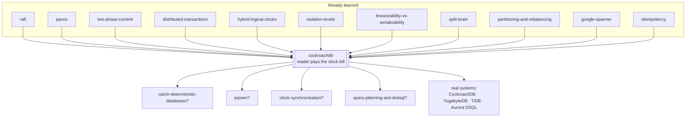

# CockroachDB

### The database that refused to buy a clock

---

**What this lab is.** A teaching document, an interactive simulator
(`visualization.html`, also hosted as
**[The Reader Pays](https://claude.ai/code/artifact/2119fede-4cbd-44ca-9e82-b4583323640b)**),
and a set of pencil-and-paper exercises. There is no code to run and nothing to install.

Every number in this document comes from one of exactly two places, and I say which,
every time:

- **the simulator on this page**, whose rules are printed at the bottom of it. Its engine
  was checked headlessly before publication — **71 checks** covering all eight scenario
  traces value by value, plus property sweeps over its clock settings (1,344 combinations
  for the stale-read condition alone), and **25 further checks** driving the page's DOM,
  every dial to both extremes and every switch to both positions;
- **Cockroach Labs' own documentation and engineering blog** for CockroachDB v26.2, the
  current stable release as this is written (August 2026). Every page I used is listed in
  [Sources](#sources) at the end. Where I state something I did *not* verify against those
  pages, I say so in the same sentence.

**Where you are in the sequence.** You have already built almost all of this, in pieces.
This lab does not reteach any of it:

- [raft](../raft/) and [paxos](../paxos/) gave you a replicated group that agrees on an
  ordered log. CockroachDB puts one under every shard, and this lab treats it as a black box.
- [two-phase-commit](../two-phase-commit/) gave you all-or-nothing across shards, and a
  coordinator that can block everyone forever.
- [distributed-transactions](../distributed-transactions/) proved that two-phase commit
  alone is not a distributed transaction — you measured **16 fractured audits in 40 runs**
  with a perfect 2PC and zero crashes — and taught you Percolator, whose staged locks and
  relocated commit point are the direct ancestor of everything in stage 10 here.
- [hybrid-logical-clocks](../hybrid-logical-clocks/) built the timestamp CockroachDB
  stamps on every version, measured the **86 out of 86 stale reads** a fast-clocked writer
  inflicts on a slow-clocked reader with no causal path between them, and named the three
  places that bill can be sent: the writer, the reader, or the client.
- [google-spanner](../google-spanner/) is **the writer-pays design**, and it ended with a
  four-row table whose second row said: *CockroachDB — reader pays, HLC plus uncertainty
  restarts, ε ≈ 500 ms on commodity clocks*. **This lab is that row, opened up.**
- [isolation-levels](../isolation-levels/), [linearizability-vs-serializability](../linearizability-vs-serializability/),
  [split-brain](../split-brain/), [partitioning-and-rebalancing](../partitioning-and-rebalancing/),
  [quorums-and-replication](../quorums-and-replication/), [btree-and-lsm](../btree-and-lsm/),
  [idempotency](../idempotency/), [pacelc](../pacelc/) and [cap-theorem](../cap-theorem/)
  supply the rest.

So this lab teaches **one new idea**: a database that never tries to be sure what time it
is, and instead makes its *readers* carry the doubt — and then shows you how the same
refusal to be sure, applied to commits and to conflicts, generates the rest of the design.

---

## Table of contents

| | Stage | Depth layer |
|---|---|---|
| 1 | [Why this exists](#1-why-this-exists) | Beginner |
| 2 | [The problem, as a story](#2-the-problem-as-a-story) | Beginner |
| 3 | [What a reasonable person tries first](#3-what-a-reasonable-person-tries-first) | Beginner |
| 4 | [Where all four break](#4-where-all-four-break) | Beginner |
| 5 | [What we actually need to guarantee](#5-what-we-actually-need-to-guarantee) | Beginner |
| 6 | [The key idea](#6-the-key-idea) | Beginner |
| 7 | [The words you now need](#7-the-words-you-now-need) | Beginner |
| 8 | [Two mental models, and where the first one lies](#8-two-mental-models-and-where-the-first-one-lies) | Beginner |
| 9 | [The simulator](#9-the-simulator) | Beginner |
| 10 | [The actual mechanism](#10-the-actual-mechanism) | **Intermediate** |
| 11 | [Failure scenarios](#11-failure-scenarios) | **Engineering** |
| 12 | [What is guaranteed, and what is not](#12-what-is-guaranteed-and-what-is-not) | **Engineering** |
| 13 | [Production](#13-production) | **Production** |
| 14 | [Exercises](#14-exercises) | — |
| 15 | [Knowledge map and next steps](#15-knowledge-map-and-next-steps) | — |
| 16 | [Glossary](#16-glossary) | — |
| | [Sources](#sources) | — |

---

## 1. Why this exists

You are running a business on a database. Three things are true at once, and they fight
each other.

The database has to **survive a machine dying** — not gracefully degrade, not fail over
in four minutes with a page to a human, but keep answering while a machine is on fire.
It has to **hold money correctly**, which means that when two things must both happen or
neither, that is what happens, even across machines. And it has to **speak SQL**, because
your application, your reporting stack and every engineer you will hire already do.

Pick any two and the answer has existed for decades. Pick all three, at more data and
more traffic than one machine can hold, and until about 2012 the honest answer was
"you can't; shard it yourself and give up transactions across the shards."

Google's Spanner proved you *could* have all three — and the price of admission was
**hardware you cannot buy**: GPS antennas and atomic clocks in every datacentre, feeding
a time service that tells you not what time it is, but how wrong it might be.

CockroachDB is the answer to a narrower question: **can you have all three on ordinary
machines with ordinary clocks, in somebody else's cloud, where you are not allowed to
install an antenna on the roof?**

If nobody solves this, the concrete consequence is the one every large system eventually
lives with: a payments ledger sharded by customer ID, an application-level "distributed
transaction" made of retries and reconciliation jobs, and a monthly meeting about the
seventeen accounts that do not balance.

---

## 2. The problem, as a story

A town has one ledger book and one clerk. Every purchase, every payment, every transfer
is a line in the book, and every line is dated and timed by the clerk as it is written.

Because there is one book and one clerk, two things are automatically true and nobody
ever thinks about them. Everything that happens is written in **one order** — the order
the clerk wrote it. And every line's **time is comparable to every other line's**,
because one wristwatch produced all of them.

The clerk goes home with influenza. The town stops.

So the town hires three clerks in three towns — one in Mumbai, one in Frankfurt, one in
Ohio — and gives each of them a copy of the book, so no single illness can stop anything.

And now the two things nobody ever thought about are both false.

The three clerks write in three books, so there is no single order. And — this is the
part that generates everything in this lab — **each clerk dates entries by their own
wristwatch, and no two watches agree.** They are not broken watches. They are ordinary
watches, checked against the radio every so often, drifting a little between checks. Mumbai's
runs a fifth of a second fast. Ohio's runs a tenth of a second slow. Nobody can tell,
because to know your watch is fast you would need a watch you already trusted.

Here is the concrete damage, in milliseconds, exactly as the simulator runs it. Call the
true instant of Asha's payment **1000**.

1. At true time **1000**, Asha pays a bill in Mumbai. Mumbai's watch is 180 ms fast, so
   the clerk dates the entry **1180**.
2. At true time **1060**, Asha is told the payment has gone through.
3. At true time **1070**, Asha telephones Ben in Ohio: *"it's gone through."*
4. At true time **1080**, Ben asks the Ohio clerk to look. Ohio's watch is 120 ms slow,
   so it reads **960**. The clerk therefore examines the book *as of 960*.
5. Asha's entry is dated **1180**. That is **later** than 960, so as far as the Ohio clerk
   can tell it has not happened yet. The clerk tells Ben: *"no payment here."*

Nobody lied. Nobody's watch is broken. No message was lost. And Ben has been told
something false about money, twenty milliseconds after Asha was told it was true.

> **🔮 Predict:** Ohio's clerk has a *copy* of Mumbai's page — replication is not the
> problem here; assume the page arrived instantly. Why does having the data not help?
> <details><summary>Reveal</summary>
> Because the question the clerk asks is not "do you have the page?" but "what did the
> book look like **at my time**?" — and the entry is dated later than the clerk's time,
> so it is filed as *not yet having happened*. The data is right there and is deliberately
> ignored. **Every problem in this lab is a problem of interpretation, not of delivery.**
> That is worth holding onto: you already have labs about delivery
> ([quorums-and-replication](../quorums-and-replication/), [anti-entropy](../anti-entropy/)),
> and none of them touch this.
> </details>

---

## 3. What a reasonable person tries first

Four fixes, in the order a sensible engineer reaches for them. Three you have already
killed in earlier labs, so they get one line each; the fourth is the interesting one.

| # | The fix | Where it dies | Already covered in |
|---|---|---|---|
| 1 | **One bigger machine.** No second clock, no second order. | Works beautifully until the machine dies or the data outgrows it. This is not a distributed-systems failure; it is the absence of the property you paid for. | [cap-theorem](../cap-theorem/) |
| 2 | **One writer, several read replicas.** One clock stamps everything, so order is safe. | The single writer is the ceiling and the outage. Promoting a replica loses whatever had not shipped. | [quorums-and-replication](../quorums-and-replication/), [split-brain](../split-brain/) |
| 3 | **Shard by customer, transactions within a shard only.** | Any invariant spanning two shards — a transfer, a uniqueness constraint, a ledger that must balance — has no home. You measured what happens when you bolt two-phase commit on anyway: **16 fractured audits in 40 runs**, with no crashes at all. | [distributed-transactions](../distributed-transactions/) |
| 4 | **Do what Spanner does: buy a clock that admits its own error, and make every writer wait out that error before acknowledging.** | This one is *correct*. It is the design you already studied, and it closes the problem completely. | [google-spanner](../google-spanner/) |

Fix 4 deserves more than a line, because it is not wrong — it is unavailable.

Spanner's `TT.now()` does not return a time. It returns an *interval*
`[earliest, latest]` that is guaranteed to contain the true instant, and ε is half its
width. A writer stamps its transaction with `latest`, then **refuses to acknowledge the
client until `TT.after(s)`** — until the interval has moved entirely past its own stamp.
The write is provably in the past of everything that starts afterwards. You measured the
bill in that lab: about **5 ms added to every write**, and hardware in every datacentre to
keep ε down to single-digit milliseconds.

The reason you cannot copy it is not intellectual. It is a loading dock. ε is small only
because there is a GPS receiver on the roof and an atomic clock in the rack, and you
cannot install either in a cloud region you rent by the hour. Without them, ε on ordinary
NTP-disciplined machines is measured in **hundreds** of milliseconds, and a design that
sleeps for 2ε on every write becomes a design that sleeps for most of a second on every
write.

---

## 4. Where all four break

Take fix 4 and simply run it on ordinary hardware. This is the most instructive failure
in the lab, because nothing about the *protocol* breaks — only the number.

Set ε to a realistic commodity value of 250 ms. Commit-wait now holds every write's
acknowledgement for roughly 2ε ≈ 500 ms. A payments API that used to answer in 15 ms now
answers in 515 ms. You have bought a perfectly correct database that nobody can use.

And you cannot simply declare ε small and carry on. ε is not a preference. If you claim
ε = 5 ms while your clocks actually disagree by 200 ms, commit-wait sleeps for the wrong
duration and **external consistency dies with commit wait switched on**, silently — the
exact failure the Spanner lab's fourth scenario demonstrates.

So the four fixes leave us here:

- Fixes 1–3 give up one of the three requirements outright.
- Fix 4 keeps all three, and charges the **writer** an amount proportional to how bad
  your clocks are. On good hardware that is a few milliseconds. On rented hardware it is
  a business-ending latency.

What the failure reveals is not "clocks are hard". It is something sharper:

> The cost of clock uncertainty has to be paid by *somebody*. Spanner charges the writer,
> on every single write, whether or not anyone was ever going to read it. That is a
> **fixed premium on all traffic**, and on commodity hardware the premium is unaffordable.

Which raises the question this whole lab turns on: **is the writer the right payer?**

---

## 5. What we actually need to guarantee

Strip away the mechanism and there are three separate promises, and they are worth
separating because CockroachDB keeps two of them and deliberately declines the third.

**Promise A — no stale reads.** Once a write has been acknowledged to its client, every
transaction that *begins after that acknowledgement* sees it. This is the promise Ben's
dashboard broke in stage 2. It is the one users notice, because it is the one that makes
a database feel like a single machine.

**Promise B — serializable.** However many transactions run concurrently, the outcome is
the same as *some* one-at-a-time order of them. No fractured reads, no write skew, no lost
updates. You have the full anomaly taxonomy already from [isolation-levels](../isolation-levels/).

**Promise C — that order matches real time, for everybody.** Not just "some serial order
exists" but "the serial order never contradicts the wall clock, even for two transactions
that share no data and never met." This is **strict serializability** — Spanner calls it
external consistency, and you named it precisely in
[linearizability-vs-serializability](../linearizability-vs-serializability/).

Here is the honest statement of what this lab builds, made now rather than sprung on you
in stage 12:

> **CockroachDB guarantees A and B. It does not guarantee C, and does not claim to.**
> Cockroach Labs' own writing puts it plainly: *"CockroachDB doesn't quite offer strict
> serializability, but we're fairly close to it."*

Stage 12 shows you exactly what falls through the gap between B and C, stage 8 of the
simulator lets you watch it happen with every clock inside its budget, and stage 13 shows
you the one table type where CockroachDB buys C back — by doing exactly what Spanner does.

---

## 6. The key idea

Two sentences.

> **Do not try to know the time. Know how wrong your clock is allowed to be — a number
> you declare, not one you measure — and put the cost of that doubt on the reader.**
>
> Then apply the same posture everywhere else: never coordinate to *prevent* a conflict;
> proceed optimistically, *detect* the conflict, and retry.

The first sentence is the clock story, and it inverts Spanner exactly. Cockroach Labs
states the inversion in one line: *"While Spanner always waits after writes, CockroachDB
sometimes retries reads."*

Look at what that trade actually is. Spanner pays a **certain, small, universal** cost:
every write waits, always. CockroachDB pays an **uncertain, occasionally large, rare**
cost: a read that happens to encounter a value in an awkward timestamp range does its work
twice. Writes are acknowledged immediately. Reads that touch nothing recent cost nothing.
The bill only arrives when a reader and a recent writer nearly collide in time — which,
on most workloads, is seldom.

The second sentence is why CockroachDB looks so unlike a lock-based database from the
outside. Almost nothing waits for anything. Writes do not wait for a commit record.
Readers do not wait for writers. Writers do not wait for readers. Instead the system
detects, afterwards, that something incompatible happened — and throws work away. That is
why **`SQLSTATE 40001` is part of the API contract, not an error path**: an ordinary,
healthy CockroachDB application has a retry loop around every transaction, because the
database is entitled to refuse a perfectly reasonable transaction and ask for it again.

---

## 7. The words you now need

Five terms, each earned by the problem it names. The rest arrive in stage 10, where they
are needed.

### range

**Plain meaning.** A chapter of the book: all the rows whose keys fall between two
bookmarks.

**Technical meaning.** CockroachDB stores the entire cluster — every table, every index,
every internal record — as **one sorted key-value map**, and cuts that map into contiguous
chunks called ranges. A range splits in two when it grows past `range_max_bytes`
(**512 MiB** by default) and merges with its right-hand neighbour when it shrinks below
`range_min_bytes` (**128 MiB**). Each range is replicated — three copies by default — and
each range's copies form their own independent Raft group.

**Why the word exists.** To distinguish this from the *hash* partitioning you learned in
[consistent-hashing](../consistent-hashing/). A hash bucket holds keys that have nothing
to do with each other. A range holds keys that are **adjacent in sort order**, which is
what makes `WHERE id BETWEEN 100 AND 200` a single seek plus a scan rather than a
question asked of every machine in the cluster. That choice buys ordered scans and costs
you hot spots on sequential keys — a trade stage 11 makes concrete.

**Example.** `/accounts/a–m` is one range; `/accounts/n–z` is the next. Asha's row is in
the first, Raj's in the second, and a transfer between them is therefore a two-range
transaction.

**Connects to.** [partitioning-and-rebalancing](../partitioning-and-rebalancing/) (this
is range partitioning, with automatic splits); [raft](../raft/) (one group per range, not
one per cluster).

### leaseholder

**Plain meaning.** For each chapter, one of the three clerks is on duty. Only the duty
clerk may answer questions about that chapter without consulting the others.

**Technical meaning.** One replica of each range holds the **range lease**: the exclusive
right, for a bounded time, to serve reads from its local copy and to sequence writes.
Reads at the leaseholder need no consensus round at all — which is the difference between
a read costing 1 ms and a read costing a cross-region round trip.

**Why the word exists.** Because it is *not* the same thing as the Raft leader, and the
distinction cost CockroachDB real production incidents before it was eliminated. Raft
leadership is about who appends to the log. The lease is about who may answer without
appending. Historically these could drift apart — a "leader-leaseholder split" — and a
leaseholder whose Raft log had fallen behind could render a range unavailable during a
partition. Since **v25.2 the default is leader leases**, which structurally fuse the two:
the Raft leader is always the leaseholder, except briefly during a transfer.

**Example.** In the simulator, Frankfurt holds the lease for `/accounts/a–m`. A client
connected to Frankfurt reads Asha's balance in 1 ms; the same client reads Raj's balance
in 60 ms, because Ohio holds that lease.

**Connects to.** [split-brain](../split-brain/) — a lease is a **fencing token**, and its
entire job is to make it impossible for two machines to believe they are in charge at once.

### write intent

**Plain meaning.** A pencil mark. A value written into the book provisionally, with a note
saying which transaction it belongs to, so anyone who finds it knows where to ask whether
it counts.

**Technical meaning.** The docs describe it precisely: a write intent is *"a combination
of a replicated lock and a replicated provisional value"* — an ordinary MVCC record
carrying a pointer to a **transaction record**. It is replicated through Raft like any
other write, so it survives machine death; and it blocks nobody outright, because a reader
that meets one can go and resolve it.

**Why the word exists.** To keep two ideas that a lock fuses apart from each other. A
lock says *"you may not proceed."* An intent says *"here is the value, and here is where
to find out whether it is real."* The second is strictly more useful, because a reader
holding an intent can finish the writer's transaction on its behalf.

**Example.** Simulator, scenario 1: `/accounts/asha` briefly carries an intent
`₹1,500 @ ts 1000` pointing at transaction T1's record, before anything says COMMITTED.

**Connects to.** [distributed-transactions](../distributed-transactions/) — this is
Percolator's staged lock, with one change stage 10.3 makes much of.

### transaction record

**Plain meaning.** The master card for one transaction, filed in one place, saying whether
it counts.

**Technical meaning.** A single key-value pair, living on the range that contains the
transaction's first written key (its *anchor*), whose value is the transaction's status:
`PENDING`, `STAGING`, `COMMITTED` or `ABORTED` — plus a fifth case, *the record does not
exist*, which is resolved by comparing the intent's timestamp against a liveness threshold.
Every intent in the transaction, on every range, points at this one record.

**Why the word exists.** Because it is the thing that makes a multi-range commit **atomic
by construction rather than by protocol**. There is no vote and no agreement about the
outcome; there is one shard-local write that a hundred intents all defer to. This is the
"relocated commit point" from the distributed-transactions lab, and it is what deletes
two-phase commit's blocking problem.

**Example.** In scenario 2, Frankfurt dies with the record stuck in `STAGING`. The record
outlives its author, on a different machine, and a stranger reads the outcome off it.

**Connects to.** [two-phase-commit](../two-phase-commit/) (the coordinator's decision,
turned into replicated data instead of a process's memory);
[distributed-transactions](../distributed-transactions/) (Percolator's primary key).

### uncertainty interval

**Plain meaning.** A reader's window of doubt: *"anything stamped in the next half second
might secretly have happened before I started."*

**Technical meaning.** A transaction reading at timestamp `t` treats every committed value
stamped in the half-open range `(t, t + max_offset]` as **ambiguous** — not visible, not
invisible, but unresolvable. `max_offset` is the `--max-offset` cluster-wide promise about
clock skew; **its default is 500 ms**. Meeting an ambiguous value raises
`ReadWithinUncertaintyIntervalError`, and the transaction restarts at a higher timestamp.

**Why the word exists.** To name the thing Spanner's ε names, but relocated. In Spanner ε
is a *measured* property of the hardware and the writer pays it. In CockroachDB
`max_offset` is a *declared* budget and the reader pays it. Same quantity, opposite ends
of the transaction, and — crucially — one is a fact and the other is an assumption.
Stage 12 is largely about that difference.

**Example.** Simulator, scenario 3, at the default settings: Ben reads at **960** with a
window ending at **1460**. Asha's payment is stamped **1180**, which is inside the window,
so the read restarts at **1180⁺** and returns SETTLED. Drag the max-offset slider to 0 and
the same read returns PENDING — a wrong answer about money, with no error raised.

**Connects to.** [hybrid-logical-clocks](../hybrid-logical-clocks/) — this is the
"uncertainty restart" that lab named and did not build; [google-spanner](../google-spanner/)
— same ε, opposite payer.

---

## 8. Two mental models, and where the first one lies

### The simple model: three clerks and a book in chapters

The book is cut into chapters. Every chapter is photocopied to all three towns, so no
town's fire destroys anything. For each chapter, one clerk is **on duty** and may answer
questions about it alone; the others hold copies and stay quiet.

To write a transaction, you first go round and put **pencil marks** in every chapter you
are changing, each mark saying *"see master card #714"*. Then you fill in card #714. Once
card #714 says the transaction counts, every pencil mark counts, everywhere, at once —
even before anyone has gone back to ink them in.

And every entry is dated by the duty clerk's own watch. Everyone knows the watches
disagree, and everyone has agreed on one number: **no watch is more than half a second
from any other**. So a clerk reading the book "as of 960" treats every entry dated between
960 and 1460 as *"I cannot tell whether this is in my past"* and goes back to check.

### The engineering model

| The story | The machinery |
|---|---|
| The book | One monolithic sorted key-value map holding the whole cluster |
| A chapter | A **range** — a contiguous key span, 512 MiB max by default |
| Three photocopies of a chapter | Three **replicas**, forming that range's own Raft group |
| The duty clerk for a chapter | The **leaseholder**; since v25.2 always also the Raft leader |
| A pencil mark | A **write intent**: an MVCC value plus a pointer to a transaction record |
| Master card #714 | The **transaction record**, `PENDING` / `STAGING` / `COMMITTED` / `ABORTED` |
| The date on an entry | A **hybrid logical clock** timestamp — 64-bit wall clock plus a 32-bit logical counter |
| "No watch is more than half a second out" | `--max-offset`, default **500 ms** |
| "I cannot tell whether this is in my past" | The **uncertainty interval** `(read_ts, read_ts + max_offset]` |
| Going back to check | An **uncertainty restart** — `ReadWithinUncertaintyIntervalError` |
| A note that someone already read this line | The **timestamp cache** |
| Proving your earlier reading still stands | A **read refresh** |

### Where the analogy breaks

Four places, and each one is load-bearing.

**1. The duty clerk is not elected by a show of hands about the data.** A lease is not
consensus about content; it is a bounded, fenced grant of authority. The reason this
matters is [split-brain](../split-brain/)'s whole argument: a machine that has been
partitioned away can still *believe* it is the duty clerk, and the design has to make that
belief harmless. Leader leases do it by refusing to let leadership and duty ever be held
by different machines.

**2. "Pencil first, then ink" implies the ink is what makes it real. It is not.** In the
real design, filling in the master card is not even the commit — the transaction is
committed the instant the card says `STAGING` *and* every mark it lists has been agreed
by a majority. The inking is bookkeeping done afterwards, by whoever happens to pass. Stage
10.3 builds this and it is the least intuitive idea in the lab.

**3. Chapters are not fixed.** Ranges split and merge continuously as data grows and
shrinks, and the boundaries move under load. There is no moment at which the shape of
the book is settled.

**4. There is no clerk who knows the true time — including the reader.** The analogy
tempts you to imagine a narrator who knows it is "really" 1000. The simulator has such a
narrator, drawn as the top lane of its timeline, and **no component of the real system
does**. Every mechanism in this lab is built out of *relative* comparisons between numbers
that are all individually wrong.

---

## 9. The simulator

Open **[The Reader Pays](https://claude.ai/code/artifact/2119fede-4cbd-44ca-9e82-b4583323640b)**
(or `visualization.html` in this directory — it works offline).

**What you are looking at.** The timeline has two lanes on a single shared millisecond
scale, and reading it correctly is most of the lesson:

- **The top lane is real time** — when each transaction actually began and was
  acknowledged. Nothing inside the database can see this lane. It exists so *you* can.
- **The bottom lane is what the cluster believes**: each key as a row, each committed
  version as a dot at its timestamp, each write intent as a hollow diamond.
- **The dashed line between them** connects a transaction's real beginning to the
  timestamp it was given. Its slant is that machine's clock error, drawn to scale, with
  the millisecond figure on it. A right-leaning line is a fast clock inventing the future;
  a left-leaning line is a slow clock backdating the present.
- **The amber band** is the reading transaction's window of doubt. Version dots are
  coloured by where they fall relative to it: green = in the reader's past and visible,
  amber = ambiguous and about to cause a restart, grey = in the reader's future and
  skipped.

**What to try, in this order.**

1. **Scenario 3, "The stale read"**, with everything at its defaults. Answer the
   prediction, then press *Run it for me*. Watch the amber band catch the payment, and
   watch the read line jump right while the band's right-hand edge stays put.
2. **The same scenario, with the max-offset slider dragged to 0.** This is the single most
   valuable ten seconds on the page: the verdict banner turns red, a payment that has been
   acknowledged is reported as not having arrived, and **not one log line says anything is
   wrong**.
3. **Scenario 1 with the parallel-commits switch on, then off.** You have not met parallel
   commits yet — stage 10.3 builds them — but you can see what they buy right now: the
   client's wait goes from 121 ms to 181 ms for exactly the same guarantee.
4. **Scenario 5, "Two doctors"**, then turn off *re-check reads when pushed* and run it
   again — write skew, live.
5. **Scenario 8, "The causal reverse"** — a name stage 12 will earn. Every clock inside its
   budget, no failures at all, and the audit still sees an effect without its cause.

Two habits make the page much more useful. **Predict before you run** — the buttons are
there so you commit to an answer while being wrong is still cheap. And **step backwards**:
the whole simulation is a pure function of the dials, so ← and → move freely, and nothing
is remembered between steps that the screen does not show you.

---

**CHECKPOINT — end of the beginner model.**
You can now say why this database exists, what breaks without it, and what its one big
idea is: never be sure what time it is, declare how unsure you are, and make readers carry
the doubt. **What the next layer adds:** how a row becomes a key, who is allowed to answer
a read, how a two-continent commit takes one round trip instead of two, and how
serializability is enforced without a single lock on a reader.

---

## 10. The actual mechanism

Five parts. Each one starts with the version a sensible engineer would build, breaks it,
and repairs it — because every odd detail of the real design is the scar of one of these
breakages.

### 10.1 Where a row actually lives

**v1: hash the primary key and send it to a machine.** This is
[consistent-hashing](../consistent-hashing/), it spreads load perfectly, and it is what
Cassandra and DynamoDB do.

**It breaks on the second query you will ever write.** `SELECT … WHERE id BETWEEN 100 AND
200` has to be sent to every machine, because a hash scatters adjacent keys deliberately.
So does `ORDER BY id LIMIT 10`. So does any range scan on any index. You have made
single-key lookups perfect and everything else a fan-out.

**The repair: keep the keys in order.** CockroachDB stores the whole cluster as **one
sorted key-value map** and cuts it into contiguous ranges. Adjacent keys are adjacent
bytes, in the same range, on the same machine, in the same LSM tree
([btree-and-lsm](../btree-and-lsm/)).

A SQL row becomes key-value pairs by an encoding worth seeing once, because two production
problems fall straight out of it:

```
   /<table_id>/<index_id>/<indexed column values>  →  <the remaining column values>
```

The primary key uses `index_id = 1`. So a row of `accounts` (say table 106) with primary
key `'asha'` and columns `(balance, tier)` is roughly:

```
   /106/1/"asha"   →   (2000, "gold")
```

and a secondary index on `tier` (index 2) is another entry in the same map:

```
   /106/2/"gold"/"asha"   →   —
```

Three consequences follow immediately, and you should be able to derive each one from
that single line of encoding:

- **A range scan is a sequential read.** Every row of `accounts` between `'a'` and `'m'`
  is contiguous bytes.
- **A secondary index is just more rows in the same map, usually in a different range** —
  which is why inserting one row with two indexes is a *multi-range* transaction, and why
  stage 10.3's saved round trip matters so much.
- **A monotonically increasing primary key is a design fault**, not a preference. Every
  new row sorts to the end of the map, so every insert in the cluster hits the same range,
  and therefore one leaseholder, on one machine. Stage 11 makes this concrete.

**How does a client find the range?** A two-level index, held in the map itself:
**`meta1`** addresses `meta2`, and `meta2` addresses every user range. The location of
`meta1` is spread to every node by gossip ([gossip-protocols](../gossip-protocols/)), and
every node caches range descriptors it has used. Two levels addresses up to 4 EiB, so in
practice a lookup is at most two hops and usually zero.

### 10.2 Who is allowed to answer a read

**v1: read through Raft.** Every read is proposed to the range's Raft group and answered
once a majority has agreed. This is obviously correct and it is what a first implementation
does.

**It breaks on cost.** Every read — including the 95% of your traffic that is reads —
now costs a consensus round, which across regions is tens of milliseconds. You have built
a correct database with the read latency of a write.

**The repair: the range lease.** One replica holds the exclusive right to serve reads
locally for a bounded period. Reads become a local lookup. The leaseholder also sequences
writes, which is what makes the timestamp cache in 10.5 possible at all.

**And that repair broke, in production, for years.** The lease and the Raft leadership were
separate grants and could land on different replicas — a **leader-leaseholder split**.
A leaseholder whose Raft log had fallen behind the others would keep answering reads while
being unable to make progress on writes, and under a network partition this could leave a
range unavailable indefinitely.

**The second repair: leader leases**, the default since **v25.2**. The Raft leader is
always the leaseholder, except briefly during a deliberate transfer. This also removed a
structural single point of failure: epoch-based leases depended on a single **node
liveness range** that every node in the cluster heartbeated, and leader leases replaced
that with store-wide failure detection. (Heartbeating still exists for cluster membership,
death detection and replica placement — it is no longer on the critical path of holding a
lease.) A third kind, **expiration-based leases**, still covers system ranges; they expire
after a few seconds and are renewed by continued Raft activity.

> **🔮 Predict:** The leaseholder answers reads from its own copy without asking anybody.
> A stale or partitioned leaseholder could therefore serve an old value forever. What
> stops it?
> <details><summary>Reveal</summary>
> The lease is <b>time-bounded</b>, and this is exactly the fencing argument from
> <a href="../split-brain/">split-brain</a>. A leaseholder may only answer reads while its
> lease is valid; a partitioned one runs out and stops. A new leaseholder cannot be granted
> until the old lease has provably expired, so two machines can never both believe they are
> on duty at once. The safety property does not come from the leaseholder being
> well-behaved — it comes from time bounding what a misbehaving one can do. Which is the
> same trick as the uncertainty interval, applied to authority instead of to data.
> </details>

### 10.3 How a transaction writes — and why the commit is not an event

Take the transfer from scenario 1: move ₹500 from Asha (range `/accounts/a–m`, leaseholder
Frankfurt) to Raj (range `/accounts/n–z`, leaseholder Ohio). Two ranges, two leaseholders,
60 ms apart.

**v1: Percolator, which you already know.** Stage the writes as intents; then flip one
designated record from pending to committed; secondaries clean up lazily. That is the
design from [distributed-transactions](../distributed-transactions/), and CockroachDB's
intents and transaction record are exactly its lock and primary, generalised — the record
is its own key rather than one of the data keys.

Here is the trace, from the simulator with parallel commits **off**:

```
t=1000   BEGIN on Frankfurt · read_ts = HLC(Frankfurt) = 1000
t=1001   GET /accounts/asha  @ Frankfurt (local, 1 ms)  → ₹2,000 @ ts 200
t=1061   GET /accounts/raj   @ Ohio (60 ms)             → ₹500   @ ts 300
t=1061   PUT intent /accounts/asha = ₹1,500 @ 1000
         PUT intent /accounts/raj  = ₹1,000 @ 1000       ← round 1 of consensus
t=1121   both intents agreed by majorities
t=1181   PUT txn record PENDING → COMMITTED              ← round 2 of consensus
         client acknowledged.  Elapsed: 181 ms
```

**It breaks on the second round.** The outcome was already determined at t=1121 — both
values are durable on majorities, nothing can undo them, no participant can change its
mind. The client then waits another full cross-region round trip while the coordinator
writes down a conclusion that was already forced. And it gets worse with schema: every
secondary index entry is another key, often on another range, so a wide table's insert
pays this on more ranges.

**The repair: parallel commits.** Redefine what "committed" means. The docs put it
exactly:

> *"A transaction is considered committed if its record is in the STAGING state and an
> observer can prove that all of the writes listed in its transaction record have
> successfully achieved consensus."*

Read that twice, because it is the whole trick. Committed stops being an **event someone
performs** and becomes a **condition anyone can check**. The coordinator therefore writes
the record — as `STAGING`, listing the keys it is waiting on — *at the same time* as the
intents, not after them:

```
   TransactionRecord{ Status: STAGING, Writes: []Key{"/accounts/asha", "/accounts/raj"} }
```

The same trace with parallel commits on:

```
t=1000   BEGIN on Frankfurt · read_ts = 1000
t=1001   GET /accounts/asha  → ₹2,000 @ ts 200
t=1061   GET /accounts/raj   → ₹500   @ ts 300
t=1061   PUT intent /accounts/asha, PUT intent /accounts/raj,
         PUT txn record {STAGING, in-flight:[asha, raj]}   ← all three, in parallel
t=1121   every one of them agreed → the commit condition holds → transaction IS committed
         client acknowledged.  Elapsed: 121 ms
t=1126   record STAGING → COMMITTED; intents resolved to values   ← off the critical path
```

**121 ms instead of 181** — exactly one cross-region round trip saved, and the simulator
asserts that identity across its configurations. Cockroach Labs' own measurement is the
qualitative version of the same claim: without parallel commits, client-perceived latency
grows at *twice* the rate of the round-trip time; with them, at exactly the rate of the
round-trip time.

> **🔮 Predict:** At t=1122 — after the acknowledgement, before anything says COMMITTED,
> before either pencil mark is inked — the coordinator machine catches fire. Is the money
> moved?
> <details><summary>Reveal</summary>
> <b>Yes, definitively.</b> Not "probably", not "a human must decide" — the commit
> condition was satisfied at t=1121 and it is a property of data that is replicated on
> majorities. Nothing about the coordinator's continued existence was ever part of it.
> The next reader to touch either key finds an intent, follows it to a <code>STAGING</code>
> record, checks the keys the record lists, finds them all present, and concludes the
> transaction committed — then does the tidying itself. Run scenario 2 to watch a stranger
> finish someone else's transaction.
> <br><br>
> Compare this with <a href="../two-phase-commit/">two-phase-commit</a>, where a
> coordinator dying between prepare and commit leaves participants holding locks with no
> way to learn the outcome, and with XA in the JVM, where the resolution is a human being
> inventing a <i>heuristic outcome</i> for an <i>in-doubt</i> transaction. The blocking
> problem is not solved here. It is <b>deleted</b>, by making the outcome a fact in the
> data rather than a message from a process.
> </details>

**And what if a write is missing?** The recovery procedure must not guess, and must not
be able to reach a different conclusion than someone else running it a moment later. So
when it finds a listed key without an agreed intent, it does not simply abort — it first
**makes that write impossible forever**, by raising the barrier on that key (the timestamp
cache, 10.5) above the transaction's timestamp, and only then marks the record `ABORTED`.
Any straggling attempt to complete that write now fails. The same procedure produces both
outcomes and both are atomic; scenario 2's final step walks the abort branch.

### 10.4 How a reader avoids a stale answer

This is the part that is unique to CockroachDB, and it is stage 3 of the simulator.

Every version in the store is stamped with a **hybrid logical clock** value — the
timestamp you built in [hybrid-logical-clocks](../hybrid-logical-clocks/), a wall-clock
reading plus a logical counter, in CockroachDB an `int64` of nanoseconds plus an `int32`.
A transaction takes its read timestamp from the clock of the node its client connected to.

**v1: read at your own now.** Show every version stamped at or below your read timestamp.
This is textbook MVCC, and on one machine it is exactly right.

**It breaks on the story in stage 2.** Here is the trace, from the simulator, defaults,
with the doubt set to zero:

```
t=1000  Mumbai (clock +180) commits Asha's payment.  commit_ts = 1180
t=1060  Asha is acknowledged
t=1070  Asha telephones Ben
t=1080  Ohio (clock −120) begins Ben's read.  read_ts = 960
t=1141  value ts 1180 > read_ts 960  →  "in my future"  →  invisible
        Ben is told: PENDING                                  ← STALE READ
```

**The repair: refuse to answer when you cannot tell.** Give the reader an
**uncertainty interval** `(read_ts, read_ts + max_offset]`. A value in it is neither
visible nor invisible; it is *unresolvable*, and returning either answer might be a lie.
So the read raises `ReadWithinUncertaintyIntervalError` and restarts at a timestamp just
above the offending value. Same trace, doubt at its default of 500 ms:

```
t=1080  read_ts = 960 · uncertainty interval = (960, 1460]
t=1141  value ts 1180 ∈ (960, 1460]  →  ambiguous  →  ReadWithinUncertaintyIntervalError
        restart at 1180⁺ · ceiling stays 1460 · window is now 280 ms wide, not 500
t=1142  value ts 1180 ≤ read_ts 1180⁺  →  visible
        Ben is told: SETTLED                    ← correct, and it cost one round trip
```

**And that repair looks like it might never terminate.** A busy cluster is writing all the
time; if every value in the window costs a restart, a long report could restart forever.
Two brakes stop it, and they are independent.

**Brake one: the ceiling never rises.** On restart the read timestamp moves up but
`read_ts + max_offset` — the value computed when the transaction *began* — does not. So
every restart strictly shrinks the remaining doubt. The docs state this directly: *"the
upper bound of the uncertainty interval does not change on restart, so the window of
uncertainty shrinks."*

**Brake two: observed timestamps.** When a transaction first contacts a node, it records
what that node's clock read at that moment. Any value on that node stamped **above** that
reading must have been written *after* the transaction spoke to it — so it is provably in
the transaction's future, not merely possibly. No restart. The consequence is a hard bound:
a transaction can be forced to restart **at most once per node**, and never by more than
the width of its uncertainty interval.

Scenario 4 is this bound, made visible. Same report, same four rows, one switch:

| | restarts | what the report saw for `/payments/p2` |
|---|---|---|
| with observed timestamps (default) | **1** | the older version, `PENDING @ 580` |
| without them | **2** | the newer version, `REFUNDED @ 1285` |

Note the second column carefully, because it is a subtlety people miss: the optimisation
does not only make things faster, it changes **which snapshot you get**. Both answers are
serializable; they are different, equally valid, points in the transaction order. Nothing
about correctness depends on which one you get, and that is precisely why the optimisation
is allowed to exist.

> **🔮 Predict:** Ohio's clock is slow, so writes made in Ohio carry small timestamps and
> look older than they are. Does that hurt Ohio's *own* readers?
> <details><summary>Reveal</summary>
> No — and working out why is the best test of whether the mechanism has landed. A slow
> clock backdates its writes, so they fall <i>below</i> other readers' read timestamps and
> are plainly visible. Doubt only arises when a value is stamped <b>above</b> the reader's
> timestamp, which needs the <i>writer's</i> clock to be ahead of the <i>reader's</i>.
> Scenario 4 has a row exactly like this — Raj's, written on Ohio at true time 900 and
> stamped 780 — and it causes no drama at all.
> <br><br>
> The direction matters enormously for a different reason. A fast clock is the dangerous
> one: it invents timestamps in the future, and future timestamps are what hide from
> readers. This is why the failure in stage 11.3 is asymmetric, and why the derived
> condition there involves <i>off_writer − off_reader</i> and not the absolute error of
> either.
> </details>

### 10.5 Serializable, without ever blocking a reader

Snapshot isolation comes free with MVCC and is not enough — [isolation-levels](../isolation-levels/)
measured exactly what it lets through, and
[distributed-transactions](../distributed-transactions/) showed **write skew survives
distribution completely untouched**. So something has to close it.

**v1: lock what you read** (distributed strict two-phase locking). Correct, and it means
readers queue behind writers and writers behind readers, across regions, and inherit 2PC's
blocking. Rejected for the same reason as everything else in this lab: it makes an
ordinary operation wait for a remote machine.

**The repair, in three moving parts.**

**Part one — reads leave a mark.** Each leaseholder keeps a **timestamp cache** in memory:
for each key span, the highest timestamp at which anybody has read it. When a write
arrives, its timestamp is checked against this mark, and a write is never allowed to slip
in underneath a read that already happened. If it would, the write's whole transaction is
**pushed**: its commit timestamp moves up above the mark. Nobody waits; the write simply
gets a later position in time than it asked for.

**Part two — being pushed creates a debt.** A transaction that read at 890 and now claims
to commit at 1000⁺ is claiming its reads were valid at 1000⁺ too. Under `SERIALIZABLE`
that has to be proved, by a **read refresh**: re-check every span the transaction read for
changes in the gap `(old_ts, new_ts]`. Clean → the push was free. Dirty → the transaction
cannot be salvaged, and the client gets **`RETRY_SERIALIZABLE`, SQLSTATE 40001**.

**Part three — the client retries.** This is not an error path. It is the contract.

Scenario 5 is the canonical case, traced by the simulator:

```
t=1000  T_A on Frankfurt reads both doctors at 1000 · both ON CALL
        T_B on Ohio      reads both doctors at  890 · both ON CALL
        timestamp cache now marks both rows as read at 1000
t=1200  T_A writes dr_mehta = OFF @ 1000 · nobody else read it higher · COMMITTED
t=1260  T_B writes dr_qureshi = OFF @ 890
        timestamp cache[dr_qureshi] = 1000 ≥ 890  →  push T_B's commit_ts to 1000⁺
t=1265  T_B was pushed → refresh its reads over (890, 1000⁺]
        dr_mehta changed at 1000, inside the gap  →  refresh FAILED
        RETRY_SERIALIZABLE (40001)
t=1330  T_B retried at 1000⁺ → reads dr_mehta = OFF → the application refuses
```

One doctor stays on call, and **not one lock was taken on a reader**. Turn off the
*re-check reads when pushed* switch and the same trace ends with both doctors off call —
which is snapshot isolation, and is why `READ COMMITTED` transactions in CockroachDB (GA
since v24.1, but not the default) explicitly *do not* perform read refreshing.

Two more pieces complete the concurrency picture, named here because you will meet them in
error messages:

- The **latch manager** sequences requests inside a single replica so that two operations
  on the same key do not interleave: many read latches may coexist; a write latch excludes.
  Latches are held for the duration of one request, not one transaction — they are not locks.
- The **lock table** is the per-node, in-memory structure holding locks that in-progress
  transactions have actually acquired (`SELECT … FOR UPDATE`, and the discovered locks
  behind write intents), each with a wait-queue. The **`TxnWaitQueue`**, kept on the
  range's Raft leader, tracks transactions that tried to push another transaction and
  could not — and it is where distributed deadlocks are broken.

Notice the timestamp cache is doing **two unrelated jobs** with one structure: it enforces
serializability by pushing writes above reads, and it is the barrier that parallel-commit
recovery raises to kill a missing write for good. That economy is worth remembering,
because it also explains a failure in stage 11: the structure is in memory only, and never
replicated.

---

**CHECKPOINT — end of the intermediate model.**
You can now trace a two-region transaction end to end: how its rows are addressed, who
serves its reads, how its commit becomes a fact rather than a message, when its reads
restart and why they stop, and how it is refused if committing would break serializability.
**What the next layer adds:** what happens when machines and clocks misbehave, and exactly
which promises bend.

---

## 11. Failure scenarios

Nine ways this design gets hurt. For each: how to create it, where to watch it, what
happens, why, how the system responds, which promise survives, which bends, and what it
looks like to somebody on call.

### 11.1 The leaseholder dies

**Create it:** simulator scenario 6, or `kill -9` a node in a real cluster.

The range itself is barely inconvenienced — three replicas, two survivors, still a
majority. What dies with the machine is the **timestamp cache**, which lives only in the
leaseholder's memory and is never replicated. The surviving replicas elect a new leader,
which under leader leases immediately becomes the new leaseholder; and that new leaseholder
has no idea what anybody read before its lease began. It cannot afford to assume nothing
was read, so it assumes everything was: it installs a **low-water mark** at the moment its
lease started and refuses any write from a transaction older than that.

```
t=1000  T_X reads /oncall/dr_mehta at 1000 from Frankfurt (mark recorded in RAM only)
t=1050  Frankfurt dies
t=1410  Mumbai wins the election, takes the lease, sets low-water mark = 1590
t=1470  T_X tries to write → 1590 > 1000 → ABORT_REASON_NEW_LEASE_PREVENTS_TXN
t=1550  T_X retried from BEGIN → COMMITTED
```

**Guarantee kept:** serializability, and no incorrect answer was ever returned.
**Guarantee bent:** none — but liveness for that range pauses for the length of the lease
handover, and in-flight transactions touching it are destroyed. **On call:** a brief spike
in 40001s correlated with a node restart, and a range-unavailability blip that resolves
itself. This is the single best argument for why a retry loop is mandatory: *the most
ordinary event in cluster operation — a rolling restart — throws away healthy transactions.*

### 11.2 The coordinator dies mid-commit

**Create it:** scenario 2.

Covered fully in 10.3. The important property to name here is that the recovery procedure
is **idempotent and convergent**: two different readers running it concurrently on the same
`STAGING` record reach the same conclusion, because whichever one gets there first makes
its conclusion permanent before anyone can contradict it. **Guarantee kept:** atomicity
and durability, both branches. **Guarantee bent:** none. **On call:** invisible; there is
nothing to page about. Contrast with XA/JTA in the JVM tier, where the same event produces
an *in-doubt* transaction and a human inventing a *heuristic outcome*.

### 11.3 A clock drifts past the budget

**Create it:** scenario 7 (selecting it moves Mumbai's clock to +600 ms and Ohio's to
−150 ms), then toggle *machines shut themselves down*.

This is the failure that matters most, because it is the one the whole design is
conditional on. With the self-check **on**, Mumbai finds it disagrees with its peers by
more than 80% of the 500 ms budget and **terminates itself**; its leases move; the payment
is stamped by an honest clock; Ben's read restarts and returns SETTLED. With the self-check
**off**:

```
t=1000  Mumbai (clock +600) commits Asha's payment.  commit_ts = 1600
t=1060  Asha acknowledged
t=1080  Ohio (clock −150) reads.  read_ts = 930 · uncertainty limit = 1430
        value ts 1600 > 1430  →  "in my future"  →  invisible
        Ben is told: PENDING     ← wrong, with no error, no warning, no log line
```

The condition for this, which the simulator verifies exhaustively over **1,344**
combinations of the two clock offsets, the budget and the network latency:

> A stale read is possible exactly when
> **`off_writer − off_reader > max_offset + Δ`**, where Δ is the real time between the
> writer taking its timestamp and the reader taking its own.

Three things fall out of that inequality, and they are worth more than the mechanism:

1. **Only the *difference* between two clocks matters.** Every clock in the cluster being
   an hour fast is completely harmless. This is the same shape as the Spanner lab's derived
   condition `g < ε₁ − ε₂ − P`, which also depended on the difference of two admissions
   rather than on any clock being right.
2. **Δ helps you, so a *faster* system is a *more exposed* one.** Slow networks and slow
   readers give the inequality more slack. Improve your latency and you shrink your own
   safety margin. This is the third time you have met that inversion — the Spanner lab's
   version was "making Paxos faster makes the bug more likely."
3. **Lowering `--max-offset` to reduce restart latency is buying performance with
   correctness margin.** Cockroach Labs recommend 250 ms for clusters using the
   multi-region SQL abstractions; that recommendation is a statement about how good you
   believe your clocks are, and nothing in the database will check it for you.

**Guarantee kept:** serializability — the history is still equivalent to *some* serial
order. **Guarantee lost:** promise A, no stale reads. **On call:** and this is the point —
*nothing*. There is no error, no metric that moves, no log line. The only thing that moved
was the clock-offset gauge, which is why it must be treated as a **correctness alarm rather
than a performance one**. A latency incident with flat CPU, flat disk, flat network and a
raised clock-offset gauge is a *time* incident. This is the third sighting of the same
conditional bound in this curriculum: [hybrid-logical-clocks](../hybrid-logical-clocks/)
measured one +60 ms node dragging a ±8 ms cluster's bound from 16 to 67; the
[google-spanner](../google-spanner/) lab watched external consistency die *with commit wait
switched on*.

### 11.4 A network partition

**Create it:** cut one region off.

A range makes progress only on the side holding a majority of its replicas. The minority
side cannot elect a leader, cannot acquire a lease and therefore cannot serve reads or
writes for ranges whose majority is elsewhere — it does not serve stale data, it serves
nothing. Clients on that side see requests hang, and after
`kv.replica_circuit_breaker.slow_replication_threshold` (default **`1m0s`**) the
**per-replica circuit breaker** trips and returns `ReplicaUnavailableError` instead of
hanging indefinitely. **Guarantee kept:** everything. **Guarantee lost:** availability on
the minority side. **On call:** unavailable ranges on the minority, normal service on the
majority. This is textbook CP by [cap-theorem](../cap-theorem/) and PC/EC by
[pacelc](../pacelc/) — no surprises, and the good news is that the failure is loud.

### 11.5 A contended row

**Create it:** many transactions writing one row — a counter, a merchant's balance, a
sequence.

Every writer's read leaves a mark; every writer's write is pushed above someone else's
mark; every push forces a refresh; refreshes that meet a change fail with 40001. Throughput
does not degrade gracefully — it collapses, because the work is being done and then thrown
away. **Guarantee kept:** correctness, entirely. **Guarantee lost:** throughput, and it is
the optimistic-versus-pessimistic trade you priced in
[optimistic-vs-pessimistic-locking](../optimistic-vs-pessimistic-locking/) and measured
in [distributed-transactions](../distributed-transactions/) (255 conflict aborts under
Percolator versus 632 timeout aborts under 2PL). **On call:** a rising
`RETRY_SERIALIZABLE` rate and `crdb_internal.cluster_contention_events` pointing at one
index. **Fixes**, in order of preference: send the statements in one batch so the whole
transaction is one round trip; take the conflict pessimistically up front with
`SELECT … FOR UPDATE`, which converts a late refusal into an early wait; split the hot row
into per-shard rows and sum them; or stop writing it that often.

### 11.6 A sequential primary key

**Create it:** `id SERIAL PRIMARY KEY`, or a primary key beginning with `created_at`.

Straight out of the encoding in 10.1: every new row sorts to the end of the map, so every
insert in the cluster lands in the last range, which has one leaseholder, on one machine.
You have bought a distributed database and are using one node of it. Load-based splitting
will split the range, but the *new* last range immediately becomes the new hot spot — the
problem regenerates itself. **Guarantee kept:** all. **Guarantee lost:** the entire point
of the cluster. **On call:** one node at 90% CPU while the others idle; the Hot Ranges page
naming a single range. **Fixes:** a random primary key (`UUID`); a **hash-sharded index**
(`USING HASH`), which prefixes the key with a hash bucket so the sequence is spread across
buckets while remaining scannable; reordering a composite key so the high-cardinality
column comes first; or `ALTER … SPLIT AT` to pre-split. This is the same lesson as the
Spanner lab's `bit_reversed_positive` sequences — the identical failure, in a different
database, with the same cause.

### 11.7 The ambiguous commit

**Create it:** kill the client's connection at the exact moment of acknowledgement, or
have a lease transfer interrupt a write in flight (`RETRY_ASYNC_WRITE_FAILURE`).

The transaction may or may not have committed and the client cannot tell. This is not a
CockroachDB defect; it is a property of every network. **Guarantee kept:** all of them —
the database knows the answer perfectly well; the *client* does not. **On call:** duplicate
charges, if the application is careless. **Fix:** the application must be able to ask
"did this already happen?" and get a definitive answer — which is exactly
[idempotency](../idempotency/)'s idempotency key, and exactly the discipline the retry loop
already demands. Note how these two requirements coincide: a transaction body that is safe
to retry after a 40001 is very nearly a transaction body that is safe to retry after an
ambiguous result.

### 11.8 A long report versus garbage collection

**Create it:** an analytical query, or an `AS OF SYSTEM TIME` read, older than the
retention window.

Old MVCC versions are garbage-collected after `gc.ttlseconds`, whose default is
**14400 seconds — four hours**. A read below that horizon fails: the versions it needs are
gone. **Guarantee kept:** all. **Guarantee lost:** the ability to read the past that far
back. **On call:** `batch timestamp … must be after replica GC threshold`. **Fixes:** raise
`gc.ttlseconds` for the tables in question and pay for the storage; or use protected
timestamps, which is what backups and changefeeds
([change-data-capture](../change-data-capture/)) use to pin the horizon while they work.
Note the related ceiling from the other end: `RETRY_COMMIT_DEADLINE_EXCEEDED` is what a
transaction gets when it has been pushed forward by other transactions for so long that it
would outlive the closed-timestamp horizon.

### 11.9 The transaction that spans three continents

**Create it:** a single transaction writing rows whose leaseholders are in three regions.

Nothing is wrong; it is simply expensive. Every range involved needs its own round of
consensus, and consensus needs a majority, which crosses an ocean. The Spanner lab
measured its version of this curve — 2PC mean latency **17.0 ms** with one participant,
**42.7 ms** with fifty, **150.5 ms** with two hundred — and the shape is the same here.
Parallel commits halve the constant; they do not change the geography. **Guarantee kept:**
all. **Guarantee lost:** latency. **On call:** slow transactions with no CPU or disk
pressure anywhere. **Fixes:** make the transaction touch fewer regions —
`REGIONAL BY ROW` tables so a customer's rows live where the customer is; fewer secondary
indexes on the hot write path; and `GLOBAL` tables for read-mostly reference data, whose
mechanism is in 13.3.

---

## 12. What is guaranteed, and what is not

### What you get

**Serializability, and only serializability, by default.** Every history is equivalent to
some serial order of its transactions. `READ COMMITTED` exists (generally available since
v24.1, gated by `sql.txn.read_committed_isolation.enabled`) but must be asked for
explicitly; `SERIALIZABLE` remains the default, which is unusual among SQL databases and
is a deliberate position.

**No stale reads.** Once a write transaction has committed, every read transaction
*starting afterwards* sees it. This is the promise the uncertainty interval exists to buy,
and it is the one that makes the cluster feel like one machine.

**Atomicity across any number of ranges**, at one round of consensus, with no blocking
window in which a coordinator's death leaves anybody stuck.

**Durability against the loss of a minority of replicas**, from Raft, with no special
casing anywhere in the layers above.

### What you do not get

**Strict serializability.** Cockroach Labs say so plainly: *"CockroachDB doesn't quite
offer strict serializability, but we're fairly close to it"*, and *"even though CRDB
guarantees 'no stale reads', it still can produce transaction histories that are not
linearizable."*

The specific hole is the **causal reverse**, and it is scenario 8. Here is the trace, at
default clock settings with nothing faulty:

```
t=600   an audit begins on Frankfurt.  read_ts = 600 · ceiling = 1100  (fixed, for life)
t=670   audit reads invoice 88 → UNPAID @ ts 100
t=1000  Mumbai (clock +180) marks invoice 88 PAID.  commit_ts = 1180
t=1060  ...and acknowledges the client
t=1080  a person sees that confirmation and, because of it,
        Ohio (clock −120) raises Raj's credit limit.  commit_ts = 960
t=1140  ...and acknowledges
t=1220  audit reads Raj's row → ts 960 is inside its window → restart at 960⁺ → sees ₹5,000
t=1260  audit re-reads invoice 88 → ts 1180 > ceiling 1100 → "in my future" → skipped
        The audit reports: invoice UNPAID, credit limit ₹5,000
```

The audit has observed an effect without its cause. Marking the invoice paid was
**acknowledged at real time 1060**; raising the limit did not **begin until 1080**. Real
time says one strictly preceded the other. The database's order says the opposite, and the
audit reports it.

Three things about this deserve emphasis, because it is easy to over- or under-react to it.

- **Nothing is broken.** Every clock is inside its budget. There is a perfectly valid
  serial order — raise the limit, run the audit, mark the invoice paid — and every
  transaction's reads are consistent with it. Serializability holds exactly.
- **It takes three transactions, and two of them must share no data.** Had the Ohio
  transaction so much as *read* the invoice row, its own uncertainty interval would have
  caught the PAID write and pushed it above. The anomaly needs a pair of transactions with
  disjoint read and write sets, plus a third that overlaps both — and it is impossible when
  the transactions touch common data or run on the same node.
- **No stale read occurred.** The audit *started* at real time 600, long before the invoice
  write was acknowledged at 1060. Promise A only ever covered transactions that begin after
  an acknowledgement, and this one did not.

**Everything above is conditional on `--max-offset` being true.** This is the honest
boundary and it is worth stating as bluntly as possible: the correctness argument contains
no term for how accurate your clocks actually are. It contains a term for how accurate you
*declared* them to be. Exceed the declaration and the guarantee ends silently, with a wrong
answer and no error — scenario 7 with the self-check off. The 80%-of-budget self-termination
rule is what makes the assumption self-enforcing rather than merely hopeful, and the 20%
margin exists so that removal happens *before* the promise breaks rather than after.

### What was traded away, and to whom the bill went

| Cost | Who pays it | When |
|---|---|---|
| Uncertainty restarts | the **reader** | only when it meets a value in its window |
| Pushes and read refreshes | the **writer** | only under contention |
| `SQLSTATE 40001` retry loops | the **application developer** | always, as a design constraint |
| Cross-region consensus | **latency** | on every write to a range whose majority is remote |
| Strict serializability | **given up** | except for `GLOBAL` tables (13.3) |

That third row is the one people underestimate. Spanner's read-write transactions are
pessimistic and use wound-wait, so aborts are normal there too — but in CockroachDB the
retry loop is load-bearing in a wider set of ordinary situations, including a rolling
restart (11.1). **The transaction body must be re-runnable.** That is a constraint the
database imposes on your application code, and it is the real price of the optimistic
posture in stage 6.

### Safety and liveness, separated

**Safety** (nothing wrong is ever observed) rests on: Raft majorities for durability; the
lease as a fencing token so two machines never both answer for a range; the timestamp cache
plus read refreshes for serializability; and the uncertainty interval — *conditional on the
clock budget* — for no-stale-reads. Only the last of these has a hardware assumption in it.

**Liveness** (progress eventually happens) rests on: a majority of each range being
reachable; clocks staying inside the budget so nodes do not evict themselves; and
contention being low enough that retries converge. Under a partition, liveness is what is
sacrificed, loudly, on the minority side.

---

**CHECKPOINT — end of the engineering model.**
You can now state exactly what CockroachDB promises, construct the specific history it
does not promise, and name the one assumption every promise rests on. **What the next layer
adds:** what the real thing is made of, what an operator watches, and where the toy in this
lab stops.

---

## 13. Production

### 13.1 From the toy to the real thing

The simulator has three nodes, five ranges, a fake network and no storage. The real thing
is five layers, and every one of them is a place this lab stopped short.

| Layer | What it does | What this lab showed | What it omits |
|---|---|---|---|
| **SQL** | Parses, plans, and turns rows into keys | the key encoding, 10.1 | the optimiser, distributed execution (DistSQL), vectorised execution, schema changes |
| **Transaction** | Intents, transaction records, timestamp cache, refreshes, uncertainty | most of stage 10 | the lock table's full contention handling, transaction priorities, buffered writes |
| **Distribution** | The monolithic sorted map, ranges, `meta1`/`meta2`, splits and merges | 10.1 | load-based splitting and merging, the allocator, rebalancing |
| **Replication** | Raft per range, leases, snapshots, and the closed timestamps of 13.4 | 10.2 | real Raft, snapshot delivery, non-voting replicas, membership changes |
| **Storage** | The on-disk LSM tree (Pebble) and MVCC garbage collection | nothing at all | everything — see [btree-and-lsm](../btree-and-lsm/) |

Deliberately faked in the simulator: consensus is a fixed 60 ms rather than a real Raft
round; there is no persistence, no log, no snapshotting; the lock table and latch manager
do not exist; the SQL layer does not exist; and node failure is instant and perfectly
detected. Every claim in this document that depends on those is labelled as coming from
the documentation rather than from the simulator.

### 13.2 The shape of a real deployment

Three nodes minimum, because three is the smallest number that can form a majority of
three. Replication factor 3 by default (`num_replicas = 3`); system ranges get 5. Tolerated
failures are `(replication factor − 1) / 2`, so 3 replicas survive 1 loss and 5 survive 2.
Default zone configuration, worth memorising because three of its numbers explain a great
deal of behaviour:

```sql
ALTER RANGE default CONFIGURE ZONE USING
    range_min_bytes = 134217728,   -- 128 MiB: merge below this
    range_max_bytes = 536870912,   -- 512 MiB: split above this
    gc.ttlseconds   = 14400,       --   4 hours of MVCC history
    num_replicas    = 3;
```

**Non-voting replicas** (since v21.1, configured by `num_voters` alongside `num_replicas`)
follow the Raft log without participating in the majority. They give a distant region
local read capacity without enlarging the write quorum — the same idea as Spanner's
read-only replicas, under a different name.

### 13.3 Multi-region, and the row where the bill flips

CockroachDB exposes three table localities, and they are worth understanding as three
different answers to "where should the leaseholder be?"

- **`REGIONAL BY TABLE`** — the whole table's leaseholders live in one named region.
  Fast there, a round trip away everywhere else. The default.
- **`REGIONAL BY ROW`** — each row carries a hidden region column, and its replicas and
  lease follow it. A customer's rows live where the customer is, so their transactions are
  local. This is the main tool against 11.9.
- **`GLOBAL`** — and this one inverts the entire lab.

A `GLOBAL` table is optimised so that **reads never leave the region and never block**, at
the cost of much slower writes. The mechanism is worth spelling out, because it is
CockroachDB doing precisely what Spanner does, in one table:

> The leaseholder closes timestamps a few hundred milliseconds **in the future**. A writer
> arriving at a `GLOBAL` table is told the present is already set in stone and its only
> option is to write *above* the present. Having done so, it must **commit-wait** — hold
> its acknowledgement until real time has caught up with the timestamp it used — so that
> once the client is told the write succeeded, any subsequent read is guaranteed to have a
> high enough timestamp to see it. Because timestamps are closed far enough ahead, readers
> never block on a contending writer at all.

That is commit-wait, in CockroachDB, on commodity clocks. The four-row table from the
[google-spanner](../google-spanner/) lab — writer pays, reader pays, network pays, client
pays — turns out **not to be a fixed property of a database at all. It is a per-table
dial.** CockroachDB's default is reader-pays; `GLOBAL` is writer-pays; and you choose per
table according to your read/write ratio. That is the single most useful idea to carry out
of this lab.

The tuning knob to know: for clusters whose round-trip times exceed 150 ms,
`kv.closed_timestamp.lead_for_global_reads_override` should be raised above **800 ms**, in
100 ms steps, with **1500 ms** the point at which you should be talking to support instead.

**Survival goals** are the orthogonal axis: `SURVIVE ZONE FAILURE` (the default, cheaper)
versus `SURVIVE REGION FAILURE`, which requires at least three regions and places voting
replicas so that an entire region can vanish.

### 13.4 Reading the past on purpose

The same closed-timestamp machinery gives you cheap historical reads. Each range tracks a
**closed timestamp** below which no new write can ever appear; once a follower replica has
applied everything up to it, that follower can serve reads at or below it **without holding
the lease**. Defaults: `kv.closed_timestamp.target_duration` = **3s**, and
`kv.closed_timestamp.side_transport_interval` = **200ms**, which is how idle ranges keep
their closed timestamps moving without traffic.

Three ways to ask:

- `AS OF SYSTEM TIME follower_read_timestamp()` — far enough back to be very likely served
  by a local follower. The docs recommend at least **4.2 seconds** in the past for exact-
  staleness reads, to reduce the chance of blocking on a conflicting write.
- `AS OF SYSTEM TIME '-1h'` — exact staleness, subject to the four-hour GC horizon.
- **Bounded staleness**: `with_max_staleness(INTERVAL)` or `with_min_timestamp(TIMESTAMPTZ)`,
  where the database picks the freshest timestamp it can serve locally within your bound.

This is the same job as Spanner's `t_safe` and `MinNextTS`, under different names — and
the same trade: reads that cost nothing and cannot block, in exchange for being a few
seconds behind.

### 13.5 What an on-call engineer actually watches

- **Clock offset per node.** Alert on it as a **correctness** signal, not a performance one.
  A node is evicted at 80% of `--max-offset`; anything approaching that is an emergency,
  and a latency incident with a raised offset and flat everything-else is a time incident.
- **Transaction retries**, broken down by reason. `RETRY_SERIALIZABLE` means contention;
  `ReadWithinUncertaintyIntervalError` means clock skew has become visible to your
  workload; `ABORT_REASON_NEW_LEASE_PREVENTS_TXN` means leases have been moving.
- **Hot ranges.** One range with far more QPS than the rest is 11.5 or 11.6.
- **Contention events** — `crdb_internal.cluster_contention_events` names the index and
  key range where transactions are colliding.
- **Unavailable ranges**, and per-replica circuit breakers tripping
  (`kv.replica_circuit_breaker.slow_replication_threshold`, default `1m0s`).
- **Admission control** queueing, which is how the cluster sheds load rather than falling
  over — and which this lab does not cover at all.

Two settings you will meet at scale and should recognise rather than guess at:
leaseholder rebalancing runs periodically (about every ten minutes in large clusters) under
`kv.allocator.load_based_lease_rebalancing.enabled`; and **buffered writes** — on by
default for explicit `SERIALIZABLE` transactions in current versions — keep a
transaction's writes on the gateway node until commit, reducing round trips, toggled with
`kv_transaction_buffered_writes_enabled`.

### 13.6 Where it sits among its peers

Everything below is a placement, not a recommendation; the details for each come from that
system's own lab or documentation, and I have not benchmarked any of them here.

| System | How it handles clock uncertainty | Consequence |
|---|---|---|
| **Spanner** | TrueTime hardware; the **writer** waits (commit wait) | Needs GPS and atomic clocks; reads are lock-free, local and never retry; strict serializability |
| **CockroachDB** | HLC plus a declared budget; the **reader** restarts | Runs anywhere; writes acknowledge immediately; serializable but not strictly so |
| **TiDB / Percolator** | A central timestamp oracle; the **network** pays | No clock assumptions at all; one extra round trip on every transaction; the oracle is a thing to scale |
| **MongoDB** | Signed `clusterTime` tokens; the **client** carries causality | Cheap; gives nothing to two clients who never met |
| **YugabyteDB** | HLC plus leader leases | Closest architectural relative to CockroachDB |

And within CockroachDB itself, the same axis appears again: default tables charge the
reader, `GLOBAL` tables charge the writer. The question is never "which database has
solved time" — it is "for this table, who should pay?"

---

## 14. Exercises

Work through **[EXERCISES.md](EXERCISES.md)** — 24 exercises on the eight-rung ladder,
from "explain it in your own words" to "design a three-region payments ledger and say what
you monitor". Answers, including worked design discussions for the last two rungs, are in
**[SOLUTIONS.md](SOLUTIONS.md)**. Attempt first; the rungs are ordered so that each one
uses the previous one's answer.

The three worth doing even if you do nothing else: **E3.2** (predict the exact restart
behaviour from a table of clock offsets), **E6.1** (a plausible variant of the design with
one rule removed — construct the run that breaks it), and **E8.1** (the three-region
ledger).

---

## 15. Knowledge map and next steps



**Prerequisites, and what each contributed.** [raft](../raft/) and [paxos](../paxos/): the
replicated log under every range. [two-phase-commit](../two-phase-commit/): the blocking
problem, deleted here a second, different way from Spanner's. [distributed-transactions](../distributed-transactions/):
Percolator, whose staged locks became write intents and whose primary became the
transaction record. [hybrid-logical-clocks](../hybrid-logical-clocks/): the timestamp, and
the naming of the reader-pays option that this lab builds.
[google-spanner](../google-spanner/): the writer-pays design this one inverts.
[isolation-levels](../isolation-levels/): write skew, closed here by refreshes rather than
locks. [split-brain](../split-brain/): the lease as a fencing token.
[partitioning-and-rebalancing](../partitioning-and-rebalancing/): range partitioning and
hot spots. [idempotency](../idempotency/): why the retry loop is safe.

**Commonly confused with — one sentence each.**

- **CockroachDB vs Spanner.** Same guarantee family, opposite payer: Spanner's writers
  wait on measured hardware error, CockroachDB's readers restart on a declared budget —
  and CockroachDB stops one step short of strict serializability while Spanner does not.
- **CockroachDB vs TiDB.** Both are Percolator-shaped over Raft; TiDB keeps a central
  timestamp oracle (a network round trip, no clock assumptions), CockroachDB has none (no
  round trip, a clock assumption).
- **CockroachDB vs Vitess or Citus.** Those are sharding layers over MySQL or PostgreSQL;
  CockroachDB is a single distributed store, so cross-shard serializable transactions are
  the default rather than an add-on.
- **A range vs a hash partition.** A range is a contiguous key span, which is what makes
  ordered scans cheap and sequential keys dangerous; a hash partition is the reverse trade.
- **A leaseholder vs a Raft leader.** Historically different replicas and a real source of
  incidents; since v25.2 leader leases make them the same replica by construction.
- **An uncertainty restart vs a transaction retry.** The first is internal, invisible to
  your client and bounded at one per node; the second surfaces as 40001 and your code has
  to handle it.
- **`max_offset` vs Spanner's ε.** Same quantity, but ε is *measured by hardware* and
  `max_offset` is *declared by you* — which is the entire difference between a fact and an
  assumption.

**Where to go next**, in order of value:

- `/learn calvin-deterministic-databases` — the third answer to this problem: decide the
  order first and delete distributed commit entirely. It is the natural completion of the
  set now that you have both timestamp-based designs.
- `/learn jepsen` — how claims like "serializable" actually get falsified, and what the
  Jepsen analyses of CockroachDB and its peers found. The right follow-up to stage 12.
- `/learn clock-synchronisation` — NTP, PTP, GPS: what `max_offset` and ε are actually made
  of, and how you would know whether your declared budget is true.
- `/learn query-planning-and-distsql` — the one layer of the five this lab did not open.

---

## 16. Glossary

Every term introduced above, in order of first appearance.

| Term | One line |
|---|---|
| **hybrid logical clock (HLC)** | A timestamp combining a wall-clock reading with a logical counter, so it both orders events correctly and roughly means what a clock means. |
| **`--max-offset`** | The cluster-wide declared bound on how far any two clocks may differ; default 500 ms. Not measured — promised. |
| **range** | A contiguous span of the cluster's single sorted key-value map; splits above 512 MiB, merges below 128 MiB. |
| **replica** | One copy of a range. Three by default, forming that range's own Raft group. |
| **leaseholder** | The one replica currently entitled to serve a range's reads locally and sequence its writes. |
| **leader lease** | The default since v25.2: the lease is held by the Raft leader by construction, so the two can never separate. |
| **epoch-based lease** | The previous default, tied to a cluster-wide node liveness range; now legacy. |
| **expiration-based lease** | A short lease renewed by Raft activity, still used for system ranges. |
| **leader-leaseholder split** | The old failure mode where the lease and Raft leadership sat on different replicas, and a lagging leaseholder could hang a range. |
| **write intent** | A provisional MVCC value carrying a pointer to its transaction record — a replicated lock and a replicated value in one. |
| **transaction record** | The single key holding one transaction's status: `PENDING`, `STAGING`, `COMMITTED`, `ABORTED`, or absent. |
| **anchor key** | The transaction's first written key, whose range hosts the transaction record. |
| **parallel commits** | Writing the `STAGING` record alongside the intents instead of after them, cutting commit from two rounds of consensus to one. |
| **implicitly committed** | The state of a transaction whose record says `STAGING` and all of whose listed writes have achieved consensus — committed as a fact about data, with nothing yet written down. |
| **transaction status recovery** | The procedure a reader runs on a `STAGING` record: prove the listed writes exist and finish the commit, or block the missing one forever and abort. |
| **uncertainty interval** | `(read_ts, read_ts + max_offset]` — the range of timestamps a reader cannot classify as past or future. |
| **`ReadWithinUncertaintyIntervalError`** | The error raised inside the database when a read meets a value in that range; it causes a restart, not a client-visible failure. |
| **uncertainty restart** | Re-running the read at a higher timestamp; the ceiling does not move, so the doubt strictly shrinks. |
| **observed timestamp** | What a node's clock read when this transaction first contacted it; anything that node stamps above it is provably in the transaction's future. |
| **timestamp cache** | The in-memory, per-leaseholder record of the highest timestamp at which each key span has been read. Never replicated. |
| **push** | Moving a write's transaction timestamp up above a read that already happened, instead of making it wait. |
| **read refresh** | Re-verifying a pushed transaction's earlier reads over the gap it was pushed across; required under `SERIALIZABLE`, not performed under `READ COMMITTED`. |
| **`RETRY_SERIALIZABLE` / SQLSTATE 40001** | The client-visible refusal when a read refresh fails; the reason a retry loop is part of the contract. |
| **`RETRY_WRITE_TOO_OLD`** | A write met a committed write at a higher timestamp on the same row. |
| **`ABORT_REASON_NEW_LEASE_PREVENTS_TXN`** | A new leaseholder cannot vouch for reads recorded by the old one, so it refuses older transactions. |
| **`RETRY_ASYNC_WRITE_FAILURE`** | A write could not be replicated because of a lease transfer or partition. |
| **`RETRY_COMMIT_DEADLINE_EXCEEDED`** | A transaction was pushed forward for so long that it ran out of horizon. |
| **latch manager** | Per-replica sequencing of concurrent requests on the same keys; held per request, not per transaction. |
| **lock table** | The per-node in-memory structure holding locks that in-progress transactions have acquired, each with a wait queue. |
| **`TxnWaitQueue`** | The structure on a range's Raft leader tracking transactions that failed to push another, and where distributed deadlocks are broken. |
| **`meta1` / `meta2`** | The two-level index that maps a key to the range holding it; `meta1`'s location is gossiped to every node. |
| **range descriptor** | A range's identity: its ID, its key boundaries, and where its replicas live. |
| **hash-sharded index** | An index whose key is prefixed with a hash bucket, so a sequential column spreads across ranges instead of piling into the last one. |
| **closed timestamp** | A per-range promise that no new write will ever appear at or below it — what makes follower reads safe. |
| **follower read** | A read served by a non-leaseholder replica at or below the closed timestamp; local, cheap, and slightly stale. |
| **bounded staleness** | Asking for the freshest timestamp servable locally within a stated staleness bound, rather than naming a timestamp yourself. |
| **non-blocking transaction** | The `GLOBAL`-table protocol: close timestamps in the future, force writers above the present, and make them commit-wait. |
| **survival goal** | Whether a database is configured to survive the loss of a zone or of an entire region. |
| **`gc.ttlseconds`** | How long overwritten MVCC versions are retained; default 14400 (four hours), and the floor under historical reads. |
| **causal reverse** | The anomaly in which a transaction's effect is ordered before its cause, possible with three transactions two of which share no data — the gap between serializable and strictly serializable. |
| **strict serializability** | Serializability plus the requirement that the serial order never contradicts real time; Spanner's "external consistency"; what CockroachDB declines to guarantee. |

---

## Sources

**The simulator on this page** — for every number labelled as coming from a trace. Its
rules are printed at the foot of the page; its engine was verified with 71 headless checks
plus 25 DOM and control checks before publication. It is a deliberate simplification and
is not a CockroachDB implementation.

**Cockroach Labs documentation and engineering blog** (v26.2, read August 2026) — for
every default, setting name, error name and protocol description:

- [Transaction Layer](https://www.cockroachlabs.com/docs/stable/architecture/transaction-layer) — write intents, transaction record states, parallel commits, timestamp cache, read refreshing, latch manager, lock table, `TxnWaitQueue`, buffered writes, the 80%-of-max-offset self-termination rule
- [Replication Layer](https://www.cockroachlabs.com/docs/stable/architecture/replication-layer) — Raft usage, leader leases (default v25.2+), epoch-based and expiration-based leases, leader-leaseholder splits, non-voting replicas, circuit breakers, lease rebalancing
- [Distribution Layer](https://www.cockroachlabs.com/docs/stable/architecture/distribution-layer) — the monolithic sorted map, ranges, `meta1`/`meta2`, range descriptors, the SQL-to-KV encoding
- [Replication Controls](https://www.cockroachlabs.com/docs/stable/configure-replication-zones) — the default zone configuration and its four numbers
- [Transaction Retry Error Reference](https://www.cockroachlabs.com/docs/stable/transaction-retry-error-reference) — every error name and its documented cause and fix
- [Follower Reads](https://www.cockroachlabs.com/docs/stable/follower-reads) and [Global Tables](https://www.cockroachlabs.com/docs/stable/global-tables) — closed timestamps, staleness functions, non-blocking transactions
- [Living without atomic clocks](https://www.cockroachlabs.com/blog/living-without-atomic-clocks/) — the uncertainty interval, restarts, the shrinking window, and the serializability-not-linearizability position
- [CockroachDB's consistency model](https://www.cockroachlabs.com/blog/consistency-model/) — "no stale reads", the causal reverse, and the explicit statement about strict serializability
- [Parallel Commits](https://www.cockroachlabs.com/blog/parallel-commits/) — the `STAGING` state, the implicit commit condition, and the recovery procedure
- [Operational FAQs](https://www.cockroachlabs.com/docs/stable/operational-faqs) and [Production Checklist](https://www.cockroachlabs.com/docs/stable/recommended-production-settings) — the 500 ms `--max-offset` default and the 250 ms multi-region recommendation
- [Read Committed Transactions](https://www.cockroachlabs.com/docs/stable/read-committed) — general availability in v24.1, and that `SERIALIZABLE` remains the default

**Stated but not verified against those pages**, and flagged here rather than hidden: that
the storage engine is Pebble (widely documented elsewhere, but I did not open the storage-
layer page for this lab); the peer comparison table in 13.6, whose non-CockroachDB rows
come from the earlier labs rather than from fresh reading; and the Spanner figures quoted
throughout, which come from the [google-spanner](../google-spanner/) lab's reading of the
2012 OSDI paper.
