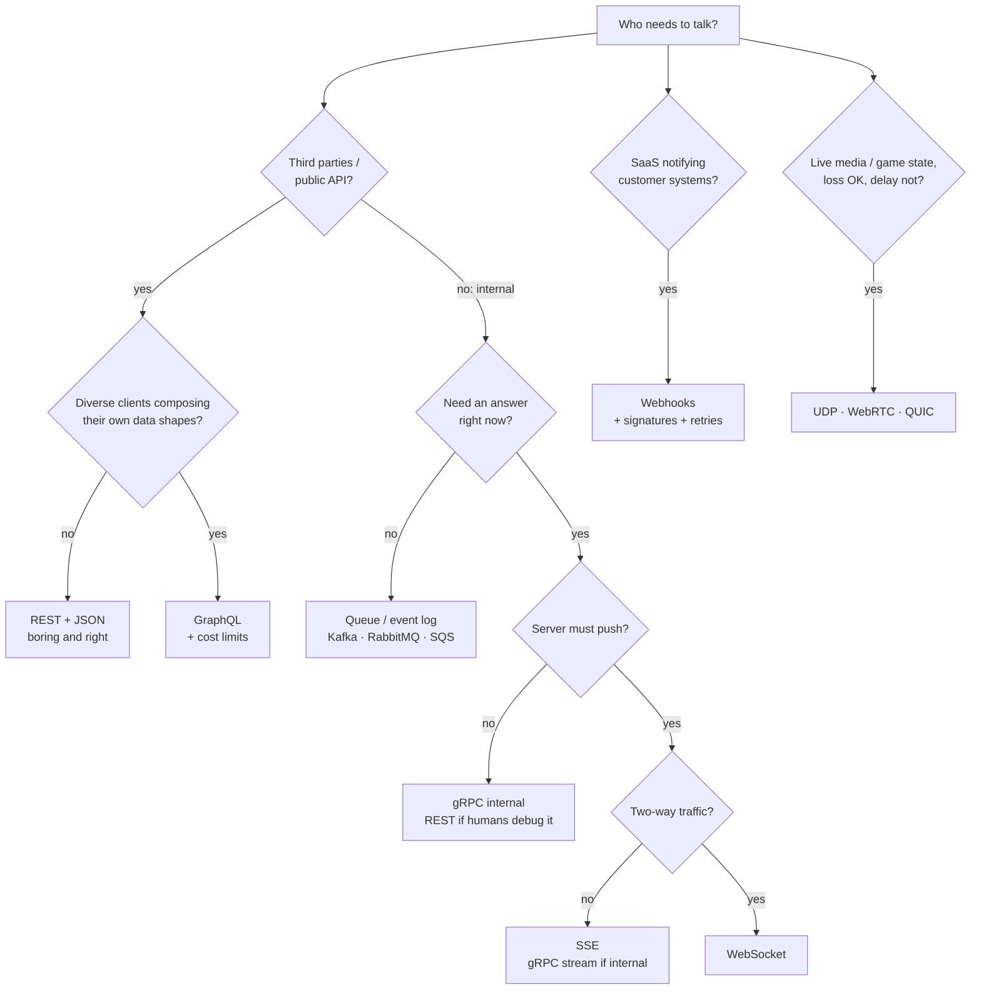
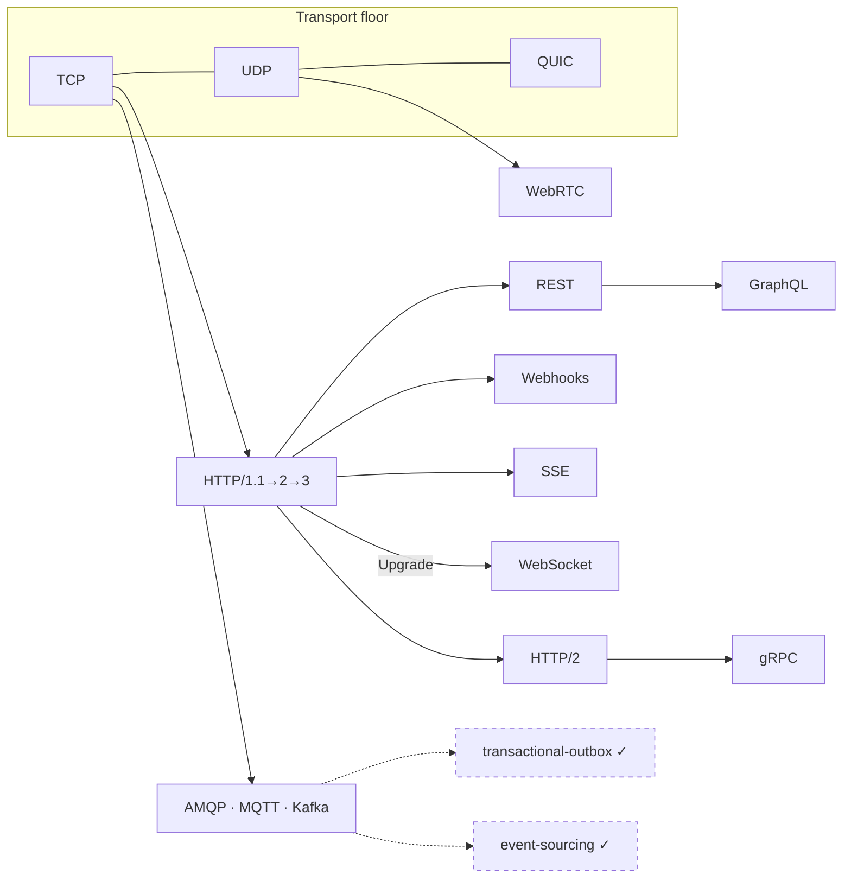

# Communication Protocols — how systems talk, and how to choose

> **Lab type:** survey / decision-skill lab, like [database-landscape](../database-landscape/).
> There is no single algorithm to implement; the skill being trained is
> *conversation-pattern reasoning* — looking at two systems that need to talk and
> knowing which protocol fits, which ones will quietly hurt you, and why.
>
> **What's in this lab:**
> - `README.md` — this document (the full story, the catalog, the decision rules)
> - `experiments/` — runnable proofs (plain JDK single-file Java, no build tool) of the three
>   facts everything else rests on
> - `visualization.html` — interactive protocol playground with predict-then-run scenarios
> - `EXERCISES.md` / `SOLUTIONS.md`
>
> **Builds on labs you've done:** [transactional-outbox](../transactional-outbox/) and
> [saga](../saga/) (message queues and at-least-once delivery reappear here as one of
> the protocol choices), [cap-theorem](../cap-theorem/) (networks partition — every
> protocol below has a story about what happens then).

---

## Layer map

> **BEGINNER MODEL** (§1–§9) → **INTERMEDIATE MODEL** (§10) →
> **ENGINEERING MODEL** (§11–§12) → **PRODUCTION MODEL** (§13–§15)

You are at the beginning. Zero networking knowledge is assumed — only that you've
written an app that called some API at some point.

---

## 1. WHY — why are there ten ways to make an API call?

Open any system-design discussion and you'll hear a parade of names: REST, GraphQL,
gRPC, WebSockets, SSE, webhooks, MQTT, Kafka… They all do the same thing at some
level — move bytes between programs — so why do all of them exist, and why do
interviewers and architects care so much which one you pick?

Because the pick is **structural**. A protocol choice decides how your servers are
deployed, what your load balancers must support, how clients handle failures, how
much battery a phone burns, and how painful the next feature is. Choosing polling
where you needed push can 100× your server load. Choosing WebSockets where a plain
HTTP call would do buys you months of reconnect-and-scale plumbing for nothing.
And unlike a function you can refactor in an afternoon, a protocol is a **contract
with other people's code** — other teams, other companies, millions of installed
apps — so a wrong pick calcifies.

The good news: the parade of names is not ten random inventions. Each one is the
answer to a specific pain that an earlier, simpler choice caused. By the end of this
document you'll be able to look at any "A needs to talk to B" problem and derive
the right protocol from five questions — and, just as importantly, say out loud when
a fashionable protocol is the *wrong* answer.

---

## 2. PROBLEM — Priya's food-delivery app

Priya is building **Tiffin**, a food-delivery service. Ignore computers for a
moment and just list who needs to tell what to whom:

1. **The customer asks for the menu.** Customer: "What does Biryani House sell?"
   Tiffin answers. One question, one answer, done. Like sending a **letter** and
   getting a reply.
2. **The customer watches their order.** "Is my food cooked yet? Has the rider
   picked it up? Where is the rider *right now*?" The news changes every few
   seconds, and it's Tiffin who knows first — the customer shouldn't have to keep
   asking. Like a **phone call** that stays open, where either side can speak.
3. **The kitchen dashboard shows new orders.** Every restaurant screen must light
   up the moment an order lands. One event, many listeners. Like a **radio
   broadcast** — the station speaks once, every tuned-in receiver hears it.
4. **The payment company confirms payment.** Tiffin uses an outside company,
   PayFlow, to charge cards. PayFlow finds out the payment cleared *seconds later*,
   on its own schedule, and must tell Tiffin. Tiffin can't keep a phone line open
   to a company it doesn't control — so PayFlow needs to **ring Tiffin's
   doorbell**: come to Tiffin's address and announce the news.
5. **The order flows through Tiffin's own kitchen of services.** Inside Tiffin,
   the ordering system must tell billing, notifications, and analytics about every
   order — even if analytics is down for maintenance right now. Like leaving a
   message **in a mailbox** the recipient empties when they're back.

Five different *shapes* of conversation: ask-and-answer, open line, broadcast,
doorbell, mailbox. Priya's question — and this whole lab — is: **how do computers
hold each of these conversations, and what goes wrong when you use the wrong shape?**

---

## 3. NAIVE SOLUTION — "just connect and send the data"

Priya knows the operating system gives every program a primitive for talking over
the network: you can open a connection to another machine and then **write bytes**
into it, and the other side **reads bytes** out, like a two-way pipe. (This
primitive is called a *socket* — the one bit of jargon we need this early, because
everything else in this lab is built on top of it.)

So the naive plan: the app opens a connection to the server and sends the text
`GIVE ME THE MENU FOR BIRYANI HOUSE`. The server sends back the menu as text.
Invent little phrases for each need. Done?

It genuinely works — you'll run exactly this in `experiments/Exp01HttpIsJustText.java`.
And it is how everything worked in the early days. But watch it break.

---

## 4. FAILURE — four problems hiding in "just send bytes"

**Problem 1: Where does one message end?** A socket is a *stream of bytes*, not a
sequence of messages. If the server sends the menu (500 bytes) and then a
"restaurant is closing soon" notice (80 bytes), the app might read 580 bytes in one
gulp, or 90, then 490 — the network chops and merges freely.

> **🔮 Predict:** Priya's server writes two JSON objects back-to-back into the
> socket: `{"menu": [...]}` then `{"notice": "closing soon"}`. The app does one
> read. What does it get?
> <details><summary>Reveal</summary>
> Very possibly both blobs glued together — `{"menu":[...]}{"notice":...}` — which
> is not valid JSON and crashes a naive parser. Or the first blob *plus half* of the
> second. TCP (the OS's reliable-delivery service under that byte pipe — formally
> introduced in §7) guarantees the bytes arrive **in order and uncorrupted**; it says
> nothing about *where your message boundaries are*. Every protocol in this lab
> must solve this **framing** problem somehow: a length prefix, a delimiter line,
> or a "close the connection when done" rule. Experiment 01 shows this live.
> </details>

**Problem 2: Nobody else speaks your language.** Priya invented
`GIVE ME THE MENU`. The Android app team must implement it. So must the payment
company. So must the caching proxy her cloud provider runs, the load balancer, the
monitoring tools… none of which have ever heard of it. Every piece of the world's
network infrastructure — caches, proxies, firewalls, browsers, test tools — speaks
*standard* protocols. A private language means rebuilding all of that yourself.

**Problem 3: Every conversation shape must be rebuilt by hand.** Broadcast to
5,000 kitchen screens? Deliver a message to a service that's currently down?
Notify an outside company behind their own firewall? Raw sockets give you none of
this; you'd hand-build subscription lists, retry queues, and authentication.

**Problem 4: The rules are unwritten.** When the connection drops mid-order, did
the order go through? Can the app safely re-send? Who may speak first? A protocol
is precisely an answer sheet for these questions — and Priya hasn't written one.

The deeper discovery: "how do two computers talk" is really **two separate
problems**. Getting bytes across reliably is the easy, solved part. Agreeing on
*what the bytes mean and how the conversation flows* is the real work — and that's
what all those protocol names are competing to solve.

---

## 5. THE REAL REQUIREMENT

What Priya actually needs is a **shared, standard set of conversation rules** for
each conversation shape from §2, such that:

1. **Framing** — both sides always know where a message starts and ends.
2. **Meaning** — requests, replies, success and failure are expressed the same way
   by everyone, so strangers' code (and infrastructure) can join the conversation.
3. **Shape fit** — ask/answer, open line, broadcast, doorbell, and mailbox each
   get rules designed for that shape, not hacked onto the wrong one.
4. **Failure rules** — every protocol states what happens on a dropped connection,
   a repeated message, a slow consumer.

Keep this list; every protocol below is graded against it.

---

## 6. KEY IDEA

> **Protocols are layered, and above the transport layer every protocol is just a
> reusable answer to one conversation shape.** You choose one not by fashion but by
> five questions: *Who starts the conversation? One answer or a stream? One
> listener or many? Do both ends live in your company? Must the answer come back
> right now, or later?*

Everything with a name — HTTP, GraphQL, gRPC, WebSocket, SSE, webhook, MQTT —
is a point in that small design space. Once you can place a protocol on those five
axes, you can derive when to use it and when it will hurt, without memorizing
anything.

---

## 7. TERMINOLOGY — the words professionals use

Now that you've felt the problems, here are the standard names. Load-bearing terms
get the full treatment; the rest are one-liners. (Every term also lands in the
GLOSSARY, §18.)

**Protocol** — *plain:* the agreed rules of a conversation — who speaks first,
what the phrases mean, how it ends. *Technical:* a specification of message
formats and exchange rules two independent implementations can follow and
interoperate. *Why the term exists:* to separate the **agreement** from any one
program that implements it — `curl`, Chrome, and a Java service all "speak HTTP"
because the rules live in a document (an RFC), not in code. *Example:* HTTP says a
request line looks like `GET /menu HTTP/1.1`. *Connects to:* it's the answer sheet
Problem 4 in §4 asked for.

**Transport (TCP and UDP)** — *plain:* the delivery service that moves your bytes
between machines, before any meaning is attached. *Technical:* the OS-provided
layer; **TCP** gives a reliable, ordered byte stream (lost pieces are re-sent,
order restored); **UDP** sends independent packets with no delivery or ordering
promise, but no setup delay or retransmission stalls either. *Why two:* reliability
costs time; some conversations (a video call) would rather lose a syllable than
pause. *Example:* HTTP runs on TCP; live game traffic and DNS lookups run on UDP.
*Connects to:* TCP is what made §4's naive plan "genuinely work" — and framing is
the part TCP explicitly does *not* do.

**Socket** — *plain:* the plug your program speaks into. *Technical:* the OS
endpoint object for a network connection; you `write()` bytes in, the peer
`read()`s them out. *Why the term exists:* programs need a handle for "this one
conversation" distinct from the machine (one server holds thousands of sockets at
once). *Example:* experiment 01 opens a socket to port 8000 and types HTTP into it
by hand. *Careful:* "WebSocket" is a different, higher-level thing (§10.6) that
merely borrowed the word.

**Request/response** — *plain:* ask once, get one answer, conversation over.
*Technical:* client-initiated exchange; the server never speaks unprompted.
*Why named:* it's the shape half the internet assumes — and naming it lets us say
precisely what push protocols change. *Example:* `GET /menu` → `200 OK` + body.

**Round trip (RTT)** — *plain:* the time for a message to go there and the reply
to come back. *Technical:* network latency × 2, paid *per exchange* regardless of
how small the messages are. *Why it matters so much:* within one data center an
RTT is ~1 ms, but phone-to-server is 50–300 ms — so the number of round trips,
not bytes, usually decides how slow an app feels. *Example:* a screen needing 4
sequential API calls on a 200 ms-RTT connection spends 800 ms just commuting.
*Connects to:* this single number explains why GraphQL and HTTP/2 exist (§10).

**Push vs pull** — *plain:* does news come to you (push), or do you keep checking
(pull)? *Technical:* whether the server can initiate delivery on an existing
channel, or the client must poll with fresh requests. *Why named:* it's axis #1 of
the key idea, and the axis most often gotten wrong — real-time features built on
pull are the classic scaling accident. *Example:* order-status via polling = pull;
via WebSocket = push.

**Serialization** — *plain:* turning your in-memory objects into bytes and back.
*Technical:* an encoding such as JSON (human-readable text) or Protocol Buffers
(compact binary, schema-driven). *Why separate from the protocol:* the same HTTP
call can carry JSON, XML, or binary — envelope and letter are independent choices.

Minor terms (one line each, defined here at first use):
**API** — the surface a program exposes for others to call; a protocol is how you reach it.
**Client / server** — the side that initiates / the side that answers.
**Header** — a labeled metadata line accompanying a message (`Content-Type: application/json`).
**Endpoint** — one addressable operation, e.g. `GET /restaurants/42/menu`.
**Payload / body** — the actual data carried inside the protocol envelope.
**Handshake** — the opening exchange that sets a connection's rules before real data flows.
**Idempotent** — safe to repeat: doing it twice has the same effect as once (you know this one from [transactional-outbox](../transactional-outbox/)).

---

## 8. MENTAL MODELS — carry two pictures, and know where they diverge

**The simple model (the one you carry around):** every protocol is one of five
human conversation shapes —

| Human picture | Shape | Protocols that implement it |
|---|---|---|
| **Letter** with a reply | ask → answer, then silence | HTTP (REST, GraphQL, and unary gRPC ride on it) |
| **Phone call** held open | either side speaks anytime | WebSocket, gRPC bidirectional streaming |
| **Radio / newsletter** | one sender, many subscribed listeners | SSE to browsers; MQTT, Kafka behind the scenes |
| **Doorbell** | outsider shows up at *your* address with news | Webhook |
| **Mailbox** | leave a message; recipient empties it later, even if away now | Message queue (RabbitMQ, SQS, Kafka) |

**The engineering model (the precise one):** a protocol is a position on **five
axes** — ① initiation: pull vs push · ② cardinality: one answer vs stream, one
listener vs many · ③ connection lifetime: per-request vs persistent · ④ encoding:
text vs binary, free-form vs schema-checked · ⑤ coupling: synchronous (answer now,
both alive) vs asynchronous (answer later, receiver may be down). §10 places every
named protocol on these axes; the visualization lets you watch each position behave.

**Mapping between the models:** letter = pull, one answer, per-request connection,
synchronous. Phone call = push+pull, streams, persistent, synchronous. Radio =
push, one-to-many. Doorbell = push across trust boundaries, per-request.
Mailbox = asynchronous — the only shape where the receiver may be *dead* during
sending, which is why it alone survives a downed consumer.

**Where the analogy breaks (read this — it's where bugs live):**
- **Letters never get lost silently in the postal model; requests do.** When an
  HTTP call times out, you cannot know whether the server did the work. A real
  letter-writer would eventually get a "return to sender." Networks just go quiet.
  This is why *idempotency*, not hope, is the real safety mechanism (§12).
- **A phone call, once connected, stays connected. A WebSocket doesn't.** Real
  connections die every few minutes on mobile networks; the "open line" is
  actually "open line + automatic redial + a plan for what was missed while
  redialing." Teams that take the phone-call analogy literally ship chat apps that
  drop messages on every train tunnel (§11).
- **Radio listeners who miss a broadcast miss it forever — but Kafka listeners
  don't.** Log-based queues keep history and let a listener rewind. The radio
  picture is right for *live* fan-out (SSE, MQTT fire-and-forget) and wrong for
  replayable streams; you saw the replayable kind in [event-sourcing](../event-sourcing/).
- **A doorbell ring is heard at most once; webhooks arrive at least once.**
  Payment providers *retry* until you acknowledge — so the same doorbell can ring
  five times for one event, sometimes out of order (§11).

---

## 9. VISUALIZATION — see the shapes move

Open **`visualization.html`** (double-click; fully offline). It animates a client
lane and a server lane and lets you run the same "order status" scenario under
each protocol: polling, long polling, SSE, WebSocket, webhook, and queue.

What to look at, in order:
1. **Run "Polling" first** and watch the counters: requests fired vs events
   actually delivered — the waste is the point.
2. **Run "WebSocket"** on the same scenario; the counters invert.
3. Each scenario opens with a **predict question** — commit to an answer before
   pressing run; the log then tells you, in full sentences, what happened and why.
4. Use the **latency and event-frequency sliders**: the protocols reorder
   themselves as the numbers change. That reordering *is* the decision skill.

The diagrams in §10 use the same left-client / right-server layout as the
visualization, so both build one spatial picture.

> **CHECKPOINT — you now hold the beginner model.** You can name the five
> conversation shapes, the five axes, and why "just send bytes" fails. Next: how
> each real protocol actually works on the wire, in the order history invented
> them — each one born from the previous one's specific pain.

---

## 10. ACTUAL MECHANISM — the catalog, one pain at a time

Read this section as one continuous story: each protocol exists because the
previous one hurt somewhere specific. For each: how it works (with real wire
bytes), where it shines with real examples, and **when NOT to use it** — the
part interviews and architecture reviews actually probe.

### 10.1 Raw TCP sockets — the floor everything stands on

**How it works.** The OS gives you the reliable byte pipe from §3. You define
everything else: framing, meaning, failure rules. Framing is typically a length
prefix ("next message is 512 bytes") or a delimiter (newline).

**Where it's genuinely used:** database wire protocols (Postgres, MySQL, Redis
speak custom TCP protocols — that's what a "database driver" implements), game
servers, exchange trading feeds. These are cases where a team controls both ends,
needs every microsecond and byte, and is willing to write and version its own
protocol spec.

**When NOT — and this is almost always:** you rebuild framing, auth, encryption,
proxying, and tooling that HTTP gives you free, and no third party can talk to
you without your custom library. Raw TCP is the *last* resort, not the pro move.
**Run `experiments/Exp01HttpIsJustText.java` now** — it talks raw TCP to a real
HTTP server so you can see with your own eyes that everything below is "just
text over a socket," plus discipline.

### 10.2 HTTP — the letter, standardized (and why it won)

**How it works.** One request, one response, in a rigidly framed text format.
This is *literally* what travels over the socket:

```
GET /restaurants/42/menu HTTP/1.1
Host: api.tiffin.com
Accept: application/json
                                          ← blank line = "headers done" (framing!)
```

```
HTTP/1.1 200 OK
Content-Type: application/json
Content-Length: 57                        ← framing: exactly 57 body bytes follow
Cache-Control: max-age=300

{"restaurant": "Biryani House", "items": [{"dosa": 120}]}
```

Every §5 requirement is answered: framing via `Content-Length` and the blank
line; shared meaning via **verbs** (GET reads, POST creates, PUT replaces, DELETE
removes) and **status codes** (2xx success, 3xx redirect, 4xx *your* mistake,
5xx *server's* mistake); failure rules like "GET is idempotent, so anything in
the middle may retry it."

**Why HTTP conquered the world:** those shared semantics let *infrastructure*
join the conversation. A CDN can cache any `GET` with `Cache-Control` without
understanding your business. A proxy can retry idempotent requests. A browser, a
load balancer, `curl`, and your monitoring all speak it. This network effect —
not technical elegance — is why "when in doubt, HTTP" is the correct default.

**Versions in one paragraph (the pain-driven story):** HTTP/1.1 handles one
request at a time per connection, so browsers open ~6 parallel connections and
still queue — **head-of-line blocking** at the request level. **HTTP/2** (2015)
multiplexes many concurrent streams over one TCP connection in binary frames,
and compresses headers.

> **🔮 Predict:** HTTP/2 puts 6 streams on one TCP connection. One packet
> belonging to *stream 3* is lost in transit. What happens to streams 1, 2, 4–6?
> <details><summary>Reveal</summary>
> They all stall. TCP promises *in-order* delivery of the whole byte stream, so
> until the lost packet is re-sent, TCP refuses to hand *any* later bytes to the
> application — even bytes belonging to unrelated streams. Head-of-line blocking
> moved down a layer, from HTTP into TCP itself. That's unfixable *on TCP* —
> which is why **HTTP/3** abandons TCP entirely: it runs on **QUIC**, a transport
> built on UDP that keeps streams independent (a lost packet stalls only its own
> stream) and merges the TCP+TLS handshakes into one round trip. Google, YouTube,
> Facebook and Cloudflare serve most traffic this way today.
> </details>

### 10.3 REST — a discipline for using HTTP, not a protocol

**How it works.** REST is a *style*: model your domain as **resources** with
URLs, manipulate them with the standard verbs, keep the server **stateless**
(each request self-contained — this is what lets any of 50 identical servers
answer any request, which is what makes horizontal scaling trivial):

```
GET    /restaurants/42          → read one
GET    /restaurants?city=pune   → list/filter
POST   /orders                  → create (body: the new order)
PATCH  /orders/97               → partial update
DELETE /orders/97               → cancel
```

**Use it for:** public and partner APIs (Stripe, GitHub, Twilio — the entire
API economy), anything third parties integrate with, browser/mobile backends of
ordinary CRUD shape, anything that benefits from HTTP caching. Boring, universal,
debuggable with `curl` — the right default.

**When NOT:**
- **Real-time push** — REST has no way for the server to speak first. Period.
- **Screens that aggregate many resources** — the pain that births GraphQL, next.
- **High-volume internal service-to-service traffic** — JSON parsing and untyped
  contracts get expensive; that pain births gRPC (§10.5).
- Also know: **SOAP**, the 2000s XML predecessor (rigid contracts, heavy
  tooling), survives in banking/enterprise integrations; you read it, you don't
  choose it for new work.

### 10.4 GraphQL — born from REST's over- and under-fetching

**The pain, concretely.** Tiffin's app home screen needs: user profile, active
order, that order's restaurant, and the rider's location.

> **🔮 Predict:** As clean REST that's `GET /me`, `GET /orders/active`,
> `GET /restaurants/42`, `GET /riders/7` — and calls 2–4 depend on call 1's
> response, so they can't all run in parallel. On a phone with 200 ms RTT, how
> long until the screen renders? And what fraction of the returned fields does
> the screen actually display?
> <details><summary>Reveal</summary>
> Two sequential rounds minimum (≈400 ms) — likely three (≈600 ms) — before
> rendering, and screens typically use well under half the fields returned
> (**over-fetching**: full objects arrive when you needed 3 fields;
> **under-fetching**: no single endpoint had everything, forcing the extra
> calls). Facebook's mobile team hit exactly this wall in 2012; their fix became
> GraphQL (open-sourced 2015). `experiments/Exp02RoundTrips.java` measures this —
> the chatty version loses by roughly the predicted margin.
> </details>

**How it works.** One endpoint (`POST /graphql`). The *client* sends a typed
query describing exactly the shape it wants; the server resolves it in one round
trip:

```graphql
query HomeScreen {
  me { name }
  activeOrder {
    status
    restaurant { name }
    rider { location { lat lng } }
  }
}
```

The response is JSON mirroring the query — nothing more. A schema (types,
fields) is the contract; clients discover it by introspection, and tooling
(auto-complete, type-checked clients) falls out of that.

**Use it for:** mobile/web apps aggregating many resources per screen, **many
different frontends with different data needs** on one backend (the killer case:
iOS, Android, web, watch — each queries its own shape, backend team ships
nothing), public APIs serving diverse integrators (GitHub's v4 API, Shopify).

**When NOT (this list wins interviews):**
- **Server-to-server internal calls** — services need fixed, known shapes;
  GraphQL's flexibility is dead weight and gRPC is faster and typed (§10.5).
- **Simple CRUD with one client** — you pay the complexity tax (schema,
  resolvers, query-cost limiting) for flexibility nobody uses.
- **HTTP-cache-friendly content** — everything is `POST` to one URL, so CDNs
  and browser caches, which key on `GET`+URL, go blind. (Client-side caches like
  Apollo's exist, but you *rebuild* caching, not inherit it.)
- **Naive resolvers hide N+1 catastrophes** — `orders { rider { name } }` can
  fire one DB query per order; you must add batching (DataLoader). And because
  clients compose arbitrary queries, a public GraphQL API needs **query depth/
  cost limits** or one hostile query `{ orders { items { restaurant { orders
  ... }}}}` is a denial-of-service (§11).
- **File uploads / binary** — bolted on, awkward; plain HTTP does it natively.

### 10.5 gRPC — born from JSON-over-HTTP/1.1 being too slow *inside* the walls

**The pain.** Inside Tiffin, `orders` calls `pricing` maybe 5,000×/second. Costs
that don't matter on a public API become the bill: JSON is verbose to ship and
CPU-heavy to parse; nothing checks that `pricing` didn't rename a field until
production; every call re-pays HTTP/1.1's one-at-a-time connection handling.

**How it works.** gRPC (Google, 2015; from their internal "Stubby") = three
decisions welded together:
1. **Protocol Buffers** for encoding: you write a schema, a compiler generates
   client/server code in any language; the wire format is compact binary
   (field *numbers*, not names — typically 3–10× smaller than JSON, far cheaper
   to parse). Renaming a field incompatibly now breaks the *build*, not prod.
2. **HTTP/2 transport**: multiplexed, persistent connections.
3. **Streaming as a first-class citizen**: four call shapes — unary
   (request/response), server-streaming, client-streaming, bidirectional.

```protobuf
service Pricing {
  rpc Quote (QuoteRequest) returns (QuoteReply);            // unary
  rpc WatchSurge (Area) returns (stream SurgeUpdate);       // server-streaming
}
message QuoteRequest { int64 restaurant_id = 1; repeated int64 item_ids = 2; }
```

Calling it feels like a local function call — `stub.Quote(req)` — which is the
"RPC" (remote procedure call) philosophy: hide the network behind a function.
(Contrast REST's philosophy: *expose* the network's semantics. Keep both in
your head; the hidden network still fails, §11.)

**Use it for:** internal microservice meshes (Netflix, Uber, Dropbox, Spotify
run thousands of gRPC services), polyglot shops (schema generates consistent
clients in Java, Go, Python…), low-latency streaming between services, mobile↔
backend where you control both ends (it also powers etcd's and CockroachDB's
client protocols — you met etcd in the [paxos](../paxos/) lab's production notes).

**When NOT:**
- **Browsers** — browser JS can't speak raw gRPC (no control over HTTP/2
  frames); you need a translation proxy (grpc-web / Envoy). For browser-facing
  APIs, REST or GraphQL.
- **Public third-party APIs** — integrators expect `curl`-able JSON they can
  poke in a terminal; handing them a `.proto` and a codegen step is friction
  (Stripe exposes REST, not gRPC, on purpose).
- **Debuggability tax** — binary payloads mean you need `grpcurl` and
  reflection where `curl` and eyeballs used to do.
- **Anywhere humans read the payloads** — config, webhooks, logs.

### 10.6 WebSocket — born from "the server can never speak first"

**The pain.** Order tracking under pure HTTP means the app asks every 2 seconds:
"status?" "same." "status?" "same." — **polling**.

> **🔮 Predict:** 10,000 customers polling every 2 s, order status changes
> ~every 60 s. (a) requests/second on the server? (b) fraction that return
> nothing new? (c) worst-case staleness of the screen?
> <details><summary>Reveal</summary>
> (a) 5,000 req/s. (b) ~97% carry no news — thousands of req/s of pure waste,
> each paying full HTTP+auth+DB cost. (c) up to the full 2 s interval. Tighten
> the interval and the waste grows; loosen it and staleness grows — polling has
> no good setting. `experiments/Exp03PollVsPush.java` measures this trade
> directly. The stopgap era used **long polling** (server *holds* the request
> open until news arrives, then the client immediately re-asks): real-time-ish
> latency, but still one full HTTP cycle per event and a held-open request per
> client — a bridge, not a destination.
> </details>

**How it works.** A WebSocket starts life as an HTTP request that asks to
*change protocols*:

```
GET /live HTTP/1.1
Host: api.tiffin.com
Upgrade: websocket                 ← "let's stop doing HTTP on this connection"
Connection: Upgrade
Sec-WebSocket-Key: dGhlIHNhbXBsZQ==

HTTP/1.1 101 Switching Protocols   ← server agrees
```

After the `101`, the connection is no longer HTTP: it's a persistent, cheap,
**two-way message pipe** (framing handled for you) that either side may write
at any time, until someone closes it. The handshake trick is why WebSockets
traverse firewalls and reuse port 443 like ordinary web traffic.

**Use it for:** anything both **real-time and two-way** — chat (Slack),
collaborative editing (Figma, Google Docs), multiplayer games, live trading
UIs, ride-hailing driver↔dispatch links.

**When NOT:**
- **One-way flows** — if the client only listens, SSE (next) does it with none
  of the following costs.
- **You inherit a distributed-state problem:** each open socket lives on *one*
  server, so load balancers must be connection-aware; deploys/restarts drop
  every connection; pushing to a user means *finding which server holds their
  socket* (enter Redis pub/sub or a message bus between your own servers); and
  HTTP middleware — caching, retries, auth-per-request — no longer applies:
  you re-invent request IDs, acks, and heartbeats inside your own message
  format.
- **The reconnect burden is yours:** mobile connections die constantly; every
  client needs redial-with-backoff *plus* "what did I miss?" recovery (§11) —
  the analogy-break from §8 as a work item.
- **Occasional updates** — status that changes every few minutes doesn't earn a
  persistent connection; poll politely or use SSE.

### 10.7 SSE (Server-Sent Events) — the one-way push you probably want

**How it works.** The client makes a *normal* HTTP GET; the server just **never
finishes the response**, trickling events as text lines whenever it has news:

```
GET /orders/97/events            ← ordinary HTTP request

HTTP/1.1 200 OK
Content-Type: text/event-stream  ← "this response never ends"

data: {"status": "COOKING"}

data: {"status": "PICKED_UP"}
                                  ← blank line = event boundary (framing again!)
id: 42
data: {"status": "DELIVERED"}
```

Because it *is* HTTP, everything HTTP-shaped still works: same auth, same load
balancers, plain text debugging. Browsers have it built in (`EventSource`) with
**automatic reconnection**, and the client sends `Last-Event-ID: 42` on
reconnect so the server can replay what was missed — the "what did I miss?"
problem WebSockets make you hand-build is half-solved in the protocol.

**Use it for:** live one-way feeds — dashboards, notifications, sports scores,
order tracking, and the example you use daily: **LLM token streaming.** ChatGPT
and the Claude API stream responses as SSE — client asks once (a POST),
tokens trickle back as events. Under HTTP/1.1, browsers capped ~6 connections
per domain, which throttled SSE-heavy pages; HTTP/2 multiplexing erased that.

**When NOT:** client needs to *send* frequently (that's WebSocket territory);
binary data (SSE is text-only); non-browser consumers you fully control (gRPC
server-streaming is the typed equivalent inside the walls).

### 10.8 Webhooks — the doorbell across company walls

**The pain.** PayFlow (§2, shape 4) learns the card cleared 3 s after checkout.
Tiffin can't hold sockets open to every partner, and PayFlow won't let
thousands of merchants poll its API every second.

**How it works.** Inversion: **Tiffin gives PayFlow a URL**, and PayFlow makes
an ordinary HTTP POST *to Tiffin* when the event happens — consumer becomes
server:

```
POST /callbacks/payflow HTTP/1.1        ← PayFlow calling Tiffin
PayFlow-Signature: t=1724832000,v1=5257a8ee...   ← HMAC: proves sender + content
Content-Type: application/json

{"event": "payment.succeeded", "order_id": 97, "amount": 45000}
```

Tiffin answers `200 OK` quickly (ack now, process async — do the real work off
a queue); no timely 2xx ⇒ PayFlow **retries with backoff**, often for days.
This is exactly how Stripe payment events, GitHub push events, and Twilio
message-status callbacks work.

**Use it for:** cross-organization event delivery where the consumer can host
a public HTTPS endpoint — the standard answer for "SaaS tells its customers
something happened."

**When NOT:** consumers behind firewalls/NAT or on devices (they can't host an
endpoint — flip to polling, SSE, or MQTT); high-frequency streams (per-event
HTTP calls don't amortize; hand out a stream or queue instead); and never
naively: retries mean **duplicates and reordering** are contractual, so an
endpoint that isn't idempotent *will* double-ship an order (§11), and an
unverified signature means anyone who finds your URL can fake "payment
succeeded."

### 10.9 Message queues & event streams — the mailbox (asynchronous messaging)

**The pain.** Shape 5 from §2: ordering must tell billing, notifications, and
analytics — but with any *synchronous* protocol above, if analytics is down,
either checkout fails with it, or the event is simply gone. Synchronous
protocols require both ends alive at the same moment. Sometimes that's the
wrong requirement altogether.

**How it works.** Insert a **broker** — a server whose only job is holding
messages. Producers publish to it and move on; consumers take messages out on
their own schedule; the broker retries until a consumer **acknowledges**.
You know this pattern's guarantees cold from [transactional-outbox](../transactional-outbox/):
delivery is **at-least-once**, so consumers must be idempotent. Two families:

- **Task queues** (RabbitMQ — AMQP protocol; SQS): message = a job, consumed by
  *one* worker, deleted when acked. "Mailbox" exactly.
- **Event logs** (Kafka): message = a fact appended to a durable, ordered log;
  many independent consumer groups read at their own pace and can **rewind** —
  the radio-with-a-tape-recorder from §8's analogy-breaks, and the natural
  carrier for [event-sourcing](../event-sourcing/) / [cqrs](../cqrs/) event feeds.
- **MQTT** deserves its own line: a tiny binary pub/sub protocol for **IoT and
  flaky mobile links** — topic subscriptions, three delivery-guarantee levels
  (QoS 0/1/2), "last will" messages announcing a device's death, and headers
  measured in *bytes* because a sensor on a SIM card pays per byte. Smart
  meters, vehicle telemetry; Facebook Messenger famously used MQTT on mobile
  for battery-cheap push.

**Use it for:** decoupling services in time (consumer may be down), absorbing
bursts (queue soaks up a spike the consumer drains later), fan-out to many
internal consumers, background jobs.

**When NOT:** the caller needs the answer *in this request* (price quote —
that's RPC territory; a queue adds a broker hop and an ops burden for
negative value); request/response faked over two queues (correlation IDs,
timeout logic — you've rebuilt RPC, badly); tiny systems where a broker is
one more thing to run, monitor, and upgrade.

### 10.10 The floor below, revisited: UDP, QUIC, WebRTC

Some conversations tolerate loss but not delay: in a video call, a re-sent
50 ms-old audio packet is *worse* than silence — TCP's retransmission stalls
(the §10.2 reveal) are exactly wrong. So latency-critical media runs on **UDP**
and handles loss at the application layer: **WebRTC** (browser-to-browser
audio/video/data: Meet, Discord voice) with jitter buffers and codecs that
survive gaps; most competitive multiplayer games with custom UDP state sync
(lost position update? the next one supersedes it anyway); DNS (one tiny
question, one tiny answer — a TCP handshake would triple the cost). And
**QUIC** (§10.2) is the modern middle path: UDP's foundation with reliability
rebuilt per-stream — TCP's promises without TCP's head-of-line stall.
**When NOT:** anything needing ordered completeness (payments, APIs) — you'd
re-implement TCP yourself, poorly.

> **CHECKPOINT — you now hold the intermediate model.** Every major protocol,
> the pain that birthed it, and its wire format. What you can't yet do is
> defend a choice under failure conditions — that's the engineering layer.

---

## 11. FAILURE SCENARIOS — what breaks, and what each protocol does about it

The five §5 questions get real here. Per scenario: how to create it, where to
watch it, what happens, why, and which guarantee survives. The visualization's
**"chaos" controls** (drop connection, take server down) run scenarios 1, 2,
and 4 live.

**11.1 The timed-out POST (every synchronous protocol).** Create: submit an
order; kill the connection before the response. Watch: viz scenario "Lost
reply". What happens: client *cannot distinguish* "server never got it" from
"server did it; reply died." Why: one round trip carries both the action and
its confirmation. Response: retry — but a blind retry of `POST /orders`
double-orders. Fix (works on REST, GraphQL, gRPC alike): client sends an
**idempotency key** (`Idempotency-Key: a91f…`, a client-generated unique ID);
server stores key→result and replays the stored result on repeats. Stripe's
API works exactly this way. Guarantee kept: at-least-once *attempt*; guarantee
you must add yourself: exactly-once *effect*. Same medicine as the
[transactional-outbox](../transactional-outbox/) consumer side — this problem
follows you across every protocol in this lab.

**11.2 WebSocket dies on a moving train.** Create: kill the connection
mid-stream (viz: "Drop connection" during WebSocket run). What happens: rider
location updates silently stop; neither side is told promptly — TCP death is
*discovered*, not announced, so both ends need **heartbeats** (ping/pong) to
notice within seconds. Client must **reconnect with exponential backoff +
jitter** (10k clients redialing simultaneously after a server restart is a
self-inflicted DDoS — the *thundering herd*), then **resynchronize**: either
re-fetch full state ("where is the rider *now*") or replay from a last-seen
sequence number. Guarantee kept: none by the protocol — WebSocket gives you a
pipe, not delivery semantics; the recovery story is application code. This is
the single most under-estimated cost of choosing WebSockets, and SSE's
built-in `Last-Event-ID` reconnect is precisely this lesson pre-baked for the
one-way case.

**11.3 The hostile (or merely naive) GraphQL query.** Create: send a deeply
nested query against unprotected resolvers. What happens: one request fans out
to thousands of DB queries (N+1 at each level) or an exponentially exploding
join — one client request, whole-backend outage. Why: the protocol's core
feature — *client* composes the query — is also its attack surface; REST's
fixed endpoints made cost predictable per-endpoint, and GraphQL removes that
ceiling. Response in production: DataLoader-style batching, query depth
limits, cost analysis before execution, persisted-queries-only for public
APIs. Guarantee traded: server-controlled cost was exchanged for client
flexibility — you must claw it back explicitly.

**11.4 Webhook endpoint down for five minutes.**

> **🔮 Predict:** PayFlow POSTs `payment.succeeded`; Tiffin is mid-deploy and
> returns 503 for 5 minutes. Is the event lost? What arrives later — and in
> what order relative to a `refund.issued` fired 1 minute after it?
> <details><summary>Reveal</summary>
> Not lost: no 2xx ⇒ the provider queues and retries with backoff (Stripe: up
> to ~3 days). But when Tiffin recovers, the retried `payment.succeeded` may
> arrive *after* the fresher `refund.issued` — retries destroy ordering, and
> overlapping retries also produce duplicates. So a correct webhook consumer
> (a) verifies the signature, (b) acks 2xx immediately and processes async,
> (c) dedupes by event ID, and (d) never trusts arrival order — either use the
> event's own timestamp/sequence, or treat the webhook as a *hint* and re-fetch
> current truth from the provider's API ("trust but verify"). Guarantee kept:
> at-least-once delivery. Never promised: exactly-once, in-order.
> </details>

**11.5 The slow consumer (streams & queues).** Create: a kitchen dashboard
consuming 10 events/s from a server producing 1,000/s. What happens: someone
must absorb the difference — unbounded server-side buffering (memory death),
dropping (data loss), or **backpressure** (telling the producer to slow down).
Where each protocol lands: raw TCP has backpressure built in (the window
mechanism — a full receiver stalls the sender); WebSocket inherits TCP's but
your *application* rarely notices a full send-buffer until memory grows; gRPC
streaming exposes per-stream flow control; Kafka sidesteps it entirely — the
log persists to disk and slow consumers simply lag, visibly, measurable as
*consumer lag* (the same "how far behind is the read model?" metric you
watched in [cqrs](../cqrs/)). Guarantee insight: "the mailbox never fills" is
an illusion; every real mailbox has a size, and you must choose who suffers.

**11.6 The network partitions (all of them at once).** From
[cap-theorem](../cap-theorem/): the link between client and server tears.
Synchronous protocols (REST/GraphQL/gRPC/WebSocket) all fail *visibly* —
errors, timeouts — and recovery is retry+idempotency (11.1). Asynchronous
messaging fails *invisibly*: producers keep publishing happily; consumers
just fall behind; the queue absorbs the partition. That's the async
superpower and its trap in one: nothing errors, so only **lag monitoring**
tells you something's wrong. Webhooks sit between: the *provider* eats the
partition via its retry queue.

---

## 12. CORRECTNESS — the guarantees ledger

Pull the threads together. For any protocol choice, be able to fill this ledger:

| Question | The honest answer, per family |
|---|---|
| Is delivery guaranteed? | Sync protocols: no — you learn of failure and must retry. Queues/webhooks: at-least-once (duplicates contractual). Exactly-once *delivery*: physically impossible over a lossy network; exactly-once *effect* is achievable, and only via idempotency at the receiver. |
| Is ordering guaranteed? | Within one TCP connection/stream: yes. Across reconnects, retries, parallel requests, webhook redeliveries: **no** — sequence numbers or versioning are your job. Kafka: per-partition only. |
| Who notices failure? | Sync: the caller, immediately (timeout). Async: nobody, until lag/DLQ monitoring fires. Persistent connections: nobody, until heartbeats notice. |
| What was traded? | REST: flexibility→universality. GraphQL: server cost-control→client flexibility. gRPC: human debuggability→speed+types. WebSocket: HTTP's middleware & statelessness→bidirectional latency. Queues: immediacy of answers→decoupling in time. UDP: reliability→latency floor. |

Two cross-cutting laws, protocol-independent:
1. **Timeout + retry + idempotency is one atom.** A retry without a timeout
   never fires; a timeout without a retry just fails harder; a retry without
   idempotency corrupts data. Every production protocol stack implements all
   three or is wrong.
2. **Any persistent connection = distributed state.** The moment a connection
   outlives one request, some server *holds* something for a specific client,
   and you own its lifecycle: discovery, failover, resync. Stateless
   request/response is what you give up — knowingly or not.

> **CHECKPOINT — engineering model complete.** You can now defend a protocol
> choice under failure questioning. Next: proof by running code, then the
> production layer — what real companies actually deploy.

---

## 13. CODE — the experiments, and the lines that matter

Three single-file, JDK-only Java programs in `experiments/` (no build tool, no
dependencies; run each with `java experiments/Exp0N*.java`). Each proves one
load-bearing fact:

- **`Exp01HttpIsJustText.java`** — starts a real HTTP server, then talks to it
  with a **raw socket**, printing every byte both directions. The load-bearing
  lines: the hand-typed request string (HTTP is text you could type), and the
  demo that one `read()` is *not* one message (§4's framing problem, live) —
  it parses `Content-Length` to know where the message ends, exactly as every
  HTTP library on earth does.
- **`Exp02RoundTrips.java`** — one server, artificial 30 ms network latency; fetches
  a home screen as 4 dependent REST calls vs 1 aggregated call. The
  load-bearing line: the ~4× wall-clock ratio (measured: ~135 ms vs ~34 ms) —
  *round trips, not bytes,* dominate (§10.4's justification for GraphQL,
  measured).
- **`Exp03PollVsPush.java`** — one event at a random moment; a poller (every 1 s)
  races an SSE stream to detect it. Load-bearing output: requests spent vs
  detection latency — polling pays *both* costs, push pays neither (§10.6's
  justification for WebSocket/SSE, measured). The SSE client is a raw socket
  reading `data:` lines, so you also *see* §10.7's wire format for real.

---

## 14. EXPERIMENTS — run, predict first

| # | Predict before running | Command |
|---|---|---|
| 1 | Two responses sent back-to-back: how many `read()` calls see them? | `java experiments/Exp01HttpIsJustText.java` |
| 2 | 4 dependent calls at 30 ms RTT vs 1 call: your guess at the ratio? | `java experiments/Exp02RoundTrips.java` |
| 3 | Poll-every-1s: average detection delay? Requests wasted? | `java experiments/Exp03PollVsPush.java` |

All three print a `WHAT YOU JUST SAW` epilogue tying the numbers back to the
sections above. Then open `visualization.html` and run the chaos scenarios
(§11.2's dropped WebSocket, §11.4's downed webhook endpoint) — predict, run,
read the verdict.

---

## 15. PRODUCTION — what real systems actually deploy

**The decision procedure (the five questions, operationalized):**



**Who runs what, and why (verify against their public engineering blogs — all
of these are publicly documented):**
- **Stripe / GitHub / Twilio**: REST for the public API (curl-able, cacheable,
  stable for strangers) + **webhooks** for events out. GitHub *additionally*
  offers GraphQL (v4) for integrators with diverse shapes. This trio *is* the
  standard SaaS posture: REST in, webhooks out.
- **Netflix / Uber / Spotify**: gRPC (or similar RPC) between internal
  microservices; REST/GraphQL only at the public edge. Uber's driver apps
  stream location over persistent connections; Netflix's edge speaks HTTP to
  your TV and gRPC behind it.
- **Slack / Figma / trading platforms**: WebSockets for live two-way UI, with
  exactly §11.2's machinery (heartbeats, backoff+jitter, resync-on-reconnect)
  — plus a pub/sub bus behind the socket tier so any server can reach any
  user's connection.
- **OpenAI / Anthropic APIs**: SSE for token streaming — one-way, HTTP-native,
  proxy-friendly. The protocol lesson hiding in your daily tools.
- **Facebook**: invented GraphQL for the §10.4 pain; used MQTT in Messenger
  for battery-cheap mobile push.
- **Google / Cloudflare / Meta edges**: HTTP/3-over-QUIC to browsers.
- **Every event-driven backend you've studied** ([cqrs](../cqrs/),
  [event-sourcing](../event-sourcing/), [transactional-outbox](../transactional-outbox/)):
  Kafka or a broker as the internal event backbone.

**Operational realities per family (what the on-call actually watches):**
- REST/GraphQL/gRPC: p99 latency, error rates by status/code, retry storms.
- WebSocket/SSE: concurrent-connection count (a *capacity* dimension HTTP
  never had — connections, not req/s), reconnect rate spikes (deploys!),
  message delivery lag. Deploys need connection draining.
- Webhooks: delivery success rate, retry-queue depth, consumer endpoint p99
  (slow consumers back up *your* retry queue), signature failures (probing).
- Queues: consumer lag (the metric), DLQ depth, broker disk. 
- Everything: timeout budgets end-to-end — a 30 s client timeout in front of a
  60 s downstream timeout is a lie someone will debug at 3 a.m.

**What this lab intentionally omitted** (each is real, each is a rabbit hole):
TLS/security details beyond signatures; service meshes (Envoy/Istio moving
retries/timeouts out of app code); API gateways; schema-evolution discipline
for protobuf/GraphQL; OpenAPI codegen closing half of gRPC's type-safety gap
on REST; AMQP wire details; gRPC deadlines/cancellation propagation; HTTP
caching depth (`ETag`/conditional requests); WebTransport (the
QUIC-era successor candidate to WebSockets).

---

## 16. EXERCISES

See [`EXERCISES.md`](EXERCISES.md) — eight rungs from "explain it back" to
"design Tiffin's full protocol architecture." Attempt before opening
[`SOLUTIONS.md`](SOLUTIONS.md).

---

## 17. KNOWLEDGE MAP & NEXT STEPS



**Commonly confused, separated in one sentence each:**
- *WebSocket vs socket*: a socket is the OS byte-pipe primitive; a WebSocket is
  a message protocol layered on it via an HTTP handshake.
- *REST vs HTTP*: HTTP is the protocol; REST is a discipline for using it.
- *gRPC vs GraphQL*: near-opposite tools that sound alike — gRPC = fixed typed
  functions for *internal* speed; GraphQL = client-composed queries for
  *frontend* flexibility.
- *SSE vs long polling*: long polling re-issues a request per event; SSE keeps
  one response open for many events.
- *Webhook vs WebSocket*: webhook = per-event HTTP call *to you* (server-to-
  server, no standing connection); WebSocket = standing two-way pipe.
- *Kafka vs RabbitMQ*: replayable shared log vs delete-on-ack task mailbox.

**Next steps (ready to type):**
- `/learn io-multiplexing` — how one server *holds* 100k WebSockets (epoll,
  event loops; also queued from [java-virtual-threads](../java-virtual-threads/)).
- `/learn kafka` — the event log's internals: partitions, consumer groups, exactly-once.
- `/learn http-caching` — the deepest unused superpower of the REST choice.
- `/learn api-versioning` — evolving every contract in this lab without breaking clients.
- `/learn tls` — what the `s` in every URL above actually does.

---

## 18. GLOSSARY (in order of appearance)

| Term | One line |
|---|---|
| socket | OS endpoint for one network conversation; write bytes in, peer reads them out |
| framing | knowing where one message ends and the next begins in a byte stream |
| protocol | the shared rulebook of a conversation, independent of any implementation |
| TCP | transport giving a reliable, ordered byte stream (retransmits, reorders) |
| UDP | transport sending independent packets: no delivery/order promise, no stalls |
| transport | the byte-delivery layer (TCP/UDP) beneath meaning |
| request/response | client asks, server answers, done; server never speaks first |
| round trip (RTT) | out-and-back time, paid per exchange; dominates perceived latency |
| push / pull | server initiates delivery vs client keeps asking |
| serialization | objects ↔ bytes (JSON, Protocol Buffers) |
| API / client / server / header / endpoint / payload / handshake | see §7 minor terms |
| idempotent | repeating the action changes nothing after the first time |
| verb / status code | HTTP's shared action names (GET/POST…) and outcome numbers (2xx/4xx/5xx) |
| head-of-line blocking | one stalled item holding up unrelated items behind it |
| HTTP/2, HTTP/3, QUIC | multiplexed HTTP on TCP; HTTP rebuilt on QUIC (UDP) to un-stall streams |
| REST | resource-oriented, stateless discipline for HTTP APIs |
| stateless | each request self-contained; any server can answer it |
| SOAP | 2000s XML RPC predecessor; enterprise legacy |
| over-/under-fetching | getting unneeded fields / needing extra calls — REST's mobile pain |
| GraphQL | client-composed typed queries, one round trip, one endpoint |
| schema / introspection | the typed contract; clients querying the contract itself |
| N+1 | one query per list item — resolver catastrophe pattern |
| RPC | making a network call look like a function call |
| gRPC | protobuf + HTTP/2 + streaming RPC for internal services |
| Protocol Buffers | compact binary schema-driven serialization with codegen |
| unary / streaming | one-shot RPC vs message streams (server-, client-, bidirectional) |
| polling / long polling | ask repeatedly / server holds the ask open until news |
| WebSocket | persistent two-way message pipe born from an HTTP Upgrade |
| Upgrade / 101 | the handshake that switches a connection off HTTP |
| SSE | never-ending HTTP response carrying one-way `data:` events |
| EventSource / Last-Event-ID | browser SSE client; resume marker for replay on reconnect |
| webhook | provider POSTs to *your* URL when an event happens |
| HMAC signature | proof a webhook came from the provider, unaltered |
| broker / producer / consumer | the mailbox server and its two sides |
| acknowledge (ack) | consumer's "safe to delete/advance" signal |
| at-least-once / exactly-once effect | delivery may duplicate; idempotency makes effects single |
| AMQP / MQTT | broker protocol (RabbitMQ) / featherweight IoT pub/sub |
| QoS 0/1/2 | MQTT's delivery-guarantee dial |
| event log (Kafka) | durable, ordered, replayable stream; consumers track offsets |
| consumer lag | how far behind a consumer is — async's health metric |
| WebRTC | UDP-based browser media/data, loss-tolerant, latency-first |
| idempotency key | client-chosen ID letting a server dedupe retried writes |
| heartbeat / ping-pong | periodic proof a silent connection is alive |
| exponential backoff + jitter | retry spacing that avoids the thundering herd |
| thundering herd | everyone retrying at once, finishing the server off |
| backpressure | slowing the producer when the consumer can't keep up |
| DLQ (dead-letter queue) | where messages go after repeated processing failure |
| connection draining | letting connections finish before a deploy kills them |
