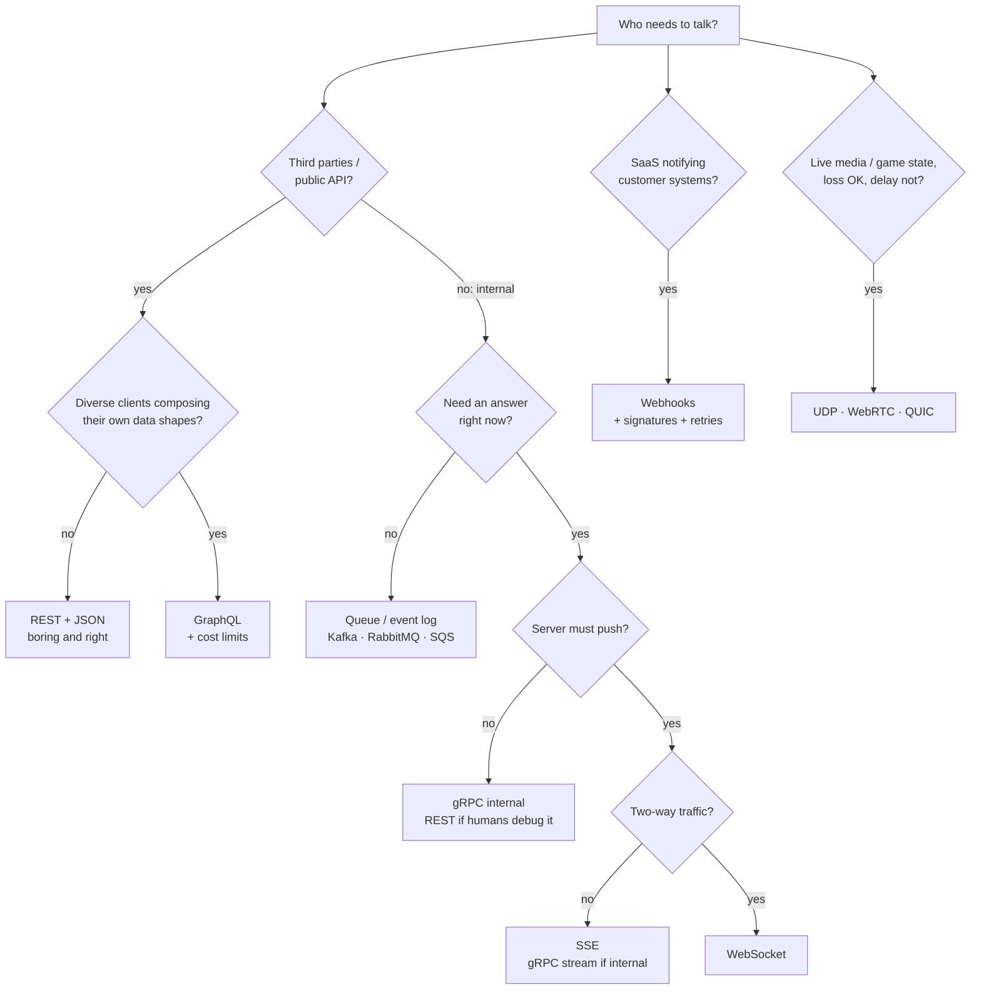
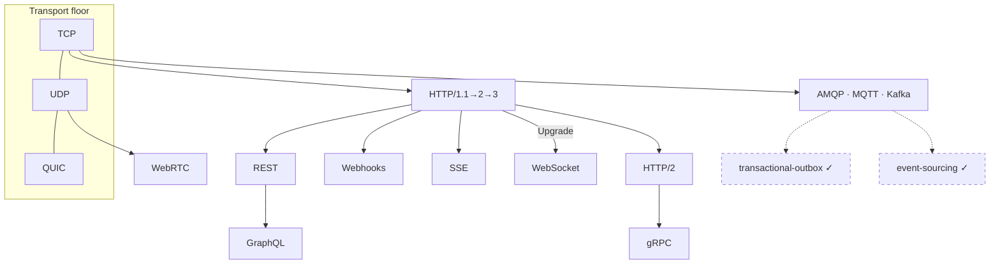

# Communication Protocols — how systems talk, and how to choose

> **Tell a friend:** Priya is building Tiffin, a food-delivery app, and five very
> different conversations have to work inside it. Asha asks for a menu and then
> watches her order move; Meera's kitchen screen lights up when an order lands;
> PayFlow reports that the card cleared; billing must hear every order while it
> is down. Every famous protocol name, from REST and gRPC to WebSocket and Kafka,
> is a ready-made answer to one of those five conversation shapes. You choose by
> asking five questions: who speaks first, one answer or many, one listener or
> many, whose code sits at each end, and must the answer come now. Pick wrong and
> the app is slow, expensive, or quietly loses orders in every train tunnel.

The playground for this lab is [`visualization.html`](visualization.html)
(double-click; it works offline). Three runnable experiments live in
`experiments/`. Everything about how the lab was built, and where it sits among
your other labs, is in [section 19](#19-about-this-lab) at the end.

---

# BEGINNER MODEL

## 1. Why are there ten ways to make an API call?

> **In one breath:** Every protocol name you have heard moves bytes between
> programs. Each one exists because it fixes a specific pain the previous one
> caused. And the one you pick shapes your whole system, so it is worth getting
> right.

Priya opens a system-design discussion and a parade of names walks past: REST,
GraphQL, gRPC, WebSockets, SSE, webhooks, MQTT, Kafka… At some level they all do
the same job. They move bytes between programs. So why do all of them exist?
And why do interviewers and architects care so much which one she picks?

Because the pick is **structural**. A protocol choice decides how her servers
are deployed. It decides what her load balancers must support. It decides how
clients handle failures, how much battery a phone burns, and how painful the
next feature is. Choose polling where you needed push and you can 100× your
server load. Choose WebSockets where a plain HTTP call would do and you buy
months of reconnect-and-scale plumbing for nothing.

A protocol is also not a function you refactor in an afternoon. It is a
**contract with other people's code**: other teams, other companies, millions of
installed apps. A wrong pick calcifies.

The good news is that the parade is not ten random inventions. Each name is the
answer to one specific pain that an earlier, simpler choice caused. By the end
of this document you will look at any "A needs to talk to B" problem and derive
the right protocol from five questions. Just as importantly, you will be able to
say out loud when a fashionable protocol is the *wrong* answer.

## 2. What does Priya's app need to say, and to whom?

> **In one breath:** Forget computers for a minute. Tiffin has five
> conversations to hold, and they are five different shapes: a letter, a phone
> call, a radio broadcast, a doorbell, and a mailbox.

Priya is building **Tiffin**, a food-delivery service. Ignore computers for a
moment and just list who needs to tell what to whom.

1. **Asha asks for the menu.** Asha is a customer. She asks: "What does Biryani
   House sell?" Tiffin answers. One question, one answer, done. It is like
   sending a **letter** and getting a reply.
2. **Asha watches her order.** "Is my food cooked yet? Has the rider picked it
   up? Where is Arjun the rider *right now*?" The news changes every few
   seconds, and Tiffin knows first. Asha should not have to keep asking. It is
   like a **phone call** that stays open, where either side can speak.
3. **Meera's kitchen screen shows new orders.** Meera runs Biryani House. Her
   kitchen screen, and every other restaurant's screen, must light up the
   moment an order lands. One event, many listeners. It is like a **radio
   broadcast**: the station speaks once, and every tuned-in receiver hears it.
4. **PayFlow confirms the payment.** Tiffin uses an outside company, PayFlow,
   to charge cards. PayFlow finds out that the payment cleared *seconds later*,
   on its own schedule, and must tell Tiffin. Tiffin cannot keep a phone line
   open to a company it does not control. So PayFlow has to **ring Tiffin's
   doorbell**: come to Tiffin's address and announce the news.
5. **The order flows through Tiffin's own kitchen of services.** Inside Tiffin,
   the ordering system must tell billing, notifications, and analytics about
   every order. It must do that even if analytics is down for maintenance right
   now. It is like leaving a message **in a mailbox** the recipient empties when
   they are back.

Five different *shapes* of conversation: ask-and-answer, open line, broadcast,
doorbell, mailbox. Priya's question, and this whole lab's question, is this.
**How do computers hold each of these conversations, and what goes wrong when
you use the wrong shape?**

> **🔮 Predict:** Analytics is switched off for an hour of maintenance. During
> that hour Asha places an order. Which of the five shapes can still get the
> news to analytics once it wakes up, and which ones lose it for good?
>
> <details><summary>Reveal</summary>
>
> **Only the mailbox.** A letter needs someone to read it. A phone call needs
> both ends awake. A radio broadcast is heard by whoever is tuned in at that
> second, and by nobody else, ever. A doorbell rung at an empty house is a
> doorbell wasted. The mailbox is the one shape where the message *waits*.
>
> If you said "the radio, because analytics can listen to a recording", you
> have just invented the tape recorder that section 8 attaches to the radio.
> Plain radio has no memory. That difference is the whole reason two families
> of message systems exist, and section 10.9 splits them.
> </details>

Nothing about networking is assumed here. All you need is to have written an
app that called some API at some point. Here is how far the lab goes, and what
you can do after each layer:

| Layer | Sections | After it you can… |
|---|---|---|
| **Beginner** | 1–9 | name the five conversation shapes and the five axes, and say why "just send bytes" fails |
| **Intermediate** | 10 | say how each named protocol works on the wire, and which pain it was born from |
| **Engineering** | 11–12 | defend a protocol choice while someone keeps asking "and what if that breaks?" |
| **Production** | 13–15 | run the proofs, walk the decision tree, and know what the on-call engineer watches |

## 3. Why not just connect and send the data?

> **In one breath:** The operating system gives every program a two-way pipe to
> another machine. Priya's first plan is to shout her own phrases down that
> pipe. It works. Then it breaks in four ways.

Priya knows the operating system gives every program a primitive for talking
over the network. You open a connection to another machine and **write bytes**
into it. The other side **reads bytes** out. It is a two-way pipe. This
primitive is called a *socket*. It is the one bit of jargon we need this early,
because everything else in this lab is built on top of it.

So here is the naive plan. Dev, who builds Tiffin's Android app, opens a
connection to Priya's server and sends the text
`GIVE ME THE MENU FOR BIRYANI HOUSE`. The server sends back the menu as text.
Invent little phrases for each need. Done?

It genuinely works. You will run exactly this in
`experiments/Exp01HttpIsJustText.java`. And it is how everything worked in the
early days. But watch it break.

## 4. What breaks when you just send bytes?

> **In one breath:** The pipe does not say where one message ends. Nobody else
> speaks Priya's invented phrases. Every conversation shape has to be rebuilt by
> hand. And nobody wrote down what happens when the line drops.

### Problem 1: where does one message end?

A socket is a *stream of bytes*, not a sequence of messages. Suppose the server
sends Asha the menu (500 bytes) and then a "restaurant is closing soon" notice
(80 bytes). Dev's app might read 580 bytes in one gulp. Or 90 bytes, then 490.
The network chops and merges freely.

> **🔮 Predict:** Priya's server writes two JSON objects back-to-back into the
> socket: `{"menu": [...]}` then `{"notice": "closing soon"}`. The app does one
> read. What does it get?
>
> <details><summary>Reveal</summary>
>
> Very possibly both blobs glued together: `{"menu":[...]}{"notice":...}`. That
> is not valid JSON, and it crashes a naive parser. Or the app gets the first
> blob *plus half* of the second.
>
> If you said "one object per read, obviously", you are assuming the pipe keeps
> your parcels apart. It does not. The reliable-delivery service under the byte
> pipe is called TCP (it gets its proper introduction in section 7). TCP
> guarantees the bytes arrive **in order and uncorrupted**. It says nothing
> about *where your message boundaries are*.
>
> Every protocol in this lab must solve this **framing** problem somehow: a
> length prefix, a delimiter line, or a "close the connection when done" rule.
> Experiment 01 shows this live.
> </details>

### Problem 2: who else speaks Priya's language?

Priya invented `GIVE ME THE MENU`. Dev's Android app team must now implement
it. So must PayFlow, the payment company. So must the caching proxy her cloud
provider runs, the load balancer, the monitoring tools… none of which have ever
heard of it. Every piece of the world's network infrastructure speaks
*standard* protocols: caches, proxies, firewalls, browsers, test tools. A
private language means rebuilding all of that yourself.

### Problem 3: who builds the broadcast, the doorbell, and the mailbox?

Broadcast a new order to 5,000 kitchen screens like Meera's? Deliver a message
to a service that is currently down? Notify an outside company behind its own
firewall? Raw sockets give you none of this. You would hand-build subscription
lists, retry queues, and authentication.

### Problem 4: what happens when the line drops mid-order?

Asha's connection drops halfway through placing an order. Did the order go
through? Can the app safely re-send? Who may speak first? A protocol is
precisely an answer sheet for these questions. Priya has not written one.

Here is the deeper discovery. "How do two computers talk" is really **two
separate problems**. Getting bytes across reliably is the easy, solved part.
Agreeing on *what the bytes mean and how the conversation flows* is the real
work. That is what all those protocol names are competing to solve.

## 5. What does Priya actually need?

> **In one breath:** A shared, standard rulebook for each of the five shapes.
> It must say where messages end, what they mean, which shape it serves, and
> what happens when things go wrong.

What Priya actually needs is a **shared, standard set of conversation rules**
for each conversation shape from section 2, such that:

1. **Framing.** Both sides always know where a message starts and ends.
2. **Meaning.** Requests, replies, success and failure are expressed the same
   way by everyone. Then strangers' code, and their infrastructure, can join the
   conversation.
3. **Shape fit.** Ask/answer, open line, broadcast, doorbell, and mailbox each
   get rules designed for that shape, not hacked onto the wrong one.
4. **Failure rules.** Every protocol states what happens on a dropped
   connection, a repeated message, a slow consumer.

Keep this list. Every protocol below is graded against it.

## 6. What is the key idea?

> **In one breath:** Protocols stack in layers. Above the byte-delivery layer,
> every protocol is a reusable answer to one conversation shape, and five
> questions tell you which one you need.

> **Protocols are layered, and above the transport layer every protocol is just
> a reusable answer to one conversation shape.** You choose one not by fashion
> but by five questions. *Who starts the conversation? One answer or a stream?
> One listener or many? Do both ends live in your company? Must the answer come
> back right now, or later?*

Everything with a name is a point in that small design space: HTTP, GraphQL,
gRPC, WebSocket, SSE, webhook, MQTT. Once you can place a protocol on those five
axes, you can derive when to use it and when it will hurt, without memorizing
anything.

## 7. What are the words engineers use for what just happened?

> **In one breath:** You have already met every idea in this section. Now each
> one gets its proper name, in the order Priya bumped into it.

Walk back through Priya's naive attempt and name each thing as she trips over
it. Every term also lands in the glossary, section 18.

### What is a protocol, really?

Priya's answer sheet from Problem 4 has a name. A **protocol** is the agreed
rules of a conversation: who speaks first, what the phrases mean, how it ends.
More precisely, it is a specification of message formats and exchange rules
that two independent implementations can follow and still interoperate.

Why does the word exist? To separate the **agreement** from any one program
that implements it. `curl`, Chrome, and a Java service all "speak HTTP" because
the rules live in a document (an RFC), not in code. For example, HTTP says a
request line looks like `GET /menu HTTP/1.1`.

### What carries the bytes before they mean anything?

Under Priya's pipe is a delivery service that moves bytes between machines
before any meaning is attached. Engineers call it the **transport**, and the
operating system provides it. It comes in two flavours.

**TCP** gives a reliable, ordered byte stream. Lost pieces are re-sent and order
is restored. **UDP** sends independent packets with no delivery or ordering
promise, but also no setup delay and no retransmission stalls. Why two? Because
reliability costs time, and some conversations would rather lose a syllable
than pause. A video call is one. HTTP runs on TCP; live game traffic and DNS
lookups run on UDP.

TCP is what made the naive plan in section 4 "genuinely work". And framing is
the part TCP explicitly does *not* do.

### What is the plug the program speaks into?

The **socket** is the plug. Technically it is the operating system's endpoint
object for one network connection. You `write()` bytes in, and the peer
`read()`s them out. Programs need a handle for "this one conversation" that is
distinct from the machine, because one server holds thousands of sockets at
once. Experiment 01 opens a socket to port 8000 and types HTTP into it by hand.

One warning. "WebSocket" is a different, higher-level thing (section 10.6) that
merely borrowed the word.

### What is the shape half the internet assumes?

Asha's menu question is **request/response**: ask once, get one answer,
conversation over. The client starts the exchange; the server never speaks
unprompted. Naming this shape lets us say precisely what push protocols change.
On the wire it looks like `GET /menu` going out and `200 OK` plus a body coming
back.

### Why does the number of questions matter more than their size?

Every exchange costs one trip there and one trip back. That is a **round trip**
(**RTT**): network latency times two, paid *per exchange* regardless of how
small the messages are. Within one data centre a round trip is about 1 ms. From
Asha's phone to a server it is 50–300 ms. So the number of round trips, not the
number of bytes, usually decides how slow an app feels.

| Situation | Round trip | Sequential calls | Time spent commuting |
|---|---|---|---|
| Inside one data centre | ~1 ms | 4 | ~4 ms, nobody notices |
| Asha's phone, good signal | 200 ms | 4 | 800 ms before the screen can draw |

This single number explains why GraphQL and HTTP/2 exist (section 10).

### Does the news come to you, or do you go and get it?

Asha's order screen can keep asking "anything new?" That is **pull**. Or Tiffin
can speak on an existing channel the moment there is news. That is **push**.
Technically the question is whether the server can initiate delivery on an
existing channel, or the client must poll with fresh requests. This is axis
number one of the key idea, and the axis most often gotten wrong. Real-time
features built on pull are the classic scaling accident. Order status via
polling is pull; via WebSocket it is push.

### How do objects become bytes?

Turning in-memory objects into bytes and back is **serialization**. JSON is one
encoding (human-readable text). Protocol Buffers is another (compact binary,
schema-driven). This is separate from the protocol: the same HTTP call can carry
JSON, XML, or binary. Envelope and letter are independent choices.

### The smaller words, in three maps back to the story

Each row says where the thing happened.

| Plumbing word | In plain words | Where it happened |
|---|---|---|
| socket | the plug one conversation speaks into | Priya's pipe, section 3 |
| transport | the byte-delivery layer beneath meaning | under the pipe, this section |
| TCP | the reliable, ordered flavour of transport | what made section 4 "work" |
| UDP | the fast, no-promises flavour | the video call above; section 10.10 |
| protocol | the shared rulebook, independent of any program | Problem 4's answer sheet |
| serialization | objects to bytes and back | the JSON blobs in section 4 |

| Conversation word | In plain words | Where it happened |
|---|---|---|
| request/response | ask once, one answer, done | Asha's menu, section 2 |
| round trip (RTT) | one there-and-back, paid per exchange | the commuting table above |
| push / pull | news comes to you / you keep asking | Asha's order screen, section 2 |
| client / server | the side that initiates / the side that answers | Dev's app / Priya's server |
| handshake | the opening exchange that sets a connection's rules | section 10.6's Upgrade |
| idempotent | safe to repeat: twice has the same effect as once | [transactional-outbox](../transactional-outbox/) |

| Message word | In plain words | Example |
|---|---|---|
| API | the surface a program exposes for others to call; a protocol is how you reach it | Tiffin's menu API |
| endpoint | one addressable operation | `GET /restaurants/42/menu` |
| header | a labelled metadata line travelling with a message | `Content-Type: application/json` |
| payload / body | the actual data inside the protocol envelope | the menu JSON |

## 8. Which two pictures should you carry, and where do they lie?

> **In one breath:** Carry the five human conversation shapes for intuition and
> five precise axes for decisions. Then learn the four places the human picture
> lies to you, because that is where the bugs live.

### The simple picture: five human conversations

This is the one you carry around. Every protocol is one of five shapes.

| Human picture | Shape | Protocols that implement it |
|---|---|---|
| **Letter** with a reply | ask → answer, then silence | HTTP (REST, GraphQL, and unary gRPC ride on it) |
| **Phone call** held open | either side speaks anytime | WebSocket, gRPC bidirectional streaming |
| **Radio / newsletter** | one sender, many subscribed listeners | SSE to browsers; MQTT, Kafka behind the scenes |
| **Doorbell** | outsider shows up at *your* address with news | Webhook |
| **Mailbox** | leave a message; recipient empties it later, even if away now | Message queue (RabbitMQ, SQS, Kafka) |

### The engineer's picture: five axes

This is the precise one. A protocol is a position on five axes. Read the middle
column as the question you ask about any conversation.

| # | Axis | The question | The two ends |
|---|---|---|---|
| ① | initiation | who starts it? | pull vs push |
| ② | cardinality | how many answers, how many listeners? | one answer vs a stream; one listener vs many |
| ③ | connection lifetime | does the line outlive one exchange? | per-request vs persistent |
| ④ | encoding | what do the bytes look like? | text vs binary; free-form vs schema-checked |
| ⑤ | coupling | must both ends be alive at the same moment? | synchronous (answer now) vs asynchronous (answer later, receiver may be down) |

Section 10 places every named protocol on these axes. The playground lets you
watch each position behave.

### How do the two pictures line up?

| Shape | Initiation | Cardinality | Connection | Coupling |
|---|---|---|---|---|
| Letter | pull | one answer | per-request | synchronous |
| Phone call | push and pull | streams both ways | persistent | synchronous |
| Radio | push | one to many | persistent | live: both tuned in |
| Doorbell | push, across trust boundaries | one event, one address | per-request | synchronous at the door |
| Mailbox | sender drops it, receiver collects | one worker, or many groups | persistent to the broker | asynchronous |

The mailbox is the only shape where the receiver may be *dead* during sending.
That is why it alone survives a downed consumer, which is exactly what the
Predict in section 2 asked.

### Where the story lies to you

Read this part twice. It is where bugs live.

**Letters never get lost silently in the postal picture; requests do.** When an
HTTP call times out, you cannot know whether the server did the work. A real
letter-writer would eventually get a "return to sender". Networks just go
quiet. This is why *idempotency*, not hope, is the real safety mechanism
(section 12).

**A phone call, once connected, stays connected. A WebSocket does not.** Real
connections die every few minutes on mobile networks. The "open line" is
actually "open line, plus automatic redial, plus a plan for what was missed
while redialing". Teams that take the phone-call picture literally ship chat
apps that drop messages on every train tunnel (section 11).

**Radio listeners who miss a broadcast miss it forever. Kafka listeners do
not.** Log-based queues keep history and let a listener rewind. The radio
picture is right for *live* fan-out (SSE, MQTT fire-and-forget) and wrong for
replayable streams. You saw the replayable kind in
[event-sourcing](../event-sourcing/).

**A doorbell ring is heard at most once; webhooks arrive at least once.**
Payment providers like PayFlow *retry* until you acknowledge. So the same
doorbell can ring five times for one event, sometimes out of order (section 11).

## 9. Where can you watch the shapes move?

> **In one breath:** Open the playground, run Asha's "order status" scenario
> under each protocol, and watch the counters. Polling wastes almost every
> request; push inverts the numbers.

Open **[`visualization.html`](visualization.html)** (double-click; fully
offline). It animates a client lane and a server lane. It lets you run the same
"order status" scenario under each protocol: polling, long polling, SSE,
WebSocket, webhook, and queue.

What to look at, in order:

1. **Run "Polling" first** and watch the counters: requests fired versus events
   actually delivered. The waste is the point.
2. **Run "WebSocket"** on the same scenario. The counters invert.
3. Each scenario opens with a **predict question**. Commit to an answer before
   pressing run. The log then tells you, in full sentences, what happened and
   why.
4. Use the **latency and event-frequency sliders**. The protocols reorder
   themselves as the numbers change. That reordering *is* the decision skill.

The diagrams in section 10 use the same left-client / right-server layout as
the playground, so both build one spatial picture.

---

> ### ✅ Checkpoint: end of the beginner model
>
> You now hold the beginner model. You can name the five conversation shapes,
> the five axes, and say why "just send bytes" fails.
>
> **Say it back.** Without using the words *protocol*, *socket* or *framing*,
> explain to Meera why Dev's first version of the app sometimes crashed just as
> Biryani House was about to close.
> <details><summary>A good answer sounds like</summary>
> "The pipe between the app and Tiffin's server does not keep messages apart.
> When the server sent the menu and the closing notice one after the other, the
> app sometimes read them as one lump, or read only half of the notice. It had
> no way to know where the menu stopped, so it tried to make sense of garbage."
> </details>
>
> Next: how each real protocol actually works on the wire, in the order history
> invented them. Each one was born from the previous one's specific pain.

---

# INTERMEDIATE MODEL

## 10. How does each protocol actually work, and what pain made it?

> **In one breath:** Read this section as one continuous story. Each protocol
> exists because the one before it hurt Priya somewhere specific. For each you
> get the real wire bytes, where it shines, and when *not* to use it.

The "when not" part is what interviews and architecture reviews actually probe,
so it gets as much space as the "how".

### 10.1 Raw TCP sockets: what is the floor everything stands on?

This is Priya's naive plan from section 3, taken seriously. The operating system
gives you the reliable byte pipe. You define everything else: framing, meaning,
failure rules. Framing is typically a length prefix ("next message is 512
bytes") or a delimiter (a newline).

Where is raw TCP genuinely used? Database wire protocols: Postgres, MySQL and
Redis each speak a custom TCP protocol, and that is what a "database driver"
implements. Game servers. Exchange trading feeds. In every one of those cases a
team controls both ends, needs every microsecond and every byte, and is willing
to write and version its own protocol spec.

When should Priya not use it? Almost always. She would rebuild framing, auth,
encryption, proxying, and tooling that HTTP gives her free. And no third party
could talk to Tiffin without her custom library. Raw TCP is the *last* resort,
not the pro move.

**Run `experiments/Exp01HttpIsJustText.java` now.** It talks raw TCP to a real
HTTP server, so you can see with your own eyes that everything below is "just
text over a socket", plus discipline.

### 10.2 HTTP: how did the letter get standardized, and why did it win?

Asha's letter, written in a format everyone agrees on. One request, one
response, in a rigidly framed text format. This is *literally* what travels
over the socket when Dev's app asks for a menu:

```
GET /restaurants/42/menu HTTP/1.1
Host: api.tiffin.com
Accept: application/json
                                          ← blank line = "headers done" (framing!)
```

```
HTTP/1.1 200 OK
Content-Type: application/json
Content-Length: 57                        ← framing: exactly 57 body bytes follow
Cache-Control: max-age=300

{"restaurant": "Biryani House", "items": [{"dosa": 120}]}
```

Check it against the list in section 5. Framing is answered by
`Content-Length` and the blank line. Shared meaning comes from **verbs** and
**status codes**, in the table below. Failure rules come along too: "GET is
idempotent, so anything in the middle may retry it."

| HTTP word | What it means | Examples |
|---|---|---|
| verb | the action | GET reads, POST creates, PUT replaces, DELETE removes |
| 2xx status | success | `200 OK` |
| 3xx status | go somewhere else | redirect |
| 4xx status | *your* mistake | wrong URL, bad request |
| 5xx status | the *server's* mistake | crashed handler |

Why did HTTP conquer the world? Because those shared semantics let
*infrastructure* join the conversation. A CDN can cache any `GET` that carries
`Cache-Control` without understanding Priya's business. A proxy can retry
idempotent requests. A browser, a load balancer, `curl`, and your monitoring
all speak it. This network effect, not technical elegance, is why "when in
doubt, HTTP" is the correct default.

The versions tell a pain-driven story of their own. HTTP/1.1 handles one
request at a time per connection. So browsers open about 6 parallel connections
and still queue. Engineers call that **head-of-line blocking** at the request
level. **HTTP/2** (2015) multiplexes many concurrent streams over one TCP
connection in binary frames, and compresses headers.

> **🔮 Predict:** HTTP/2 puts 6 streams on one TCP connection. One packet
> belonging to *stream 3* is lost in transit. What happens to streams 1, 2, and
> 4 to 6?
>
> <details><summary>Reveal</summary>
>
> **They all stall.** TCP promises *in-order* delivery of the whole byte
> stream. Until the lost packet is re-sent, TCP refuses to hand *any* later
> bytes to the application, even bytes belonging to unrelated streams.
> Head-of-line blocking moved down a layer, from HTTP into TCP itself.
>
> If you said "only stream 3 waits", you were describing what HTTP/2 *wanted*.
> On TCP that is unfixable, which is why **HTTP/3** abandons TCP entirely. It
> runs on **QUIC**, a transport built on UDP that keeps streams independent (a
> lost packet stalls only its own stream) and merges the TCP and TLS handshakes
> into one round trip. Google, YouTube, Facebook and Cloudflare serve most
> traffic this way today.
> </details>

### 10.3 REST: why is it a discipline and not a protocol?

REST is a *style* for using HTTP, not a new protocol. Model your domain as
**resources** with URLs. Manipulate them with the standard verbs. Keep the
server **stateless**, meaning each request is self-contained. That last rule is
what lets any of 50 identical servers answer any request, which is what makes
horizontal scaling trivial. Tiffin's API in this style:

```
GET    /restaurants/42          → read one
GET    /restaurants?city=pune   → list/filter
POST   /orders                  → create (body: the new order)
PATCH  /orders/97               → partial update
DELETE /orders/97               → cancel
```

Reach for REST for public and partner APIs (Stripe, GitHub, Twilio, the entire
API economy), for anything third parties integrate with, for browser and mobile
backends of ordinary CRUD shape, and for anything that benefits from HTTP
caching. It is boring, universal, and debuggable with `curl`. It is the right
default.

Where would Priya be wrong to pick it?

- **Real-time push.** REST has no way for the server to speak first. Period.
- **Screens that aggregate many resources.** This is the pain that births
  GraphQL, next.
- **High-volume internal service-to-service traffic.** JSON parsing and
  untyped contracts get expensive. That pain births gRPC (section 10.5).
- Also know **SOAP**, the 2000s XML predecessor with rigid contracts and heavy
  tooling. It survives in banking and enterprise integrations. You read it; you
  do not choose it for new work.

### 10.4 GraphQL: what pain in REST gave birth to it?

Tiffin's app home screen needs four things: Asha's profile, her active order,
that order's restaurant, and Arjun's location.

> **🔮 Predict:** As clean REST that is `GET /me`, `GET /orders/active`,
> `GET /restaurants/42`, `GET /riders/7`. Calls 2 to 4 depend on call 1's
> response, so they cannot all run in parallel. On a phone with a 200 ms round
> trip, how long until the screen renders? And what fraction of the returned
> fields does the screen actually display?
>
> <details><summary>Reveal</summary>
>
> Two sequential rounds minimum, and likely three, before rendering. Screens
> typically use well under half the fields returned.
>
> | Rounds | Time before the screen can draw | What it means |
> |---|---|---|
> | 2 | ≈400 ms | the best case, with calls 2 to 4 in parallel |
> | 3 | ≈600 ms | the likely case, when one of them depends on another |
>
> If you said "200 ms, it's one screen", you counted screens, not round trips.
> Engineers have names for both halves of this pain. **Over-fetching**: full
> objects arrive when you needed 3 fields. **Under-fetching**: no single
> endpoint had everything, forcing the extra calls. Facebook's mobile team hit
> exactly this wall in 2012. Their fix became GraphQL, open-sourced in 2015.
> `experiments/Exp02RoundTrips.java` measures this, and the chatty version
> loses by roughly the predicted margin.
> </details>

How does it work? One endpoint (`POST /graphql`). The *client* sends a typed
query describing exactly the shape it wants, and the server resolves it in one
round trip:

```graphql
query HomeScreen {
  me { name }
  activeOrder {
    status
    restaurant { name }
    rider { location { lat lng } }
  }
}
```

The response is JSON mirroring the query, nothing more. A schema (types,
fields) is the contract. Clients discover it by introspection, and tooling such
as auto-complete and type-checked clients falls out of that.

Reach for GraphQL when mobile or web apps aggregate many resources per screen.
Reach for it when **many different frontends with different data needs** share
one backend. That is the killer case: iOS, Android, web, watch, each querying
its own shape, while the backend team ships nothing. Reach for it in public APIs
serving diverse integrators (GitHub's v4 API, Shopify).

Where would Priya be wrong to pick it? This list wins interviews.

- **Server-to-server internal calls.** Services need fixed, known shapes.
  GraphQL's flexibility is dead weight there, and gRPC is faster and typed
  (section 10.5).
- **Simple CRUD with one client.** You pay the complexity tax (schema,
  resolvers, query-cost limiting) for flexibility nobody uses.
- **HTTP-cache-friendly content.** Everything is `POST` to one URL, so CDNs and
  browser caches, which key on `GET` plus URL, go blind. Client-side caches like
  Apollo's exist, but you *rebuild* caching rather than inherit it.
- **Naive resolvers hide N+1 catastrophes.** `orders { rider { name } }` can
  fire one database query per order. You must add batching (DataLoader). And
  because clients compose arbitrary queries, a public GraphQL API needs **query
  depth and cost limits**. Otherwise one hostile query,
  `{ orders { items { restaurant { orders ... }}}}`, is a denial of service
  (section 11).
- **File uploads and binary.** Bolted on and awkward. Plain HTTP does it
  natively.

### 10.5 gRPC: why was JSON over HTTP/1.1 too slow inside the walls?

Inside Tiffin, the `orders` service calls the `pricing` service maybe 5,000
times per second. Costs that do not matter on a public API become the bill.
JSON is verbose to ship and CPU-heavy to parse. Nothing checks that `pricing`
did not rename a field until production. Every call re-pays HTTP/1.1's
one-at-a-time connection handling.

gRPC (Google, 2015, grown from their internal "Stubby") is three decisions
welded together.

| Decision | What it gives you | Why it matters inside the walls |
|---|---|---|
| **Protocol Buffers** for encoding | you write a schema; a compiler generates client and server code in any language | the wire format is compact binary using field *numbers*, not names: typically 3–10× smaller than JSON and far cheaper to parse. Renaming a field incompatibly now breaks the *build*, not prod |
| **HTTP/2** transport | multiplexed, persistent connections | no more one-at-a-time |
| **Streaming** as a first-class citizen | four call shapes: unary (request/response), server-streaming, client-streaming, bidirectional | Arjun's location can flow as a stream, not a series of calls |

```protobuf
service Pricing {
  rpc Quote (QuoteRequest) returns (QuoteReply);            // unary
  rpc WatchSurge (Area) returns (stream SurgeUpdate);       // server-streaming
}
message QuoteRequest { int64 restaurant_id = 1; repeated int64 item_ids = 2; }
```

Calling it feels like a local function call: `stub.Quote(req)`. That is the
"RPC" (remote procedure call) philosophy: hide the network behind a function.
Contrast REST's philosophy, which is to *expose* the network's semantics. Keep
both in your head. The hidden network still fails (section 11).

Reach for gRPC for internal microservice meshes (Netflix, Uber, Dropbox and
Spotify run thousands of gRPC services). Reach for it in polyglot shops, where
the schema generates consistent clients in Java, Go, Python and more. Reach for
it for low-latency streaming between services, and for mobile-to-backend links
where you control both ends. It also powers etcd's and CockroachDB's client
protocols; you met etcd in the [paxos](../paxos/) lab's production notes.

Where would Priya be wrong to pick it?

- **Browsers.** Browser JavaScript cannot speak raw gRPC, because it has no
  control over HTTP/2 frames. You need a translation proxy (grpc-web or
  Envoy). For browser-facing APIs, use REST or GraphQL.
- **Public third-party APIs.** Integrators expect `curl`-able JSON they can
  poke in a terminal. Handing them a `.proto` file and a codegen step is
  friction. Stripe exposes REST, not gRPC, on purpose.
- **The debuggability tax.** Binary payloads mean you need `grpcurl` and
  reflection where `curl` and eyeballs used to do.
- **Anywhere humans read the payloads.** Config, webhooks, logs.

### 10.6 WebSocket: what if the server needs to speak first?

Asha's order tracking under pure HTTP means Dev's app asks every 2 seconds.
"Status?" "Same." "Status?" "Same." Engineers call this **polling**.

> **🔮 Predict:** 10,000 customers like Asha are polling every 2 s, and an
> order's status changes about every 60 s. (a) How many requests per second hit
> the server? (b) What fraction return nothing new? (c) What is the worst-case
> staleness of the screen?
>
> <details><summary>Reveal</summary>
>
> | Question | Answer | What it means |
> |---|---|---|
> | (a) load | 5,000 req/s | every one paying full HTTP, auth and database cost |
> | (b) waste | ~97% carry no news | thousands of requests per second of pure waste |
> | (c) staleness | up to the full 2 s interval | Asha's screen can be 2 s behind |
>
> If you said "tighten the interval to fix (c)", notice that (a) and (b) get
> worse. Loosen it and (c) gets worse. Polling has no good setting.
> `experiments/Exp03PollVsPush.java` measures this trade directly.
>
> The stopgap era used **long polling**. The server *holds* the request open
> until news arrives, then the client immediately re-asks. That gives
> real-time-ish latency, but it still costs one full HTTP cycle per event and a
> held-open request per client. A bridge, not a destination.
> </details>

How does a WebSocket work? It starts life as an HTTP request that asks to
*change protocols*:

```
GET /live HTTP/1.1
Host: api.tiffin.com
Upgrade: websocket                 ← "let's stop doing HTTP on this connection"
Connection: Upgrade
Sec-WebSocket-Key: dGhlIHNhbXBsZQ==

HTTP/1.1 101 Switching Protocols   ← server agrees
```

After the `101`, the connection is no longer HTTP. It is a persistent, cheap,
**two-way message pipe** with framing handled for you. Either side may write at
any time, until someone closes it. The handshake trick is why WebSockets
traverse firewalls and reuse port 443 like ordinary web traffic.

Reach for it for anything both **real-time and two-way**: chat (Slack),
collaborative editing (Figma, Google Docs), multiplayer games, live trading
UIs, and ride-hailing driver-to-dispatch links like Arjun's.

Where would Priya be wrong to pick it?

- **One-way flows.** If the client only listens, SSE (next) does it with none
  of the following costs.
- **You inherit a distributed-state problem.** Each open socket lives on *one*
  server. So load balancers must be connection-aware. Deploys and restarts drop
  every connection. Pushing to Asha means *finding which server holds her
  socket*, which is where Redis pub/sub or a message bus between your own
  servers comes in. And HTTP middleware no longer applies: caching, retries,
  auth-per-request. You re-invent request IDs, acks, and heartbeats inside your
  own message format.
- **The reconnect burden is yours.** Mobile connections die constantly. Every
  client needs redial-with-backoff *plus* "what did I miss?" recovery (section
  11). This is the phone-call lie from section 8, turned into a work item.
- **Occasional updates.** Status that changes every few minutes does not earn
  a persistent connection. Poll politely, or use SSE.

### 10.7 SSE: what is the one-way push you probably want?

Server-Sent Events. Dev's app makes a *normal* HTTP GET. The server simply
**never finishes the response**, trickling events as text lines whenever it has
news about Asha's order:

```
GET /orders/97/events            ← ordinary HTTP request

HTTP/1.1 200 OK
Content-Type: text/event-stream  ← "this response never ends"

data: {"status": "COOKING"}

data: {"status": "PICKED_UP"}
                                  ← blank line = event boundary (framing again!)
id: 42
data: {"status": "DELIVERED"}
```

Because it *is* HTTP, everything HTTP-shaped still works: same auth, same load
balancers, plain-text debugging. Browsers have it built in (`EventSource`) with
**automatic reconnection**. On reconnect the client sends `Last-Event-ID: 42`,
and the server can replay what was missed. The "what did I miss?" problem that
WebSockets make you hand-build is half-solved in the protocol.

> **🔮 Predict:** Asha's train enters a tunnel for forty seconds. Her order goes
> from COOKING to PICKED_UP to DELIVERED while she is underground. Compare two
> versions of the app, one on WebSocket and one on SSE. When the signal comes
> back, what does each one have to do to show her all three transitions?
>
> <details><summary>Reveal</summary>
>
> **The SSE version does almost nothing.** The browser's `EventSource`
> reconnects on its own and sends `Last-Event-ID` with the last event it saw.
> Tiffin's server replays everything after it. **The WebSocket version has to
> do all of that in Dev's code**: notice the death, redial with backoff, then
> ask "what did I miss?" in a format he invented himself.
>
> If you said "TCP re-sends the missed data", remember that TCP only
> retransmits *inside one connection*. The tunnel killed the connection. Nothing
> below the application knows what Asha last saw. Section 11.2 walks the
> WebSocket version step by step, and the playground's two "Train tunnel"
> scenarios run both.
> </details>

Reach for SSE for live one-way feeds: dashboards, notifications, sports scores,
order tracking. And for the example you use daily: **LLM token streaming**.
ChatGPT and the Claude API stream responses as SSE. The client asks once (a
POST), and tokens trickle back as events. Under HTTP/1.1, browsers capped
connections at about 6 per domain, which throttled SSE-heavy pages. HTTP/2
multiplexing erased that.

Where would Priya be wrong to pick it? When the client needs to *send*
frequently (that is WebSocket territory). For binary data (SSE is text-only).
For non-browser consumers she fully controls, where gRPC server-streaming is the
typed equivalent inside the walls.

### 10.8 Webhooks: how does the doorbell work across company walls?

Back to shape 4 from section 2. PayFlow learns that Asha's card cleared 3 s
after checkout. Tiffin cannot hold sockets open to every partner, and PayFlow
will not let thousands of merchants poll its API every second.

The answer is an inversion. **Tiffin gives PayFlow a URL**, and PayFlow makes
an ordinary HTTP POST *to Tiffin* when the event happens. The consumer becomes
the server:

```
POST /callbacks/payflow HTTP/1.1        ← PayFlow calling Tiffin
PayFlow-Signature: t=1724832000,v1=5257a8ee...   ← HMAC: proves sender + content
Content-Type: application/json

{"event": "payment.succeeded", "order_id": 97, "amount": 45000}
```

Tiffin answers `200 OK` quickly: acknowledge now, process asynchronously, do the
real work off a queue. If no timely 2xx comes back, PayFlow **retries with
backoff**, often for days. This is exactly how Stripe payment events, GitHub
push events, and Twilio message-status callbacks work.

Reach for webhooks for cross-organization event delivery where the consumer can
host a public HTTPS endpoint. It is the standard answer for "SaaS tells its
customers something happened".

Where would Priya be wrong to pick it? For consumers behind firewalls or NAT,
or on devices, because they cannot host an endpoint (flip to polling, SSE, or
MQTT). For high-frequency streams, because per-event HTTP calls do not amortize
(hand out a stream or a queue instead). And never naively. Retries mean
**duplicates and reordering** are contractual, so an endpoint that is not
idempotent *will* double-ship an order (section 11). And an unverified
signature means anyone who finds your URL can fake "payment succeeded".

### 10.9 Message queues and event streams: how does the mailbox work?

Shape 5 from section 2. Ordering must tell billing, notifications, and
analytics. With any *synchronous* protocol above, if analytics is down, either
checkout fails with it or the event is simply gone. Synchronous protocols
require both ends alive at the same moment. Sometimes that is the wrong
requirement altogether.

Insert a **broker**: a server whose only job is holding messages. Producers
publish to it and move on. Consumers take messages out on their own schedule.
The broker retries until a consumer **acknowledges**. You know this pattern's
guarantees cold from [transactional-outbox](../transactional-outbox/). Delivery
is **at-least-once**, so consumers must be idempotent.

There are two families, plus one small protocol that deserves its own line.

| Family | The message is… | Who consumes it | The human picture |
|---|---|---|---|
| **Task queues** (RabbitMQ with the AMQP protocol; SQS) | a job | *one* worker; deleted when acked | the mailbox, exactly |
| **Event logs** (Kafka) | a fact appended to a durable, ordered log | many independent consumer groups, each at its own pace, able to **rewind** | the radio with a tape recorder from section 8 |
| **MQTT** | a tiny binary pub/sub message | topic subscribers over IoT and flaky mobile links | a radio for devices on a SIM card |

Kafka's rewindable log is the natural carrier for
[event-sourcing](../event-sourcing/) and [cqrs](../cqrs/) event feeds.

MQTT is built for **IoT and flaky mobile links**. It has topic subscriptions,
three delivery-guarantee levels (QoS 0, 1 and 2), "last will" messages that
announce a device's death, and headers measured in *bytes*, because a sensor on
a SIM card pays per byte. Smart meters and vehicle telemetry use it. Facebook
Messenger famously used MQTT on mobile for battery-cheap push.

Reach for a queue to decouple services in time (the consumer may be down), to
absorb bursts (the queue soaks up a spike the consumer drains later), for
fan-out to many internal consumers, and for background jobs.

Where would Priya be wrong to pick it? When the caller needs the answer *in
this request*. A price quote is RPC territory; a queue adds a broker hop and an
ops burden for negative value. When request/response is faked over two queues
with correlation IDs and timeout logic, because she has rebuilt RPC, badly. And
in tiny systems, where a broker is one more thing to run, monitor, and upgrade.

### 10.10 UDP, QUIC, WebRTC: when is losing a packet better than waiting?

Some conversations tolerate loss but not delay. In a video call, a re-sent
50 ms-old audio packet is *worse* than silence. TCP's retransmission stalls
(the reveal in section 10.2) are exactly wrong there. So latency-critical media
runs on **UDP** and handles loss at the application layer.

| Who | How it copes with loss | Why not TCP |
|---|---|---|
| **WebRTC** (browser-to-browser audio, video and data: Meet, Discord voice) | jitter buffers and codecs that survive gaps | a late syllable is worse than a missing one |
| most competitive multiplayer games | custom UDP state sync; a lost position update is superseded by the next one anyway | waiting for a re-send freezes the game |
| DNS | one tiny question, one tiny answer | a TCP handshake would triple the cost |
| **QUIC** (section 10.2) | UDP's foundation with reliability rebuilt per stream | TCP's promises without TCP's head-of-line stall |

Where would Priya be wrong to pick it? Anything needing ordered completeness:
payments, APIs. She would re-implement TCP herself, poorly.

### The catalogue side by side

The same facts, in two tables, so you can compare down the columns. First the
letter family, then the push and mailbox family.

| Protocol | Shape | Born from | Reach for it when | Keep away when |
|---|---|---|---|---|
| Raw TCP | any, hand-built | the floor | you own both ends and need every byte | almost always; last resort |
| HTTP / REST | letter | the naive plan's four problems | public, partner, CRUD, cacheable | push, aggregation screens, hot internal paths |
| GraphQL | letter, client-shaped | REST's round trips and over-fetching | many frontends, diverse integrators | internal calls, one-client CRUD, caching, uploads |
| gRPC | letter or phone call, typed | JSON's cost inside the walls | internal meshes, polyglot, streams | browsers, public APIs, human-read payloads |
| SOAP | letter, 2000s style | rigid enterprise contracts | you read it in banking | new work |

| Protocol | Shape | Born from | Reach for it when | Keep away when |
|---|---|---|---|---|
| WebSocket | phone call | "the server can never speak first" | real-time *and* two-way | one-way, occasional, reconnect-shy teams |
| SSE | radio to browsers | polling's waste, one-way case | dashboards, tracking, token streams | client sends often, binary |
| Webhook | doorbell | partners cannot hold sockets or poll | SaaS-to-customer events | firewalled consumers, high frequency |
| Queue / log / MQTT | mailbox, tape recorder | "both ends must be alive" | decoupling, bursts, fan-out, devices | answer needed now, tiny systems |
| UDP / QUIC / WebRTC | live media | TCP's retransmission stall | loss OK, delay not | anything needing completeness |

---

> ### ✅ Checkpoint: end of the intermediate model
>
> You now hold the intermediate model: every major protocol, the pain that
> birthed it, and its wire format.
>
> **Say it back.** Without using the words *push*, *pull* or *polling*, tell
> Asha why her order screen used to be both slow and wasteful at the same
> time, and what changed.
> <details><summary>A good answer sounds like</summary>
> "Her phone used to ask 'anything new?' every two seconds, and almost every
> answer was 'no'. Each ask cost a full request for nothing, and news could
> still sit for two seconds before the next ask. Now the phone opens one line
> and stays quiet. Tiffin speaks the moment there is news, so the screen is
> fresher and the server does almost no work."
> </details>
>
> What you cannot yet do is defend a choice under failure conditions. That is
> the engineering layer.

---

# ENGINEERING MODEL

## 11. What breaks, and what does each protocol do about it?

> **In one breath:** Six things go wrong for Tiffin. Each one is a short
> story: what happened, what you would see, why, and which guarantee survived.
> The playground's chaos controls run three of them live.

The four requirements from section 5 get real here. The playground's **chaos
controls** ("Cut the connection", and the server-down and endpoint-down
scenarios) run scenarios 1, 2 and 4 live.

### 11.1 What happens when the POST times out?

This one hits every synchronous protocol. Asha taps "place order". Dev's app
sends the request and the connection dies before the response comes back. To
watch it, press the playground's "Cut the connection" control while a reply is
in flight.

> **🔮 Predict:** The request timed out. Which of these is true? (a) Tiffin
> never received the order. (b) Tiffin placed the order and only the reply
> died. (c) You cannot tell.
>
> <details><summary>Reveal</summary>
>
> **(c), and that is the whole problem.** One round trip carries both the
> action and its confirmation. When the trip is cut, the client *cannot
> distinguish* "server never got it" from "server did it; reply died".
>
> If you said (a), "a timeout means it failed", you are the reason Asha gets
> charged twice. The obvious response is to retry. But a blind retry of
> `POST /orders` double-orders.
> </details>

The fix works on REST, GraphQL and gRPC alike. The client sends an
**idempotency key**: a client-generated unique ID. The server stores the key
together with the result, and on a repeat it replays the stored result instead
of doing the work again. Stripe's API works exactly this way.

| Piece | In words | On the wire |
|---|---|---|
| the key | a unique ID the client makes up *before* the first attempt | `Idempotency-Key: a91f…` |
| the store | server remembers key → result | a row per key |
| the replay | same key again, same stored answer, no second order | identical response |

What did the protocol keep? At-least-once *attempt*. What must you add
yourself? Exactly-once *effect*. It is the same medicine as the consumer side of
[transactional-outbox](../transactional-outbox/), and this problem follows you
across every protocol in this lab.

### 11.2 What happens when the WebSocket dies on a moving train?

Asha is on a train, watching Arjun's location move on a WebSocket. The train
enters a tunnel. In the playground, run WebSocket and press "Cut the
connection (train tunnel)" mid-stream.

What happens? Arjun's location updates silently stop. Neither side is told
promptly. TCP death is *discovered*, not announced. So both ends need
**heartbeats** (ping/pong) to notice within seconds.

Then Dev's client must **reconnect with exponential backoff plus jitter**. Why
jitter? Because 10k clients redialing simultaneously after a server restart is
a self-inflicted DDoS. Engineers call that the *thundering herd*. Then the
client must **resynchronize**: either re-fetch full state ("where is Arjun
*now*?") or replay from a last-seen sequence number.

What did the protocol keep? Nothing. WebSocket gives you a pipe, not delivery
semantics. The recovery story is application code. This is the single most
under-estimated cost of choosing WebSockets. SSE's built-in `Last-Event-ID`
reconnect is precisely this lesson, pre-baked for the one-way case.

### 11.3 What happens when a GraphQL query is hostile, or merely naive?

Someone sends a deeply nested query against Tiffin's unprotected resolvers.
One request fans out to thousands of database queries (N+1 at each level), or
an exponentially exploding join. One client request, whole-backend outage.

Why? The protocol's core feature, that the *client* composes the query, is also
its attack surface. REST's fixed endpoints made cost predictable per endpoint.
GraphQL removes that ceiling.

The production response is DataLoader-style batching, query depth limits, cost
analysis before execution, and persisted-queries-only for public APIs. What was
traded? Server-controlled cost was exchanged for client flexibility. You must
claw it back explicitly.

### 11.4 What happens when the webhook endpoint is down for five minutes?

> **🔮 Predict:** PayFlow POSTs `payment.succeeded` for Asha's order. Tiffin is
> mid-deploy and returns 503 for 5 minutes. Is the event lost? What arrives
> later, and in what order relative to a `refund.issued` fired 1 minute after
> it?
>
> <details><summary>Reveal</summary>
>
> **Not lost.** No 2xx means the provider queues the event and retries with
> backoff (Stripe: up to about 3 days). But when Tiffin recovers, the retried
> `payment.succeeded` may arrive *after* the fresher `refund.issued`. Retries
> destroy ordering, and overlapping retries also produce duplicates.
>
> If you said "lost, the server was down", you forgot that PayFlow keeps a
> mailbox on *its* side. If you said "they arrive in the order they happened",
> you trusted the doorbell to remember the sequence. It does not.
>
> So a correct webhook consumer does four things. (a) It verifies the
> signature. (b) It acks 2xx immediately and processes asynchronously. (c) It
> dedupes by event ID. (d) It never trusts arrival order: either it uses the
> event's own timestamp or sequence, or it treats the webhook as a *hint* and
> re-fetches current truth from the provider's API ("trust but verify").
>
> Kept: at-least-once delivery. Never promised: exactly-once, in-order.
> </details>

### 11.5 What happens when the consumer is slow?

Meera's kitchen dashboard consumes 10 events/s from a server producing
1,000/s. Streams and queues both meet this.

> **🔮 Predict:** After one second, 990 events have arrived faster than
> Meera's screen can draw them. Where are they?
>
> <details><summary>Reveal</summary>
>
> **Somebody is holding them, and you did not choose who.** There are only
> three places the difference can go: unbounded server-side buffering (memory
> death), dropping (data loss), or **backpressure** (telling the producer to
> slow down).
>
> If you said "the network slows the producer automatically", that is true for
> raw TCP and only raw TCP. The table below says where each protocol lands.
> </details>

| Protocol | Where the difference goes | What you notice |
|---|---|---|
| raw TCP | backpressure is built in: the window mechanism; a full receiver stalls the sender | the sender blocks |
| WebSocket | inherits TCP's backpressure | your *application* rarely notices a full send-buffer until memory grows |
| gRPC streaming | exposes per-stream flow control | you can act on it |
| Kafka | sidesteps it: the log persists to disk and slow consumers simply lag, visibly | *consumer lag*, the same "how far behind is the read model?" metric from [cqrs](../cqrs/) |

The insight about guarantees: "the mailbox never fills" is an illusion. Every
real mailbox has a size, and you must choose who suffers.

### 11.6 What happens when the network partitions?

From [cap-theorem](../cap-theorem/): the link between Dev's app and Tiffin's
servers tears, for all of them at once.

Synchronous protocols (REST, GraphQL, gRPC, WebSocket) all fail *visibly*, with
errors and timeouts. Recovery is retry plus idempotency (11.1). Asynchronous
messaging fails *invisibly*. Producers keep publishing happily. Consumers just
fall behind. The queue absorbs the partition.

That is the async superpower and its trap in one. Nothing errors, so only
**lag monitoring** tells you something is wrong. Webhooks sit between: the
*provider* eats the partition via its retry queue.

### The six failures side by side

| # | What broke for Tiffin | Where to watch | The protocol kept | You must add |
|---|---|---|---|---|
| 11.1 | Asha's order POST timed out | "Cut the connection" mid-reply | at-least-once *attempt* | idempotency key → exactly-once *effect* |
| 11.2 | WebSocket died in a tunnel | "Cut the connection (train tunnel)" during WebSocket | nothing: a pipe, not delivery | heartbeats, backoff + jitter, resync |
| 11.3 | a hostile GraphQL query | not in the playground | client flexibility | batching, depth and cost limits, persisted queries |
| 11.4 | PayFlow's endpoint at Tiffin returned 503 | "Your endpoint goes down (webhook)" | at-least-once delivery | signature check, fast ack, dedupe by event ID, ignore arrival order |
| 11.5 | Meera's screen fell 990 events/s behind | "Consumer takes a nap (queue)" | depends on the protocol (table above) | a decision about who suffers |
| 11.6 | the network partitioned | any scenario, server down | sync: visible errors; async: nothing | lag monitoring |

## 12. What can you honestly promise?

> **In one breath:** No protocol delivers exactly once. Ordering only holds
> inside one connection. Someone has to notice failures, and every choice
> traded something away. Two laws hold across all of them.

Pull the threads together. For any protocol choice, be able to fill this
ledger.

### Is delivery guaranteed?

| Family | The honest answer |
|---|---|
| Synchronous protocols (REST, GraphQL, gRPC, WebSocket) | no; you learn of failure and must retry |
| Queues and webhooks | at-least-once; duplicates are contractual |
| Anything over a network | exactly-once *delivery* is physically impossible over a lossy network; exactly-once *effect* is achievable, and only via idempotency at the receiver |

> **🔮 Predict:** A vendor's brochure promises "exactly-once delivery". Is that
> possible, and if it works, how must it be working?
>
> <details><summary>Reveal</summary>
>
> **Not as delivery. Only as effect.** Over a network that can lose the reply,
> the sender can never know whether the last message landed, so it must resend,
> so the receiver may see it twice. The only way "exactly once" can be true is
> that the receiver recognises the repeat and ignores it. That is idempotency
> at the receiver, wearing a brand name.
>
> If you said "Kafka has an exactly-once mode", look at how it does it: the
> producer numbers its messages and the broker drops any number it has already
> seen. Same trick, inside the pipeline.
> </details>

### Is ordering guaranteed?

| Where | The honest answer |
|---|---|
| Within one TCP connection or stream | yes |
| Across reconnects, retries, parallel requests, webhook redeliveries | **no**; sequence numbers or versioning are your job |
| Kafka | per-partition only |

### Who notices failure?

| Style | Who notices, and when |
|---|---|
| Synchronous | the caller, immediately (timeout) |
| Asynchronous | nobody, until lag or dead-letter-queue monitoring fires |
| Persistent connections | nobody, until heartbeats notice |

### What was traded?

| Protocol | Gave up | Got |
|---|---|---|
| REST | flexibility | universality |
| GraphQL | server cost-control | client flexibility |
| gRPC | human debuggability | speed and types |
| WebSocket | HTTP's middleware and statelessness | bidirectional latency |
| Queues | immediacy of answers | decoupling in time |
| UDP | reliability | a latency floor |

### The two laws that hold for every protocol

1. **Timeout, retry and idempotency are one atom.** A retry without a timeout
   never fires. A timeout without a retry just fails harder. A retry without
   idempotency corrupts data. Every production protocol stack implements all
   three, or it is wrong.
2. **Any persistent connection is distributed state.** The moment a connection
   outlives one request, some server *holds* something for a specific client,
   and you own its lifecycle: discovery, failover, resync. Stateless
   request/response is what you give up, knowingly or not.

---

> ### ✅ Checkpoint: end of the engineering model
>
> You can now defend a protocol choice under failure questioning.
>
> **Say it back.** Priya's checkout call timed out. In two sentences, say what
> she knows about Asha's order and what her code must do next.
> <details><summary>A good answer sounds like</summary>
> "She knows nothing: the order might never have arrived, or it might be placed
> and only the reply died. So she retries with the same key she attached the
> first time, and the server, seeing that key again, returns the answer it
> already stored instead of placing a second order."
> </details>
>
> Next: proof by running code, then the production layer, meaning what real
> companies actually deploy.

---

# PRODUCTION MODEL

## 13. Which lines in the code matter?

> **In one breath:** Three single-file Java programs, no build tool. Each one
> proves one fact the whole lab rests on: HTTP is text, round trips dominate,
> and polling pays twice.

Three single-file, JDK-only Java programs live in `experiments/`. No build
tool, no dependencies. Run each with `java experiments/Exp0N*.java`. Each
proves one load-bearing fact.

**`Exp01HttpIsJustText.java`** starts a real HTTP server, then talks to it with
a **raw socket**, printing every byte in both directions. The load-bearing
lines are the hand-typed request string (HTTP is text you could type) and the
demo that one `read()` is *not* one message. That is section 4's framing
problem, live. The program parses `Content-Length` to know where the message
ends, exactly as every HTTP library on earth does.

**`Exp02RoundTrips.java`** runs one server with an artificial 30 ms network
latency. It fetches Tiffin's home screen as 4 dependent REST calls versus 1
aggregated call. The load-bearing line is the wall-clock ratio.

| Version | Time the run showed | What it means |
|---|---|---|
| 4 dependent calls | ~135 ms | four commutes at 30 ms each, plus work |
| 1 aggregated call | ~34 ms | one commute |
| ratio | ~4× | *round trips, not bytes,* dominate: section 10.4's justification for GraphQL, in numbers |

**`Exp03PollVsPush.java`** fires one event at a random moment. A poller (every
1 s) races an SSE stream to detect it. The load-bearing output is requests
spent versus detection latency. Polling pays *both* costs; push pays neither.
That is section 10.6's justification for WebSocket and SSE, in numbers. The
SSE client is a raw socket reading `data:` lines, so you also *see* section
10.7's wire format for real.

## 14. What should you predict before each experiment?

> **In one breath:** Guess first, run second, then read the epilogue each
> program prints. Then break things in the playground.

| # | Predict before running | Command |
|---|---|---|
| 1 | Two responses sent back-to-back: how many `read()` calls see them? | `java experiments/Exp01HttpIsJustText.java` |
| 2 | 4 dependent calls at 30 ms RTT vs 1 call: your guess at the ratio? | `java experiments/Exp02RoundTrips.java` |
| 3 | Poll every 1 s: average detection delay? Requests wasted? | `java experiments/Exp03PollVsPush.java` |

All three print a `WHAT YOU JUST SAW` epilogue tying the numbers back to the
sections above. Then open `visualization.html` and run the chaos scenarios:
section 11.2's dropped WebSocket, and section 11.4's downed webhook endpoint.
Predict, run, read the verdict.

## 15. What do real systems actually deploy?

> **In one breath:** Walk the five questions as a decision tree, then check
> your answers against what Stripe, Netflix, Slack and the rest publicly run.
> Then learn what the on-call engineer watches for each family.

### The decision procedure: the five questions, operationalized

Start at the top with Priya's question, "who needs to talk?", and follow the
branches.



> **🔮 Predict:** Stripe employs excellent engineers and knows gRPC well. Why
> does its public API speak REST and not gRPC?
>
> <details><summary>Reveal</summary>
>
> **Because its callers are strangers.** Integrators expect `curl`-able JSON
> they can poke at in a terminal. A `.proto` file and a codegen step are
> friction for every one of thousands of merchants. Stripe exposes REST on
> purpose (section 10.5), and sends events out with webhooks.
>
> If you said "gRPC is slower over the public internet", that is not it. gRPC
> is fast anywhere. The decision is about whose code sits at the other end,
> which is axis ④ and the "third parties?" branch above.
> </details>

### Who runs what, and why?

All of these are publicly documented; check them against the companies' own
engineering blogs.

| Who | Runs what | Why |
|---|---|---|
| **Stripe / GitHub / Twilio** | REST for the public API, plus **webhooks** for events out. GitHub *additionally* offers GraphQL (v4) | curl-able, cacheable, stable for strangers; GraphQL for integrators with diverse shapes. This trio *is* the standard SaaS posture: REST in, webhooks out |
| **Netflix / Uber / Spotify** | gRPC (or similar RPC) between internal microservices; REST or GraphQL only at the public edge | Uber's driver apps stream location over persistent connections; Netflix's edge speaks HTTP to your TV and gRPC behind it |
| **Slack / Figma / trading platforms** | WebSockets for live two-way UI, with exactly section 11.2's machinery (heartbeats, backoff + jitter, resync-on-reconnect) | plus a pub/sub bus behind the socket tier, so any server can reach any user's connection |
| **OpenAI / Anthropic APIs** | SSE for token streaming | one-way, HTTP-native, proxy-friendly: the protocol lesson hiding in your daily tools |
| **Facebook** | invented GraphQL; used MQTT in Messenger | GraphQL for section 10.4's pain; MQTT for battery-cheap mobile push |
| **Google / Cloudflare / Meta edges** | HTTP/3 over QUIC to browsers | no head-of-line stall, one handshake |
| **Every event-driven backend you have studied** ([cqrs](../cqrs/), [event-sourcing](../event-sourcing/), [transactional-outbox](../transactional-outbox/)) | Kafka or a broker as the internal event backbone | the mailbox, at company scale |

### What does the on-call engineer actually watch?

| Family | What the on-call watches |
|---|---|
| REST / GraphQL / gRPC | p99 latency, error rates by status or code, retry storms |
| WebSocket / SSE | concurrent-connection count (a *capacity* dimension HTTP never had: connections, not requests per second), reconnect-rate spikes (deploys!), message delivery lag. Deploys need connection draining |
| Webhooks | delivery success rate, retry-queue depth, consumer endpoint p99 (slow consumers back up *your* retry queue), signature failures (someone is probing) |
| Queues | consumer lag (the metric), DLQ depth, broker disk |
| Everything | timeout budgets end to end. A 30 s client timeout in front of a 60 s downstream timeout is a lie someone will debug at 3 a.m. |

### What did this lab intentionally leave out?

Each of these is real, and each is a rabbit hole: TLS and security details
beyond signatures; service meshes (Envoy and Istio moving retries and timeouts
out of app code); API gateways; schema-evolution discipline for protobuf and
GraphQL; OpenAPI codegen closing half of gRPC's type-safety gap on REST; AMQP
wire details; gRPC deadlines and cancellation propagation; HTTP caching depth
(`ETag` and conditional requests); WebTransport (the QUIC-era successor
candidate to WebSockets).

---

> ### ✅ Checkpoint: end of the production model
>
> You can walk the decision tree, name who runs what, and say what each
> family's on-call dashboard shows.
>
> **Say it back.** PayFlow, Meera's kitchen screen, and the billing service
> each ended up with a different protocol. In one sentence each, say why the
> other shapes would have been wrong.
> <details><summary>A good answer sounds like</summary>
> "PayFlow lives outside Tiffin, so it needs a doorbell it can ring at Tiffin's
> address, not an open line Tiffin cannot hold open to a stranger. Meera's
> screen only listens, so a one-way stream over ordinary HTTP is enough, and it
> reconnects by itself. Billing may be down when an order lands, so only the
> mailbox keeps the message until it is back."
> </details>

---

## 16. Where are the exercises?

> **In one breath:** Eight rungs, from explaining it back to designing all of
> Tiffin's protocols. Try each before reading the answer.

See [`EXERCISES.md`](EXERCISES.md): eight rungs from "explain it back" to
"design Tiffin's full protocol architecture". Attempt each before opening
[`SOLUTIONS.md`](SOLUTIONS.md).

## 17. Where does this sit, and what comes next?

> **In one breath:** Everything with a name sits on TCP or UDP, and most of it
> sits on HTTP. Six pairs of names get confused; here is the one sentence that
> separates each pair, and five labs to type next.

Read the map top to bottom: the transport floor, then what stands on it.



### Which pairs get confused, and what separates them?

| Pair | The one-sentence split |
|---|---|
| WebSocket vs socket | a socket is the OS byte-pipe primitive; a WebSocket is a message protocol layered on it via an HTTP handshake |
| REST vs HTTP | HTTP is the protocol; REST is a discipline for using it |
| gRPC vs GraphQL | near-opposite tools that sound alike: gRPC is fixed typed functions for *internal* speed; GraphQL is client-composed queries for *frontend* flexibility |
| SSE vs long polling | long polling re-issues a request per event; SSE keeps one response open for many events |
| Webhook vs WebSocket | a webhook is a per-event HTTP call *to you* (server to server, no standing connection); a WebSocket is a standing two-way pipe |
| Kafka vs RabbitMQ | a replayable shared log vs a delete-on-ack task mailbox |

### What should you learn next?

Ready to type:

- `/learn io-multiplexing`: how one server *holds* 100k WebSockets (epoll,
  event loops; also queued from
  [java-virtual-threads](../java-virtual-threads/)).
- `/learn kafka`: the event log's internals: partitions, consumer groups,
  exactly-once.
- `/learn http-caching`: the deepest unused superpower of the REST choice.
- `/learn api-versioning`: evolving every contract in this lab without
  breaking clients.
- `/learn tls`: what the `s` in every URL above actually does.

## 18. Glossary: where was each word earned?

> **In one breath:** Every term in the lab, one line each, in order of
> appearance, with the section where Priya first bumped into it.

| Term | One line | Where |
|---|---|---|
| socket | OS endpoint for one network conversation; write bytes in, peer reads them out | 3, 7 |
| framing | knowing where one message ends and the next begins in a byte stream | 4 |
| protocol | the shared rulebook of a conversation, independent of any implementation | 7 |
| TCP | transport giving a reliable, ordered byte stream (retransmits, reorders) | 7 |
| UDP | transport sending independent packets: no delivery/order promise, no stalls | 7, 10.10 |
| transport | the byte-delivery layer (TCP/UDP) beneath meaning | 7 |
| request/response | client asks, server answers, done; server never speaks first | 7 |
| round trip (RTT) | out-and-back time, paid per exchange; dominates perceived latency | 7 |
| push / pull | server initiates delivery vs client keeps asking | 7 |
| serialization | objects ↔ bytes (JSON, Protocol Buffers) | 7 |
| API / client / server / header / endpoint / payload / handshake | see the three small tables in section 7 | 7 |
| idempotent | repeating the action changes nothing after the first time | 7, 11.1 |
| verb / status code | HTTP's shared action names (GET/POST…) and outcome numbers (2xx/4xx/5xx) | 10.2 |
| head-of-line blocking | one stalled item holding up unrelated items behind it | 10.2 |
| HTTP/2, HTTP/3, QUIC | multiplexed HTTP on TCP; HTTP rebuilt on QUIC (UDP) to un-stall streams | 10.2 |
| REST | resource-oriented, stateless discipline for HTTP APIs | 10.3 |
| stateless | each request self-contained; any server can answer it | 10.3 |
| SOAP | 2000s XML RPC predecessor; enterprise legacy | 10.3 |
| over-/under-fetching | getting unneeded fields / needing extra calls: REST's mobile pain | 10.4 |
| GraphQL | client-composed typed queries, one round trip, one endpoint | 10.4 |
| schema / introspection | the typed contract; clients querying the contract itself | 10.4 |
| N+1 | one query per list item: the resolver catastrophe pattern | 10.4, 11.3 |
| RPC | making a network call look like a function call | 10.5 |
| gRPC | protobuf + HTTP/2 + streaming RPC for internal services | 10.5 |
| Protocol Buffers | compact binary schema-driven serialization with codegen | 10.5 |
| unary / streaming | one-shot RPC vs message streams (server-, client-, bidirectional) | 10.5 |
| polling / long polling | ask repeatedly / server holds the ask open until news | 10.6 |
| WebSocket | persistent two-way message pipe born from an HTTP Upgrade | 10.6 |
| Upgrade / 101 | the handshake that switches a connection off HTTP | 10.6 |
| SSE | never-ending HTTP response carrying one-way `data:` events | 10.7 |
| EventSource / Last-Event-ID | browser SSE client; resume marker for replay on reconnect | 10.7 |
| webhook | provider POSTs to *your* URL when an event happens | 10.8 |
| HMAC signature | proof a webhook came from the provider, unaltered | 10.8 |
| broker / producer / consumer | the mailbox server and its two sides | 10.9 |
| acknowledge (ack) | consumer's "safe to delete/advance" signal | 10.9 |
| at-least-once / exactly-once effect | delivery may duplicate; idempotency makes effects single | 10.9, 12 |
| AMQP / MQTT | broker protocol (RabbitMQ) / featherweight IoT pub/sub | 10.9 |
| QoS 0/1/2 | MQTT's delivery-guarantee dial | 10.9 |
| event log (Kafka) | durable, ordered, replayable stream; consumers track offsets | 10.9 |
| consumer lag | how far behind a consumer is: async's health metric | 11.5 |
| WebRTC | UDP-based browser media/data, loss-tolerant, latency-first | 10.10 |
| idempotency key | client-chosen ID letting a server dedupe retried writes | 11.1 |
| heartbeat / ping-pong | periodic proof a silent connection is alive | 11.2 |
| exponential backoff + jitter | retry spacing that avoids the thundering herd | 11.2 |
| thundering herd | everyone retrying at once, finishing the server off | 11.2 |
| backpressure | slowing the producer when the consumer cannot keep up | 11.5 |
| DLQ (dead-letter queue) | where messages go after repeated processing failure | 12, 15 |
| connection draining | letting connections finish before a deploy kills them | 15 |

---

## 19. About this lab

What kind of lab is this, and how were its numbers made?

### What kind of lab is it?

A survey / decision-skill lab, like [database-landscape](../database-landscape/).
There is no single algorithm to implement. The skill being trained is
*conversation-pattern reasoning*: looking at two systems that need to talk and
knowing which protocol fits, which ones will quietly hurt you, and why.

### What is in the folder?

| File | What it is |
|---|---|
| `README.md` | this document: the full story, the catalogue, the decision rules |
| `experiments/` | runnable proofs (plain JDK single-file Java, no build tool) of the three facts everything else rests on |
| `visualization.html` | interactive protocol playground with predict-then-run scenarios |
| `EXERCISES.md` / `SOLUTIONS.md` | eight rungs and their answers |

### Which labs does it build on?

- [transactional-outbox](../transactional-outbox/) and [saga](../saga/):
  message queues and at-least-once delivery reappear here as one of the
  protocol choices.
- [cap-theorem](../cap-theorem/): networks partition, and every protocol above
  has a story about what happens then (section 11.6).

### How were the numbers made?

The layer map is: **beginner model** (sections 1–9), **intermediate model**
(section 10), **engineering model** (sections 11–12), **production model**
(sections 13–15). Zero networking knowledge is assumed at the start.

| Number | Where it came from |
|---|---|
| ~135 ms vs ~34 ms, ratio ~4× (section 13) | measured by `Exp02RoundTrips.java` on the machine the lab was written on, with a simulated 30 ms latency; treat the milliseconds as one representative run and the ratio as the durable finding |
| requests spent vs detection latency (section 13) | measured by `Exp03PollVsPush.java`; the event fires at a random moment, so each run differs |
| 5,000 req/s, ~97% waste, 2 s staleness (section 10.6) | arithmetic from the stated 10,000 clients, 2 s interval and 60 s change rate, not a measurement |
| ≈400 ms and ≈600 ms (section 10.4) | arithmetic from a 200 ms round trip, verified in shape by experiment 2 |
| "who runs what" (section 15) | the companies' public engineering blogs; verify against them |
| Stripe's ~3-day webhook retry window (section 11.4) | Stripe's public documentation, order of magnitude |

The playground's millisecond values are modelled, not captured. Its chaos
controls are named "Cut the connection (train tunnel)" and "Make news happen
right now", plus the scenario "Your endpoint goes down (webhook)". An earlier
draft of this document called the first of those "Lost reply" and "Drop
connection"; the names above are the ones on the buttons.
