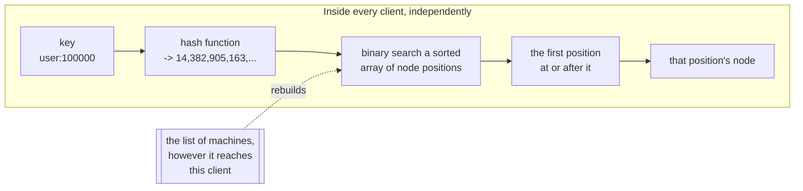
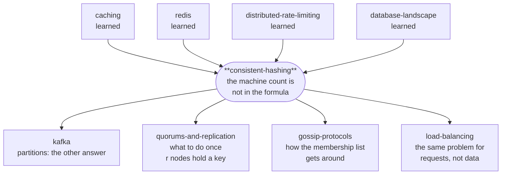

# Consistent hashing — how to spread data over machines without moving it all every time

> **What this is.** A lab that teaches consistent hashing by building it, alongside the
> four things people build instead. Everything below is demonstrated by runnable Java in
> `src/`, and every number quoted was measured by running it on this machine.
>
> **Depth layers.** BEGINNER MODEL (§1–9) → INTERMEDIATE MODEL (§10) →
> ENGINEERING MODEL (§11–14) → PRODUCTION MODEL (§15), with a checkpoint at each
> transition telling you what stopping there leaves you with.

---

## 1. Why this exists

You have more data than fits on one machine, or more traffic than one machine can
serve. So you buy several and split the work between them.

That immediately creates a question that has to be answered millions of times a second,
by every part of your system, without anybody asking anybody: **given this item, which
machine has it?** Every one of your twenty application servers must reach the same
answer, alone, instantly, from nothing but the item's name.

There is an obvious rule that does exactly this, costs nothing, and spreads the work
perfectly evenly. It is what everybody writes, and it is right up until the moment the
number of machines changes — which is to say, up until your first deploy, your first
autoscale, or your first hardware failure.

When that happens, the obvious rule sends **almost every item to a different machine at
once**. If those machines were a cache, your cache is now empty and your database is
receiving your full unfiltered traffic with nothing in front of it. That is not a
slowdown; it is an outage, and it happens at the exact moment you were trying to add
capacity.

This lab is about why that happens and what to do instead.

---

## 2. The problem, without any jargon

A school has a cloakroom holding 500 coats and four attendants: **Amara, Bao, Chidi and
Dev**.

The cloakroom cannot have a queue at a desk — 500 children arrive in four minutes. So
there is no list and nobody to ask. Every child has to work out for themselves which
attendant has their coat, from something they already know.

That constraint is the whole problem. Remember it: **no lookup, no asking, everyone
computes the same answer alone.**

---

## 3. What a reasonable person tries first

The school's rule:

> Count the letters in your name. Divide by the number of attendants. The remainder is
> your attendant.

Priya has 5 letters. 5 divided by 4 leaves 1, so Priya's coat is with attendant number
1, Bao. Every child can do this in their head, it needs no list, and the coats spread
evenly across all four.

This is a genuinely good rule. It is fast, it needs no memory, and it is perfectly
balanced. Every property you would ask for, it has.

---

## 4. Why it breaks

Dev goes home sick at lunchtime. Now there are three attendants, so everyone divides by
3 instead of 4.

Priya: 5 divided by 3 leaves 2 — attendant number 2, Chidi. But Priya's coat is with
Bao, because Bao is who the *old* rule chose this morning.

> **🔮 Predict:** 500 children, one attendant of four goes home. How many children find
> their coat with the attendant their new calculation points at?
>
> <details><summary>Reveal</summary>
>
> **About one in four.** Measured on 200,000 items:
>
> ```
> 4 machines -> 3 :  the remainder rule moved 75.0% of items
> ```
>
> Three-quarters of the cloakroom is now unfindable, and notice what makes this so much
> worse than it first sounds: **Dev only ever held a quarter of the coats.** Losing Dev
> should have disturbed a quarter of the children. Instead it disturbed three-quarters,
> and the extra half is children whose coats never moved at all and who are now looking
> in the wrong place.
>
> It gets worse as the school grows, not better. At 100 attendants, losing one moves
> **99.0%** of the coats — to redistribute the 1% that genuinely had to move.
> </details>

**Sit with what just went wrong, because it is not "the rule is inaccurate".** The rule
is perfectly accurate. The problem is what it depends on.

`remainder after dividing by the number of attendants` makes every child's answer a
function of a **global property of the whole cloakroom**. Change that one number and
every answer changes at once, including for the overwhelming majority of children whose
own situation did not change in any way.

This rule has a name you will meet everywhere, including in this lab's code and
experiment output: **modulo hashing**, after the remainder operation at its heart.

That is the actual disease, and it is worth stating in a form you can carry to other
problems: **a rule whose output depends on a global count will produce a global change
whenever the count changes.** Any rule with the total in it has this, no matter how
clever the rest of it is.

---

## 5. What we actually need

Stated plainly, before any solution:

> Every child must work out their attendant **alone**, from their own name and the list
> of who is on duty — no queue, no lookup, no asking.
>
> And when one attendant joins or leaves, **only that attendant's share of the coats may
> be affected** — roughly one in four of them — and no other child's answer may change.

The first clause is what the remainder rule already gives us, and we must not lose it.
The second is the one it fails. Everything that follows is the pursuit of both at once.

---

## 6. The idea that fixes it

Rebuild the cloakroom as a **circular corridor with a thousand numbered doors**, 0 to
999, running all the way round.

- Every coat gets a door number from the child's name — some fixed calculation that
  always gives the same number for the same name.
- Every attendant stands at some door, at a spot decided the same way from their own
  name. Amara at 91, Bao at 305, Chidi at 502, Dev at 780.
- **The rule: walk clockwise from your coat's door number until you meet an attendant.
  That attendant has your coat.**

Priya's name gives door 340. She walks 341, 342, ... and meets Chidi at 502. Chidi has
her coat.

Now Dev goes home. Dev stood at 780, so the coats affected are exactly those whose
numbers fall between Chidi at 502 and Dev at 780 — they now keep walking past 780 and
reach Amara at 91, wrapping round the end. **Every other child's walk is unchanged**,
because nothing between the other attendants moved.

Look at the rule again and notice what is missing from it: *how many attendants there
are*. It does not appear. There is nothing global left to change.

That is the whole invention. Everything else in this document is consequences.

---

## 7. Now the vocabulary

You have earned all of these; each names something you have already felt.

### hash function

**Plain meaning:** the calculation that turns a name into a door number.

**Technical meaning:** a function from arbitrary input to a fixed-size number, which for
our purposes must be **deterministic** (same input, same output, on every machine,
forever) and **uniform** (outputs spread evenly over the whole output range, with no
clumping).

**Why the term exists:** to separate the two jobs a hash can do. Cryptographic hashes
promise you cannot work backwards or find collisions; we need neither of those. We need
only spread and determinism, which is why this world uses fast non-cryptographic hashes
like MurmurHash rather than SHA-256.

**Concrete:** in `src/Hashing.java`, `hash64("user:100000")` always produces the same
64-bit number, on every machine, in every process.

**The trap that this lab measures:** uniformity is a property of the hash *and* of the
range you use it in. §11 F6 shows a perfectly good hash destroying a cluster because its
output was 32 bits wide and the space it was being placed into was 64.

### hash space, and the ring

**Plain meaning:** the corridor — all the door numbers, laid out in a circle.

**Technical meaning:** the full range of the hash function's output (for a 64-bit hash,
0 to 2⁶⁴−1), treated as a circle by declaring that the largest value wraps round to the
smallest.

**Why the term exists:** to name the thing that stays *fixed*. The number of machines
changes constantly; the hash space never does. Putting both the items and the machines
into that one unchanging space is the substitution that solves the problem, and the ring
is that space.

**Concrete:** `Ring.successorIndex` binary-searches a sorted array of positions and,
when it runs off the end, returns index 0. That single line is where the corridor
becomes a circle.

### node and key

**Plain meaning:** an attendant, and a coat.

**Technical meaning:** a **node** is a machine that can hold data; a **key** is the
identifier of one item. Both are hashed into the same space, which is the point — they
are the same kind of thing as far as the ring is concerned.

**Why these terms exist:** deliberately generic, because the same mechanism places
cache entries on cache servers, database rows on database nodes, and live HTTP requests
on backend servers. Naming them "key" and "node" keeps the mechanism separate from any
one use.

### the clockwise owner (the successor)

**Plain meaning:** the first attendant you meet walking clockwise.

**Technical meaning:** a key's owner is the node whose position is the smallest one
greater than or equal to the key's position, wrapping to the first node if there is
none.

**Why the term exists:** "successor" is the word the original paper and every
implementation uses, and it names a *relative* relationship rather than an absolute
slot. That is precisely the difference from the remainder rule: a key does not have a
slot number that must be recomputed, it has a neighbour.

**Concrete:** key at 340, nodes at 91/305/502/780 → owner is the node at 502.

### remapping fraction

**Plain meaning:** what share of the coats have to move.

**Technical meaning:** the proportion of keys whose owner changes when the membership
changes.

**Why the term exists:** because it is the number the whole field is optimising, and
because it has a floor that people forget. To have n+1 machines share the keys evenly,
at least 1/(n+1) of the keys *must* end up somewhere new. That movement is not waste;
it is the job. Everything **above** the floor is waste, and that gap is what to measure.

**Concrete, measured on 200,000 keys:**

| change | remainder rule | ring | unavoidable |
|---|---|---|---|
| 10 → 11 machines | 90.8% | 9.5% | 9.1% |
| 100 → 101 machines | 99.0% | 0.9% | 1.0% |

---

## 8. Two mental models, and the map between them

### The simple model (carry this around)

A circular corridor of numbered doors. Attendants stand at fixed spots decided by their
names. Every coat has a door number decided by its owner's name. Walk clockwise until
you meet an attendant.

### The engineering model (this is what actually runs)



- **State:** a sorted array of positions, and a parallel array naming which node each
  position belongs to. That is all. There is no server, no table, and no lookup service.
- **Lookup:** hash the key, binary search, take the successor. O(log(nodes × positions)),
  no network involved.
- **On a membership change:** rebuild the array. Nothing else in the system is told
  anything.
- **The invariant everything rests on:** a node's positions depend only on that node's
  own name — never on how many other nodes exist.

### The map between them

| cloakroom | consistent hashing | where it is in the code |
|---|---|---|
| the circular corridor of doors | the hash space, treated as a ring | `Ring.positions` |
| a child's name → a door number | the hash function applied to a key | `Hashing.hash64` |
| an attendant standing at a door | a node's position on the ring | `Ring.rebuild` |
| walking clockwise to the next attendant | finding the successor | `Ring.successorIndex` |
| wrapping past door 999 back to door 0 | the wrap that closes the ring | `lo == positions.length ? 0 : lo` |
| an attendant going home | a node leaving | `Ring.removeNode` |

### Where the analogy breaks

Four places, and each one matters later:

1. **The corridor has 1,000 doors; a real ring has 2⁶⁴ positions.** With a thousand
   doors, two children would constantly share one and you would wonder what happens. In
   a 64-bit space, positions are so astronomically sparse that collisions never come up.
   The sparseness is not a detail — it is why the hash's *width* is load-bearing (§11 F6).
2. **An attendant stands in one place; a machine occupies hundreds of positions at
   once.** The single most important refinement in §10 has no counterpart in the story,
   because a person cannot be in two places. Machines can, and must.
3. **The children can see who is on duty.** Real machines find out late — whatever
   mechanism tells them takes time to reach everyone — and during that window different
   clients hold different lists and compute different owners. That is a real failure mode with real consequences (§11 F4),
   and the story simply does not contain it.
4. **Coats do not walk to their new attendant by themselves.** This is the big one.
   Consistent hashing decides **where an item belongs**. It does not move anything. For
   a cache you do not need it to — the item is simply absent and gets fetched again. For
   stored data, something else entirely must notice the change and copy the data, and
   that machinery is a separate system with its own failure modes (§11 F8).

---

## 9. Watch it move

Spend five minutes here before the mechanism — the rest of the document is much easier
once you have seen keys change colour.

**→ [The Clockwise Rule](https://claude.ai/code/artifact/4169af96-aa2e-4918-9d19-a10c74336747)**
*(also saved locally as `visualization.html`)*

The page is the corridor, drawn as a circle: machines are the thick coloured bands,
items are the small dots just inside, and a dot takes the colour of the band ahead of it
clockwise. Click any dot to watch its walk.

The thing to actually do: press **Add a machine**, then look at the two strips lower
down. Both show the same 180 items coloured by owner — one under the ring, one under the
remainder rule. The ring's strip barely flickers. The other one turns into a different
picture entirely. That is §4 and §6, side by side, on identical data.

Five predict-then-watch scenarios cover the surprises: how little moves, why one
position per machine is not enough, where a dead machine's items land, why nothing ever
moves sideways, and what a too-narrow hash does to the whole cluster.

---

> ### ✅ CHECKPOINT — end of the BEGINNER MODEL
>
> You can now explain why the obvious rule fails, what the ring replaces it with, and
> why "the number of machines is not in the formula" is the entire trick. That is enough
> to follow a design discussion and to spot the bug in someone's sharding scheme.
>
> **What the next layer adds:** the version of this you would build from §6 alone is
> badly broken in two specific ways. Next we build it, break it, and fix it.

---

## 10. The mechanism, told as the story of its own design

Let us build exactly what §6 describes, and watch it fail twice.

### v1 — the rule, with real numbers

Four machines. Hash each machine's name to get its position:

```
hash("A") = 91      hash("B") = 305     hash("C") = 502     hash("D") = 780
```

Sorted, that is the ring: `[91:A, 305:B, 502:C, 780:D]`. Now place some keys:

| key | its position | first position at or after it | owner |
|---|---|---|---|
| `cart:17` | 340 | 502 | **C** |
| `cart:22` | 88 | 91 | **A** |
| `cart:31` | 954 | *(none — wrap to the first)* | **A** |
| `cart:45` | 610 | 780 | **D** |

`cart:31` is the interesting one. Its position, 954, is past every machine, so the walk
runs off the end of the array and comes back to the start. That wrap is one line of code
and it is what makes this a circle rather than a line — without it, every key above 780
would have no owner at all. The test `ring_wraps_around_past_the_top_of_the_number_space`
pins it.

**Now add machine E at position 400.** The ring becomes `[91:A, 305:B, 400:E, 502:C,
780:D]`. Recompute:

| key | position | owner before | owner now |
|---|---|---|---|
| `cart:17` | 340 | C | **E** ← moved |
| `cart:22` | 88 | A | A |
| `cart:31` | 954 | A | A |
| `cart:45` | 610 | D | D |

One key moved, and it moved **onto the new machine**. Look at why that is not luck:
inserting a position into the ring can only put a new candidate *in front of* some keys.
It cannot reorder any of the machines that were already there, so no key can be pushed
from one existing machine to another.

That property has a name — **monotonicity** — and it is the formal statement of what
consistent hashing guarantees: *adding a node only ever moves keys onto the newcomer,
never sideways between existing nodes.* Experiment 4 measures it on 200,000 keys:

```
strategy               moved to newcomer  moved elsewhere    total moved
modulo                           17,989          163,679        181,668
ring(vnodes=200)                 18,603                0         18,603
```

The middle column is the whole lab in one number. Modulo's 163,679 sideways moves
achieved nothing whatsoever — those keys were fine where they were.

### Break 1: the load is horribly uneven

> **🔮 Predict:** eight machines, one position each. Eight random points on a circle —
> do they cut it into eight roughly equal slices?
>
> <details><summary>Reveal</summary>
>
> No, and it is much worse than "roughly". Experiment 2, 200,000 keys over 8 machines,
> where a fair share is 25,000:
>
> ```
> positions       busiest     quietest      imbalance
> 1               118,515        1,657          4.74x
> ```
>
> The busiest machine holds **4.74 times its fair share** and the quietest holds under
> 7% of one. And no hash function can fix this, because nothing is wrong with the hash —
> random points on a circle simply leave gaps of wildly differing size, and **the gap is
> the machine's share**.
> </details>

**The fix: put each machine at many positions instead of one.** Machine A appears at
`hash("A#0")`, `hash("A#1")`, ... `hash("A#199")` — two hundred unrelated points
scattered right round the circle. Its share is now the sum of two hundred independent
gaps, and the relative variation of a sum of *n* independent values shrinks roughly as
1/√n.

These extra positions are called **virtual nodes** (or *vnodes*, or *tokens*, depending
whose documentation you are reading). Measured:

```
positions       busiest     quietest      imbalance
1               118,515        1,657          4.74x
5                47,097       18,895          1.88x
20               33,252       19,306          1.33x
100              26,435       23,332          1.06x   <- typical production setting
500              25,592       24,299          1.02x
```

That curve is why production values sit in the low hundreds: 1→100 removes almost all of
the imbalance, and 100→500 buys another four percentage points for five times the memory.

### Break 2: a machine dies, and one neighbour inherits everything

Virtual nodes were introduced above to fix *steady-state balance*. They turn out to fix
something more dangerous, and this is the reason that actually matters.

> **🔮 Predict:** eight machines, one position each, and one of them fails. Its keys have
> to go somewhere. Do they spread over the seven survivors, or land on one of them?
>
> <details><summary>Reveal</summary>
>
> **All on one**, and it is chosen by an accident of the circle rather than by who has
> room. Experiment 3:
>
> ```
> --- 1 position per machine ---
> n3 held 7,996 keys. After it died they went to:
>   n7   +  7,996   (1,657 -> 9,653, +483%)
> ```
>
> n7 was the *quietest* machine in the cluster and is now by far the busiest, in one
> step, with no warning.
>
> Now think about what happens if the cluster was near capacity. The inheritor is not
> chosen by who can cope — so it may well be a machine that cannot. When it falls over,
> **its** entire share lands on **its** single neighbour, which is now taking three
> machines' worth. That is a cascading failure with a concrete mechanism, and it is a
> real way clusters die.
> </details>

With two hundred positions each, the dead machine's share is cut into two hundred small
gaps whose neighbours are all different machines, so it spreads over everybody:

```
--- 200 positions per machine ---
n3 held 24,550 keys. After it died they went to:
  n0 +2,705 (+10%)   n1 +4,253 (+19%)   n2 +2,794 (+12%)   n4 +2,613 (+10%)
  n5 +4,368 (+18%)   n6 +3,113 (+12%)   n7 +4,704 (+18%)
```

A uniform 10–19% bump on everyone, instead of +483% on one victim. **This, not the
balance, is the argument for virtual nodes that would survive a design review.**

### Break 3: where do the copies go?

One machine holding the only copy of a key is not a design anyone ships. You want the
key on *r* machines. The obvious extension: take the next *r* positions clockwise.

> **🔮 Predict:** the ring has 200 positions per machine. You take the next 3 positions
> clockwise and call them your three replicas. What is wrong with that?
>
> <details><summary>Reveal</summary>
>
> With 200 positions each, adjacent positions are frequently the **same physical
> machine** — so all three "copies" can land on one box. Your data reads as replicated,
> is not, and you find out the day that machine dies.
>
> The fix is one line: walk clockwise collecting **distinct** nodes, skipping further
> positions belonging to a machine already chosen. It is the `!out.contains(n)` check in
> `Ring.owners`, and `BrokenRing` bug 2 removes it so you can watch the failure.
> </details>

Real systems go one step further than distinctness, and it is worth knowing why. Three
distinct machines in the same rack share a power supply and a top-of-rack switch, so
they fail together and your replication factor of 3 is really 1. Cassandra and DynamoDB
therefore make the walk **rack- and datacentre-aware**: keep walking until you have
three machines in three different failure domains. Consistent hashing gives you the
ordering; what counts as "different enough" is yours to define.

### Break 4: the machines are not the same size

You bought five machines two years ago and three more last month with four times the
memory. Equal shares would waste most of the new hardware.

There is no separate weighting mechanism, because there does not need to be one: a
machine's share **is** the total width of its gaps, so give it four times as many
positions. Experiment 8:

```
machine              keys   fair share      ratio
small-1            18,128       18,181      1.00x
small-3            17,325       18,181      0.95x
large-1            73,178       72,724      1.01x
large-2            70,999       72,724      0.98x
```

The catch: weight is expressed in whole positions, so fine ratios need enough positions
to exist at all. Another reason the number is in the hundreds.

### Break 5: the average is fixed, the worst case is not

Two hundred positions brings the busiest machine to about 1.06× its fair share. For
*stored data* that is fine. For *live requests* it may not be — 6% over on a machine
sized at 95% utilisation is the machine falling over.

The fix, if you need it, is **consistent hashing with bounded loads**: give every machine
a hard cap of `ceil(c × total / n)`, and when a key's rightful owner is full, keep
walking to the first machine that is not. Experiment 7:

```
setting                         busiest      imbalance   sent elsewhere
ring, no cap                     21,636         1.082x                -
bounded load (c=1.05)            20,980         1.049x              914
bounded load (c=1.01)            20,192         1.010x            4,356
```

The last column is the price, and there is a much bigger one hiding behind it: **this is
stateful**. A key's answer now depends on how many other items have already been placed,
so two clients with different traffic reach different answers and you cannot recompute
an item's location later from the key alone. It is a load balancer's tool — HAProxy
ships it — and not a database's.

### One more thing: you may not need the ring at all

Everything above builds the ring, because the ring is what the libraries implement and
what people mean by "consistent hashing". But two other algorithms give you the same
core guarantee, and one of them is simpler than anything on this page.

**Rendezvous hashing** (also called *highest random weight*, from Thaler & Ravishankar —
published in **1996, a year before** the consistent hashing paper, and far less famous).
The whole algorithm is: for a given key, score every machine by `hash(key + machine)`,
and give the key to the highest scorer.

That is it. No circle, no sorted array, no virtual positions, no tuning knob. And it
inherits the properties you spent this section earning: a machine leaving only affects
the keys it was winning, and because every survivor is re-scored independently, those
keys spread perfectly across all of them rather than piling onto one successor.
Replication is free too — take the top *r* scorers instead of the top 1.

**Jump consistent hash** (Lamping & Veach, Google, 2014). About twenty lines, literally
zero memory, and the best balance of anything here — with one hard limitation: it maps a
key to a bucket *number*, so buckets are positions in an ordered list and you can only
add or remove at the **end**. There is no way to express "machine 3 died".

Experiment 6 runs all of them over 100 machines and 200,000 keys:

```
strategy                   imbalance  moved on remove         lookup       memory
ring(vnodes=200)               1.16x             1.1%       0.138 us 100 x 200 entries
ring(vnodes=20)                1.66x             1.0%       0.091 us 100 x 20 entries
rendezvous                     1.06x             1.0%       4.013 us the node list
jump hash                      1.07x             1.0%       0.152 us nothing at all
modulo                         1.07x            99.0%       0.051 us the node list
```

Read the balance column first and notice that **almost everything wins it, including
modulo**. Balance was never the hard part. The column that disqualifies modulo is
"moved on remove", and the columns that separate the other three are lookup cost and
what kind of membership change they can express.

Rendezvous is **29× slower per lookup** than the ring at 100 machines, because it scans
every machine while the ring binary-searches. At ten machines that difference is
irrelevant and rendezvous is the better engineering choice; at a thousand it is
disqualifying. That single trade is why the ring won the mindshare, and it is worth
knowing that the simpler algorithm exists and is often the right answer.

---

> ### ✅ CHECKPOINT — end of the INTERMEDIATE MODEL
>
> You can now derive the real algorithm from scratch: hash both keys and machines into
> one fixed space, take the successor, scatter each machine over many positions, walk to
> distinct nodes for replicas, weight by position count. Every one of those is a scar
> from a failure you just watched.
>
> **What the next layer adds:** what this looks like when it goes wrong in production —
> which failures it prevents, which it merely reshapes, and which it does nothing about
> at all.

---

## 11. Failure scenarios

### F1 — Too few positions, so the load is lopsided

**Create it:** `java src/Experiments.java 2`, or drag the positions slider to 1 in the
visualization.

**What happens / why:** §10 break 1 — few random points cut a circle into wildly unequal
gaps, and the gap is the share. Busiest machine at **4.74×** its fair share.

**What survives / what is lost:** correctness is untouched — every key still has exactly
one well-defined owner and every client agrees on it. What is lost is your ability to
size the cluster, because you must provision for the worst machine, not the average one.

**In production:** monitor per-node key count or request rate as a ratio to the mean, not
in absolute terms. An alert on `max/mean > 1.3` catches both a bad position count and
the hot key in F5.

### F2 — A machine dies and one neighbour inherits all of it

**Create it:** `java src/Experiments.java 3`, or the third scenario in the visualization.

**What happens / why:** §10 break 2 — with one position each, the whole share lands on a
single successor chosen by geometry rather than by capacity. Measured **+483%** on a
machine that was the quietest in the cluster.

**What survives / what is lost:** correctness again survives. What is lost is the
assumption that failures are independent: one machine's death is now a targeted load
spike on one specific other machine, and if that one falls over the pattern repeats.

**In production:** this is why nobody runs one position per node. It is also why you
should test a node failure under load rather than at rest — the failure mode is a
*capacity* event, not an availability one, and it is invisible on an idle cluster.

### F3 — The miss storm when you add capacity

> **🔮 Predict:** a 10-machine cache is running at 92% hit ratio. You add an 11th
> machine mid-traffic. What does your database experience in the next few seconds?
>
> <details><summary>Reveal</summary>
>
> Under the ring, almost nothing. Under the remainder rule, close to your full
> unfiltered request rate. Experiment 5 measures hit ratio in windows of 25,000
> requests:
>
> ```
> modulo             55%  85%  88%  90%  91%  92% |ADD| 59%  85%  89%  90%  91%  92%
>                    database hit 10,313 times in the 25,000 requests right after
> ring(vnodes=200)   55%  85%  88%  90%  91%  92% |ADD| 90%  93%  94%  95%  95%  96%
>                    database hit  2,622 times in the 25,000 requests right after
> ```
>
> Modulo's hit ratio collapses from 92% back to 59% — a **cold cache**, in one instant,
> for the whole fleet. The ring dips two points.
> </details>

**Why:** every key that moves is a cache entry now sitting on a machine that does not
have it, so the next request for it misses. They all move at the same instant, so they
all miss at the same instant.

**What survives / what is lost:** nothing is incorrect — a cache miss returns the right
answer. What is lost is the protection your cache was providing, at the exact moment you
were adding capacity, which is a particularly cruel piece of timing.

**In production:** note that both rows recover within a minute. **The storm is a
transient**, which is what makes it dangerous: it is over before you finish reading the
alert, it vanishes into a five-minute average, and the thing it took down was your
database rather than your cache. This is [caching](../caching/)'s cold-cache problem with
a specific trigger — your own deploy.

### F4 — Two clients disagree about who is alive

**Create it:** `java src/Experiments.java 9`.

**What happens:** a machine is added; client A has heard, client B has not yet.

```
strategy                   keys disagreed         of 200,000
modulo                            181,699              90.8%
ring(vnodes=200)                   19,015               9.5%
```

**Why:** membership never changes everywhere at the same instant. It propagates — by
gossip, by a config push, by a watch firing — and during that window your clients hold
different lists and therefore compute different owners.

**What survives / what is lost:** every individual client remains self-consistent. What
is lost is agreement *between* clients, so a write may land on one machine while a read
looks on another.

**In production:** this is the failure that makes consistent hashing an *operational*
win rather than merely an efficient one, and it is the one people miss. You do not
control the length of the propagation window, but you do control the **blast radius**,
and it is exactly the remapping fraction. For a cache the cost is extra misses; for
stored data a write to the wrong owner is invisible until the reader who needed it comes
looking. §15 covers the alternative design that removes this window entirely by
accepting a coordinator.

### F5 — One key gets all the traffic

**Why:** consistent hashing distributes *keys*. A single key lives on one machine. If one
key is 30% of your traffic, 30% of your traffic is on one machine, and adding machines
does nothing at all.

**What survives / what is lost:** correctness is fine; horizontal scalability for that
workload is gone.

**In production:** you met this in [distributed-rate-limiting](../distributed-rate-limiting/)
as the hot-key problem and again in [redis](../redis/) as F8, and the remedies are the
same: split the key into `key:0..key:9` and combine, put a short-TTL local cache in front
of it, or route by a different dimension. **Worth saying plainly: no placement algorithm
on this page helps with a hot key.** They all agree that one key has one owner, which is
the thing hurting you.

### F6 — The hash is narrower than the space you put it in

> **🔮 Predict:** the ring is fine, the machine positions are spread perfectly across the
> whole 64-bit circle. The only change: keys are hashed with a 32-bit function instead
> of a 64-bit one. What happens?
>
> <details><summary>Reveal</summary>
>
> **One machine gets everything.** Measured, 8 machines and 20,000 keys:
>
> ```
> 64-bit key hash: {n0=2636, n1=2385, n2=2539, n3=2378, n4=2546, n5=2509, n6=2349, n7=2658}
> 32-bit key hash: {n0=0, n1=0, n2=0, n3=0, n4=0, n5=20000, n6=0, n7=0}
> ```
>
> Nothing collided and nothing is broken. A 32-bit value spans about 4×10⁹; the ring
> spans about 1.8×10¹⁹. So every key in the system lands inside roughly one
> hundred-millionth of the circle, and whichever machine owns that sliver owns the
> entire dataset. The other seven are idle.
> </details>

**In production:** the realistic version is somebody using `key.hashCode()`, a language's
built-in string hash, or a truncated digest as the ring position. The rule to remember:
**whatever hashes your keys must produce values spanning the same range the node
positions occupy.** Test it by counting keys per node on a sample — this failure is
loud in that one metric and completely silent everywhere else.

### F7 — Two client libraries build different rings

**Why:** a client's ring is built from three things — the hash function, the string
format used to name virtual positions, and the number of positions. Ours uses
`hash64(node + "#" + i)`. memcached's *ketama* uses MD5 over `node + "-" + i` and takes
four positions from each digest. Neither is more correct; they are simply different, and
**two clients that disagree on any of the three compute different owners for the same
key**.

**What survives / what is lost:** each client is internally consistent and confidently
wrong about the other. This is F4 made permanent instead of transient.

**In production:** this genuinely happens when a polyglot fleet uses one memcached
cluster from a Java service and a Python service with libraries that are not
ketama-compatible. Symptom: a persistently poor hit ratio with no other explanation,
because each language's clients keep re-populating keys the other language's clients
cannot find. Pin the library and the settings, and verify by hashing a known key list in
both and diffing.

### F8 — The ring says where data belongs; something else has to move it

**Why:** the ring is a pure function. When a machine joins, keys instantly *belong*
somewhere new, and not one byte has been copied. For a cache that is fine — the data is
simply absent and gets fetched again, which is F3. For stored data, a separate process
must detect the change and stream the affected ranges.

**What survives / what is lost:** placement is correct immediately. Durability and
completeness are not: during the transfer the new owner is missing data it is
responsible for, so reads must either be served from the old owner or accept a gap.

**In production:** this is what Cassandra's bootstrap/decommission and DynamoDB's
partition splits actually spend their time doing, it is throttled precisely because it
competes with live traffic, and it is where "we added a node and latency got worse for
two hours" comes from. Consistent hashing shrank the volume from ~100% to ~1/n; it did
not make it free.

### F9 — The ring itself gets big

**Why:** every client holds `nodes × positions` entries and re-sorts them on every
membership change.

```
   10 machines x 200 positions =      2,000 entries
  100 machines x 200 positions =     20,000 entries
1,000 machines x 200 positions =    200,000 entries
```

**In production:** this is exactly why Cassandra lowered its default `num_tokens` from
256 to 16, adding an allocation algorithm that places the fewer positions deliberately
rather than randomly — getting the balance of many positions with the footprint of few.
It is a good reminder that "just raise the vnode count" has a real cost at scale.

---

## 12. What is guaranteed, what is not, and what it cost

### The guarantees

1. **Monotonicity.** Adding a node moves keys only onto that node, never between two
   existing nodes. Measured at exactly zero sideways moves in experiment 4. This is the
   formal property, and it is the one the remainder rule lacks.
2. **Bounded remapping.** A membership change disturbs about 1/n of the keyspace — close
   to the theoretical floor.
3. **No coordination.** Every client computes ownership alone, from the membership list,
   with no lookup and no network call. Pinned by
   `two_clients_building_the_ring_separately_agree_on_every_key`, which builds two rings
   by adding the same machines in opposite orders and checks all 20,000 keys.
4. **Determinism.** Same key, same membership, same answer — in every process, every
   language, forever, *provided* the hash and the position-naming match (F7).
5. **Spread and death-spread.** With enough positions, both the steady-state load and a
   dead node's inherited load are shared across all survivors.

### What is NOT guaranteed

- **Exact balance.** The guarantee is statistical. With 100 positions per node you get
  about 1.06× on the busiest; you never get 1.00×, and no setting gives you a hard
  ceiling. Bounded loads gives you one, at the cost of becoming stateful.
- **That a hot key is helped.** It is not, at all (F5).
- **That clients agree during a membership change.** They do not; the ring only bounds
  how much they disagree about (F4).
- **That data has actually moved.** Placement is not migration (F8).
- **Compatibility between implementations** (F7).

### What it cost, against the rule it replaced

| | remainder rule | ring |
|---|---|---|
| memory | none | nodes × positions entries, per client |
| lookup | one modulo | binary search, ~0.14 µs at 100 nodes (measured) |
| tuning | nothing to get wrong | a position count you must choose |
| balance | exact | ~1.06× at 100 positions |
| **movement on change** | **99.0%** | **0.9%** |

Read that table top to bottom and notice that the remainder rule **wins four rows out of
five**. It is simpler, smaller, faster and better balanced. It loses one row, and that
row is the only one anybody cares about, because it is the difference between a routine
deploy and an outage.

That is worth internalising as a general shape: the naive solution is usually not naive
about the things it is measured on. It is naive about the thing nobody measured until it
happened.

### Where this sits formally

The ring is from Karger et al., *Consistent Hashing and Random Trees* (1997), written to
distribute web pages across caches — the work that became Akamai. Rendezvous hashing
(Thaler & Ravishankar) predates it by a year and is less famous despite being simpler.
The classical result is that with Θ(log n) virtual positions per node the load is within
a constant factor of the mean with high probability, which is the theory behind the curve
you measured in experiment 2.

---

## 13. The code

Six files, no build tool, no dependencies. Every strategy implements one interface, which
is what lets the experiments run them all against the same workload.

| file | what it is |
|---|---|
| `src/Hashing.java` | the hash, and a deliberately narrow one for F6 |
| `src/Placement.java` | the one question: given a key, which machine? |
| `src/Ring.java` | consistent hashing — the star |
| `src/Placements.java` | modulo, rendezvous, jump hash, bounded loads |
| `src/Tests.java` | 22 scenario-named tests |
| `src/Experiments.java` | the nine experiments in §14 |
| `src/BrokenRing.java` | three planted bugs, for the debug exercise |

**The load-bearing lines, in the order worth reading them:**

1. **`Ring.owner`** — hash the key, take the successor. Three lines. Note what is
   absent: no division, no modulo, no reference to how many machines exist. That absence
   *is* consistent hashing.
2. **`Ring.successorIndex`** — a binary search whose only unusual feature is
   `lo == positions.length ? 0 : lo`. That ternary is where the line becomes a circle.
3. **`Ring.rebuild`** — each machine placed at `hash(name + "#" + i)`. The position
   depends only on the machine's own name, never on the cluster; that is the invariant
   monotonicity rests on.
4. **`Ring.owners`** — the `!out.contains(n)` distinctness check, without which three
   replicas can be one machine.
5. **`Placements.Modulo.owner`** — one line, `nodes.size()` inside it, and that is the
   entire bug the lab exists to explain.
6. **`Placements.Jump.removeNode`** — throws, on purpose. An algorithm that cannot
   express "machine 3 died" should say so loudly rather than quietly do something else.

**One deliberate flaw, disclosed.** `Ring` ships with a real latent bug that all 22
tests pass over: a machine registered with a weight silently drops back to weight 1 if it
re-registers through the single-argument `addNode`. It is left in because finding it is
exercise 6.6, and because it is a good example of where bugs actually survive — not in
clever code, but in **sequences of operations nobody wrote a test for**. This suite covers
add, remove and rebuild thoroughly, and re-add not at all.

**Run it:**

```bash
cd ~/Documents/Learning/consistent-hashing

java src/Tests.java              # 22 scenario tests, ~10s
java src/Experiments.java        # all nine experiments, ~3 min
java src/Experiments.java 1 5    # just 1 and 5
java src/BrokenRing.java         # three planted bugs
```

---

## 14. The experiments

Predict, then run, then reconcile.

| # | question to answer before running | command |
|---|---|---|
| 1 | 10 machines become 11. What fraction of keys move, under each rule? | `java src/Experiments.java 1` |
| 2 | 8 machines, one ring position each. Is the load even? | `... 2` |
| 3 | A machine dies. Where do its keys go? | `... 3` |
| 4 | When you *add* a machine, can a key move between two existing ones? | `... 4` |
| 5 | You add a cache node mid-traffic. What does the database feel? | `... 5` |
| 6 | Four strategies, same workload. Which is best? | `... 6` |
| 7 | Virtual nodes leave ~6% imbalance. Can you cap it, and what does that cost? | `... 7` |
| 8 | One machine has 4× the RAM. How do you tell the ring? | `... 8` |
| 9 | Half your clients have not heard about the new machine yet. How bad is that? | `... 9` |

Every measured figure in this document came from these runs, on this machine. Numbers
that measure *how much* (percentages, imbalance ratios) will vary a little on yours;
numbers that measure *whether* — the zero in experiment 4's middle column, the seven
idle machines in F6 — are consequences of the design and will not.

---

> ### ✅ CHECKPOINT — end of the ENGINEERING MODEL
>
> You can now reason about this the way an on-call engineer has to: which failures the
> ring prevents, which it only shrinks, and which (hot keys, data movement, client
> incompatibility) it does not touch.
>
> **What the last layer adds:** the bridge to real systems — including the fact that two
> of the systems you would most expect to use consistent hashing deliberately do not.

---

## 15. Production

### The design space, honestly

There are **two** ways to stop the number of machines from being in the formula, and
consistent hashing is only one of them.

| | **consistent hashing** | **fixed partitions + an assignment table** |
|---|---|---|
| the idea | keys map to a position; the position maps to whoever is next clockwise | keys map to one of a large, **never-changing** number of slots; a table says which machine owns each slot |
| why modulo's bug is absent | the machine count is not in the formula | the *slot* count is in the formula and it never changes |
| who decides | every client, alone | a coordinator, which publishes the table |
| rebalancing | implicit; the ring shifts | explicit; move slot 4,102 from A to B |
| clients disagreeing mid-change | yes, bounded by 1/n (F4) | no — there is one authoritative table version |
| operator control | statistical | exact, and you can move one slot by hand |
| used by | Cassandra, DynamoDB, Riak, memcached clients, Envoy, HAProxy, Akamai | **Redis Cluster** (16,384 slots), **Kafka** (partitions), Elasticsearch (shards) |

**This is the correction to make now, while [redis](../redis/) is fresh:** Redis Cluster
does *not* use consistent hashing. `CRC16(key) mod 16384` is a plain modulo — it is safe
only because 16,384 never changes, and a separate table maps slots to nodes. Kafka is the
same shape: `hash(key) % numPartitions`, which is why **adding partitions to a Kafka topic
breaks key-to-partition affinity** and is treated as a significant operation.

The trade is coordination for control. Consistent hashing removes the coordinator and
accepts statistical balance and a disagreement window; fixed slots accept a coordinator
and get exact placement, hand-tunable rebalancing and no ambiguity. Neither is more
advanced. **Pick by whether you already have a reliable coordinator** — if you are
running one anyway, fixed slots are usually the easier system to operate.

### What this lab leaves out

| omitted | what real systems do |
|---|---|
| moving the data | bootstrap/decommission streaming, throttled against live traffic (F8) |
| failure-domain awareness | walk to r distinct **racks** or datacentres, not just distinct nodes |
| membership propagation | gossip (Cassandra, Riak) or a coordinator (Redis Cluster, Kafka) |
| Maglev hashing | Google's load-balancer scheme: builds a lookup table for O(1) lookups with minimal disruption; in Envoy alongside ring hash |
| deliberate token allocation | Cassandra's algorithm places few positions well instead of many at random |
| read repair, hinted handoff, anti-entropy | what keeps replicas equal once placement has decided where they are |

### What an operator actually watches

- **Keys or requests per node as a ratio to the mean.** Absolute counts hide everything.
  Alert above ~1.3×; it catches a bad position count (F1), a hot key (F5) and a narrow
  hash (F6) with one signal.
- **Nodes receiving zero traffic.** The single loudest symptom of F6 and F7, and silent
  in every other metric.
- **Rebalance/streaming throughput and backlog** during a membership change (F8).
- **Cache hit ratio around deploys** — the transient in F3 disappears from any average
  wide enough to be convenient.
- **The ring version or membership epoch each client is on**, so you can see the F4
  window rather than infer it.

### Choosing, in practice

- **Small cluster (< ~30 nodes), you control every client:** rendezvous hashing, for the
  reasons in §10 — no tuning, no memory, better balance, and perfect death-spread. Its
  4.0 µs lookup at 100 nodes is the thing to check against your budget.
- **Large cluster, or you must interoperate with existing clients:** the ring. It is what
  the libraries implement and what everyone expects.
- **You already run a coordinator (ZooKeeper, etcd, a control plane):** fixed slots plus
  an assignment table. Easier to operate and to reason about during an incident.
- **Splitting a static dataset into n parts, where n only ever grows at the end:** jump
  hash — best balance, zero memory. Never for a cluster where any node can fail.
- **Balancing live requests where the tail is what hurts:** bounded loads, accepting that
  it is stateful and unusable for stored data.

### When it does not help at all

- One key is your bottleneck (F5).
- You need range queries — hashing destroys ordering by design, which is exactly why
  Cassandra's default partitioner cannot do range scans on partition keys, and why
  HBase and CockroachDB use **range partitioning** instead.
- The item's location must be chosen by something other than its identity — by
  geography, by tenant, by regulation.
- You have three machines and no growth plans, and modulo's failure would cost you a
  brief cache miss.

---

## 16. Exercises

**[EXERCISES.md](EXERCISES.md)** — eight rungs from "explain it back" to "design the
placement layer for a 200-node store across three datacentres". Answers in
**[SOLUTIONS.md](SOLUTIONS.md)**; try first.

Two worth doing even if you skip the rest:

- **6.4** — turn on planted bug 1 and run the suite. The test named after this lab's
  headline guarantee **passes**, while the bug destroys exactly that guarantee. Work out
  why before reading on; the answer changes how you write tests for invariants.
- **8.4** — migrate a live 20-server memcached fleet from modulo to the ring without a
  miss storm. The naive cutover remaps **94.9%** of keys, which is precisely the disaster
  you are adopting the ring to avoid, suffered once on the way in.

---

## 17. Where this sits, and what to learn next



**Commonly confused — the one sentence that separates each:**

- **Consistent hashing vs sharding.** Sharding is the goal (split data across machines);
  consistent hashing is one way to decide the split.
- **Consistent hashing vs Redis Cluster's hash slots.** Slots are plain modulo over a
  count that never changes, plus a coordinator-published table — a different solution to
  the same problem, with opposite trade-offs.
- **Consistent hashing vs a hash table's buckets.** A hash table rehashes everything when
  it grows, which is exactly the behaviour this exists to avoid.
- **Virtual nodes vs replicas.** Virtual nodes are extra *positions* for one machine, to
  even out the load. Replicas are extra *copies* of data, for durability. They are
  unrelated, and confusingly some documentation calls virtual nodes "replicas".
- **Consistent hashing vs rendezvous hashing.** Same guarantees; rendezvous scores every
  node per lookup instead of keeping a ring, so it is simpler and O(n).
- **Hash partitioning vs range partitioning.** Hashing spreads evenly and destroys
  ordering; ranges preserve ordering and invite hot spots.

**Next:**

```
/learn kafka                    # partitions are the fixed-slot answer, and the
                                # consumer-group rebalance is this lab's F4 with teeth
/learn gossip-protocols         # how the membership list every client depends on
                                # actually propagates -- the input this lab assumed
/learn quorums-and-replication  # once r nodes hold a key, who must answer a read
/learn load-balancing           # the same placement question for live requests
```

---

## 18. Glossary

In order of first appearance.

| term | in one line |
|---|---|
| **remainder rule / modulo hashing** | `hash(key) % numberOfMachines` — correct, balanced, and it moves ~everything when the count changes |
| **hash function** | turns a name into a number; must be deterministic everywhere and spread uniformly |
| **hash space / the ring** | the hash function's full output range, treated as a circle by wrapping the top round to the bottom |
| **node** | a machine that can hold data |
| **key** | the identifier of one item |
| **clockwise owner / successor** | the node whose position is the first at or after the key's, wrapping if there is none |
| **wrap** | the one line that turns a sorted array into a circle |
| **remapping fraction** | the share of keys whose owner changes when membership changes |
| **monotonicity** | adding a node moves keys only onto that node, never between two existing nodes |
| **virtual node / vnode / token** | one of the many positions a single machine occupies, so its share is an average rather than a lottery |
| **imbalance** | busiest node's load divided by the fair share; 1.00 is perfect |
| **weight** | a machine's share, expressed as its number of positions |
| **replication factor (r)** | how many distinct machines hold a copy of each key |
| **failure domain** | rack or datacentre — what "distinct" must really mean for replicas |
| **bounded loads** | a hard cap per node, with overflow walking clockwise; even, but stateful |
| **rendezvous hashing (HRW)** | score every node by `hash(key + node)`, take the highest; no ring, O(n) |
| **jump consistent hash** | Google's zero-memory scheme; near-perfect balance, cannot remove a middle bucket |
| **hot key** | one key taking a large share of traffic; no placement algorithm helps |
| **miss storm** | the cold-cache transient after keys move en masse |
| **membership propagation window** | the interval during which clients hold different node lists and disagree about owners |
| **ketama** | the memcached-world consistent hashing implementation; MD5-based, and a compatibility contract between client libraries |
| **hash slot** | a fixed, never-changing partition number (Redis Cluster's 16,384) assigned to nodes by a table — the alternative design |
| **range partitioning** | splitting by key order rather than by hash; preserves range queries, invites hot spots |
| **Maglev hashing** | Google's load-balancer table-based scheme, O(1) lookup with minimal disruption |
