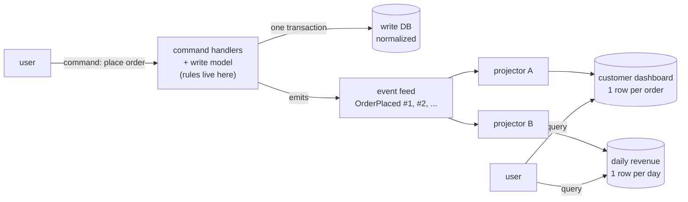
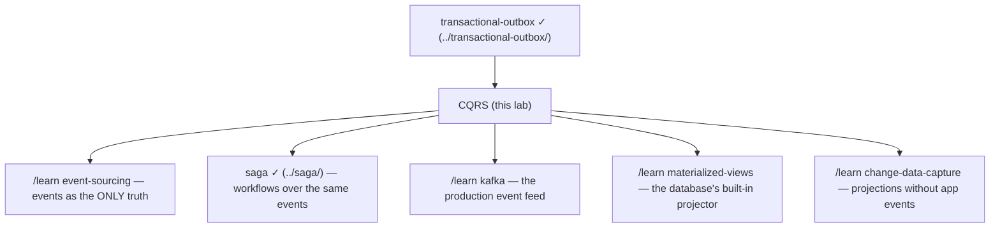

# CQRS — Command Query Responsibility Segregation — a learning lab

*Audience: a backend engineer who has never met this pattern. By the end you
should be able to reason about its consistency windows and failure modes,
argue for or against it in a design review, and read Greg Young / Fowler /
microservices.io material fluently. Third of the event-driven family here:
[transactional-outbox](../transactional-outbox/) (how events leave a service
reliably) and [saga](../saga/) (how services coordinate via events).*

**Lab contents**

| File | What it is |
|---|---|
| `README.md` | This document — the full story |
| `visualization.html` | Interactive simulator — lag, crash, and corrupt the projector; watch queries go stale |
| `CqrsLab.java` | Runnable simulation: two real H2 databases with different shapes + a projector between them. Narrated demo: `java -cp ../lib/h2.jar CqrsLab.java` |
| `CqrsTest.java` | Scenario-named tests: `java -cp ../lib/h2.jar CqrsTest.java` |
| `EXERCISES.md` / `SOLUTIONS.md` | Predict / modify / debug, answers separate |

---

## 1. WHY does this exist?

In most systems, the code and storage that *change* data and the code and
storage that *show* data have opposite needs — changing needs rules and
safety; showing needs speed and convenient shapes — yet we habitually force
both through one model and one database schema. CQRS exists for the moment
that single model starts failing both sides at once: reads slowed by a shape
built for correctness, writes tangled by compromises made for display.

## 2. THE PROBLEM, as a story

A busy shop keeps one big ledger at the counter. Cashiers write every sale
into it — carefully, checking prices, one sale at a time. The manager reads
it constantly: "revenue so far today?", "top sellers this week?" — flipping
back through hundreds of pages, adding numbers, while cashiers wait for the
ledger. One book, two jobs. The queue grows: readers block writers, writers
block readers, and the ledger's format — perfect for recording a sale — is
terrible for answering questions (nothing is totalled by day or product).

Then the shop changes one thing. Cashiers keep writing sales into the ledger
(that stays sacred — prices checked, no negative quantities, one entry per
sale). But now a clerk walks over every few minutes, reads the new entries,
and updates **chalkboards** on the wall: "TODAY'S REVENUE: ₹12,400",
"TOP SELLER: keyboards". The manager never opens the ledger again — one
glance at a board answers each question. The boards run a few minutes behind
the ledger. Nobody minds, and everyone stops queuing.

## 3. THE NAIVE SOLUTION

One model, one database, used for everything — what every CRUD app rightly
starts as. When reports get slow: add indexes, add caching, add read
replicas, write cleverer SQL against the same normalized schema.

## 4. WHY THAT EVENTUALLY FAILS (for some systems)

Each patch treats a symptom of the same disease — **one shape serving two
masters**:

- **The shape mismatch is permanent.** The write schema is normalized
  (orders + order_items + customers + products) because that's what
  correctness wants. Every dashboard query then pays for 5-way JOINs and
  aggregations at *read time*, thousands of times a day, recomputing the
  same answers. Indexes soften this; they cannot remove it — and every
  index you add to serve reads slows every write.
- **Contention.** Heavy reporting queries and update transactions fight
  over the same rows, pages, and locks. A month-end report can stall
  checkout.
- **Model corruption.** Display concerns creep into the domain model:
  denormalized "summary" columns updated inline, entities growing fields
  that exist only for one screen. The write model — the one place business
  rules must stay crisp — silently becomes a view model too.
- **Read replicas get you halfway** — same shape, just elsewhere; the JOINs
  and the mismatch remain (and you've already accepted replication lag —
  i.e., stale reads — without getting the shape benefit in return).

## 5. THE KEY IDEA

**Split the model in two, along the read/write line.** One model receives
*commands* and enforces every rule; it emits facts about what happened. From
those facts, any number of *query* models are built, each pre-shaped to
answer one kind of question instantly — and each rebuildable from the facts
at any time. Correctness lives in one place, speed in another, and neither
compromises the other.

## 6. TERMINOLOGY

| Term | Plain-English meaning |
|---|---|
| **Command** | A request to change something ("place order ord-1"). Can be *rejected*. Named imperatively. Returns success/failure, not data. |
| **Query** | A request to read something. Never changes state, never rejected for business reasons. |
| **Write model / command side** | The model that validates commands and owns the business rules (the ledger). Normalized, transactional. |
| **Read model / query side** | A store shaped exactly like one family of questions (a chalkboard). Denormalized, disposable. There are usually several. |
| **Event** | A fact that a command succeeded ("OrderPlaced #17"). Past tense, immutable. The feed between the two sides. |
| **Projection / projector** | The clerk: consumes events, updates a read model. |
| **Checkpoint** | The projector's bookmark: "I have applied events up to seq N." |
| **Consistency window / lag** | Events the write side has recorded but a read model hasn't applied yet — the minutes a chalkboard runs behind. |
| **Eventual consistency** | The promise that the window closes: stop writing, and every read model converges to the truth. |
| **Idempotent projection** | Applying the same event twice changes nothing — the property that makes redelivery safe. |
| **Read-your-own-writes** | The UX guarantee that a user sees their *own* change immediately, even though the read side lags. |

## 7. THE MENTAL MODEL

> **One ledger, many chalkboards.** All changes go through one guarded door
> (commands → ledger) which publishes facts; each question gets its own
> board, kept current by a clerk replaying those facts. Boards are caches
> with a bookmark: erase any board and the clerk rewrites it from the
> ledger's history. The price of the split is honesty about time — every
> board is a few beats behind, and the system must be designed so that's
> acceptable, hidden, or worked around per screen.



## 8. SEE IT MOVE

- **Interactive simulator** — `visualization.html` (published copy:
  <https://claude.ai/code/artifact/73a777ba-b452-4925-b77b-2559d192ddbf>). Place orders, drag the projector's lag, crash it, make
  it non-idempotent and watch revenue double-count, then rebuild the board
  from history. Story buttons narrate each scene.
- **The narrated demo** — `java -cp ../lib/h2.jar CqrsLab.java` walks scenes
  1–5 of the same story with two real H2 databases (its actual output appears
  throughout below).

## 9. THE ACTUAL MECHANISM, step by step

Follow one order through the lab code (`CqrsLab.java`):

1. **A command arrives**: `placeOrder("ord-1", "priya", [keyboard ×1 @80,
   mouse ×2 @20])`. The command handler checks every invariant (items
   non-empty, quantities positive, id unused). A bad command is **rejected
   here and nothing else happens** — no event, no trace (test:
   `command_that_violates_an_invariant_is_rejected_and_emits_nothing`).
2. **One local transaction** writes the normalized rows (`orders`,
   `order_items`) *and* appends the event `OrderPlaced(seq=1, total=120.0)`
   to the feed. State change and its announcement commit atomically —
   this is the [transactional-outbox](../transactional-outbox/) idea; that
   lab is entirely about why this must be one transaction.
3. **The command returns "OK"** — just OK, no data. Meanwhile a query
   right now shows (real demo output):
   ```
   dashboard('priya') RIGHT NOW: []   <- stale: projector hasn't run
   lag = 1 event(s)
   ```
   The write happened; the read side hasn't heard. **This moment is the
   whole pattern.** Everything else is managing it.
4. **The projector runs**: reads events after its checkpoint (0), applies
   each to the read tables — `customer_dashboard` gets one pre-joined row
   `(ord-1, PLACED, 120.0)`; `daily_revenue['2026-08-27'] += 120` — and
   advances the checkpoint to 1 **in the same read-side transaction**
   (why that matters: §10c).
5. **Queries are now trivial**: the dashboard is `SELECT * FROM
   customer_dashboard WHERE customer='priya'` — no joins, no aggregation,
   no business logic; the JOIN happened once, at projection time, instead
   of on every read.
6. **Different questions, different boards.** The same two events also
   feed `daily_revenue` — a completely different shape. Adding a third
   board later ("top products by units") needs **no new writes**: replay
   history (test: `a_read_model_invented_later_backfills_from_old_events`).
7. **Boards are disposable.** Drop the read DB, run a fresh projector from
   seq 0, get identical state (test:
   `read_model_rebuilt_from_scratch_matches...`). Schema change on the
   read side = rebuild, not migrate.

## 10. FAILURE SCENARIOS

**(a) The stale read.** Priya places an order, the confirmation page
immediately queries the dashboard — empty! Not a bug in CQRS; *the* cost of
CQRS. Options, cheapest first: design screens to not need instant
consistency ("your order was received ✓" from the command result, not from a
query); **read-your-own-writes** — return the event seq from the command
and have that user's next query wait until the checkpoint passes it (the
lab's `waitFor`, test `read_your_own_writes_via_wait_for`); route *that
specific* query at the write model; or UI optimism (render from the command
you just sent).

**(b) Projector down.** Commands keep succeeding (the sides are decoupled —
that's a feature: reads degrade to stale, writes don't stop). Lag grows.
On restart, the projector resumes from its checkpoint and drains the
backlog. Monitoring lag (`write.lastSeq() - read.checkpoint()`) is as
important as monitoring error rates.

**(c) Crash mid-batch.** The projector dies after applying 3 of 5 events.
Because projection writes and the checkpoint advance share one transaction,
the crash rolls everything back: restart applies all 5 exactly once (test:
`crash_mid_batch_with_atomic_checkpoint_is_all_or_nothing`). Break that
atomicity and a crash leaves applied-but-uncheckpointed events that get
**re-applied** on restart (test: `...without_atomic_checkpoint_corrupts...`,
real result: revenue 80 → **160**).

**(d) Duplicate delivery.** Real feeds (Kafka, outbox pollers) are
at-least-once: the same event *will* arrive twice eventually. An idempotent
projection shrugs (`MERGE ... WHEN NOT MATCHED`, guarded updates); a naive one
(`revenue += total` unconditionally) corrupts silently — the demo shows
240.0 where the truth is 120.0. Idempotency is not optional hygiene; it is
load-bearing.

**(e) Event order.** Projections assume feed order (cancel after place). A
feed that reorders (partitioned topics, parallel projectors) needs ordering
keys — partition by aggregate id so each order's events stay in sequence.

**(f) Schema drift.** Events live forever; your code changes. Old events
must stay readable (versioned event types, upcasting) or rebuilds break —
the operational tax of owning a history.

## 11. CORRECTNESS — what is guaranteed, what is not

**Guaranteed** (by construction, each pinned by a test): invariants are
enforced exactly once, on the write side — the read side can be arbitrarily
denormalized *because it makes no decisions*; a command is atomic — rejected
means traceless, accepted means recorded-and-announced; each event affects
each read model effectively once (idempotency + atomic checkpoint), so
convergence: stopped writes ⇒ every read model reaches the same state as a
from-scratch replay.

**NOT guaranteed:** a query reflecting the write that just returned (the
window is real; per-screen you must decide staleness tolerance);
cross-read-model consistency at an instant (two boards may be at different
checkpoints); write-side scaling (CQRS scales *reads* and *shapes*; the
command side scales by other means).

**Traded away:** the single-database instant-consistency programming model
— the simplicity of `INSERT then SELECT sees it`. That loss is permanent
and infects UX design, testing, and on-call. This is why "start with CRUD;
adopt CQRS per-subsystem when the shape war actually hurts" is the mature
position — not CQRS-everywhere.

## 12. THE CODE

Read `CqrsLab.java` top to bottom (~400 lines, plus JDBC/JSON plumbing under
the line at the bottom): `WriteSide` (commands, invariants, one-transaction
append), `ReadSide` (two query-shaped tables + checkpoint), `Projector`
(batching, idempotent vs naive apply, atomic vs sloppy checkpoint, crash
injection), `waitFor` (read-your-own-writes). The flags `idempotent` and
`checkpointInTxn` exist so you can switch each protection off and watch the
specific corruption it was preventing.

## 13. RUN THE EXPERIMENTS

```bash
java -cp ../lib/h2.jar CqrsLab.java   # narrated 5-scene demo
java -cp ../lib/h2.jar CqrsTest.java  # 11 scenario tests
```

Then break things: in the demo, comment out the `p.runOnce()` in scene 2
and watch every later scene read stale; flip `idempotent` to `false` in scene
4's rebuild and redeliver; make a batch of 1 and crash between batches.

## 14. FROM THIS LAB TO PRODUCTION

What the lab simplifies, and what real systems do:

- **The feed**: our `events` table read in-process → in production, an
  outbox table drained by Debezium/CDC into Kafka, or a broker with
  consumer groups; checkpoints become consumer offsets.
- **Read stores**: our H2 → whatever each question wants: Elasticsearch
  for search, Redis for hot dashboards, Postgres materialized-view-style
  tables for reports, ClickHouse for analytics. One feed, many stores —
  this polyglot freedom is a top practical payoff.
- **Rebuilds at scale**: replaying years of events takes hours → blue/green
  projections (build v2 alongside, cut over), snapshots, and compacted
  topics.
- **Frameworks**: Axon (Java), EventStoreDB, Lagom; but most production
  CQRS is hand-rolled exactly like this lab: handlers + outbox + consumers
  + idempotent upserts.
- **Where it's used**: order management (Amazon-style "your order" pages
  are projections), banking ledgers, inventory, anywhere audit + read-scale
  coexist.
- **CQRS-lite**: same database, two schemas (tables + projected summary
  tables), synchronous projection in the same transaction — zero staleness,
  most of the shape benefit. Often the right first step.

## 15. EXERCISES

[`EXERCISES.md`](EXERCISES.md) — predict staleness, break idempotency, hunt
a planted bug. Answers in [`SOLUTIONS.md`](SOLUTIONS.md).

## 16. RELATED CONCEPTS

| | CQRS | Event sourcing | Read replicas | Cache-aside |
|---|---|---|---|---|
| What's duplicated | the *shape* (different models) | nothing — events ARE the state | the same shape, elsewhere | hot subsets, same shape |
| Source of truth | write DB (events are a feed) | the event log itself | primary | the DB |
| Staleness | projector lag, observable | none on write side; projections lag | replication lag | TTL / invalidation guesswork |
| Rebuild reads | replay events | replay (native) | re-clone | re-warm |

**CQRS is not event sourcing** — the most common conflation. This lab's
write side stores *current state* and emits events as a feed; event
sourcing stores *only* the events and derives current state by replay. They
pair well (ES needs CQRS to be queryable) but each stands alone. Combine
with [transactional-outbox](../transactional-outbox/) (the only reliable
way to emit the feed) and [saga](../saga/) (commands/events across
services); a saga's steps often *consume* the same events your projections
do.

## 17. NEXT STEPS



*Read next from the source: Greg Young's original CQRS document, Martin
Fowler's "CQRS" bliki entry (notably his warnings), microservices.io on
CQRS, and the Axon/EventStoreDB docs for the production vocabulary.*
