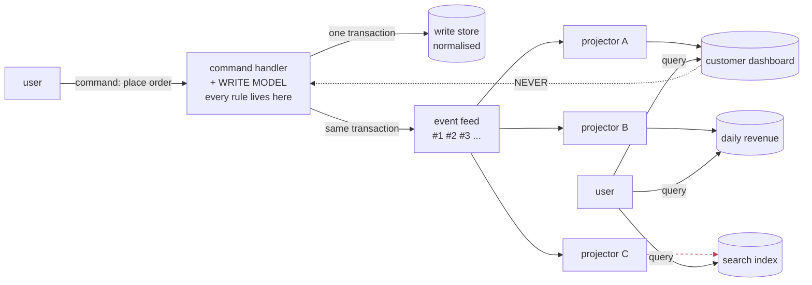
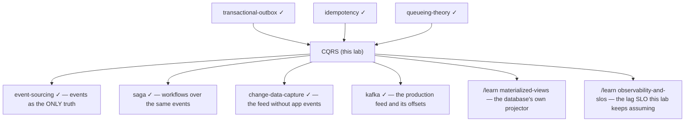

# CQRS — Command Query Responsibility Segregation

*A learning lab. Audience: a working backend engineer who has never used this
pattern, or has used it and is not sure which parts were load-bearing.*

By the end you should be able to argue this pattern in a design review with
numbers instead of adjectives: say how wide the consistency window actually
is, why it stays flat right up to the moment it becomes unbounded, which one
rule makes the whole thing safe, and — most usefully — recognise the single
mistake that turns CQRS from a performance decision into a correctness bug.

---

## Lab contents

| File | What it is |
|---|---|
| `README.md` | This document — the whole story, with every figure sourced |
| `visualization.html` | **The Two Desks** — 5 panels. Move the poll interval and watch the window move; break a projector; run a rebuild |
| `EXERCISES.md` / `SOLUTIONS.md` | 8 rungs, reasoning only, answers kept separate |
| `_java-original/`, `_python-original/` | Earlier generations of this lab, kept for reference. They are not part of the lesson |

**No runnable code.** Everything below is a hand-worked trace, a diagram, a
short illustrative snippet, or a figure produced by the simulator embedded in
`visualization.html`. Where a snippet appears, it is there to be *read*, not
executed.

---

## Where this sits in your other labs

You have already built most of the machinery this lab needs. Nothing below is
re-taught; this is the refresher line, and the sentence that says what CQRS
adds.

- **[transactional-outbox](../transactional-outbox/)** — how a state change
  and the announcement of that change get committed together. CQRS *assumes*
  this. If you do not have it, everything in this lab is built on sand,
  because a read model updated from an event that does not correspond to a
  committed write is not stale, it is wrong.
- **[idempotency](../idempotency/)** — retries are mandatory, so duplicates
  exist, so every consumer must survive them. A projection is a consumer. §10.5
  is that lab's rule applied to one specific consumer, and it is where this
  lab's only *correctness* requirement lives.
- **[eventual-consistency](../eventual-consistency/)** — that lab ended by
  noting that CQRS and caching both talk about a "consistency window" without
  ever giving it edges. §10.2 gives it edges: a formula, a measured
  distribution, and the point at which it stops being finite.
- **[change-data-capture](../change-data-capture/)** — filed the same
  complaint from the other side, and is one of the two ways real systems build
  the event feed this lab draws as an arrow. §13 connects them.
- **[queueing-theory](../queueing-theory/)** and
  **[load-balancing](../load-balancing/)** — a projector is a server with a
  queue, so ρ = λ/μ governs it, and §11.3 is the ρ→1 cliff you already know,
  wearing a costume. §4 is the *pooling* result from the load-balancing lab
  run in reverse: pool identical work, separate dissimilar work.
- **[kafka](../kafka/)** — "each reader remembers its own position" is exactly
  a projector's checkpoint. §13 explains why Kafka's version of that position
  makes one of this lab's two safety mechanisms structurally unavailable.
- **[event-sourcing](../event-sourcing/)** — the neighbour CQRS is most often
  confused with. §14.1 draws the line properly. They are separable, and most
  production CQRS does not use event sourcing.
- **[saga](../saga/)**, **[caching](../caching/)**,
  **[isolation-levels](../isolation-levels/)** — appear in passing.

New here: the **cost of the split, measured**; the rule that decides whether
the split is legal at all; and the four ways projections silently corrupt.

---

## How the numbers in this document were produced

Every figure below comes from a discrete-event simulator. The same simulator
is embedded in `visualization.html`, so you can reproduce any figure by
opening the page and setting the controls — the document and the page share
one engine and agree digit for digit.

**The model, stated so you can argue with it:**

- Commands commit to the write store as a Poisson process at rate **λ**. Each
  accepted command appends exactly one event — a sequence number and a commit
  timestamp — in the *same* transaction as the state change.
- A **projector** reads events after its checkpoint, applies each to a read
  store, then commits the checkpoint. One apply costs `applyMs`; committing
  the checkpoint costs `ckptMs`; one batch holds at most `batch` events.
- The applies and the checkpoint share one read-side transaction, so every
  event in a batch becomes visible **at the same instant** — the batch commit.
  Visibility is quantised, not smooth. This matters in §10.2.
- Projector capacity is therefore **μ = 1000·batch / (batch·applyMs + ckptMs)**
  events per second.

**Canonical setup**, used wherever a figure does not say otherwise: λ = 40
events/s, applyMs = 2, ckptMs = 5, batch = 100, poll = 500 ms, 15 simulated
minutes. That gives **μ = 487.8 events/s** and **ρ = 0.082** — a projector
loafing at 8% utilisation, which is what a healthy one looks like.

**What was checked before any figure was believed:**

| Check | Expected | Measured |
|---|---|---|
| M/M/1 mean sojourn, ρ = 0.8, S = 80 ms | 400.0 ms | **399.1 ms** |
| M/M/4 mean sojourn, ρ = 0.8, S = 80 ms | 140.0 ms | **141.5 ms** (this lab's `queueing-theory` entry recorded 140) |
| Poll-mode window floor at negligible load | poll/2 + apply + ckpt | 107 → **108.3**, 257 → **263.3**, 507 → **520.1**, 1007 → **1040.4** ms |
| Capacity formula at batch = 1, 10, 100 | 142.9, 400.0, 487.8 /s | identical, and measured utilisation tracked ρ to within 0.01 across ρ = 0.08…0.96 |
| Lag at ρ > 1 must grow without bound | linear in run length | 14.3 → 29.0 → 57.9 → **118.2 s** as the run doubled four times |
| Idempotent + atomic projection under crashes | exactly 0% error | **0.00%** across 210 crashes |
| Key-partitioned projectors | exactly 0 reorderings | **0**, with the stall converted to 990 ms of delay |
| Blast-radius rule B·h, at two independent hazard rates | same curve vs B·h | replay/useful **0.13 / 0.29 / 0.70 / 1.96** at B·h = 0.25/0.5/1/2, matching the other rate's **0.05 / 0.33 / 0.76 / 2.43** at the same B·h |

Two things this simulator is **not**: it is not a database, and it is not
proof that Postgres, Kafka or Debezium behave this way. It is a model of the
*mechanism*. Wherever a claim is about a real product, it is sourced to that
product's documentation and marked as such.

---

## 1. WHY — the outage where the write path never broke

Start with the shape of the incident, because it is the reason the pattern
exists and it is not the reason usually given.

A retail order service. One Postgres, one connection pool of 8. Checkout
writes are small and fast: about 5 ms each, 300 per second. That is 1.5
seconds of work per second spread over 8 workers — **19% utilisation**. The
database is nearly idle and every dashboard says so.

Then the analytics team ships a merchandising page. It runs a five-way join
over orders, order_items, products and customers, aggregates by day, and takes
about 800 ms. It is called a handful of times a second.

Here is what happens to checkout — same hardware, same checkout traffic, the
only change being how many report queries per second share the pool:

| Reports/s | Pool utilisation | Checkout mean | Checkout p99 |
|---|---|---|---|
| 0 | 0.19 | 5.01 ms | **23 ms** |
| 2 | 0.39 | 5.13 ms | **24 ms** |
| 4 | 0.59 | 19.44 ms | **406 ms** |
| 6 | 0.79 | 161.24 ms | **1,590 ms** |
| 8 | 0.99 | 5,412 ms | **13,192 ms** |

Checkout p99 goes from 23 ms to 1.59 seconds — **69×** — and at 8 reports per
second checkout is simply dead, thirteen seconds to place an order. Nobody
deployed anything to checkout. Checkout's own traffic never changed. Its code
never changed.

The mechanism is not mysterious and it is not about CPU. There is one queue in
front of 8 workers. An 800 ms report **occupies a worker for 800 ms**. A 5 ms
checkout write that arrives when several workers are holding reports waits
behind them. That is head-of-line blocking, and you can see it in the number:
at 4 reports/s the checkout p99 is 406 ms — about half of one report's service
time, which is exactly the average wait behind a job you are stuck behind.

Now the part that makes this a *pattern* and not just a capacity story. There
are two completely different things wrong here, and they need different fixes:

1. **Two workloads with wildly different service times are sharing one
   queue.** Your [load-balancing](../load-balancing/) lab proved that pooling
   is a large win when the work is *identical*, and this is the same result
   read backwards: when the work is not identical, sharing a queue means the
   short jobs inherit the long jobs' latency.
2. **The report is recomputing, on every single view, an answer that changes
   only when someone places an order.** The join is not slow because the
   database is bad. It is slow because the schema is shaped for *recording a
   sale*, and the question being asked is *how much did we sell today*, and
   those are not the same shape.

CQRS is the design that takes both of those seriously at once. Most
explanations of it lead with the second. The first is what actually gets it
approved.

> **🔮 Predict, before §3.** You have the table above on a dashboard. Which
> would you reach for first: a read replica, a cache, or a materialised
> summary table? Write down which, and what you expect it to fix. §3 and §4
> score all three.

---

## 2. THE PROBLEM — one ledger, two jobs

The abstraction is easier to hold if you have a physical picture first.

A busy shop keeps **one ledger** at the counter. Cashiers write every sale
into it: date, customer, each item, each price. They are careful — prices are
checked, quantities cannot be negative, one entry per sale. The ledger is the
truth, and it is guarded.

The manager reads the same ledger constantly. *Revenue so far today? Which
product is moving? How much has this customer spent this year?* None of those
questions are written anywhere in the ledger. Each one is answered by flipping
back through pages and adding numbers up.

So the ledger is doing two jobs with opposite requirements:

|  | The cashier's job | The manager's job |
|---|---|---|
| Needs | rules, one-at-a-time care, exact | speed, totals, convenient shape |
| Touches | one new entry | hundreds of old entries |
| Frequency | once per sale | many times per hour |
| If it is 30 seconds out of date | **unacceptable** — you would sell stock twice | fine, nobody notices |

That last row is the one to remember. The two jobs do not merely have
different performance profiles. **They have different tolerances for being
wrong about time.** That asymmetry is the entire opening for the pattern; a
design that does not exploit it has nothing to trade.

And now the shop's actual fix, which is what CQRS is:

Cashiers keep writing into the ledger, unchanged. But every few minutes a
clerk walks over, reads the entries added since they last looked, and updates
**chalkboards** on the wall — `TODAY'S REVENUE: ₹12,400`, `TOP SELLER:
keyboards`, `PRIYA — 4 ORDERS THIS YEAR`. The manager stops opening the ledger
entirely; one glance at a board answers each question.

The boards are a few minutes behind. Everyone accepts that, and the queue at
the counter disappears.

Three properties of that arrangement are worth naming now, because everything
technical later is one of these three:

1. **The boards are derived.** Erase one and the clerk can rewrite it from the
   ledger. They hold no truth of their own.
2. **The boards are behind.** Always. Not sometimes, not under load — always,
   by at least the time it takes the clerk to walk over.
3. **Nobody makes a decision from a board.** The cashier checks stock in the
   ledger, not on a chalkboard. Notice this one. It is doing more work than it
   appears to be, and §11.2 is what happens when it is violated.

---

## 3. THE OBVIOUS SOLUTION — everything you would try first, and should

Faced with §1's table, no competent engineer invents CQRS. They do these, in
roughly this order, and they are all reasonable:

**Add indexes.** Correct first move, often sufficient, and cheap. Its limit is
structural: an index makes *finding* rows fast, but the merchandising query's
cost is in *joining and aggregating* them, which no index removes. And every
index added for the reporting side is maintained on the checkout side, on
every write, forever.

**Add a cache.** Also correct, also often sufficient. Its limit is that a
cache is a *guess* about what will be asked again, with invalidation as the
price. Your [caching](../caching/) lab covered where that guess goes wrong. A
cache also does nothing for the first request after every write.

**Add a read replica.** This is the strongest of the three and deserves a
straight answer: **it fixes §1's table completely.** Move the reports to a
replica and checkout gets its 8 workers back and its 23 ms p99. If §1 were
the whole problem, you would stop here, and many teams correctly do.

**Write cleverer SQL, or a materialised view.** Now you are close to the real
thing, and we come back to it in §10.1.

> **🔮 Predict.** The read replica has just fixed the contention. What is
> still wrong? Try to name it before reading on — and note that "the replica
> is slightly stale" is *not* the answer, because you are about to accept
> staleness in every design in this lab.

---

## 4. FAILURE — the replica fixes the queue and leaves the arithmetic

Two things survive the read replica, and each one is a reason for a different
half of CQRS.

### 4a. You paid for staleness and did not spend it

A read replica is asynchronously replicated. The moment you route reports to
it, your reports are answering from a slightly old copy. You have accepted
exactly the property that people cite as the *reason not to* adopt CQRS —
"eventual consistency is too hard" — and in exchange you received: the same
schema, somewhere else.

That is the trade worth staring at. Staleness is the currency. A replica
spends it and buys isolation. CQRS spends the same currency and buys isolation
**and** shape. If you were willing to pay once, the question is only whether
you want the second thing too.

### 4b. The work is being paid at the wrong end

Here is the arithmetic, and it is the whole economic case for the pattern.
Let **N** = changes per day, **R** = reads per day, **J** = the cost of
computing one answer from the normalised schema.

- Compute at **read** time: total cost = **R · J**. Paid once per question.
- Compute at **write** time: total cost ≈ **N · J′**, where J′ is the cost of
  *incrementally updating* a stored answer. Paid once per change.

The deciding quantity is **R/N** — reads per change — and nothing else. Not
data volume. Not table size. Not "we're at scale now".

Worked, with J = 40 ms (a model, not a measurement — the point is the ratio,
not the constant):

| Orders/day (N) | Dashboard views/day (R) | R/N | Read-time cost | Projection-time cost |
|---|---|---|---|---|
| 40,000 | 20,000 | 0.5 | 0.22 CPU-h/day | 0.44 CPU-h/day |
| 40,000 | 100,000 | 2.5 | 1.11 CPU-h/day | 0.44 CPU-h/day |
| 40,000 | 1,000,000 | 25 | **11.11 CPU-h/day** | **0.44 CPU-h/day** |
| 1,000,000 | 100,000 | 0.1 | 1.11 CPU-h/day | 11.11 CPU-h/day |

Read the last row carefully, because it is the row people skip: **a
write-heavy system with few reads is made worse by projections.** CQRS is not
a scaling technique that helps more the bigger you get. It is a bet on a
ratio, and the bet loses when the ratio is below 1.

And now the distinction that the replica option obscures:

> **A read replica multiplies the number of machines paying R·J.
> A projection reduces R·J itself.**

Replicas *add capacity* to absorb the work. Projections *delete the work*. If
your dashboard is called a million times a day, three replicas means three
machines each doing five-way joins a million times a day. That is why "just
add replicas" runs out — not at some magic scale, but at the point where R·J
exceeds what you are willing to buy hardware for, over and over.

### 4c. The third failure, which is not about performance at all

There is a slower failure that no benchmark shows. Once the write model is
also the read model, display concerns leak into it: a `total_amount` column
denormalised so one screen is fast, a `last_order_at` maintained inline, an
entity that grows six fields belonging to one report. Each is individually
justified. Collectively they mean the one place business rules must stay crisp
is now also a view model, and every rule change has to reason about screens.

This one does not appear in any table in this lab, and in my experience it is
the reason teams that adopt CQRS say they would do it again. Flagging it as
judgement rather than measurement.

---

## 5. THE REAL REQUIREMENT — say it in plain words first

Everything above points at one requirement, and it is worth writing without
any vocabulary:

> **The code that changes things and the code that shows things should be able
> to use different data shapes, on different hardware, without either one
> being able to slow down or corrupt the other — and the showing side must be
> allowed to be slightly out of date, because that is the only thing we have
> to pay with.**

Three commitments hide in that sentence, and each becomes a mechanism:

1. **Different shapes.** So there must be more than one representation of the
   same facts, and something must keep the second one current.
2. **Neither can hurt the other.** So the coupling between them must be
   asynchronous — and the moment it is asynchronous, they are not equal in
   time.
3. **Out of date is allowed.** Allowed *where*? That is the question this lab
   spends the most effort on, because the honest answer is not "on the read
   side". It is narrower than that, and §6 states it.

---

## 6. THE KEY IDEA — and the one rule that licenses it

The idea in two sentences:

> **Handle changes and questions with two different models. One model receives
> commands, enforces every rule, and records what happened; from that record,
> any number of query models are built, each shaped like one question, each
> rebuildable, each allowed to lag.**

That is CQRS. It fits on a napkin. But stated that way it invites the mistake
that ruins it, so here is the rule that makes it safe — the single most
important sentence in this lab:

> ### The read model makes no decisions.
>
> It is allowed to be stale, denormalised, duplicated, wrong-shaped and
> disposable **precisely and only because nothing depends on it being right at
> any particular instant.** The moment a command consults a read model in
> order to decide whether to accept, the consistency window stops being a UX
> cost and becomes a correctness bug.

Everything else in this lab is either machinery that supports that rule, or a
measurement of what happens when it is broken. §11.2 breaks it on purpose and
counts the damage.

Notice what the rule does *not* say. It does not say the read side is
unimportant, or that it can be sloppy, or that staleness does not matter. It
says the read side's staleness is *survivable* because it is never an input to
a decision. That is a narrow, checkable property, and it is checkable by
reading your command handlers and asking one question: **does anything in here
read from a projection?**



The dashed arrow is the one that must not exist. Most of the failures in §11
are that arrow drawn by accident.

---

## 7. TERMINOLOGY — five words, and two that are routinely confused

You have met most of these; the entries here are about the *distinctions*, not
the definitions. Full list in §16.

### Command vs Query

A **command** asks for a change: `PlaceOrder(ord-1, priya, [...])`. Named
imperatively, may be **rejected**, and returns success or failure — not data.
A **query** asks a question. It changes nothing, and it is never rejected for
a business reason.

The reason to name them is that they have different *failure vocabularies*. A
command can fail because you are not allowed to do that. A query can only fail
because something broke. Once you notice that, it is obvious they should not
share a code path, and less obvious but equally true that they need not share
a data model.

### CQS vs CQRS — the confusion that costs people a year

- **CQS** (Command–Query Separation, Bertrand Meyer, 1988) is a rule about
  *methods*: a method either changes state or returns a value, never both. It
  applies inside one object, one model, one database. `list.pop()` violates it.
- **CQRS** (Greg Young, ~2010) is a rule about *models*: the object model you
  write through and the object model you read through are allowed to be
  different objects, in different stores, with different schemas.

CQRS is what happens when you take CQS seriously enough to notice the two
sides also want different *data*. Teams that split their handlers into
`PlaceOrderCommand` and `GetOrderQuery` classes, keep one schema, and announce
they have adopted CQRS have adopted CQS. That is a perfectly good thing to
have adopted. It buys none of §1's table.

### Write model / read model

The **write model** is the one that validates commands and owns the business
rules. Normalised, transactional, one per bounded piece of the domain. The
**read model** is a store shaped like one family of questions. Denormalised,
disposable, and there are usually several.

"Read model" is a slightly unfortunate name: it is not a *view of* the write
model, it is a *separate stored answer* maintained from the same facts. Think
"chalkboard", not "window".

### Event, projection, checkpoint

An **event** is a fact that a command succeeded: `OrderPlaced(seq=17,
total=120.00)`. Past tense, immutable, carries a sequence number. A
**projection** is the code that consumes events and updates a read model — the
clerk. A **checkpoint** is the projector's bookmark: *I have applied
everything up to sequence N.*

The checkpoint is the most under-rated of the three. It is what makes a
projector restartable, what makes duplicates detectable, what makes lag
measurable, and in §10.5 it is half of the correctness argument. Kafka calls
it a consumer offset. Debezium calls it an LSN. It is the same object.

### Consistency window

The **consistency window** is the time between an event committing on the
write side and becoming visible in a read model. It is not a constant, it is a
distribution, and §10.2 measures it. Every number in this lab that matters is
a property of that distribution.

---

## 8. MENTAL MODELS

### The simple model

**One guarded ledger, many chalkboards, one clerk per board.** Changes go
through the counter, which checks the rules and writes the ledger. Clerks
copy from the ledger onto boards, each board pre-answering one question.
Everyone reads boards. Erase a board and a clerk rewrites it from the ledger's
history.

### The engineering model

State it as five objects and two invariants, because that is all it is:

| Object | What it holds |
|---|---|
| Write store | Current state, normalised. The truth |
| Event feed | An ordered, append-only sequence of facts, each with a sequence number |
| Projector | A loop: read after checkpoint → apply → advance checkpoint |
| Read store | One denormalised table (or index, or document) per question |
| Checkpoint | One integer per projector, per read model |

**Invariant 1 (atomicity at the source).** A state change and its event commit
together or not at all. This is the [transactional-outbox](../transactional-outbox/)
guarantee, and without it the feed can describe a write that was rolled back.

**Invariant 2 (effectively-once application).** Applying the feed from
sequence 0 to sequence N produces the same read-store state regardless of how
many times any individual event was delivered, or how many times the projector
crashed on the way. §10.5 is entirely about buying this.

Given those two, one property follows, and it is the property people mean when
they say "eventual consistency":

> Stop writing. Wait. Every read model converges to exactly what a from-scratch
> replay would produce.

Which — as your [eventual-consistency](../eventual-consistency/) lab
established — is a **liveness** property. It promises about the limit and says
nothing about any present moment, and no finite observation can falsify it.
That is why the rest of this lab measures the *window* rather than testing the
*promise*. The promise is not testable. The window is.

### Mapping the two models

| Shop | System |
|---|---|
| The ledger | Write store + event feed |
| The counter, where prices are checked | Command handlers — every business rule |
| A chalkboard | One read model |
| The clerk walking over | The projector's poll |
| "The board is 3 minutes behind" | The consistency window |
| Erasing and rewriting a board | A rebuild |

### Where the analogy breaks — three places, all of them load-bearing

**1. The clerk is not one clerk.** Real projectors run in parallel for
capacity, and parallel clerks can update a board out of order in a way one
clerk never could. §10.4 and §11.6.

**2. Chalk does not double-write.** A clerk who is interrupted and starts over
does not accidentally add today's revenue twice. Code does, and it is the most
common real corruption in this pattern. §10.5 and §11.7.

**3. The boards are not "a few minutes behind" — that is a distribution with
a tail, and the tail is where every incident lives.** The mean window in the
canonical setup is 297 ms; the p99 is 545 ms; and under conditions §11.3
describes it is unbounded, with no intermediate warning. Replace "a few
minutes behind" in your head with "a random variable with a cliff in it".

---

## 9. VISUALIZATION — what to open and what to look at

Open `visualization.html`. Five panels, in the order the document uses them:

1. **The window** — the core exhibit. Drag the poll interval and watch the lag
   distribution move; switch to streaming and watch the floor collapse; push λ
   towards capacity and watch the cliff in §11.3 appear all at once.
2. **The stale read** — the same run, asked two questions: *what fraction of
   users see their own write missing?* and *how many orders get accepted
   against stock that is already gone?*
3. **The split** — §1's table, live. Drag report load across a shared pool,
   then separate the pools.
4. **Projection correctness** — the four crash combinations, and the ordering
   experiment with a stalled worker, keyed and unkeyed.
5. **The rebuild** — backlog, capacity and live load; watch the catch-up time
   go non-linear.

Each panel has a **Run this scenario for me** button that drives the sequence
the document describes, and panels 1, 2 and 4 ask you to predict before
revealing.

---

## 10. THE ACTUAL MECHANISM — five designs, each forced by the last one's failure

This is the spine of the lab. We do not start at the final architecture. We
start at the simplest thing that could work, and each step is taken because a
specific, measured thing went wrong.

### 10.1 — v1: project synchronously, inside the write transaction

The smallest possible split. Keep one database. Add a second set of tables
shaped for reading. When a command commits, update those tables **in the same
transaction**.

```
BEGIN;
  INSERT INTO orders ...;                          -- write model
  INSERT INTO order_items ...;
  INSERT INTO customer_dashboard (...) VALUES (...);   -- read model, inline
  UPDATE daily_revenue SET total = total + 120 WHERE day = '2026-09-01';
COMMIT;
```

This is often called **CQRS-lite**, and it deserves more respect than it gets.
Look at what it already has:

- The dashboard query is now `SELECT * FROM customer_dashboard WHERE
  customer = 'priya'`. No joins, no aggregation. §4b's R·J is gone.
- **The consistency window is exactly zero.** Every guarantee you had with one
  model, you still have. Read-your-own-writes is free. There is no lag to
  monitor, no projector to restart, no rebuild to schedule.
- It is one transaction, so there is no outbox, no feed, no checkpoint.

For a very large fraction of systems that think they need CQRS, this is the
correct final answer. Say so out loud in design reviews.

**What it costs.** The projection work is now on the write path. Same setup as
§1 — checkout at 300/s, base write 5 ms, each read model adding 2 ms:

| Read models updated inline | Write service time | Pool utilisation | Checkout mean | Checkout p99 | Window |
|---|---|---|---|---|---|
| 0 | 5 ms | 0.188 | 5.00 ms | 23 ms | 0 ms |
| 1 | 7 ms | 0.263 | 7.00 ms | 32 ms | 0 ms |
| 2 | 9 ms | 0.338 | 9.01 ms | 42 ms | 0 ms |
| 3 | 11 ms | 0.413 | 11.05 ms | 51 ms | 0 ms |
| 5 | 15 ms | 0.563 | 15.44 ms | 70 ms | 0 ms |
| 8 | 21 ms | 0.788 | 26.34 ms | 108 ms | 0 ms |

That is a real cost but not a shocking one: eight read models maintained
inline take checkout's p99 from 23 ms to 108 ms and its utilisation from 19%
to 79%. If you have three read models and a comfortable pool, this is
completely fine, and you get a zero-width window for it.

> **🔮 Predict.** v1 has zero staleness and acceptable latency. What forces
> anyone to give that up? There are three answers and only one of them is
> about performance.

**What breaks it.**

1. **The read store cannot always be in your transaction.** The moment one of
   your read models is Elasticsearch, Redis, ClickHouse, or another service's
   database, there is no transaction that spans it. You would need a
   distributed transaction, and your
   [two-phase-commit](../two-phase-commit/) and
   [distributed-transactions](../distributed-transactions/) labs already
   established what that costs and why nobody does it here.
2. **Availability is now coupled the wrong way.** If the search index is
   down, checkout fails. You have made the least important component a
   dependency of the most important one. That is backwards, and it is not
   fixable within v1.
3. **Latency is coupled.** Row 8 above is fine at 21 ms. It is not fine when
   one read model's update occasionally takes 400 ms because of a lock or a
   remote call — that 400 ms is now inside the customer's checkout.

Points 2 and 3 are the same shape: **synchronous coupling means the write path
inherits every read model's worst day.** That is the requirement v2 exists to
break, and breaking it is what creates every remaining problem in this lab.

### 10.2 — v2: decouple with a feed and a polling projector

Write the event to a feed in the write transaction (the outbox rule), and let
a separate process apply it later.

```
-- command side, one transaction
BEGIN;
  INSERT INTO orders ...;
  INSERT INTO events (seq, type, payload) VALUES (17, 'OrderPlaced', ...);
COMMIT;

-- projector, separately, forever
loop every 500ms:
    BEGIN;                                     -- on the READ store
      rows = SELECT * FROM events WHERE seq > :checkpoint ORDER BY seq LIMIT 100;
      for each row: apply(row);
      UPDATE projector_state SET checkpoint = :lastSeq;
    COMMIT;
```

Now checkout is insulated: its transaction contains one extra small INSERT and
nothing else. The read models can be anywhere, in any technology, and can be
down without checkout noticing.

**And the consistency window is born.** Here it is, measured, at the canonical
load:

| Projector | Mean | p50 | p95 | p99 | Max |
|---|---|---|---|---|---|
| poll 100 ms | 65.1 ms | 65.2 | 110.1 | 116.6 | 129.9 |
| **poll 500 ms** | **297.2 ms** | 297.9 | 522.1 | **544.9** | 577.3 |
| poll 1000 ms | 586.8 ms | 586.4 | 1035.3 | 1079.0 | 1123.5 |
| poll 2000 ms | 1160.9 ms | 1160.3 | 2066.3 | 2147.1 | 2199.3 |
| poll 5000 ms | 2513.0 ms | 2515.2 | 4655.8 | 4920.0 | 5198.2 |

The structure is completely regular, and the formula behind it is worth
keeping:

> **mean window ≈ (poll / 2) · (1 + ρ) + apply + checkpoint**

An event arrives at a uniformly random point in the poll interval, so it waits
**poll/2** on average; then it waits for the projector to chew through the
events ahead of it in the same batch, which is the drain time, which is
**ρ·poll**. Check it: at ρ = 0.96 the formula gives 250·1.964 = 491 ms and the
simulator measured 491 ms.

Read the practical consequence off that formula: **at low utilisation — which
is what a healthy projector looks like — the window is essentially poll/2 and
nothing else.** Your consistency window is a config value you chose, probably
without thinking about it, probably by copying it from another service.

**Visibility is quantised.** Because the applies and the checkpoint share one
transaction, a whole batch becomes visible at one instant. The window does not
shrink smoothly toward zero for lucky events; events cluster at batch commits.
This is why the p50 (297.9 ms) sits almost exactly at the mean and the p95
jumps to 522 ms — the distribution is closer to a sawtooth than a bell.

### 10.3 — v3: stop polling

The formula says the whole window is the poll interval. So delete it. Have the
write side notify the projector — a `LISTEN/NOTIFY`, a broker push, a
long-lived CDC stream — and let it apply events as they arrive, batching
whatever happens to be available.

| Projector | Mean window | p99 | Capacity |
|---|---|---|---|
| poll 500 ms | 297.2 ms | 544.9 ms | 487.8/s |
| **streaming** | **8.1 ms** | **15.5 ms** | 487.8/s |

**A 37× reduction in the mean window from deleting a timer.** And notice the
last column: **capacity did not change at all.** That is the sentence to
remember —

> Streaming fixes the *floor* of the window. It does nothing to the *ceiling*.

There is a nice secondary result hiding here that corrects an intuition I had
to abandon. I expected batching to trade latency for throughput — bigger
batches, wider window. Under streaming it does not:

| Max batch | Capacity | Mean window | Actual mean batch |
|---|---|---|---|
| 1 | 142.9/s | 8.38 ms | 1.00 |
| 10 | 400.0/s | 8.12 ms | 1.04 |
| 100 | 487.8/s | 8.12 ms | 1.04 |
| 2000 | 499.4/s | 8.12 ms | 1.04 |

Raising the batch limit from 1 to 2000 changed capacity by 3.5× and the window
by nothing, because the batch is **opportunistic** — it takes whatever has
arrived, which at ρ = 0.08 is one event. Batching only costs latency if you
*wait* to fill the batch. And that waiting has a name you already know: it is
a linger timer, and **a poll interval is a linger timer** — which is precisely
why v2 cost 297 ms and v3 costs 8 ms. Same mechanism, one lab apart.

So: set the batch limit high, and never add a fill-wait.

### 10.4 — v4: run projectors in parallel, and immediately break ordering

Streaming fixed the floor; capacity is still one projector's 487.8 events/s.
When λ approaches that, the obvious move is more workers.

The obvious way to do it is wrong, and it fails so rarely that it will reach
production. Hand events to N workers round-robin. Now consider one order:
`OrderPlaced(ord-1)` at t, `OrderCancelled(ord-1)` 50 ms later. Different
workers. Normally the placed event is applied first because it arrived first,
and everything is fine.

Then one worker stalls — a GC pause, a slow read-store shard, a lock. One
second. 20,000 orders over ten minutes, 8 workers, one 1-second stall:

| Setup | Cancelled orders left looking alive | Max apply delay |
|---|---|---|
| 8 workers, round-robin, no stall | **0** | 4 ms |
| 8 workers, round-robin, one 1 s stall | **3** | 989 ms |
| 8 workers, **partitioned by order id**, one 1 s stall | **0** | 990 ms |

Three orders out of twenty thousand — 0.015% — where the CANCELLED event was
applied first and the later PLACED event overwrote it. Those three orders are
now **permanently** shown as active in the read model. Not stale. Not
eventually consistent. Wrong forever, and a rebuild reproduces the state
correctly, so the two disagree and nobody knows why.

The fix is the one your [kafka](../kafka/) lab already taught: **route by
key.** All events for one order go to the same worker, so they are applied in
order relative to each other, and events for *different* orders are still
parallel. The third row shows what that does: zero corruption, and the stall
turns into 990 ms of extra latency for that partition.

> **Partitioning by key converts a correctness failure into a latency
> failure.** That is the whole trade, and it is almost always the right one,
> because latency failures are visible and correctness failures are not.

One honest note on the numbers, because the raw sweep looks like it says
something it does not. Stalling *one* worker out of W corrupts fewer orders as
W grows (8 at W=2, 3 at W=8, 1 at W=16), which looks like "more parallelism is
safer". It is not — it is just that one stalled worker out of 32 has a 1/32
blast radius. Let every worker stall once and the total is flat:

| Workers | Total corrupted across one stall each | Avg per stall |
|---|---|---|
| 2 | 18 | 9.00 |
| 4 | 23 | 5.75 |
| 8 | 29 | 3.63 |
| 16 | 29 | 1.81 |
| 32 | 29 | 0.91 |

Flat from 8 workers up. Adding workers does not reduce your exposure; it
divides the same exposure into smaller pieces.

### 10.5 — v5: survive your own crash, which is the only correctness requirement

Everything so far has been about latency and shape. This step is about being
*right*, and it is the one that cannot be skipped.

The projector dies mid-batch. It has applied 60 of 100 events and not yet
committed its checkpoint. It restarts, reads from its old checkpoint, and
applies those 60 events **again**.

Whether that is harmless or catastrophic depends on two independent
properties, and here is the full matrix — 200,000 events, batch 100, one crash
per 1,000 applies, 210 crashes:

| Apply is idempotent? | Checkpoint in the same transaction? | Revenue error |
|---|---|---|
| yes | yes | **0.00%** |
| yes | no | **0.00%** |
| no | yes | **0.00%** |
| **no** | **no** | **+5.39%** |

**Either protection alone is sufficient. Having neither reports revenue 5.39%
too high**, and — this is the part that makes it dangerous — nothing is broken,
no error is logged, no alert fires. The number on the dashboard is simply
wrong, and it drifts further every time the projector restarts.

The two protections are genuinely different mechanisms, and you should know
which one you have:

**Idempotent apply** means re-applying an event is a no-op. This is a property
of *how you write the projection*, and it is mostly a matter of avoiding
accumulation:

```sql
-- NOT idempotent: applying twice double-counts
UPDATE daily_revenue SET total = total + 120 WHERE day = '2026-09-01';

-- idempotent: applying twice is the same as applying once
MERGE INTO customer_dashboard USING (...) ON (order_id = 'ord-1')
  WHEN MATCHED THEN UPDATE SET status = 'PLACED', total = 120.00
  WHEN NOT MATCHED THEN INSERT (...);

-- idempotent accumulation: guard with the sequence you have already applied
UPDATE daily_revenue SET total = total + 120, last_seq = 17
  WHERE day = '2026-09-01' AND last_seq < 17;
```

Upserts keyed by the aggregate's identity are naturally idempotent. **Counters
and sums are not**, and that is where the 5.39% came from. Any projection with
a `+=` in it needs the third form.

**Atomic checkpoint** means the applies and the checkpoint advance commit
together, so a crash rolls back both and the batch is simply retried. This is
available only when the checkpoint lives in **the read store** — you write it
to a `projector_state` table in the same database, in the same transaction. It
is the cheaper protection when you can have it, and §13 explains the very
common production situation where you cannot.

**The blast radius is the batch size.** With neither protection, the damage
scales directly with how much work a crash throws away:

| Batch size | Revenue error |
|---|---|
| 1 | +0.09% |
| 10 | +0.49% |
| 100 | +5.39% |
| 500 | +32.92% |
| 2000 | **+242.81%** |

At batch 2000 the reported revenue is **3.4× the truth**. Same crash rate,
same events, same code — only the batch size changed.

And there is a second, subtler batch limit that applies **even when you are
fully correct**. Every replayed event is itself exposed to the crash hazard,
so a large enough batch spends most of its time replaying:

| Batch | B·h (expected crashes per batch) | Wasted replay ÷ useful work |
|---|---|---|
| 100 | 0.10 | 0.05× |
| 500 | 0.50 | 0.33× |
| 1000 | 1.00 | 0.76× |
| 2000 | 2.00 | 2.43× |
| 5000 | 5.00 | **27.13×** |

At B·h = 5 the projector does 27 units of wasted work per unit of progress. It
is still perfectly correct — the atomic checkpoint guarantees that — it just
barely moves. This is a **poison batch**: a batch large enough that a crash
within it is likely, so it rarely completes, so it retries, so it crashes.
The governing quantity is the dimensionless product **B·h**, confirmed at two
independent hazard rates (replay ratios 0.13 / 0.29 / 0.70 / 1.96 at
B·h = 0.25 / 0.5 / 1 / 2, against 0.05 / 0.33 / 0.76 / 2.43 at the other rate).

Push it further and the projector stops being a projector. At B·h = 12
(batch 3,000, one crash per 250 applies) it had applied **1.5% of the feed**
before a work budget of 60× the useful work ran out — it was not slow, it had
no forward progress at all, and it would have stayed that way indefinitely.

**Rule: keep B·h well under 1.** If your projector crashes once per thousand
events, batches of 100 are comfortable and batches of 5,000 are a trap. Note
that this is a *self-inflicted* failure mode: it is caused entirely by the
batch size you chose, and it gets worse exactly when the system is already
unhealthy, because that is when h rises.

### Checkpoint — what you can now explain

You can now say what CQRS is, why the split happens at all (§4: isolation
plus R/N), what the split costs (a window whose mean is poll/2·(1+ρ)), how to
make the window small (stream, don't poll), how to add capacity without
corrupting anything (partition by key), and what makes a projection correct
under crashes (idempotent applies, or an atomic checkpoint, and a batch size
with B·h ≪ 1).

What remains is what happens on a bad day — and the failure that matters most
is not any of the above. It is the one in §11.2.

---

## 11. FAILURE SCENARIOS

### 11.1 — The stale read, or: your user does not believe you

Priya places an order. The command returns OK. The browser redirects to
"My Orders" and queries the read model. The list is empty.

This is not a bug. It is the pattern working exactly as designed. The question
is only how often it happens, and the answer is worse than most people guess.
Percentage of users who see their own write missing, by how long after the
command their page issues its query:

| Projector | after 100 ms | after 250 ms | after 500 ms |
|---|---|---|---|
| poll 5000 ms | 99.6% | 97.5% | 92.5% |
| poll 2000 ms | 99.9% | 95.7% | 83.1% |
| **poll 500 ms** | **89.4%** | **59.5%** | **9.5%** |
| poll 100 ms | 15.0% | 0.0% | 0.0% |
| **streaming** | **0.0%** | **0.0%** | **0.0%** |

With a 500 ms poll — a completely ordinary configuration — **89% of users see
their own order missing** if the page loads 100 ms later. This is the number
that generates the bug report titled "orders sometimes don't save", which is
then not reproducible, because by the time anyone looks the window has closed.

The fixes, cheapest first:

1. **Render from the command result, not from a query.** The confirmation page
   already knows the order succeeded — it does not need to ask. This costs
   nothing and removes the entire class of problem for the most common screen.
2. **Stream instead of poll.** The table's last row: 0.0% at every think time.
   This is the highest-leverage change available and it is a config decision,
   not an architecture one. (Honest limit of the model: streaming measured
   8.1 ms mean and 15.5 ms p99 with no network hop modelled. Add a real broker
   and a real network and it is tens of milliseconds, not zero — but still far
   inside any page load.)
3. **Read-your-own-writes by waiting.** Return the event's sequence number
   from the command; have that user's next query block until the projector's
   checkpoint passes it. Precise, costs a little latency for one user, and
   requires plumbing the sequence number through your API.
4. **Route that specific query to the write model.** Correct, and a legitimate
   escape hatch — but if you find yourself doing it for most screens, you have
   discovered that this subsystem did not want CQRS.

Note what streaming does *not* fix: at higher load its own window grows.
At ρ = 0.92 streaming measured 89.6 ms mean and 197 ms p99, and 87% of users
querying 50 ms later saw a stale page. The window is never zero unless the
projection is synchronous (v1).

### 11.2 — THE ONE THAT MATTERS: a command that reads the read model

This is the failure the entire lab is built around, and it is the one that
turns a latency property into lost money.

Someone writes an inventory check. It is the obvious thing to write:

```
handlePlaceOrder(cmd):
    sold = SELECT units_sold FROM product_stats WHERE sku = cmd.sku   -- READ MODEL
    if sold >= stock: reject("out of stock")
    ... accept, write, emit OrderPlaced ...
```

It reads beautifully. `product_stats` is fast, it is already there, it is what
the product page uses. And it is a correctness bug, because the read model is
by construction behind, so **every order that arrives inside the consistency
window sees a stock level that has already been spent.**

One unit left. How many orders get accepted for it:

| Setup | Mean window | Mean oversells | p99 | Worst seen |
|---|---|---|---|---|
| λ=40/s, poll 2000 ms | 1160.9 ms | 46.66 | 97 | 117 |
| **λ=40/s, poll 500 ms** | 297.2 ms | **11.95** | **29** | **41** |
| λ=40/s, poll 100 ms | 65.1 ms | 2.61 | 9 | 15 |
| λ=40/s, streaming | 8.1 ms | 0.33 | 2 | 5 |
| λ=400/s, poll 500 ms | 456.5 ms | 182.54 | 325 | 385 |

**One unit of stock. Twelve orders accepted on average, forty-one in the worst
case.** And the expected count is exactly what you would derive by hand:
λ × window. At 40/s and a 297 ms window that is 11.87; measured 11.95.

Now read the table for the lesson, because the lesson is not "the window was
too wide":

> Tightening the window from 2000 ms to streaming took the oversell from 46.66
> to 0.33. It never reached zero — and it cannot, because there is always
> *some* window. **You cannot fix a decision made on stale data by making the
> data less stale. You can only move the decision.**

The fix is to put the check where the truth is:

```
handlePlaceOrder(cmd):
    BEGIN;
      UPDATE stock SET units = units - 1
        WHERE sku = cmd.sku AND units >= 1;   -- write model, conditional
      if rowsAffected = 0: rollback; reject("out of stock")
      INSERT INTO orders ...; INSERT INTO events ...;
    COMMIT;
```

One conditional write on the write model, and the oversell is exactly zero at
any window, any load, any poll interval — the same conditional-write move your
[optimistic-vs-pessimistic-locking](../optimistic-vs-pessimistic-locking/) and
[idempotency](../idempotency/) labs kept finding in different costumes.

**How to find this in an existing codebase:** grep your command handlers for
reads of any projection table. Every hit is either a bug or a deliberate,
documented decision that the staleness is acceptable for that rule. In my
experience most hits are neither — they are someone reaching for the
convenient table.

The read model may still *show* stock. Showing is fine. Deciding is not.

### 11.3 — The cliff: the window is flat until it is infinite

You are monitoring projector lag, as everyone advises. Here is what that
monitor shows as the projector approaches saturation:

| ρ | λ | Mean window | p99 |
|---|---|---|---|
| 0.10 | 49/s | 307 ms | 554 ms |
| 0.50 | 244/s | 384 ms | 697 ms |
| 0.80 | 390/s | 445 ms | 786 ms |
| 0.90 | 439/s | 463 ms | 797 ms |
| 0.95 | 463/s | 468 ms | 799 ms |
| 0.98 | 478/s | 509 ms | 840 ms |
| 1.00 | 488/s | 731 ms | 1,334 ms |
| **1.02** | **498/s** | **8,661 ms** | **16,538 ms** |
| 1.05 | 512/s | 22,128 ms | 43,105 ms |
| 1.20 | 585/s | 89,448 ms | 176,383 ms |

From ρ = 0.10 to ρ = 0.98 — almost the entire operating range — the mean
window moves from 307 ms to 509 ms. **A 1.7× change while utilisation went up
nearly tenfold.** Then a 2% further increase in traffic multiplies it by 17×,
and past that it is not a number at all: at ρ = 1.05 the backlog age was 14.3 s
after 5 minutes, 29.0 s after 10, 57.9 s after 20, 118.2 s after 40. It
doubles when you double the run, which is what "unbounded" looks like when you
measure it instead of asserting it.

Why so much flatter than the M/M/1 curve you know from
[queueing-theory](../queueing-theory/)? Because a polling projector is a
**bulk-service** queue. It does not serve events one at a time as they arrive;
it sleeps, then drains everything at once. Below capacity, the window is set
by the sleep, not by the queue — so the queue's growth is invisible until the
drain no longer fits in one interval.

The operational conclusion is uncomfortable and worth stating plainly:

> **Projector lag is not a leading indicator of projector saturation.** By the
> time lag moves, you are already over capacity. You must monitor the
> projector's *utilisation* — busy time ÷ wall time — as a separate signal.

That is the same lesson your [load-shedding](../load-shedding/) lab reached
about throughput ("50.1/s during a total outage and 50.0/s during optimal
operation"): the metric everyone watches is the one that cannot distinguish
healthy from doomed.

### 11.4 — The read store gets slower and the alarm does not know

Nothing changes about your traffic. The read store gets slower — a rebuilt
index, a noisy neighbour, a table that outgrew its cache. Applies go from 2 ms
to 20 ms.

| Apply cost | Capacity | ρ | Mean window | p99 | Time to drain a 10,000-event backlog |
|---|---|---|---|---|---|
| 2 ms | 487.8/s | 0.082 | 298 ms | 543 ms | **0.4 min** |
| 5 ms | 198.0/s | 0.202 | 361 ms | 618 ms | 1.1 min |
| 10 ms | 99.5/s | 0.402 | 465 ms | 750 ms | 2.8 min |
| 15 ms | 66.4/s | 0.602 | 610 ms | 1,493 ms | 6.3 min |
| 20 ms | 49.9/s | 0.802 | 1,777 ms | 3,388 ms | 16.9 min |
| 24 ms | 41.6/s | 0.962 | 3,748 ms | 5,490 ms | **105.5 min** |
| ~25 ms | 40.0/s | 1.00 | — | — | **never** |

Two things to take from this. First, a 12× slowdown in the read store moves
you from 8% to 96% utilisation and puts you one small regression away from an
unbounded window — **and your write traffic never changed**, so nothing in
your capacity planning saw it coming.

Second, look at the last column against a typical alarm: *"page when the
projector is more than 10,000 events behind."* That threshold means 0.4
minutes of catch-up on a good day and 105.5 minutes on a bad one — **a 264×
difference in what the same alarm means.** This is exactly the trap your
load-shedding lab named: any threshold expressed in units of *work* secretly
encodes how long that work takes.

**Alarm on the age of the oldest unapplied event, not on the count.** Age is
in the unit your users experience and your SLA is written in. Count is in a
unit whose meaning drifts.

### 11.5 — Two read models are never in sync with each other, ever

The order page shows a list from the dashboard projection and a total from the
revenue projection. Each is individually eventually consistent. Together they
can show a combination that never existed in the write store.

Same commit stream, board A always a 500 ms poll, board B varied:

| Board B | B's mean window | Page loads where the two disagree | Mean gap | p99 | Max |
|---|---|---|---|---|---|
| revenue board, poll 5 s | 2,506 ms | **100.0%** | 90.6 events | 200 | 238 |
| identical 500 ms poll, timer offset 250 ms | 297 ms | **100.0%** | 10.1 events | 18 | 25 |
| identical 500 ms poll, timer offset 50 ms | 298 ms | 86.7% | 3.7 events | 26 | 34 |
| 500 ms poll, applies 5× slower | 467 ms | 31.1% | 21.5 events | 32 | 36 |

The second row is the one to sit with. **Two read models with identical
configuration, identical load, and identical code, differing only in when
their timer happens to fire, disagree on 100% of page loads.** There is no
tuning that fixes this. Independent projectors have independent checkpoints,
and there is no instant at which both are at the same place.

Consequences worth designing around:

- **Never compute a derived value by combining two read models** — the
  arithmetic will occasionally be visibly impossible (5 orders listed, revenue
  for 4).
- If a screen genuinely needs two things consistent with each other, they
  belong in **one** read model, maintained by **one** projector. That is a
  real and common reason to denormalise more aggressively than feels
  comfortable.
- If they must stay separate, show them as separately-timestamped facts
  ("revenue as of 12:04:31") rather than as one coherent picture.

### 11.6 — Reordering (see §10.4) and its permanence

Covered as a mechanism in §10.4; here is what makes it a *failure* rather than
a design note. Three orders in twenty thousand, silently, with no error and no
retry, end up in a state the write model does not agree with. It is permanent:
the read model is not behind, it has converged to the wrong value.

The detection story is the problem. Lag is zero. Error rate is zero. The only
thing that would catch it is a **reconciliation job** that periodically
compares a projection against a fresh replay or against the write model, and
almost nobody has one. §13 says what to do about that.

### 11.7 — Crash mid-batch (see §10.5), and why it is worse than it looks

Also covered mechanically. What makes it a nastier failure than §11.6 is that
it is *cumulative*. A reordering corrupts specific orders once. A
non-idempotent accumulator over-counts a little on **every** crash, forever,
and the error only grows. The 5.39% in §10.5 is 210 crashes' worth; run for a
year and the number is unbounded, and there is no point at which anything
alerts.

The tell, if you ever suspect it: **rebuild the projection into a second table
and compare.** A correct projection rebuilds to the same numbers. A drifting
one does not, and the difference is your accumulated error.

### 11.8 — The rebuild you cannot afford

"Read models are disposable, just rebuild them" is the pattern's proudest
claim, and it is true, and it comes with a bill nobody computes in advance.

Rebuild time is not history ÷ throughput. While you rebuild, live traffic
keeps arriving and must also be applied. So:

> **rebuild time = H / (μ − λ)**

Your rebuild speed is not your projector's capacity. It is your projector's
**spare** capacity. Replaying 50 million events at μ = 487.8/s:

| Live λ | ρ | Rebuild time |
|---|---|---|
| 40/s | 0.08 | 31.0 hours (1.3 days) |
| 200/s | 0.41 | 48.3 hours (2.0 days) |
| 400/s | 0.82 | 158.2 hours (**6.6 days**) |
| 450/s | 0.92 | 367.4 hours (15.3 days) |
| 470/s | 0.96 | 780.1 hours (32.5 days) |
| 488/s | 1.00 | **never finishes** |

The same rebuild is 31 hours on a quiet system and 6.6 days on a busy one —
and the busy one is 82% utilised, which most teams would call healthy. Past
ρ = 1 it does not complete at all: you have a read model you can never
recreate, which means a schema change you can never make.

> **🔮 Predict.** Your projector runs at ρ = 0.9 and you need to rebuild.
> What do you actually do? There are three real options — think before §13.6
> gives them.

---

## 12. CORRECTNESS — what you are actually guaranteed

**Guaranteed, given the two invariants of §8:**

- **Business rules are enforced exactly once, on the write side.** This is the
  guarantee that licenses everything else: the read side may be arbitrarily
  denormalised and duplicated *because it makes no decisions*.
- **Commands are atomic.** Rejected means no trace anywhere; accepted means
  recorded and announced together.
- **Convergence.** Stop writing, wait, and every read model reaches exactly
  the state a from-scratch replay would produce — provided applies are
  idempotent or checkpoints are atomic (§10.5), and provided per-key order is
  preserved (§10.4).
- **Rebuildability.** Any read model can be recreated from the feed. This is
  what makes read-side schema change cheap and read-store choice free.

**Not guaranteed:**

- **That a query reflects the write that just returned.** 89.4% of the time it
  does not, at a 500 ms poll (§11.1).
- **That two read models agree with each other.** 100% of the time they do not
  (§11.5).
- **That the window is bounded.** It is bounded only while ρ < 1, and ρ is not
  visible in the lag metric (§11.3).
- **Anything about write-side scale.** CQRS scales *reads* and *shapes*. The
  command side scales by the usual means — partitioning, bigger boxes — and
  this pattern does not help it. Believing otherwise is §14.4.

**The assumptions all of that rests on:**

1. The outbox invariant holds (state and event commit together).
2. The feed preserves order per key, and the projector respects it.
3. Applies are idempotent, or checkpoints are atomic, and B·h ≪ 1.
4. **No command reads a read model.** If this one is false, none of the above
   guarantees mean anything, because the system is now making decisions from a
   store that is defined to be behind.

**Traded away, permanently:** the `INSERT` then `SELECT` sees it programming
model. That loss infects UX design, integration testing (every test needs to
wait for a projector), and on-call (every incident starts with "is the
projector behind?"). It does not go away with maturity. It is the price, and
§14.7 is about pretending otherwise.

---

## 13. PRODUCTION — from this model to what you actually operate

### 13.1 The feed

This lab drew an arrow. In production it is one of three things:

- **An outbox table polled or streamed by the application.** Simplest, keeps
  the checkpoint in your own database — which means the atomic checkpoint of
  §10.5 is available to you. Covered by
  [transactional-outbox](../transactional-outbox/).
- **CDC off the write database's log** — Debezium reading the Postgres WAL or
  MySQL binlog. No application change at all, and events describe row changes
  rather than domain facts, which is a real semantic difference your
  [change-data-capture](../change-data-capture/) lab covers in depth.
- **A broker the command side publishes to**, usually Kafka, usually fed by
  one of the first two rather than written to directly (writing to the DB and
  the broker separately is precisely the dual-write bug the outbox exists to
  prevent).

### 13.2 The checkpoint, and why Kafka takes a protection away from you

This matters more than it sounds and it is the most useful production fact in
this lab.

In §10.5, the atomic checkpoint worked because the checkpoint was a row in the
read store, written in the same transaction as the applies. **When your feed
is Kafka, the checkpoint is a consumer offset, and it lives in Kafka.** There
is no transaction spanning your read store and `__consumer_offsets`. So:

> A Kafka-fed projection is structurally the "non-atomic checkpoint" column of
> §10.5's matrix. **Idempotency is not optional for it — it is the only
> protection you have.**

Two consequences. First, if you are on Kafka, audit every projection for
accumulation (`+=`) and convert to upserts or sequence-guarded updates.
Second, there is a well-known way to buy the atomicity back: **store the
offset in the read store yourself**, in the same transaction as the applies,
and seek to it on startup instead of using Kafka's committed offset. Kafka
supports this (`seek()` on partition assignment), Flink and Debezium do
variants of it, and it is the standard move for exactly-once sinks.

### 13.3 Read stores

The freedom to pick a store per question is the practical payoff people
actually enjoy: Elasticsearch for search, Redis for hot dashboards, Postgres
tables for reports, ClickHouse for analytics — one feed, many stores. Note
that each one you add is another projector, another checkpoint, another lag
metric, and another entry in §11.5's disagreement table.

### 13.4 What to monitor

In priority order, and the first is the one usually missing:

1. **Projector utilisation** (busy ÷ wall time). The only leading indicator of
   §11.3's cliff.
2. **Age of the oldest unapplied event**, per projector — not event count
   (§11.4).
3. **Time since the projector last made progress.** Distinguishes "behind" from
   "dead". Your [eventual-consistency](../eventual-consistency/) lab's point
   exactly: the delivery clause's death produces no event, so you must alarm
   on the machinery's heartbeat.
4. **Rebuild headroom**: μ − λ, and the implied rebuild time for your current
   history size. Compute it quarterly, before you need it.
5. **Reconciliation residual**: periodically rebuild a projection into a
   shadow table and diff it. This is the only thing that catches §11.6 and
   §11.7. Almost nobody runs it; everyone who has been burned once does.

### 13.5 Read-your-own-writes in real systems

The sequence-number-and-wait approach (§11.1 option 3) has a standard shape:
the command returns its event sequence, the client sends it back as a header
or cookie, and the query layer either waits for the projector's checkpoint to
pass it or routes to the write model. This is the same mechanism as a session
token for bounded staleness in a replicated database, and it is the same idea
as your [causal-consistency](../causal-consistency/) lab's session guarantees.

### 13.6 Rebuilds at scale — the answer to §11.8's prediction

Three real options, and you should know which one you have:

1. **Blue/green projections.** Build v2 into a new table alongside the live
   v1, from sequence 0, while v1 keeps serving. When v2 catches up, flip
   reads. This is the standard answer, and it is exactly the snapshot + delta
   + cutover protocol from your
   [change-data-capture](../change-data-capture/) and
   [partitioning-and-rebalancing](../partitioning-and-rebalancing/) labs.
2. **Parallel replay.** Rebuild with far more workers than the live projector
   uses — the ordering constraint is per key, so replay parallelises well if
   you partition by key. This is how you turn 6.6 days into hours, and it is
   why §10.4's keying decision pays off twice.
3. **Reduce H.** Snapshots, or a compacted topic, or simply not keeping ten
   years of events for a projection that only needs ninety days.

The one thing you must not do is discover during an incident that option 1
takes six days.

### 13.7 Frameworks, and where this actually shows up

Axon (Java), EventStoreDB, Marten, and Lagom package this. Most production
CQRS is not built on any of them — it is command handlers, an outbox, a
consumer, and idempotent upserts, exactly as drawn in §8. If you are on Spring,
the honest description of a typical implementation is `@Transactional` command
handlers writing an outbox table, Debezium or a scheduled poller draining it,
and `@KafkaListener` projections doing upserts.

Where you meet it in the wild: order management (an "orders" page is almost
always a projection), banking and ledger systems, inventory, and anywhere an
audit trail and read scale have to coexist.

### 13.8 What this lab left out

- **Event schema evolution.** Events outlive the code that wrote them, so
  rebuilds must be able to read five-year-old events. Versioned event types
  and upcasting are the standard answers; [event-sourcing](../event-sourcing/)
  covers them, and the concern is much sharper there.
- **Multi-tenancy and privacy.** Deleting a user's data from a write model is
  easy; from a feed that is replayed forever, it is not.
- **Backpressure** between a fast write side and a slow projector — beyond
  "the window grows".
- **Exactly how to size a read store.** Treated here as a service with a fixed
  cost per apply, which is a real simplification.

---

## 14. COMMON WRONG MODELS

### 14.1 "CQRS is event sourcing"

The most common conflation, and the one that makes people think CQRS is
exotic.

**CQRS** says: read through a different model than you write through. The
write model in this entire lab stores **current state** — normal rows in
normal tables — and emits events as a *feed*. Delete the feed and the write
model is still complete and correct.

**Event sourcing** says: the events *are* the state. There is no current-state
table to fall back on; you derive state by folding the stream, as your
[event-sourcing](../event-sourcing/) lab covered.

They compose well — event sourcing needs something like CQRS to be queryable
at all — but each stands alone, and **most production CQRS is not event
sourced.** If you take one thing from this section: you can adopt CQRS on
Tuesday without adopting event sourcing, and you probably should.

### 14.2 "CQRS means two databases"

It means two *models*. §10.1's v1 is CQRS with one database, one transaction,
and a zero-width consistency window, and it is the right answer more often
than the full asynchronous version. The number of databases is a deployment
detail chosen later, driven by §10.1's three breaking points.

### 14.3 "CQRS means eventual consistency"

Only the asynchronous variant does. v1 is synchronous and has none. The
eventual consistency is a consequence of *decoupling*, not of *splitting the
model*, and conflating the two makes people reject the whole pattern because
they cannot afford the window — when the version without a window was
available.

### 14.4 "CQRS scales writes"

It scales reads and shapes. The command side is untouched, and if anything v1
makes it slower (§10.1's table: 5 ms → 21 ms of service time for eight inline
read models). A team adopting CQRS to fix write throughput has misdiagnosed.

### 14.5 "The read model is a cache"

Superficially similar, structurally different, and the difference decides how
you operate it:

|  | Cache | Read model |
|---|---|---|
| Population | on demand, on miss | eagerly, from the feed |
| Correctness mechanism | invalidation (a guess) | replay (a derivation) |
| On a miss | falls back to the source | there is no fallback; a miss is *the answer* |
| Staleness | unbounded and unmeasured | a window you can measure and alarm on |
| Recovery | re-warm | rebuild deterministically |

The last row of the "on a miss" line is the practically important one. A cache
miss is a slow correct answer. A read model miss is a **wrong answer**, and
that is why projection correctness (§10.5) needs the care it does.

### 14.6 "Make the window smaller and staleness stops mattering"

§11.2's table is the counterexample. Going from a 2 s poll to streaming took
oversells from 46.66 to 0.33 — a 140× improvement that is still not zero, and
cannot be. Narrowing the window changes the *probability* of a stale-data
decision, never its possibility. Only moving the decision to the write model
removes it.

This is the same shape as your [distributed-locking](../distributed-locking/)
lab's conclusion about shortening a lease: it reduces the window, not the
possibility.

### 14.7 "We'll adopt CQRS across the service"

CQRS is a per-subsystem decision, taken where §4b's R/N ratio is high and the
staleness is genuinely tolerable. Applied uniformly, it imposes the window on
subsystems that gain nothing — and every one of those is a candidate for
§11.2's bug, because the engineer working there has no reason to have
internalised why the read model must not be consulted.

Start with CRUD. Adopt v1 where the shape war hurts. Adopt v2+ only where v1's
three breaking points actually bite.

### 14.8 "Splitting the models is the hard part"

The split is a day's work. The permanent work is everything in §13.4: lag
monitoring that measures age rather than count, a utilisation metric nobody
asked for, a rebuild rehearsed before it is needed, and a reconciliation job
that catches the two silent corruptions. Teams that fail at CQRS rarely fail
at the split.

---

## 15. KNOWLEDGE MAP — where this sits



**Prerequisites, all already learned:** transactional-outbox, idempotency,
queueing-theory.

**Commonly confused with:**
- *Event sourcing* — CQRS splits the model; event sourcing replaces the state
  with its history. §14.1.
- *CQS* — a rule about methods, not models. §7.
- *Read replicas* — same shape elsewhere; adds capacity rather than removing
  work. §4b.
- *Caching* — populated on demand and repaired by invalidation, not derived
  and repaired by replay. §14.5.

**Suggested next:**

```
/learn materialized-views      # the same projection idea, run by the database
/learn observability-and-slos  # this lab alarmed on four things and defined none
/learn ddd-aggregates          # what decides where a write model's boundary goes
```

---

## 16. GLOSSARY

In order of appearance.

| Term | Meaning |
|---|---|
| **Command** | A request to change state. Imperatively named, may be rejected, returns success/failure rather than data |
| **Query** | A request for data. Changes nothing, never rejected for a business reason |
| **CQS** | Command–Query Separation (Meyer, 1988): a *method* either changes state or returns a value, never both. About methods, not models |
| **CQRS** | Command Query Responsibility Segregation (Young, ~2010): the model you write through and the model you read through may be different models in different stores |
| **Write model / command side** | The model that validates commands and owns every business rule. Normalised, transactional, authoritative |
| **Read model / query side** | A store shaped like one family of questions. Denormalised, disposable, derived. Usually several |
| **Event** | A past-tense, immutable fact that a command succeeded, carrying a sequence number |
| **Event feed** | The ordered, append-only sequence of those facts. An outbox table, a CDC stream, or a broker topic |
| **Projection / projector** | The consumer that reads events and updates a read model |
| **Checkpoint** | A projector's bookmark: the highest sequence it has applied. A Kafka consumer offset is one |
| **Consistency window** | Time between an event committing on the write side and being visible in a read model. A distribution, not a constant |
| **λ (lambda)** | Event commit rate |
| **μ (mu)** | Projector capacity, `1000·batch/(batch·apply + ckpt)` events/s |
| **ρ (rho)** | Projector utilisation, λ/μ. Bounded window requires ρ < 1 |
| **Poll interval** | How often a polling projector wakes. Sets the window's floor: mean ≈ (poll/2)(1+ρ) |
| **Streaming projector** | A projector notified of new events rather than waking on a timer. Collapses the floor, leaves capacity unchanged |
| **Batch** | Events applied in one read-side transaction. Sets the crash blast radius |
| **B·h** | Batch size × per-event crash hazard. Expected crashes per batch; keep ≪ 1 or the projector replays more than it applies |
| **Idempotent apply** | Re-applying an event is a no-op. Upserts are; `+=` accumulations are not |
| **Atomic checkpoint** | Applies and checkpoint advance commit in one read-store transaction, so a crash rolls back both. Unavailable when the offset lives in a broker |
| **Effectively-once** | The combination of at-least-once delivery with an idempotent consumer. The achievable version of "exactly once" |
| **Read-your-own-writes** | The guarantee that a user sees their own change immediately, even while others see the old value |
| **Rebuild / backfill** | Recreating a read model by replaying the feed from sequence 0. Takes H/(μ − λ) |
| **Blue/green projection** | Building a new version of a read model alongside the live one and cutting over when it catches up |
| **Reconciliation** | Periodically rebuilding a projection into a shadow table and diffing, to catch silent divergence |
| **CQRS-lite** | Synchronous projection inside the write transaction. Zero window, coupled latency and availability |

---

## Sources and further reading

Primary and near-primary, for the claims this lab attributes rather than
measures:

- **Greg Young**, *CQRS Documents* (2010) — the original statement of the
  pattern, and the source of the CQS/CQRS distinction in §7.
- **Martin Fowler**, "CQRS" (bliki, 2011) — notably his warnings; §14.7 is
  essentially his position.
- **Bertrand Meyer**, *Object-Oriented Software Construction* (1988) — CQS.
- **microservices.io** — the CQRS and Transactional Outbox pattern pages.
- **Apache Kafka documentation** — consumer offsets, `seek()` on assignment,
  and the delivery-semantics discussion behind §13.2.
- **Debezium documentation** — CDC as a feed, and offset storage.

Everything with a number attached in this document came from the simulator in
`visualization.html` under the model stated at the top, not from any of the
above.
