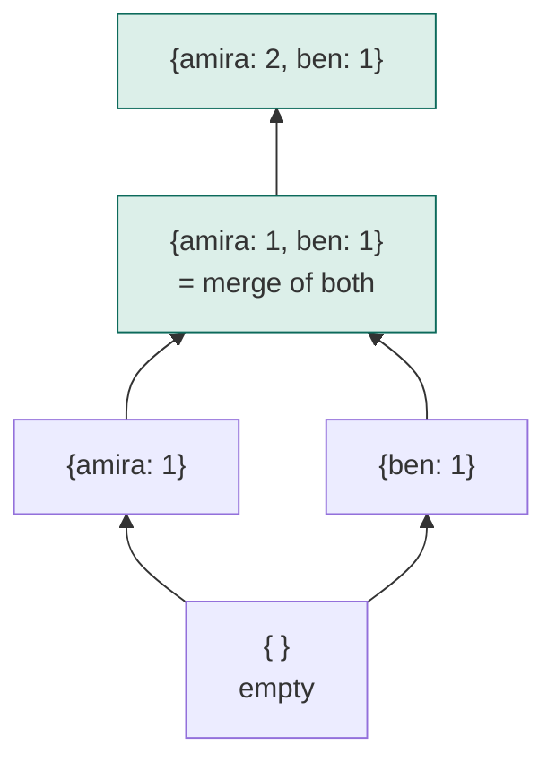
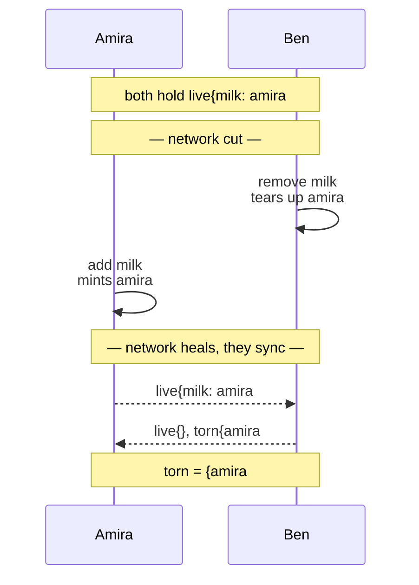
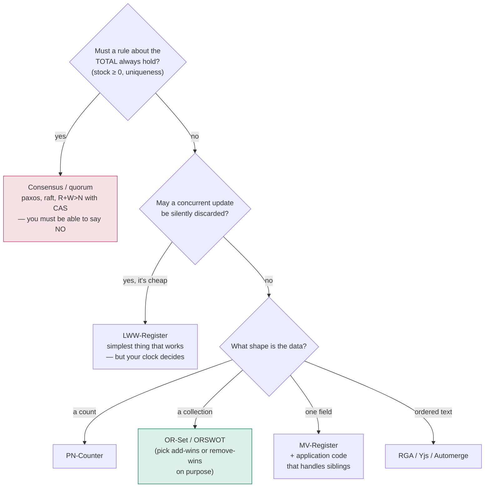
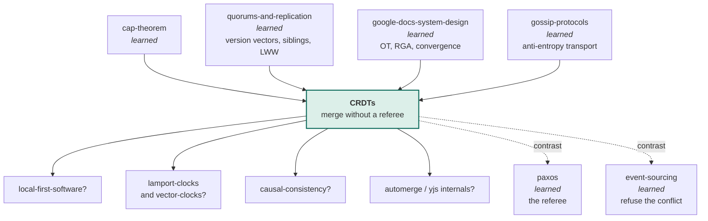

# CRDTs — conflict-free replicated data types

> Two people change the same thing at the same time, on machines that cannot
> talk to each other. Both changes must survive, nobody is allowed to be in
> charge, and when the machines finally do talk they must end up identical.
>
> This lab builds the data structures that make that possible, breaks them, and
> then draws the line — precisely — around the things they cannot do.

**Run it:**

```bash
java src/Sim.java             # one narrated afternoon: two phones, one shopping list
java src/Tests.java           # 46 guarantees, asserted
java src/Tests.java broken    # three planted bugs, and which law each one breaks
java src/Experiments.java     # ten measurements
java src/Experiments.java 6   # ...or just experiment 6
java src/YourMerge.java       # exercise 5: implement merge yourself (2/5 -> 5/5)
```

No build tool, no dependencies. JDK 22+ compiles the whole `src/` directory
straight from source.

**Play with it:** [`visualization.html`](visualization.html) —
*Merge Without a Referee*
(<https://claude.ai/code/artifact/fea9c00f-2004-4f4f-a867-7d6048751fdc>).
Three phones, four competing designs, every network abuse as a button, and
eight guess-first situations.

**Depth layers:**

| Layer | Stages | You will be able to |
|---|---|---|
| **Beginner model** | 1–9 | Explain why two offline edits normally destroy each other, and what "design the merge instead of the value" buys |
| **Intermediate model** | 10 | Derive every type in the family — counter, set, register, text — from the failure of the one before it |
| **Engineering model** | 11–14 | Reason about the failure modes, state the guarantee precisely, and say out loud what is *not* guaranteed |
| **Production model** | 15 | Read the Shapiro paper, Riak's data-type docs and Automerge's internals, and know what you are looking at |

**Builds on earlier labs.** You already have three pieces of this:
[`quorums-and-replication`](../quorums-and-replication/) measured that
last-write-wins silently discarded 1,000 of 1,000 concurrent updates and showed
you version vectors and siblings;
[`google-docs-system-design`](../google-docs-system-design/) built an RGA as the
alternative to operational transformation;
[`gossip-protocols`](../gossip-protocols/) built the anti-entropy transport that
CRDTs ride on. This lab is the thing all three were pointing at.

---

## 1. WHY — the problem, before any technology

Your app runs on people's phones. Phones go into tunnels, onto planes, into
buildings with bad signal. People keep using the app anyway, because an app that
freezes when the bars disappear is an app they delete.

So the app lets them keep working, stores the change locally, and sends it up
when the signal comes back. Now two people have changed the same shopping list,
the same document, the same order, while neither could see what the other was
doing. Somebody's change has to be dealt with.

The way almost every app deals with it is: whichever change arrives at the
server last replaces the other one. That is not a decision anyone wrote down.
It is what happens when nobody makes a decision, and it means real work that a
real person did just stops existing, with no error message and no way to notice.

This lab is about the alternative: designing the data so that both changes
survive on their own, without asking anyone for permission.

---

## 2. PROBLEM — a story with two people in it

Amira is on the London Underground. Ben is on a plane to Berlin. They share a
shopping list in the same app. Right now both phones show the same thing:

```
bread
```

Amira, underground, adds **milk**. Ben, over the North Sea, adds **eggs**.
Neither phone has signal, so both changes sit in a pocket for forty minutes.

Then they land. Both phones connect. Both send their list up.

Here is the thing to hold on to: **the two phones are not disagreeing about
anything.** Amira wants milk on the list. Ben wants eggs on the list. Those are
completely compatible wishes. There is a right answer — `bread, milk, eggs` —
and everybody would accept it. The only reason the app might get it wrong is the
way it stores and sends the list.

---

## 3. NAIVE SOLUTION — send the list

The obvious design, and the one you would write first:

> Each phone keeps the list. When you edit it, send the whole list up with the
> current time. The server keeps whichever list has the newest time.

It is simple, it is easy to test, and it works flawlessly as long as only one
person is editing.

---

## 4. FAILURE — what actually arrives

Amira's phone sends `[bread, milk]`, stamped 14:32:07.
Ben's phone sends `[bread, eggs]`, stamped 14:32:09.

> **🔮 Predict:** What does the list hold afterwards, and who is told about it?
>
> <details><summary>Reveal</summary>
>
> `[bread, eggs]`. Milk is gone. Nobody is told anything, because from the
> server's point of view nothing went wrong: it received two lists, it kept the
> newer one, exactly as designed.
>
> The deep problem is in the *shape of the message*. Ben's phone sent a
> complete list that happened not to contain milk. The server cannot tell the
> difference between **"Ben deleted milk"** and **"Ben has never heard of
> milk"** — because a list of items does not record which of them were
> decisions. The message threw away the information needed to combine the two.
>
> Run it: `java src/Sim.java` — Scene 1 shows exactly this.
> Measured at scale in `java src/Experiments.java 1`: over 1,000 rounds with 3
> phones editing offline, users made **8,992** changes and **2,971** survived.
> **67% of all work was destroyed**, and every single round "succeeded".
>
> </details>

Two more things break the same way, and it is worth seeing that they are the
same break:

- **A retry duplicates work.** The phone doesn't get an acknowledgement, so it
  sends again. If the message had been `add 1 to the counter`, the counter is
  now 2. The transport is at-least-once — you met that in the
  [`transactional-outbox`](../transactional-outbox/) and
  [`communication-protocols`](../communication-protocols/) labs — so this is
  not a rare case, it is Tuesday.
- **The clock decides.** Ben's phone won because its clock said a bigger
  number. If Amira's phone were 60 seconds fast, Amira would win every argument
  for the next minute regardless of who actually acted later. `java
  src/Experiments.java 8` runs this: a clock 60 seconds fast destroyed
  **1,000 of 1,000** genuinely-newer writes.

---

## 5. THE REAL REQUIREMENT

Write down what we actually need, in plain words, with no technology in it:

1. Each machine can change its own copy immediately, with no permission from
   anyone. (Otherwise the app freezes in the tunnel.)
2. Machines exchange information in any order, any number of times, with any
   amount of it lost along the way, and it must not matter.
3. Once two machines have exchanged the same information, they must hold
   **exactly the same thing** — not "close enough", not "eventually if a repair
   job runs".
4. No change that a person actually made may be silently thrown away.

Requirements 1 and 3 look contradictory. Almost every distributed system you
have studied so far resolves the contradiction by giving up on 1: a leader, a
coordinator, a quorum, a lock — some referee who decides. You have built three
of those ([`two-phase-commit`](../two-phase-commit/), [`paxos`](../paxos/),
[`quorums-and-replication`](../quorums-and-replication/)) and you know what they
cost: when the referee is unreachable, work stops.

This lab takes the other road. Keep requirement 1. Get requirement 3 anyway.

---

## 6. KEY IDEA

> **Stop sending the answer. Send the evidence — and design the combining rule
> so that combining evidence is boring.**

Two halves, both load-bearing:

- **Send evidence, not conclusions.** Not "the list is `[bread, eggs]`", but
  "an event named `ben#1` says eggs is on the list". Evidence from two machines
  is not in conflict; it is just more evidence.
- **Make the combining rule immune to the network.** Design the rule so that
  combining in a different order gives the same result, combining in different
  groupings gives the same result, and combining the same evidence twice
  changes nothing. A network that reorders, regroups and duplicates then has
  nothing left to break.

Everything else in this lab is working out what that combining rule has to look
like for a counter, for a set, for a single field, and for a piece of text.

---

## 7. TERMINOLOGY — the words, now that you have the ideas

Five terms carry the whole lab. Each gets the full treatment; smaller terms are
defined where they first appear and collected in the glossary at the end.

### replica

- **Plain meaning:** one machine's own copy of the data.
- **Technical meaning:** an independently updatable copy. Amira's phone, Ben's
  phone and the server are three replicas of one shopping list.
- **Why the word exists:** to stop you saying "the data". There is no "the
  data" — there are only copies, and at any given moment they may all be
  different. You used this word in
  [`quorums-and-replication`](../quorums-and-replication/) for the same idea;
  the difference here is that a replica may accept a write with no quorum, no
  coordinator and no permission at all.
- **Example:** three replicas of the shopping list; Amira's holds
  `[bread, milk]`, Ben's holds `[bread, eggs]`, the server's holds `[bread]`.

### merge

- **Plain meaning:** the rule for combining two copies into one.
- **Technical meaning:** a pure function `merge(a, b)` that takes two complete
  states and returns a state, never mutating either input.
- **Why the word exists:** to separate it from "apply", "write" and "resolve".
  A merge does not decide who was right; it is not allowed to prefer the caller
  over the argument, or the newer over the older, unless that preference is
  written into the function itself. Everything interesting in this lab is a
  choice about what `merge` does.
- **Example:** `merge({a:3}, {b:2})` = `{a:3, b:2}` for the scoreboard in §8.
- **Connects to:** it is the counterpart of the `transform` function in
  [`google-docs-system-design`](../google-docs-system-design/) — same job
  (reconcile two independent edits), completely different strategy.

### commutative, associative, idempotent — "the three laws"

These are the three properties `merge` must have. They are one idea each:

| Law | In symbols | In words | The network fault it kills |
|---|---|---|---|
| **Commutative** | `a⊔b = b⊔a` | order of combining doesn't matter | messages arriving out of order |
| **Associative** | `(a⊔b)⊔c = a⊔(b⊔c)` | grouping doesn't matter | messages batched or relayed differently |
| **Idempotent** | `a⊔a = a` | combining twice changes nothing | messages delivered more than once |

- **Why these three:** they are exactly the abuses an unreliable network
  commits. If your merge survives all three, the network has no move left. This
  is not an analogy — `java src/Experiments.java 3` delivers seven pending
  messages in **all 5,040 possible orders** and gets **1** distinct final state.
- **Example of breaking one:** if `merge` added the counters instead of taking
  the maximum, it would still be commutative and associative — but not
  idempotent, so one duplicated message would invent a count that never
  happened. Measured in `java src/Experiments.java 2`: with the same message
  delivered ten times, sum-merge reads **11** where the true answer is **2**.

### converge / strong eventual consistency

- **Plain meaning:** everyone ends up holding the same thing.
- **Technical meaning:** **strong eventual consistency (SEC)** — any two
  replicas that have received the same *set* of updates are in the same state,
  immediately, with no further coordination. Note "set", not "sequence": the
  order they arrived in is not part of the promise.
- **Why the word "strong":** plain eventual consistency (from
  [`cap-theorem`](../cap-theorem/) and [`cqrs`](../cqrs/)) only promises that
  things settle down *somehow*, often with a background repair job resolving
  conflicts by picking a winner. SEC is stronger and cheaper at once: sameness
  is a property of the merge function itself, so there is no repair job, no
  conflict resolution step, and no window in which two replicas that have seen
  the same updates disagree.
- **Careful:** converging is not the same as being *right*. You will see a
  design in §10 where all three replicas converge, perfectly, onto an answer
  that is wrong.

### CRDT

- **Plain meaning:** a data type built so that copies of it can be merged
  without a referee.
- **Technical meaning:** **conflict-free replicated data type** — a data type
  whose merge is commutative, associative and idempotent, so that replicas
  achieve strong eventual consistency with no coordination.
- **Why the term exists:** to name the shift from *resolving* conflicts to
  *not having* them. In a CRDT there is no conflict to resolve, because two
  concurrent updates are, by construction, both representable in the merged
  state. The name is a promise about where the work went: into the design of
  the type, so it does not have to happen at runtime.
- **Two families, both called CRDTs:** **state-based** (also *CvRDT*
  — "convergent"), which ship whole states and merge them; and **op-based**
  (also *CmRDT* — "commutative"), which ship individual operations. This lab
  builds state-based ones, because they demand nothing from the network, and
  §11 shows exactly what op-based ones demand instead.

---

## 8. MENTAL MODELS — two pictures, and where the first one lies

### The simple model: a scoreboard nobody can rub out

Picture a wall scoreboard with one row per person. Rules:

1. You may only ever **raise your own row**.
2. To combine two scoreboards, take the **higher number in each row**.
3. The score is the **sum of all rows**.

That is the whole thing. Two people raising their own rows in a tunnel cannot
destroy each other's work, because they are writing in different rows. Combining
is taking maxima, and taking the max of a row you already have changes nothing —
so a scoreboard you have already copied can be copied again, ten times, in any
order, harmlessly.

### The engineering model: a lattice you can only climb

Formally, a replica's state is a point in a **join-semilattice**: a set of
states with a partial order (`≤` = "is at least as old as") in which any two
states have a **least upper bound** — the smallest state that is at or above
both of them. `merge` *is* that least upper bound, written `⊔` or "join".



Read the arrows as "climbs to". Two replicas that go their own way climb into
different branches; merging is finding the lowest point above both. Because
there is always exactly one such point, and because a local update also only
ever climbs (**monotonicity**), replicas can never end up in a state from which
they cannot rejoin.

That single picture explains the three laws rather than assuming them: a least
upper bound is symmetric in its arguments (commutative), the LUB of three
elements is the same however you bracket it (associative), and the LUB of a
thing with itself is the thing (idempotent).

### Mapping the two

| Scoreboard | Engineering | In the Java |
|---|---|---|
| the whole board | one replica's state | `GCounter` instance |
| one row | one replica's contribution | an entry in `rows` |
| raising your own row | a local, uncoordinated update | `increment(replica, n)` |
| taking the higher of each row | the join / least upper bound | `merge` |
| the total at the bottom | the value the user sees | `value()` |
| "you can never rub out" | monotonicity | no code path lowers a row |

### Where the analogy breaks

The scoreboard is genuinely misleading in three places, and each one is a whole
section later on:

1. **You cannot lower a row.** Decrementing is not "write a smaller number" —
   merge would immediately restore the bigger one. The scoreboard has no way to
   go down, and §10 shows the actual fix.
2. **Rows are for counting, not for identity.** A shopping list is not a number
   per person. Sets need a different construction, and *deletion* in a set is
   the hardest thing in this lab.
3. **The board grows forever.** Real CRDTs accumulate evidence — one row per
   replica that ever touched the data, one record per deletion — and nothing in
   the algorithm ever cleans it up. Measured in `java src/Experiments.java 7`:
   a shopping cart with **10** visible items was storing **500** records,
   **50 per item**.

---

## 9. VISUALIZATION — watch it before you read the mechanism

**[`visualization.html`](visualization.html) — *Merge Without a Referee***
(<https://claude.ai/code/artifact/fea9c00f-2004-4f4f-a867-7d6048751fdc>)

Three phones hold one shopping list. Each phone card shows two boxes, and the
whole lesson is the difference between them:

- the **green box** — what the person sees;
- the **dashed box** — what is actually stored.

Watch the dashed box. The green box is the same in every design; the dashed box
is the design.

What to do, in order:

1. Start on **Receipts**, the default. (The page also prints its technical
   name, OR-Set; §10 is where that name gets earned.) Press *add milk* on Amira, then
   *Sync to everyone* — notice that syncing does **not** deliver. The messages
   sit on the wire until you deliver them, one at a time, in any order, or
   duplicate them, or throw them away. That is the experiment.
2. Switch to **Whole list, newest wins** and do the same thing on two phones.
   Watch one person's item disappear with no error anywhere.
3. Use the **guess-first situations** at the bottom. Each one poses a question
   with two or three answers, then plays the sequence out with a full-sentence
   narration of every step. Being wrong is the point; the explanation only lands
   after you have committed.
4. When something surprises you, use **Step back** and change one thing —
   whose clock is fast, which phone is cut off, which message gets delivered
   first. Every arbitrary choice on that page is a control, deliberately.

Every outcome on the page is the same outcome the Java produces; the eight
scripted situations were verified against the test suite.

---

> ### ✅ Checkpoint — end of the beginner model
>
> You can now explain why two offline edits normally destroy each other, why
> the fix is to change the message rather than add a resolution step, and what
> the three laws buy. **Next:** deriving the actual types — and every strange
> detail in them will arrive as the fix to something you just watched break.

---

## 10. THE ACTUAL MECHANISM — nine designs, each one fixing the last

Nothing below is presented as finished. Each version is what a careful engineer
would build next, given what just broke.

### v1 — a counter is a number, merge takes the bigger one

Two phones, both showing `5`. Amira taps +1, Ben taps +1. Amira's copy says 6,
Ben's says 6. Merge takes the maximum: **6**.

> **🔮 Predict:** Two people each added one. What should the counter read, and
> what does it read?
>
> <details><summary>Reveal</summary>
>
> It should read 7. It reads 6. One increment is gone.
>
> The bug is not in the merge, it is in the *state*. A single number cannot
> record who did what, so two different histories (`5+1` and `5+1+1`) can produce
> the same number and become indistinguishable. **The state has thrown away the
> information the merge needs.** That sentence is the whole design method:
> when a merge cannot do its job, add to the state, don't add to the merge.
>
> </details>

### v2 — G-Counter: one row per replica

Keep a **row per replica**. You may only raise your own row. Merge takes the
per-row maximum. The value is the sum.

```
Amira:  {amira: 1}                Ben: {ben: 1}
merge:  {amira: 1, ben: 1}   -> value 2   ✔
```

Two people writing in different rows cannot overwrite each other, because
overwriting is not a thing you can do to someone else's row. `GCounter.java`,
and the merge is one line:

```java
other.rows.forEach((replica, count) -> next.merge(replica, count, Math::max));
```

Duplicates are now harmless for free: `max(1,1) = 1`. Run
`java src/Experiments.java 2` — the same message delivered ten times still reads
2, where a sum-merge reads 11.

The name: **G-Counter**, G for *grow-only*. Which is also its problem.

> **🔮 Predict:** Ben wants to subtract 3. His row says 4, so he writes 1 into
> it and syncs with Amira, whose copy still says `{ben: 4}`. What does the
> counter read afterwards?
>
> <details><summary>Reveal</summary>
>
> `{ben: 4}` — the decrement is gone. Merge takes the max, so a smaller number
> looks exactly like older news, and older news is what merge exists to discard.
>
> Run `java src/Experiments.java 4` for the printed before/after. The general
> rule this teaches: **in this family, the state may only ever climb.** Any
> operation that moves it down is not implementable as-is. It must be re-expressed
> as something that moves it up.
>
> </details>

### v3 — PN-Counter: two piles

Re-express the decrement. Keep **two** grow-only counters: `P` for everything
ever added, `N` for everything ever taken away. The value is `sum(P) − sum(N)`.
Both halves still only climb, so both halves still merge by max.

```
P{amira: 6, ben: 4}   N{ben: 3}   ->   10 − 3 = 7   ✔
```

That is `PNCounter.java`, and it is eleven lines of real code. The pattern —
*if the operation goes the wrong way, add a second monotonic pile to hold it* —
recurs everywhere in this family.

### v4 — G-Set: adding things to a list

A shopping list is not a number. Simplest possible design: a set, merge is
union. Union is commutative, associative and idempotent for free, so this
converges with no machinery at all (`GSet.java`).

It cannot remove. Removing means the set gets smaller, and smaller is down.

### v5 — 2P-Set: adds pile plus a blacklist

Same trick as the PN-Counter: a second grow-only pile. One set of things added,
one set of things removed, and the list you see is *adds minus removes*.

> **🔮 Predict:** Amira removes milk, changes her mind, and adds milk again.
> Is milk on the list?
>
> <details><summary>Reveal</summary>
>
> No — and it never can be again. The removes pile contains the word "milk", and
> the new add lands in the adds pile where the removes pile cancels it, forever.
>
> Measured: `java src/Experiments.java 5` runs 100 add-remove-add cycles.
> The 2P-Set has the item in **0 of 100** carts. Try it yourself in the
> visualization under *Adds plus a blacklist*.
>
> And notice what kind of failure this is. All three replicas agree completely.
> The merge obeys all three laws. It converges beautifully — onto the wrong
> answer. **Convergence is a property of the merge; correctness is a property
> of the design.** Nothing in the algebra will ever warn you about this.
>
> </details>

The diagnosis is the same as v1: the state threw away information. "milk was
removed" is not enough. We need to know **which** milk.

### v6 — OR-Set: remove receipts, not values

This is the central idea of the lab, and it is one sentence:

> **An add is not a value. It is a unique event — and a remove destroys events,
> never values.**

Every add mints a **dot**: a globally unique name for one event, made with no
coordination at all, consisting of *(which replica, how many things that replica
has done)*. `amira#3` is the 3rd action ever taken on Amira's phone, and no
machine anywhere can accidentally produce that name. (`Dot.java`. This is the
same idea as the site-id tie-break in
[`google-docs-system-design`](../google-docs-system-design/), and one entry of a
version vector from [`quorums-and-replication`](../quorums-and-replication/).)

The state becomes:

```
live:  milk -> {amira#3}      the adds still standing, with their receipts
torn:  {amira#1, ben#2}       tombstones: receipts that have been destroyed
```

A **tombstone** is a record that something was deleted, kept because "absent"
and "deleted" have to be told apart — you met the word for deleted rows in
[`btree-and-lsm`](../btree-and-lsm/) and
[`quorums-and-replication`](../quorums-and-replication/); here it names a dead
receipt rather than a dead row.

Removing milk does not blacklist the word "milk". It tears up **exactly the
receipts for milk that this replica has actually seen** — which is why the type
is called an **observed-remove set (OR-Set)**. Merge is:

```java
torn = torn(a) ∪ torn(b)
live = (live(a) ∪ live(b)) minus every receipt in torn
```

Re-adding now works: the second add mints `amira#9`, and no torn receipt names
`amira#9`. **100 of 100** carts, in the same experiment that gave the 2P-Set
0 of 100.

> **🔮 Predict:** Both phones hold milk with receipt `amira#1`. The network is
> cut. Ben deletes milk; at the same moment Amira, in the dairy aisle, adds milk
> again. They sync. Is milk on the list — and does the answer depend on which
> message arrives first?
>
> <details><summary>Reveal</summary>
>
> Milk stays, and no, the order makes no difference.
>
> Ben's delete names one receipt: `amira#1`. Amira's new add mints `amira#4`,
> which Ben has never seen and therefore cannot have meant to destroy. The merge
> tears up `amira#1` and leaves `amira#4` standing.
>
> Measured over 1,000 randomly-ordered merges in
> `java src/Experiments.java 6`: the add won **1,000** times.
>
> </details>



**"Add wins" is a policy, not an accident.** It falls out of "you may only
remove what you have observed", and it was chosen because a stray item in a cart
annoys a user, whereas an item that refuses to be deleted is a support ticket —
or a privacy incident. Remove-wins sets exist too. The thing that matters
professionally is knowing which one you bought.

### v7 — registers: one field, two people, one value

A counter merges by adding evidence. A set merges by unioning it. But what
about a field that is *supposed* to hold exactly one value — a delivery address,
a display name?

**LWW-Register** (`LwwRegister.java`): keep the value plus a timestamp plus the
replica id, and merge keeps the bigger `(timestamp, replicaId)` pair. It is a
perfectly legal CRDT — the three laws hold, and the tie-break on replica id is
load-bearing, not decoration: without it, two writes in the same millisecond
merge differently depending on direction and the replicas diverge permanently.
(`java src/Tests.java broken` plants exactly that bug and catches it.)

It converges by throwing one of the two writes in the bin, and your wall clock
picks which. `java src/Experiments.java 8`: a replica whose clock is 60 seconds
fast destroyed **1,000 of 1,000** genuinely-newer writes, silently.

**MV-Register** (`MvRegister.java`): refuse to pick. Keep every candidate that
nothing else supersedes, and hand the set to whoever reads it. Each candidate
carries the **version vector** it was written against — the same structure you
used in [`quorums-and-replication`](../quorums-and-replication/), and, not
coincidentally, the same lattice as a G-Counter. A write joins every vector it
can see and bumps its own entry, which is how it *earns* the right to replace
what it saw. Merge drops any candidate strictly dominated by another: a
dominated candidate is not a rival opinion, it is an ancestor whose author has
already been overruled by someone who read it.

Two survivors are exactly what Riak and Dynamo call **siblings**. The trade is
plain: LWW never bothers the application and sometimes loses data; MV never
loses data and sometimes hands the application a decision it must be written to
handle.

### v8 — RGA: order, which is the hard one

Text is a set with a *position*, and position is exactly the thing that stops
being true the moment someone else edits. "Insert at index 3" was correct when
it was written and wrong when it ran — the failure the
[`google-docs-system-design`](../google-docs-system-design/) lab spent its whole
length on.

**RGA** (replicated growable array, `Rga.java`) applies the OR-Set trick to
order: never name a position, name an identity. Every character gets a dot, and
an insert says *"this character goes immediately after that character"*. Two
concurrent inserts after the same character are ordered by their dots, bigger
first — a rule both replicas can apply without talking. Deletes are tombstones,
so a delete may safely arrive before the character it deletes.

Merge is union of characters plus union of tombstones: the three laws hold for
free.

One catch, which bit this lab during construction and is worth carrying:
union-merge makes RGA **converge** whatever dot numbers you use, but it only
produces the order a human expected if the dot counters are **Lamport counters**
— every new dot numbered higher than every dot its author has seen. With plain
per-replica 1, 2, 3… all replicas still agree; they just agree on `HATSC`
instead of `CHATS`. **Convergence and intention preservation are two different
properties, and only one of them is free.**

### v9 — shipping operations instead of whole states

Everything so far ships a whole snapshot on every sync. For a 10,000-item set
that is absurd. The obvious economy is to ship the operation — "add milk with
receipt amira#3" — instead of the state. That is the **op-based** family, and it
is what Automerge, Yjs and most collaborative editors actually do.

> **🔮 Predict:** An op-based set sends two operations: `add milk (amira#1)`
> and then `remove milk (amira#1)`. One replica receives them in that order,
> another receives them backwards. Do the two replicas end up the same?
>
> <details><summary>Reveal</summary>
>
> No. `java src/Experiments.java 9` prints it: add-then-remove gives `[]`,
> remove-then-add gives `[milk]`. The remove arrived when there was nothing to
> remove, did nothing, and then the add landed with nothing left to cancel it.
>
> Op-based CRDTs need **causal delivery**: an operation may not be applied
> before the operations it depends on. Somebody has to build that — sequence
> numbers, buffering, exactly-once — and it is not free. This is the same bug
> the google-docs lab hit in its own CRDT: a delete arriving before its
> character was silently lost, in 428 of 500 runs.
>
> The state-based version has no such requirement, because it never applies a
> bare "remove" — it merges a whole snapshot with the tombstones included. Same
> experiment: both orders give `[]`.
>
> </details>

The honest summary of the trade:

| | State-based (CvRDT) | Op-based (CmRDT) |
|---|---|---|
| ships | the whole state | one operation |
| bandwidth | large, grows with the data | small, grows with activity |
| needs from the network | **nothing** — drop, duplicate, reorder freely | causal order, exactly-once delivery |
| a wiped replica | repairs itself on the next ordinary sync | needs someone to keep and replay the log |
| used by | Riak data types, Redis Enterprise CRDBs, Akka Distributed Data | Automerge, Yjs, most collaborative editors |

**δ-state CRDTs** are the modern middle: state-based semantics, but a sync ships
only the *part* of the lattice that changed (a "delta"), which merges by exactly
the same rule. You get op-based bandwidth with state-based network requirements.
Riak, Akka and most current research systems are delta-based. This lab ships
full states because they make the algebra visible; deltas are an optimisation on
top, not a different idea.

---

> ### ✅ Checkpoint — end of the intermediate model
>
> You can now derive the whole family from first principles: every type is a
> monotonic state plus a join, and every awkward-looking detail (two piles, a
> receipt per add, a tie-break on replica id, Lamport-numbered dots) is the scar
> of a specific failure you have now watched. **Next:** what breaks in
> production, and the precise sentence describing what a CRDT does *not*
> promise.

---

## 11. FAILURE SCENARIOS

Ten things that go wrong. For each: how to cause it, where to watch it, what
happens and why, and what it looks like when it happens to you at 3am.

**1 · The same message is delivered five times.**
*Cause:* `java src/Experiments.java 2`, or *Duplicate* on any message in the
visualization. *What happens:* nothing. *Why:* merge is idempotent — taking the
max of a row you already hold, or unioning a receipt you already have, is a
no-op. *Guarantee intact:* everything. *Lost:* nothing. *In production:* this is
why CRDT syncs can ride at-least-once transports (gossip, Kafka, a retrying
HTTP client) with no deduplication layer, which is a real operational saving.
Contrast the sum-merge bug: same duplicates, counter reads **11** instead of 2.

**2 · Messages arrive in a scrambled order.**
*Cause:* `java src/Experiments.java 3`, or *Deliver in reverse* on the page.
*What happens:* nothing. *Why:* commutativity and associativity. *Evidence:*
seven pending messages delivered in all **5,040** orders produce **1** distinct
final state. *In production:* no sequencer, no per-connection ordering
requirement — the exact opposite of the *ordered per-client channel* that
[`google-docs-system-design`](../google-docs-system-design/) needed and whose
violation threw immediately.

**3 · Messages are lost.**
*Cause:* `Cluster.dropRate = 0.4` in the tests, or *Drop* on the page.
*What happens:* replicas stay behind, then catch up on the next sync that gets
through. *Why:* every sync carries the **whole** state, so a later message
subsumes every earlier one that was lost. Losing a message costs latency, never
data. *Intact:* convergence, once anything gets through. *Lost:* nothing
permanent. *In production:* this is why anti-entropy is a background loop rather
than a retry queue — see [`gossip-protocols`](../gossip-protocols/). The
tests run at **30–50% loss** with 46/46 passing.

**4 · The network splits, then heals.**
*Cause:* Scene 4 of `java src/Sim.java`; the *Cut the group in half* situation
on the page. *What happens:* during the split the two sides genuinely show
different lists (`Sim` prints 2 distinct views); after healing they agree in
**1** sync round, with 76 messages dropped and 55 duplicated along the way.
*Why:* merge does not care how old the news is. *Intact:* availability —
everyone kept working. *Lost:* **agreement, temporarily.** During the split two
users can be looking at different lists and neither is wrong. *In production:*
this is the AP corner of [`cap-theorem`](../cap-theorem/), chosen on purpose;
the operational job is to make the disagreement window visible (sync lag per
replica) rather than to prevent it.

**5 · A replica is wiped and restarts empty.**
*Cause:* `java src/Experiments.java 10`. *What happens:* it reads 0, and after
one ordinary sync round it reads **60** again — fully repaired. *Why:* every
replica carries complete evidence, so a healthy peer's snapshot restores the
wiped one with no special recovery path. *Compare:* an op-based replica that
consumed and discarded its operations reads **0** forever unless someone
replays a log. *In production:* the strongest argument for state-based CRDTs.
Note this is the exact failure that broke the quorum argument in
[`quorums-and-replication`](../quorums-and-replication/) — there, two
rebuilt-empty replicas satisfied `R=2` and returned nothing. Here the same event
is a non-event.

**6 · One machine's clock is wrong.**
*Cause:* `java src/Experiments.java 8`, or the *clock accurate / +60s fast*
toggle on the page. *What happens:* under an LWW-Register, the fast machine wins
every argument: **1,000 of 1,000** genuinely-newer writes destroyed. *Why:* LWW
made the wall clock into the conflict-resolution algorithm. *Intact:*
convergence — everyone agrees, on the wrong value. *Lost:* the newer write, with
no error, no log line and no metric. *In production:* either accept it
explicitly for data where losing a write is fine (a "last seen at" field), or
use an MV-Register and write the application code that handles siblings. NTP
skew is not a hypothetical; it is the normal state of a fleet.

**7 · The data grows forever.**
*Cause:* `java src/Experiments.java 7`. *What happens:* a cart with **10**
visible items stores **500** records (**50 per item**, 250 of them tombstones);
a 206-character document stores **403** cells. *Why:* every add is remembered as
an event and every delete is remembered as a tombstone, and nothing in the
algorithm ever frees either. *Intact:* correctness. *Lost:* nothing logical —
this is a cost, not a bug. *In production:* the single biggest operational
concern with CRDTs. Freeing a tombstone requires knowing that **every** replica
has seen the delete (*causal stability*), which is itself a distributed
agreement problem — so real systems either run a stability tracker, or bound the
number of replicas, or (Riak's ORSWOT, Automerge's compaction) redesign the
representation so version vectors replace most per-element tombstones.

**8 · Operations arrive before the operations they depend on.**
*Cause:* `java src/Experiments.java 9`. *What happens:* an op-based set
diverges permanently: `[]` on one replica, `[milk]` on the other. *Why:* the
remove had nothing to remove yet, so it did nothing, and the add later landed
uncancelled. *Intact:* nothing — this is real divergence. *Lost:* strong
eventual consistency itself. *In production:* op-based systems ship a causal
delivery layer (vector clocks + a buffer for operations whose dependencies have
not arrived) and exactly-once delivery. If you adopt an op-based library, that
layer is part of what you are adopting — check it exists before you trust it.

**9 · A replica moves *down* the lattice.**
*Cause:* `java src/Tests.java broken`, bug 1 and bug 3; or imagine a bad deploy
that resets a row, or a restore-from-backup that reverts one replica.
*What happens:* the invariant "state only ever climbs" is gone, and merges start
producing different answers depending on direction. *Why:* the join is only well
defined over a lattice you climb; a state that goes backwards can be
re-introduced by a peer and then removed again, forever. *Intact:* nothing
reliable. *Lost:* convergence. *In production:* restoring a CRDT replica from an
old backup is not a neutral act — it is a non-monotonic move, and the safe
procedure is to bootstrap the replica empty and let it re-merge, exactly as in
failure 5. The three planted bugs in `Broken.java` are all this failure in
disguise, and **3 of 3** are caught by the law checks alone.

**10 · Everything converges and the result is still wrong.**
*Cause:* Scene 5 of `java src/Sim.java`, and `java src/Tests.java`'s
`pncounter_cannot_keep_the_value_above_zero`. *What happens:* 10 bags of flour,
two partitioned warehouses each sell 6, the merged stock level is **−2**.
Or the Bayou classic: a 2P-Set converges on "the cart is empty" after a re-add,
in **0 of 100** carts. *Why:* the merge faithfully recorded everything that
happened; nothing in it was ever asked whether the result was *allowed*.
*Intact:* convergence. *Lost:* any rule spanning replicas. *In production:* this
is the failure that gets people fired, and §12 is about drawing the line before
it happens.

---

## 12. CORRECTNESS — the promise, and its exact edge

### What is guaranteed

- **Strong eventual consistency.** Any two replicas that have received the same
  *set* of updates hold identical state. Not "eventually", not "after a repair
  job" — immediately, as a property of the merge function.
- **No lost updates in the type's own terms.** Every update that reaches a
  replica is represented in the merged state. A G-Counter loses no increments; an
  OR-Set loses no add that was not observed-and-removed.
- **Total availability for writes.** Any replica accepts any update at any time,
  including alone in a tunnel. There is no quorum to gather and no leader to find.
- **Immunity to the network.** Loss, duplication, reordering, regrouping and
  partition cost latency, never correctness — for state-based types.
- **Monotonic progress.** Replica state only climbs the lattice, so replicas can
  never reach a state from which they cannot rejoin.

### What is explicitly NOT guaranteed

- **No global invariant.** `stock ≥ 0`, `balance ≥ 0`, "this username is
  unique", "at most 5 members" — none of these can be enforced. Two replicas that
  cannot see each other cannot both check a rule about the total. This is not a
  weakness of a particular type; it follows directly from accepting writes
  without coordination, and it is the reason CRDTs and consensus coexist rather
  than compete. **Measured: −2 bags of flour.**
- **No linearizability, no total order.** There is no "the order in which things
  happened". Concurrent updates are genuinely unordered, and read-your-own-writes
  holds only on your own replica.
- **No atomicity across objects.** Two CRDTs merge independently. There is no
  transaction spanning them; a reader can see one merged and the other not.
- **No semantic conflict resolution.** The type decides *mechanically*, by its
  own rule — add-wins, last-writer-wins, keep-both. Whether that rule matches
  what a human would have wanted is your problem, not the algorithm's. A CRDT
  guarantees that everyone agrees; it does not guarantee that what they agree on
  is sensible.
- **No free garbage collection.** Metadata grows with the number of operations,
  not the size of the data.

### What was traded away to get it

Coordination — and with it, the ability to say no. A referee-based system can
reject a write ("insufficient stock", "name already taken"); that rejection is
precisely what a CRDT gives up in exchange for working in a tunnel.

### Where the line falls in practice



The single sentence to be able to say in an interview or a design review:

> **CRDTs guarantee that everyone ends up agreeing. They do not guarantee that
> what everyone agrees on was ever allowed.**

### Complexity, briefly

| | state size | merge cost | wire cost per sync |
|---|---|---|---|
| G/PN-Counter | O(replicas) | O(replicas) | O(replicas) |
| OR-Set (this lab) | O(adds ever) | O(adds + tombstones) | O(state) |
| ORSWOT (production) | O(elements + replicas) | O(elements + replicas) | O(state), or O(δ) with deltas |
| RGA | O(characters ever typed) | O(cells) | O(state), or O(δ) |

The rows that matter are the ones with "ever" in them.

---

## 13. CODE — what to read, in what order

Seventeen files, no dependencies. Read them in this order; each is short.

| File | What it is | The line that matters |
|---|---|---|
| `Replicated.java` | the one-method interface | the three laws, stated as a comment contract |
| `Dot.java` | a globally unique event name | `record Dot(String replica, long counter)` |
| `GCounter.java` | grow-only counter | `next.merge(replica, count, Math::max)` — the whole idea, one line |
| `PNCounter.java` | up and down | `decrement` calls `minus.increment` — a decrement is an increment in the other pile |
| `GSet.java` / `TwoPSet.java` | the naive sets | `next.removeAll(removed.value())` — converges, and is wrong |
| `OrSet.java` | the set that works | `nextKilled.addAll(observed)` — removes only what was observed |
| `LwwRegister.java` | last writer wins | `wins()` — a **total** order, including the replica tie-break |
| `VersionVector.java` | causal context | `strictlyDominatedBy` — how a candidate is proved to be an ancestor |
| `MvRegister.java` | keep both | `assign` joins every visible clock before bumping its own |
| `Rga.java` | replicated text | `insertAfter` names an identity, never a position |
| `Cluster.java` | the hostile network | `dropRate`, `duplicateRate`, `shuffle`, `partition` |
| `Sim.java` | the narrated story | five scenes |
| `Tests.java` | 46 asserted guarantees | `laws()` on fixed samples, **plus** a 50,000-triple randomised law fuzz |
| `Broken.java` | three planted bugs | each breaks exactly one law |
| `YourMerge.java` | exercise 5 — `merge()` blanked out | self-checking: starts at 2/5, correct at 5/5 |

The load-bearing pattern, visible in every type: **the state is the evidence,
the merge is a least upper bound, and no code path ever moves the state down.**
Grep for `Math::max`, `addAll` and `putAll` — that is where all the convergence
lives. There is no conflict-resolution function anywhere in the lab, because
there is nothing to resolve.

**A bug this lab found in itself, worth keeping.** The hand-written law check
uses five sample states, and five samples are not a proof. Adding a randomised
law fuzz (50,000 triples of replicas that share a history and then diverge)
immediately failed: `a.merge(a) != a` on 995 of them. The cause was in
`OrSet.add` — presenting a dot that had already been torn up put it back into
`live` while it was still in `killed`, and merge then subtracted it again. One
guard line fixed it. The lesson generalises past this lab: **for a CRDT, the
laws are the specification, so test them on generated states, not on states you
chose while thinking about the happy path.**

Actual output of `java src/Tests.java`:

```
== The three laws — checked on every type in the lab
  PASS  G-Counter: commutative / associative / idempotent
  ... (all 7 types)
  PASS  OR-Set laws over 50000 random triples (comm/assoc/idem broken: 0/0/0)
== Sets
  PASS  2P-Set: 'milk' is dead forever after one remove
  PASS  concurrent add vs remove: the add wins
  PASS  ...and it wins in both merge directions
== Text
  PASS  500 random 3-editor sessions, 30% loss + 30% duplication: 0 diverged
46 passed, 0 failed
```

---

## 14. EXPERIMENTS — break it yourself

Each one is predict-first. Read the question, commit to an answer, then run it.

| # | Question to answer before you run it | Command | What you should see |
|---|---|---|---|
| 1 | Of 9,000 offline edits, how many survive last-writer-wins? | `java src/Experiments.java 1` | **67% destroyed** (2,971 of 8,992 survive); G-Counter loses 0 |
| 2 | A message is delivered 10 times. Sum-merge vs max-merge? | `…2` | **11** vs **2** |
| 3 | Seven messages, every possible order. How many outcomes? | `…3` | 5,040 orders, **1** outcome |
| 4 | Can you decrement by writing a smaller number? | `…4` | No — merge restores the bigger one |
| 5 | Add, remove, add again: is it there? | `…5` | 2P-Set **0/100**, OR-Set **100/100** |
| 6 | Concurrent delete and re-add — who wins, and is it stable? | `…6` | Add wins **1000/1000**, both merge directions |
| 7 | How much metadata per visible item? | `…7` | **50 records per cart item**; 2 cells per character |
| 8 | A clock 60s fast, against genuinely newer writes | `…8` | **1000/1000** newer writes destroyed |
| 9 | Op-based, delivered out of causal order | `…9` | `[]` vs `[milk]` — permanent divergence |
| 10 | A replica's disk is wiped | `…10` | State-based recovers in one sync; op-based never |

Two more worth doing by hand:

- Open `Tests.java`, set `dropRate = 0.9` in
  `rga_fuzz_three_editors_never_diverge`, and re-run. Convergence should still
  be 0 diverged — losing messages costs time, not data. Then set
  `Cluster.settle`'s `maxRounds` to 1 and watch it start failing: that is the
  difference between *cannot converge* and *has not converged yet*.
- Run `java src/Tests.java broken` and, before reading the output, predict which
  law each of the three bugs violates.

---

> ### ✅ Checkpoint — end of the engineering model
>
> You can now name the failure modes, state the guarantee and its exact edge,
> and defend a design choice between add-wins and remove-wins, LWW and MV.
> **Next:** what real systems actually run, and everything this lab left out.

---

## 15. PRODUCTION — from this lab to a real system

### The chain: toy → real → architecture → operations

**This lab** is a single JVM, in-memory, full-state syncs, hand-driven network,
one CRDT at a time. It exists to make the algebra visible.

**A real implementation** adds four things, in roughly this order of importance:

1. **Deltas.** Nobody ships a 10,000-element set on every sync. δ-state CRDTs
   ship only the part of the lattice that changed and merge it with the same
   join. Riak, Akka Distributed Data and most current systems are delta-based.
2. **A smaller representation.** The OR-Set in this lab keeps one tombstone per
   deleted element forever. Riak's **ORSWOT** ("observed-remove set without
   tombstones") replaces most of them with a version vector per replica, which
   is O(replicas) instead of O(deletes-ever). Automerge and Yjs do the
   equivalent for sequences, plus run-length encoding of adjacent characters.
3. **Persistence and compaction.** State on disk, snapshot + subsequent deltas,
   periodic rewrite — structurally the same problem as
   [`btree-and-lsm`](../btree-and-lsm/) compaction and
   [`event-sourcing`](../event-sourcing/) snapshots.
4. **Garbage collection with a stability rule.** A tombstone may only be dropped
   once every replica has certainly seen the delete. Tracking that
   (*causal stability*) needs membership and liveness — which is what
   [`gossip-protocols`](../gossip-protocols/) provides.

**A production architecture** looks like: a set of replicas discovered and
health-checked by gossip; anti-entropy sync between them on a timer (again,
gossip); client requests routed to any replica, often the nearest, sometimes
sticky for read-your-own-writes; and a completely separate path — a quorum
write, a leader, a database transaction — for the small number of operations
that need to be able to say no.

**Operational concerns** — what an on-call engineer actually watches:

| Signal | Why | What it looks like when bad |
|---|---|---|
| metadata size per key | tombstones and dots never shrink on their own | one key at 4 MB; merges slow; sync timeouts cascade |
| sync lag between replicas | the disagreement window is a real user-visible thing | "my colleague can't see my edit" |
| tombstone / GC backlog | GC blocked by one unreachable replica | steady growth with no plateau |
| sibling count (MV / Riak) | conflicts the application must resolve | sibling explosion — a value with 10,000 siblings, a classic Riak outage |
| clock skew (only if LWW) | the clock *is* the conflict resolver | silent data loss, discovered by a customer |

### Who actually uses this

| System | What it uses | Note |
|---|---|---|
| **Riak** | G/PN-Counter, ORSWOT, MV-Register, maps of CRDTs | the reference production implementation; siblings are visible to your code |
| **Redis Enterprise (CRDB)** | LWW + counters + sets, geo-distributed active-active | plain open-source Redis has **no** CRDTs; this is the commercial product |
| **Azure Cosmos DB** | LWW by default, pluggable merge in multi-region write mode | LWW-Register semantics, with all that implies |
| **Automerge / Yjs** | op-based sequence CRDTs (RGA-family) | what you would actually use to build a collaborative editor today |
| **Apple Notes, Figma-adjacent tools** | CRDT-style merge for offline editing | offline-first is the killer use case |
| **Akka Distributed Data** | delta-CRDTs over cluster gossip | JVM, and the closest thing to this lab's code in production form |
| **Phoenix Presence** | ORSWOT over Erlang distribution | tracks who is online across a cluster with no coordinator |
| **SoundCloud Roshi** | LWW-element-set over Redis | a whole storage service built from one CRDT |

Note the pattern: **counters, sets, presence, flags, carts, and text.** Not
ledgers, not stock levels, not usernames. That boundary is §12's line, drawn by
the industry rather than by theory.

### What this lab deliberately leaves out

| Omitted | Why it matters | How real systems do it |
|---|---|---|
| **Deltas** | full-state sync is O(data) per round | δ-CRDTs; ship the changed join-irreducible part |
| **Tombstone GC** | metadata grows without bound | causal stability tracking; ORSWOT-style redesign |
| **Persistence** | everything here is in-memory | append + snapshot + compaction |
| **Real transport** | `Cluster` is hand-driven | gossip / anti-entropy, see the sibling lab |
| **Membership changes** | replica set is fixed at 3–4 | gossip membership; a new replica's dots must not collide |
| **Maps of CRDTs** | real data is nested (a cart *of* counters) | Riak maps; recursive merge, with a policy for the container |
| **Security** | any replica can mint any dot | CRDTs assume non-byzantine replicas; a malicious one can corrupt state permanently |
| **Undo** | genuinely hard in this model | Automerge and Yjs implement it as new inverse operations, not as removal |
| **Compression / encoding** | 500 dots is 500 objects here | run-length encoding of dot ranges; columnar formats (Automerge) |

The security row deserves a sentence rather than a cell: **there is no defence
in a CRDT against a replica that lies.** Every replica trusts every dot it
receives. That is fine inside your own cluster and dangerous the moment
untrusted clients are replicas — which is exactly the situation in a
peer-to-peer or local-first app, and an open research area.

---

## 16. EXERCISES

[`EXERCISES.md`](EXERCISES.md) — eight rungs, from "explain it in your own
words" through implementing a missing merge rule and finding a planted bug, up
to designing an offline-first cart for a payments-adjacent system and saying
precisely which parts must *not* be a CRDT. Answers in
[`SOLUTIONS.md`](SOLUTIONS.md) — attempt first.

---

## 17. KNOWLEDGE MAP & WHAT TO LEARN NEXT



**Commonly confused with — one sentence each:**

- **CRDT vs operational transformation (OT).** Both make concurrent edits
  converge. OT *rewrites* an operation against the ones it did not know about
  and needs a server to fix the official order; a CRDT changes the data so no
  rewriting is needed and no server is required. OT is cheaper on the wire and
  in memory, which is why a product that already has a central server picks it —
  the [`google-docs-system-design`](../google-docs-system-design/) lab measured
  both.
- **CRDT vs eventual consistency.** Eventual consistency says replicas settle
  down somehow, usually via a conflict-resolution step. A CRDT says replicas
  that have seen the same updates are *already* identical, because sameness is a
  property of the merge.
- **CRDT vs a version vector.** A version vector *detects* concurrency and hands
  you siblings. A CRDT *resolves* it by construction. A version vector is a
  component inside several CRDTs, not an alternative to them.
- **CRDT vs consensus.** Consensus picks one value and can therefore refuse a
  write; a CRDT keeps all values and can never refuse. Systems need both, for
  different data.
- **CRDT vs "last write wins".** LWW is a CRDT — the simplest one — not the
  opposite of one. The interesting question is never "CRDT or not" but "which
  merge rule, and what does it throw away".

**Suggested next:**

```
/learn lamport-clocks          the ordering machinery under dots, version vectors and causal delivery
/learn causal-consistency      the consistency model that op-based CRDTs need and this lab sidesteps
/learn local-first-software    the product philosophy CRDTs were built to serve
/learn raft                    the referee, done properly — the other half of §12's decision tree
```

---

## 18. GLOSSARY

In order of first appearance.

| Term | One line |
|---|---|
| **replica** | one machine's independently updatable copy of the data |
| **merge** | the pure function combining two replica states into one |
| **commutative** | `a⊔b = b⊔a`; order of combining doesn't matter — kills reordering |
| **associative** | `(a⊔b)⊔c = a⊔(b⊔c)`; grouping doesn't matter — kills rebatching |
| **idempotent** | `a⊔a = a`; combining twice changes nothing — kills duplicate delivery |
| **converge** | all replicas end up holding the same state |
| **strong eventual consistency (SEC)** | replicas that received the same *set* of updates are identical, with no coordination step |
| **CRDT** | a data type whose merge is commutative, associative and idempotent, giving SEC |
| **state-based / CvRDT** | ships whole states; needs nothing from the network |
| **op-based / CmRDT** | ships individual operations; needs causal, exactly-once delivery |
| **join-semilattice** | the algebraic structure: states ordered so any two have a least upper bound |
| **least upper bound / join (⊔)** | the smallest state at or above two given states — this is what merge computes |
| **monotonic** | state only ever climbs the lattice; nothing moves it down |
| **G-Counter** | grow-only counter: one row per replica, merge by per-row max |
| **PN-Counter** | two G-Counters, P and N; value is `sum(P) − sum(N)` |
| **G-Set** | grow-only set; merge is union |
| **2P-Set** | adds pile plus a removes pile; converges, but re-adding is impossible |
| **dot** | a globally unique name for one event: `(replica, counter)`, e.g. `amira#3` |
| **tombstone** | a stored record that something was deleted, kept so "absent" and "deleted" differ |
| **OR-Set (observed-remove set)** | adds mint dots; a remove destroys only the dots it has observed — so re-add works and add wins |
| **add-wins / remove-wins** | the two possible biases for concurrent add-vs-remove; a policy you choose |
| **LWW-Register** | one value plus `(timestamp, replicaId)`; merge keeps the larger pair |
| **version vector** | per-replica counts of "how much of your history I have seen" |
| **MV-Register** | keeps every candidate not superseded by another; hands the set to the application |
| **sibling** | one of the surviving candidates in an MV-Register (Riak / Dynamo's word) |
| **RGA** | sequence CRDT: characters carry dots and are inserted *after an identity*, never at a position |
| **Lamport counter** | a counter numbered above everything its author has seen; needed for RGA's *order*, not its convergence |
| **intention preservation** | the result matching what the humans meant, as distinct from merely converging |
| **causal delivery** | applying an operation only after everything it depends on — required by op-based CRDTs |
| **δ-state CRDT** | ships only the changed part of the lattice; state-based semantics at op-based bandwidth |
| **ORSWOT** | Riak's observed-remove set that replaces most tombstones with a version vector |
| **causal stability** | knowing every replica has seen an update — the precondition for freeing a tombstone |
| **global invariant** | a rule about the whole dataset (`stock ≥ 0`); the thing CRDTs provably cannot enforce |
