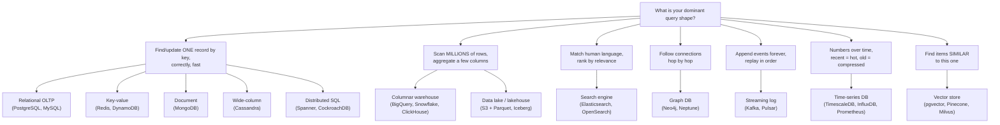
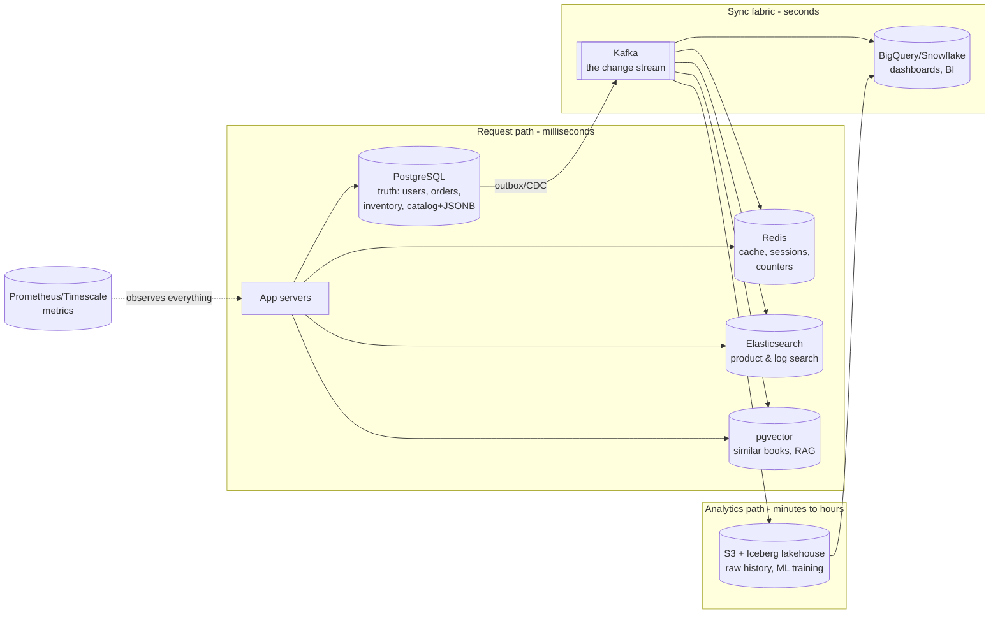
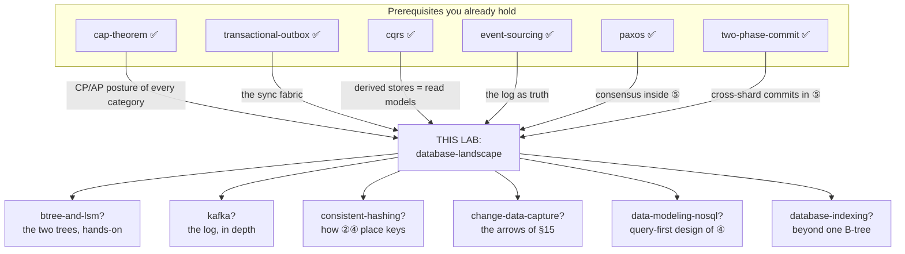

# The Database Landscape — how to choose a data store, and when to say no

> **Lab type:** survey / decision-skill lab. There is no protocol to implement here;
> the skill being trained is *workload reasoning* — looking at a problem and knowing
> which kind of store fits, which kinds will hurt, and why.
>
> **What's in this lab:**
> - `README.md` — this document (the full story, the catalog, the anti-patterns)
> - `experiments/` — runnable proofs that storage layout decides speed (H2 + DuckDB + plain Java)
> - `visualization.html` — interactive decision explorer with predict-then-reveal scenarios
> - `EXERCISES.md` / `SOLUTIONS.md`
>
> **Builds on labs you've done:** [cap-theorem](../cap-theorem/) (CP vs AP shows up in
> every category below), [cqrs](../cqrs/) (read models = derived stores),
> [transactional-outbox](../transactional-outbox/) (how stores are kept in sync),
> [event-sourcing](../event-sourcing/) (the append-only log as a source of truth).

---

## Layer map

> **BEGINNER MODEL** (§1–§9) → **INTERMEDIATE MODEL** (§10) →
> **ENGINEERING MODEL** (§11–§14) → **PRODUCTION MODEL** (§15)

You are at the beginning. Zero database-internals knowledge is assumed — only that
you've written an app that reads and writes data somewhere.

---

## 1. WHY — why are there fifty kinds of database?

Open any cloud console and you'll find a bewildering menu: relational, key-value,
document, wide-column, graph, time-series, search, warehouse, lake, streaming, vector…
Teams routinely pick wrong, and the wrong pick is expensive in a specific way: **a
database choice is the hardest decision in a system to reverse.** Code can be
refactored in an afternoon; migrating a terabyte of live data between stores with
different data models is a multi-month project with downtime risk. Teams that pick
a store because it's trendy (or because it's the one they know) end up either
fighting their database daily or rebuilding on a new one under pressure.

The good news: the menu is not fifty random products. It is about **a dozen
categories**, and each category exists for one clear reason. By the end of this
document you'll be able to look at a workload and name the category — and, just as
importantly, name the categories that would quietly ruin you.

---

## 2. PROBLEM — Meera's ledger

Meera runs a corner bookshop and keeps **one big ledger book**. Every event goes in
it, one line after another: sold two novels to Arjun, received a box from the
distributor, Priya asked for "that blue book about trains", noted that Arjun likes
mysteries.

One notebook. Perfectly fine — until the shop grows. Now watch four different
*questions* hit the same notebook:

1. *"How much money did we make in March?"* — Meera flips through **every page**,
   picking out just the amounts, adding as she goes. One question, an hour of flipping.
2. *"Do we have 'The Blue Train' in stock?"* — flip pages **backwards** looking for
   the last time that title was bought or sold. Another flip-through.
3. *"Which books mention trains?"* — the ledger is ordered by **date**, not by topic.
   There is no way to answer without reading everything ever written.
4. *"Arjun liked these mysteries — what should I recommend?"* — she'd need to trace
   from Arjun, to books he bought, to *other customers* who bought those books, to
   what *they* bought. Hopping like that through a date-ordered notebook is torture.

Notice what's happening: the notebook isn't "too small". It's **shaped wrong for
three of the four questions**. Each question wants the information physically
arranged a different way: totals want *just the amounts, all together*; stock wants
*one row per title, kept current*; topics want *a word-to-books index like the back
of a textbook*; recommendations want *threads connecting people to books to people*.

Real shopkeepers solved this centuries ago: they keep **several books**. A daily
ledger (append-only, the truth), a stock register (one line per title, updated in
place), a subject index card box, and a "regulars" notebook with each customer's
tastes. Same information — arranged four ways, because it is *asked* four ways.

Hold onto that sentence. It is the entire topic.

---

## 3. NAIVE SOLUTION — "one database for everything, just make it bigger"

Back to software. Priya and Dev launch **Chaptr**, an online bookstore. Like almost
every sensible startup, they put everything in one relational database — PostgreSQL:
users, books, orders, page views, search, everything. Tables, foreign keys,
transactions. And to be clear: **this is the right starting move**, not a mistake.
One store, one backup, one thing to learn; transactions keep money-related data
correct for free.

Chaptr grows. Things get slow. The naive plan, the one every team tries first:

- Slow query? **Add an index.**
- Still slow? **Buy a bigger server.**
- Still slow? **Add read replicas** (copies of the database that serve reads).

This works for a surprisingly long time — years, sometimes. A single well-tuned
PostgreSQL box comfortably handles tens of thousands of queries per second. Most
apps never outgrow it, which is why "just use Postgres" is genuinely good default
advice. But Chaptr keeps growing, and growth doesn't send *more of the same*
queries — it sends **new shapes of query**.

---

## 4. FAILURE — four query shapes, four different ways to die

Here is the year Chaptr's single database died, one incident at a time. Watch
carefully: **each failure is one of Meera's four questions**, and no amount of
bigger-server fixes it, because the problem is the *arrangement* of the data, not
the amount of hardware under it.

**Incident 1 — the dashboard that ate the database (Meera's question 1: totals).**
The finance team wants a dashboard: revenue per day, per category, per region, over
two years. That query touches 40 million order rows. PostgreSQL stores data
**row by row** — each order's id, user, book, price, address, timestamp sit together
on disk. To sum just the `price` column, it must read *entire rows* — dragging the
addresses and timestamps through memory only to throw them away. The dashboard query
takes 4 minutes, and while it runs, checkout queries queue behind it. Analytics is
literally slowing down shopping. An index doesn't help: an index finds *few* rows
fast; this query wants *all* rows.

**Incident 2 — search that isn't search (question 3: topics).**
Users type "blue train mystery" into the search box. The team implements it as
`WHERE title LIKE '%blue%train%'`. Two problems: it scans every row (the `LIKE`
pattern with a leading `%` can't use a normal index), and it's *wrong* — it won't
find "The Blue Locomotive", won't rank the best match first, won't tolerate the typo
"mistery". Relational databases match values; users want **relevance over language**.
Different job entirely.

**Incident 3 — the counter that melted (a new shape: tiny hot writes).**
Chaptr adds "👀 231 people viewed this book today". Every page view is now an
UPDATE to a counter row. Popular books get hundreds of updates a second — all
fighting to lock the *same row*, each waiting for the previous transaction. The
database is doing everything correctly — full transactional ceremony for a number
nobody needs to be perfectly exact. Correctness Chaptr doesn't need, at a price it
can't pay.

**Incident 4 — the recommendation query from hell (question 4: threads).**
"Readers who bought this also bought…" is, in SQL, a join from orders to orders to
orders. Three hops means joining the 40-million-row orders table to itself three
times. Each hop multiplies the work. Six-second response times. The data is a
**web of connections**, and tables answer web-shaped questions by rebuilding the web
from scratch on every query.

Four incidents. One diagnosis: **the query shapes changed, and the storage layout
didn't.** PostgreSQL wasn't wrong — it was *shaped* for question 2 (find/update one
order by id — which it still does beautifully) and got handed questions 1, 3, and 4.

> **🔮 Predict:** the team's first instinct is "PostgreSQL can't handle our scale —
> let's migrate everything to something webscale." Is Chaptr's problem *scale*?
> 

Reveal

> No — and this misdiagnosis is the most expensive mistake in the field. The order
> workload (question 2's shape) is fine; Postgres handles it easily. The problem is
> that *other-shaped* workloads landed on a store shaped for question 2's
> find-one-record-fast shape. Migrating
> *everything* to, say, Cassandra would fix incident 3, leave 1 and 4 broken,
> and *break checkout*, which needs transactions Cassandra doesn't offer.
> The fix is not one better database. It is one database *per dominant query shape*.
> 

---

## 5. THE REAL REQUIREMENT

What Chaptr actually needs, in plain words:

> **For each workload, data must be physically arranged the way that workload asks
> for it** — while keeping exactly **one** authoritative copy of the truth, so the
> many arrangements can disagree only briefly and can always be rebuilt.

Two halves, both load-bearing. The first half says *you will run more than one kind
of store*. The second half says *they can't all be equally trusted* — one of them
owns the truth and the rest are copies arranged for speed. The whole discipline of
choosing databases is the pursuit of these two guarantees.

---

## 6. KEY IDEA

> **Every database is an opinionated bet on one access pattern.** It arranges bytes
> on disk so that *its* favorite question is nearly free — and pays for that by
> making other questions expensive. Choosing a database is therefore not "which is
> best?" but **"whose bet matches the question I ask most?"**

And the corollary, from requirement half two: **use several stores, but appoint one
of them the source of truth and treat the rest as disposable, rebuildable copies.**
The industry name for running several stores this way is *polyglot persistence*
(defined properly in the next section).

---

## 7. TERMINOLOGY — the words professionals use for what you just watched

You've now *felt* every problem these words name. The load-bearing ones, in full:

**OLTP — online transaction processing.**
*Plain:* the shop-counter workload — many small, fast reads and writes of individual
records, right now, correctly. *Precise:* high volume of short transactions touching
few rows each, needing low latency and strong correctness. *Why the term exists:* to
separate this workload from analytics, because the two want opposite storage
layouts. *Example:* Chaptr's checkout — read one cart, insert one order, decrement
one stock count, 30 ms, must never double-charge. *Connects to:* the transactions
and locking you saw melt down in incident 3 are OLTP machinery.

**OLAP — online analytical processing.**
*Plain:* the back-office workload — big questions over history. *Precise:* low
volume of long queries scanning millions of rows, aggregating a few columns,
latency in seconds, data slightly stale is fine. *Why:* incident 1 *is* the OLTP/OLAP
collision — one store can't be laid out for both. *Example:* revenue per category
per month over two years. *Connects to:* the row-vs-column layouts in §10.

**Access pattern (query shape).**
*Plain:* the *kind* of question you ask, and how often. *Precise:* the distribution
of operations — point lookup vs range scan vs full scan vs traversal vs aggregation;
read/write ratio; latency budget; consistency need. *Why the term exists:* it's the
input to every database decision — Meera's four questions are four access patterns.
*Example:* "get order by id, 5000×/sec, <10 ms, must be current" vs "sum revenue,
10×/day, <30 s, yesterday's data fine."

**Index.**
*Plain:* the card box at the back of the textbook — a shortcut from a value to where
it lives. *Precise:* an auxiliary structure (usually a B-tree, §10) mapping key →
row location, making point lookups O(log n) instead of full scans; every index
slows writes slightly, because each write must also update it. *Why:* it's the
first tool everyone reaches for, and incidents 1–2 showed its limits: indexes
accelerate *selective* lookups, not scan-everything or match-language queries.

**Source of truth vs derived data.**
*Plain:* the master ledger vs all the copies made from it. *Precise:* the one store
whose loss is unrecoverable and whose value is definitionally correct; every other
store holds transformations of it that may lag and can be rebuilt from it. *Why the
distinction exists:* the moment you run two stores, they *will* disagree; this rule
decides who wins. *Example:* Chaptr's Postgres orders table is truth; the search
index and the analytics warehouse are derived. *Connects to:* your CQRS lab — read
models are exactly derived data, and the "consistency window" you learned there is
the lag between truth and its copies.

**Denormalization.**
*Plain:* writing the same fact in several places so each reader finds it already
arranged for them. *Precise:* deliberately duplicating data to eliminate query-time
joins/aggregation, trading write complexity and storage for read speed. *Why:*
NoSQL stores don't do joins; denormalization is how they answer join-shaped
questions. *Example:* storing the author's *name* (not just id) inside every order
record so displaying an order needs no second lookup.

**Polyglot persistence.**
*Plain:* several kinds of store in one system, each doing what it's shaped for.
*Precise:* an architecture with one source-of-truth store per data domain plus
derived stores per access pattern, connected by a synchronization mechanism (§15).
*Why:* it's the name of the destination this whole document walks toward.

Minor terms, one line each, defined here because they appear below:
**schema-on-write** — the store enforces structure when data goes *in* (relational);
**schema-on-read** — structure is applied when data comes *out* (documents, lakes);
**throughput** — operations per second; **latency** — time for one operation;
**hot key / hot partition** — one item receiving a disproportionate share of traffic
(incident 3's counter row was a hot key).

> **Checkpoint — BEGINNER → INTERMEDIATE.** You can now explain *why* multiple
> database categories exist (query shapes differ; layout must match) and use the
> vocabulary of the trade. Next: the actual physical tricks — the handful of data
> arrangements that every database on earth is built from.

---

## 8. MENTAL MODELS — carry two pictures, and know the seam between them

**The simple model: Meera's shelf of books.**
One shop, several specialized books: the *daily ledger* (append-only truth), the
*stock register* (one row per item, updated in place), the *subject index cards*
(word → books), the *regulars notebook* (webs of taste), the *monthly totals sheet*
(just numbers, pre-added). New question shape → new book. Every evening, Meera
copies from the ledger into the other books.

**The engineering model: a database category = four choices.**
Every store you'll ever meet is a bundle of four decisions. (The names in the
options column — B-tree, LSM, inverted index and friends — are §10's subject;
you only need the *shape* of this table for now, and each name is taught
properly before it's used for anything.)

| Choice | The options | Decides |
|---|---|---|
| **Storage layout** | rows together / columns together / append-only log / key→value slots | which query shape is nearly free |
| **Index structure** | B-tree / LSM-tree / hash / inverted index / graph adjacency / vector index | how lookups and writes cost |
| **Distribution model** | single node / replicas / partitioned (sharded) across nodes | scale ceiling and failure behavior |
| **Consistency contract** | ACID transactions ↔ eventual consistency (your CAP lab: CP ↔ AP) | what the app may assume |

Categories are just recurring bundles: "relational OLTP" = rows + B-tree + usually
single-writer + ACID. "Wide-column" = rows-by-partition + LSM + heavily partitioned +
eventual/tunable. Learn the four axes and no product page will confuse you again.

**The mapping between the models:**

| Meera's shop | Engineering |
|---|---|
| The daily ledger | source of truth (append-only log / OLTP store) |
| Stock register | OLTP table, updated in place |
| Subject index cards | search engine's inverted index |
| Regulars notebook | graph database |
| Monthly totals sheet | OLAP warehouse / materialized aggregate |
| Meera's evening copying | CDC / outbox relay / ETL pipeline (§15) |
| "Which book do I trust if they disagree?" — the ledger | derived stores rebuilt from truth |

**Where the analogy breaks — read this, it's load-bearing.**
(1) Meera copies *once a day* and nobody minds; software's derived stores lag by
*seconds*, and users **do** mind — read-your-own-writes problems (your CQRS lab) are
real engineering, not bookkeeping. (2) Meera never crashes mid-copy; systems do,
which is why the sync mechanism needs the outbox/CDC machinery you already learned,
not a nightly cron and hope. (3) Meera's books can't disagree with *themselves*;
distributed stores can — a partitioned database can show two values for one key
(your CAP lab), a failure mode with no shopkeeping equivalent. (4) In the shop, one
person owns all books; in production, different teams own different stores, and the
truth/derived contract is an *organizational* agreement, not just a technical one.

---

## 9. VISUALIZATION

Two things to look at before the mechanism sections:

**First, the map.** This is the territory the rest of the document walks through —
organized by the question each category answers best. Don't memorize it; by §10's
end you'll be able to redraw it from scratch:

**Second, the interactive explorer** — `visualization.html` in this lab (also
published as an artifact; link in the lab notes). It gives you eight real-world
scenarios to diagnose *before* seeing the answer, a workload questionnaire that
walks this same decision tree visibly, and two animations of the physical layouts
you're about to meet (row vs column scan, B-tree vs LSM write path). Best used
**after** reading §10, as practice.

---

## 10. ACTUAL MECHANISM — first the tricks, then the catalog

Databases look like fifty products, but under the floorboards there are only about
**seven physical tricks** — seven ways to arrange bytes so one kind of question
becomes cheap. Learn the tricks first; then every category in the catalog is just
"which tricks, bundled how".

### 10.1 The seven tricks

**Trick 1 — the hash table: key → slot, one jump.**
Compute `hash("user:42") % number_of_slots`, jump straight to that slot. Point
lookup and write in O(1) — no walking, no ordering. *The price:* there **is** no
ordering. "All users between 40 and 50" or "all keys starting with `user:`" degrade
to checking everything. Powers: Redis, Memcached, DynamoDB's partition routing.

**Trick 2 — the B-tree: sorted pages, wide and shallow.**
Keep rows **sorted by key**, in fixed-size pages (typically 8 KB) arranged as a tree
so wide that a billion rows are ~3–4 levels deep. Point lookup: walk 3–4 pages.
Range scan ("orders from March"): find the start, then read *neighbors in order* —
sorted layout makes ranges cheap, which the hash table couldn't do. Writes update
pages **in place**. *The price:* a write to a random key touches a random page —
at high write rates this becomes scattered disk I/O, and page locks contend
(incident 3). Powers: PostgreSQL, MySQL, SQL Server, Oracle — and almost every
secondary index anywhere.

**Trick 3 — the LSM-tree: never update in place, always append.**
(Log-Structured Merge tree.) Writes go to an in-memory sorted buffer; when full,
it's flushed to disk as an immutable sorted file; background *compaction* merges
files, discarding overwritten values. All disk writing is **sequential** — the
fastest thing storage hardware does — so write throughput is enormous.
*The price:* reads may consult several files (memory buffer + N files on disk), so
reads are slower and less predictable than a B-tree's; and compaction burns
background I/O. **The B-tree/LSM fork is the single most important internals fact
in this document:** B-tree = read-optimized, LSM = write-optimized. Powers:
Cassandra, HBase, RocksDB, LevelDB, ScyllaDB, and the storage engines inside many
newer systems.

**Trick 4 — columnar layout: store each column together.**
Instead of `[order1: id,user,price,date][order2: id,user,price,date]…`, store
`[all ids][all users][all prices][all dates]`. Now `SUM(price)` reads *only the
price bytes* — for a 40-column table, roughly 1/40th of the data (this is
incident 1's cure). Bonus: a column of similar values compresses brutally well
(a million dates from the same year, run-length-encoded, almost vanish), often
10–20×, shrinking scans further. *The price:* fetching or updating **one whole
row** now touches every column file — the exact opposite bet from a B-tree.
Columnar stores are therefore batch-loaded, not transactionally updated. Powers:
BigQuery, Snowflake, Redshift, ClickHouse, DuckDB, and the Parquet file format.

**Trick 5 — the inverted index: word → documents.**
Like a textbook's back-of-book index: tokenize every document ("The Blue Train" →
`blue`, `train`), and for each term keep the list of documents containing it. Query
"blue train" = intersect two lists — milliseconds over millions of documents — then
*score* each hit for relevance (rarer words weigh more; term frequency matters).
Add analyzers for stemming (`running`→`run`) and fuzzy matching ("mistery" →
"mystery"). This is incident 2's cure. *The price:* the index is expensive to
update in place, so search engines rebuild index segments in the background —
documents become searchable *seconds* after writing, not instantly (near-real-time,
not real-time), and search engines make poor primary stores (§11). Powers:
Elasticsearch, OpenSearch, Solr, Lucene (the library inside all three).

**Trick 6 — adjacency: every record physically points at its neighbors.**
Store each node with **direct references** to its edges (called *index-free
adjacency*). "Friends of friends of Arjun" = follow pointers: cost proportional to
the *neighborhood you touch*, not to the table size. In SQL, every hop is a join
that searches an index over ALL edges; in a graph store, hop 3 is as cheap as
hop 1. This is incident 4's cure. *The price:* pointer-chasing layouts partition
poorly across machines (a graph has no clean cut lines), so graph stores scale
awkwardly; and non-traversal queries ("all users named Priya") need ordinary
indexes anyway. Powers: Neo4j, Amazon Neptune, Memgraph.

**Trick 7 — the append-only log: an ordered, immutable history.**
Records are only ever **appended**; readers each keep their own position (offset)
and replay forward at their own pace. Sequential writes and reads = maximal disk
throughput; many independent readers don't disturb the writer or each other; the
past is never destroyed, so any reader can start from zero and rebuild. You know
this trick — it's your event-sourcing lab's event store, industrialized. *The
price:* a log answers "what happened, in order" and nothing else — no lookups, no
queries; you *derive* queryable stores from it. Powers: Kafka, Pulsar, Kinesis, and
the write-ahead log hiding inside every database above.

*(Half-trick 8 — the vector index: store embeddings — arrays of floats representing
meaning — in a structure (e.g. HNSW, a navigable graph of neighbors) that finds
approximate nearest neighbors without comparing against every vector. It trades
exactness for speed: results are ~99% right, deliberately. Powers pgvector,
Pinecone, Milvus, Weaviate. It gets a proper entry in the catalog.)*

> **🔮 Predict:** Cassandra (LSM, trick 3) advertises stunning write throughput.
> A teammate proposes it for Chaptr's *order* system "because writes matter most
> when checkout traffic spikes". What did they miss?
> 

Reveal

> Two things. First, checkout isn't write-heavy in the relevant sense — thousands of
> writes/sec is nothing; Postgres does that easily. LSM's advantage matters at
> *hundreds of thousands* of writes/sec. Second, checkout's actual hard requirement
> is the one Cassandra sacrificed: multi-row ACID transactions (decrement stock +
> insert order + record payment, atomically). They'd trade a guarantee they need
> for throughput they don't. The lesson generalizes: **pick by the requirement that
> is hardest, not the benchmark that is flashiest.**
> 

### 10.2 The catalog

Each entry below follows the same skeleton, so you can compare like with like:
**the story beat** (which Chaptr moment forces it) → **the bet** (which tricks,
bundled how) → **reach for it when** (with real-world users) → **walk away when**
(the anti-pattern, concretely) → **names to know** → **consistency posture** (in
your CAP-lab vocabulary).

---

#### ① Relational OLTP — PostgreSQL, MySQL, SQL Server, Oracle

**Story beat:** not an incident — this is the store Chaptr *rightly started with*,
and it keeps the checkout/orders/users workload forever.
**The bet:** rows together on disk (fetching one order gets the whole order),
B-trees for keys and indexes, **ACID transactions** across many rows and tables,
schema-on-write, and joins so data lives in one place (normalized) yet answers
combined questions. Usually one writer node + read replicas.
**Reach for it when:** entities relate to each other and correctness matters —
orders, payments, inventory, bookings, anything where "read two things, decide,
write two things" must be atomic. Also: **when you don't know your query patterns
yet** — SQL's flexibility (any WHERE, any join, ad-hoc) is the best hedge against
an unknown future, which is why "default to Postgres until a specific incident
forces otherwise" is professional advice, not laziness. Real users: basically every
company on earth for the transactional core — Stripe on MySQL, Instagram and
Robinhood on Postgres.
**Walk away when:** (a) a single machine's write capacity is genuinely exceeded
(~tens of thousands of writes/sec sustained) — replicas scale *reads* only, and
sharding relational data yourself is a famous tar pit → ⑤ or ⑨; (b) the workload
is analytical scans → ⑥; (c) the data is genuinely schema-free or the access is
pure key→blob → ②/③.
**Consistency posture:** CP-leaning single-writer ACID; replicas introduce the one
eventual-consistency leak (replica lag) most teams meet first.

---

#### ② Key-value stores & caches — Redis, Memcached, DynamoDB

**Story beat:** incident 3 (the melted counter) — plus a second, quieter one: every
page load hits the database for the same book details, thousands of times a minute.
**The bet:** trick 1, the hash table. The store knows *nothing* about your value —
it's an opaque blob behind a key. In exchange: sub-millisecond O(1) get/set, and
(because keys hash independently) near-perfect horizontal scaling. Two families
sharing one bet: **in-memory caches** (Redis, Memcached — microsecond reads, data
may be evicted or lost) and **durable KV** (DynamoDB, Riak — disk-backed,
replicated, still key-only).
**Reach for it when:** access is *by exact key, at high volume*: sessions
(`session:abc123` → who's logged in), caching query results in front of store ①
(read-through: check cache, miss → read DB → fill cache), counters and rate
limiters (Redis `INCR` is atomic and lock-free — incident 3's cure), leaderboards
(Redis sorted sets), feature flags. DynamoDB specifically: when you need KV at
*any* scale with SLAs and zero ops — Amazon's own cart runs on it.
**Walk away when:** you need queries by anything other than the key ("all sessions
for user 42" — the store can't see inside values); you need multi-key transactions;
**or you're tempted to make a cache the only copy of data you can't lose** — a
restarted Redis is empty (§11 has the war story). DynamoDB corollary: you must
know your access patterns *up front*; changing them later means re-modeling the
table, which is why "unknown future queries" was a reason to *stay* relational.
**Consistency posture:** Redis single-node is trivially consistent but that's
because it's one machine; DynamoDB is AP by default (eventually-consistent reads)
with opt-in strongly-consistent reads at double cost.

---

#### ③ Document stores — MongoDB, Couchbase, Firestore

**Story beat:** Chaptr's product catalog. Books, e-books, audiobooks, box sets —
each with different fields (narrator? file size? volumes?). In Postgres this
becomes 60 nullable columns or a dozen sparse side-tables; every product page load
joins six tables to assemble one product.
**The bet:** store each record as a **self-contained JSON document** — the whole
product, nested — retrieved by key in one read, no joins to reassemble it (this is
denormalization institutionalized). Unlike ②, the store *can* see inside: you can
index and query any field. Schema-on-read: two documents in one collection may
differ in shape; the writer decides, per document.
**Reach for it when:** records are naturally self-contained "things" read whole —
product catalogs (each seller's item has different attributes — the canonical use),
user profiles, CMS content, IoT payloads that vary by device — and when each
record's shape varies enough that a fixed schema fights you. Real users: eBay's
catalog, Forbes' CMS on MongoDB.
**Walk away when:** (a) your entities are *many-to-many relational* — orders
referencing users referencing addresses — because documents force you to either
embed copies (which then must be updated everywhere: "user changed address" now
touches every order document) or simulate joins in application code, badly;
(b) you need cross-document ACID as a routine (Mongo has multi-document
transactions now, but if you use them constantly, your data is telling you it's
relational); (c) documents grow without bound — an "orders" array inside the user
document eventually hits the 16 MB document cap and rewrites the whole document on
every append (§11). *Honesty note:* Postgres's JSONB gives you indexed documents
inside a relational store — for mixed workloads, one store ① with JSONB columns
often beats running ①+③.
**Consistency posture:** single-document atomicity always; primary-replica with
eventual reads if you read from secondaries; tunable per query.

---

#### ④ Wide-column stores — Cassandra, ScyllaDB, HBase, Bigtable

**Story beat:** Chaptr launches a reading app that reports each reader's page
position every 10 seconds. A million readers → ~100 000 writes/sec, forever, spread
worldwide, and the *only* query is "positions for reader X, most recent first".
Postgres's B-trees choke on the random-write firehose.
**The bet:** trick 3 (LSM) for the write firehose + aggressive partitioning: rows
are grouped by **partition key** (reader X's data lives together on one set of
nodes, *sorted* by a clustering key, e.g. timestamp) and partitions are spread
across dozens of nodes in a hash ring, every node accepting writes — no single
writer to bottleneck. Masterless replication (writes go to N replicas; R+W quorum
knobs per query). The catch that shocks relational people: **you design tables
from your queries, not your entities** — one query shape per table, data
duplicated across tables at write time. There is no join, no ad-hoc query; the
schema *is* the query plan.
**Reach for it when:** write-heavy, key-partitioned, known-in-advance queries at
serious scale with multi-datacenter, no-single-point-of-failure requirements:
messaging history (Discord stores trillions of messages on ScyllaDB), activity
feeds, device telemetry, Netflix's viewing history (Cassandra), Apple runs
hundreds of thousands of Cassandra nodes.
**Walk away when:** queries are ad-hoc or evolving (every new question = new
table + backfill); data volume is under a few TB or writes under ~10 000/sec
(Postgres does this without the operational bill — Cassandra clusters need real
care: compaction tuning, repair schedules); you need transactions or strong
consistency as the default; your partition key produces hot or unbounded
partitions (§11 — celebrity problem).
**Consistency posture:** the textbook AP system, straight from your CAP lab —
available under partition, tunable quorums (R+W>N buys per-query strong reads),
last-write-wins conflict resolution by default.

---

#### ⑤ Distributed SQL / NewSQL — Spanner, CockroachDB, YugabyteDB, TiDB, Vitess

**Story beat:** Chaptr goes global. Orders must survive a *region* failure, and
write volume finally, genuinely exceeds one Postgres box — but checkout still needs
real transactions. Category ① can't scale writes; category ④ won't do transactions.
For decades the answer was "pick your poison".
**The bet:** keep SQL, schema, and ACID — but shard data automatically across nodes
and run **consensus per shard** (Raft/Paxos — your paxos lab, productized: every
write is a quorum decision) so any node can fail and the shard keeps a consistent
leader. Cross-shard transactions layer 2PC *on top of* per-shard consensus — your
two-phase-commit lab's blocking problem is solved by making each "participant"
itself a fault-tolerant quorum, exactly the fix that lab hinted at. Spanner adds
globally synchronized clocks (GPS + atomic clocks) to give lock-free consistent
reads across continents.
**Reach for it when:** relational semantics at a scale or availability level one
machine can't give — global financial ledgers, multi-region inventory, any system
where "Postgres but it survives a region and scales writes" is the actual spec.
Real users: Google's own AdWords billing (Spanner exists because sharded-MySQL was
unbearable), DoorDash and Netflix metadata on CockroachDB.
**Walk away when:** one region and one box's write volume suffice — which is *most
businesses* — because you pay real costs: every write crosses the network for
quorum (latency floor: milliseconds, not microseconds), cross-shard joins and
transactions cost more than local ones, and ops (or bills) are heavier. This
category is a destination you *earn* via measured limits, not a starting point.
**Consistency posture:** CP by construction — under partition the minority side
refuses writes; your CAP lab's "the majority keeps working" made into a product.

---

#### ⑥ Columnar warehouses (OLAP) — BigQuery, Snowflake, Redshift, ClickHouse, DuckDB

**Story beat:** incident 1 — the 4-minute dashboard that queued up checkouts.
**The bet:** trick 4, columnar layout + compression, plus massively parallel
execution (a big scan is split across many workers), plus — in the cloud
generation — **storage/compute separation**: data lives in object storage, compute
spins up per query, you pay per scan (BigQuery) or per warehouse-second
(Snowflake). Loaded in batches or streams *from* other systems; queried with
full SQL, big and read-only.
**Reach for it when:** analytics, period — dashboards, BI, "revenue by category by
month over two years", ML feature backfills, anything scanning millions→billions
of rows for aggregates. The pattern is always: OLTP stores (①–④) hold the live
truth; a pipeline (§15) copies changes into the warehouse; analysts hammer the
warehouse where they can't hurt production. ClickHouse/DuckDB variants: ClickHouse
when you need *sub-second* analytics inside a product (Cloudflare's dashboards);
DuckDB when the data fits one machine — it's "SQLite for analytics", a library,
no server (you'll run it in this lab's experiments).
**Walk away when:** the workload is operational — point lookups ("order 12345"),
single-row updates, thousands of small queries per second. Columnar layout makes
each of those touch every column file; warehouses also often charge *per data
scanned*, so an app hammering BigQuery with point lookups is slow **and**
ruinously expensive. A warehouse is never the source of truth and never behind an
end-user request path (with the deliberate ClickHouse-style exception).
**Consistency posture:** not the interesting axis — data is minutes-to-hours stale
by design; the honest contract is "answers about *up to* T, fast", and consumers
must know T.

---

#### ⑦ Search engines — Elasticsearch, OpenSearch, Solr, Algolia, Typesense, Meilisearch

**Story beat:** incident 2 — `LIKE '%blue%train%'` isn't search.
**The bet:** trick 5, the inverted index, plus a relevance-scoring pipeline
(tokenize → normalize → stem → score → rank), typo tolerance, faceting ("Fiction
(1 203) | Mystery (410)…"), highlighting, and aggregations fast enough that
Elasticsearch doubles as a log-analytics engine (the ELK stack: logs in,
Kibana dashboards out — likely where you've already met it).
**Reach for it when:** humans type words and expect the *best* matches ranked —
product search (Amazon-style), site search, log search (grep over terabytes in
milliseconds), autocomplete. Real users: Wikipedia, GitHub code search lineage,
Uber (Elasticsearch); Stripe's dashboard search (Typesense/Algolia class).
**Walk away when:** matching is *exact and structured* ("orders over ₹500 this
week" — SQL does this; a search engine adds ops for nothing), or you're tempted to
treat it as a primary store — it is the canonical **derived** store: near-real-time
(not immediate) visibility of writes, historically weak durability guarantees,
mappings that periodically need full reindexing. The rule that keeps you safe:
**you must always be able to delete the search index and rebuild it from the
source of truth.** If you can't, you've mis-assigned truth (§11).
**Consistency posture:** eventually consistent by design (refresh interval ≈ 1 s);
your CQRS lab's consistency window, made product.

---

#### ⑧ Time-series databases — TimescaleDB, InfluxDB, Prometheus, QuestDB

**Story beat:** Chaptr now runs 200 services and wants CPU, latency, and
request-rate metrics every 15 seconds — plus "p99 latency, per service, last 30
days". Metrics are a firehose with a peculiar shape: always appended (never
updated), always queried by time window, recent data hot, old data only ever read
as aggregates.
**The bet:** exploit that shape ruthlessly. Partition by time (drop a whole month
by deleting one partition — instant, vs a million-row DELETE); compress brutally
(delta-of-delta timestamps, since "every 15 s" is nearly constant; Gorilla-style
float compression — 10–20×); **downsample** old data automatically (keep raw for
7 days, 1-minute averages for 90, hourly forever); make time-window aggregation
the fast path. Prometheus adds the *pull* model: it scrapes your services and is
the de-facto standard for infrastructure metrics.
**Reach for it when:** metrics, IoT sensor data, financial ticks, anything whose
primary key is really *(thing, timestamp)* and whose queries are windows and
rollups. TimescaleDB is the pragmatic pick when it's one workload among many —
it's a Postgres extension, so your metrics sit next to your relational data with
full SQL.
**Walk away when:** data isn't time-keyed, gets updated after the fact, or the
volume is modest (a plain Postgres table with a timestamp index handles millions
of rows fine — the specialized machinery pays off at billions). And never store
*business truth* (orders!) in a store configured to downsample and expire —
retention policies delete data *by design* (§11).
**Consistency posture:** typically single-writer or per-series-partitioned;
consistency is rarely the pressure point — ingestion throughput and retention are.

---

#### ⑨ Graph databases — Neo4j, Amazon Neptune, Memgraph

**Story beat:** incident 4 — the three-self-joins recommendation query.
**The bet:** trick 6, index-free adjacency; a query language shaped like the
traversal (Cypher: `(arjun)-[:BOUGHT]->(b)<-[:BOUGHT]-(other)-[:BOUGHT]->(rec)` —
compare that to the SQL it replaces), and hop cost independent of dataset size.
**Reach for it when:** *the connections are the data* and queries are multi-hop or
variable-depth: fraud rings (accounts sharing devices sharing cards — bank
anti-fraud is the killer app), recommendations, knowledge graphs, dependency and
impact analysis, network topology, permissions inheritance. Real users: LinkedIn's
graph (custom-built), NASA's lessons-learned knowledge graph (Neo4j), most large
banks' fraud units.
**Walk away when:** you have relationships but your queries are only ever 1–2
fixed hops — SQL joins handle that fine, and "our data has relationships!"
describes *every* dataset — the honest test is *do you ask variable-depth or
≥3-hop questions, often?*; when queries are aggregations over everyone (graph DBs
are poor at OLAP); when you need extreme write scale (partitioning a graph across
machines is an unsolved-in-general problem — see ④'s bet going the other way).
**Consistency posture:** Neo4j is single-writer ACID (CP-ish, causal clusters);
graph stores generally choose consistency and pay in scale-out.

---

#### ⑩ Streaming logs & message queues — Kafka, Pulsar, Kinesis / RabbitMQ, SQS

**Story beat:** by now Chaptr's one truth (Postgres) feeds *five* derived stores —
search ⑦, warehouse ⑥, cache ②, metrics ⑧, recommendations ⑨. Wiring five
point-to-point sync pipelines = ten integrations, each lossy in its own way. The
fix you already know from the outbox lab: publish every change **once**, to a
place every consumer can read at its own pace.
**The bet:** trick 7, the append-only log, partitioned for scale (Kafka): producers
append; each consumer keeps its own offset; history is retained (days, or forever
with compaction), so a *new* consumer — next year's warehouse — replays from zero
and catches up. This is a **data source**, not a database: it holds the flow of
facts, and the query language is "read forward from an offset".
**One distinction that prevents endless confusion — queue vs log:** a **queue**
(RabbitMQ, SQS) hands each message to *one* worker and then it's gone — it's for
*jobs* (send this email, resize this image; the message is a task to consume). A
**log** (Kafka) is durable history that *many* readers replay independently — it's
for *facts* (order 123 was placed; the message is an event to remember). Job → queue.
Fact carrying data between systems → log. Teams using Kafka as a mere job queue,
or RabbitMQ as an event backbone, both suffer.
**Reach for it when:** one truth must feed N systems (CDC from the primary DB into
Kafka — your outbox lab's relay, industrialized — is *the* standard pattern);
event-driven microservices; stream processing (fraud scoring on the purchase
stream in flight — Kafka Streams/Flink); buffering firehoses in front of slower
stores. Real users: LinkedIn (built Kafka: ~7 trillion messages/day), Uber, every
bank's integration backbone.
**Walk away when:** you need to *query* ("what's the current state of order 123?"
— a log can only replay; state lives in stores derived from it); request/response
RPC between two services (that's an API call — putting Kafka in the middle adds
latency and an ops estate for nothing); tiny scale (two services, one DB → the
plain outbox pattern you know, no Kafka cluster required).
**Consistency posture:** ordered *within a partition*, at-least-once by default
(your outbox lab's idempotent-consumer rule applies verbatim), exactly-once only
within Kafka's own transactional boundaries.

---

#### ⑪ Object storage, data lakes, lakehouses — S3/GCS/ADLS + Parquet + Iceberg/Delta/Hudi

**Story beat:** Chaptr's ML team wants *everything, forever, raw*: clickstreams,
images, logs, six years of order snapshots. The warehouse ⑥ is structured and
priced for curated tables, not petabytes of maybe-useful-someday.
**The bet — three layers that took the industry a decade to stack:**
(a) **Object storage** (S3, GCS): infinitely scalable key→blob-file storage,
~$0.02/GB-month, eleven nines of durability, no compute attached — the cheapest
durable bytes money buys. (b) **Data lake**: files in object storage in open
columnar format (Parquet — trick 4 as a *file format*), so any engine (Spark,
Trino, DuckDB) can query in place; but bare files have no transactions — two
writers corrupt each other, readers see half-written data ("the data swamp").
(c) **Lakehouse** (Iceberg, Delta Lake, Hudi): a *table format* — a metadata layer
over those files adding ACID commits, schema evolution, and time travel — making
the lake behave like warehouse tables while every engine keeps direct file access
and storage stays $0.02/GB. The current industry consensus is converging here
(warehouses like Snowflake/BigQuery now read Iceberg natively).
**Reach for it when:** raw/varied/huge data whose future uses are unknown; ML
training corpora; the cheap long-term layer beneath the warehouse; sharing one
copy of data across many engines without N copies. Also plain object storage for
what it is: the correct home for **files** (images, PDFs, backups — put the *URL*
in your database, never megabyte blobs in Postgres rows).
**Walk away when:** you need low-latency serving (lake queries are seconds-to-
minutes; nothing user-facing reads a lake directly); small structured data a
warehouse or Postgres handles (a lakehouse's Spark-sized toolchain is a heavy
tax); or as a system of record for *transactional* workloads.
**Consistency posture:** object stores are now strongly consistent per object
(S3 since 2020); table formats add snapshot-isolation commits per table.

---

#### ⑫ Vector stores — pgvector, Pinecone, Milvus, Weaviate, Qdrant

**Story beat:** Chaptr adds "books like this one" and semantic search ("cozy
mystery on a train" should find *The Blue Locomotive* even though no word
matches). An ML model turns each book description into an **embedding** — an
array of ~1000 floats where *similar meaning lands nearby in space*. The query is
now "nearest neighbors of this point", which neither B-trees, inverted indexes,
nor hashes can answer: exact nearest-neighbor in 1000 dimensions means comparing
against *every* vector.
**The bet:** approximate nearest-neighbor (ANN) indexes — chiefly HNSW, a
multi-layer "skip-list of neighborhoods" graph — that find ~99% of the true
nearest neighbors in milliseconds by accepting that missing ~1% is fine for
similarity (half-trick 8). Plus metadata filtering ("similar AND in stock").
**Reach for it when:** semantic/similarity retrieval — RAG for LLM apps (retrieve
relevant documents to stuff into a prompt: 2023-25's defining workload),
recommendation retrieval, image/audio similarity, near-duplicate detection.
Pragmatic guidance that mirrors ⑧'s: **pgvector first** — an extension keeping
vectors next to your relational data with joins and transactions; a dedicated
vector DB (Pinecone/Milvus) when vectors are your *primary* workload at
hundreds-of-millions scale. Real users: most production RAG stacks (Notion AI,
etc.) started on pgvector.
**Walk away when:** exact keyword/filter queries (a *hybrid* of ⑦ + ⑫ usually
beats either alone for search — BM25 keywords + vector similarity, fused); tiny
corpora (<100k vectors — brute-force scan is fast, exact, and index-free); or
treating it as truth — embeddings are *derived twice over* (from documents, via a
model version), and re-embedding on model upgrade means full rebuild: the
delete-and-rebuild rule of ⑦ applies doubly.
**Consistency posture:** derived-store semantics; freshness = your re-embedding
pipeline's lag. Approximate by *contract* — the only category here whose reads
are deliberately not exact.

---

#### ⑬ Embedded databases — SQLite, RocksDB, DuckDB

**Story beat:** not a Chaptr incident — a change of *setting*. Chaptr ships a
mobile app needing a local offline store; and its edge service needs a KV store
*inside the process*, no network hop.
**The bet:** the database is a **library in your process**, not a server — no
network, no ops, one file (or directory) of state. Same tricks, embedded: SQLite =
B-tree relational (①), RocksDB = LSM KV (③'s engine, extracted — it *is* the
storage engine under many big systems), DuckDB = columnar OLAP (⑥) as a library.
**Reach for it when:** on-device storage (SQLite is on every phone on earth —
the most deployed database in existence), local-first apps, CLI tools, test
fixtures, single-user analytics on files (DuckDB querying Parquet on your laptop
replaces a Spark cluster embarrassingly often), or as the storage engine inside a
system you're building.
**Walk away when:** many *processes/machines* must share mutable state — embedded
means single-machine, and SQLite specifically serializes writers (one writer at a
time; fine for an app, fatal for a busy web backend); when you need managed
durability/replication (that's what servers buy you). *(A footnote cousin: "NewSQL
at the edge" — Turso/libSQL replicate SQLite; niche but real.)*
**Consistency posture:** single-node ACID (SQLite is fully ACID) — trivially
consistent because there's nothing distributed to disagree.

---

#### ⑭ The specialist shelf — one honest paragraph each

**Ledger DBs (Amazon QLDB, immudb):** append-only tables with cryptographic
hash-chaining so history is *provably* untampered — audit/compliance niches; QLDB
itself is being retired (lesson: niche categories carry vendor risk; Postgres +
append-only discipline + hash chains often suffices).
**Geospatial (PostGIS):** "points/shapes near X" via R-tree-family spatial
indexes; overwhelmingly used as the PostGIS Postgres extension — the pattern
"extension over new store" you've now seen for time-series ⑧, vectors ⑫, and
geo. Internalize that pattern; it's the single best ops-saver in this document.
**Multi-model (ArangoDB, Cosmos DB, OrientDB):** one product speaking several
models (document + graph + KV). Tempting on paper ("one store for everything!");
in practice each model is rarely best-in-class, and Cosmos DB's real pitch is
Azure-managed global distribution rather than multi-modelness. Evaluate per
workload as if each model were a separate product.
**Hierarchical/mainframe (IBM IMS) and object DBs:** pre-relational history —
IMS still clears a shocking share of card transactions. Know they exist; the
relational model largely replaced them for good reasons (ad-hoc queries).
**In-memory data grids (Hazelcast, Ignite):** partitioned RAM caches with
compute; niche between ② and ⑤.

> **Checkpoint — INTERMEDIATE → ENGINEERING.** You can now name every major
> category, the physical trick under it, and its walk-away conditions. What's
> left is what separates senior engineers: how these stores *fail*, what they
> actually guarantee, and how a real company wires ten of them together without
> lying to itself about consistency. That's the rest of the document.

---

## 11. FAILURE SCENARIOS — how each choice goes wrong in production

Happy-path knowledge picks databases; **failure knowledge keeps them running**.
Each scenario below is a real, recurring industry incident pattern. For each:
how it arises, what you'd see, why it happens, and which guarantee bent. The
first three are about *the gaps between stores* — polyglot persistence's own
failure modes — and they matter more than any single store's quirks.

**F1 — The cache that became the truth.**
*Create it:* team caches data in Redis "temporarily"; months later some values
(shopping carts, draft posts) exist *only* in Redis; then Redis restarts.
*What you see:* every cart in the company empties at 14:32. *Why:* an in-memory
store's contract is "may forget anything" (eviction, restart, failover) — the team
silently promoted a derived store to source of truth without giving it a truth
store's durability. *Response:* data is simply gone; you apologize. *Guarantee
intact:* Redis behaved exactly as documented. *Lost:* your data — the
truth/derived boundary (§5) was crossed unnoticed. *In production:* the rule is
mechanical — for every store, ask "if this vanished right now, can we rebuild it
from something else?" If no, it's a truth store and must have truth-store
durability (or move that data out). Redis *can* persist (AOF) and Chaptr's cart
belongs in Postgres or DynamoDB.

**F2 — The stale derived store (and the dual-write trap).**
*Create it:* app writes Postgres, then writes Elasticsearch — two separate calls.
One day the ES call fails after the DB commit (deploy, timeout, crash between the
two — your outbox lab's *dual-write problem*, verbatim). *What you see:* a product
exists, is purchasable, but search can't find it; nobody notices for weeks because
nothing *errors*. *Why:* two independent writes cannot be atomic. *Response:*
periodic full reconciliation (compare truth vs index, repair diffs) plus fixing
the pipe: publish changes via CDC/outbox → Kafka → indexer (§15), so the search
index is fed by a replayable stream, not a best-effort second write. *Intact:*
Postgres truth. *Lost:* completeness of the derived view — silently, which is
what makes it dangerous. *In production:* teams monitor *lag* and *drift* (count
mismatches) between truth and each derived store as first-class alerts.

**F3 — Read-your-own-writes across stores.**
*Create it:* user edits their profile (Postgres), page reloads from the
search-backed listing (ES, 1–2 s behind) — the edit "didn't take", user edits
again, confusion or duplicate records. *Why:* every derived store is behind truth
by its consistency window (your CQRS lab). *Response:* route the *author's own
next read* to the truth store, or apply the write optimistically in the UI —
standard CQRS medicine. *Intact:* eventual convergence. *Lost:* the illusion of
one database — which is precisely the illusion polyglot systems must engineer
deliberately, per-flow, where it matters.

**F4 — The hot partition (Cassandra/DynamoDB's celebrity problem).**
*Create it:* partition key = `book_id`; a celebrity posts about one book; that
book's partition takes 100× the traffic of any node's fair share. *What you see:*
cluster is 95% idle yet timeouts spike — one node melting while its peers watch.
*Why:* partitioning distributes *keys*, not *load*; a skewed key defeats it —
incident 3's hot-row problem reborn at cluster scale. *Response:* redesign the
key (e.g. `book_id + hour`, or shard suffix `book_id#1..8` fanned out at read
time) — note this is a *data-model* fix requiring rewrite + backfill, not a
config toggle, which is why ④ said queries must be known up front. *Intact:*
the cluster's other partitions. *Lost:* latency SLO on the hot key. *Production
sibling:* the **unbounded partition** — key = `user_id` for an append-forever
stream grows one partition to gigabytes and repairs/compactions choke; the fix
is again key design (time-bucketing). Cassandra also punishes delete-heavy
workloads: deletes write *tombstones* (markers) that must be scanned until
compaction purges them — queues-on-Cassandra is a notorious anti-pattern.

**F5 — The unbounded document.**
*Create it:* MongoDB user document embeds an `orders: [...]` array; loyal
customer hits thousands of orders. *What you see:* the busiest customers get the
slowest pages (every read/write moves megabytes); at 16 MB, writes start failing
outright. *Why:* embedding bets a document stays small and read-whole; unbounded
growth breaks the bet. *Response:* model the relationship as separate documents
(orders collection referencing user) — i.e., relational modeling inside the
document store. *The general law:* **document stores fit data that arrives and
is read as a bounded unit; anything that grows without limit is a stream or a
table, not a field.*

**F6 — The warehouse on the request path.**
*Create it:* "BigQuery is fast, let's serve the seller dashboard's live widget
from it" — a per-page-load query. *What you see:* p95 in seconds (warehouses
optimize throughput, not latency; some queue queries), and a five-figure monthly
bill — scan-priced engines charge per query even when each result is one number.
*Why:* wrong side of the OLTP/OLAP split — the mirror image of incident 1.
*Response:* precompute aggregates into a serving store (Postgres/Redis/ClickHouse)
on a schedule or stream; the request path reads the precomputed answer. *Rule:*
**end-user requests read stores shaped for point reads; warehouses feed those
stores, never browsers.**

**F7 — Replica lag inside one database.**
*Create it:* classic Postgres + read replicas; replica falls minutes behind under
load; reads routed to it serve stale data — user "loses" the order they just
placed. *Why:* even category ① becomes eventually consistent the moment reads
leave the writer — CAP-lab thinking applies *within* one product. *Response:*
route read-after-write to primary; monitor replication lag; treat replicas as
what they are — the first derived store most teams ever run.

> **🔮 Predict:** F2's team says "fine, we'll write Elasticsearch *first*, then
> Postgres — search can never miss a product then." What breaks instead?
> 

Reveal

> Ghost products: ES write succeeds, Postgres write fails → search returns items
> that don't exist (can't be bought — arguably worse than invisible ones). The
> dual-write problem is orderless: *any* two independent writes can diverge in
> either direction. The only fixes are one write + derived replication (outbox/CDC)
> or reconciliation — never write ordering. You proved this in the outbox lab;
> here it is wearing a search costume.
> 

---

## 12. CORRECTNESS — what is actually guaranteed, what is not, what was traded

Pull the whole lesson into invariants. Three system-level laws first — these are
the ones that survive any technology churn:

**Law 1 — single source of truth per fact.** Every fact has exactly one store
whose value is definitionally correct; every other copy is derived, may lag, and
must be rebuildable *from the truth alone* (delete-and-rebuild test, ⑦/⑫). A
fact with two truth stores will eventually have two values and no arbiter (F1's
cart, F2's drift).

**Law 2 — every derived store has a consistency window, and someone must know
its size.** Truth→derived lag is a *contract term*, not an implementation detail:
search may be 2 s behind, the warehouse 15 min, the ML embeddings a day. Failures
F2/F3/F7 are all "nobody knew (or monitored) the window".

**Law 3 — cross-store operations are at-least-once, so consumers are
idempotent.** The sync fabric (outbox, CDC, Kafka) redelivers on retry — your
outbox lab's rule now governs the whole architecture.

And the per-category ledger — what each bought, and with what coin:

| Category | Guarantees | Explicitly does NOT guarantee | Traded away for |
|---|---|---|---|
| ① Relational OLTP | multi-row ACID; ad-hoc SQL | write scale beyond one node; fast full-scans | flexibility & correctness over scale |
| ② KV / cache | O(1) by key; (cache) microsecond reads | queries inside values; (cache) durability | speed over queryability |
| ③ Document | atomic single document; flexible shape | cheap cross-document relations | read-whole speed over relational integrity |
| ④ Wide-column | massive write throughput; no SPOF; tunable quorums | joins; ad-hoc queries; default strong consistency | availability & scale over flexibility (AP) |
| ⑤ Distributed SQL | ACID + SQL across nodes/regions (CP) | microsecond writes; single-box simplicity | latency & ops over both prior compromises |
| ⑥ Warehouse | fast scans over billions of rows | freshness; cheap point reads | latency & freshness over scan cost |
| ⑦ Search | relevance ranking; typo tolerance | immediate visibility; being a safe truth store | exactness & freshness over language handling |
| ⑧ Time-series | ingest rate; window queries; cheap retention | updates; non-time queries; keeping everything raw forever | generality over the time-shaped fast path |
| ⑨ Graph | hop cost ∝ neighborhood | scan/aggregate speed; easy horizontal scale | scale-out over traversal speed |
| ⑩ Log/stream | ordered durable replayable history (per partition) | queryability; exactly-once across systems | queryability over being the universal feed |
| ⑪ Lake(house) | cheapest durable bytes; open format; (lakehouse) table ACID | latency; serving traffic | speed over cost & openness |
| ⑫ Vector | fast semantic similarity | exact results (deliberately ~99%) | exactness over similarity speed |
| ⑬ Embedded | zero-ops in-process ACID | multi-machine sharing | distribution over simplicity |

Read the third column twice. **A database's "does NOT guarantee" list is its real
datasheet** — every §11 failure was someone not reading it.

> **Checkpoint — ENGINEERING model complete.** You can name the categories, their
> physical bets, their failure modes, and their guarantee ledgers. Two things
> remain: *touch the mechanism with your own hands* (§13–14), and see how a real
> company assembles and operates the whole picture (§15).

---

## 13. CODE — the claims, made runnable

This lab's code is deliberately tiny: three experiments in `experiments/` that
prove the load-bearing claims of §10 on your laptop, with no servers — because
the *tricks* are what matter, and the tricks are demonstrable in plain Java +
H2 (row store) + DuckDB (column store) — two JDBC jars in `../lib/`, no build tool.

| Script | Proves | From §10 |
|---|---|---|
| `experiments/Exp1IndexVsScan.java` | an index makes *selective* lookups ~350× faster but does nothing for aggregate scans | trick 2's promise and its limit (incident 1) |
| `experiments/Exp2InvertedIndex.java` | `LIKE '%word%'` degrades linearly; an inverted index answers in microseconds from the same data | trick 5 (incident 2) |
| `experiments/Exp3RowVsColumn.java` | the identical SQL aggregate runs orders of magnitude faster on columnar DuckDB than row-store H2 (566× measured here) — and the point read reverses the verdict | trick 4 (incident 1's cure) |

The load-bearing lines are commented with the invariant they demonstrate. Run
them yourself (§14) — predicted-then-observed beats read-and-believed.

---

## 14. EXPERIMENTS — predict first, then run

Setup once: `cd ~/Documents/Learning/database-landscape` (nothing to install —
the H2 and DuckDB JDBC jars are already in `../lib/`, and every experiment is a
single Java source file the `java` launcher compiles and runs in one step. The
`--enable-native-access=ALL-UNNAMED` flag just silences a JDK 25 warning from
DuckDB's native library).

**Experiment 1 — the index's power and its boundary.**
*Predict:* 1M-row table. (a) `WHERE id = 500000` without an index vs with one —
how much faster? (b) `SUM(price)` over all rows — does the index help at all?
Run: `java --enable-native-access=ALL-UNNAMED -cp ../lib/duckdb_jdbc.jar:../lib/h2.jar experiments/Exp1IndexVsScan.java`
*Observe & why:* (a) ~350× — B-tree walks ~3 pages instead of scanning 1M rows.
(b) within noise of identical — the aggregate must visit every row regardless;
indexes accelerate *selectivity*, not *volume*. This asymmetry **is** incident 1.

**Experiment 2 — why search engines exist.**
*Predict:* 200k short documents. `LIKE '%locomotive%'` vs a dict-of-sets inverted
index built from the same rows — guess the gap. Then: which one finds "Blue
Locomotive" when the user types "locomotiv"?
Run: `java --enable-native-access=ALL-UNNAMED -cp ../lib/duckdb_jdbc.jar:../lib/h2.jar experiments/Exp2InvertedIndex.java`
*Observe & why:* LIKE scans every row every query (tens/hundreds of ms, growing
linearly with data); the inverted index intersects two small sets (µs). And LIKE
finds substrings only — no stemming, no ranking; the toy index shows where
relevance machinery *attaches*. A real engine (Lucene) is this dict, made
persistent, compressed, scored, and sharded.

**Experiment 3 — row store vs column store, same SQL, same data.**
*Predict:* 5M-row orders table, `SELECT category, SUM(price) ... GROUP BY` in
H2 vs DuckDB. And the reverse bet: fetch *one whole row* by id — which store
wins that?
Run: `java --enable-native-access=ALL-UNNAMED -cp ../lib/duckdb_jdbc.jar:../lib/h2.jar experiments/Exp3RowVsColumn.java`
*Observe & why:* the aggregate is dramatically faster columnar — 566× on this
machine (reads 2 columns' bytes, vectorized, compressed — not 8 columns × 5M
rows); the single-row fetch reverses it, 57.8× in the row store's favor (one
B-tree page vs reassembling a row from every column's segment).
**Neither store wins both — that is the entire document in one experiment.**

*(Actual timings from this machine are recorded in `experiments/RESULTS.md` —
compare yours.)*

---

## 15. PRODUCTION — how Chaptr actually looks at the end

**The final architecture.** Every box below earned its place through an incident
you watched; nothing here is decoration:

Note what did **not** happen: Chaptr never "migrated off Postgres". It stayed
truth for the transactional core; specialized stores grew *around* it, each fed
from the change stream. That is the mature shape of most successful systems.

**The sync fabric is the hard part.** Boxes are easy; the arrows are engineering:
- **CDC (change data capture)** — tail the truth DB's write-ahead log (Debezium)
  and publish every row change to Kafka: your outbox lab's relay at
  infrastructure grade. Outbox pattern where you need *intent* events rather than
  row diffs.
- **ETL/ELT** — batch pipelines (Airflow/dbt) loading the warehouse/lake; the
  modern default is ELT: load raw, transform with SQL inside the warehouse.
- Everything downstream is **at-least-once → idempotent consumers** (Law 3).

**What an on-call engineer actually watches, per store:** Postgres — replication
lag, connection saturation, bloat/vacuum, slow-query log. Redis — memory +
eviction rate (evictions on a store someone treats as truth = F1 brewing),
hit ratio. Cassandra — compaction backlog, tombstone warnings, partition-size
p99, repair schedule. Elasticsearch — indexing lag vs truth, heap pressure,
segment merges. Kafka — **consumer group lag** (the single most-watched number in
event-driven shops: it *is* every consistency window). Warehouse — cost per
query, pipeline freshness SLA. Everything — drift reconciliation job results (F2).

**Managed vs self-hosted, and cost truth.** Default to managed (RDS/Aurora,
MemoryDB, MSK, OpenSearch Service, Snowflake/BigQuery) — the ops above are why;
self-host only with a team that *wants* that job (ClickHouse and Kafka are the
common self-host exceptions for cost at scale). And count total cost per store
added: infrastructure + a sync pipeline + monitoring + an on-call rotation that
understands it + upgrade toil, forever. **A store you add is a marriage, not a
download.** This is the deep reason behind the extension pattern (⑭): Timescale/
PostGIS/pgvector add a *capability* without adding a *marriage* — and behind the
professional default: new stores enter by measured incident, never by
conference-talk enthusiasm.

**What this lab's toy view omits** (so the bridge to real systems is honest):
security and access control per store (wildly uneven across categories); schema
migration mechanics; backup/restore drills (a backup untested is a hope, not a
backup); multi-region topologies per store; data-governance/lineage (who may see
which column where — GDPR's "delete user 42 *everywhere*" is genuinely hard in
polyglot systems and ties back to your event-sourcing lab's crypto-shredding);
capacity planning; and the political dimension — every arrow in that diagram
crosses a team boundary, and Conway's law bites harder than CAP in practice.

> **Checkpoint — PRODUCTION model reached.** You can read a company's data
> architecture diagram and, for every box, say why it's there, what feeds it,
> what it must not be trusted for, and what its on-call watches.

---

## 16. EXERCISES

Eight rungs in [`EXERCISES.md`](EXERCISES.md) — from "explain it in your own
words" through workload-diagnosis drills to full system designs (with worked
answers in [`SOLUTIONS.md`](SOLUTIONS.md)). The diagnosis drills mirror the
visualization's scenario cards; do those *before* peeking at either answer.

---

## 17. KNOWLEDGE MAP & NEXT STEPS

**Commonly confused pairs, one sentence each:**
*Document vs relational-with-JSONB* — same query surface; differ in whether
relational integrity remains available when you need it (JSONB keeps it).
*Wide-column vs columnar warehouse* — despite the names, opposites: ④ is
OLTP-ish write-scale (LSM, partitions), ⑥ is OLAP scan-speed (trick 4).
*Search vs vector* — inverted index matches *words*, vector index matches
*meaning*; production search increasingly fuses both.
*Queue vs log* — a job disappears when done; a fact is history many readers
replay (⑩'s distinction).
*Data lake vs warehouse* — open files, cheap, schema-on-read, slow vs curated
tables, priced, schema-on-write, fast — and the lakehouse is their merger.

**Ready-to-type next steps:** `/learn btree-and-lsm` (the fork under everything —
recommended next), `/learn kafka`, `/learn consistent-hashing`,
`/learn change-data-capture`, `/learn database-indexing`.

---

## 18. GLOSSARY (in order of appearance)

| Term | Plain meaning |
|---|---|
| OLTP | shop-counter workload: many small fast correct reads/writes of single records |
| OLAP | back-office workload: few big scans aggregating history |
| access pattern / query shape | what kind of question you ask, how often, how fast, how fresh |
| index | shortcut structure from a value to where its rows live; speeds selective lookups, taxes writes |
| source of truth | the one store whose value is definitionally correct and whose loss is unrecoverable |
| derived data | any copy/transformation of truth; may lag; must be rebuildable |
| denormalization | duplicating data on purpose so reads find it pre-arranged |
| polyglot persistence | one system, several store kinds, each matched to a workload |
| schema-on-write / schema-on-read | structure enforced going in (relational) vs applied coming out (document, lake) |
| throughput / latency | operations per second / time for one operation |
| hot key / hot partition | one key or partition receiving outsized traffic and melting its owner |
| hash table (trick 1) | key → slot in one jump; O(1); no ordering |
| B-tree (trick 2) | sorted pages, wide shallow tree; point + range reads; in-place writes |
| page | fixed-size disk block (~8 KB) databases read/write as a unit |
| LSM-tree (trick 3) | append-only sorted files merged in background; huge write throughput, costlier reads |
| compaction | LSM background merging of files, discarding overwritten/deleted values |
| columnar layout (trick 4) | each column stored contiguously; scans read only needed columns; compresses hugely |
| inverted index (trick 5) | word → list of containing documents; the back-of-book index |
| tokenize / stem / analyzer | split text into terms / reduce to root form / the pipeline doing both |
| relevance scoring | ranking hits by match quality (rarity, frequency), not just matching |
| index-free adjacency (trick 6) | nodes physically point at neighbors; hop cost ∝ neighborhood |
| append-only log (trick 7) | ordered immutable history; readers replay from their own offset |
| offset | a reader's bookmark position in a log |
| embedding | array of floats encoding meaning; similar things land nearby |
| ANN / HNSW (trick 8) | approximate nearest-neighbor search / the graph index doing it |
| ACID | atomic-consistent-isolated-durable transactions |
| read replica / replica lag | read-only copy of a database / how far behind truth it runs |
| partition key / clustering key | which node group a row lives on / sort order within the partition |
| masterless | every node accepts writes; no single leader (Cassandra) |
| tombstone | delete-marker an LSM store must carry until compaction purges it |
| sharding | splitting data across machines by key |
| storage/compute separation | data in object storage, query engines spun up independently |
| downsampling / retention | replacing old raw data with aggregates / how long data is kept at all |
| CDC | change data capture: tailing a database's log to publish every change |
| ETL / ELT | pipelines loading analytics stores; modern default transforms *after* loading |
| queue vs log | a job consumed once and gone vs a fact kept for many readers to replay |
| object storage | infinitely scalable, cheap key→file storage (S3); no compute attached |
| Parquet | open columnar *file* format — trick 4 as a file |
| data lake / lakehouse | raw files in object storage / + a table format adding ACID and schema |
| table format (Iceberg, Delta) | metadata layer making lake files behave like transactional tables |
| time travel | querying a lakehouse table as of a past snapshot |
| RAG | retrieval-augmented generation: fetch similar documents to ground an LLM |
| hybrid search | fusing keyword (inverted) and semantic (vector) rankings |
| embedded database | database as an in-process library, not a server (SQLite) |
| write-ahead log | the internal append-only log every serious database recovers from |
| cache-aside / read-through | check cache → on miss read truth and fill cache |
| cache stampede | a popular key expires and thousands of requests hit truth at once |
| consistency window | how far a derived store lags truth; a contract term, not a detail |
| idempotent consumer | processing a redelivered message twice changes nothing (your outbox rule) |
| drift / reconciliation | truth and a derived store disagreeing / the job that finds and repairs it |

