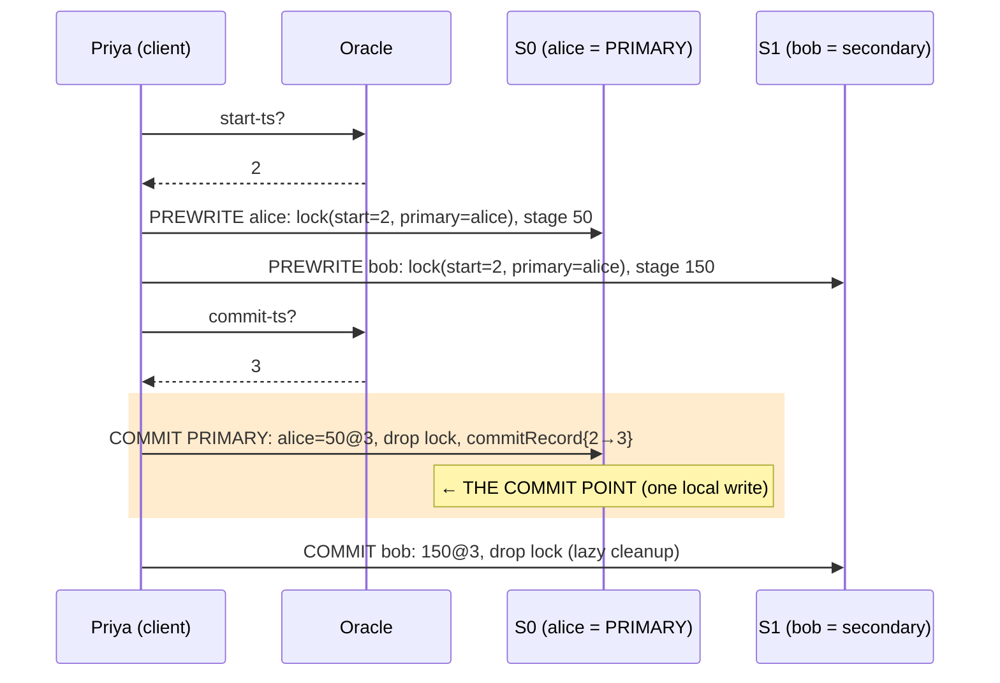
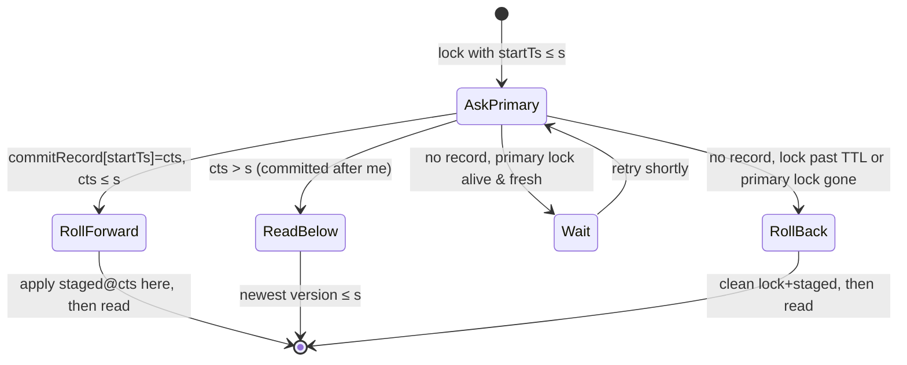
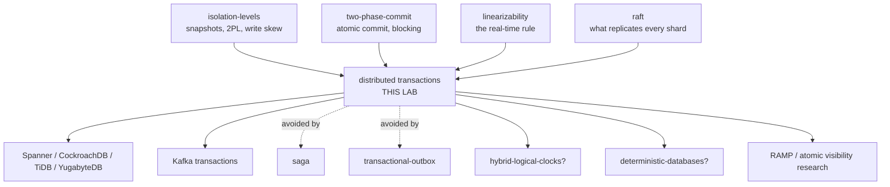

# Distributed Transactions — a learning lab

*Audience: a backend engineer who has finished the two-phase-commit and
isolation-levels labs. By the end you should be able to explain why 2PC alone
does not give you a distributed transaction, walk a Percolator commit cell by
cell, say precisely what Spanner buys with its atomic clocks, and argue about
when a payments system genuinely needs any of this.*

**Lab contents**

| File | What it is |
|---|---|
| `README.md` | This document — the full story |
| `visualization.html` | Interactive simulator — two shards, six designs, an auditor you control, crash and clock-skew buttons |
| `src/Core.java` | Shards (multi-version data + lock tables), the oracle, the deterministic scheduler |
| `src/Engines.java` | Six transaction designs behind one step-driven framework |
| `src/Fuzz.java` | Randomized workloads + invariant counters (seeded, reproducible) |
| `src/Tests.java` | 31 scenario-named checks — `java src/Tests.java` (add `broken` for the planted bugs) |
| `src/Experiments.java` | 10 measured experiments — `java src/Experiments.java [1-10]` |
| `src/Sim.java` | 5 narrated scenes — `java src/Sim.java [1-5]` |
| `src/YourResolver.java` | Implement the percolator read rule yourself (self-checking, 1/6 → 6/6) |
| `validate-visualization.sh` | Proves the page's JS engine agrees with the Java lab (11 checks; node or macOS JavaScriptCore) |
| `EXERCISES.md` / `SOLUTIONS.md` | The eight-rung ladder, answers separate |

No dependencies. Every command is plain `java src/File.java` from this directory.

Builds directly on: [`../two-phase-commit/`](../two-phase-commit/README.md)
(atomic commit — treated as known here),
[`../isolation-levels/`](../isolation-levels/README.md) (anomalies, MVCC,
snapshots, 2PL — the single-machine halves of everything below),
[`../raft/`](../raft/README.md), [`../linearizability/`](../linearizability/README.md),
[`../saga/`](../saga/README.md) and [`../transactional-outbox/`](../transactional-outbox/README.md)
(the two patterns that exist to AVOID this lab).

---

> **Where you are: BEGINNER MODEL — stages 1–9.** No prior knowledge of this
> concept assumed; everything from your earlier labs gets a one-line refresher
> when it appears.

## 1. WHY does this exist?

When a business action must change data that lives on **several machines** —
money leaving an account on one and arriving on another — two things must be
true at once: the changes must **all happen or none happen**, and everyone
else looking at the data must **never see the in-between**. Get the first
wrong and money is destroyed. Get the second wrong and every report, balance
check, and fraud rule in the company computes on money that briefly doesn't
exist. Databases solved both on one machine decades ago. This lab is about
what it costs to get them back when the data is split.

## 2. THE PROBLEM, as a story

A bank has grown too big for one computer, so its accounts are split across
branch machines: names starting A–M live on branch machine **S0**, N–Z on
**S1**. (Your consistent-hashing lab called this *sharding*; here it just
means "alice's row and bob's row are on different computers".)

**Priya** the teller moves 50 from alice (on S0) to bob (on S1).

**Omar** the auditor has one job: at any moment he pleases, he sums every
account across every branch, and the total must equal the money the bank
actually holds — 200. Not "usually 200". Always 200. An auditor who can be
fooled by walking between branches at the wrong second is not an auditor.

Priya's problem and Omar's problem are different, and the whole lab hangs on
that difference. Priya needs her two changes to **happen** together. Omar
needs them to **appear** together — to him, and to every other reader in the
system, forever.

## 3. THE NAIVE SOLUTION

Commit at S0, then commit at S1:

```java
shardS0.commit(debit(alice, 50));   // done!
shardS1.commit(credit(bob, 50));    // done! ...probably
```

You already know this beast: it is the **dual write** from your outbox lab,
and the two-phase-commit lab spent its whole story killing it. Measured here
anyway (experiment 1): crash a few clients mid-transfer and money is
permanently wrong in **28 of 40 runs**.

So we reach for the fix we already own: **two-phase commit** — lock and stage
on both shards (*prepare*), durably log the verdict, then commit both. The
2PC lab proved this makes the pair all-or-nothing, and our experiment 1
confirms it: with 2PC plus its crash recovery, money wrong in **0 of 40
runs**, crashes and all.

Job done?

> **🔮 Predict:** *With 2PC working perfectly — no crashes at all — can Omar's
> audit ever be wrong?*
> <details><summary>Reveal</summary>
> Yes, routinely. 2PC makes the two commits **both happen**, but it commits
> shard S0 at one moment and shard S1 at a slightly later moment. Omar can
> read S0 after its commit and S1 before its commit. In experiment 2, with
> **zero crashes**, auditors sweeping during commits got a wrong total **16
> times** under 2PC — barely better than the naive design's 14. 2PC was never
> designed to say anything about readers.
> </details>

## 4. THE FAILURE, watched closely

Run `java src/Sim.java 1` and watch it happen:

```
Priya: COMMIT applied on S0. alice is now 50 — visible to everyone.
Omar reads alice on S0: sees 50   (the new world)
Omar reads bob on S1:   sees 100  (the old world)
Omar's total: 150. Fifty units of money do not exist.
Priya: COMMIT applied on S1. bob is now 150. Total is correct again: 200
```

Nothing crashed. Nothing was misconfigured. 2PC kept every promise it ever
made — and the audit was still wrong, because **"commit" across two shards is
not an instant, it is a window**, and Omar walked through the window.

This is the deeper problem the naive solution just uncovered, and it deserves
its own names:

- **Atomic durability** — the changes all end up on disk or none do. 2PC
  gives you this. It is a promise about the *final state*.
- **Atomic visibility** — no observer, ever, sees some of the changes without
  the rest. 2PC does **not** give you this. It is a promise about *every
  moment along the way*.

Omar's wrong total is a **fractured read**: a read that caught a transaction
half-applied across shards. You have seen its single-machine cousin: the
isolation-levels lab called it *read skew*, and fixed it there with a
snapshot. Hold that thought — it is exactly where this lab is going, and
exactly where it gets hard: on one machine a snapshot was cheap because one
machine has one clock. Two shards have two clocks and no shared "now".

## 5. THE REAL REQUIREMENT

A **distributed transaction** — the thing this lab is named after — needs all
three of:

1. **All-or-nothing on disk** (atomic durability). 2PC's job; solved.
2. **All-or-nothing to every observer** (atomic visibility). Every reader
   sees a transaction entirely or not at all — Omar's job.
3. **A defensible order** (isolation). Concurrent transactions must not
   corrupt each other — the isolation-levels lab's job, now spread over
   machines that share nothing.

And one more, which you won't miss until stage 10's ending: once the system
tells a client "done", **no later reader may see a world without that
transaction** — the real-time rule you met in the linearizability lab,
wearing a new costume ("external consistency").

## 6. THE KEY IDEA

Two sentences, which the rest of the lab unfolds:

> **Give every transaction one position in a single, global order of time —
> one number — and make every commit and every read happen "as of" a
> number.** Then a transaction is either entirely before your read or
> entirely after it, and the fractured in-between is not just avoided but
> *unobservable*.

> **Make the commit itself one local write in one durable place** — so that
> the verdict "did it commit?" can be answered by anyone, even after every
> coordinator involved is dead.

The first sentence is a snapshot made global. The second is the 2PC lab's
*commit point*, moved out of the coordinator's private log and into data
everyone can reach.

## 7. TERMINOLOGY — the words, now that you've felt the problems

The load-bearing terms. Each exists to make a distinction you have now
watched matter.

**Shard.** One independent database holding a slice of the keys, committing
its own changes atomically with its own local machinery. alice's shard can
promise things about alice; nobody is in charge of alice-and-bob. That
missing "nobody" is the subject of the lab.

**Atomic visibility.** The guarantee that no reader anywhere sees a
transaction partially applied. Distinct from atomic durability — stage 4's
whole point — and coined *atomic visibility* in the research literature (the
RAMP papers) precisely because "atomic" alone had come to mean only
durability. Example: experiment 2's TPC row — durable in 40/40 runs,
fractured 16 times.

**Fractured read.** A read that observes some of a transaction's writes but
not the rest (Omar's 150). The cross-shard sibling of the isolation-levels
lab's read skew.

**Snapshot / consistent cut.** A single timestamp `s`, with reads returning
each key's newest version committed at or below `s`. It is a *cut* through
history: everything ≤ s is in, everything above is out. For the cut to be
consistent across shards, "committed at ts" must mean the same thing on
every shard — which is only true if timestamps come from one order.

**Timestamp oracle.** A service handing out numbers from one counter, so
that "one global order of time" is trivially true. Two calls per write
transaction (start, commit), one per read. The simplest possible correct
answer, and a single point of failure and scale — measured in experiment 5,
removed in stage 10's final act.

**Prewrite / primary / secondary.** Percolator's names. *Prewrite*: stage a
value and take a lock on every written key. The *primary* is the one key the
transaction appoints as the place its verdict will live; every other written
key (*secondary*) carries a lock that points at the primary. Plain-English
version: every sticky note on every branch says "the decision is taped to
alice's page".

**Commit point (revisited).** In the 2PC lab: the coordinator's durable
decision record — one place, owned by one process, and the reason 2PC
blocks. Here: **replacing the primary's lock with a commit record, in one
local shard write**. Same concept, relocated into data. Scene 2 shows the
exact line; experiment 9 proves it is the line.

**Lock TTL / resolution.** A reader that hits a lock consults the primary
and then acts: *roll forward* (finish a committed-but-unfinished txn's
cleanup), *wait* (fresh lock, txn alive), or *roll back* (stale lock, no
commit record — bury the corpse). This is the mechanism that deletes the
blocking problem.

**External consistency.** Spanner's name for the linearizability lab's
real-time rule applied to transactions: if T1's client was told "done"
before T2 started, T2 must see T1. A *stale snapshot* is the violation: a
snapshot number smaller than an already-acknowledged commit's number.

**Uncertainty interval (ε) / commit wait.** A clock that might be wrong by
at most ε doesn't know "now"; it knows "now is somewhere in `[t−ε, t+ε]`".
Commit wait: after choosing a commit timestamp, hold the "done" message
until the timestamp is provably in the past for *every* clock in the system
(~2ε). The ack gets slower; the clocks stay wrong; correctness returns.

Minor terms defined on first use later: distributed deadlock, first-committer-wins
(from isolation-levels), write skew (ditto), TrueTime, HLC.

## 8. TWO MENTAL MODELS

**The simple model: the numbered-ticket bank.** Head office has one roll of
numbered tickets. Every action — starting a piece of work, sealing a deal —
tears off the next ticket, and every page of every ledger records the ticket
number under which it was written. An audit is not "walk around reading
pages"; it is "tear off a ticket — say #40 — and read every page *as it
stood at #40*", ignoring anything written under a later number. A deal
touching two branches gets sticky notes on both pages saying "pending — the
decision will be taped to alice's page", and sealing the deal is one act:
taping the verdict, with its ticket number, onto alice's page.

**The engineering model.** Each shard: `key → {commitTs → value}` (MVCC
version chains — same picture as isolation-levels), plus a lock table of
claims `(startTs, primaryKey)`, plus the primary's `commitRecord: startTs →
commitTs`. A write transaction: `startTs` → prewrite all keys (primary
first) → `commitTs` → **one write at the primary** → lazy cleanup. A read:
one `snapTs` for all shards; per key, take the newest version ≤ snapTs,
detouring through the resolution rule when a lock with `startTs ≤ snapTs`
is present.

| Simple model | Engineering model |
|---|---|
| ticket roll at head office | timestamp oracle (later: clocks + ε) |
| ticket number on a ledger page | `commitTs` on a version |
| "read the world as of #40" | snapshot read at `snapTs=40` |
| sticky note "decision on alice's page" | secondary lock pointing at the primary |
| taping the verdict to alice's page | the primary commit record — the commit point |
| a note left by a teller who went home | an abandoned lock, past its TTL |

**Where the analogy breaks.** (1) A ticket roll never runs out and never
goes down; a real oracle is a process — TiDB runs one and engineers its
availability hard. (2) The tempting upgrade "skip head office, use
wristwatches" silently changes the model: tickets never go backwards, clocks
do — that one difference is stages 10.5–10.6. (3) Tearing a ticket is
instant; in the real system getting a timestamp is a network round trip that
can reorder against other messages — the sim models it as one step, real
systems batch it.

## 9. VISUALIZATION

Open **`visualization.html`** (published: ["Two Branches, One Instant"](https://claude.ai/code/artifact/f4965258-05f4-4bcd-8eb2-a7984d745b85)). Two shards,
version chains drawn as the ticket-book, every design from this README
selectable, and Omar under your control. Recommended first ten minutes:

1. Engine "2PC", press *Run transfer*, and mid-commit press *Audit now* —
   watch the fractured read happen and get caught.
2. Engine "Percolator", same game — watch the audit detour through the lock,
   consult the primary, and come back whole.
3. Press *Kill client* at each step of a percolator commit (the step slider
   chooses where) and watch a later audit roll the corpse back or forward.
4. Engine "Clocks (no wait)", skew slider up, and replay the scripted
   "confirmed-then-invisible" scenario; then flip to "Clocks + commit wait".

Every scenario asks for your prediction before it runs. The event log
explains every transition in a full sentence; click any shard to inspect its
locks, staged values, and version chain.

> **Checkpoint — you now hold the beginner model.** You can say why 2PC is
> not enough (durability ≠ visibility), what a fractured read is, and what
> the two key ideas are (one global time order; commit = one local write).
> Next: the mechanism, built the way you would have built it — with each
> version breaking in your hands.

---

> **Where you are: INTERMEDIATE MODEL — stage 10.** The mechanism, version
> by version. Every refinement below is the scar of a failure you watch.

## 10. THE ACTUAL MECHANISM — four versions, three funerals

### v1 — 2PC + "just read the current values"

This is stage 4. Engine `TPC` in the code. Durability perfect (0/40 lost),
visibility broken (16 fractured audits with no crashes; scene 1 shows one).
Buried. But its corpse defines the goal: the fix must close the *window*
between the per-shard commits — or make the window unobservable.

### v2 — close the window with locks: distributed 2PL

The isolation-levels lab's answer on one machine was strict two-phase
locking: readers take read locks, writers take write locks, everyone holds
them to the end. Distribute it (engine `TPC_2PL`): Omar read-locks alice,
then bob; Priya's prepare write-locks collide with Omar's read locks; whoever
is second waits. Result: **fractured audits: 0** (experiment 2). Correct!
Serializable, even — 2PL doesn't care how many machines the locks live on.

Three prices, all measured:

- **Readers wait, always.** Omar queues behind every in-flight transfer
  (experiment 8: 159 reader wait ticks vs 0 for the no-lock designs).
- **Distributed deadlock — and no one can see it.** Priya locks alice→bob,
  a reverse transfer locks bob→alice. Each shard sees exactly one waiting
  transaction — the *cycle* exists only across shards, so no shard's local
  deadlock detector can ever fire. A **distributed deadlock** is a waits-for
  cycle whose edges live on different machines. The lab breaks it with
  timeouts: one victim aborts, the survivor commits (test
  `d2pl_cross_shard_deadlock_timeout_kills_one_victim_survivor_commits`).
  Experiment 4: 632 timeout aborts on a hot pair — and the isolation-levels
  lock-ordering fix still works across shards (632 → 320).
- **The blocking problem, now with victims.** In the 2PC lab, a dead
  coordinator froze *participants*. Here it freezes **innocent readers**:
  kill coordinators mid-commit and **281 auditors gave up waiting forever**
  (experiment 3). 2PC's defining flaw, inherited by every read in the
  system.

> **🔮 Predict:** *Could we let Omar read old versions instead of waiting —
> each shard keeps its version history (MVCC, like isolation-levels), and
> Omar reads "as of when my audit started" per shard?*
> <details><summary>Reveal</summary>
> Per shard, yes. Across shards, "when my audit started" is not one moment —
> S0's version numbers (its local sequence) and S1's have no relation to
> each other. A cut at "S0's seq 17, S1's seq 12" can still land after the
> transfer's commit on one shard and before it on the other: the same
> fracture, wearing MVCC clothing. A snapshot only works if **one order of
> time spans all shards.** That is the next version.
> </details>

### v3 — one order of time: the oracle, and Percolator

Give the cluster a **timestamp oracle** — one counter. This is Google
Percolator's design (2010, built on Bigtable; today the heart of TiDB), and
it answers both halves of the key idea at once. Engine `PERCO`. The commit
protocol, with the real values from scene 2 (`java src/Sim.java 2`):



Walk it with the story's eyes:

1. **start-ts = 2** — Priya's snapshot. All her reads are "as of ticket 2".
2. **Prewrite, primary first.** Every written key gets a lock + staged
   value. bob's lock *points at alice*: "my verdict will live there". A
   prewrite fails if the key is locked (someone mid-flight) or has a
   committed version above start-ts — the **first-committer-wins** rule from
   isolation-levels, now enforced per shard with no coordination.
3. **commit-ts = 3**, then **the flip**: in one local write on S0, alice's
   lock becomes the committed version `alice=50@3` plus the record `2→3`.
   *This single write commits the whole transaction* — experiment 9 kills
   the client at every one of the seven steps and the outcome flips exactly
   there: steps 1–5 → rolled back, money 200; steps 6–7 → rolled forward,
   money 200. Never anything else.
4. **Secondaries commit lazily.** Pure cleanup — the verdict already exists.

And the read side, which is where the magic actually lives. Omar, snapshot
`s`, hits a lock with `startTs ≤ s`:



This rule (in code: `Engines.resolveAndRead`, ~30 lines — and
`src/YourResolver.java` makes you write it yourself) is what deletes v2's
funerals in one stroke, measured:

- **Fractured audits: 0**, with readers never blocking behind healthy
  commits (experiment 2; scene 4 shows Omar *finishing* a dead client's
  commit himself, `rollForwards=47` across experiment 3's crash storm).
- **The blocking problem: gone.** Same crash storm that stranded 281 locked
  readers forever strands **0** percolator readers — the worst case is
  waiting out one TTL (30 ticks), after which any reader buries the corpse
  (scene 3). The verdict lives in a shard, and shards outlive coordinators.
- Atomicity under every crash: 0/40 money-wrong with clients dying at
  random steps (experiment 1).

Why is it safe for random readers to roll transactions back and forward?
Because the primary is a **single arbitration cell**: a committing client
flips it only if its lock is still there; a cleaning reader removes the lock
first. Both race to one row on one shard, and one of them loses cleanly —
the loser's next step observes it lost (test: a rolled-back client's commit
attempt finds its lock gone and aborts; counter `rolledBackByReader`).

What percolator does *not* fix — it is honest snapshot isolation,
distributed: **write skew survives** (experiment 7: two doctors, one
invariant "someone on call", each on-call flag on a *different shard*; both
transactions read {1,1} under their snapshots, write different keys, both
commit, on-call count 0). Same anomaly, same mechanism-shaped hole as the
isolation-levels lab, and 2PL — which locks what was *read* — still
prevents it. Remember the closing line of that lab: snapshot checks what
you wrote; serializable also checks what you read. Distribution changed
nothing about that sentence.

> **🔮 Predict:** *The oracle is one process handing out numbers. What
> exactly goes wrong when you try to run this design across two continents —
> or when the oracle dies?*
> <details><summary>Reveal</summary>
> Every transaction — reads included — makes a round trip to the oracle
> before its first byte of work (experiment 5: ~2 calls per write, 1 per
> read, 1,913 calls in 40 small runs). Cross-continent, that is +100ms on
> *everything*, and the counter itself becomes the throughput ceiling and
> the availability linchpin. TiDB accepts this trade and engineers around
> it (a Raft-replicated "PD" service, batched timestamp grants). Google,
> building Spanner planet-wide, could not. Their way out is the last act.
> </details>

### v4 — fire the oracle: clocks, the lie, and commit wait

Replace the oracle with each client's own clock (engine `PERCO_CLOCK`):
`start-ts = my clock now`, `commit-ts = my clock now`. Everything else
identical. Fractured reads: still 0 — the lock check never depended on
*where* timestamps came from. But scene 5 (`java src/Sim.java 5`):

```
tick 16: Priya's transfer commits at ts=18001 and she is told: DONE.
tick 18 (AFTER the ack): Omar starts an audit. His slow clock hands him
snapshot 13002 — which is LESS than 18001. He reads alice=100.
A transfer that was confirmed done... is invisible.
```

Priya's clock runs 5 ticks fast, Omar's 5 slow. Omar begins *after* Priya
was told "done" and reads a world without her transfer — the real-time rule
from the linearizability lab, violated by a wristwatch. Experiment 6
measures it: at skew 8 ticks, 10 stale snapshots; at 20, 25 — and remember
that lab's darker lesson, which repeats here: **at skew 0–2 the count is 0.
A design with no guarantee is indistinguishable from a correct one while
the clocks happen to behave.**

The fix is not better clocks — no clock is perfect. It is admitting
imperfection *into the protocol*. **TrueTime** (Spanner's clock API) returns
an interval `[earliest, latest]` guaranteed to contain true time, ε wide on
each side. Then (engine `PERCO_CLOCK_WAIT`):

- take `commit-ts = now().latest` — a timestamp that is, if anything, in
  the future;
- **commit wait**: before telling the client "done", spin until
  `now().earliest > commit-ts` — until the commit timestamp is provably in
  the *past* for every honest clock on Earth.

Now anyone who starts after the ack gets `snap-ts = now().latest ≥ real
time > commit-ts`. Measured: stale snapshots 0 at every skew; the bill is
the ack — average commit latency 6.7 → 24.8 ticks at ε=8, 51.0 at ε=20
(~2ε, exactly as predicted by the two inequalities). And the second-order
bill: locks are held ~2ε longer, so *reader* waiting rises too (experiment
8). Spanner's bet is engineering, not mathematics: GPS receivers and atomic
clocks in every datacenter push ε to a few milliseconds, so commit wait
costs less than a disk sync. **Nobody's clock got better. The ack got
slower.**

> **Checkpoint — you now hold the intermediate model.** You can run a
> percolator commit in your head, name the exact write that is the commit
> point, execute the read-resolution rule, and explain both timestamp
> designs and their price tags. Next: everything that can go wrong, on
> purpose.

---

> **Where you are: ENGINEERING MODEL — stages 11–14.** Failure by failure,
> guarantee by guarantee.

## 11. FAILURE SCENARIOS

Each: how to create it → where to watch → what happens, why, what holds,
what bends, and the production face of it.

**Client/coordinator dies mid-commit (percolator).** Create: `killAtStep`
1–7; watch: experiment 9 (the table), scenes 3–4, visualization *Kill
client*. Before the primary flip: no commit record can ever appear, so the
first reader past the TTL rolls everything back — the transaction never
happened. After the flip: the record exists, so every reader rolls the
leftovers forward — it fully happened. Holds: atomicity, visibility,
non-blocking reads (worst wait = one TTL). Bends: the *writer's* latency
promise — a transaction can be committed and its owner never learns it, so
**client retries must be idempotent** (your outbox lab's law, resurfacing).
Production: TiDB readers do exactly this resolution; its TTLs scale with
transaction size, and monitoring watches "resolve lock" rates.

**Coordinator dies holding locks (distributed 2PL).** Create: `kills(2)` on
`TPC_2PL`; watch: experiment 3. 281 readers strand forever (until recovery)
because the verdict lives only in the dead coordinator's log — the 2PC
lab's blocking problem, now taxing every reader in the cluster. Holds:
safety — nobody reads a wrong value. Bends: liveness, catastrophically.
Production: this is why lock-based XA across services is feared in
operations — a wedged transaction manager turns into a cluster-wide
brownout, and DBAs end up making **heuristic decisions** (manually forcing
commit/abort per participant — breaking atomicity by hand, under pressure).

**Distributed deadlock.** Create: opposite-direction transfers on a hot
pair; watch: experiment 4, test `..._survivor_commits`. Each shard sees
half a cycle; no local detector can fire; a timeout kills one victim and
the survivor commits. Holds: atomicity, consistency. Bends: latency and
throughput (632 timeout aborts), fairness (victims are arbitrary).
Production: real systems use lock-wait timeouts (MySQL XA), global waits-for
sampling, or avoid it structurally — deterministic databases (stage 15)
order transactions *before* executing them.

**Clock skew beyond ε.** Create: give `ClockTs` an offset larger than the
eps you pass; not measured above because it breaks the model's honesty —
TrueTime's entire contract is that the interval *contains true time*. If a
clock drifts outside its promised bound, commit wait's inequality is built
on sand and external consistency silently fails — the linearizability
lesson again: no violation until the day there is one. Production: Spanner
evicts nodes whose clocks misbehave; CockroachDB crashes a node whose
offset exceeds the configured maximum (default 500ms) — *crashing is the
correct response to a lying clock*.

**Straggler locks from slow (not dead) clients.** Create: lower `LOCK_TTL`
below a healthy commit's duration — a reader will roll back a *live*
transaction; the client's own commit then finds its lock gone and aborts
(counter `rolledBackByReader`). The TTL is a bet: too long → readers wait
on corpses; too short → healthy writers get murdered. Holds: safety, always
(the primary cell arbitrates). Bends: write availability under load spikes.
Production: TiDB heartbeats long transactions to extend their TTL.

**Oracle down / partitioned.** Every new transaction in the cluster stalls
at `startTs` — reads included. Not modeled (the oracle here is an object);
the mitigation is the v4 story, or TiDB's: make the oracle a Raft group
(your raft lab: elections in ~1.5 timeouts) and grant timestamps in batches.

## 12. CORRECTNESS — what each design actually promises

| | atomic durability | atomic visibility | isolation | external consistency | reads block? | deadlock? |
|---|---|---|---|---|---|---|
| NAIVE | ✗ (28/40) | ✗ (14) | none | ✗ | no | no |
| TPC | ✓ | ✗ (16) | write-locks only | ✗ | no | writers |
| TPC_2PL | ✓ | ✓ (0) | serializable | ✓* | **yes** | writers+readers |
| PERCO | ✓ | ✓ (0) | snapshot (write skew!) | ✓ (oracle orders acks) | no | no (aborts instead) |
| PERCO_CLOCK | ✓ | ✓ (0) | snapshot | ✗ (10 stale @ skew 8) | no | no |
| PERCO_CLOCK_WAIT | ✓ | ✓ (0) | snapshot | ✓ (0 stale) | no | no |

\* 2PL's external consistency comes free from blocking: you cannot read
around a lock you are waiting on.

The shape to internalize — **nothing in the right columns is free**:

- Visibility via **locks** costs *reader waiting* and inherits 2PC blocking.
- Visibility via **snapshots** costs *a global time order* — an oracle
  (SPOF, round trips) or clocks+ε (commit wait ≈ 2ε on every write ack).
- Isolation above snapshot costs *aborts* (SSI-style read tracking) or
  *waiting* (2PL). Percolator alone leaves write skew alive — the one row
  of the table where distribution changed nothing at all.
- And everything above assumes each shard itself survives — in production
  every shard and the oracle are themselves Raft/Paxos groups (stage 15),
  paying that lab's price underneath this one.

Safety vs liveness, one more time: every mechanism here keeps **safety**
unconditionally (no run in 40×10 experiments showed wrong money or a
fractured read on the ✓ designs — and the planted bugs each break exactly
one cell: run `java src/Tests.java broken`). What failures attack is
**liveness**: who waits, for how long, and whether a corpse can make the
waiting permanent. The design progression of this whole lab is liveness
repair: 2PC blocks participants → 2PL blocks readers too → percolator
blocks nobody beyond a TTL → commit wait *deliberately* blocks only the
final ack, because that is the cheapest place in the system to pay.

## 13. THE CODE — the lines that carry the guarantees

Read in this order (all in `src/Engines.java`):

1. **`resolveAndRead`** — the percolator read rule; the diagram in stage 10
   as ~30 lines. The load-bearing branches: `l.startTs > snapTs` (a lock
   from a *later* transaction is none of your business — miss this and
   readers stall on the future); `cts <= snapTs` roll-forward (a reader
   completing a stranger's commit); the TTL rollback (liveness); the final
   `else` (aborted leftovers). `YourResolver.java` is this method with the
   decisions blanked out.
2. **`PercoTransfer.commitPrimary`** — the commit point. Note the guard: if
   our lock is gone, *a reader outran us and we are already rolled back* —
   the primary cell arbitrating the race. The line writing `commitRecord`
   is the single write experiment 9 pivots on.
3. **`PercoTransfer.doStep` prewrite arm** — `latestCommitTs(key) > startTs
   → abort`: first-committer-wins with zero cross-shard coordination,
   because a snapshot plus that one local check *is* the conflict check.
4. **`ClockTs.commitWaitDone`** — one inequality, `now().earliest >
   commitTs`; the entire content of "Spanner waits out the uncertainty".
5. **`TpcTransfer`** + **`LockingReader`** — v1/v2 for contrast; the
   `readersLock` flag is the only difference between "fractured 16" and
   "fractured 0 but 281 stranded readers".

The scheduler (`Core.Sched`) steps one random live driver per tick, so
every interleaving and crash the doc describes is just a sequence of
`step()` calls — which is also why every number above is reproducible from
its seed.

## 14. EXPERIMENTS — break it yourself

Predict first, then run. All ten: `java src/Experiments.java`.

| # | Command | Ask yourself first | You should see |
|---|---|---|---|
| 1 | `... 1` | can recovery fix a dual write? | NAIVE 28/40 wrong; TPC & PERCO 0/40 |
| 2 | `... 2` | who fractures with **zero** crashes? | NAIVE 14, TPC 16, all lock/snapshot designs 0 |
| 3 | `... 3` | kill coordinators: who gets stuck? | 281 stranded 2PL readers vs 0 percolator |
| 4 | `... 4` | can any shard see the deadlock? | 632 timeout aborts → 320 with lock ordering |
| 5 | `... 5` | what does the oracle cost? | ~2 calls/write, 1/read — every txn queues there |
| 6 | `... 6` | skew 0: is the clock design safe? | 0 stale at skew ≤2 — then 10, 25; wait: 0 at 2ε cost |
| 7 | `... 7` | both doctors commit — legal? | on-call 0 under PERCO; prevented by 2PL |
| 8 | `... 8` | where does each design charge? | latency ladder 1.1 → 24.8; reader-wait column |
| 9 | `... 9` | which step is the commit point? | rolled back through step 5, forward from 6 |
| 10 | `... 10` | optimistic vs pessimistic, hot keys | 255 conflict aborts vs 632 timeout aborts |

> **Checkpoint — you now hold the engineering model.** You can name each
> design's guarantees and their price, walk every failure, and point at the
> exact line of code carrying each invariant. Next: what the real systems
> add, and when to refuse to play this game at all.

---

> **Where you are: PRODUCTION MODEL — stage 15.**

## 15. PRODUCTION — from this toy to real systems

**The chain:** this lab's percolator → real Percolator/TiDB → Spanner /
CockroachDB → and, running the other direction, the patterns that avoid the
whole game.

**What the toy deliberately omits, and who supplies it:**

- **Replication.** Our shards are objects that never die. In every real
  system each shard is a **Raft/Paxos group** (your raft lab, verbatim:
  Spanner = 2PC *over Paxos groups*; TiDB = percolator over Raft-replicated
  regions; CockroachDB likewise). The 2PC-lab's closing line — "the two
  compose" — is these systems' literal architecture. The coordinator state
  itself lives in a group, so the *participant-side* blocking problem is
  solved by replication even before percolator's reader-resolution.
- **The oracle's availability.** TiDB's PD is a Raft group granting
  timestamp *batches*; the toy's single object stands in for all of that.
- **Version GC.** Version chains grow forever here; real systems garbage-
  collect below a safe timestamp — the same "one open snapshot pins
  cleanup" story as isolation-levels' VACUUM, now cluster-wide.
- **Latency engineering.** Real Percolator/TiDB add *async commit* and
  *1PC* fast paths; CockroachDB's **parallel commits** write an explicit
  transaction record and prewrites concurrently, cutting a round trip.
  Spanner holds locks at Paxos leaders, and read-only transactions run
  lock-free entirely on snapshots (this lab's `SnapshotReader` is that).
- **Serializable-and-above.** CockroachDB layers SSI-style read tracking
  (isolation-levels' rw-antidependency machinery) on its snapshot core, so
  write skew aborts instead of committing; Spanner's read-write
  transactions use pessimistic locks. Our PERCO row's write-skew hole is a
  *choice* real vendors patch, each in one of the two ways stage 12 priced.
- **Clock honesty.** TrueTime is hardware + an eviction discipline;
  CockroachDB substitutes **HLC** (hybrid logical clocks — a Lamport
  counter piggybacking on wall clocks) plus per-read *uncertainty
  restarts* instead of commit wait, trading Spanner's write-side wait for
  occasional read-side retries — same ε, charged to a different account.

**The Java/Spring face of this topic — XA/JTA.** `XADataSource`, JTA
transaction managers (Narayana, Atomikos), `@Transactional` spanning two
resources: that is v2 of this lab — lock-based 2PC — living in your app
tier. It works, and operations teams dread it for exactly the reasons you
measured: in-doubt transactions holding locks (experiment 3), heuristic
outcomes when humans break ties, and a transaction manager whose log is a
non-replicated commit point. Modern practice: one ACID database per
service; the **outbox** for state-change + message (its lab called 2PC "the
road not taken" — now you've priced the road); **sagas** for multi-service
flows, accepting visible intermediate states (that lab's "trades atomicity
and isolation for availability" is precisely "fractured reads by design,
with compensations instead of rollback"). Kafka's "exactly-once"
transactions are also this lab: a transaction coordinator, markers in
partitions as the commit point, and readers (`read_committed` consumers)
that skip uncommitted data — percolator-shaped, not 2PL-shaped.

**The decision ladder** an architect actually walks:

1. Can the keys live in **one database**? Do that. `BEGIN…COMMIT` plus
   isolation-levels knowledge beats everything in this lab.
2. Can they be **co-located onto one shard** (same account family, same
   region)? Single-shard transactions are the fast path of every system
   here — TiDB 1PC, Cockroach's single-range fast path.
3. Is "state change + notify others" the real need? **Outbox.**
4. Is it a multi-step business flow that can tolerate visible intermediate
   states with compensation? **Saga.**
5. Only now — cross-shard invariants that must never be seen broken
   (ledgers, uniqueness, inventory holds) — pay for a distributed
   transaction, and pick which currency: reader waiting (2PL/XA), oracle
   round trips (TiDB), or commit wait ε (Spanner-style).

**What on-call sees.** Commit latency p99 tracking clock ε (Spanner
publishes ε; a GPS outage widens commit wait cluster-wide); "resolve lock"
/ transaction-retry rates (TiDB) — spikes mean crashing clients or hot
keys; lock-wait queues and in-doubt XA transactions (the page at 3 a.m. is
"decide this heuristic outcome"); clock-offset alarms (CockroachDB nodes
*suicide* past max offset — a crashed node beats a lying one); and the
GC/oldest-snapshot age, this lab's version chains meeting isolation-levels'
VACUUM lesson at production scale.

## 16. EXERCISES

The eight-rung ladder is in [`EXERCISES.md`](EXERCISES.md) — explain,
identify, predict, modify, implement (`YourResolver.java`), debug (the four
planted bugs), handle failure, design (a 3-region payments ledger). Attempt
before opening [`SOLUTIONS.md`](SOLUTIONS.md).

## 17. KNOWLEDGE MAP & NEXT STEPS



Commonly confused, one sentence each:

- **2PC vs distributed transaction**: 2PC is one *component* (atomic
  durability); a distributed transaction is durability **plus visibility
  plus isolation** — this lab measured a system with perfect 2PC and 16
  broken audits.
- **Saga vs distributed transaction**: a saga *chooses* fractured
  visibility and buys availability with compensations; it is the same
  trade-off table, opposite corner — not a cheaper implementation of the
  same guarantee.
- **Snapshot vs serializable, distributed**: identical to one machine —
  percolator ships write skew; check what you *read*, not just what you
  wrote, to close it.
- **Linearizability vs external consistency**: the same real-time rule —
  for single operations vs whole transactions (strict serializability).
- **Percolator's primary vs 2PC's coordinator log**: the same commit point,
  but one is data any reader can reach; that single relocation deletes the
  blocking problem.

Next, ready to type:
- `/learn hybrid-logical-clocks` — CockroachDB's answer to TrueTime without
  the hardware (earned twice now: causal-consistency suggested it too).
- `/learn deterministic-databases` — Calvin/FaunaDB: agree on the order
  *first* (raft!), execute without 2PC at all; the road this lab didn't take.
- `/learn change-data-capture` — how the outbox's relay works at production
  scale; the practical alternative you'll deploy more often than Spanner.
- `/learn jepsen` — now you can read its reports fluently: every anomaly
  named here has a Jepsen test that hunts it.

## 18. GLOSSARY

In order of appearance:

- **shard** — one independent database owning a slice of the keys.
- **dual write** — committing to two systems separately and hoping; no
  atomicity (28/40 runs lost money under crashes).
- **two-phase commit (2PC)** — prepare everywhere, log a verdict, commit
  everywhere; atomic durability with a blocking coordinator (prior lab).
- **atomic durability** — all of a transaction's writes survive, or none.
- **atomic visibility** — no reader ever observes a transaction partially
  applied; NOT implied by atomic durability.
- **fractured read** — a read catching a transaction half-applied across
  shards (Omar's 150); read skew's cross-shard sibling.
- **distributed transaction** — atomic durability + atomic visibility +
  isolation, across shards.
- **external consistency** — if T1 was acknowledged before T2 began, T2
  sees T1; the real-time rule for transactions (= strict serializability).
- **snapshot / consistent cut** — one timestamp; read each key's newest
  version at or below it.
- **timestamp oracle** — a single counter service defining the global time
  order; ~2 calls per write txn, 1 per read.
- **distributed 2PL** — strict two-phase locking with lock tables on many
  shards; serializable, blocking, deadlock-prone.
- **distributed deadlock** — a waits-for cycle whose edges live on
  different shards; invisible to every local detector.
- **victim** — the transaction a timeout (or detector) aborts to break a
  deadlock; its release lets the survivor commit.
- **Percolator** — Google's snapshot-isolation transaction protocol over a
  sharded store (TiDB's core): prewrite → primary flip → lazy cleanup.
- **prewrite** — stage a value + take a lock on every written key before
  any commit.
- **primary / secondary** — the one key holding the transaction's verdict /
  every other written key, whose locks point at the primary.
- **commit point** — the single durable write that decides the transaction;
  here, replacing the primary's lock with a commit record.
- **commit record** — `startTs → commitTs` at the primary; the verdict any
  reader can consult.
- **first-committer-wins** — a prewrite finding a committed version newer
  than its snapshot aborts (isolation-levels' rule, per-shard here).
- **lock TTL** — how long a lock may sit before readers may presume its
  owner dead and roll it back.
- **resolution / roll forward / roll back** — a reader finishing or undoing
  a dead client's transaction by consulting the primary.
- **write skew** — two snapshot transactions reading a shared rule and
  writing disjoint keys, jointly breaking the rule; survives distribution
  (doctors: on-call 0).
- **stale snapshot** — a snapshot below an already-acknowledged commit
  timestamp; the external-consistency violation.
- **uncertainty interval (ε)** — the honest error bound around a clock
  reading: true time ∈ [t−ε, t+ε].
- **TrueTime** — Spanner's clock API returning that interval, backed by
  GPS + atomic clocks.
- **commit wait** — holding the client's ack until commit-ts is provably
  past for every clock (~2ε); buys external consistency from lying clocks.
- **hybrid logical clock (HLC)** — wall clock + Lamport counter;
  CockroachDB's TrueTime substitute (with read-side uncertainty restarts).
- **parallel commits / async commit / 1PC** — production fast paths
  shaving commit round trips (CockroachDB, TiDB).
- **XA / JTA** — the Java standard for app-tier lock-based 2PC across
  resources; works, blocks, pages people.
- **heuristic outcome** — a human manually forcing one participant's
  commit/abort in a wedged XA transaction; atomicity broken by hand.
- **in-doubt transaction** — a participant prepared but verdict-less; the
  thing heuristics get applied to.
