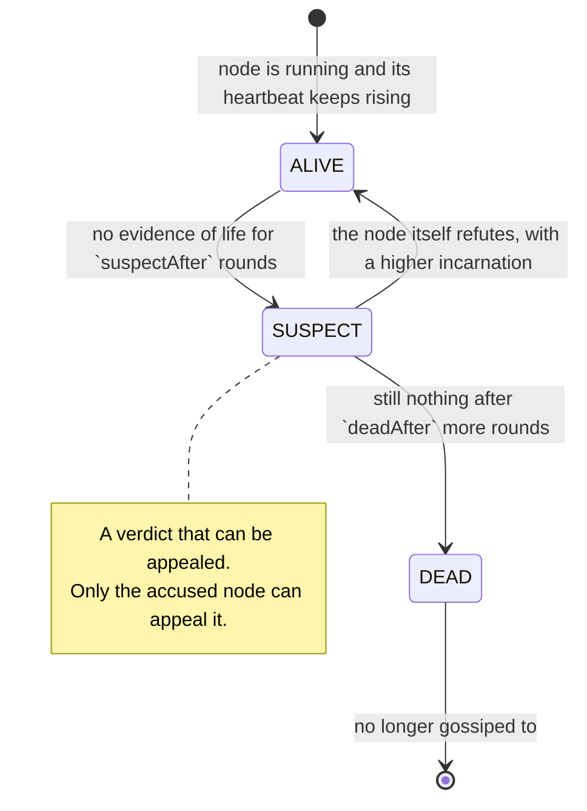
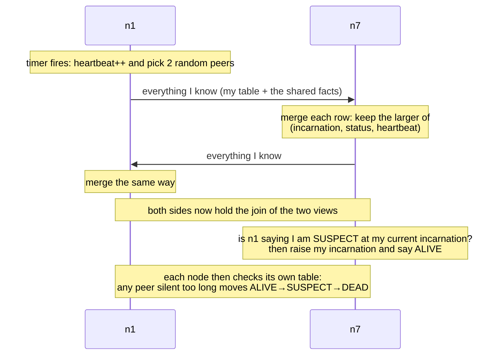
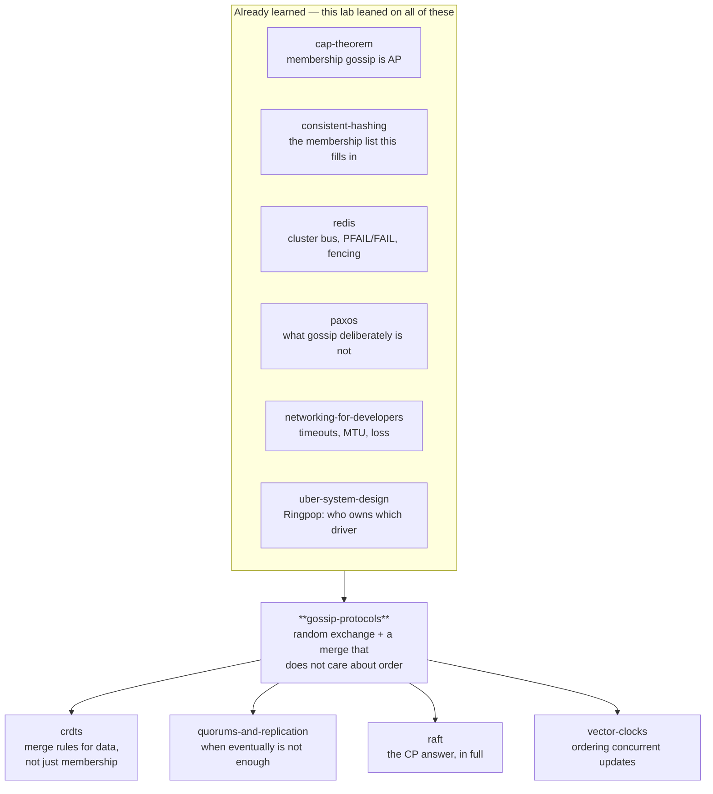

# Gossip protocols

> How a thousand machines agree on who is alive and what the current config is —
> with no coordinator, no broadcast, no acknowledgements and no retries.
>
> The [`consistent-hashing`](../consistent-hashing/) lab ended with an admission:
> every client depends on a membership list, and while that list is propagating,
> different clients route the same key to different machines. It measured the
> damage (9.5% of the keyspace in disagreement) and left the propagation itself as
> a black box. **This lab is that box.**

**Run it:**

```bash
java src/Sim.java           # one narrated afternoon in an 8-node cluster
java src/Experiments.java   # ten measurements (or pass 1-10 for one)
java src/Tests.java         # 12 guarantees, asserted
java src/Tests.java broken  # the planted-bug merge rule, for exercise 6
```

**Play with it:** [`visualization.html`](visualization.html) — the Rumour Mill
(<https://claude.ai/code/artifact/25ee9543-4e48-4ea0-8bcd-4f79c1160fdb>).
Twenty machines, every rule exposed as a switch, seven predict-then-run situations.

**Depth layers:**

| Layer | Stages | You will be able to |
|---|---|---|
| **Beginner model** | 1–9 | Explain why a coordinator is not the answer, and what "tell two random friends" buys |
| **Intermediate model** | 10 | Walk the protocol step by step and justify every strange-looking detail |
| **Engineering model** | 11–14 | Reason about its failures, and state precisely what it does and does not guarantee |
| **Production model** | 15 | Read Cassandra's, Consul's and Redis Cluster's docs and know what you are looking at |

---

## 1. WHY — the problem, before any technology

You have five hundred machines. Every one of them needs to know two kinds of
thing: **who else is currently working** (so it does not send requests into a
void), and **the current shared settings** (which machine owns which data, which
version is live, who the write leader is).

Nobody can be told these things by a person. Machines join, crash, freeze for
eight seconds during garbage collection, and come back. If a machine does not
find out that another one has died, it keeps sending it work that vanishes. If
two machines disagree about the current settings, they send the same request to
different places and your data ends up in two homes.

So: five hundred machines, all of which must keep agreeing about a changing set
of facts, with no one in charge and a network that loses messages.

---

## 2. THE PROBLEM — the phone tree

Meet a school with 500 families. Something changes — tomorrow's trip is
cancelled — and every family has to hear about it tonight.

**The obvious plan is the school office.** The office phones all 500 families.
It works, right up until the evening it doesn't:

- One person makes 500 calls. If it takes a minute each, the last family hears
  eight hours later.
- If the office's phone line is out, **nobody hears anything**. Not "some people
  hear late" — nobody, ever, because the office was the only one making calls.
- Every family also has to tell the office when they move house, so the office's
  line is busy all evening with 500 families calling in.

**The other obvious plan is that everybody phones everybody.** No single point of
failure, and it is fast. It also means each family makes 499 calls, and the town
makes 249,500 calls — every evening, whether or not anything has changed.

**🔮 Predict:** *A third plan: five families volunteer as relays. The office
phones the five, and each relay phones a hundred families. What breaks?*

<details><summary>Reveal</summary>

You have not removed the single point of failure — you have made five of them,
and now the failure is *partial and silent*. If relay number three is out, a
hundred families never hear, and nobody notices, because from the office's point
of view the call to relay three went through fine.

This is the shape of every hierarchical scheme: it converts a total, obvious
failure into a partial, invisible one. That is usually worse, because you find
out about it from the families who missed the trip.
</details>

---

## 3. THE NAIVE SOLUTION — a machine in charge

Translated to servers, the school office is a **coordinator**: one process that
holds the real membership list and the real settings. Everyone reports to it,
everyone reads from it, and it tells everyone about changes.

This is not a strawman. It is a completely reasonable design, and several systems
you use are built exactly this way — Kubernetes has etcd, Kafka had ZooKeeper and
now has a controller quorum, Redis Cluster has a slot table that a coordinator
publishes. The [`consistent-hashing`](../consistent-hashing/) lab called this the
"fixed slots plus a coordinator" answer and found real advantages: exact control,
no disagreement window, hand-movable placement.

So the question is not "is a coordinator bad?". It is: **what does it cost, and
what happens when you cannot afford it?**

---

## 4. THE FAILURE — three costs, one of which is fatal

**Cost one: it must be kept alive.** A coordinator that matters cannot be one
process — it becomes three or five, running a consensus protocol
([`paxos`](../paxos/), Raft) to agree on every change. You now operate a
distributed database in order to answer "who is alive?".

**Cost two: everybody talks to it.** Every machine reporting in, every machine
reading the list. The load grows with the cluster, and it lands on the one
component whose failure is total.

**Cost three, and this is the fatal one: it must be reachable.** When the network
splits, the machines on the wrong side of the split have no membership list at
all. They are up, and their peers are up, and they cannot see each other's health
because the thing that told them was on the other side. This is
[`cap-theorem`](../cap-theorem/) arriving exactly where you least want it: a
consistent coordinator must refuse to answer during a partition, and "who is
alive?" is a question you need answered *especially* during a partition.

And the other naive plan — everybody phones everybody — has arithmetic you can
do on paper. `java src/Experiments.java 1` prints it:

```
   nodes | messages each node sends each second | messages in the cluster
      10 |            9                         |            90
     100 |           99                         |         9,900
     500 |          499                         |       249,500
    1000 |          999                         |       999,000
```

At 1,000 machines every machine sends 999 messages **every second, for ever**,
whether or not anything has changed. That command prints a second half to the
table, showing what the design in this lab costs instead — but it is written in
words you have not been given yet, so it is held back until stage 14. One number
from it is safe to carry with you: the right-hand design sends **6** per machine
per second, at every cluster size in that table.

---

## 5. THE REAL REQUIREMENT

What do we actually need?

1. **Every machine eventually learns every fact** — memberships and settings.
2. **No machine is special.** Any machine may die at any moment without stopping
   the flow of information.
3. **Each machine's cost is fixed** — it must not grow as the cluster grows.
4. **It survives a lossy network** without acknowledgements or retry bookkeeping.
5. **Nodes discover failures themselves**, since the thing that would have told
   them is exactly what might be unreachable.

Note the word **eventually** in (1). It is doing enormous work, and giving it up
is the price of everything else on the list. We are not going to know things at
the same instant. We are going to know them shortly.

---

## 6. THE KEY IDEA

> **Every machine, once a second, picks two other machines at random and tells
> them everything it knows. That is the entire protocol.**

No routing, no coordinator, no list of who has been told. A machine that hears
something new starts telling it too — so the number of machines that know the
news **multiplies** every second instead of growing by one.

Multiplication is why this works at all. Telling everyone one at a time takes 500
seconds in a 500-machine cluster. Doubling takes 9. Tripling takes 6. That is the
difference between a design that scales and one that does not, and it comes from
a rule you could explain to a child.

The second half of the idea, which arrives in stage 10 once you have felt the
need for it: **when two machines exchange what they know, the way they combine
their two versions must not depend on who spoke first.**

---

## 7. TERMINOLOGY — the words, now that the need for them exists

Ten load-bearing terms. Each is named after a distinction you have already felt.

### gossip protocol (epidemic protocol)

- **Plain meaning:** everybody tells a few random people, who tell a few random
  people.
- **Technical meaning:** a family of protocols in which each node periodically
  exchanges state with randomly chosen peers, so information spreads
  probabilistically rather than along a planned route.
- **Why the word exists:** to distinguish this from *broadcast* (a planned
  delivery to everyone) and from *consensus* (an agreement reached before
  proceeding). Gossip promises neither delivery nor agreement — it promises that
  if you wait, everyone ends up knowing.
- **Example:** Cassandra nodes gossip once per second with up to three peers.
- **Connects to:** the "periodic sync/gossip" you met in
  [`distributed-rate-limiting`](../distributed-rate-limiting/) as one line in a
  table. This lab is that line.

### round (gossip interval)

- **Plain meaning:** one tick of each machine's clock, when it makes its calls —
  what stage 6 was calling "each second".
- **Technical meaning:** the period between a node's gossip exchanges. In this
  lab all nodes tick together for legibility; in production each node has its own
  timer and nothing is synchronised.
- **Why the word exists:** it is the unit in which the time to reach everybody is
  measured. "Five rounds" is a portable answer; "five seconds" depends entirely
  on how often you set the timer.

### fanout

- **Plain meaning:** how many peers you call each round.
- **Technical meaning:** the number of randomly chosen peers a node contacts per
  round; the base of the exponential spread.
- **Why the word exists:** it is the one dial that trades bandwidth for speed,
  and its effect is asymmetric — cost is linear in fanout, benefit is
  logarithmic.
- **Example:** fanout 3 in a 500-node cluster reaches everyone in ~5 rounds;
  fanout 1 takes ~8.3 (experiment 3).

### convergence

- **Plain meaning:** the moment everybody has the same answer.
- **Technical meaning:** the state in which every node's copy of the shared state
  is identical. Gossip guarantees it *eventually and with high probability*, not
  at any fixed time.
- **Why the word exists:** to name the goal precisely enough to measure it, and
  to force the honest qualifier — convergence is a destination, not a promise
  about when you arrive.
- **Connects to:** eventual consistency from [`cap-theorem`](../cap-theorem/) and
  the consistency window from [`cqrs`](../cqrs/). Same idea, here applied to the
  membership list rather than to your data.

### push, pull, push-pull

- **Plain meaning:** I tell you; I ask you; we swap.
- **Technical meaning:** three exchange styles. Push sends state to a peer; pull
  requests a peer's state; push-pull does both in one exchange.
- **Why the word exists:** because they have opposite weaknesses, and the
  difference only shows up at the *end* of a spread (experiment 4): push is
  quick to start and slow to finish; pull is the reverse.

### heartbeat counter

- **Plain meaning:** a number each machine increases to show it is still there.
- **Technical meaning:** a monotonically increasing per-node counter, gossiped
  with the node's entry; peers keep the highest value they have seen and time how
  long since it last increased.
- **Why the word exists:** to answer "is this information fresher than what I
  have?" **without comparing clocks**. Two machines' clocks may differ by
  seconds; a counter that only goes up needs no agreement about time at all.
- **Example:** `n5: heartbeat 412` merged with `n5: heartbeat 419` keeps 419.

### incarnation number

- **Plain meaning:** "this is a newer version of me — ignore what you heard".
- **Technical meaning:** a per-node counter that **only that node may increase**,
  used to override other nodes' beliefs about it.
- **Why the word exists:** because bad news spreads and cannot be un-spread. Once
  the cluster believes n4 is suspect, no third party can talk it out of it — you
  need one authority whose word outranks the rumour, and the only sensible
  authority about n4 is n4.
- **Example:** n4 is suspected at incarnation 1; it wakes up, sets incarnation 2,
  says ALIVE. Everyone prefers the higher incarnation, so the refutation
  overtakes the rumour wherever it goes.
- **Connects to:** the **fencing token** from [`redis`](../redis/) and the
  expected-version check from [`event-sourcing`](../event-sourcing/) — a number
  that decides whose claim is current.

### failure detector

- **Plain meaning:** the rule for deciding somebody has stopped answering.
- **Technical meaning:** the component that turns silence into a verdict —
  typically "no evidence of life for T" → suspect → dead.
- **Why the word exists:** to name the fact that this is a *separate, fallible
  component*, not a property of the network. A failure detector can be wrong in
  two directions, and the two errors trade against each other.
- **Connects to:** the timeout-versus-retry judgement from
  [`networking-for-developers`](../networking-for-developers/) — you cannot tell
  a dropped packet from a slow server, so you pick a number and accept both error
  types.

### suspicion

- **Plain meaning:** "I think you might be gone, but I am saying so out loud
  before I act on it."
- **Technical meaning:** an intermediate state between alive and dead, gossiped
  like any other fact, giving the accused node a chance to refute before it is
  written off.
- **Why the word exists:** because going straight from ALIVE to DEAD on a timeout
  makes a garbage collection pause indistinguishable from a crash, and evicts
  healthy nodes. Suspicion turns an instant verdict into an appealable one.

### anti-entropy

- **Plain meaning:** every so often, two machines compare everything and fix
  whatever differs.
- **Technical meaning:** a background reconciliation exchange of full (or
  digested) state, as opposed to *rumour mongering*, which spreads individual new
  facts and then stops.
- **Why the word exists:** to name the safety net. Rumour spreading is fast and
  can miss nodes; anti-entropy is slow and misses nothing. Real systems run both,
  and the names distinguish which layer you are talking about.
- **Example:** measured in experiment 5 — an eager stop rule left 9 nodes in
  1,000 without the news, for ever.

---

## 8. TWO MENTAL MODELS

### The simple model: a rumour in a crowded room

Two hundred people at a party. One of them learns that the band has cancelled.
Every minute, each person who knows tells whoever is nearest. Nobody organises
it; nobody keeps a list of who has been told; some people are told six times.
Within a few minutes the whole room knows, and if a few people had left the party
mid-way, everyone else would still have found out.

### The engineering model

Each node holds one row per node, and a rule for combining rows.



- **State per node:** its own `heartbeat` and `incarnation`, plus a table
  `peer → (incarnation, status, heartbeat, last-changed)`.
- **Messages:** that whole table, sent to a random peer.
- **The merge rule:** keep whichever version is larger, comparing
  `(incarnation, status, heartbeat)` in that order.
- **Invariants:** (i) merging is order-independent; (ii) a node's own entry is
  only ever raised by that node; (iii) merging the same message twice changes
  nothing.

### Mapping the two

| Party | Engineering | Why it matters |
|---|---|---|
| Telling whoever is nearest | pick `fanout` peers uniformly at random | Uniform choice is what makes the spread exponential |
| Being told six times | redundant delivery | The redundancy replaces acknowledgements and retries |
| "The band cancelled at 9:15" | version / heartbeat number | Lets a listener tell new news from old |
| Somebody insisting they are fine | incarnation number | The only claim that outranks a rumour |
| Not hearing from a friend all evening | failure detector timeout | Silence is the only symptom available |
| Comparing notes properly at the end | anti-entropy | Catches whoever the rumour missed |

### Where the analogy breaks — read this before you trust it

1. **Rumours mutate; gossip state must not.** The party version gets garbled;
   ours is defined by a merge rule that is deterministic, commutative and
   idempotent. Without those three properties, two nodes given the same facts in
   different orders end up in *different* states permanently. That is the
   difference between a protocol and a game of telephone, and it is why stage 10
   spends so long on one comparison.
2. **People know who they told; nodes do not.** A node keeps no record of who it
   has informed — that record is exactly the O(n) bookkeeping we are avoiding. It
   just keeps saying it.
3. **A person can say "are you okay?" and get an answer.** A node cannot: silence
   is all it ever observes, and silence has three causes it cannot distinguish
   (crashed, busy, unreachable).
4. **Party guests do not declare each other dead.** Ours do, and it is the most
   dangerous thing they do — experiment 10 shows a cluster of 100 perfectly
   healthy machines declaring every one of its members dead.

---

## 9. VISUALIZATION — go and run the cluster yourself

Open [`visualization.html`](visualization.html)
(<https://claude.ai/code/artifact/25ee9543-4e48-4ea0-8bcd-4f79c1160fdb>).

Twenty machines in a ring; below them, a grid with one row per machine showing
what *that* machine believes about every other. The grid is the thing to watch —
a column in one colour means the cluster agrees; a mottled column is the cluster
in two minds, which is the disagreement window from the consistent-hashing lab,
made visible.

In this order:

1. **Tell n1 something new**, then press **Run one round** five times. Watch the
   violet ring spread: 1, 3, 9, 20.
2. Set message loss to **60%** and do it again. It still gets everywhere.
3. Click a machine, press **Crash selected**, and step. Watch the grid column
   turn amber a few cells at a time — every machine works it out separately.
4. Click another, press **Pause selected 5 rounds**, and keep stepping past its
   return. Read the log line where it *refutes* its own death.
5. Run situation **7**. Twenty healthy machines, 90% packet loss, and the grid
   goes entirely red. Nothing crashed.

**Step back** undoes one round at a time, so any moment can be replayed.

> **CHECKPOINT — end of the beginner model.**
> You can now say why a coordinator is not always the answer, what "tell two
> random peers" buys, and why the number that matters is a multiplication rather
> than an addition. What is missing is the mechanism: the exact rule two machines
> use when they compare notes, and why several parts of it look strange until you
> watch the simpler version break.

---

## 10. THE ACTUAL MECHANISM — built the way it actually gets built

Eight versions. Each one is what a careful engineer writes next, and each breaks
in a way that forces the following one. Every odd-looking detail in the final
protocol is the scar of one of these breaks.

Throughout: a five-node cluster, `n1`–`n5`, and one shared fact — the identity of
the current write leader.

### v1 — just send what you know

Each node picks a random peer each second and sends its copy of the settings. The
receiver overwrites its copy with what arrived.

**🔮 Predict:** *n1 learns `leader=n7` at 09:00:01. n3 learns `leader=n9` at
09:00:04 — a genuinely newer decision. Both spread. Where does the cluster end
up?*

<details><summary>Reveal</summary>

**Nowhere in particular, and different nodes end up in different places
permanently.** A node that hears n1 last believes `n7`; a node that hears n3 last
believes `n9`. There is no "last" in a network — only "last as observed by me" —
so the cluster settles into two camps and stays there.

Nothing detects this. Every node is behaving correctly by its own rule.
</details>

### v2 — attach a version, and keep the larger

Every fact carries a version number. On receipt: keep the higher version.

`leader=n7 (v4)` merged with `leader=n9 (v5)` is `leader=n9 (v5)` — on every
node, in any order, however many times it arrives. Three properties now hold,
and they are the ones that matter for the rest of the lab:

- **commutative** — merge(a,b) = merge(b,a); order does not exist, so it must not
  matter
- **idempotent** — the same message twice is the same as once, so duplicates are
  free
- **monotonic** — the result is never older than either input, so information
  never goes backwards

Together they make "highest version wins" a **join**: the merge always moves the
node's state upward in an ordering both sides agree on. That is the whole
correctness argument for the dissemination half of this protocol, and it is why
gossip needs no ordering, no delivery guarantees and no deduplication.

### v3 — membership by heartbeat

The settings were the easy half. Now: who is alive?

Each node increments its own **heartbeat counter** every round and gossips it.
Everyone keeps the highest value they have seen for each peer, plus the local
time it last increased.

Why a counter rather than a timestamp: a timestamp requires two machines to agree
about the time, and they do not. A counter compared with `max` needs no agreement
at all — it is the same trick as v2's version numbers, applied to liveness.

Detection is then local arithmetic: if a peer's heartbeat has not moved for
`suspectAfter` rounds, something is wrong with it.

### v4 — v3's timeout is a bet, and the bet is measurable

**🔮 Predict:** *n4 is healthy but pauses for four rounds — a long garbage
collection. Its peers use a three-round timeout. What fraction of the cluster
declares it dead?*

<details><summary>Reveal</summary>

Measured, 50 nodes, `java src/Experiments.java 7`:

```
  suspectAfter | rounds to spot a real crash | false alarms on a 4-round pause
             1 |            3.6              |  98% of nodes
             2 |            3.8              |  81% of nodes
             3 |            6.0              |  12% of nodes
             5 |            7.9              |   0% of nodes
             8 |           11.0              |   0% of nodes
```

There is no good row. Fast detection and no false alarms are the same dial pulled
in opposite directions, because **a crashed node and a busy node produce exactly
the same observation: nothing.** No cleverness removes this; it is the
[`cap-theorem`](../cap-theorem/) lab's "you cannot tell slow from dead", arriving
as a number you have to choose.
</details>

So we do not go straight from ALIVE to DEAD. We add **SUSPECT**: a public
statement that a node looks gone, gossiped like any other fact, which the accused
gets the chance to answer.

### v5 — but the accused cannot answer, and that is fatal

n4 wakes up. Every other node says SUSPECT n4. n4 says "I am alive" — and its
message is just one more opinion about n4, merged against nineteen opinions
saying otherwise. Worse: with a naive "worse status wins" rule, the SUSPECT
rumour keeps circulating and re-infecting every node n4 corrects. **n4 is dead
for ever, while running perfectly.**

The fix is to give exactly one node the last word about each node: the
**incarnation number**, which only that node may raise. n4 sets incarnation 2 and
says ALIVE. The merge rule prefers the higher incarnation over any status, so the
refutation beats the rumour everywhere it goes, including nodes the rumour
reaches first.

The complete rule is a comparison of three fields in a fixed order:

```java
// PeerState.mergeFrom -- keep whichever state is LARGER, comparing
// (incarnation, then status, then heartbeat), exactly like version 2.7.1.
int cmp = Long.compare(in.incarnation, this.incarnation);
if (cmp == 0) cmp = Integer.compare(in.status.ordinal(), this.status.ordinal());  // ALIVE<SUSPECT<DEAD
if (cmp == 0) cmp = Long.compare(in.heartbeat, this.heartbeat);
if (cmp <= 0) return false;      // mine is already at least as new
```

Two things about that snippet are worth more than they look.

**Why bad news wins at the same incarnation.** Within one incarnation, SUSPECT
beats ALIVE. Otherwise a suspicion would be cancelled by any node that had not
heard it yet, and a real failure would never be agreed on. Bad news must travel;
only the accused, with a fresh incarnation, may stop it.

**Why the fields are compared in a fixed order, and never mixed.** Writing this
lab I first implemented "take the higher heartbeat, and separately take the worse
status" — which reads perfectly sensibly and is wrong. The test
`merging_in_either_order_gives_the_same_answer` caught it immediately: 40
orderings of the same five facts produced **two different final states**. Mixing
the fields destroys commutativity, and a cluster whose merge is not commutative
never converges — nodes that saw the same news in different orders stay different
for ever. That test is in `Tests.java` because of this bug, and exercise 6 plants
it back for you to find.

### v6 — telling is not enough: the last mile

With push only, spread is fast at the start and slow at the finish. Measured,
500 nodes, fanout 1 (`java src/Experiments.java 4`):

```
  mode       | rounds to reach all | to reach 90% | messages
  PUSH       |        16.5         |     11.9     |  8,250
  PULL       |        12.0         |     10.4     | 12,000
  PUSH_PULL  |         8.3         |      7.0     |  8,300
```

Look at PUSH's two round columns: 90% takes 11.9 rounds, and the last 10% takes
almost as long again. Late in a spread, a push is useful only if it happens to
hit one of the few nodes still in the dark — and those are rare by definition.
PULL has the mirror-image problem (early on, the node you ask probably knows
nothing) and the mirror-image strength: an uninformed node *asks*, so the tail
finishes fast. Doing both costs the same as push and finishes twice as quickly.

### v7 — when do you stop repeating yourself?

A node cannot spread every fact for ever, so: stop telling a fact once you have
heard it back a few times — evidence it is already widespread. This is called
**rumour mongering**, and it is a real optimisation.

**🔮 Predict:** *1,000 nodes, fanout 1, stop after hearing a fact back once. How
many nodes never learn it?*

<details><summary>Reveal</summary>

Measured (`java src/Experiments.java 5`), over 40 rounds:

```
  policy                          | nodes reached | messages that carried the news
  stop after hearing it back 1x   |    991.0/1000 |  4,696
  stop after hearing it back 2x   |    998.8/1000 |  6,300
  stop after hearing it back 3x   |    999.8/1000 |  7,584
  stop after hearing it back 5x   |   1000.0/1000 |  9,917
  never stop (anti-entropy)       |   1000.0/1000 | 29,933
```

Nine nodes in a thousand never hear it, and **they never will** — a stopped
rumour cannot restart, because nobody knows anybody is missing it. Meanwhile the
saving is real: 4,696 messages against 29,933, and the gap grows with every round
that passes.

So neither layer is optional. Production systems run **rumour mongering** for
speed and **anti-entropy** — a slower, always-on exchange of full state —
underneath it, to repair whatever the rumours missed.
</details>

### v8 — "is it up?" versus "can I reach it?"

One last break. The cable between n1 and n5 is cut; all other links are fine.

With heartbeat gossip, n1 keeps seeing n5's heartbeat rise via the other 18
nodes, so it never suspects n5 — and keeps sending it work it cannot deliver. If
instead only *direct* contact counts as proof of life, n1 correctly notices, and
then does something much worse: it declares a healthy node dead and gossips that
verdict to nodes for which it is false.

Measured, 20 nodes, one cut cable (`java src/Experiments.java 8`):

```
  detection model                            | nodes that suspect or bury n5
  heartbeats via anyone (Cassandra-style)    |  0.0 of 20
  only direct contact counts (SWIM-style)    |  9.7 of 20
  direct contact + 3 indirect probes (SWIM)  |  0.0 of 20
```

The third row is the fix, and it is the idea at the heart of SWIM: **before
blaming a node, ask a few other nodes to try it for you.** If any of them can
reach it, the problem is the path, not the node. It converts an unanswerable
question ("is n5 up?") into an answerable one ("can anybody reach n5?").

### The finished exchange, end to end



> **CHECKPOINT — end of the intermediate model.**
> You can now justify every field in the protocol: versions, heartbeats,
> incarnations, suspicion, push-pull, anti-entropy, indirect probes. Next: what
> happens when the network itself misbehaves — including the failure that takes
> down a cluster in which nothing has failed.

---

## 11. FAILURE SCENARIOS

Eight. For each: how to create it, where to watch it, what happens and why, what
the protocol does about it, which guarantee survives, which bends.

### F1 — a node crashes silently

**Create:** `java src/Sim.java` (scene 3), or in the page: select a machine →
**Crash selected**.
**What happens:** nothing, for `suspectAfter` rounds. Then peers begin suspecting
it one at a time, and the suspicion itself spreads, so the last few nodes learn
by gossip rather than by their own timers. In the 8-node sim: everyone believes
it dead within 13 rounds of the crash.
**Why:** nobody is notified; each node independently notices an absence.
**Response:** ALIVE → SUSPECT → DEAD, and dead nodes are dropped from the gossip
partner list.
**Intact:** convergence — every node reaches the same verdict.
**Bent:** for several rounds, some nodes route work to a machine that is gone.
**In production:** this is the *detection latency* you tune, and it is why a
service that must fail over fast (a database primary) uses a shorter timeout than
one that merely needs an accurate roster.

### F2 — a healthy node pauses (garbage collection, a slow disk, a long fsync)

**Create:** page → **Pause selected 5 rounds**; measured in experiment 7.
**What happens:** identical observations to F1 — silence — so peers suspect it.
With a 3-round timeout, a 4-round pause has 12% of the cluster wrongly suspecting
it; with a 1-round timeout, 98% do.
**Why:** *no* failure detector can distinguish a paused process from a dead one.
**Response:** suspicion (not death) plus refutation: the node raises its
incarnation on return and the correction overtakes the rumour.
**Intact:** the node keeps its identity, its data and its place in the ring.
**Bent:** during the pause, work routed to it stalls; if the pause is long enough
it is evicted and must rejoin.
**In production:** the reason Cassandra uses a **phi-accrual** detector — instead
of a fixed threshold it learns each peer's normal reply distribution and emits a
suspicion *level*, so a node on a jittery link is given more rope than one that
is normally instant.

### F3 — a node is declared dead and comes back

**Create:** `java src/Sim.java` scene 4; test
`a_node_that_was_only_slow_refutes_its_own_death_and_stays_alive`.
**What happens without incarnations:** the node is re-killed for ever — its
"I'm alive" is one vote against many, and the old rumour keeps re-infecting the
nodes it corrects.
**Why:** bad news is monotonic by design (F1 needs it to be), so only a
distinguished authority can reverse it.
**Response:** the incarnation number, raised only by the node itself.
**Intact:** convergence, and the invariant that no node believes itself dead.
**Bent:** nothing — this one is free once the merge rule is right.
**In production:** the same mechanism, under the same name, in SWIM, Serf,
memberlist and Ringpop.

### F4 — messages are lost

**Create:** page → loss 60%; `java src/Experiments.java 6`.
**What happens:** convergence slows and nothing breaks. 500 nodes, fanout 3:

```
   loss |  rounds | vs no loss
     0% |     5.0 |  1.00x
    40% |     7.8 |  1.56x
    80% |    21.7 |  4.34x
    95% |    91.4 | 18.28x
```

**Why:** every node retries implicitly every round, with *different* partners.
**Response:** none required — there is no retry logic anywhere in this lab.
**Intact:** everything.
**Bent:** latency only, and gracefully.
**In production:** why gossip runs over UDP, and why it is the layer that keeps
working when TCP-based control planes are timing out.

### F5 — the network is bad enough that the detector kills the cluster

**Create:** `java src/Experiments.java 10`, or page situation 7.
**What happens:** at 100 nodes with a 3-round timeout:

```
   loss | processes running | beliefs saying DEAD | nodes that got the news
    60% |    100 of 100     |         15%         |    100 of 100
    80% |    100 of 100     |         64%         |     93 of 100
    90% |    100 of 100     |        100%         |     10 of 100
```

**Every process is running.** At 90% loss, every node has written off every other
node, stopped gossiping to all of them, and the cluster is silent. It cannot
recover on its own, because recovery would require talking to nodes it has
already buried.
**Why:** silence is the detector's only symptom, and a bad network manufactures
unlimited silence.
**Response:** none in this lab — that is the point. It is the honest limit.
**Intact:** nothing useful.
**Bent:** everything, from a network problem that broke no process.
**In production:** mitigations are partial and all of them are about refusing to
be certain — adaptive timeouts (phi-accrual), Lifeguard's trick of extending your
own timeouts when *you* look unhealthy to others, never garbage-collecting a
"dead" node without an explicit administrative removal, and alerting on the rate
of state changes rather than on any single node's state.

### F6 — the cluster partitions

**Create:** page → **Split the cluster**; `Sim.java` scene 5; experiment 9.
**What happens:** each half converges internally and is unreachable from the
other. Each half sees the other half's nodes fall silent and starts suspecting
them — from inside, a partition looks exactly like "half the cluster died".
**Why:** [`cap-theorem`](../cap-theorem/), unchanged.
**Response on healing:** none. The first ordinary message across the mended link
carries higher versions, and the merge rule does the rest — measured at 1.8
rounds to full reconvergence in a 100-node cluster.
**Intact:** convergence, once connectivity returns; no split-brain in the *data*
sense, because there is no election and nothing to win.
**Bent:** during the split each side has a wrong membership list, and any system
built on top of it (a hash ring, a router) is making decisions from it.
**In production:** this is why membership gossip is **AP** and any decision that
must not be made twice (a leader, a lock, an owner) needs a **CP** mechanism on
top. Gossip tells you who is probably there. It never tells you who is in charge.

### F7 — a rumour stops before it reaches everyone

**Create:** experiment 5 with an eager stop rule.
**What happens:** 9 nodes in 1,000 never learn the fact, permanently, and nothing
in the system notices.
**Why:** the stop rule is local ("I have heard this back twice") and cannot know
about a node nobody happened to pick.
**Response:** the anti-entropy layer underneath — a full-state exchange that
eventually compares everything with somebody.
**Intact:** eventual convergence, *because of* the second layer.
**Bent:** it would be lost entirely with rumour mongering alone.
**In production:** Cassandra's gossip carries full digests, and the read-repair
and hinted-handoff machinery is the same anti-entropy idea applied to data rather
than to membership.

### F8 — the message grows with the cluster

**Create:** not measured in this lab — stated. Each message carries one row per
known node, so a 10,000-node cluster is carrying a 10,000-row table in every
message, several times a second.
**Why:** the payload is the whole membership table.
**Response, in real systems:** send a **digest** (id + version) and let the peer
ask for only what it lacks; cap the number of updates piggybacked per message and
prefer the freshest and least-disseminated ones; keep packets under the network's
MTU (see [`networking-for-developers`](../networking-for-developers/) — a message
above the path MTU is a black-hole waiting to happen). `Cluster.java` has a
`maxEntriesPerMessage` knob that implements the cap, so exercise 5 can measure
what bounding it costs.
**Bent:** convergence slows, because each message carries less news.

---

## 12. CORRECTNESS — what is guaranteed, and what it cost

### Invariants, each enforced by a named piece of code

| # | Invariant | Enforced by | Test |
|---|---|---|---|
| I1 | Merging is order-independent | the fixed-order comparison in `PeerState.mergeFrom` | `merging_in_either_order_gives_the_same_answer` |
| I2 | Merging the same message twice changes nothing | the same comparison returning `false` on a tie | `merging_the_same_news_twice_changes_nothing` |
| I3 | Information never moves backwards | the merge only ever replaces a smaller tuple with a larger one | `a_higher_incarnation_always_wins` |
| I4 | A suspicion may only be overturned by its subject | incarnation is raised only in the "somebody is talking about me" branch of `Node.merge` | `a_refuted_node_is_not_re_suspected_by_stale_gossip` |
| I5 | Within one incarnation, bad news wins | `status.ordinal()` comparison, `ALIVE < SUSPECT < DEAD` | `bad_news_beats_good_news_at_the_same_incarnation` |
| I6 | No running node believes itself dead | a node always rewrites its own row each round | `no_node_ever_believes_itself_dead` |
| I7 | Dead nodes stop receiving traffic | `Node.randomTargets` skips `DEAD` peers | `nobody_keeps_gossiping_to_a_node_declared_dead` |

### What is guaranteed

- **Eventual convergence, with high probability.** If the network delivers
  *some* messages and the membership stops changing, every node reaches the same
  state. This is a probabilistic statement, not a deadline: the probability that
  a given node has not heard after `r` rounds falls exponentially in `r`, and is
  never exactly zero.
- **Order independence.** Nodes may receive the same facts in any order, twice,
  or not at all, and still agree.
- **Constant cost per node.** `fanout × message size`, independent of cluster
  size.
- **Self-healing.** No repair step exists because none is needed: after a
  partition, a crash or a storm of loss, the ordinary mechanism is the recovery
  mechanism.

### What is explicitly NOT guaranteed

- **No agreement at any instant.** There is no moment at which the cluster
  "has" a membership list. Experiment 9: a single crash leaves the cluster with
  a peak of **45% of nodes disagreeing**, for about 10 rounds.
- **No delivery guarantee** for any individual message, and no way to know
  whether one arrived.
- **No total order.** Two facts published concurrently at different nodes have
  no defined relative order; the version numbers only order *updates to the same
  fact*. Genuinely concurrent updates need version vectors or a CRDT — beyond
  this lab.
- **No accuracy from the failure detector.** It is wrong in both directions, by
  design, and F5 shows it can be catastrophically wrong.
- **Nothing about leadership.** Gossip cannot elect anything. It reports beliefs;
  it does not create facts.
- **No security.** Any node that can talk to the cluster can inject any belief,
  including "everyone is dead".

### Safety versus liveness, stated plainly

The unusual thing about gossip is that its **safety property is trivial** —
nothing bad can happen from merging states, because the merge is a join over a
partial order and every node only ever moves upward in it. There is no equivalent
of two Raft leaders or a lost committed write.

Almost everything interesting is therefore a **liveness** question: *when* does
everyone know? And the one true safety-flavoured failure — F5, the cluster
declaring itself dead — comes not from the gossip at all, but from the
**judgement** layered on top of it. That division is worth carrying away:
spreading is robust; deciding is fragile.

### Complexity

| Quantity | Cost | Note |
|---|---|---|
| messages per node per round | `fanout` (×2 for push-pull) | independent of cluster size |
| rounds to converge | `O(log n)` | measured: 2 rounds at n=10, 6 at n=5,000, fanout 3 |
| total messages per fact | `O(n log n)` | measured: 15,000 for 500 nodes at fanout 3 |
| message size | `O(n)` naive, `O(1)` with a cap | F8; real systems cap it |
| detection latency | `suspectAfter + deadAfter` rounds, plus spread | tuned against false positives |

---

## 13. THE CODE — the lines that carry the meaning

Eight small files, no build tool, no dependencies.

**[`src/PeerState.java`](src/PeerState.java) — the merge rule.** The whole
protocol's correctness lives in nine lines:

```java
int cmp = Long.compare(in.incarnation, this.incarnation);
if (cmp == 0) cmp = Integer.compare(in.status.ordinal(), this.status.ordinal());
if (cmp == 0) cmp = Long.compare(in.heartbeat, this.heartbeat);
if (cmp <= 0) return false;
```

Fixed order, no mixing. Commutative, idempotent, monotonic — the three properties
that make ordering, deduplication and acknowledgement unnecessary.

**[`src/Node.java`](src/Node.java) — refutation.** The only place a node writes a
number about itself that others must accept:

```java
if (in.status != Status.ALIVE && in.incarnation >= incarnation) {
    incarnation = in.incarnation + 1;     // only I may raise my own incarnation
    ...
}
```

**[`src/Node.java`](src/Node.java) — detection, and its honest comment.** Local
arithmetic over one number, with a note about what it fundamentally cannot see:

```java
long silence = round - p.lastChangedRound;
if (p.status == Status.ALIVE && silence > suspectAfter) p.status = Status.SUSPECT;
```

**[`src/Cluster.java`](src/Cluster.java) — the frozen snapshot.** The line that
makes a "round" mean anything:

```java
Map<String, Snap> frozen = new LinkedHashMap<>();
for (Node n : nodes) if (n.running) frozen.put(n.id, snap(n));
```

Without it, a fact relays through the entire cluster inside one tick and every
convergence number in this lab would be a fiction of the simulator. (I know
because the first version did exactly that: it reported 1,000 nodes converging in
2.3 rounds, which is faster than theory allows. The fix moved it to 5.0 — bang on
`log₄(1000)`.)

The rest: `Status`, `Cluster` (the breakable network), `Sim` (the narrated
afternoon), `Experiments`, `Tests`, `BrokenMerge` (exercise 6).

---

## 14. EXPERIMENTS — predict, then run

Each: the question, the command, and what the number means.

1. **What does a coordinator-free design cost per node?** `java src/Experiments.java 1`
   — predict the messages per node per round at 1,000 nodes. It is 6, at every
   size; all-to-all is 999.
2. **How does convergence grow with the cluster?** `...2` — predict the rounds
   for 5,000 nodes if 10 nodes take 2. It is 6 (`log₄ n`, fanout 3).
3. **Is a bigger fanout worth it?** `...3` — predict the gain from 6 to 10. Almost
   nothing, for 67% more traffic for ever.
4. **Who finishes the last mile?** `...4` — predict which of push/pull is slower
   at the *end*. Push, and by nearly 2×.
5. **What does an eager stop rule lose?** `...5` — predict how many of 1,000
   nodes never hear. Nine, permanently.
6. **Does 80% packet loss break it?** `...6` — predict the slowdown. 4.3×, with
   no retry logic anywhere.
7. **How fast should a failure detector be?** `...7` — predict a setting that is
   good at both columns. There isn't one.
8. **Who gets blamed for one broken cable?** `...8` — predict which detection
   model wrongly buries a healthy node. The strict one; indirect probes fix it.
9. **How long is the cluster of two minds?** `...9` — predict the peak
   disagreement after one crash. 45% of nodes, for ~10 rounds.
10. **Can a network fault kill a cluster with no failed process?** `...10` —
    predict what 90% loss does to 100 healthy machines. All of them declare all
    of the others dead.

And end to end: `java src/Sim.java`.

> **CHECKPOINT — end of the engineering model.**
> You can now defend the protocol under loss, partition, pauses and false
> verdicts, and you know its one catastrophic mode. What remains is the distance
> between this lab and the systems on your cluster.

---

## 15. PRODUCTION — from this lab to the real thing

### The chain: toy → real → architecture → operations

| This lab | Real systems | Why the toy is not enough |
|---|---|---|
| lock-step rounds | each node's own timer; nothing synchronised | Real gossip has no rounds; the spread shape is the same, the reasoning about "rounds" becomes "gossip intervals" |
| whole table in every message | digests (id + version), then a targeted exchange of differences; Merkle trees for data anti-entropy | F8: the payload cannot grow with the cluster |
| fixed `suspectAfter` | **phi-accrual** (Cassandra): learns each peer's reply distribution and outputs a suspicion level | Experiment 7 has no good row; an adaptive detector picks the row per peer, continuously |
| SUSPECT + incarnation | **SWIM** (Consul/Serf, memberlist, Ringpop): direct ping, then indirect ping via k peers, then suspicion with a timeout, plus **Lifeguard** refinements | Experiment 8: reachability is per-observer, so a second opinion is mandatory |
| everyone knows everyone at boot | **seed nodes**: a handful of well-known addresses, and the rest is learned by gossiping | Bootstrapping is a real problem this lab skips entirely |
| one config value | membership + schema versions + token ranges + load + DC/rack topology, all gossiped together | The payload is where the design effort goes |
| in-memory, one process | UDP for probes, TCP for state sync, both encrypted and authenticated | Anyone who can send a packet can currently inject "everyone is dead" |

**Named systems, and what each one is good to read:**

- **Cassandra** — gossip once per second with up to three peers; state is
  `(generation, version)` per node (generation = boot count, so it plays the role
  of the incarnation number); phi-accrual failure detection. Every idea in this
  lab appears, under these names.
- **Consul / Serf / HashiCorp memberlist** — a direct SWIM implementation, plus
  **Lifeguard**, whose core insight is that a node that is *itself* overloaded
  should be more forgiving of others, because its own observations are suspect.
  That is the honest answer to F5 that this lab does not implement.
- **Redis Cluster** — the cluster bus is gossip (PFAIL → FAIL: one node's private
  suspicion, promoted to a cluster-wide verdict once a majority of primaries
  agree). Note the difference from this lab: Redis requires a **quorum** before a
  verdict becomes binding, precisely to avoid F8's "one node buries a healthy
  peer". Worth pairing with [`redis`](../redis/).
- **Ringpop (Uber)** — SWIM plus consistent hashing, which is exactly the pairing
  the [`uber-system-design`](../uber-system-design/) lab needed for "which node
  owns which driver".
- **Amazon Dynamo (the 2007 paper)** — the origin of gossiped membership plus
  consistent hashing in one design, and still the clearest short read.

*(These descriptions come from published papers and documentation; treat the
details as "how these systems have been described", not as a guarantee about the
version you are running.)*

### What this lab intentionally omits

Bootstrapping from seed nodes · digests and delta exchange · Merkle-tree
anti-entropy over data · phi-accrual · Lifeguard · encryption and authentication ·
NAT and multi-datacentre topology (real systems gossip *less* across DC links) ·
version vectors for genuinely concurrent updates · persistent membership across
restarts · explicit leave/join announcements · quorum-gated verdicts.

### What an on-call engineer actually watches

| Signal | Why it is the one that matters |
|---|---|
| **Convergence time** (fact published → all nodes have it) | The number everything else is a proxy for |
| **Membership flap rate** (state changes per node per hour) | Rising flap rate is the early warning for F2 and F5, long before an outage |
| **Nodes in SUSPECT**, as a rate not a state | A steady trickle is normal; a spike is a network event, not a node event |
| **Disagreement**: distinct membership views across the cluster | The window from experiment 9 — directly, the thing that misroutes requests |
| **Gossip message rate and size** | Where F8 shows up before it becomes a packet-size cliff |
| **Phi values / suspicion levels per peer** | Which links are marginal, before they are broken |

The alerting rule worth stealing: **alert on the rate of membership change, not
on any node's membership state.** A single node marked dead is routine. Fifty
marked dead in a minute is a network event, and F5 says your cluster may be about
to write itself off.

### The tradeoffs, gathered

1. **Fanout** — cost linear, benefit logarithmic. Real systems sit near 3.
2. **Gossip interval** — detection latency versus constant background traffic.
3. **Suspicion timeout** — false positives versus slow failover. No good setting;
   adaptive detectors choose per peer, continuously.
4. **Rumour mongering versus anti-entropy** — speed and cheapness versus
   completeness. Run both.
5. **Hearsay versus direct evidence** — a cheap, forgiving view of liveness
   versus an accurate view of *reachability* that needs second opinions to be
   safe.
6. **Gossip versus a coordinator** — no single point of failure and constant
   per-node cost, bought with permanent uncertainty about the present moment.
   This is the [`consistent-hashing`](../consistent-hashing/) lab's
   "coordination for control" trade, seen from the other side.

> **CHECKPOINT — production model.** You can now read the Cassandra gossip docs,
> the SWIM paper and Redis Cluster's PFAIL/FAIL rules and recognise every moving
> part, including which ones this lab deliberately left out.

---

## 16. EXERCISES

[`EXERCISES.md`](EXERCISES.md) — eight rungs, from explaining it in your own words
to designing membership for three datacentres. Answers in
[`SOLUTIONS.md`](SOLUTIONS.md); try first.

---

## 17. KNOWLEDGE MAP & WHAT TO LEARN NEXT



**Commonly confused with this — the sentence that separates them:**

- **Gossip vs. broadcast.** Broadcast plans a delivery to everyone; gossip makes
  no plan and relies on repetition — which is why broadcast fails completely when
  a link fails and gossip merely slows down.
- **Gossip vs. consensus (Raft, Paxos).** Consensus decides *one* value and can
  tell you it is decided; gossip spreads values somebody else decided and can
  never tell you it is finished. Use consensus to pick a leader; use gossip to
  tell everyone who it is.
- **Gossip vs. a heartbeat to a monitor.** A monitor is one observer with one
  opinion; gossip has n observers whose opinions merge. That is why gossip
  degrades into "half the cluster disagrees" rather than "the monitor is down and
  nobody knows anything".
- **Anti-entropy vs. rumour mongering.** Same protocol family, opposite jobs:
  rumours are fast and can miss; anti-entropy is slow and misses nothing.
- **Failure detector vs. failure.** The detector is a component with its own
  error modes. Experiment 10 is entirely a detector failure with zero process
  failures — a distinction that matters enormously at 3am.
- **Eventually consistent vs. eventually convergent.** Convergence is about
  *replicas of the same state agreeing*; consistency is about what a *reader* is
  promised. Gossip gives the first; what a client sees is a separate design
  question.

**Ready to type:**

```bash
/learn crdts                    # the merge rule of §10 v2, generalised to real data
/learn quorums-and-replication  # R + W > N: what to do when eventual is not enough
/learn raft                     # the CP answer in full; the tool gossip cannot replace
/learn vector-clocks            # ordering updates that gossip's version numbers cannot
/learn kafka                    # the last unopened box in the consistent-hashing map
```

---

## 18. GLOSSARY

In order of first appearance.

| Term | In one line |
|---|---|
| **coordinator** | A designated node that holds the authoritative state; simple, and a single point of failure and unavailability. |
| **gossip protocol (epidemic protocol)** | Each node periodically exchanges state with a few random peers, so facts spread by repetition rather than by plan. |
| **round (gossip interval)** | One firing of a node's gossip timer; the unit convergence is measured in. |
| **fanout** | How many random peers a node contacts per round; cost is linear in it, speed logarithmic. |
| **convergence** | The state in which every node holds identical state — guaranteed eventually and probabilistically, never at a fixed time. |
| **push / pull / push-pull** | I tell you / I ask you / we swap; push starts fast and finishes slowly, pull the reverse. |
| **heartbeat counter** | A per-node number that only increases, so freshness can be compared without any agreement about clocks. |
| **incarnation number** | A per-node counter only that node may raise, letting it overrule the cluster's belief about itself. |
| **failure detector** | The rule that turns silence into a verdict; a fallible component, wrong in both directions. |
| **suspicion** | A public, appealable "this node looks gone", sitting between alive and dead. |
| **anti-entropy** | A slow, always-on exchange of full state that repairs whatever the fast rumours missed. |
| **rumour mongering** | Spreading a new fact eagerly and stopping once it has been heard back a few times. |
| **merge rule (join)** | The order-independent function combining two views; commutative, idempotent and monotonic, which is why gossip needs no ordering or acknowledgements. |
| **piggybacking** | Carrying updates on messages that were being sent anyway. |
| **digest** | Ids and versions only, so a peer can ask for just what it lacks instead of receiving everything. |
| **seed node** | A well-known address a joining node contacts to discover the rest of the cluster. |
| **phi-accrual detector** | A detector that learns each peer's normal timing and outputs a suspicion level instead of a yes/no. |
| **SWIM** | The membership protocol built on direct probe → indirect probe → suspicion → refutation. |
| **Lifeguard** | SWIM refinements in which an overloaded node distrusts its own observations and becomes more forgiving. |
| **detector meltdown** | A cluster in which no process has failed writing every member off, because the network manufactured enough silence. |

---

## Files in this lab

```
README.md              this document
EXERCISES.md           eight rungs, from "explain it" to "design it for three datacentres"
SOLUTIONS.md           worked answers — try first
visualization.html     the Rumour Mill (also published as an artifact)
src/Status.java        ALIVE / SUSPECT / DEAD, and why the order matters
src/PeerState.java     one row of the membership list, and THE merge rule
src/Node.java          a member: its view, its merge, its refutation, its detection
src/Cluster.java       the breakable network and the round loop
src/Sim.java           one narrated afternoon in an 8-node cluster
src/Experiments.java   ten measurements
src/Tests.java         twelve guarantees (`java src/Tests.java broken` for exercise 6)
src/BrokenMerge.java   the planted bug
```
