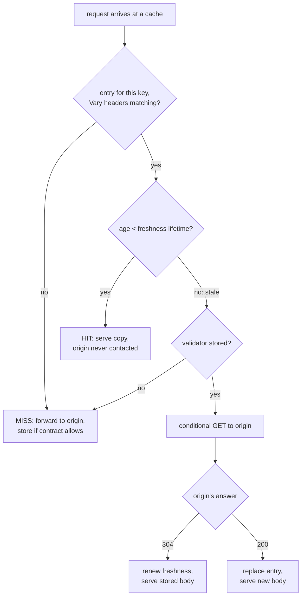
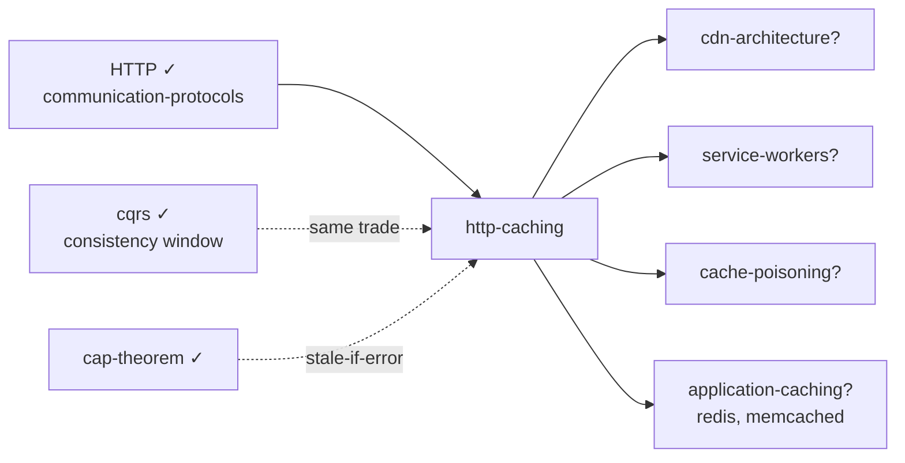

# HTTP Caching — the reuse contract every response carries

> **Lab type:** protocol-mechanism lab. The skill being trained: reading and
> writing the *reuse contract* — the headers that decide who may keep a copy of
> a response, for how long, and how to cheaply check whether it's still good.
>
> **What's in this lab:**
> - `README.md` — this document (the story, the mechanism, the failure catalog)
> - `experiments/` — a real caching proxy, a 304 byte-diet demo, and a live cache
>   stampede + fix (plain Java, JDK only — no build tool, no dependencies)
> - `visualization.html` — interactive two-cache simulator (browser + CDN) with
>   predict-then-run scenarios
> - `EXERCISES.md` / `SOLUTIONS.md`
>
> **Builds on labs you've done:** [communication-protocols](../communication-protocols/)
> — you already speak HTTP's wire format (headers, verbs, status codes), know that
> **round trips dominate perceived latency**, that **GET is idempotent**, and that
> "REST's deepest unused superpower is HTTP caching" was left as a promise there.
> This lab is that promise kept. From [cqrs](../cqrs/) you know the **consistency
> window** — serving answers slightly behind the truth in exchange for speed.
> HTTP caching is that exact trade, standardized into the protocol.

---

## Layer map

> **BEGINNER MODEL** (§1–§9) → **INTERMEDIATE MODEL** (§10) →
> **ENGINEERING MODEL** (§11–§12) → **PRODUCTION MODEL** (§13–§15)

Zero caching knowledge assumed. By §15 you'll be able to read RFC 9111 and a
CDN dashboard without flinching.

---

## 1. WHY — the fastest request is the one never sent

In the protocols lab you measured it: every request pays a round trip, and
round trips — not bytes — make apps feel slow. The only move that beats a fast
request is *no request*: answer from a copy stored nearby. HTTP has this built
in — a complete, standardized system for storing and reusing responses — and it
is the single highest-leverage performance feature most backend engineers never
touch. The stakes run both directions: teams that ignore it burn money serving
the same unchanged bytes millions of times and ship apps that feel sluggish on
every continent but their own; teams that enable it carelessly serve customers
**yesterday's prices** — or, far worse, **someone else's account page**. Caching
is not an optimization sprinkle; it's a correctness contract you are already
party to, whether you've read it or not.

---

## 2. PROBLEM — two million people keep asking for the same menu

Tiffin again. Biryani House's menu is requested **2 million times a day**. It
changes about **twice a day** (lunch menu, dinner menu). Alice in Pune taps the
app; her request crosses to Tiffin's servers in Mumbai, the server queries the
database, renders JSON, and sends back the same bytes it sent the previous
999,999 times. Every copy is identical. Everyone waits ~200 ms. The database
does the same work 2 million times to produce 2 answers.

Watch the shape of the waste: **the answer barely changes; the asking never
stops.** Any human clerk would have solved this by lunchtime: write today's
menu on a chalkboard by the door, and stop walking to the kitchen to ask.

---

## 3. NAIVE SOLUTION — keep a copy, reuse it

So: Alice's phone keeps a copy of the menu after the first fetch and reuses it.
Even better, Tiffin puts helper servers in every city (you met this idea as a
**CDN** — a *content delivery network*, servers near users that can answer on
Tiffin's behalf), and each keeps a copy too: the first Pune user's fetch
fills the Pune copy, and the next hundred thousand Pune users get it from
next door in 10 ms.

Instant win: traffic to Mumbai collapses, and so does everyone's waiting. Ship it?

---

## 4. FAILURE — the copy doesn't know when it's wrong

**Break #1 — stale forever.** At 5 p.m. Biryani House raises the biryani price
from ₹250 to ₹280. Alice's phone and the Pune helper server have no idea; they
happily serve ₹250 *forever*. Customers order at a price that no longer exists.
The copy has no expiry date and no way to learn the world changed.

**Break #2 — the wrong thing got copied.**

> **🔮 Predict:** The Pune helper server also cached the response to
> `GET /account` — Alice's account page — because hey, it's a GET like any
> other. Bob, also in Pune, opens *his* account page. What does Bob see?
> <details><summary>Reveal</summary>
> **Alice's account.** The helper server is shared by every user in Pune; it
> stored "the response to `GET /account`" with no idea that this response was
> *for Alice specifically*. This is not hypothetical — cached-personalized-page
> leaks (names, emails, balances shown to strangers) have hit real companies
> repeatedly. A shared copy of a personal answer is a data breach, not a
> performance win. Some responses must never be shared; some must never be
> stored at all.
> </details>

**Break #3 — re-downloading what didn't change.** Suppose we patch break #1
crudely: copies expire after 10 minutes. Now every 10 minutes, 2 million
clients re-download the *identical* 50 KB menu — full body, full cost — just to
discover nothing changed. Expiry without a cheap "did it change?" check turns
into scheduled waste.

The deeper discovery: a copy is only safe to reuse if someone answers three
questions about it — **how long is it trustworthy? who is allowed to reuse it?
and how can its owner cheaply confirm it's still right?** The phone and the
helper server can't answer these. Only the origin — the server that made the
response — knows.

---

## 5. THE REAL REQUIREMENT

We need the **origin to attach the reuse rules to every response it sends**,
and every copy-keeper to obey them:

1. **A lifetime** — "reuse this freely for N seconds, no need to ask me."
2. **An audience** — "anyone may reuse this" vs "only the one user it was made
   for" vs "never store this at all."
3. **A cheap check** — a way to ask "is my copy still good?" and get back a
   tiny *yes* instead of the whole body.
4. **An identity rule** — what counts as "the same request," so a copy is
   never served to a request it doesn't actually answer.

And one constraint that shapes everything: the origin's rules must travel *in
the response itself*, because the copy-keepers (browsers, helper servers, even
servers Tiffin doesn't own) will never run Tiffin's code.

---

## 6. KEY IDEA

> **Every HTTP response carries its own reuse contract, written in headers; a
> cache is a dumb, obedient contract-follower.** Two mechanisms cover
> everything: **freshness** — "serve your copy without asking me, for this
> long" — and **validation** — "after that, ask me *cheaply* whether the copy
> still matches, and I'll say either 'yes, keep using it' in ~zero bytes or
> send the new one."

Everything else in this lab — every header, every CDN behavior, every failure
— is these two mechanisms plus the audience and identity rules from §5.

---

## 7. TERMINOLOGY — the words on the contract

**Cache** — *plain:* any keeper of response copies. *Technical:* a store
mapping requests to previously received responses, governed by HTTP's reuse
rules (RFC 9111). *Why the term:* it names the *role*, not a product — your
browser has one, every CDN node is one, your office proxy may be one; the same
contract binds them all. *Example:* Alice's phone storing the menu JSON.
*Connects to:* the "copy-keeper" of §3–§4.

**Origin** — *plain:* the server that actually creates the answers. *Technical:*
the authoritative server for a resource; every cached copy descends from an
origin response. *Why:* once copies exist everywhere, "the server" is ambiguous —
this term marks the one that owns the truth. *Example:* Tiffin's Mumbai API
servers. (You've seen this word in CDN contexts; here it gets its precise
meaning.)

**Hit / miss** — *plain:* the copy was there and usable / it wasn't.
*Technical:* a request satisfied from cache without contacting the origin (hit)
vs one that had to go through (miss). *Why:* the ratio of these two numbers —
the **hit ratio** — is the single metric the entire practice optimizes.
*Example:* 2M requests, 1.99M hits = 99.5% hit ratio; the origin saw only 10k.

**Fresh / stale, freshness lifetime** — *plain:* young enough to serve without
asking vs too old to trust blindly. *Technical:* a stored response is fresh
while its **age** (seconds since the origin generated it) is below its
freshness lifetime, declared by `Cache-Control: max-age=N`; after that it is
stale — not deleted, not unusable, just *no longer reusable without checking*.
*Why two words:* the naive model had only "have a copy / don't"; the whole fix
of break #1 lives in this third state — *have a copy, must verify*. *Example:*
`max-age=300`, stored at 12:00 → fresh until 12:05, stale after — but still on
disk, awaiting a cheap check. *Connects to:* the [cqrs](../cqrs/) consistency
window: max-age *is* the declared window width.

**Private vs shared cache** — *plain:* a copy-keeper serving one person vs
many. *Technical:* a browser cache is private (one user); CDNs and proxies are
shared (many users). `Cache-Control: private` permits only private caches to
store the response; `public` (or just a lifetime) permits shared ones too.
*Why:* break #2 — Bob seeing Alice's account — is exactly what this distinction
prevents. *Example:* `Cache-Control: private, max-age=60` on `/account`: Alice's
phone may reuse it for a minute; the Pune CDN node must not keep it at all.

**Validator (`ETag`, `Last-Modified`)** — *plain:* a fingerprint of the copy,
used to ask "still this one?" *Technical:* an opaque version token (`ETag:
"v2-9f3a"`) or a timestamp (`Last-Modified`) the origin sends with the
response; the cache stores it alongside the body. *Why:* break #3 — the cheap
check needs something cheaper than comparing bodies. *Example:* the menu's
ETag changes only when the menu does.

**Conditional request / `304 Not Modified`** — *plain:* "send it only if it
changed" / "it didn't — use what you have." *Technical:* a GET carrying
`If-None-Match: "v2-9f3a"` (or `If-Modified-Since`); the origin compares and
answers either `304` with **no body** — renewing the copy's freshness — or
`200` with the new body and new validator. *Why:* this is **validation**, the
second half of the key idea; a 304 costs one round trip but ~zero bytes.
*Connects to:* you'll measure the savings in experiment 02.

**Cache key** — *plain:* what counts as "the same request." *Technical:* the
lookup key for stored responses — by default the method + URL. *Why:* §5's
identity rule; every cache-poisoning and wrong-variant bug is a cache-key bug.
*Example:* `GET https://api.tiffin.com/menu?restaurant=42`.

**`Vary`** — *plain:* "my answer also depends on these request headers, not
just the URL." *Technical:* a response header listing request headers that must
match for a stored copy to be reused — effectively extending the cache key.
*Example:* `Vary: Accept-Encoding` keeps a gzip-compressed copy from being
served to a client that can't decompress it (§11.3 shows the garbage that
happens otherwise).

Minor terms at first use:
**TTL** — informal name for the freshness lifetime ("time to live").
**`Age` header** — a cache tells you how old the copy it served is, in seconds.
**Heuristic caching** — what caches do when *no* lifetime was declared: guess (§10.5).
**Purge** — explicitly deleting a stored copy from a cache you control.

---

## 8. MENTAL MODELS

**The simple model: the chalkboard by the door.** The kitchen (origin) writes
today's menu on a chalkboard (cache) so nobody walks to the kitchen. In the
corner it writes the rules: *"good until 17:00"* (freshness lifetime), *"today's
menu, version: dinner-v2"* (validator). At 17:00 the board isn't erased — a
waiter pokes their head into the kitchen: *"still dinner-v2?"* — "yes" costs
two seconds (304) and the board gets a new "good until" time; "no" means
copying out the new menu (200). A second, personal chalkboard in Alice's own
notebook may hold her order history (private); the door board (shared) must
never hold it.

**The engineering model.** Per stored entry:
`{cache key (+Vary'd headers) → body, validator, stored-at, freshness lifetime, audience flags}`
and one decision procedure on every request:



**Mapping:** chalkboard = cache entry · "good until 17:00" = `max-age` ·
"version: dinner-v2" = `ETag` · the waiter's poke = conditional request ·
"yes, still v2" = `304` · door board vs Alice's notebook = shared vs private ·
erasing the board = purge.

**Where the analogy breaks:**
- **The kitchen can't repaint chalkboards it doesn't own.** A real kitchen
  could send someone to erase the door board early. The origin **cannot reach
  into Alice's phone or a stranger's proxy** — once a copy with `max-age=3600`
  is out, it is out for an hour, everywhere. HTTP has *no revocation
  broadcast*. This single missing feature drives half of production practice
  (§10.4, §11.1).
- **One board vs thousands.** The chalkboard is one place; real copies live in
  millions of browsers and hundreds of CDN nodes *at different ages* — so an
  update rolls through the world gradually, one expiry at a time. Users on the
  same second can see different menus. (The cqrs lab's "every reader at its
  own checkpoint," reborn.)
- **The waiter always finds the kitchen open.** If the origin is *down*, a
  cache holding a stale copy faces a choice the analogy never has: serve
  possibly-wrong or serve nothing — CAP's flavor of trade, at the HTTP layer
  (§10.6's `stale-if-error`).

---

## 9. VISUALIZATION — watch a copy age

Open **`visualization.html`** (offline-capable; artifact link in the wrap-up).
The layout matches this doc's world: **Alice's browser cache** and **Bob's
browser cache** (private) on the left, the **CDN node** (shared) in the middle,
the **origin** on the right. Cache entries appear as boxes with a draining
freshness bar; every request animates hop by hop and the log explains each
decision in a sentence ("fresh for 42 more seconds → served from the CDN;
origin never contacted").

Use it in this order:
1. Set `max-age=60`, click **Alice requests** twice, then **advance time +90 s**,
   then request again — watch fresh HIT become stale → conditional → `304`.
2. Click **Deploy v2 at the origin** while copies are still fresh, and watch
   who keeps seeing v1, and until when.
3. Run the scripted scenarios (left rail) — each asks for your prediction
   first: the deploy trap, the account-page leak, the missing `Vary`, the
   stampede.

> **CHECKPOINT — beginner model done.** You can explain why copies need a
> lifetime, an audience, a cheap check, and an identity rule — and what each
> is called. Next: the actual headers, and the order they were forced into
> existence.

---

## 10. ACTUAL MECHANISM — building the contract, break by break

We rebuild Tiffin's caching the way the world built HTTP's: start with the
obvious contract, watch it fail, patch with the next header. Each subsection
is one refinement with real values.

### 10.1 v1 — a lifetime: `Cache-Control: max-age`

The origin answers the menu request with one added header line (wire format
exactly as you hand-typed in the protocols lab):

```
HTTP/1.1 200 OK
Content-Type: application/json
Cache-Control: max-age=300
ETag: "menu-v7"

{"restaurant": "Biryani House", "biryani": 250, ...}
```

Contract: *anyone may reuse this for 300 seconds.* The Pune CDN node stores it
at 12:00:00. Requests until 12:04:59 are **hits** — served in ~10 ms with an
added `Age: 137`-style header ("this copy is 137 s old"). Tiffin's 2M
requests/day become ~300/day at the origin *per CDN node*. Break #1 (stale
forever) is fixed: worst-case staleness is now a declared, bounded 300 s.

### 10.2 v2 — the cheap check: `ETag` + `If-None-Match` → `304`

At 12:05 the copy goes stale. Naively the CDN re-downloads all 50 KB — break
#3. Instead, it sends a **conditional request**:

```
GET /menu HTTP/1.1
If-None-Match: "menu-v7"
```

The origin compares tags — the menu hasn't changed — and answers:

```
HTTP/1.1 304 Not Modified
Cache-Control: max-age=300
ETag: "menu-v7"
                                ← no body. That's the whole point.
```

The CDN keeps its stored body, resets the age clock, serves hits for another
300 s. Cost of the check: one round trip, a few hundred header bytes. When the
menu *does* change, the same conditional request gets a full `200` with
`ETag: "menu-v8"`. Experiment 02 puts a byte counter on exactly this exchange.

*(`Last-Modified`/`If-Modified-Since` is the older, timestamp-based validator —
same dance, 1-second resolution, kept for compatibility. Prefer `ETag`.)*

### 10.3 v3 — the audience: `private`, `no-store`, `s-maxage`

Break #2 (Bob sees Alice's account) is fixed by audience directives:

- `Cache-Control: private, max-age=60` — *Alice's own browser* may reuse her
  account page for a minute; **shared** caches (CDN, proxies) must not store it.
- `Cache-Control: no-store` — nobody stores this, ever (payment confirmations,
  anything regulated). The strongest directive — and therefore the most abused
  default; sprinkle it everywhere and you've turned caching off for your whole
  product.
- `Cache-Control: max-age=0, s-maxage=600` — split lifetimes: browsers must
  revalidate every time, but **s**hared caches may serve it for 10 minutes.
  Why would you want that? Because Tiffin can *purge its own CDN* on demand
  (it's Tiffin's infrastructure) but can never purge browsers — so you give
  the cache you can invalidate a long leash and the one you can't a short one.
  Remember the analogy break: no revocation broadcast exists; `s-maxage` is
  how you engineer around it.

### 10.4 v4 — the update problem, solved by never updating

> **🔮 Predict:** Tiffin ships a redesign: `app.js` served with
> `max-age=86400` (a day). At 14:00 they deploy new HTML that *requires* the
> new JS. Alice's browser cached `app.js` at 13:59. What does Alice see, and
> what can Tiffin's ops team do to fix her?
> <details><summary>Reveal</summary>
> Alice gets the **new HTML with the day-old JS** — a broken page (missing
> functions, mismatched markup) — until 13:59 *tomorrow*. And ops can do
> **nothing**: the copy is in her browser, and HTTP has no way to reach it.
> Purging the CDN helps the *next* user, not her. This is the analogy break
> made flesh: you cannot repaint chalkboards you don't own.
> </details>

The production fix is a pattern, not a header: **stop updating resources;
create new ones.** Build tooling fingerprints the file into its URL —
`app.9f3a2c.js` — and the HTML references the exact version. Now:

- `app.9f3a2c.js` → `Cache-Control: public, max-age=31536000, immutable` — a
  year of freshness, and `immutable` ("this URL's content will *never*
  change") tells browsers not even to revalidate on refresh. Safe, because a
  changed file gets a *new URL*.
- `index.html` → `Cache-Control: no-cache` — meaning *store, but revalidate
  every time*: every load does a conditional GET; a `304` makes it nearly
  free, and a deploy is visible on the very next load, atomically swapping
  which JS URL the page asks for.

**⚠️ The most-confused pair in all of HTTP, worth engraving:**
`no-cache` = *store it, but always ask before reusing* (validation every use).
`no-store` = *never write it down at all*.
Half the internet's config files use `no-cache` intending `no-store` and vice
versa.

### 10.5 v0, retroactively — what happens with NO headers at all

> **🔮 Predict:** Priya's teammate ships `/api/specials` with no
> `Cache-Control` and no `Expires` header at all — just `Last-Modified: (3
> days ago)`. Is the response cached? For how long?
> <details><summary>Reveal</summary>
> Quite possibly **yes — for ~7.2 hours**, by a cache Priya doesn't control.
> Absent explicit lifetimes, caches are *allowed* to guess (**heuristic
> caching**); the RFC's suggested guess is 10% of how long the resource has
> gone unmodified — 10% of 3 days ≈ 7.2 h. Browsers and CDNs implement
> variations of this. Silence is not "no caching"; silence is *undefined
> caching*. The rule this forces: **every response your API serves should
> state its contract explicitly**, even if the contract is `no-store`.
> </details>

*(Also part of the default machinery: caching applies to **safe** methods —
GET/HEAD. POST/PUT/DELETE responses aren't reused%; in fact a successful
unsafe request on a URL tells caches to invalidate their copy of it — the
protocol knows a write dirties the read, shades of your cqrs lab.)*

### 10.6 v5 — living with staleness: `stale-while-revalidate`, `stale-if-error`

One residual wart: the client that arrives at 12:05:01 — one second after
expiry — pays the full revalidation round trip while everyone before and after
gets 10 ms hits. Fix: let the cache serve the *slightly* stale copy instantly
and revalidate **in the background**:

```
Cache-Control: max-age=300, stale-while-revalidate=60, stale-if-error=3600
```

*"Fresh for 5 min; for 1 more min you may serve stale while you refresh behind
the scenes; and if the origin is erroring/unreachable, serve stale up to an
hour rather than failing."* — `stale-if-error` being the explicit,
bounded choice of availability over consistency (the AP corner, chosen per
response — your [cap-theorem](../cap-theorem/) lab as an HTTP header). The
strict opposite exists too: `must-revalidate` = "once stale, NEVER serve
without a successful check" — for correctness-critical data like prices.

> **CHECKPOINT — intermediate model done.** You can write the contract:
> lifetime (`max-age`, `s-maxage`), audience (`public/private/no-store`),
> check (`ETag`→`304`), identity (`Vary` next §), update strategy
> (fingerprint + `immutable`, `no-cache` shell), staleness policy
> (`stale-while-revalidate`, `must-revalidate`). Next: how this machinery
> fails in production — the engineering layer.

---

## 11. FAILURE SCENARIOS

Each: how to create it → where to watch → what/why → the fix → which
guarantee bent. The visualization's scenarios run 11.1–11.4 predict-first;
experiment 03 runs 11.4 live.

**11.1 The un-recallable copy (deploy horror).** Create: long `max-age` on a
mutable URL, then change the content (viz scenario "The deploy trap"; §10.4's
predict). What/why: copies you cannot reach serve the old bytes until each
one's own clock runs out; rollout is gradual and per-user. Fix: fingerprinted
immutable URLs + revalidate-always HTML (§10.4); for CDN copies, purge APIs.
Guarantee bent: none — the system did exactly what you declared. That's the
lesson: **max-age is a promise about the future; only make promises about
URLs whose content can't change.**

**11.2 The shared-cache privacy leak.** Create: personalized response without
`private`/`no-store` behind a shared cache (viz scenario "Bob sees Alice's
account"). What/why: shared caches key on URL — nothing in the key says
*whose* answer this was; first user's response becomes everyone's. Real-world
variants: CDN misconfig leaking account pages; caches keyed without the
`Authorization` header (the RFC forbids shared caches from storing authorized
responses unless explicitly allowed — but private proxies and misconfigured
CDNs exist). Fix: `Cache-Control: private` (or `no-store`) on anything
personalized, and never rely on obscurity of URLs. Guarantee bent:
confidentiality — the one failure here that's a *security incident*, not a
performance bug.

**11.3 The missing `Vary`.**

> **🔮 Predict:** The origin compresses responses for clients that send
> `Accept-Encoding: gzip`. The CDN caches the gzipped `/menu` (no `Vary`
> header). Next comes a legacy client that doesn't speak gzip. What does it
> receive?
> <details><summary>Reveal</summary>
> The gzipped bytes, served as-is from cache — which it renders as **binary
> garbage**. The cache key was just the URL; nothing recorded that this
> stored answer was only right *for gzip-speaking clients*. Fix:
> `Vary: Accept-Encoding` — the cache now stores per-encoding variants and
> matches on that request header. Same trap with `Accept-Language`,
> API-versioning headers, and worst of all `Vary: Cookie`-shaped
> personalization (which quietly makes the hit ratio ~0% — every user their
> own variant — the opposite failure). `Vary` is the identity rule of §5;
> both under- and over-specifying it are bugs. Watch it in the viz scenario
> "The gzip garbage".
> </details>

**11.4 The stampede (dogpile).** Create: one popular entry expires while 30
requests/s are arriving (run `experiments/Exp03Stampede.java`; viz scenario "The
expiry stampede"). What/why: at expiry, every concurrent request misses
*simultaneously* and all of them descend on the origin with the same
question — the cache's whole point inverted at the worst moment, periodically.
The origin sees load spikes shaped like your TTLs (thundering herd, §11.2 of
the protocols lab, caused by a timer instead of a reconnect). Fixes, in
increasing order of niceness: (a) **single-flight** — one request refills the
entry, the rest wait for it; (b) `stale-while-revalidate` — the rest are
served stale instantly while one refreshes; (c) jittered TTLs so entries
don't expire in sync. Guarantee bent: none formally — liveness of the origin
in practice. The experiment shows the raw spike (30 origin hits, then the
fix: 1).

**11.5 Caching the error.** Create: origin has a bad minute and answers `500`
or an empty list; a cache stores it. What/why: some errors are cacheable by
default rules (and CDNs often add "negative caching" deliberately); now the
*outage outlives itself* — the origin recovered but the error is fresh for
another N minutes. Fix: explicit short/no lifetime on error responses
(`Cache-Control: no-store` on 5xx, or CDN negative-TTL config measured in
seconds); `stale-if-error` on the *good* responses so errors prefer old-good
over fresh-bad. Guarantee bent: freshness working as declared — on the wrong
content.

**11.6 The cache you forgot existed.** Create: nothing — this one finds you.
Symptom: "we deployed the fix but the user still sees the bug"; "it works in
incognito." Why: the request path is a *chain* of caches — browser memory →
browser disk → service worker → corporate proxy → CDN edge → CDN shield →
maybe your reverse proxy (nginx/Varnish) — and each obeys the contract
*independently*, each with its own age for the same URL. Debugging tools of
the trade: the `Age` header (who's serving this and how old), CDN debug
headers (`X-Cache: HIT/MISS`, `CF-Cache-Status`), DevTools' "Disable cache",
and `curl -H 'Cache-Control: no-cache'` to force end-to-end revalidation
(what a browser refresh actually sends). Rule: never say "the cache" —
name *which* one.

---

## 12. CORRECTNESS — what the contract does and doesn't promise

**Guaranteed (by conformant caches):** a response is reused only within the
lifetime you declared, only for the audience you declared, only for requests
matching the key + `Vary`; validators are compared exactly; a `304` never
invents content — it can only bless bytes the cache already holds.

**Explicitly NOT guaranteed:** global consistency (copies at different ages
disagree — there is no "the current version" anywhere but the origin);
revocation (no push-invalidation of copies you don't own); that every box on
the path *is* conformant (buggy proxies exist — defensive rule: for anything
sensitive, `no-store` beats hoping); freshness under `stale-*` directives you
yourself enabled.

**The trade, named precisely:** you exchange a **bounded consistency window**
(max-age, per copy) for latency and origin offload — the identical trade to
your cqrs read models, with one twist worth savoring: *here the writer
declares the window and unknown readers obey it*, whereas in cqrs the reader
measured its own lag. Corollaries: cache-invalidation-is-hard is not a joke
but a structural fact (no revocation) — which is why the winning pattern
(§10.4) is to make invalidation *unnecessary* (immutable URLs); and idempotent
GET (protocols lab) is what makes all of this legal — caching is the reward
HTTP pays you for keeping reads side-effect-free.

> **CHECKPOINT — engineering model done.** You can predict every failure in
> §11 from the model. Next: proof by running code, then production practice.

---

## 13. CODE — what each experiment proves

Stdlib-only, `java experiments/Exp0N….java` (JDK 21+, no build tool):

- **`Exp01ARealCache.java`** — an origin (200 ms away, counts its own hits) and
  a genuinely rule-following caching proxy in ~60 lines. Load-bearing lines:
  the freshness check (`age < max-age` — §10.1's contract, executed) and the
  `Age`/`X-Cache` headers it stamps. Phase 3 raises the price at the origin
  and shows the proxy *correctly* serving ₹250 — staleness as contract
  compliance, not bug.
- **`Exp02The304Diet.java`** — the §10.2 exchange with a byte scale: full `200`
  vs conditional `304`, unchanged vs changed content, actual byte counts and
  the residual round-trip cost (tying back to the protocols lab: validation
  still pays latency; only freshness pays nothing).
- **`Exp03Stampede.java`** — §11.4 live: 30 virtual threads hit one expired
  entry; origin's concurrent-request gauge spikes to 30. Then the single-flight
  lock (the load-bearing ~10 lines: one fetcher, everyone else waits on its
  result) and the same 30 virtual threads produce exactly 1 origin hit.

## 14. EXPERIMENTS — predict, then run

| # | Predict first | Command |
|---|---|---|
| 1 | 5 requests, `max-age=60`: how many reach the origin? After the price changes at t+10 s: what price do users see, and until when? | `java experiments/Exp01ARealCache.java` |
| 2 | Menu unchanged: how many *body* bytes does revalidation move? What does it still cost? | `java experiments/Exp02The304Diet.java` |
| 3 | 30 simultaneous requests, entry just expired: origin hits without the fix? With single-flight? | `java experiments/Exp03Stampede.java` |

Then run the four viz scenarios you haven't yet.

---

## 15. PRODUCTION

**The four response archetypes** — nearly every endpoint is one of these; the
decision procedure is to name the archetype, not to hand-craft headers:

| Archetype | Contract | Why |
|---|---|---|
| Fingerprinted static asset (`app.9f3a2c.js`) | `public, max-age=31536000, immutable` | content can never change at this URL (§10.4) |
| HTML shell / entry point | `no-cache` (+ `ETag`) | deploys must land next load; 304 keeps it cheap |
| Personalized API (`/me`, `/orders`) | `private, no-store` — or `private, no-cache` + `ETag` if bodies are big | never in shared caches (§11.2); ETag still saves bytes |
| Shared, slowly-changing API (`/menu`, catalogs) | `public, s-maxage=60, stale-while-revalidate=300` (+ purge on write) | CDN absorbs the world; you can purge what you own (§10.3) |

**Architecture:** real CDNs run **tiers** — many edge nodes near users, a
smaller **shield/mid-tier** in front of your origin so a miss at 100 edges
becomes ~1 origin request (request coalescing = §11.4's single-flight, run
for you at planet scale). Reverse-proxy caches (Varnish, nginx
`proxy_cache`) apply the same RFC inside your own rack. Purge/invalidation
APIs (by URL, or better by **surrogate key/tag** — "purge everything tagged
`restaurant-42`") — that's how "purge on write" in the table is actually
wired, typically off the same event feed your outbox/cqrs labs built.

**What the on-call watches:** hit ratio (edge and origin-shield separately) —
a dip means a deploy changed URLs/headers/`Vary` somewhere; **origin offload**
(requests the origin didn't see — capacity planning is done on this number);
`Age` percentiles (how stale is lived experience); purge latency; and after
every incident, the reflex question of §11.6: *which* cache.

**What this lab intentionally omits:** service workers and the browser's
programmable cache (`Cache API`) — a whole client-side layer with its own
lifecycle; proxy-revalidation details (`proxy-revalidate`); range/partial
responses; `Expires` (the legacy absolute-date header `max-age` replaced);
request-side `Cache-Control` beyond refresh semantics; cache poisoning
attacks via unkeyed inputs (a security topic worth its own hour); HTTP/2
push's failed cache story; and consistency protocols CDN vendors layer on
top (instant purge propagation).

---

## 16. EXERCISES

[`EXERCISES.md`](EXERCISES.md) — eight rungs, from explaining the two
mechanisms to designing Tiffin's full caching architecture. Answers in
[`SOLUTIONS.md`](SOLUTIONS.md); attempt first.

---

## 17. KNOWLEDGE MAP & NEXT STEPS



**Commonly confused, one sentence each:**
- *HTTP caching vs application caching (Redis/Memcached):* HTTP caching reuses
  whole responses via headers any infrastructure obeys; application caching is
  your code storing arbitrary values behind your API — invisible to HTTP,
  invalidated by your own logic.
- *`no-cache` vs `no-store`:* store-but-always-revalidate vs never-store (§10.4).
- *`max-age` vs `s-maxage`:* everyone vs shared-caches-only lifetime.
- *`ETag` vs fingerprinted URL:* same idea (content identity) applied at
  validation time vs baked into the address so validation is never needed.
- *Purge vs expiry:* an action you perform on caches you own vs a clock that
  runs everywhere.

**Next steps:**
- `/learn cdn-architecture` — tiers, shields, anycast, purge propagation.
- `/learn cache-poisoning` — the security flip side of cache keys and `Vary`.
- `/learn application-caching` — Redis-side patterns: cache-aside, write-through, TTL jitter.
- `/learn io-multiplexing` — still queued from the protocols lab.

---

## 18. GLOSSARY (in order of appearance)

| Term | One line |
|---|---|
| CDN | content delivery network — shared caches placed near users |
| cache | any store of response copies governed by HTTP's reuse rules |
| origin | the authoritative server the copies descend from |
| hit / miss | served from the copy / had to contact the origin |
| hit ratio | hits ÷ requests — the practice's headline metric |
| fresh / stale | young enough to reuse without asking / must check first |
| freshness lifetime / TTL | how long a copy stays fresh (`max-age=N`) |
| age / `Age` header | seconds since the origin generated the copy; caches expose it |
| private vs shared cache | one user's cache (browser) vs many users' (CDN, proxy) |
| `public` / `private` / `no-store` | audience directives: anyone / that user only / nobody ever |
| validator | fingerprint used for the cheap check (`ETag`, `Last-Modified`) |
| conditional request | "send only if changed" (`If-None-Match` / `If-Modified-Since`) |
| `304 Not Modified` | "your copy is still right" — renews freshness, carries no body |
| cache key | what counts as the same request (method + URL, extended by `Vary`) |
| `Vary` | response header naming request headers the answer depends on |
| heuristic caching | a cache's permitted guess when no lifetime was declared |
| purge | deleting entries from a cache you control |
| `s-maxage` | freshness lifetime for shared caches only |
| fingerprinted URL / cache busting | content hash in the filename; updates become new URLs |
| `immutable` | "this URL's bytes will never change — don't even revalidate" |
| `no-cache` | store, but revalidate before every reuse (≠ `no-store`) |
| safe methods | GET/HEAD — side-effect-free, hence legally cacheable |
| `stale-while-revalidate` | serve stale briefly while refreshing in the background |
| `stale-if-error` | serve stale rather than fail when the origin errors |
| `must-revalidate` | once stale, never serve without a successful check |
| stampede / dogpile | synchronized misses at expiry crushing the origin |
| single-flight | one request refills an expired entry; the rest wait/reuse |
| negative caching | caching an error/absence response (dangerous by accident) |
| `X-Cache` / `CF-Cache-Status` | CDN debug headers announcing HIT or MISS |
| shield / mid-tier | CDN layer between edges and origin, coalescing misses |
| surrogate key | CDN tag on responses enabling group purge ("everything for restaurant 42") |
| origin offload | fraction of traffic the origin never saw |
