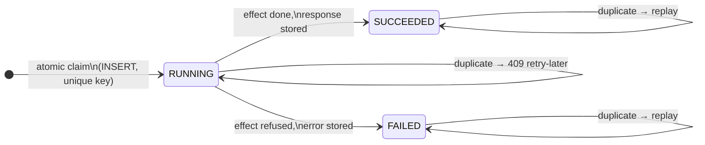
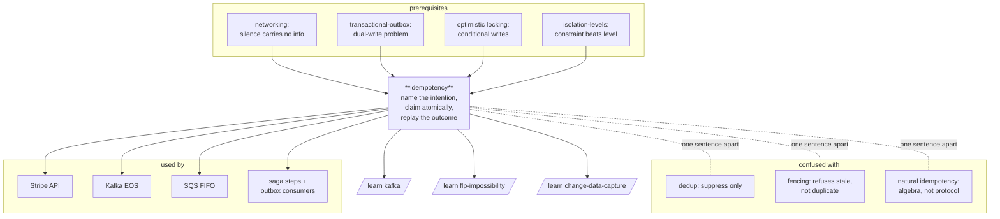

# Idempotency — one effect, no matter how many tries

> **Lab contents:** this document · [`visualization.html`](visualization.html)
> (interactive: "The Second Tap") · [`EXERCISES.md`](EXERCISES.md) ·
> [`SOLUTIONS.md`](SOLUTIONS.md). No runnable code — the mechanism is
> demonstrated by hand-worked traces here and by the visualization's simulator.

You have met the *slogan* of this lab many times: eight prior labs end some
chapter with "…and therefore consumers must be idempotent." The
[transactional-outbox](../transactional-outbox/) lab said it about events, the
[networking](../networking-for-developers/) lab measured *why* (TCP delivers
bytes to kernels, never outcomes), [raft](../raft/) said it about client
retries of uncommitted entries, and [distributed-locking](../distributed-locking/)
left "idempotency keys" as the explicitly-unfinished half of its honest corner
(box G). This lab opens the slogan up. Being idempotent is not a checkbox — it
is a small protocol with three parts that each fail in a specific, measurable
way when done naively, and one part that no amount of cleverness removes.

---

## Depth map

> **BEGINNER MODEL** (§1–§9): why duplicates are mandatory, why guessing
> doesn't work, and the key idea of naming intentions.
> **INTERMEDIATE MODEL** (§10): the mechanism, built four times, each version
> broken by a trace you can watch.
> **ENGINEERING MODEL** (§11–§12): the full failure catalogue and the exact
> statement of what is and is not guaranteed.
> **PRODUCTION MODEL** (§13): Stripe, Kafka, SQS, HTTP semantics, Spring
> shapes, and what to put on a dashboard.

---

## 1. WHY — the duplicate is not a bug, it is the price of reliability

When your code sends a request and no answer comes back, there are two
worlds you cannot tell apart: *the request never arrived* (safe to resend) and
*the request was processed and only the answer was lost* (resending repeats
it). The [networking lab](../networking-for-developers/) measured this
directly: a timeout elapsing at ≈ your configured limit is the fingerprint of
silence, and silence carries no information about what the other side did.

So any client that wants reliability **must retry** — the
[communication-protocols](../communication-protocols/) lab called
timeout + retry + idempotency "one atom" for exactly this reason. And every
retry is, from the server's point of view, possibly a brand-new request.
If nobody solves this, the failure mode is not exotic: it is a customer
charged twice, an email sent three times, a shipment dispatched again. The
retry that makes the system reliable is the same act that makes it wrong.

## 2. PROBLEM — Asha taps Pay twice

Asha is buying a ₹2,000 concert ticket in the PayEasy app. She taps **Pay**.
The app sends `POST /payments {amount: 2000, concert: "indie-night"}` to the
PayEasy server. The server charges her card at the bank, saves an order, and
sends back "success" — but that reply is lost in a tunnel between two cell
towers. Asha's app shows a spinner for ten seconds, then: *"Something went
wrong. Try again."* She taps **Pay** again.

The server now receives a second `POST /payments {amount: 2000, concert:
"indie-night"}`. Look at it from the server's chair: this request is
byte-for-byte a legitimate purchase. There is no field in it that says "I am
attempt two of an earlier intention." The server does the only thing it can:
charges her again. Asha is out ₹4,000, and *no component misbehaved* — the
network lost one packet, and everything else worked exactly as designed.

Two observations that shape everything downstream:

- **The duplicate is indistinguishable from a new order by content alone.**
  Maybe Asha genuinely wants two tickets — friends exist. The bytes are
  identical either way.
- **Only Asha's phone knows** that the two sends are one intention. The
  knowledge lives at the client, at the moment of the first send.

## 3. NAIVE SOLUTION — check before charging

The reasonable first fix: before charging, look for evidence you already did.

```sql
-- illustrative, to read, not to run
SELECT id FROM orders
 WHERE customer = 'asha' AND concert = 'indie-night'
   AND created_at > now() - interval '2 minutes';
-- none found? → charge the card, INSERT the order
```

If a recent matching order exists, skip the charge and return it. This is
**deduplication by guessing**: infer "same intention" from similar content
close together in time.

## 4. FAILURE — three ways, one deeper problem

**🔮 Predict:** Asha's app auto-retries after 3 seconds, and her first request
was merely *slow*, not lost. Both requests are now inside the server, 3 ms
apart, both at the `SELECT`. What happens?

<details><summary>Reveal</summary>

Both `SELECT`s run before either `INSERT` — both see "no recent order" — both
charge. This is the **check-then-act gap**, and you have already watched it
kill a design once: the [distributed-locking](../distributed-locking/) lab
measured the defensive pre-write check dying in its own gap. Checking harder,
sooner, or twice does not help; between any check and the act it guards, the
world can move.
</details>

Walked through concretely, the naive check fails three independent ways:

1. **Concurrent duplicates** (the trace above): two requests interleave
   check-before-act. Frequency in real systems: double-taps and aggressive
   client retry policies make this the *common* case, not the rare one.
2. **The guess is wrong in both directions.** False positive: Asha really
   does want two tickets, bought 40 seconds apart — the check silently
   swallows a real order. False negative: Asha's retry went through a
   different code path that changed a field (the app re-priced the cart to
   ₹1,900) — the content no longer matches and the duplicate sails through.
3. **Crash between charge and record.** The server charges the bank, then
   dies before the `INSERT`. The retry's `SELECT` finds nothing — the
   evidence the check depends on is exactly what the crash destroyed.

The deeper problem all three point at: **the server is trying to reconstruct
intent from content, but intent is not in the content.** The fix cannot be a
better guess. The intent has to be *named*, by the party that has it, at the
moment it exists — and acting on that name has to be atomic with checking it.

## 5. THE REAL REQUIREMENT

For one intention, any number of physical requests must result in:

1. **At most one effect.** The card is charged once, no matter how many
   copies of the request arrive, in whatever order, however interleaved.
2. **Every attempt learns the one outcome.** Asha's second tap must get back
   *the receipt from the first charge* — not an error, not a fresh charge.
   (A dedup layer that swallows duplicates but answers "duplicate!" leaves
   the client no better off; it still doesn't know what happened.)

The [google-docs lab](../google-docs-system-design/) met requirement 2 in
miniature: the server there kept a per-client edit number and **re-sent the
original confirmation** for a duplicate edit — it called that "an idempotency
key in its smallest form." This lab is that mechanism grown to full size.

## 6. KEY IDEA

> **The client mints a unique name for the intention — before the first
> send — and attaches the same name to every retry. The server makes claiming
> the name atomic with doing the work, stores the outcome under the name, and
> answers every later arrival of the name from the stored outcome.**

That is the whole invention. Naming moves the "is this a duplicate?" question
from *guessing about content* to *equality of an identifier* — a question
with a crisp answer. Atomic claiming closes the check-then-act gap by making
the check and the act one indivisible event. Storing the outcome satisfies
requirement 2.

## 7. TERMINOLOGY — the professional vocabulary

Now that you have felt the problem, the standard words for its parts:

**Idempotent** — *plain:* doing it again changes nothing. *Precise:* in
mathematics, `f(f(x)) = f(x)` — applying the function to its own output is a
no-op (`abs(abs(-3)) = abs(-3)`). *Why the term exists:* it isolates the one
property that makes retries safe, separate from other niceties like
commutativity. *In distributed systems the usage shifts subtly:* we rarely
feed an output back in; we mean *processing the same request twice leaves the
system in the state one processing leaves it in*. `SET x = 5` is idempotent;
`INCREMENT x` is not. You met the mathematical version as one of the three
CRDT laws ([crdts](../crdts/): merge must be commutative, associative,
idempotent — where sum-merge instead of max-merge read 11 where the truth
was 2, purely from re-delivery).

**Natural idempotency** — *plain:* some operations are idempotent for free,
by their own algebra. `SET x=5`, `DELETE row 7`, `PUT /users/42 {...}`
(full replacement), a CRDT max-merge. *Why it matters:* if you can shape an
operation to be naturally idempotent, you need none of this lab's machinery
for the duplicate problem. *The limit:* "charge ₹2,000" has no natural
idempotent shape — the effect is a *new* thing in the world each time. Those
operations need the key.

**Idempotency key** — *plain:* the name the client gives the intention.
*Precise:* a client-generated unique identifier (in practice a UUID, e.g.
`ck_7f3a9d10`), minted once per intention, attached verbatim to every retry
of it, and used by the server as the identity of the operation. *Why it
exists:* it carries the client's knowledge ("these sends are one intention")
across the network to the party that must act on it. *Connection:* the
`offer id` in [uber-system-design](../uber-system-design/) and the per-client
edit number in google-docs were both this.

**Deduplication (dedup)** — *plain:* discarding copies. *Precise:* detecting
that an arriving item's identity has been seen and suppressing re-processing.
*Distinction the term is coined for:* dedup is the detect-and-suppress half
only; idempotent *processing* also includes answering with the original
outcome and surviving crashes mid-work. Every idempotency-key design contains
a dedup step; a dedup step alone is not the design.

**Request fingerprint** — *plain:* a checksum of what the request asked for.
*Precise:* a hash of the significant request content (e.g.
`sha256(method + path + body) = 9d1f…`) stored beside the key. *Why it
exists:* to catch the client bug of reusing a key for a *different* request —
same key + different fingerprint is a contract violation and must be refused,
never executed (you'll see it as a 422 in §10).

**Response replay** — *plain:* answering a retry with the saved original
answer. *Precise:* the stored serialized response (status + body) returned
for any arrival of an already-settled key, without re-executing anything.

**Delivery guarantees** — the three phrases you have used for many labs, now
pinned down. **At-most-once:** send, never retry — duplicates impossible,
loss possible. **At-least-once:** retry until acknowledged — loss impossible
(eventually), duplicates guaranteed possible. **Exactly-once delivery:**
impossible over a lossy network — this is the two-generals result wearing
delivery clothes; no acknowledgement protocol can make the sender and
receiver certain simultaneously. *The industry's honest phrasing:*
**exactly-once processing** (or "effectively once") = at-least-once delivery
composed with idempotent processing, so the *effect* count is one even though
the *arrival* count isn't. When a vendor says "exactly-once", this is what
the truthful ones mean.

Minor terms defined at first use later: *claim, settled, dedup window,
recovery point, re-drive, reaper*.

## 8. MENTAL MODELS

**The simple model: the numbered form and the filing teller.** A bank branch
handles transfer requests on paper forms. Each pad prints a unique serial
number on every form. The teller keeps a filing cabinet ordered by serial.
Procedure: when a form arrives, look up its serial. Never seen → file the
form, do the transfer, staple the receipt to the filed form. Seen →
**photocopy the stapled receipt and hand it over; do not touch the money.**
A customer who wants a *second* transfer fills a fresh form — fresh serial.
A customer who scribbles new amounts on a photocopied old form is turned away
at the window: forms are immutable once numbered.

**The engineering model:** a `idempotency_keys` table in the *same database
as the business data*, one row per key, carrying a tiny state machine:



with columns `key, fingerprint, state, response, created_at` and one hard
rule: **the transition into the table (the claim) and the business effect
must be atomic** — or provably recoverable when they cannot be (§10).

| Simple model | Engineering model |
|---|---|
| the printed serial number | the idempotency key (client-minted UUID) |
| the form's written content | the request body |
| comparing the form to the filed one | fingerprint check |
| the filing cabinet | the `idempotency_keys` table |
| filing the form | the atomic claim (INSERT, unique constraint) |
| doing the transfer | the business effect |
| stapling the receipt | storing the response |
| photocopying the receipt | response replay |
| "come back later, teller busy with that serial" | 409 on a RUNNING key |

**Where the analogy breaks** — four places, each one a real design problem
the teller never has:

1. **One teller, no races.** A single human serializes everything. Real
   servers process duplicates *concurrently*; the atomic claim exists
   precisely because two threads can hold the "same form" at once.
2. **The teller doesn't die mid-transfer.** If she did, a filed form with no
   stapled receipt would sit in the cabinet forever — and that is exactly
   the stuck-`RUNNING` state §11 deals with via reapers and re-drive.
3. **Paper serials can't collide; client UUIDs can be misused.** The teller
   trusts the pad. The server must *verify* the client kept its side of the
   contract — hence the fingerprint.
4. **The cabinet is infinite.** Real key tables are purged (Stripe: 24
   hours), and the purge creates a reopened hole: a retry arriving after its
   key was purged is a new intention as far as the server can tell (§11.7).

## 9. VISUALIZATION — "The Second Tap"

Open [`visualization.html`](visualization.html) (also published as an
artifact: <https://claude.ai/code/artifact/b63fab62-7d79-4256-95b3-e05ac7f53598>). It puts Asha's phone, the PayEasy server
(key table + orders visible), and the bank on one stage, with the messages in
flight between them. You choose the server's protection design —
**A:** none, **B:** check-then-act, **C:** atomic claim in one transaction,
**D:** claim-first with replay and a keyed bank call — and then make the
world misbehave: drop the response, double-tap, crash the server at a chosen
step, re-drive stuck keys. A verdict banner keeps score of the only number
that matters: *how many times Asha was charged.* Six predict-then-run
scenarios walk the same ladder as §10; run scenario 1 before reading on, and
each later scenario when the text points at it.

The doc and the page share one spatial layout (client left, server middle,
bank right) and one color language (key states: amber `RUNNING`, green
`SUCCEEDED`, red duplicates/charges).

## 10. THE MECHANISM — built four times

We now build the server's payment handler the way a good engineer actually
would: simplest thing first, then fix what a trace breaks. Versions are
named v1–v4; the visualization's designs B/C/D are v1/v2/v4.

### v1 — dedup check (the naive solution, formalized)

Keep a `seen_keys` set. On arrival: if key present → return "duplicate";
else do the work, then add the key.

You already watched this die in §4, but now with the key the trace is
sharper, because the *guessing* failures (2a/2b) are gone — content no
longer matters — and what remains is pure atomicity:

```
t=0ms   request A (key ck_7f3a) arrives, thread T1
t=3ms   request B (key ck_7f3a) arrives, thread T2   ← auto-retry
t=4ms   T1: ck_7f3a in seen_keys?  no
t=5ms   T2: ck_7f3a in seen_keys?  no                ← the gap
t=6ms   T1: charge bank ₹2,000                        (charge #1)
t=9ms   T2: charge bank ₹2,000                        (charge #2)
t=10ms  T1: add ck_7f3a
t=11ms  T2: add ck_7f3a                               (no-op, too late)
```

Also unfixed: crash after the charge, before the `add` — the retry finds a
clean set. **Run visualization scenario 2** to watch both.

### v2 — atomic claim: INSERT first, unique constraint arbitrates

Flip the order and let the database be the referee:

```sql
-- illustrative shape; one local transaction
BEGIN;
INSERT INTO idempotency_keys (key, fingerprint, state)
     VALUES ('ck_7f3a', '9d1f…', 'RUNNING');   -- UNIQUE(key) ← the claim
-- do the business work (all local writes)
UPDATE accounts SET balance = balance - 2000 WHERE id = 'asha';
INSERT INTO orders VALUES (...);
UPDATE idempotency_keys SET state = 'SUCCEEDED', response = '{"order":184}'
     WHERE key = 'ck_7f3a';
COMMIT;
```

The duplicate's `INSERT` of the same key hits the **unique constraint**. The
database's uniqueness arbitration is precisely an atomic
check-and-act — there is no instant between "is it there?" and "now it is"
in which a second inserter can slip. This is the
[isolation-levels](../isolation-levels/) lab's "a constraint beats an
isolation level" doing its finest work, and structurally it is the
**seventh costume of the one primitive** the
[optimistic-vs-pessimistic-locking](../optimistic-vs-pessimistic-locking/)
lab kept meeting: a conditional write, here `INSERT … WHERE nothing wears
this name yet`. (Costumes one through six: expected-version, `WATCH`,
`If-Match`, `@Version`, incarnation number, fencing check.)

Concurrency plays out cleanly (this is Postgres/H2 behavior for a unique
index; flagged as vendor-verified behavior, not run in this lab): the
duplicate's `INSERT` *blocks* until the first transaction resolves, then
raises a unique violation; the handler catches it, reads the settled row,
and **replays the stored response**. And a crash anywhere before `COMMIT`
rolls back *everything including the claim* — the retry finds a clean table
and re-executes from scratch, correctly, because none of the effect survived
either. Claim, effect, and outcome share one commit point.

**Checkpoint — intermediate model reached.** You can now build a fully
correct idempotent consumer for any effect that lives entirely in one
database: this exact shape — a `processed_messages` table written in the
same transaction as the effect — is the honest implementation of "consumers
must be idempotent" that the [transactional-outbox](../transactional-outbox/)
and [cqrs](../cqrs/) labs required, and for many real systems it is the
whole answer. **Run visualization scenario 3** (design C, local effect,
crash mid-work) and watch the rollback save it. What the next layer adds:
the effect that *leaves* the database.

**🔮 Predict:** PayEasy's charge is not a local `UPDATE` — it is an HTTPS
call to the bank. Can the call go inside the v2 transaction? What exactly
goes wrong if you try?

<details><summary>Reveal</summary>

Two separate disasters. (1) *Holding a transaction across a network call* —
the "lunch problem" the optimistic-locking lab measured: your locks and your
connection are held hostage to the bank's tail latency. Bad, but survivable.
(2) The fatal one: **`ROLLBACK` cannot unsend a network request.** If the
charge succeeds at the bank and the server then crashes before `COMMIT`, the
rollback erases the claim, the order, the stored response — every trace that
anything happened — but the money moved. The retry finds a virgin key table
and charges again. The atomicity that saved v2 was only ever atomicity of
*local* writes.
</details>

### v3 — v2 plus an external call: the dual-write problem returns

Put the bank call between the claim and the commit and trace the crash
windows with real values:

```
step 1  BEGIN; INSERT ck_7f3a RUNNING          (uncommitted)
step 2  call bank: charge ₹2,000  →  bank says OK, charge exists   ← REAL
step 3  INSERT order #184                       (uncommitted)
step 4  UPDATE ck_7f3a → SUCCEEDED + response   (uncommitted)
step 5  COMMIT
```

Crash after step 2, before step 5: the bank charged (step 2 is in the
world), the rollback erased steps 1/3/4 (they were only in the database's
uncommitted buffers). Retry with `ck_7f3a` → no row → full re-execution →
**second charge**. **Run visualization scenario 4.**

Recognize the shape: *a durable local write and an external side effect that
must happen together, with a crash possible between them* — this is the
**dual-write problem** from the transactional-outbox lab, returned one hop
down the stack. The outbox solved it for "save data + publish event." We
need its cousin for "record intention + call bank."

### v4 — claim first, in its own transaction; recurse the key downstream

The outbox's move was: make the durable write happen *first*, alone, then do
the unreliable thing, then record the outcome. Apply it here:

```
txn 1   INSERT ck_7f3a (state RUNNING, fingerprint 9d1f…); COMMIT
        ── the claim is now durable, crash-proof evidence of intent ──
step 2  call bank: charge ₹2,000, passing bank_key = ck_7f3a-charge
step 3  txn 2: INSERT order #184;
               UPDATE ck_7f3a → SUCCEEDED + response; COMMIT
step 4  send response to Asha
```

Now walk every arrival and every crash:

- **Duplicate after step 3** → key is `SUCCEEDED` → replay the response.
  Requirement 2 satisfied; zero re-execution.
- **Duplicate between txn 1 and step 3** (first request still working) →
  key is `RUNNING` → answer **409 Conflict, retry later**. Why not make the
  duplicate *wait* for the outcome? Because holding the duplicate holds a
  connection and a thread for an unbounded time — the lunch problem again,
  now on the request path. A quick refusal with "in progress" is cheaper for
  everyone; the client's next retry will hit `SUCCEEDED` and get the replay.
- **Same key, different fingerprint** (the app re-priced the cart to ₹1,900
  but reused `ck_7f3a`) → **422 Unprocessable**, and *nothing executes*.
  This is a client bug by definition — one name, two intentions — and the
  server must refuse rather than guess which intention is real. **Scenario 6.**
- **Crash after txn 1, before step 2** → key stuck `RUNNING`, bank never
  called, Asha's retries bounce off 409 forever. Safety intact (zero
  charges), **liveness lost**. The fix is a **reaper** (the same job-shape
  as the optimistic-locking lab's crashed-worker reaper): a background
  process that finds `RUNNING` rows older than a threshold and **re-drives**
  them — re-executes from where the evidence says they stopped.
- **Crash after step 2, before txn 2** — the crux. Key stuck `RUNNING`,
  *and the bank charged*. What may the reaper do? It cannot know whether
  step 2 happened (that's the two-worlds problem from §1, now the server's
  own problem — the doubt has moved, not died). If the reaper re-drives by
  blindly re-calling the bank: second charge.

**The move that resolves the crux — and the lab's central insight:** look at
step 2 again. The re-driven bank call passes the *same* `bank_key` as the
original attempt. If the bank itself implements idempotency keys, the
re-drive's charge call is a *duplicate by name* at the bank, the bank
replays its stored "OK, charge c_991" response, and the reaper learns the
truth of step 2 retroactively — then completes txn 2 as if the crash never
happened. **Run scenario 5** and watch the re-drive land on one charge.

> **Idempotency is not a middleware you bolt onto your edge; it is a
> per-hop contract that must recurse until it reaches a hop that can answer
> duplicates by name.** Your server is the bank's client, exactly as Asha's
> phone is yours. Each hop's retry-doubt is absorbed by the next hop's key
> table. The doubt only *dies* at a hop that can atomically claim-and-act
> (v2's single database, at the bottom of the chain).

And when the bottom hop offers no key — sending an email, calling a dumb
legacy API? Then the doubt has nowhere to die, and you are in the
[distributed-locking](../distributed-locking/) lab's box G, whose honest
answer this lab can now complete: at-most-once *or* at-least-once (pick
which failure you prefer per operation — a duplicate marketing email is
fine, dedup-best-effort; a duplicate payout is not, so hold it), plus
**reconciliation** — a periodic job comparing your ledger with theirs — and
a *measured* residual duplicate rate instead of a pretended zero.

For effects with **multiple** external steps (charge card → reserve seat →
issue ticket), the same claim row grows a `recovery_point` column — after
each completed step, a small transaction advances it (`charged` →
`seat_reserved` → …) so a re-drive *resumes* instead of restarting, and each
step's own external call carries its own derived key. That is the full
Stripe-described architecture (§13), and it is v4 applied per-step; no new
idea is needed.

## 11. FAILURE SCENARIOS — the catalogue

Each entry: how to create it → where to watch → what/why → the response →
guarantees kept/lost → production handling. Design v4 assumed except where
said.

1. **Lost response, later retry** (the founding case). Create: drop the
   response in the viz; tap again. Watch: scenario 1 vs the same actions on
   design D. The retry hits `SUCCEEDED` → replay. Kept: both requirements.
   Lost: nothing. Production: this is the *routine* path — Stripe-style APIs
   serve replays constantly; it should be a counter on a dashboard, not an
   alert.
2. **Concurrent duplicate** (double-tap / aggressive retry timer). Create:
   viz "double-tap". The claim's unique constraint arbitrates; loser gets
   409 (v4) or blocks-then-replays (v2). Kept: at-most-one effect. Lost:
   the duplicate waits one extra client-retry round for its answer.
   Production: 409 + `Retry-After`; clients treat 409-on-idempotent-POST as
   "poll again," never as failure.
3. **Crash after claim, before effect.** Stuck `RUNNING`; all retries 409.
   Kept: safety (0 charges). Lost: liveness for this key until the reaper
   re-drives. Production: **oldest-RUNNING-age is the alarm to have** (the
   twin of causal-consistency's oldest-blocked-dependency alarm); re-drive
   is safe *because* downstream is keyed.
4. **Crash after external effect, before recording** (the crux). Bank
   charged; server has only `RUNNING`. Without a keyed bank: irreducible
   doubt — re-drive risks double-charge, not re-driving strands Asha.
   With a keyed bank: re-drive replays at the bank, truth recovered,
   exactly-one restored. Kept (keyed): everything, eventually. Lost:
   latency until re-drive. Production: this window is why serious payment
   APIs *require* their callers to send keys — the provider is protecting
   you from your own crashes.
5. **Same key, different body.** 422, nothing executes, fingerprint
   mismatch counter increments. Kept: the key's meaning. Lost: nothing —
   but the client team has a bug to fix; a rising mismatch rate is a
   client-regression detector.
6. **Key store separate from the data store** (keys in Redis "for speed",
   orders in Postgres). Create: viz design C/D with the key table set to
   "separate, volatile" — or just reason it: claim in Redis and effect in
   Postgres are *two* durable systems again — the dual-write problem
   rebuilt at the exact spot it was solved, plus Redis restart-from-empty
   silently forgets every claim (the quorums lab's "rebuilt-empty replica
   satisfies the quorum" trap, wearing a cache costume). Response:
   **the key row lives in the same database, same transaction, as the
   effect it guards** — or, across services, in the store at the bottom of
   the recursion. Production: this is the single most common real-world
   implementation error; Redis-backed dedup is acceptable only as a
   *best-effort accelerator* in front of a durable claim, never as the claim.
7. **Retry after key expiry** (the dedup window). Stripe purges at 24 h;
   SQS FIFO deduplicates within **5 minutes** only. A retry arriving after
   the purge is, to the server, a new intention → executed. Kept: nothing,
   by design — the window IS the guarantee's boundary, an explicit SLA.
   Production: pick retention ≫ any legitimate retry horizon (client
   timeout × max attempts, plus queue redelivery delays, plus a margin);
   emit a metric for keys arriving "shortly after purge" if you can; and
   make clients stop retrying long before the window closes.
8. **The client mints a fresh key per retry** (the client-side bug that
   defeats everything). The server is helpless — two names, two intentions,
   two charges, all *correct by contract*. Response: none available
   server-side; the contract's client half is: **mint at intention time
   (button render, not button press), persist the key with the pending
   intention (so an app restart retries with the same key), reuse verbatim
   until a terminal outcome**. Production: SDKs generate and persist the
   key for you; UI double-submit guards are the shallow cousin of this rule.

Cross-cutting: notice which failures are *safety* (2, 4, 6, 8 threaten a
second charge) and which are *liveness* (3, and the 409 waits). The design
consistently spends liveness to buy safety — the same trade Raft made — and
every liveness hole is patched by a background process (reaper) rather than
by weakening the claim.

## 12. CORRECTNESS — what is guaranteed, what is not, what it cost

**Guaranteed** (v4, with every external hop keyed, within retention):

- **Per key, at most one effect-lineage.** However many arrivals, whatever
  interleaving: at most one charge reaches the world. The mechanism is the
  claim's atomicity (unique constraint) plus the recursion absorbing crash
  doubt.
- **Every attempt eventually learns the one outcome** (replay), once the
  key settles; `RUNNING` gaps are bounded by the reaper period.
- Together: **effectively-exactly-once** — at-least-once arrivals, exactly
  one effect, observed by all attempts.

**Explicitly NOT guaranteed:**

- **Exactly-once *delivery*.** Impossible; the design never tries. Arrivals
  are many; effects are one. (Two-generals, as in §7.)
- **Anything across different keys.** Two keys are two intentions *by
  definition*. If Asha's phone mints fresh keys per tap (failure 8), or two
  services independently decide to charge her, the key table sees two
  legitimate operations. Business-level duplicate detection (velocity
  rules, "you already bought this — continue?") is a separate, heuristic
  layer — it is §3's guessing, redeemed by being advisory instead of
  load-bearing.
- **Freshness of a replayed response.** The replay is a *snapshot of the
  outcome*, not current state: if the order was refunded an hour ago, a
  late retry of the original key still replays "order #184 confirmed." That
  is correct — the retry asks "what became of intention ck_7f3a?", not
  "what is true now?" — but it surprises people; state queries belong on
  `GET`, not on replays. (Kinship: the stale-read-as-non-event from
  [linearizability-vs-serializability](../linearizability-vs-serializability/).)
- **Protection against reordering or interleaving of *different*
  operations.** Idempotency answers "is this the same intention again?" and
  nothing else. A stale `SET x=5` replayed after a newer `SET x=7` is
  perfectly idempotent and still wrong — that is a *versioning* problem
  (expected-version, [hlc](../hybrid-logical-clocks/) stamps), and a
  *concurrency* problem (optimistic locking) — three orthogonal defenses
  that production systems stack. Compare fencing
  ([distributed-locking](../distributed-locking/)): a fencing token refuses
  **stale** writers (an ordering identity), an idempotency key refuses
  **duplicate** writers (a sameness identity). Both are conditional writes
  at the resource; neither implies the other.

**What was traded away:** a durable write *before* the work and another
after (latency + storage on every request, duplicate or not); a 409 path
every client must implement; a reaper and its re-drive logic; retention
management; and — the expensive one — **the requirement that every
participant cooperates**: the client's key discipline, every hop's key
table, down to a bottom that can claim atomically. A single non-cooperating
hop reopens the doubt (and gets the box-G treatment: reconcile + measure).

**The one-sentence relationships** (commonly-confused corner):

- *Idempotency vs dedup:* dedup suppresses copies; idempotency also
  answers them and survives crashing mid-copy.
- *Idempotency vs fencing:* duplicate-refusal vs stale-refusal.
- *Idempotency vs optimistic locking:* same-intention-twice vs
  two-intentions-colliding; the claim INSERT is the same conditional-write
  primitive both use.
- *Idempotency vs natural idempotency:* the protocol manufactures for
  "charge ₹2,000" what `SET x=5` has by algebra.
- *Exactly-once delivery vs exactly-once processing:* impossible vs
  purchasable (this lab is the purchase).

## 13. PRODUCTION

**The chain from toy to real:** §10's v4 → Stripe's published architecture →
your Spring service → the dashboard.

**Stripe** (the canonical public design; from their API docs and
engineering blog — read them, you now have every concept they use):
`Idempotency-Key` request header; keys stored with a fingerprint of the
request; concurrent duplicate → 409 `idempotency_key_in_use`; settled
duplicate → replayed response flagged `Idempotent-Replayed: true`; keys
purged after **24 h**; different-body reuse → 422. Their engineering
write-up (Brandur Leach, "Implementing Stripe-like Idempotency Keys")
describes exactly §10 v4 grown up: the key row as a state machine advanced
by **atomic phases** (local transactions), **recovery points** between
foreign-state mutations, each outbound call keyed, and a reaper
("completer") that re-drives stuck keys. That article is this lab's
reading-list centerpiece.

**The IETF draft** `draft-ietf-httpapi-idempotency-key-header` standardizes
the header name and the 409/422 semantics — worth knowing it exists (status:
draft; check before citing it in an API spec).

**HTTP method semantics** — the spec-level layer above all of this:
RFC 9110 declares GET/HEAD/PUT/DELETE **idempotent by contract** and POST
not. Infrastructure *acts on this*: proxies, retry middlewares, and SDKs
auto-retry idempotent methods and refuse to auto-retry POST. Two duties
follow: never implement a non-idempotent handler behind an
idempotent-by-contract method (a `DELETE` that decrements a counter invites
infrastructure to corrupt you), and give POSTs that need retry safety an
idempotency key, which is precisely the header's job. (PUT's idempotency is
*natural* — full replacement — which is why "just use PUT with a
client-chosen id" is a legitimate lightweight alternative for
*creation*: `PUT /orders/ck_7f3a` makes the key the resource name.)

**Kafka** — two distinct features, often blurred: the **idempotent
producer** (`enable.idempotence=true`, default since 3.0) gives each
producer a PID and a per-partition sequence number, and brokers drop
already-seen sequences — dedup for the *producer→broker hop only*, within a
producer session; structurally it is google-docs' per-client edit number at
scale. **Transactions/EOS** extend this with commit markers and
`read_committed` consumers (the Percolator shape you met in
[distributed-transactions](../distributed-transactions/)). Neither does
anything for your *consumer's* side effects — "exactly-once" ends at the
topic. Your consumer's effect is exactly-once only if you apply this lab:
commit the effect and the consumed offset **in the same local transaction**
(offsets stored in *your* database, not Kafka's), which is v2 verbatim with
the offset as the key.

**SQS FIFO**: `MessageDeduplicationId`, hard **5-minute** dedup window —
failure 7 as a product spec. **DynamoDB**: conditional
`PutItem` (`attribute_not_exists(pk)`) is the claim primitive without a
relational database. **Idempotent consumers in Spring** — the shape you'd
actually write (illustrative, to read):

```java
@Transactional  // one local transaction = v2's single commit point
public void handle(OrderEvent evt) {
    try {
        jdbc.update("INSERT INTO processed_messages(id) VALUES (?)",
                    evt.messageId());          // the claim; UNIQUE(id)
    } catch (DuplicateKeyException dup) {
        return;                                 // settled → nothing to do
    }
    applyBusinessEffect(evt);                   // local writes only
}
```

and the edge-API version is v4: a filter/interceptor owning the key table,
claim-first, replay, 409, fingerprint — or an off-the-shelf one; verify any
library actually does *atomic claim + replay + fingerprint*, not just a
Redis `SETNX` (failure 6 in a box).

**What the on-call engineer watches:** replay rate (routine; a spike means
a client retry storm or a broken network path), 409 rate (concurrency
pressure), **oldest-RUNNING age** (the page-worthy alarm: reaper down or
re-drive failing), fingerprint-mismatch rate (a client released a bug),
key-table size and purge lag, reconciliation deltas for box-G hops (the
measured residual). Incident smell worth keeping: "duplicate charges" with
a *healthy* key table almost always means failure 8 (client minting fresh
keys) — check the keys on the two charges *first*; if they differ, the bug
is in the app, not your layer.

**What this lab intentionally omits** (and where the real world handles it):
multi-region key storage (a key table must be authoritative where the
traffic lands; active-active regions turn the claim into a linearizability
problem — Stripe pins an idempotent request family to a region);
key-table sharding (by key hash — consistent-hashing's job); response-size
limits and streaming responses (replay stores a bounded summary); security
(keys are per-API-credential — tenant A must not replay tenant B's key;
keys must be unguessable if the response is sensitive); stream-processor
exactly-once (Flink's checkpoint-based two-phase sinks — a different
mechanism for the same contract); and the business-heuristic advisory layer
(§12) that catches cross-key duplicates.

## 14. EXERCISES

Eight rungs in [`EXERCISES.md`](EXERCISES.md) — explain, identify (in the
visualization), predict, modify, trace, spot-the-flaw, handle-failure,
design — answers in [`SOLUTIONS.md`](SOLUTIONS.md). Rung 6 plants three
subtly-broken designs from this doc's ladder; rung 8 is a payments-grade
design prompt (3 services, one unkeyable hop).

## 15. KNOWLEDGE MAP & NEXT STEPS



This concept **completes** slogans left open by: transactional-outbox, cqrs,
saga, raft, quorums-and-replication ("failed writes are never rolled back ⇒
writes must be idempotent" — now you know what that costs), whatsapp/uber/
google-docs (at-least-once + idempotent receiver), communication-protocols
(the retry atom), networking (why the doubt is physical), and
distributed-locking (box G's "idempotency keys" entry, now a mechanism).

Suggested next: `/learn kafka` (the idempotent producer and EOS in their
native habitat — most-referenced unlearned concept in your map),
`/learn change-data-capture` (the other half of outbox plumbing),
`/learn flp-impossibility` (the theory floor under "you cannot know").

## 16. GLOSSARY (in order of appearance)

- **idempotent** — processing the same request again leaves the state the
  first processing left it in; math: f(f(x)) = f(x).
- **at-least-once** — retry until acknowledged; duplicates possible, loss
  not (eventually).
- **at-most-once** — never retry; loss possible, duplicates not.
- **exactly-once delivery** — impossible over a lossy network (two-generals).
- **exactly-once processing / effectively once** — at-least-once arrivals +
  idempotent processing = one effect, observed by all attempts.
- **check-then-act gap** — the instant between a guard's check and its
  action, in which the world can move; kills v1.
- **deduplication** — detecting and suppressing already-seen items; the
  detect half of idempotent processing.
- **idempotency key** — client-minted unique name for one intention, reused
  verbatim on every retry.
- **natural idempotency** — idempotent by the operation's own algebra
  (SET, DELETE, full PUT, CRDT merge); needs no key machinery.
- **request fingerprint** — hash of request content stored with the key;
  catches key-reuse-with-different-body (→ 422).
- **response replay** — answering a settled key's duplicate with the stored
  original response.
- **claim** — the atomic INSERT of the key row (unique constraint) that
  makes this arrival the one executor.
- **settled** — a key in a terminal state (SUCCEEDED/FAILED), safe to replay.
- **RUNNING** — claimed, outcome not yet recorded; duplicates get 409.
- **409 / 422** — in-progress duplicate / same-key-different-fingerprint
  refusals.
- **dual-write problem** — two durable systems that must change together
  with a crash possible between (outbox lab); returns in v3 and failure 6.
- **recovery point** — per-key marker of the last completed step of a
  multi-step effect, so re-drive resumes instead of restarting.
- **re-drive** — re-executing a stuck RUNNING key from its evidence, safe
  only because downstream hops are keyed.
- **reaper** — background process that finds and re-drives stale RUNNING
  keys.
- **dedup window / retention** — how long claims are kept; beyond it a
  retry is a new intention by design (Stripe 24 h, SQS 5 min).
- **fencing token vs idempotency key** — refuses stale writers vs refuses
  duplicate writers; orthogonal conditional writes.
- **reconciliation** — periodic ledger comparison against an unkeyable hop;
  turns pretended-zero duplicates into a measured residual.
- **idempotent producer (Kafka)** — PID + per-partition sequence numbers;
  dedup on the producer→broker hop only.
- **Idempotency-Key header** — the HTTP carrier of the key (Stripe; IETF
  httpapi draft).
