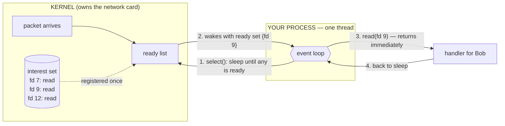
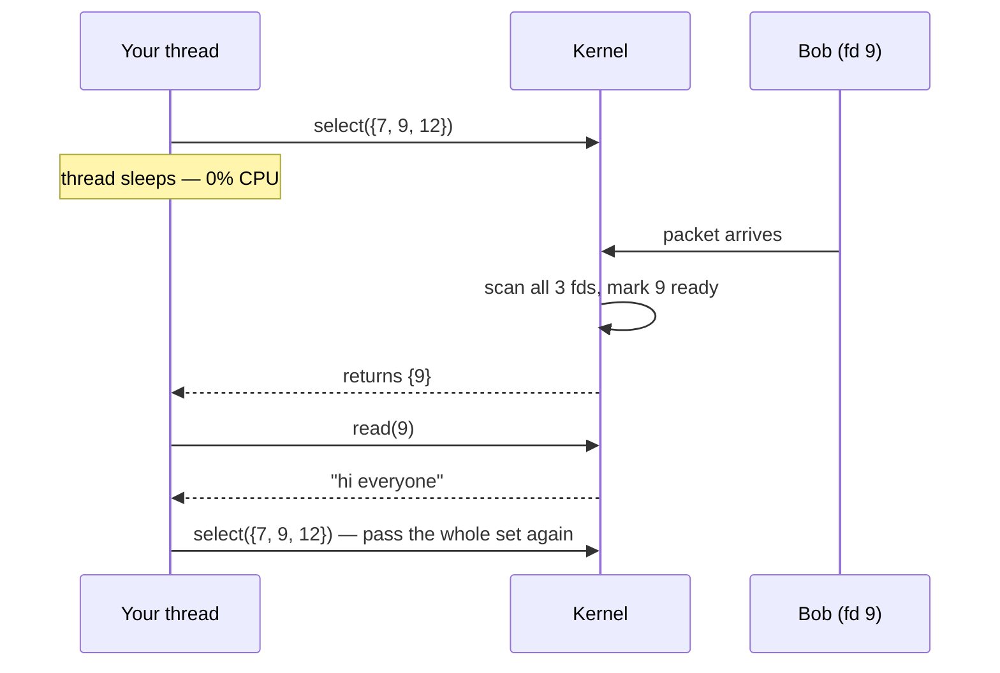
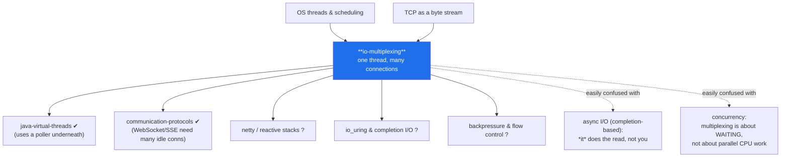

# I/O Multiplexing — from "one thread per user" to "one thread for everyone"

> **What this is.** A complete lab on how one thread can serve thousands of
> network connections at once. Everything here runs, and every number quoted
> below was produced by the code in `src/` on this machine while the document
> was being written — nothing is illustrative. Re-running will shift the
> magnitudes a little (899 ms rather than 905, 71 readiness events rather than
> 76); the shape is what matters, and that is stable.
>
> **Prerequisites:** none for this concept. You should be comfortable with
> threads in general.
>
> **Depth layers:** BEGINNER (§1–9) → INTERMEDIATE (§10) → ENGINEERING (§11–14)
> → PRODUCTION (§15). Each transition has a checkpoint telling you what you
> can do at that point.

---

# BEGINNER MODEL

## 1. WHY — the problem this exists to solve

You are running a chat server. Ten thousand people have the app open. At any
given instant, maybe five of them are actually typing.

The other 9,995 connections are open, alive, and completely silent — but you
cannot close them, because the moment someone types, you must deliver the
message instantly. Your server's job is overwhelmingly **waiting**, not working.

Here is the uncomfortable question: **what does it cost you to wait?**

If waiting is expensive, you need one machine per few thousand users, your
cloud bill scales with idle people, and a chat app becomes an infrastructure
project. If waiting is nearly free, one modest machine holds all ten thousand.

Everything in this lab is about making waiting free.

---

## 2. PROBLEM — the hotel switchboard

Forget servers for a moment.

You run a hotel with 10,000 rooms. Each room has a phone line down to the front
desk. Guests call down rarely — to order food, to ask for towels — but when
they call, someone must pick up quickly or they get annoyed and leave a bad
review.

There is no light board, no ringer, no notification of any kind. The only way
to find out whether a guest is speaking is to **pick up that line's receiver
and listen.**

Your job: staff the front desk.

That is exactly the server's problem. The rooms are connections, the guests are
users, and picking up a receiver to listen is your program asking a connection
"do you have anything for me?"

---

## 3. NAIVE SOLUTION #1 — one employee per line

The obvious answer: hire 10,000 employees. Employee #4,127 holds line 4,127's
receiver against their ear, all day, waiting.

When a guest speaks, their employee hears it immediately and handles it. Fast,
simple, and obviously correct. Nobody is ever missed.

In code this is **thread-per-connection**: every connection gets its own
thread, and that thread sits inside a `read()` call that does not return until
bytes arrive. That is `src/BlockingEchoServer.java`, and here is its heart:

```java
Socket client = serverSocket.accept();
new Thread(() -> handle(client)).start();   // one thread, one connection, forever
...
int n = in.read(buf);   // this thread now sleeps here until bytes arrive
```

This is how virtually every tutorial socket server is written, and it works.

> **🔮 Predict:** 10,000 connections, all silent, one thread each. Roughly how
> much **CPU** is this server using?
>
> <details><summary>Reveal</summary>
>
> **Almost none.** This is the part people get wrong. A thread waiting inside
> `read()` is not spinning — the operating system has taken it off the CPU
> entirely and will not schedule it again until data arrives. Zero CPU.
>
> So if CPU is free, what actually breaks? That is the whole point of the next
> section, and the answer is a different resource.
> </details>

---

## 4. FAILURE #1 — employees are not free

Run it and count:

```
$ java src/Experiments.java threads 2000

  thread-per-connection : 2000 connections -> 2000 handler threads
  io-multiplexing       : 2000 connections -> 1 event-loop thread
```

Ignore that second line for now — it is the answer we have not invented yet,
printed so you can see where we are heading. Only the first line is today's
design.

Two thousand connections, two thousand threads. The scaling is exactly 1:1, and
three costs come with it:

**Memory.** Each thread reserves its own call stack — on a 64-bit JVM, about
1 MB of address space by default. Ten thousand threads reserve roughly 10 GB of
address space, and each one really touches tens of kilobytes. You run out of
memory long before you run out of network capacity.

**Scheduler pressure.** The OS keeps a record for every thread and must consider
each one when deciding what to run. Switching between threads means saving and
restoring CPU state and polluting the CPU's caches. With five active users and
10,000 threads, the machine spends its time managing employees instead of
serving guests.

**A hard ceiling.** Operating systems limit thread counts. You hit the wall at
some number of connections and cannot go further, no matter how idle they are.

This was famous enough to get a name in 1999: the **C10K problem** — how do you
serve ten thousand concurrent connections on one machine? Thread-per-connection
could not.

**But look closer at what is actually being wasted.** Those 9,995 employees are
not doing work. They are doing *waiting*. And waiting is not a task — it is the
absence of a task. We are paying 10,000 salaries so that 10,000 people can each
be individually informed of something.

**Why does waiting need a person at all?**

---

## 5. NAIVE SOLUTION #2 — one employee who runs

Fire everyone. Hire one employee.

Give them a rule: never hold a receiver to your ear. Instead, sprint down the
row of 10,000 phones. Pick up #1 — "anything? no" — drop it. Pick up #2 —
"anything? no" — drop it. When you reach #10,000, run back to #1 and start again.

For this to work you need a phone that answers "nothing here" instantly instead
of making you wait. In code, that is a **non-blocking socket**: a connection
configured so that `read()` returns immediately with "no data right now"
instead of parking your thread.

```java
channel.configureBlocking(false);   // read() now returns 0 instead of waiting
...
int n = ch.read(buf);               // 0 = nothing right now, keep running
```

That is `src/SpinEchoServer.java`. One thread, all 10,000 connections, no
thread explosion. Problem solved?

> **🔮 Predict:** 2,000 silent connections, three seconds of this. How much CPU
> does the single thread burn, and how many times does it hear "nothing"?
>
> <details><summary>Reveal</summary>
> A full CPU core, pinned at 100%, and roughly four million "nothing" answers.
> Measured numbers below.
> </details>

---

## 6. FAILURE #2 — asking is not free either

```
$ java src/Experiments.java spin 2000

  hot-loop polling : 2,998 ms CPU burned | 2,111 loop passes | 4,225,570 readiness questions asked
  io-multiplexing  :     0 ms CPU burned |     0 wakeups     |         0 readiness questions asked
```

("Readiness question" is the program's phrase for one "anything for me?" — the
proper name for it arrives in §9. Again, only the first line is today's design.)

In 3,000 milliseconds of wall-clock time the polling thread burned 2,998
milliseconds of CPU. That is one core at 100%, permanently, **while absolutely
nothing is happening.**

It asked "anything for me?" 4.2 million times and heard "no" 4.2 million times.
Each of those questions is a **system call** — a request into the operating
system's core (the **kernel**, the privileged code that owns the network card
and the connections). System calls are not free; they are the expensive part.

And it gets worse as you grow. Every lap costs one question *per connection*, so
doubling connections doubles the cost of a lap. The busier your server looks on
paper, the slower each lap gets, and the longer a guest waits before your
employee reaches their phone.

We have now failed twice, in opposite directions:

| Design | Threads | CPU while idle | Why it fails |
|---|---|---|---|
| One thread per connection | 10,000 | ~0 | memory + scheduler collapse |
| One thread, keep asking | 1 | 100% of a core | pointless syscalls, O(n) per lap |

**The deeper problem, common to both.** In both designs, *we* are the one
asking the question. But we are the worst possible party to ask it. The kernel
receives the network packets. The kernel already knows, at the instant a packet
lands, exactly which connection it belongs to. We are standing next to the one
entity that has the answer, asking everyone *else*, over and over.

---

## 7. THE REAL REQUIREMENT

State it plainly, because the rest of the lab is the pursuit of this one
sentence:

> **One thread must be able to wait on many connections at once, and be told
> which ones need attention — without asking each one individually, and without
> using CPU while nothing is happening.**

Read the first clause again: *wait on many connections at once*. That is the
thing an ordinary `read()` cannot do. A blocking read waits on **exactly one**
connection. There is no way to say "wait until any of these 10,000 has
something."

We do not need a faster loop. We need a **new kind of wait** — one that covers
a whole set.

---

## 8. KEY IDEA

Install a light board.

Every phone at the desk gets a light. When a guest starts speaking, *the phone
system* turns that line's light on. The single employee does not run and does
not listen — they sleep in a chair, and the phone system wakes them the instant
any light comes on, then tells them exactly which lines are lit.

In code, one system call does all of that:

> **Hand the kernel your entire list of connections and go to sleep. The kernel
> wakes you when at least one of them has something, and hands you the list of
> which ones.**

That call is the whole concept. Idle connections cost the kernel a small
bookkeeping entry each and cost your thread *nothing* — no thread, no question,
no CPU. Ten thousand silent connections produce exactly zero wakeups, which is
literally what the experiment above measured: `0 ms CPU burned | 0 wakeups`.

---

## 9. TERMINOLOGY — now the real words

You have felt every one of these problems. Here are their professional names.

### I/O multiplexing

- **Plain meaning:** one worker watching many connections at once.
- **Technical meaning:** a kernel facility that lets a single thread block on
  the readiness of a *set* of file descriptors, returning the subset that is
  ready.
- **Why the term exists:** "multiplexing" comes from telecoms — sending many
  signals over one shared channel. Here the shared channel is one thread of
  execution, and the many signals are the connections. The name distinguishes
  it from having one channel per signal (thread-per-connection).
- **Example:** one thread holding 10,000 chat connections.
- **Connects to:** it is the direct answer to the C10K problem in §4.

### File descriptor (fd)

- **Plain meaning:** a small integer the kernel gives you as a handle to an open
  thing — a file, a pipe, or a network connection.
- **Technical meaning:** a per-process index into the kernel's table of open
  file descriptions.
- **Why the term exists:** Unix deliberately made network connections look like
  files so the same calls (`read`, `write`, `close`) work on both. It is why
  "everything is a file" is a Unix slogan.
- **Example:** Alice's connection is fd 7, Bob's is fd 9, Carol's is fd 12.
  These are the numbers you hand the kernel.
- **Connects to:** in Java you rarely see the integer — a `SocketChannel` wraps
  one. But `ulimit -n` (the open-file limit) counts these, and it is the limit
  you hit at high connection counts.

### Blocking vs non-blocking

- **Plain meaning:** whether a read that has no data parks your thread or
  answers "nothing right now".
- **Technical meaning:** a per-descriptor mode. Blocking: the call does not
  return until it can make progress. Non-blocking: the call returns immediately,
  with a "would have blocked" indication (`0` in Java NIO, `EAGAIN` in C).
- **Why the term exists:** to name the choice of *who waits* — the thread, or
  nobody.
- **Example:** `channel.configureBlocking(false)` in `SpinEchoServer`. Java's
  `Selector` **requires** non-blocking channels: registering a blocking channel
  throws `IllegalBlockingModeException`.
- **Connects to:** §3 used blocking, §5 used non-blocking. Neither was enough on
  its own — the fix combines non-blocking sockets with a *blocking* wait on the
  whole set.

### Readiness

- **Plain meaning:** "if you read this connection right now, you will get
  something instead of waiting."
- **Technical meaning:** a state of a descriptor, reported by the kernel:
  readable (bytes buffered, or end-of-stream), writable (send buffer has room),
  acceptable (a pending connection), connectable.
- **Why the term exists:** to separate *"you may now act"* from *"your action
  has been done for you."* This distinction defines two whole families of I/O
  APIs — see completion-based I/O in §16.
- **Example:** the kernel says fd 9 is readable; you then call `read(9)`
  yourself, and it returns immediately.
- **Connects to:** this is the light on the light board. Note carefully: the
  light says *someone is speaking*. It does not say what they said, how much, or
  whether they finished their sentence. §13 is built on that gap.

### Interest set and ready set

- **Plain meaning:** the interest set is "what to wake me for". The ready set is
  "what actually happened".
- **Technical meaning:** the interest set is the registration held in the kernel
  — descriptor plus the event types you care about. The ready set is the subset
  returned by the wait call.
- **Why the terms exist:** they are two different sets that beginners fuse into
  one. Interest is long-lived and set by you; ready is per-wakeup and set by the
  kernel.
- **Example, with real values:**
  `channel.register(selector, OP_READ)` puts fd 9 in the interest set forever.
  One `select()` returns a ready set of `{fd 9}` while fds 7 and 12 stay
  registered, idle, and untouched.
- **Connects to:** in Java, a `SelectionKey` is one entry in the interest set;
  `selector.selectedKeys()` is the ready set.

### Event loop

- **Plain meaning:** the employee's routine — sleep, get woken, handle what is
  lit, go back to sleep.
- **Technical meaning:** `while (running) { wait for readiness; dispatch each
  ready event to its handler; }` on a single thread.
- **Why the term exists:** it names the inversion of control. You no longer
  write "read, then process". You write handlers, and the loop calls them when
  the kernel says so.
- **Example:** the `eventLoop()` method in `SelectorEchoServer`.
- **Connects to:** this is the same shape as a UI framework's main loop, and the
  same shape as Node.js and nginx. Once you see it here you will recognise it
  everywhere.

### Synchronous vs asynchronous — the term everyone confuses

This is a **different axis** from blocking/non-blocking, and mixing them up
causes most of the confusion around this topic.

- **Blocking/non-blocking** = does the call park my thread?
- **Synchronous/asynchronous** = do *I* perform the I/O, or does someone else
  perform it and notify me when it is finished?

I/O multiplexing is **synchronous, non-blocking I/O with a blocking wait**. The
kernel tells you a connection is ready; **you** still call `read()` yourself and
the bytes are copied while your thread waits for that copy. Nobody did the read
for you. It looks asynchronous because your code is callback-shaped, but the
data movement is still yours. True asynchronous I/O (`io_uring`, Windows IOCP,
Java's `AsynchronousSocketChannel`) is the other thing: you hand over a buffer
and are told "it's filled" later.

---

## 10. MENTAL MODELS — carry two, and know where the first one lies

### The simple model (what you keep in your head)

A hotel switchboard. One operator, a wall of lights, one per room. Operator
sleeps. A light comes on. Operator wakes, sees exactly which lights are lit,
handles those lines, sits back down.

### The engineering model (what is actually true)

One thread. A kernel object holding a set of registered descriptors and the
events wanted for each. A blocking call that returns the ready subset. A loop
that dispatches each ready descriptor to a handler, then calls the wait again.
All per-connection state lives in objects on the heap, because there is no
per-connection stack to hold it.



### The mapping

| Hotel | Engineering | In Java |
|---|---|---|
| Phone line to a room | Network connection | `SocketChannel` |
| The line's number | File descriptor | (wrapped inside the channel) |
| The light board | Kernel multiplexing object | `Selector` |
| Wiring a phone into the board | Registering interest | `channel.register(selector, OP_READ)` |
| The full set of wired lines | Interest set | all `selector.keys()` |
| Which lights are lit right now | Ready set | `selector.selectedKeys()` |
| Operator asleep in the chair | The blocking wait | `selector.select()` |
| Operator's routine | Event loop | the `while` loop |
| The notepad for each room's half-finished order | Per-connection state | `SelectionKey` attachment |

### Where the analogy breaks

Three places — and each one is a real failure mode you will meet in §13.

1. **A lit light does not mean a complete sentence.** The operator analogy
   suggests you pick up and hear the whole request. In reality "readable" means
   only "some bytes are here." Half a message is normal. A message split across
   76 separate wakeups is normal (§13.3 measures exactly that). The light also
   turns on when the guest **hangs up** — "readable" includes end-of-stream, and
   forgetting that causes the bug in §13.2.

2. **The operator cannot leave the chair — ever.** A real operator can put a
   call on hold and walk to the kitchen. If the event-loop thread walks away —
   one slow database query, one `Thread.sleep`, one synchronous HTTP call — then
   **every** light goes unanswered until it returns. The whole board freezes.
   §13.1 measures this at 905 ms of collateral damage from one slow request.

3. **The lights can lie.** The kernel is permitted to report readiness
   spuriously — you wake up, read, and get nothing. Correct event-loop code
   treats a wakeup as a *hint*, never a promise, and must survive a read that
   returns zero bytes.

---

## 11. VISUALIZATION

Open `visualization.html` (or the published link in the chat message). It runs
the three designs — thread-per-connection, hot-loop polling, and multiplexing —
side by side on the same simulated traffic, with a live thread count, CPU
meter, and syscall counter.

Use it to answer the three questions the diagrams cannot: what changed, why it
changed, and what happens if you change it. In particular, try the buttons that
inject the failures from §13 and watch which design survives each one.

> ### ✅ CHECKPOINT — end of the BEGINNER MODEL
>
> You can now explain *why* I/O multiplexing exists: waiting on many
> connections is the server's main job, one-thread-each is too expensive, and
> asking-each-one is too wasteful, so we hand the whole set to the kernel and
> sleep. You can define readiness, interest set, ready set, and event loop, and
> you know that "synchronous vs asynchronous" is a different axis from
> "blocking vs non-blocking".
>
> **Next (§12):** how the wait call actually works, why the first version of it
> was too slow, and what the second version changed.

---

# INTERMEDIATE MODEL

## 12. THE ACTUAL MECHANISM

We build it in the order history did: the obvious version first, then the
failure that forced the version you actually use.

Throughout, a concrete scene: **a chat server with three connections — Alice on
fd 7, Bob on fd 9, Carol on fd 12. Only Bob types.**

### Mechanism v1 — `select()` (1983)

The first system call to do this. Its contract:

1. You build a set of descriptors: `{7, 9, 12}`.
2. You call `select()`, passing the whole set in. Your thread sleeps.
3. Bob types. A packet lands. The kernel returns from `select()`.
4. It hands back the set, with everything not ready removed: `{9}`.
5. You call `read(9)` and get Bob's message.
6. You rebuild the set and call `select()` again.



This satisfies §7's requirement exactly, and for three connections it is
perfect.

> **🔮 Predict:** Now scale the scene up: **10,000 connections, one of which is
> active.** How much work does the kernel do inside a single `select()` call?
>
> <details><summary>Reveal</summary>
>
> **It examines all 10,000 — every single call.** Two costs, both O(n) in the
> total number of connections, not the active ones:
>
> 1. **Copy in.** The whole 10,000-descriptor set is copied from your process
>    into the kernel on every call, and the result copied back out.
> 2. **Scan.** The kernel walks all 10,000 checking each for readiness.
>
> We fired the sprinting employee in §6 for doing exactly this — asking every
> line on every lap. `select()` did not delete that work. It **moved it into the
> kernel**, where it is much cheaper per item (no syscall each), but still
> proportional to the total.
>
> `select()` also carries a hard cap: the descriptor set is a fixed-size
> bitmask, `FD_SETSIZE`, conventionally **1024**. `poll()` (1986) removed the
> cap by using an array instead of a bitmask, but kept the O(n) copy and scan.
> </details>

### The refinement — `epoll` / `kqueue` (2000–2002)

The scar from that failure produced the design you actually use. It comes from
one observation:

> The set of connections barely changes between calls. Why re-send and re-scan
> it every single time?

So split the one call into two, and let the kernel keep the list:

1. **Register once.** `epoll_ctl(ADD, fd 9)` puts Bob in a kernel-resident
   interest set. It stays there across calls. No re-copying.
2. **The network stack maintains a ready list.** This is the key move. When
   Bob's packet arrives, the code that handles the network interrupt *already
   touches fd 9's structures*, so it appends fd 9 to a ready list right there.
   No scan is needed, because readiness is recorded at the moment it is caused.
3. **Wait returns the ready list.** `epoll_wait()` returns `{9}` — copying one
   entry, not 10,000.

The cost changes from **O(total connections)** to **O(ready connections)**.
Ten thousand idle connections now cost *nothing per call* — they are just
entries in a kernel table. That is the difference between C10K being impossible
and being routine.

| | `select` (1983) | `poll` (1986) | `epoll`/`kqueue` (2000–02) |
|---|---|---|---|
| Interest set lives | in your process | in your process | **in the kernel** |
| Cost per wait call | O(total) copy + scan | O(total) copy + scan | **O(ready)** |
| Max descriptors | 1024 (`FD_SETSIZE`) | unlimited | unlimited |
| Portable | everywhere | POSIX | Linux / BSD-macOS respectively |

Same idea, three generations. **`epoll` is Linux; `kqueue` is BSD and macOS.**
Java hides the difference: `Selector` is the portable façade. On this machine it
resolves to kqueue — verified, not assumed:

```
$ java Probe.java
Selector impl on this OS : sun.nio.ch.KQueueSelectorImpl
```

On Linux the same code gives you `sun.nio.ch.EPollSelectorImpl`.

### The refinement's own refinement — level- vs edge-triggered

One more knob, and one more failure that explains it.

- **Level-triggered (LT):** "while there are unread bytes, keep telling me."
  You get woken again on the next wait if you did not consume everything.
- **Edge-triggered (ET):** "tell me only when the state *changes* from
  not-ready to ready." One notification per arrival, regardless of how much you
  read.

ET means fewer wakeups. It also means a trap: **if you do not drain the socket
completely, you will never be told again**, and that connection hangs forever
while everything else works — one of the nastiest bugs in this area, because it
looks like a network problem.

**Java's `Selector` is level-triggered**, which is the forgiving default and why
`SelectorEchoServer` can read one bufferful and safely return. Netty's native
Linux transport offers ET for throughput, and its docs are emphatic that you
must loop reading until `EAGAIN`.

> ### ✅ CHECKPOINT — end of the INTERMEDIATE MODEL
>
> You can now explain the mechanism message-by-message, and say *why* modern
> systems use `epoll`/`kqueue` rather than `select` — the interest set moved
> into the kernel and readiness became O(ready) instead of O(total). You know
> Java's `Selector` is the portable façade and that it is level-triggered.
>
> **Next (§13):** what breaks. Every failure below is runnable here, and every
> one of them is a real production incident somewhere.

---

# ENGINEERING MODEL

## 13. FAILURE SCENARIOS

### 13.1 Blocking the event loop — the cardinal sin

**Create it:** `java src/Experiments.java blockedloop`. Client A sends a request
whose handler takes 1 second. 100 ms later, client B sends "ping".

**Measured:**
```
  io-multiplexing (1 shared loop) : B's ping took 905 ms
  thread-per-connection          : B's ping took   0 ms
```

**Why:** the event loop is one thread. While it sits inside A's handler, nobody
is calling `select()`, so B's bytes — which physically arrived at the network
card within a millisecond — sit unread in a kernel buffer. B's latency is not
B's fault and has nothing to do with B's request.

**Guarantee kept:** correctness. B's echo is right when it comes.
**Guarantee lost:** latency isolation. **Shared loop means shared fate.** One
slow handler is a partial outage for every connection on that loop.

**In production:** this is the number one event-loop bug. No JDBC call, no
synchronous HTTP client, no `Thread.sleep`, no unbounded loop, no
`synchronized` block that might contend, and no large JSON parse on the loop
thread. Slow work is handed to a separate worker pool, and the result is posted
back to the loop. Netty ships `EventExecutorGroup` for exactly this, and both
Netty and Vert.x will log a warning when a loop thread is stalled (Vert.x's
`BlockedThreadChecker` is a "blocked event loop" warning you will see in real
logs).

### 13.2 The dead connection that never sleeps — the busy loop

**Create it:** `java src/EchoTest.java broken` — the same suite against
`src/BrokenSelectorServer.java`.

**Measured:**
```
  correct : closed_connection_is_deregistered_and_loop_sleeps  → 0 wakeups in 500 idle ms
  broken  : FAIL — 351,609 wakeups in 500 idle ms
```

**Why:** when the peer closes, the connection becomes **permanently readable**
— reads return `-1` (end-of-stream) forever, and level-triggered means "keep
telling me while the condition holds." The broken handler treats `-1` as "no
data, try later" and simply returns without cancelling the registration. So
`select()` returns instantly, forever: 351,609 laps in half a second, one core
at 100%, caused by a client that *left*.

The correct code closes the loop on the condition instead:

```java
if (n == -1) { key.cancel(); ch.close(); return; }   // deregister, or spin forever
```

**Guarantee kept:** other connections still work — which is what makes this so
hard to spot.
**Guarantee lost:** the CPU budget, and eventually latency for everyone.

**In production:** the symptom is *100% CPU on one core with no traffic*, which
looks insane until you know this. Diagnosis: a flame graph or `perf top` shows
`epoll_wait` returning immediately in a tight loop; `strace -c` shows millions
of `epoll_wait` calls returning instantly.

### 13.3 Readiness is not completion — message framing

**Create it:** `java src/Experiments.java readiness` — send one 512 KB message.

**Measured:**
```
  bytes sent: 524,288 | bytes received: 524,288
  readiness events: 76 | read() calls: 108 | smallest chunk: 4,096 bytes | largest: 16,384 bytes
```

**Why:** one application message became **76 separate readiness events**. TCP is
a byte stream, not a message queue — it guarantees your bytes arrive in order
and complete, and guarantees nothing about how they are grouped. The kernel's
receive buffer is finite, so it hands you 4–16 KB at a time.

**Guarantee kept:** ordering and completeness within the connection.
**Guarantee lost:** any illusion of message boundaries.

**Consequence:** every protocol on an event loop must do **framing** — a length
prefix (Netty's `LengthFieldBasedFrameDecoder`), a delimiter (HTTP's blank line;
`\r\n` in Redis), or a self-describing format. And between wakeups the
half-arrived message must live *somewhere*: an object on the heap, per
connection. That is what the `ByteBuffer` attached to each `SelectionKey` in
`SelectorEchoServer` is for.

This is the structural cost of the whole approach. With a thread per connection,
"read until I have a whole message" is a local variable and a loop. With one
shared thread, it becomes an explicit per-connection state machine — the reason
non-blocking code is harder to write.

### 13.4 The write side — the mirror-image trap

Not runnable here (our echoes are small), so treat this as flagged theory rather
than measured fact.

Writes can be partial too. `write()` returns "I accepted 3 KB of your 100 KB"
when the kernel's send buffer fills — because the peer is slow. You must buffer
the remaining 97 KB and register interest in **writability** (`OP_WRITE`) to be
told when there is room.

The trap: **a socket is writable almost all the time.** If you leave `OP_WRITE`
registered permanently, `select()` returns immediately forever — §13.2's busy
loop again, from the other direction. The rule is: register `OP_WRITE` only
while you have leftover bytes, and deregister the moment they drain.

The second trap is **backpressure**. If a client reads slowly and you keep
queueing outbound data on the heap, you have built an unbounded queue and will
run out of memory. Netty's answer is `WriteBufferWaterMark` and
`Channel.isWritable()`: past a high-water mark you stop producing.

### 13.5 Thundering herd on accept

Run several event loops (one per core) all registered for `OP_ACCEPT` on the
same listening socket. One connection arrives; **all** loops wake; one wins the
`accept()`; the rest get nothing and go back to sleep having burned wakeups.

Fixes: a dedicated acceptor loop that hands connections to workers (Netty's
"boss" and "worker" groups), or `SO_REUSEPORT`, where each loop opens its own
socket on the same port and the kernel load-balances arrivals between them.

Note the related correctness point: readiness is a hint. `accept()` on a
supposedly-acceptable socket may legitimately return `null` because another
thread took it. Code that assumes non-null crashes here.

### 13.6 Fairness and starvation

The loop handles ready connections in whatever order the ready set gives. One
very chatty connection, handled with "read until EAGAIN", can hold the loop for
a long time while others wait. Netty caps this with `maxMessagesPerRead`. This
is **head-of-line blocking** at the event-loop level: the same phenomenon you
met in the communication-protocols lab at the connection level, one layer up.

### 13.7 Nobody is waiting, so nobody times out

Subtle and easy to miss. With thread-per-connection, a per-connection timeout is
trivial: `socket.setSoTimeout(30_000)` — that thread is already waiting, so it
can give up. With an event loop **no thread is waiting on any particular
connection**, so there is nothing to time out. A connection that goes silent
forever simply never appears in a ready set again, and holds its memory and its
fd indefinitely.

Idle detection must therefore become an explicit, separate mechanism: a timer
that sweeps connections by last-activity timestamp. Netty's `IdleStateHandler`
and its `HashedWheelTimer` exist for this.

### 13.8 The famous JDK bug — when the mechanism itself misbehaves

Historically, on Linux, `Selector.select()` could return **0 with no keys ready,
repeatedly and instantly** — the epoll spin bug (JDK-6670302 / JDK-6693490),
caused by epoll reporting an event Java's selector did not map to any interest.
The result was §13.2's busy loop with no bug in your code at all.

Netty's workaround still ships: count consecutive premature returns and, past a
threshold (`io.netty.selectorAutoRebuildThreshold`, default 512), **build a new
`Selector` and migrate every registration to it.** The bug has been reported
fixed in several JDK versions; the guard remains because the failure was so
severe. Worth knowing not because you will hit it, but because it explains why
production event-loop code contains defences that look paranoid.

---

## 14. CORRECTNESS — what is and is not guaranteed

**Guaranteed**
- If the kernel reports readable, a read will not block. It may still return 0.
- Bytes within a connection arrive in order and without gaps (TCP's guarantee,
  inherited).
- Level-triggered notification is *repeated* while the condition holds, so
  handling data incrementally is safe.
- Interest registration is durable: registered once, it stays until cancelled.

**Explicitly NOT guaranteed**
- That "readable" means a complete application message arrived (§13.3).
- That readiness will not be reported spuriously — a wakeup is a hint.
- That a "ready" operation will succeed (`accept()` may return null, §13.5).
- That connections are served fairly (§13.6).
- That a write accepts all your bytes (§13.4).
- Any liveness property at all if a handler blocks — the loop is a single point
  of stalling (§13.1).

**Traded away, deliberately**

| You gain | You give up |
|---|---|
| ~1 thread instead of N | latency isolation between connections |
| ~zero cost per idle connection | the simple "read a message" programming model |
| O(ready) instead of O(total) | per-connection timeouts as a free feature |
| No thread-count ceiling | stack-held state; you now write state machines |

That last row is the honest summary of the whole technique: **it converts a
memory-and-scheduler problem into a programming-model problem.** You get
density; you pay in complexity and shared fate. Which is precisely why §16's
final section matters so much for a Java engineer today.

---

## 15. THE CODE, AND THE EXPERIMENTS

Four servers, deliberately parallel so you can diff them:

| File | Role |
|---|---|
| `src/BlockingEchoServer.java` | §3 — thread per connection |
| `src/SpinEchoServer.java` | §5 — one thread, hot-loop polling |
| `src/SelectorEchoServer.java` | §8 — the real thing, one thread + `Selector` |
| `src/BrokenSelectorServer.java` | §13.2's bug, planted for exercise 6 |
| `src/EchoTest.java` | 5 scenario tests; `broken` arg runs them against the bug |
| `src/Experiments.java` | the four measurements in this document |

Run everything:

```bash
cd ~/Documents/Learning/io-multiplexing
java src/EchoTest.java              # 5 passed, 0 failed
java src/EchoTest.java broken       # 4 passed, 1 failed  ← finds the planted bug
java src/Experiments.java all 2000  # the four experiments
```

The entire concept is three lines of `SelectorEchoServer`, marked `THE-IDEA`:

```java
serverChannel.register(selector, SelectionKey.OP_ACCEPT);  // 1. interest set
selector.select();                                         // 2. sleep until ready
Iterator<SelectionKey> it = selector.selectedKeys().iterator();  // 3. ready set
```

Two more lines carry more weight than they look:

```java
it.remove();   // the selector ADDS to selectedKeys but never clears it.
               // Forget this and you re-handle every event forever.

client.register(selector, SelectionKey.OP_READ, ByteBuffer.allocate(4096));
               // the attachment IS the per-connection state (§13.3).
               // With no per-connection thread, there is no stack to hold it.
```

---

# PRODUCTION MODEL

## 16. FROM THIS TOY TO REAL SYSTEMS

### The chain

**Toy** (`SelectorEchoServer`, ~100 lines) → **real framework** (Netty, ~1,000×
that) → **production architecture** → **operations**.

**What Netty adds over this lab's code**, item by item — each one is a section
above that we deliberately left unsolved:

| Netty feature | Solves |
|---|---|
| `EventLoopGroup`, N loops ≈ N cores, each owning a fixed set of connections | single-loop CPU ceiling |
| boss group / worker group | thundering herd on accept (§13.5) |
| `ChannelPipeline` of handlers | the state-machine complexity of §13.3 |
| `LengthFieldBasedFrameDecoder` etc. | framing (§13.3) |
| `WriteBufferWaterMark`, `isWritable()` | backpressure (§13.4) |
| `IdleStateHandler` + `HashedWheelTimer` | no free timeouts (§13.7) |
| `EventExecutorGroup` for blocking work | the cardinal sin (§13.1) |
| pooled, reference-counted `ByteBuf` | GC pressure from per-message buffers |
| selector auto-rebuild | the JDK epoll spin bug (§13.8) |
| native epoll/kqueue transports, edge-triggered option | portability ceiling of `Selector` |

**Who runs on this exact mechanism:** nginx, HAProxy, Envoy (C/C++ epoll event
loops); Redis (famously a *single* event-loop thread — which is why one slow
`KEYS *` stalls the entire server: §13.1 at production scale); Node.js (libuv);
Kafka's broker network layer (Java NIO `Selector`, the same class as this lab);
Netty, and therefore Vert.x, Spring WebFlux, gRPC-Java, Elasticsearch, and
Cassandra.

### The fourth generation: completion-based I/O

Readiness-based multiplexing still requires *you* to call `read()` (§9). The
next step hands that over too:

- **Windows IOCP** (1990s) and **Linux `io_uring`** (2019): you submit "read
  100 bytes into this buffer" and are notified when it is **done**. Fewer
  syscalls (io_uring uses shared memory ring buffers), and no
  readiness-then-read round trip.
- In Java: `AsynchronousSocketChannel` (NIO.2) is the completion-based API.
  It has seen far less adoption than `Selector`/Netty — partly because on Linux
  it was historically implemented over epoll plus a thread pool anyway, giving
  the complexity of callbacks without the syscall win.

### Operations — what you actually watch

- **Event loop lag** — time between successive loop iterations. The single most
  important metric for an event-loop server; a rising p99 means §13.1.
- **100% CPU on one core with no traffic** → busy loop (§13.2 or §13.8). Check
  with `strace -c -p <pid>` or a flame graph for hot `epoll_wait`.
- **Open fd count vs `ulimit -n`** — your real connection ceiling. `lsof -p` or
  `/proc/<pid>/fd`. On this machine `ulimit -n` is 1,048,576; the default on
  many Linux images is 1024, which is a production incident waiting to happen.
- **Connections per loop** — imbalance means some loops idle while one saturates.
- **Outbound buffer size per connection** — rising means slow consumers and
  approaching §13.4.

Tuning knobs worth knowing: number of event loops (≈ cores), `SO_BACKLOG`
(pending-connection queue depth), `TCP_NODELAY` (disable Nagle for latency),
socket buffer sizes, and `SO_REUSEPORT` for multi-loop accept.

### The Java-specific ending: this may no longer be your problem

Here is the conclusion that matters most for you, and it connects directly to
the `java-virtual-threads` lab.

You learned there that a virtual thread is cheap and that blocking one is
nearly free because the JVM unmounts it from its carrier thread. **How does the
JVM know when to mount it back?** It has to wait on many connections at once
without burning a thread each — and that is precisely the problem this lab
solves.

So the JDK does exactly what this lab does. It runs internal **poller** threads
built on epoll/kqueue. When a virtual thread blocks on a socket read, the JDK
registers that fd with a poller and parks the virtual thread; when the poller
reports readiness, it unparks it. Verified on this machine rather than assumed:

```
$ java Probe.java
present : sun.nio.ch.Poller
present : sun.nio.ch.KQueuePoller     ← macOS; on Linux this is EPollPoller
```

**I/O multiplexing did not go away — it moved under the floor.** Which changes
the engineering advice:

- **Write thread-per-connection code again.** Blocking `read()` on a virtual
  thread gives you §3's simple programming model with §8's efficiency. No
  framing state machines, no callbacks, and `try/finally` and stack traces work
  properly.
- **§13.1 stops applying to your code.** Blocking a virtual thread blocks only
  that request; the carrier is released. The cardinal sin is a sin only on a
  real event loop.
- **But keep everything else.** Framing (§13.3), backpressure (§13.4), idle
  timeouts (§13.7), and fd limits are all still yours — the JDK solved the
  *thread cost* of waiting, not the *semantics* of stream I/O.
- **You still need this knowledge** to read Netty, Kafka, Redis, and nginx
  behaviour; to diagnose a pinned core; and to reason about any existing
  reactive codebase. And note the honest exception: pinning (a native frame or,
  before JDK 24, a `synchronized` block) puts the old thread ceiling straight
  back.

**What this lab deliberately omits:** framing, `OP_WRITE`/backpressure, multiple
loops, idle timeouts, TLS, buffer pooling, graceful shutdown, connection limits,
and the selector-rebuild guard. Each is named above with the real-world
component that provides it.

---

## 17. EXERCISES

See `EXERCISES.md` (8 rungs, from "explain it back" to a production design
prompt). Answers in `SOLUTIONS.md` — attempt first; rungs 7–8 are design
discussions, not single right answers.

---

## 18. KNOWLEDGE MAP & NEXT STEPS



**Built on your earlier labs:** `java-virtual-threads` (this is the machinery
under the unmount/mount cycle you learned there), `communication-protocols`
(persistent connections are what make idle-connection cost the dominant
concern), and `database-landscape` / `cap-theorem` only distantly.

**Commonly confused with — the one sentence that separates each:**
- *Asynchronous I/O*: multiplexing tells you **you may read now**; async I/O
  **does the read** and tells you it finished.
- *Concurrency/parallelism*: multiplexing makes **waiting** cheap; it adds no
  CPU parallelism whatsoever (one loop = one core).
- *Non-blocking I/O*: that is only the socket mode. Without a readiness
  notification it degenerates into §5's hot loop.

**Suggested next:**
```
/learn netty            — the production framework built on everything in §16
/learn io-uring         — the completion-based fourth generation
/learn backpressure     — §13.4 as a first-class topic, across protocols
/learn tcp-flow-control — why partial reads and writes happen at all
/learn reactor-pattern  — the design-pattern formalisation of the event loop
```

---

## 19. GLOSSARY

In order of first appearance.

| Term | One line |
|---|---|
| **C10K problem** | The 1999 challenge of serving 10,000 concurrent connections on one machine. |
| **Thread-per-connection** | One dedicated thread per connection, blocked in `read()` while idle. |
| **Non-blocking socket** | A connection whose `read()` returns "nothing right now" instead of waiting. |
| **Polling / hot loop** | Repeatedly asking every connection whether it has data — correct, and CPU-ruinous. |
| **System call (syscall)** | A request from your program into the kernel; cheap individually, ruinous in millions. |
| **Kernel** | The privileged core of the OS that owns the network card and the connections. |
| **I/O multiplexing** | One thread blocking on the readiness of a whole *set* of connections. |
| **File descriptor (fd)** | The small integer handle the kernel gives you for an open connection or file. |
| **Blocking vs non-blocking** | Whether a call parks your thread when it cannot proceed. |
| **Readiness** | "Act now and you will not block" — not "your data is complete". |
| **Interest set** | The registered set of descriptors + event types you want to be woken for. |
| **Ready set** | The subset the kernel returns from one wait call. |
| **Event loop** | `wait for readiness → dispatch handlers → repeat`, on one thread. |
| **Synchronous vs asynchronous** | Whether *you* perform the I/O, or someone does it and notifies you. |
| **`select`** | The 1983 multiplexing syscall: whole set in, O(total) scan, 1024-descriptor cap. |
| **`poll`** | 1986; same cost model as `select`, no fixed cap. |
| **`epoll`** | Linux (2002): kernel-resident interest set, O(ready) wait. |
| **`kqueue`** | BSD/macOS (2000) equivalent of epoll. |
| **`Selector`** | Java's portable façade over epoll/kqueue; requires non-blocking channels. |
| **`SelectionKey`** | One registration; carries the interest bits, the ready bits, and an attachment. |
| **Attachment** | Arbitrary per-connection state hung on a key — the heap replacement for a thread stack. |
| **Level-triggered** | Notify repeatedly while the condition holds. Java's `Selector` default. |
| **Edge-triggered** | Notify only on the transition to ready; you must drain fully or hang. |
| **End-of-stream (`-1`)** | The peer closed. Makes the connection permanently readable — deregister it. |
| **Busy loop** | A loop woken instantly and endlessly, usually from a never-cleared ready condition. |
| **Framing** | Recovering message boundaries from a byte stream: length prefix or delimiter. |
| **Backpressure** | Slowing production when a slow consumer makes outbound buffers grow. |
| **Thundering herd** | Many waiters woken for one event; all but one find nothing to do. |
| **Head-of-line blocking** | One item at the front of a queue delaying everything behind it. |
| **`SO_REUSEPORT`** | Multiple sockets on one port, with the kernel load-balancing new connections. |
| **Event loop lag** | Time between loop iterations; the key health metric for an event-loop server. |
| **Completion-based I/O** | IOCP / `io_uring` / NIO.2: hand over a buffer, be told when the transfer is done. |
| **Poller (JDK)** | `sun.nio.ch.Poller` — the internal epoll/kqueue threads that park and unpark virtual threads. |
| **Pinning** | A virtual thread stuck to its carrier (native frame; `synchronized` before JDK 24), restoring the old ceiling. |
