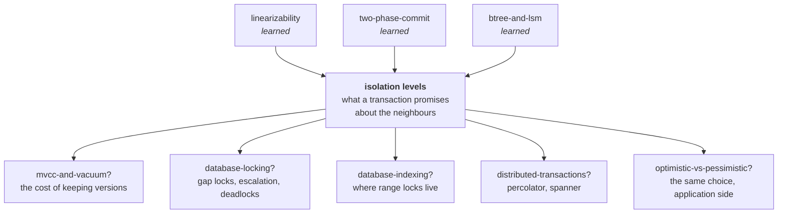

# Isolation levels — what a transaction promises about the neighbours

> **Tell a friend:** Asha has 100 in her account, and two deposits of 10 land
> at the same moment. Devi handles one deposit and Omar handles the other.
> Each of them reads 100, adds 10 and writes 110, so Asha ends with 110 and
> one deposit is simply gone, though every step succeeded and nothing
> complained. An isolation level is the dial that decides which of those
> endings your database is allowed to give you. This lab turns the dial
> through every setting on a real database and shows you what comes out.

Open the ledger at [`visualization.html`](visualization.html) or <https://claude.ai/code/artifact/76051a1f-7357-4e66-9c6d-897f76c6004a>.
How to run the code, and where this lab sits next to your other labs, is in [section 19](#19-about-this-lab).

---

## 1. Why does this problem exist at all?

> **In one breath:** Two people change the same number at the same moment.
> Each does the sensible thing. Together they can leave the database holding
> a number that was never true, and nothing will complain.

Two things happen to the same data at the same instant. That is not an edge
case. On any system with more than one user, it is Tuesday.

Here is what it costs when nobody has thought about it.

- A customer's two deposits arrive together, and one of them silently does
  not exist.
- Two people book the last meeting room, and both get a confirmation.
- A monthly report adds up four account balances and prints a total that no
  moment in history ever had.
- A doctor rota empties itself, because two doctors signed off at once. Each
  had checked that the other was still on.

Every one of those is a real, common bug. None of them involves a crash, a
network failure, or a mistake in your code. Every statement succeeded. And in
almost every case the fix is one word in a configuration file. But only if you
know which word, and why.

The first of those four is about to happen to Asha.

## 2. What happens to Asha's two deposits?

> **In one breath:** Two clerks each read Asha's balance, each add 10, and
> each write the answer back. The second write lands on top of the first, and
> one deposit vanishes without a trace.

Asha has 100 in her account. Two deposits of 10 arrive at the same moment.
Two clerks handle them: Devi takes one, Omar takes the other.

Each clerk does the obvious thing:

> Look up the balance. Add 10. Write the new balance back.

Watch the ledger, moment by moment. Read the last column: it is the number on
Asha's page after each step.

| Moment | Devi | Omar | Asha's balance on the page |
|---|---|---|---|
| 1 | looks up: **100** | | 100 |
| 2 | | looks up: **100** | 100 |
| 3 | writes **110** | | 110 |
| 4 | | writes **110** | 110 |

Asha has 110. One of her deposits is gone. Not delayed, not queued for retry.
Gone, with no record that it ever happened. Both clerks did their job
correctly. Neither made a mistake. Nobody can be blamed, and nothing in the
system knows anything is wrong.

The trouble is entirely in the *gap*. Between Devi looking up the balance and
Devi writing it back, the world changed underneath her. She had no way to
notice.

**How deep this goes.** Stop at any checkpoint and you still have something
whole.

| Layer | Sections | After it you can… |
|---|---|---|
| Beginner | 1–9 | say what a transaction does and does *not* promise, and read the standard two-column picture of two clerks overlapping |
| Intermediate | 10 | explain the three machines underneath, and why each had to be invented |
| Engineering | 11–14 | name all eight ways it goes wrong, know which level stops each, and prove it by running it |
| Production | 15 | choose a level per use case, write the retry loop, and read any vendor's isolation docs correctly |

## 3. Why not just wrap it in a transaction?

> **In one breath:** "Make the look-up and the write one unit" sounds like
> exactly the fix. Devi and Omar both do it, both succeed, and Asha still has
> 110.

This is what everyone reaches for, and it is not a silly answer:

```sql
BEGIN;
  SELECT balance FROM acct WHERE id = 1;   -- 100
  UPDATE acct SET balance = 110 WHERE id = 1;
COMMIT;
```

A transaction is the database's word for "these statements are one unit". It
sounds exactly like what we need. Make the look-up and the write into one
indivisible act, and the gap disappears.

> **🔮 Predict:** *Devi and Omar now both wrap their work in `BEGIN … COMMIT`.
> Both transactions commit successfully, with no error. What is Asha's
> balance?*
>
> <details><summary>Reveal</summary>
>
> **Still 110.** If you said 120, you gave the transaction a promise it never
> made. Do not take it from this page; run it. Eight threads each add 1 to the
> same row forty times. That is 320 increments, every one inside a
> transaction, every transaction committing successfully. The row ends on
> about **60**.
>
> ```
> java -cp ../lib/h2.jar src/Experiments.java increment
>
>                          READ COMMITTED                     ...
>   SELECT then UPDATE    60/320 LOST 260  (0 retries, 131ms)
> ```
>
> | Number | What it means |
> |---|---|
> | 320 | increments attempted, each inside its own committed transaction |
> | 60 | roughly how many survived on the row |
> | 260 | increments that vanished: about **80% of the work**, and not one error was raised |
> | 131ms | how long the broken version took; section 14 compares it with the fix |
> | 0 retries | nothing was ever refused, so nothing ever asked to try again |
>
> If that surprises you, you have just found the thing this lab exists to fix.
> </details>

## 4. What does a transaction promise, and which promise is missing?

> **In one breath:** A transaction promises four things. Two of them are about
> crashes, and Devi gets those for free. The one about Omar running at the
> same time is separate, costs extra, and you have to ask for it by name.

`BEGIN … COMMIT` really does give Devi something. It gives her
**all-or-nothing**: if the second statement fails, the first is undone. It
gives her **survives-a-crash**: once the database says committed, the change is
on disk. Those are worth a great deal. They are what most people mean when they
say "transaction".

Neither of them has anything to do with Omar running at the same time.

That is a *separate* promise, and it is the one you have to ask for by name.
The database does not give it to you by default, because it is expensive. So
it gives you a cheap approximation and lets you buy more if you say so. Almost
nobody says so, because almost nobody knows the dial exists.

The name of that dial is the **isolation level**. The default setting in
PostgreSQL, SQL Server and Oracle is one that permits exactly the bug Asha
just suffered.

## 5. What do we actually want? "As if they had queued"

> **In one breath:** We do not need Devi and Omar to take turns. We only need
> the ending to be one that taking turns *could* have produced. 120 passes.
> 110 fails.

State what we actually want, in plain words:

> **However the work actually interleaves, the result must be one that could
> have happened if the transactions had run one at a time, in some order.**

Note what that does and does not say. It does *not* demand that Devi go before
Omar. Either order is fine: Asha ends on 120 both ways. It only forbids
endings that **no** single-file order could have produced. 110 is such an
ending, which is exactly why it is a bug.

| Order | First clerk sees | Second clerk sees | Asha ends on | Allowed? |
|---|---|---|---|---|
| Devi, then Omar | 100 | 110 | 120 | yes |
| Omar, then Devi | 100 | 110 | 120 | yes |
| both at once, as in section 2 | 100 | 100 | 110 | **no**: no single-file order gives it |

> **🔮 Predict:** *Devi's deposit commits at 10:00:01. Omar's commits at
> 10:00:04. Is the database allowed to behave as if Omar went first?*
>
> <details><summary>Reveal</summary>
>
> **Yes.** The requirement says "in some order", and it means it. If you said
> no, you are thinking of the rule from the linearizability lab, which has a
> real-time clause: what finished first must count first. Serializability
> drops that clause. It is happy with any single-file story, including one
> that puts your committed transaction after a later one. Section 7 comes back
> to this, because it is the one word that separates the two labs.
> </details>

You have met this shape before. In the [linearizability](../linearizability/)
lab the requirement was "there must exist an order of the *operations* that
explains what every client was told". This is the same sentence with one word
changed: **transactions** instead of operations. That word is doing an
enormous amount of work. Sections 10 and 12 are about how much.

## 6. What is the key idea? A ladder of partial promises

> **In one breath:** Making everyone queue would fix Asha's bug and make the
> database serve one user at a time. So the industry sells a ladder instead.
> Each rung forbids more bad endings and costs more. You pick a rung.

Running everything one at a time really would fix this. It would also make
your database serve one user at a time, which no one will accept.

So the industry did something pragmatic and slightly regrettable:

> **Offer a ladder. Each rung forbids more of the bad endings than the rung
> below it, and costs more. You pick a rung.**

Two consequences follow, and they cause most of the confusion in this topic:

1. **The rungs are named after which bad endings they forbid**, not after how
   they work. Two databases can implement the same rung name with completely
   different machinery and give you different behaviour.
2. **The list of bad endings in the standard is incomplete.** It was written
   in 1992 with three phenomena in mind. The most dangerous ones in practice
   were not on that list. So there is no rung name for stopping them, which is
   why a level called `SERIALIZABLE` may not be serializable.

The rest of this lab is: what the bad endings actually are, which rung stops
each one on your database, and the three mechanisms underneath.

## 7. What do engineers call the things in Asha's story?

> **In one breath:** Six words, and you have already watched every one of them
> happen. A transaction is Devi's unit of work. Isolation is how much she may
> pretend Omar is not there. The other four name the order things happened in
> and the endings that are wrong.

Only the words needed to talk about the ladder. The bad endings get their
names in section 11, where you can watch each one happen.

### What is a transaction, and what are its four promises?

Devi's "look up, add 10, write back" is a group of statements the database
treats as one unit. Engineers call that a **transaction**. The word exists to
name work that must not be half-done. A transfer is the classic case:
`BEGIN; UPDATE acct SET balance = balance - 50 WHERE id = 1; UPDATE acct SET balance = balance + 50 WHERE id = 2; COMMIT;`.
Half of that is money destroyed.

A transaction makes four promises. Engineers remember them as **ACID**. Read
the last column: it is what each promise means for that transfer.

| Letter | The promise | For Devi's transfer |
|---|---|---|
| **A**tomic | all or none | both updates happen, or neither does |
| **C**onsistent | it moves the data from one state satisfying your constraints to another | no balance rule is broken by the pair |
| **I**solated | the next paragraph | Omar's work stays out of Devi's |
| **D**urable | once committed, it survives a crash | "committed" means on disk |

The A and the D are what the [two-phase-commit](../two-phase-commit/) lab was
fighting to preserve across several machines. This lab is entirely about the
**I**, on one machine.

### What is isolation, and why is it a dial?

How much the database lets Devi pretend nobody else is running: that is
**isolation**. Precisely, it is the degree to which transactions running at
the same time are prevented from seeing each other's intermediate states, and
from interfering with each other's decisions.

It is the one ACID property that is a *dial* rather than a yes/no. Nobody
offers "80% atomic". Everybody offers four or five degrees of isolated. At one
setting Devi can see a balance Omar has not committed. At another she cannot.
At another the database refuses to let them both finish.

The [saga](../saga/) lab said sagas "trade atomicity and isolation for
availability" and left it there. This is the thing being traded.

### What is a schedule?

The order the two clerks' steps actually happened in is the **schedule**.
Precisely: an interleaving of the operations of several transactions,
preserving each transaction's own internal order.

Why does it need a name? Because the *statements* are fixed and the
*interleaving* is not. All the interesting behaviour is a property of the
interleaving, so it needs a name of its own.

| Schedule | Asha ends on |
|---|---|
| `Devi reads · Omar reads · Devi writes · Omar writes` | 110 |
| `Devi reads · Devi writes · Omar reads · Omar writes` | 120 |

Same two transactions. Only the second one gives Asha her money. The two
columns in the visualization are a schedule, and the ▲▼ buttons let you change
it.

### What is the difference between serial and serializable?

*Serial* means the clerks genuinely ran one after another: no two transactions
overlap. *Serializable* means they overlapped, but the result is one that a
serial run could have produced. Precisely: a schedule is serializable if it is
equivalent to some serial schedule of the same transactions.

The two words exist to separate the guarantee (*looks* single-file) from the
implementation (*is* single-file). Only the first is affordable. Devi-then-Omar
and Omar-then-Devi both give 120. Any schedule giving 120 is serializable. The
schedule that gives 110 is not.

You already have this word from [linearizability](../linearizability/). That
lab's map entry recorded: *"linearizability is strict serializability where
every transaction is a single operation on a single object."* Here the
transactions are real ones, and the real-time clause is dropped.
Serializability is happy with *any* serial order, including one that puts your
committed transaction after a later one. That is the answer to the Predict in
section 5.

### What is an anomaly?

A specific way the ending can be wrong is an **anomaly**, also called a
*phenomenon*. Precisely: a pattern of interleaving whose outcome no serial
schedule could produce. Isolation levels are defined by which patterns they
forbid.

Why define levels that way? So the ladder can be specified without specifying
an implementation. That was a deliberate choice in the SQL standard. It is
both why the standard is portable and why it is so often misread. Asha's
missing deposit is the *lost update* anomaly. Section 11 is a list of eight of
them, each one runnable.

### The map back to the story

| In the story | Engineers say | Where you met it |
|---|---|---|
| Devi's "look up, add 10, write back" as one unit | **transaction** | section 3 |
| how much Devi may pretend Omar is not there | **isolation** | section 4 |
| the order the clerks' steps actually happened in | **schedule** | the four-moment table, section 2 |
| the clerks genuinely took turns | **serial** | "as if they had queued", section 5 |
| they overlapped, but the ending is one that turns could give | **serializable** | 120 versus 110, section 5 |
| a wrong ending, like Asha's vanished deposit | **anomaly** | section 2 |

## 8. What picture should you carry in your head?

> **In one breath:** Nobody rubs anything out. Every change is a new line in
> the ledger with a note saying from when it counts. "What is Asha's balance?"
> becomes "as of when?", and two clerks who started at different moments can
> both be right.

Carry two pictures. The first is the one you will think in. The second is the
one you will ship from.

### The simple picture: the ledger nobody erases

There is one ledger. Clerks do not rub anything out. A change is a **new
line**, with a note saying from when it counts. An old line stays on the page
as long as anyone might still be reading by it.

So "what is Asha's balance?" is not one question. It is *"what is Asha's
balance as of the moment I started looking?"* Devi and Omar started looking at
different moments, so they are entitled to two different answers, both correct.

An isolation level is the house rule for three things:

1. **which line you read**;
2. **whether you may write a line while someone else's is unfinished**;
3. **what happens when two clerks' decisions turn out to be incompatible**.

### The engineering picture: versions, snapshots, and three decisions

Now the same ledger in the engineer's words. Each line carries three facts:
the value, the moment it starts counting, and the moment it stops counting.
Engineers call each line a **version**, and write it as
`[value, visible-from, visible-until]`. Each row of the table is a chain of
those versions.

The "moment I started looking" is a timestamp. Engineers call it the
transaction's **snapshot**. A transaction reads the version whose window
contains its snapshot. Writes are private until commit. At commit they are
stamped and become visible.

A level is then three decisions. Read down each column: it is one level's
house rule.

| Decision | Read committed | Snapshot | Serializable (tracking) | Serializable (locking) |
|---|---|---|---|---|
| which version do I read? | newest committed, **re-decided every statement** | the one at my start timestamp | same as snapshot | the current one, under a shared lock |
| may I write over an unfinished change? | no — wait | no — wait | no — wait | no — wait for the lock |
| what if two decisions clash? | nothing is checked | if someone committed my row after my snapshot, **I am refused** | that, **plus**: if I read something they changed *and* changed something they read, I am refused | it cannot happen; locks made us take turns |

### How do the two pictures line up?

| Ledger picture | Engineering model | On the screen |
|---|---|---|
| a line in the ledger | a version `[value, from, until]` | a box in the ledger panel |
| "as of when I started looking" | the transaction's snapshot timestamp | "reading the world as it was at moment 4" |
| a pencilled line not yet inked | a buffered write, private to its transaction | the dashed box |
| a clerk waiting at the desk | blocked on a lock | the *waiting* badge |
| "you two can't both be right — start again" | serialization failure, SQLSTATE 40001 | the *refused* badge |

That last row deserves its own sentence, because your code will meet it
constantly. When the database decides Devi and Omar cannot both be right, it
refuses one of them. Engineers call that refusal a **serialization failure**,
and SQL reports it as the error code `40001`.

### Where the story lies to you

**1. A clerk does not hold a photocopy.** "Snapshot" sounds like a copy taken
at the start. Nothing is copied. The version *chain* is shared, and each read
picks a line out of it using your timestamp. This matters, because it means a
snapshot costs nothing to take and everything to keep. See section 11, F8.

**2. Read committed re-reads every time, and that is not a compromise, it is
a different thing.** Under read committed there is no single moment your
transaction is "as of". Statement one may be as of 10:00:01 and statement two
as of 10:00:04. The ledger picture makes it feel like a slightly blurry
snapshot. It is not a snapshot at all.

**3. The clerks are not peers.** The picture suggests Devi and Omar
negotiating. In fact the database is free to throw one of them out entirely,
at commit time, after all the work is done. That is not a failure. At the top
of the ladder it *is* the mechanism, and your application is expected to
handle it. Any mental model that leaves out "and then one of them is simply
killed" will mislead you about what buying `SERIALIZABLE` actually costs.

## 9. Can you watch it happen?

> **In one breath:** The screen is the textbook picture: time runs down, one
> column per clerk. Step Devi and Omar through their work, then change the
> level and watch the same schedule end differently.

Open **<https://claude.ai/code/artifact/76051a1f-7357-4e66-9c6d-897f76c6004a>**
(or `open visualization.html`). This is the standard textbook picture: time
runs down, one column per clerk. Clerk 1 is Devi. Clerk 2 is Omar.

**Do these five things, in order.**

1. **Situation 1 is loaded**: someone reading unfinished work. Answer the
   prediction, then press **Next step** four times. Watch the two "what each
   clerk can see" panels diverge and come back together.
2. **Open *A deposit that vanishes*** and step to the end at read committed.
   Then click **Snapshot** in the strip. Same schedule, same statements, and
   one clerk is now *refused*. Read the verdict text: that refusal is the
   guarantee, and it is addressed to your code.
3. **Open *Both doctors go off call*** and try every level in the strip. Four
   of the five let the rota empty. Then click **Serializable (tracking)** and
   watch the **arrows** appear in the ledger panel. Those are the reads the
   database is remembering, and they are the entire difference.
4. **Change the schedule.** On *A deposit that vanishes*, use ▲ to move Clerk
   1's `COMMIT` above Clerk 2's read. Commit to the prediction below before
   you release the button.
5. **Open *The room booked twice*** and note that at snapshot level there is
   no row for either clerk to conflict on. That is the case row locks cannot
   reach.

> **🔮 Predict:** *In step 4 you moved Devi's `COMMIT` above Omar's first
> read. Nothing about the database changed. At which levels does the deposit
> still vanish?*
>
> <details><summary>Reveal</summary>
>
> **None of them.** The anomaly disappears at every level, because the two
> clerks no longer overlap. If you said "still at read uncommitted", you are
> blaming the level for something the level never caused. **Concurrency is the
> input; the isolation level only decides what to do about it.** The cheapest
> fix in section 14 works the same way: it removes the gap instead of turning
> the dial.
> </details>

## ✅ Checkpoint: can you say the beginner model back?

You can now say what a transaction does *not* promise, read a two-column
schedule, and explain why Devi and Omar reading the same row can both be
right.

> **Say it back.** Without using the words *isolation*, *serializable* or
> *schedule*, explain to a friend why wrapping Devi's and Omar's work in
> `BEGIN … COMMIT` did not save Asha's second deposit.
> <details><summary>A good answer sounds like</summary>
> "A transaction promises that Devi's two steps both happen or neither does,
> and that they survive a crash. It says nothing about Omar. Both clerks read
> 100 inside their own transaction, both wrote 110, and both were telling the
> truth as of the moment they looked. To stop that you have to ask the
> database for a separate promise about neighbours, and the default setting
> does not include it."
> </details>

Next up: the three machines underneath (locks, snapshots and read-tracking),
and why each one had to be invented.


## 10. What is the machinery underneath? Three inventions, each forced by the last one's failure

> **In one breath:** First idea: lock the row and hold it, which is correct
> and makes everyone wait. Second idea: keep old versions so readers never
> wait, which is superb and misses one bug. Third idea: also remember what was
> read, which catches that bug by throwing a clerk out at the last moment.

### 10.1 Mechanism v1: what if Devi locks the row and holds it to the end?

The obvious fix for Asha: before reading a row, lock it. Before writing it,
lock it harder. Hold every lock until you commit. Nobody can slip into your
gap, because there is no gap.

Engineers call this **two-phase locking**, or 2PL. There is a growing phase
where you only acquire locks, then a shrinking phase at commit where you only
release them. It is genuinely correct. Here is the lab's toy engine doing it
to Devi and Omar, who appear as transaction 1 (`T1`) and transaction 2
(`T2`). Run `java src/MiniLab.java lost-update`:

```
    T1 begins at snapshot 3
    T2 begins at snapshot 4
    T1 reads acct:1 = 100
    T2 reads acct:1 = 100
    T1 must wait: T2 holds a read lock on acct:1
    T2 must wait: T1 holds a read lock on acct:1
    deadlock: T1 is waiting for T2 and T2 is waiting for T1
    T2 is thrown out: chosen as the deadlock victim
    T1 writes acct:1 = 110
    T1 commits at 5
```

Two things to notice, because both become permanent features of the topic.
First, the result is correct: one transaction did its work, the other was
told to try again. Second, **the way it got there was a deadlock**. Each clerk
was holding what the other needed. Deadlocks are not a bug in locking. They
are what locking feels like.

Before the next question, four words the lab's tables use. When a bad ending
was stopped by making a clerk wait, the table prints `safe(wait)`. When it was
stopped by refusing a clerk, `safe(err)`. When it was stopped at no cost at
all, `safe`. When it happened and nobody complained, `ALLOWED`. Section 11
has the full legend.

> **🔮 Predict:** *Locking is correct. What is the thing about it that made
> the entire industry go looking for something else?*
>
> <details><summary>Reveal</summary>
>
> **Readers block writers, and writers block readers.** If you said
> "deadlocks", that is a real cost, but it is not the one that ended the era.
> Deadlocks are occasional; waiting is constant.
>
> Run a report that reads a million rows under two-phase locking. It holds a
> shared lock on every one of them until it commits. Nothing can be updated
> for the whole minute your report runs. Meanwhile a single row being updated
> stalls every reader who touches it.
>
> Look at the toy engine's own matrix: under `SERIALIZABLE(2PL)` almost every
> row is `safe(wait)`. Correct, and every single one paid in waiting. On a
> busy OLTP database that is not a tuning problem, it is a non-starter. That
> is why the default level in every mainstream database is *not* this.
> </details>

### 10.2 Mechanism v2: what if nobody ever overwrites a row?

The insight that changed databases: never overwrite a row. Add a new version
beside it instead. Then a reader does not need a lock at all. It reads the
version that was current when it started, and writers can carry on.

**Readers never block writers. Writers never block readers.** That sentence
is the reason **MVCC** won. The letters stand for multi-version concurrency
control: the version chains from section 8, used for exactly this. It is why
Postgres, Oracle, MySQL/InnoDB and SQL Server's snapshot modes all work this
way.

Run `java -cp ../lib/h2.jar src/Experiments.java versions` and watch Asha's
row grow a chain while a report holds an old snapshot open:

```
  acct:1: [100 from 1 onwards]
  after write 1: acct:1: [100 from 1 to 4] [110 from 4 onwards]
  after write 2: acct:1: [100 from 1 to 4] [110 from 4 to 6] [120 from 6 onwards]
  ...
  the report still reads: 100   (its snapshot is older than every one of those versions)
```

Two transactions writing the same row still have to be resolved. The rule is
**first committer wins**. At commit, if any row you wrote gained a version
after your snapshot was taken, someone beat you to it and you are refused.
That refusal is where the `40001` in the matrix comes from.

This is **snapshot isolation**, and it is superb. In one move it stops five
things. A reader seeing unfinished work. The same query returning two
different answers. Rows appearing mid-count. A report totalling two rows from
two different moments. And Asha's deposit vanishing. No reader ever waits for
anything. Look at the toy engine's `SNAPSHOT` column: five rows of `safe` and
`safe(err)`, and not one `safe(wait)` on a read.

Section 11 gives each of those five its proper name and a command that makes
it happen.

### 10.3 Which failure forced v3?

Two doctors are on call. The lab calls them Alice and Bob. The rule is that at
least one must stay. Each checks the rota, sees two people on call, and signs
off. In the visualization Devi (Clerk 1) is handling Alice's sign-off and Omar
(Clerk 2) is handling Bob's.

> **🔮 Predict:** *Both transactions run under snapshot isolation. Each reads
> the rota, sees 2, and updates **its own doctor's row only**. Does
> first-committer-wins catch this?*
>
> <details><summary>Reveal</summary>
>
> **No, and it never could.** If you said yes, you have given the check a
> power it does not have. Devi's transaction writes Alice's row (row 1).
> Omar's writes Bob's row (row 2). They wrote *different rows*, so there is no
> row for the first-committer-wins check to fire on. Both commit. Nobody is on
> call.
>
> ```
> java src/MiniLab.java write-skew        # look at the SNAPSHOT section
>
>     T1 scans [on_call] -> 2 rows  (as of 3)
>     T2 scans [on_call] -> 2 rows  (as of 4)
>     T1 writes doc:1 = 0
>     T2 writes doc:2 = 0
>     T1 commits at 5
>     T2 commits at 6
>   outcome: ALLOWED   final state: 0
> ```
>
> Snapshot isolation checks **what you wrote**. The information that made this
> wrong is **what you read**, and nobody was keeping that.
>
> This anomaly is called **write skew**, and it is the reason the last rung of
> the ladder exists.
> </details>

### 10.4 Mechanism v3: what if we remember what was read, not just what was written?

The fix is to write down the reads too. When a transaction writes a row, look
for any *concurrent* transaction that already read that row, or asked a
question this row would have answered. Record an arrow from the reader to the
writer. The arrow means: "in any single-file story, the reader has to come
first, because it did not see this change." Postgres's documentation calls
that arrow an **rw-antidependency**. It is the only kind of conflict snapshot
isolation does not already handle.

A transaction with an arrow **coming in and an arrow going out** is sitting in
the middle of a loop that cannot be untangled. That shape is called a
**pivot**, and refusing it is enough.

Here is the toy engine doing exactly that to Devi and Omar, arrows and all:

```
java src/MiniLab.java write-skew        # the SERIALIZABLE(SSI) section

    T1 scans [on_call] -> 2 rows  (as of 3)
    T2 scans [on_call] -> 2 rows  (as of 4)
      ! T2 had read doc:1, T1 is writing it  ->  arrow T2 -> T1
    T1 writes doc:1 = 0
      ! T1 had read doc:2, T2 is writing it  ->  arrow T1 -> T2
    T2 writes doc:2 = 0
    T1 is refused: it has an arrow in AND an arrow out — it is the pivot of a cycle
    T2 commits at 5

  outcome: safe(err)   final state: 1
```

One doctor left on call, one transaction told to try again. This is
**serializable snapshot isolation**, SSI for short. It is how PostgreSQL
implements `SERIALIZABLE`, and the reason Postgres can offer real
serializability without going back to locks.

Notice what it does *not* do: it never makes a reader wait. It pays for
correctness in **refusals at commit time** rather than in waiting, and that is
the trade. Which is better depends entirely on how contended your data is.
Experiment 2 in section 14 puts a number on exactly that.

**Three mechanisms, three prices.** There is no fourth option where you pay
nothing.

| Mechanism | Pays in | Who pays, in the story |
|---|---|---|
| locking (2PL) | waiting | Omar stands at the desk until Devi is done |
| snapshot (MVCC) | keeping old versions around | the ledger grows a line per change, and nobody may tear one out |
| read-tracking (SSI) | transactions thrown out at the last moment | Devi is refused at commit and must start again |

## ✅ Checkpoint: can you say the intermediate model back?

You can now explain why MVCC replaced locking, why snapshot isolation cannot
see write skew, and what read-tracking adds. That is enough to understand any
database's isolation documentation.

> **Say it back.** Explain to a friend why the snapshot rule caught Asha's
> vanishing deposit but let both doctors go off call. Do not use the words
> *version*, *predicate* or *antidependency*.
> <details><summary>A good answer sounds like</summary>
> "With the deposit, Devi and Omar both wrote the same row. At commit the
> database saw that Omar's row had changed since he looked, and refused him.
> With the doctors, Devi wrote Alice's row and Omar wrote Bob's. Neither wrote
> a row the other had written, so the check had nothing to look at. What made
> it wrong was what they had *read*, and that rule never looks at reads."
> </details>

Next up: all eight anomalies, each one runnable, and the table showing which
level actually stops each one, including the level that lies.


## 11. What are the eight bad endings, and which rung stops each one?

> **In one breath:** Ten scripts, five levels, one real database, one table.
> Read the bottom two rows first: the column called SERIALIZABLE lets both
> doctors go off call.

Before the table, the names. The scripts and the screen use their own labels
for Asha's world. Here is the key.

| In the story | In the scripts and on the screen |
|---|---|
| Devi | Clerk 1, `T1` |
| Omar | Clerk 2, `T2` |
| Asha's account | the row called `alice`, or `acct:1` |
| the other account in a transfer | the row called `bob` |
| the two doctors | `dr alice` and `dr bob`, or `doc:1` and `doc:2` |

> **🔮 Predict:** *Before you look: the last column is the level H2 calls
> `SERIALIZABLE`. What does its write-skew cell say?*
>
> <details><summary>Reveal</summary>
>
> **`ALLOWED`.** Both doctors go off call at every one of the five levels,
> including the one named SERIALIZABLE. If you said `safe(err)`, you trusted
> the column heading. That is exactly the habit this section exists to break.
> </details>

This is the table the whole lab is built around. It comes from running the
scripts against a real database, H2, not from quoting anyone. Section 19 says
how the run was done.

```
java -cp ../lib/h2.jar src/Matrix.java

anomaly                                   RU           RC           RR           SNAP         SER
-----------------------------------------------------------------------------------------------------
Dirty write                               ALLOWED      safe(wait)   safe(wait)   safe(wait)   safe(wait)
Dirty read                                ALLOWED      safe         safe         safe         safe
Non-repeatable read                       ALLOWED      ALLOWED      safe         safe         safe
Phantom read                              ALLOWED      ALLOWED      safe         safe         safe
Lost update                               ALLOWED      ALLOWED      safe(err)    safe(err)    safe(err)
Lost update, arithmetic in SQL            safe(wait)   safe(wait)   safe(err)    safe(err)    safe(err)
Lost update, with SELECT ... FOR UPDATE   safe(wait)   safe(wait)   safe(err)    safe(err)    safe(err)
Read skew                                 ALLOWED      ALLOWED      safe         safe         safe
Write skew                                ALLOWED      ALLOWED      ALLOWED      ALLOWED      ALLOWED
Write skew on rows that do not exist yet  ALLOWED      ALLOWED      ALLOWED      ALLOWED      ALLOWED
```

Read a cell like this:

| Cell | What it means |
|---|---|
| `safe` | prevented, with no cost |
| `safe(wait)` | prevented by making somebody wait |
| `safe(err)` | **prevented by refusing a transaction, which your code must retry** |
| `ALLOWED` | it happened, both transactions committed, nothing complained |

The column headings are the five levels: `RU` read uncommitted, `RC` read
committed, `RR` repeatable read, `SNAP` snapshot, `SER` serializable.

**Read the bottom two rows before anything else.** The column headed `SER` is
the level called `SERIALIZABLE`, and it permits write skew. That is not a bug
in this lab. H2's own pull request adding these levels says the implementation
*"prevents all three read phenomena, but doesn't ensure equivalence of
sequential and concurrent execution of transactions"*
([h2database#2148](https://github.com/h2database/h2database/pull/2148/files/891839892fd06e9cf209216276f3edbb3809839f)).
The name is aspirational. **This is the single most important habit this lab
can give you: run the table against your own database instead of trusting the
column heading.**

Now each bad ending, as it happens to Devi, Omar and Asha. The shared facts
(which level stops each, what survives, what is lost) are collected in one
table at the end of the section.

### F1. Dirty write: how can 120 come to rest on a change that was withdrawn?

Make it happen with `java -cp ../lib/h2.jar src/Matrix.java dirty-write`.

Devi (Clerk 1) sets Asha's balance to 110 and does not commit. Omar (Clerk 2)
sets it to 120 and commits. Then Devi rolls back. Asha's balance is 120, and
it is resting on a change that was withdrawn. Devi's undo cannot undo what
Omar has already built on.

Why did the database allow it? At `READ UNCOMMITTED`, H2 takes no row locks
at all. Every other level makes Omar wait until Devi has finished. Nothing is
kept at RU. What is lost is the ability to roll back meaningfully.

In production this one is special. Every standard says a dirty write must be
prevented at every level. H2's `READ UNCOMMITTED` does not prevent it. That is
one more reason nobody should ever select that level.

### F2. Dirty read: what happens when Omar reads a number nobody has agreed to?

Make it happen with `src/Matrix.java dirty-read`.

Devi sets Asha's balance to 999 and has not committed. Omar reads 999 and acts
on it. Seconds later Devi rolls back. Omar acted on a number that never
existed.

Why? At RU, reads look inside other transactions' unfinished work. Every level
above RU reads only committed versions. Nothing is kept at RU. What is lost is
any meaning at all.

Here is the production twist. **PostgreSQL will not do this even if you ask.**
`SET TRANSACTION ISOLATION LEVEL READ UNCOMMITTED` is accepted and silently
behaves as `READ COMMITTED`, because its MVCC design has no way to produce a
dirty read. Whole categories of advice about "avoiding dirty reads" are
irrelevant on Postgres.

### F3. Non-repeatable read: how can the same question get two answers?

Make it happen with `src/Matrix.java non-repeatable-read`.

Devi reads Asha's balance twice inside one transaction. She gets 100, then
200. Omar committed a change in between.

Why? At read committed, every statement gets a fresh view. Snapshot isolation
freezes the view at transaction start. What Devi keeps at read committed: she
never sees uncommitted data. What she loses: internal consistency. Any total
she computes across two statements may be nonsense.

In production this is the everyday reason to raise the level for reports.
Experiment 4 counts it: a report reads four balances while transfers run.

| Level | Wrong totals | What it means |
|---|---|---|
| read committed | **96 of 300** | about one report in three added up numbers from two different moments |
| snapshot | **0 of 300** | one moment for all four reads, so the total always existed |

### F4. Phantom read: how does a row appear in the middle of a question?

Make it happen with `src/Matrix.java phantom-read`.

Devi asks "how many accounts hold more than 50?" and gets 2. She asks again
and gets 3. In SQL the question is `SELECT COUNT(*) WHERE balance > 50`. Omar
inserted a new account between her two questions.

Why could nothing stop him? The new row did not exist when the first count
ran, so there was nothing to lock. A snapshot prevents it for free: the new
version is after Devi's timestamp. Under locking you need **range or
predicate locks**, which lock the *question*, not the rows. Existing rows are
kept stable. What is lost is the meaning of any aggregate.

In production this is the anomaly the ANSI standard says `REPEATABLE READ`
may permit. On most MVCC engines it does not, because their `REPEATABLE READ`
is really snapshot isolation. **The level name tells you nothing here; the
implementation does.**

### F5. Lost update: how many of Asha's 320 deposits survive?

Make it happen with `src/Matrix.java lost-update`, and at scale with
`src/Experiments.java increment`.

This is Asha's story from section 2, run 320 times. About 60 of 320
increments survived at read committed. Read-then-write is two statements with
a gap, and Omar slips into Devi's gap almost every time. At snapshot and
above, first-committer-wins refuses the second clerk with `40001`. At read
committed nothing is kept. The update is lost, silently.

In production this is the single most common data-corruption bug in ordinary
CRUD applications. It has **three fixes**, and experiment 1 runs them side by
side.

| Fix | Correct at | What it costs |
|---|---|---|
| do the arithmetic in SQL: `UPDATE acct SET balance = balance + 10` | *every* level | **0 retries**, and the fastest of the three |
| `SELECT ... FOR UPDATE` before the read | every level | pays in waiting |
| raise the level to snapshot or above | snapshot and up | **you must write the retry loop** |

### F6. Read skew: how does a report find money that is not there?

Make it happen with `src/Matrix.java read-skew` and
`src/Experiments.java stability`.

Devi is writing a report. She reads Asha's balance: 100. Omar commits a
transfer of 50 from Asha to Bob. Devi reads Bob's balance: 150. Her total is
250, for a pair of accounts that always held 200.

Why? Two statements, two different moments. A snapshot makes all reads one
moment. Each individual read was of committed data and was correct; that much
is kept. What is lost is any invariant across rows.

In production this is why reporting and batch jobs are the classic customers
for `REPEATABLE READ`. It is also why "our nightly reconciliation is off by a
few pennies and we can never make it happen again" is so often this.

### F7. Write skew: why does the top rung exist?

Make it happen with `src/Matrix.java write-skew`, `src/Experiments.java skew`,
and `java src/MiniLab.java write-skew` for the mechanism.

Both doctors signed off. You watched the mechanism in section 10.3. Experiment
3 runs it on H2 unscripted, 200 rounds at each level.

| Level | Rounds broken | What it means |
|---|---|---|
| every H2 level, including `SERIALIZABLE` | **196 to 200 of 200** | the rota emptied almost every time, and the level name changed nothing |

Why? Devi and Omar wrote *different rows*, so no write-write check can fire.
The shared thing was a **rule they both read**. Only read-tracking (SSI) or
locking the predicate can stop it. Every row is individually fine. What is
lost is the invariant across rows, the thing your business actually cares
about.

In production this is the anomaly behind double-spends, over-booked
resources, two people assigned one seat, and rota holes. The reason it
survives review is that **the rule lives in an `if` statement in the
application, where the database cannot see it.**

### F8. The long transaction: what does the snapshot you took cost?

Make it happen with `src/Experiments.java versions`.

Devi opens a snapshot transaction and leaves it open. Every write Omar makes
after that leaves another version of the row alive, because Devi might still
read the old one. An old version may not be removed while any transaction
might still read it. There is no automatic response; the versions accumulate.
Correctness is kept, perfectly. Disk and scan speed are lost.

In PostgreSQL this is what `VACUUM` cleans up, and **one forgotten
`idle in transaction` session stops cleanup for the whole database.** Tables
grow while the row count does not, and queries slow down for reasons that
look nothing like a transaction bug. The setting
`idle_in_transaction_session_timeout` exists precisely for this. It is also
why long-running analytics against your OLTP primary is an isolation-level
decision, not just a load decision.

### The eight, side by side

| Anomaly | Make it happen | Stopped by | What survives / what is lost |
|---|---|---|---|
| F1 dirty write | `Matrix.java dirty-write` | every level above RU, by making Omar wait | nothing survives at RU / a meaningful rollback |
| F2 dirty read | `Matrix.java dirty-read` | every level above RU | nothing survives at RU / any meaning at all |
| F3 non-repeatable read | `Matrix.java non-repeatable-read` | a snapshot: the view is frozen at start | never seeing uncommitted data / totals across two statements |
| F4 phantom | `Matrix.java phantom-read` | a snapshot for free; locking needs predicate locks | existing rows stay stable / the meaning of any aggregate |
| F5 lost update | `Matrix.java lost-update` | snapshot and above, by refusing with `40001`; or either cheaper fix in the F5 table | nothing survives at RC / the update, silently |
| F6 read skew | `Matrix.java read-skew` | a snapshot: all reads at one moment | each read on its own was correct / any cross-row invariant |
| F7 write skew | `Matrix.java write-skew` | read-tracking (SSI) or predicate locks only | every row on its own / the invariant across rows |
| F8 long transaction | `Experiments.java versions` | nothing automatic; cleanup once the snapshot closes | correctness, perfectly / disk and scan speed |

## 12. What are you actually buying?

> **In one breath:** Each rung stops a fixed list of bad endings and permits
> the rest. Isolation is not about crashes, not about replicas, and not a
> substitute for a constraint. What you pay is waiting, or old versions, or
> refusals. The refusals depend on how hot your rows are, not on the level.

### What does each level guarantee?

| Level | Stops | Still permits |
|---|---|---|
| read uncommitted | (in principle, dirty writes — but see F1) | everything else |
| read committed | dirty reads, dirty writes | non-repeatable read, phantom, lost update, read skew, write skew |
| snapshot / most engines' repeatable read | + non-repeatable read, phantom, read skew, lost update | **write skew** |
| serializable (SSI or 2PL) | everything above | nothing — but you must retry |

### What is isolation not?

Three things people buy an isolation level for, and get nothing.

- **Not atomicity or durability.** Those are about crashes; this is about
  neighbours. Raising the isolation level does nothing for a power cut in the
  middle of Devi's transfer.
- **Not a replication guarantee.** Everything here is one node. Reading a
  serializable transaction from a lagging replica gives you a *consistent*
  view of a *stale* moment. [linearizability](../linearizability/) is the
  axis that covers that, and the two are independent. This is why Spanner
  needs a separate word (*external consistency*) for having both.
- **Not a substitute for a constraint.** Write skew happens because a rule
  lived in application code. A `CHECK`, a `UNIQUE` index or an exclusion
  constraint moves that rule into the database, where it holds at *every*
  level and costs nothing. **The cheapest fix for write skew is usually not
  an isolation level at all.** For the double-booking case,
  `UNIQUE (room, day)` ends the argument.

### What do you trade?

**Waiting** is the price of locking. Throughput falls under contention, and
deadlocks appear. Deadlocks are a **lock ordering** problem, and experiment 6
shows it with two opposing transfers.

| Lock order | Retries | What it means |
|---|---|---|
| whatever the transfer needs | 57 | the two transfers keep holding each other's second account |
| always the lower id first | **0** | no cycle can form; same level, same work |

**Version accumulation** is the price of snapshots. That is F8: Devi's open
snapshot pins every old line in the ledger.

**Refusals** are the price of SSI, and here is the sharpest number in the lab.
Same level, same code, only the spread of the data changed (experiment 2).

> **🔮 Predict:** *Experiment 2 spreads the same 320 units of work over 1 hot
> row, then over 16 rows, at the same serializable level. Roughly how many
> retries at each?*
>
> <details><summary>Reveal</summary>
>
> **282 on one row; 1 on sixteen.** If you guessed the two counts would be
> similar because the level is the same, that is the misconception the table
> below is here to kill.
> </details>

| Hot rows | Retries | Time | What it means |
|---|---|---|---|
| 1 | 282 | 247 ms | every clerk collides with every other on the one row |
| 2 | 100 | 69 ms | half the collisions, at a third of the time |
| 4 | 29 | 35 ms | contention is fading fast |
| 16 | 1 | 17 ms | almost nobody collides |
| 64 | 2 | 27 ms | no contention left; the difference from 16 is noise |

**Contention is a property of your data access pattern, not of the isolation
level.** "We turned on serializable and the app fell over" is almost always a
hot-row problem wearing an isolation-level costume.

### Safety and liveness: which one does the retry loop protect?

Preventing an anomaly is a **safety** property: nothing bad happens. Every
mechanism here delivers safety. What they differ in is the **liveness** cost.
Locking can stall Devi indefinitely, and deadlock. SSI can refuse her
repeatedly under contention. Neither can corrupt Asha's data by trying too
hard; both can stop Devi making progress. That asymmetry is why the retry loop
is not optional decoration but part of the guarantee.

### Why is the standard's own ladder broken?

ANSI SQL-92 defined the ladder by three phenomena: dirty read, non-repeatable
read, phantom. Berenson and colleagues showed in 1995 (*A Critique of ANSI SQL
Isolation Levels*) that the definitions are ambiguous. They also showed that
**snapshot isolation does not fit anywhere on the ladder**. It is stronger
than `REPEATABLE READ` (no phantoms) and weaker than `SERIALIZABLE` (write
skew). Vendors mapped it onto whichever rung name was closest. That is exactly
why `REPEATABLE READ` means different things in PostgreSQL and MySQL, and why
Oracle's `SERIALIZABLE` is snapshot isolation
([Mihalcea](https://vladmihalcea.com/write-skew-2pl-mvcc/)).

**Do not learn the ladder as a hierarchy of names. Learn it as a list of
anomalies, and find out which ones your database actually stops.**

## 13. What is in `src/`, and which five lines carry the idea?

> **In one breath:** Eleven files and no build tool. Two are the interesting
> ones: a harness that can tell "waiting" from "failed" on a real database,
> and a 250-line engine you can read end to end.

Eleven files, no build tool. The only dependency is `../lib/h2.jar`, and half
the lab needs nothing at all.

| File | What it is |
|---|---|
| [`Db.java`](src/Db.java) | JDBC plumbing and level names; `-Ddb.url=…` points the whole lab at another database |
| [`Step.java`](src/Step.java) | one action by one transaction, including one built from what an earlier step read |
| [`Scenario.java`](src/Scenario.java) | an anomaly: the story, the schedule, and the question that decides whether it happened |
| [`Anomalies.java`](src/Anomalies.java) | the ten scripts |
| [`Runner.java`](src/Runner.java) | **the interesting one**: plays a schedule against a real database and can tell *waiting* apart from *failing* |
| [`Matrix.java`](src/Matrix.java) | the table, plus a step-by-step log for any single anomaly |
| [`MiniDb.java`](src/MiniDb.java) | **the other interesting one**: a 250-line MVCC engine with all five levels |
| [`MiniLab.java`](src/MiniLab.java) | the same anomalies against MiniDb, with the internals printed |
| [`Retry.java`](src/Retry.java) | the retry loop that every high isolation level requires |
| [`Experiments.java`](src/Experiments.java) | six measured experiments |
| [`Tests.java`](src/Tests.java) | 108 checks, including every cell of both matrices |

**The lines that carry the concept.** Read these five and you have read the
lab. Each is a moment in Asha's story, in words first and then in code.

1. Which moment does a read see? `MiniDb.readTs` decides:
   `t.level == READ_COMMITTED ? clock : t.startTs`. In words: read committed
   looks at the clock now; everything else looks at the moment Devi started.
   One ternary, and it is the entire difference between read committed and a
   snapshot.
2. Did someone beat me to this row? The first-committer-wins loop in
   `MiniDb.commit` asks `if (v.begin > t.startTs)`. In words: if a version of
   this row began after my snapshot, I am refused. This is where `40001` is
   born.
3. Where is a read remembered? `MiniDb.noteReadWriteConflicts` is the only
   place a **read** is written down. Delete this method and
   `SERIALIZABLE(SSI)` becomes snapshot isolation, and both doctors go off
   call again.
4. Who gets thrown out? `MiniDb.isPivot` returns `in && out`. In words: an
   arrow coming in and an arrow going out. The whole of SSI's decision rule.
5. How does the harness know Omar is *waiting* rather than done or failed?
   `Runner.play`'s submit-then-move-on loop. Without this the matrix cannot
   tell `safe(wait)` from `safe`.

**Deliberate simplifications, flagged.** MiniDb stores one integer per key.
That is enough: every anomaly here is about *when* you see a value, never its
type. Its 2PL locks the whole table for a predicate read, where a real engine
locks index ranges: coarser, same idea. Its SSI aborts on the pivot shape
without the full read-only-transaction optimisations Cahill's algorithm has.
So it can refuse a transaction a real implementation would let through; it
never lets a bad one through.

The browser page runs an independent port of the same engine. Section 19 says
how the two are checked against each other.

## 14. What do the six experiments prove?

> **In one breath:** Six commands, each answering one question with a number.
> The headline: moving Asha's read *into* the write beats every isolation
> level, with zero retries.

`java -cp ../lib/h2.jar src/Experiments.java` lists them. The numbers are from
one run; section 19 says how much they move between runs.

| # | Command | Question | What you should see |
|---|---|---|---|
| 1 | `increment` | do transactions fix lost update? | **~60 of 320** survive at read committed; SQL arithmetic gives 320 with **0 retries**; higher levels give 320 with ~80–250 retries |
| 2 | `contention` | what does serializable cost? | 282 retries on 1 hot row, **1 retry** on 16 — same level, same code |
| 3 | `skew` | is `SERIALIZABLE` serializable? | **196–200 of 200 rounds broken at every H2 level**, including the one named SERIALIZABLE |
| 4 | `stability` | why raise the level for reports? | **96 of 300** reports wrong at read committed; **0 of 300** under snapshot |
| 5 | `versions` | what does a long transaction cost? | the version chain grows with every write while one reader sits open |
| 6 | `deadlock` | are deadlocks an isolation problem? | 57 retries with arbitrary lock order, **0** with a consistent one |

> **🔮 Predict, before running experiment 1:** *you keep `READ COMMITTED` but
> change `SELECT balance; UPDATE SET balance = <v+10>` into the single
> statement `UPDATE SET balance = balance + 10`. How many of Asha's 320
> increments survive?*
>
> <details><summary>Reveal</summary>
>
> **All 320, with zero retries, and faster than every other option.** If you
> said "still about 60, because the level did not change", you have the wrong
> culprit: the level was never what lost the deposits.
>
> | Version | Survived | Retries | Time | What it means |
> |---|---|---|---|---|
> | `SELECT` then `UPDATE` | ~60 of 320 | 0 | 131ms | the gap between the two statements swallowed the rest |
> | single `UPDATE … + 10` | 320 of 320 | 0 | 26ms | no gap, nothing to refuse, and the fastest of all |
>
> The reason is worth internalising. A single `UPDATE` takes the row lock and
> *then* reads the current value. There is no gap for anyone to slip into,
> because the read and the write are the same statement. The lost update was
> never really about the isolation level. It was about the application
> holding a value across a gap it did not own.
>
> **Before you raise an isolation level, check whether the read can simply
> move into the write.** It is the cheapest correct answer in this lab, and it
> needs no retry loop.
> </details>

## ✅ Checkpoint: can you say the engineering model back?

You can now name every anomaly, say which mechanism stops it and what that
costs, and, most importantly, you know not to trust a level name without
running the table.

> **Say it back.** Without naming any isolation level, explain to a friend why
> Devi's "same question, two answers" (F3) and "both doctors go off call" (F7)
> need different machinery to stop.
> <details><summary>A good answer sounds like</summary>
> "The first is fixed by giving Devi one moment to read from. Freeze the
> ledger at the moment she started, and both answers come off the same page.
> The second cannot be fixed by freezing, because Devi and Omar both froze the
> same page and still wrote different rows. To catch it the database has to
> remember what each clerk *read*, notice that each wrote something the other
> had read, and throw one of them out."
> </details>

Next up: what each real database actually does, and how to choose.


## 15. What happens in production?

> **In one breath:** The toy engine is the shape of Postgres. Real engines add
> cleanup, index locks and decades of tuning. You choose the level per
> transaction, not per database, and every level above the default needs a
> retry loop or it is a bug.

### From this lab to an on-call morning

`MiniDb` is structurally what Postgres does: versioned rows, a snapshot
timestamp per transaction, first-committer-wins, and read-tracking at the top
level. What real engines add is everything around it: durability, cleanup,
index-level locking, and decades of tuning.

- **This lab:** versions in a `HashMap`, cleaned up never.
- **Real:** versions in the heap pages themselves, with `VACUUM` (Postgres)
  or a separate undo/rollback segment (Oracle, InnoDB) reclaiming them.
- **Architecture:** the level is chosen **per transaction**, not per
  database. Devi's monthly report gets a snapshot; Asha's payment path gets
  serializable; the feed page gets read committed.
- **On-call:** you watch deadlock rate, serialization-failure rate,
  long-running transaction age, and table bloat. A spike in `40001` is not an
  incident by itself. It is contention, and it is telling you which row is
  hot.

### What does each real database actually do?

> **🔮 Predict:** *On MySQL/InnoDB at its default level, Devi's plain `SELECT`
> reads a snapshot. What does her `UPDATE` in the same transaction read?*
>
> <details><summary>Reveal</summary>
>
> **The latest committed row, not her snapshot.** If you said "the snapshot,
> obviously, same transaction", you have just met the split personality that
> surprises everyone. It is why read-then-write behaves differently on InnoDB
> and on Postgres at the same named level. The table below has the rest.
> </details>

Everything in this table is from vendor documentation and the sources linked
below. None of it was run in this lab; section 19 says exactly what was. The
whole point of `Matrix.java` is that you can settle it yourself in one
command:

```bash
java -cp ../lib/h2.jar:postgresql.jar \
     -Ddb.url=jdbc:postgresql://localhost/test -Ddb.user=me -Ddb.pass=secret \
     src/Matrix.java
```

| Database | What its levels really are |
|---|---|
| **PostgreSQL** | `READ UNCOMMITTED` silently means read committed — it cannot produce a dirty read. `READ COMMITTED` (default) = per-statement snapshot. `REPEATABLE READ` = **snapshot isolation**: no phantoms, but **write skew is allowed**. `SERIALIZABLE` = **SSI**, the real thing, and it raises `40001` that you must retry. |
| **MySQL / InnoDB** | Default `REPEATABLE READ`. Plain `SELECT` reads a snapshot; **`SELECT … FOR UPDATE`, `UPDATE` and `DELETE` read the latest committed row instead** — a split personality that surprises everyone, and the reason read-then-write behaves differently here than on Postgres. Gap/next-key locks stop phantoms for *locking* reads. `SERIALIZABLE` turns every plain `SELECT` into a locking read, i.e. back to 2PL. |
| **Oracle** | Offers only `READ COMMITTED` and `SERIALIZABLE`, and **its `SERIALIZABLE` is snapshot isolation — write skew is permitted** ([Mihalcea](https://vladmihalcea.com/write-skew-2pl-mvcc/)). If you need real serializability on Oracle you enforce it yourself with `SELECT … FOR UPDATE` or a constraint. |
| **SQL Server** | Default `READ COMMITTED` using *locks*, unless `READ_COMMITTED_SNAPSHOT` is on, which switches it to MVCC — a database-wide setting that changes your application's concurrency behaviour without changing a line of code. Its `SERIALIZABLE` is 2PL with range locks: genuinely serializable, and it blocks. |
| **CockroachDB** | `SERIALIZABLE` by default; `READ COMMITTED` added later as an opt-out for migrating applications. |
| **H2 (this lab)** | `READ UNCOMMITTED` allows dirty writes. `REPEATABLE READ`, `SNAPSHOT` and `SERIALIZABLE` are all snapshot-based and **all three permit write skew** — vendor-confirmed ([h2database#2148](https://github.com/h2database/h2database/pull/2148/files/891839892fd06e9cf209216276f3edbb3809839f)). |

### How does this look in a Spring Boot application?

```java
// The level is per transaction. Choose it where you know the use case.
@Transactional(isolation = Isolation.REPEATABLE_READ, readOnly = true)
public MonthlyReport build(YearMonth month) { … }        // needs a stable view

@Transactional(isolation = Isolation.SERIALIZABLE)
public void assignOnCall(Long doctorId) { … }            // an invariant across rows
```

Three things that bite in practice:

1. **`@Transactional(isolation = …)` without a retry is a bug.** Spring will
   not retry a `CannotAcquireLockException` for you. Wrap the *whole*
   transaction, with `@Retryable` or an explicit loop. The retry must re-run
   the method, not just the failed statement, because the data Devi's
   decision was based on has changed. See [`Retry.java`](src/Retry.java).
2. **JPA's `@Version` is the same idea in the application.** Optimistic
   locking raises `OptimisticLockException` on exactly the situation
   first-committer-wins catches, and it works at read committed. This is the
   same `expected-version` check you met in
   [event-sourcing](../event-sourcing/): one pattern, three names.
3. **Watch out for the read that escapes the transaction.** A lazy-loaded
   association fetched after the transaction closes is a new transaction with
   a new snapshot. None of your isolation guarantees apply to it.

### Which level for which job? Choosing, in one page

| Use case | Level | Why |
|---|---|---|
| ordinary CRUD, one row at a time | read committed | it is enough, and it never refuses anything |
| a report or export reading many rows | repeatable read / snapshot, read-only | one consistent moment; experiment 4 is the argument |
| read-modify-write on one row | read committed **+ arithmetic in SQL** | correct, no retries, fastest (experiment 1) |
| a claim on one row ("take this job") | read committed + `SELECT … FOR UPDATE`, or a conditional `UPDATE … WHERE status='free'` | one row, one lock, no cleverness |
| **an invariant across several rows** | **serializable + retry**, or a constraint | this is write skew; nothing below the top rung sees it |
| uniqueness ("one booking per room per day") | any level + a `UNIQUE` constraint | cheaper and stronger than any isolation level |

### What does this lab leave out?

| Omitted | What real systems do |
|---|---|
| durability and recovery | the WAL from [btree-and-lsm](../btree-and-lsm/); isolation and durability are independent axes |
| version cleanup | `VACUUM`, undo segments, purge threads — F8 is the symptom, not the mechanism |
| index-level locking | real 2PL locks index ranges (next-key locks), not whole tables |
| lock escalation | row locks becoming page or table locks under memory pressure |
| read-only transaction optimisations | real SSI can prove a read-only transaction is safe and skip the tracking |
| distributed transactions | [two-phase-commit](../two-phase-commit/) and [saga](../saga/) |
| replicas | reading a replica adds staleness on top of everything here |

## ✅ Checkpoint: can you say the production model back?

You can read any vendor's isolation documentation and know what is really
being promised, choose a level per use case with the cost in mind, and write
the retry loop that makes the choice real.

> **Say it back.** A colleague wants to set the whole database to
> `SERIALIZABLE` "so we never have to think about Asha's deposit again". In
> three sentences, what do you tell them?
> <details><summary>A good answer sounds like</summary>
> "The level is chosen per transaction, not per database: Devi's report wants
> a snapshot, the payment path wants serializable, and the feed page is fine
> at read committed. Serializable on Postgres means some transactions are
> refused with 40001 and must be re-run from the top, so every path that uses
> it needs a retry loop or it is a bug waiting for load. And check the cheaper
> fixes first: arithmetic inside the UPDATE, a UNIQUE constraint, or SELECT …
> FOR UPDATE on one row solve most cases without a refusal in sight."
> </details>

## 16. Where are the exercises?

See [EXERCISES.md](EXERCISES.md): eight rungs, from "say it back in your own
words" to designing the concurrency strategy for a payments ledger. Devi, Omar
and the doctors appear throughout. Answers in [SOLUTIONS.md](SOLUTIONS.md);
attempt first.

## 17. What else does this connect to, and where should you go next?

> **In one breath:** Asha's vanishing deposit is the same failure the
> linearizability lab ended on, seen from the other side. Everything below is
> either what this lab stood on or what it makes possible.



**What this built on**

- **[linearizability](../linearizability/)**: its `AtomicInteger` experiment
  *is* the lost update anomaly, and its closing line ("read-then-write is two
  operations") is Asha's story in section 2 of this lab. The two labs are the
  two axes. Linearizability is about *many machines, one operation*; isolation
  is about *one machine, many operations*. Spanner's *external consistency* is
  the corner where you buy both.
- **[two-phase-commit](../two-phase-commit/)**: its blocking problem is 2PL's
  blocking problem, one level up: participants holding locks after voting yes.
- **[btree-and-lsm](../btree-and-lsm/)**: MVCC version chains are stored in
  the pages that lab built, and its `mvcc-and-vacuum?` suggestion is now
  earned. Section 11, F8 is why vacuum exists.
- **[event-sourcing](../event-sourcing/)**: `expected-version` is
  first-committer-wins implemented in the application. Same rule, same
  failure, same retry.
- **[saga](../saga/)**: "trades atomicity and isolation for availability" now
  has content. A saga's intermediate states are visible, which is dirty reads
  and read skew by design, and *semantic locks* are how you claw some back.

**Where to go next**

```
/learn mvcc-and-vacuum          # the storage cost of every snapshot you take
/learn database-locking         # gap locks, next-key locks, escalation, deadlock graphs
/learn optimistic-vs-pessimistic-locking   # the same choice, made in your code
/learn distributed-transactions # percolator and spanner: isolation across machines
```

**Commonly confused with**

| Confused with | The one sentence that separates them |
|---|---|
| **atomicity** | atomicity is about your *own* transaction being all-or-nothing; isolation is about *other people's* |
| **linearizability** | that is one operation on one object across machines; this is many operations on many rows on one machine |
| **locking** | locking is one *mechanism* for delivering isolation; snapshots and read-tracking are two others |
| **`REPEATABLE READ`** | the ANSI name permits phantoms; almost every real implementation of it is snapshot isolation, which does not |
| **snapshot isolation** | not a rung on the ANSI ladder at all — stronger than repeatable read, weaker than serializable, and the gap is exactly write skew |
| **optimistic locking** | the same first-committer-wins rule, enforced by your application with a version column instead of by the engine |

## 18. Glossary

In order of appearance in Asha's story.

| Term | One line |
|---|---|
| **transaction** | a group of statements the database treats as one unit |
| **ACID** | atomic, consistent, isolated, durable — the four promises, of which only isolation is a dial |
| **isolation level** | how much your transaction pretends nobody else is running |
| **schedule** | the order two transactions' steps actually interleaved in |
| **serial** | the transactions genuinely ran one after another |
| **serializable** | the result is one that some serial order could have produced |
| **anomaly (phenomenon)** | a specific pattern of interleaving whose outcome no serial order could produce |
| **two-phase locking (2PL)** | acquire locks as you go, release them all at commit; correct, and it blocks |
| **deadlock** | two transactions each holding what the other needs; broken by throwing one out |
| **MVCC** | never overwrite a row — add a version beside it, so readers never block writers |
| **version** | one value of one row, alive between two moments |
| **snapshot** | the timestamp a transaction reads by, so it sees one consistent moment |
| **snapshot isolation** | read from one frozen moment, and the first committer wins any write clash |
| **first committer wins** | at commit, if a row you wrote changed after your snapshot, you are refused |
| **serialization failure** | SQLSTATE `40001` — the database refusing you so your retry can succeed |
| **dirty write** | overwriting a change nobody has committed |
| **dirty read** | reading a change nobody has committed |
| **non-repeatable read** | the same row read twice in one transaction, with two different values |
| **phantom** | a row appearing inside a question that had already been answered |
| **predicate lock** | locking the *question* rather than the rows, which is what stops phantoms under locking |
| **lost update** | two read-modify-writes on one row; one of them silently vanishes |
| **read skew** | two rows read either side of someone's transaction, giving a total that never existed |
| **write skew** | two transactions read a shared rule, then write *different* rows, and break it |
| **SSI** | serializable snapshot isolation: snapshot reads plus tracking of what was read |
| **rw-antidependency** | the arrow from a transaction that read a row to one that then wrote it |
| **pivot** | a transaction with an arrow in and an arrow out — the one SSI refuses |
| **vacuum / bloat** | removing versions nobody can still need, and what happens when you cannot |

## 19. About this lab

### Where this sits next to your last lab

[linearizability](../linearizability/) was about **one operation on one
object**, and it ended on one measurement. `AtomicInteger` is a linearizable
register, and eight threads doing `get`-then-`set` still lost most of their
increments.

| Number | What it means |
|---|---|
| 87% | the share of increments lost by eight threads doing `get`-then-`set` on an `AtomicInteger` |

Nothing was violated. Read-then-write is *two* operations, and linearizability
says nothing about a pair. That lab called this "the boundary between
linearizability and serializability" and stopped there.

**This is the other side of that boundary.** Same failure, one machine, one
database, and a much longer menu of half-guarantees than the distributed
world offers. You met that exact vanishing increment again in section 3, in
SQL, as Asha's deposit.

### How to run it

```bash
java -cp ../lib/h2.jar src/Tests.java            # 108 checks
java -cp ../lib/h2.jar src/Matrix.java           # THE TABLE: 10 anomalies x 5 levels, on a real database
java -cp ../lib/h2.jar src/Matrix.java write-skew  # every step of one of them
java src/MiniLab.java                            # the same anomalies on an engine you can read
java src/MiniLab.java write-skew                 # ...including the internals
java -cp ../lib/h2.jar src/Experiments.java      # six measured experiments
```

The interactive ledger is [`visualization.html`](visualization.html), also
published at <https://claude.ai/code/artifact/76051a1f-7357-4e66-9c6d-897f76c6004a>.
What is in `src/` is listed in section 13.

### How the numbers were produced

| What | How it was produced | What that means for you |
|---|---|---|
| the matrix in section 11 | measured on H2 2.4.240, deterministic across five consecutive runs | you can quote any cell of it; the same command reproduces it |
| the experiments in section 14 | numbers from one representative run; exact retry counts move by 10–20% between runs, the shapes do not | quote the shapes and the orders of magnitude, not the last digit |
| the vendor table in section 15 | vendor documentation and the linked sources; **not** run in this lab. Measured here: H2 only | run `Matrix.java` against your own database before relying on any row |
| the toy engine and the browser page | the browser page runs an independent port of the same engine; `./validate-visualization.sh` runs both and prints the two matrices side by side; all forty shared cells agree | the picture on screen and the code you can read were cross-checked, not asserted |
| the test suite | `Tests.java`, 108 checks, including every cell of both matrices | every claim about the toy engine and the H2 matrix is verified by a test you can run |
