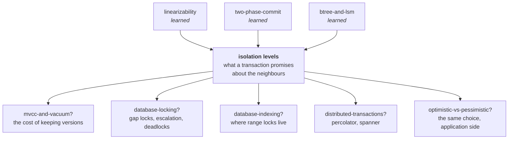

# Isolation levels

> **What this lab is.** Two users change the same data at the same time. Each one
> does something completely reasonable. Together they can leave your database
> holding a number that was never true — with every statement succeeding and no
> error raised anywhere. An isolation level is the dial that decides which of
> those endings your database is allowed to give you. This lab makes you run the
> dial through every setting and watch what actually comes out.
>
> **Run it:**
> ```bash
> java -cp ../lib/h2.jar src/Tests.java            # 108 checks
> java -cp ../lib/h2.jar src/Matrix.java           # THE TABLE: 10 anomalies x 5 levels, on a real database
> java -cp ../lib/h2.jar src/Matrix.java write-skew  # every step of one of them
> java src/MiniLab.java                            # the same anomalies on an engine you can read
> java src/MiniLab.java write-skew                 # ...including the internals
> java -cp ../lib/h2.jar src/Experiments.java      # six measured experiments
> ```
>
> **Interactive ledger:** <https://claude.ai/code/artifact/76051a1f-7357-4e66-9c6d-897f76c6004a>

> **⚠️ Where this sits next to your last lab.**
> [linearizability](../linearizability/) was about **one operation on one object**,
> and it ended on this measurement: `AtomicInteger` is a linearizable register, and
> eight threads doing `get`-then-`set` lost 87% of their increments. Nothing was
> violated — read-then-write is *two* operations, and linearizability says nothing
> about a pair. That lab called this "the boundary between linearizability and
> serializability" and stopped there.
>
> **This is the other side of that boundary.** Same failure, one machine, one
> database, and a much longer menu of half-guarantees than the distributed world
> offers. You will meet that exact vanishing increment again in stage 3, in SQL.

---

## How deep this goes

| Layer | Stages | You will be able to… |
|---|---|---|
| **Beginner model** | 1–9 | say what a transaction does and does *not* promise, and read the standard two-column picture of two users overlapping |
| **Intermediate model** | 10 | explain the three machines underneath, and why each had to be invented |
| **Engineering model** | 11–14 | name all eight ways it goes wrong, know which level stops each, and prove it by running it |
| **Production model** | 15 | choose a level per use case, write the retry loop, and read any vendor's isolation docs correctly |

---

# 1 · WHY — the problem this exists to solve

Two things happen to the same data at the same instant. That is not an edge
case; on any system with more than one user it is Tuesday.

Here is what it costs when nobody has thought about it. A customer's two
deposits arrive together and one of them silently does not exist. Two people
book the last meeting room and both get a confirmation. A monthly report adds
up four account balances and produces a total that no moment in history ever
had. A doctor rota empties itself because two doctors signed off at once,
each having checked that the other was still on.

Every one of those is a real, common bug. None of them involves a crash, a
network failure, or a mistake in your code. Every statement succeeded. And in
almost every case, the fix is one word in a configuration file — but only if
you know which word, and why.

---

# 2 · PROBLEM — Asha's two deposits

Asha has 100 in her account. Two deposits of 10 arrive at the same moment,
handled by two clerks — call them Devi and Omar.

Each clerk does the obvious thing:

> Look up the balance. Add 10. Write the new balance back.

Devi looks up: **100**. Omar looks up: **100**. Devi writes **110**. Omar
writes **110**.

Asha has 110. One of her deposits is gone. Not delayed, not queued for
retry — gone, with no record that it ever happened. Both clerks did their job
correctly. Neither made a mistake. Nobody can be blamed, and nothing in the
system knows anything is wrong.

The trouble is entirely in the *gap*: between Devi looking up the balance and
Devi writing it back, the world changed underneath her, and she had no way to
notice.

---

# 3 · NAIVE SOLUTION — "wrap it in a transaction"

This is what everyone reaches for, and it is not a silly answer:

```sql
BEGIN;
  SELECT balance FROM acct WHERE id = 1;   -- 100
  UPDATE acct SET balance = 110 WHERE id = 1;
COMMIT;
```

A transaction is the database's word for "these statements are one unit". It
sounds exactly like what we need: make the look-up and the write into one
indivisible act, and the gap disappears.

> **🔮 Predict:** both clerks now wrap their work in `BEGIN … COMMIT`, and both
> transactions commit successfully with no error. What is Asha's balance?
>
> <details><summary>Reveal</summary>
>
> **Still 110.** Measured, not guessed: eight threads each adding 1 to the same
> row forty times — 320 increments, every one inside a transaction, every
> transaction committing successfully — end on about **60**. Roughly **80% of
> the work vanished** and not one error was raised.
>
> ```
> java -cp ../lib/h2.jar src/Experiments.java increment
>
>                          READ COMMITTED                     ...
>   SELECT then UPDATE    60/320 LOST 260  (0 retries, 131ms)
> ```
>
> If that surprises you, you have just found the thing this lab exists to fix.
> </details>

---

# 4 · FAILURE — a transaction promises four things, and only one of them is this

`BEGIN … COMMIT` really does give you something. It gives you **all-or-nothing**
(if the second statement fails, the first is undone) and **survives-a-crash**
(once it says committed, it is on disk). Those are worth a great deal, and they
are what most people mean when they say "transaction".

Neither of them has anything to do with somebody else running at the same time.

That is a *separate* promise, and it is the one you have to ask for by name.
The database does not give it to you by default because it is expensive — so
it gives you a cheap approximation and lets you buy more if you say so. Almost
nobody says so, because almost nobody knows the dial exists.

The name of that dial is the **isolation level**, and the default in
PostgreSQL, SQL Server and Oracle is a setting that permits exactly the bug
Asha just suffered.

---

# 5 · THE REAL REQUIREMENT — as if they had queued

State what we actually want, in plain words:

> **However the work actually interleaves, the result must be one that could
> have happened if the transactions had run one at a time, in some order.**

Note what that does and does not say. It does *not* demand Devi go before
Omar. Either order is fine — Asha ends on 120 both ways. It only forbids
endings that **no** single-file order could have produced. 110 is such an
ending, which is exactly why it is a bug.

You have met this shape before. In the [linearizability](../linearizability/)
lab the requirement was "there must exist an order of the *operations* that
explains what every client was told". This is the same sentence with one word
changed: **transactions** instead of operations. That word is doing an enormous
amount of work, and stages 10 and 12 are about how much.

---

# 6 · KEY IDEA — a ladder of partial promises

Running everything one at a time really would fix this. It would also make
your database serve one user at a time, which no one will accept.

So the industry did something pragmatic and slightly regrettable:

> **Offer a ladder. Each rung forbids more of the bad endings than the rung
> below it, and costs more. You pick a rung.**

Two consequences follow, and they cause most of the confusion in this topic:

1. **The rungs are named after which bad endings they forbid**, not after how
   they work. Two databases can implement the same rung name with completely
   different machinery and give you different behaviour.
2. **The list of bad endings in the standard is incomplete.** It was written in
   1992 with three phenomena in mind. The most dangerous ones in practice were
   not on that list, so there is no rung name for stopping them — which is why
   a level called `SERIALIZABLE` may not be serializable.

The rest of this lab is: what the bad endings actually are, which rung stops
each one on your database, and the three mechanisms underneath.

---

# 7 · TERMINOLOGY — the frame

Only the words needed to talk about the ladder. The bad endings get their names
in stage 11, where you can watch each one happen.

### transaction

- **Plain meaning:** a group of statements the database treats as one unit.
- **Technical meaning:** a unit with four properties, conventionally ACID —
  **A**tomic (all or none), **C**onsistent (it moves the data from one state
  satisfying your constraints to another), **I**solated (see below), **D**urable
  (once committed, it survives a crash).
- **Why the term exists:** to give a name to work that must not be half-done.
- **Example:** `BEGIN; UPDATE acct SET balance = balance - 50 WHERE id = 1;
  UPDATE acct SET balance = balance + 50 WHERE id = 2; COMMIT;` — a transfer.
  Half of that is money destroyed.
- **Connects to:** the A and the D are what [two-phase-commit](../two-phase-commit/)
  was fighting to preserve across several machines. This lab is entirely about
  the **I**, on one machine.

### isolation

- **Plain meaning:** how much the database pretends nobody else is running.
- **Technical meaning:** the degree to which concurrently executing transactions
  are prevented from seeing each other's intermediate states and interfering
  with each other's decisions.
- **Why the term exists:** because it is the one ACID property that is a *dial*
  rather than a yes/no. Nobody offers "80% atomic". Everybody offers four or
  five degrees of isolated.
- **Example:** at one setting Devi can see a balance Omar has not committed; at
  another she cannot; at another the database refuses to let them both finish.
- **Connects to:** the [saga](../saga/) lab said sagas "trade atomicity and
  isolation for availability" and left it there. This is the thing being traded.

### schedule

- **Plain meaning:** the order the two transactions' steps actually happened in.
- **Technical meaning:** an interleaving of the operations of several
  transactions, preserving each transaction's own internal order.
- **Why the term exists:** because the *statements* are fixed and the
  *interleaving* is not. All the interesting behaviour is a property of the
  interleaving, so it needs a name of its own.
- **Example:** `Devi reads · Omar reads · Devi writes · Omar writes` is one
  schedule; `Devi reads · Devi writes · Omar reads · Omar writes` is another.
  Same two transactions, and only the second one gives Asha her money.
- **Connects to:** this is what the two columns in the visualization are, and
  the ▲▼ buttons let you change it.

### serial · serializable

- **Plain meaning:** *serial* = they genuinely ran one after another.
  *Serializable* = they overlapped, but the result is one that a serial run
  could have produced.
- **Technical meaning:** a schedule is serial if no two transactions overlap;
  it is serializable if it is equivalent to some serial schedule of the same
  transactions.
- **Why the term exists:** to separate the guarantee (*looks* single-file) from
  the implementation (*is* single-file). Only the first is affordable.
- **Example:** Devi-then-Omar and Omar-then-Devi both give 120. Any schedule
  giving 120 is serializable. The schedule that gives 110 is not.
- **Connects to:** you already have this word from
  [linearizability](../linearizability/) — where the map entry recorded
  *"linearizability is strict serializability where every transaction is a
  single operation on a single object."* Here the transactions are real ones,
  and the real-time clause is dropped: serializability is happy with *any*
  serial order, including one that puts your committed transaction after a
  later one.

### anomaly (phenomenon)

- **Plain meaning:** a specific way the ending can be wrong.
- **Technical meaning:** a pattern of interleaving whose outcome no serial
  schedule could produce; isolation levels are defined by which patterns they
  forbid.
- **Why the term exists:** so the ladder can be specified without specifying an
  implementation. That was a deliberate choice in the SQL standard, and it is
  both why the standard is portable and why it is so often misread.
- **Example:** Asha's missing deposit is the *lost update* anomaly.
- **Connects to:** stage 11 is a list of eight of them, each one runnable.

---

# 8 · MENTAL MODELS — carry two

### The simple model: the ledger nobody erases

There is one ledger. Clerks do not rub anything out — a change is a **new
line** with a note saying from when it counts. An old line stays on the page as
long as anyone might still be reading by it.

So "what is Asha's balance?" is not one question. It is *"what is Asha's
balance as of the moment I started looking?"* — and two clerks who started at
different moments are entitled to two different answers, both correct.

An isolation level is the house rule for three things: **which line you read**,
**whether you may write a line while someone else's is unfinished**, and
**what happens when two clerks' decisions turn out to be incompatible**.

### The engineering model

Each row is a chain of **versions**, each stamped `[value, visible-from,
visible-until]`. A transaction has a **snapshot** — a timestamp — and reads the
version whose window contains it. Writes are private until commit, when they
are stamped and become visible.

A level is then three decisions:

| Decision | Read committed | Snapshot | Serializable (tracking) | Serializable (locking) |
|---|---|---|---|---|
| which version do I read? | newest committed, **re-decided every statement** | the one at my start timestamp | same as snapshot | the current one, under a shared lock |
| may I write over an unfinished change? | no — wait | no — wait | no — wait | no — wait for the lock |
| what if two decisions clash? | nothing is checked | if someone committed my row after my snapshot, **I am refused** | that, **plus**: if I read something they changed *and* changed something they read, I am refused | it cannot happen; locks made us take turns |

### Mapping the two

| Ledger picture | Engineering model | On the screen |
|---|---|---|
| a line in the ledger | a version `[value, from, until]` | a box in the ledger panel |
| "as of when I started looking" | the transaction's snapshot timestamp | "reading the world as it was at moment 4" |
| a pencilled line not yet inked | a buffered write, private to its transaction | the dashed box |
| a clerk waiting at the desk | blocked on a lock | the *waiting* badge |
| "you two can't both be right — start again" | serialization failure, SQLSTATE 40001 | the *refused* badge |

### Where the analogy breaks

**1 · A clerk does not hold a photocopy.** "Snapshot" sounds like a copy taken
at the start. Nothing is copied — the version *chain* is shared, and each read
picks a line out of it using your timestamp. This matters, because it means a
snapshot costs nothing to take and everything to keep: see stage 11, F8.

**2 · Read committed re-reads every time, and that is not a compromise, it is
a different thing.** Under read committed there is no single moment your
transaction is "as of". Statement one may be as of 10:00:01 and statement two
as of 10:00:04. The ledger picture makes it feel like a slightly blurry
snapshot; it is not a snapshot at all.

**3 · The clerks are not peers.** The picture suggests two people negotiating.
In fact the database is free to throw one of them out entirely, at commit time,
after all its work is done. That is not a failure — at the top of the ladder it
*is* the mechanism, and your application is expected to handle it. Any mental
model that leaves out "and then one of them is simply killed" will mislead you
about what buying `SERIALIZABLE` actually costs.

---

# 9 · VISUALIZATION — step it, then change the level

Open **<https://claude.ai/code/artifact/76051a1f-7357-4e66-9c6d-897f76c6004a>**
(or `open visualization.html`). This is the standard textbook picture: time runs
down, one column per clerk.

**Do these five things, in order.**

1. **Situation 1 is loaded** — someone reading unfinished work. Answer the
   prediction, then press **Next step** four times and watch the two "what each
   clerk can see" panels diverge and come back together.
2. **Open *A deposit that vanishes*** and step to the end at read committed.
   Then click **Snapshot** in the strip. Same schedule, same statements — one
   clerk is now *refused*. Read the verdict text: that refusal is the guarantee,
   and it is addressed to your code.
3. **Open *Both doctors go off call*** and try every level in the strip. Four of
   the five let the rota empty. Then click **Serializable (tracking)** and watch
   the **arrows** appear in the ledger panel — those are the reads the database
   is remembering, and they are the entire difference.
4. **Change the schedule.** On *A deposit that vanishes*, use ▲ to move Clerk
   1's `COMMIT` above Clerk 2's read. The anomaly disappears at every level —
   because the two clerks no longer overlap. Nothing about the database changed.
   **Concurrency is the input; the isolation level only decides what to do
   about it.**
5. **Open *The room booked twice*** and note that at snapshot level there is no
   row for either clerk to conflict on. That is the case row locks cannot reach.

---

## ✅ Checkpoint — end of the beginner model

You can now say what a transaction does *not* promise, read a two-column
schedule, and explain why two clerks reading the same row can both be right.

**Next:** the three machines underneath — locks, snapshots, and read-tracking —
and why each one had to be invented.

---

# 10 · ACTUAL MECHANISM — three inventions, each forced by the last one's failure

## 10.1 · Mechanism v1 — take a lock, hold it to the end

The obvious fix for Asha: before reading a row, lock it; before writing it,
lock it harder; hold every lock until you commit. Nobody can slip into your gap
because there is no gap.

This is **two-phase locking** — a growing phase where you only acquire, then a
shrinking phase at commit where you only release. It is genuinely correct.
`java src/MiniLab.java lost-update` shows it working:

```
    T1 begins at snapshot 3
    T2 begins at snapshot 4
    T1 reads acct:1 = 100
    T2 reads acct:1 = 100
    T1 must wait: T2 holds a read lock on acct:1
    T2 must wait: T1 holds a read lock on acct:1
    deadlock: T1 is waiting for T2 and T2 is waiting for T1
    T2 is thrown out: chosen as the deadlock victim
    T1 writes acct:1 = 110
    T1 commits at 5
```

Two things to notice, because both become permanent features of the topic.
First, the result is correct: one transaction did its work, the other was told
to try again. Second, **the way it got there was a deadlock** — each holding
what the other needed. Deadlocks are not a bug in locking; they are what
locking feels like.

> **🔮 Predict:** locking is correct. What is the thing about it that made the
> entire industry go looking for something else?
>
> <details><summary>Reveal</summary>
>
> **Readers block writers, and writers block readers.**
>
> Run a report that reads a million rows under two-phase locking and it holds a
> shared lock on every one of them until it commits. Nothing can be updated for
> the whole minute your report runs. Meanwhile a single row being updated stalls
> every reader who touches it.
>
> Look at the toy engine's own matrix: under `SERIALIZABLE(2PL)` almost every
> row is `safe(wait)`. Correct, and every single one paid in waiting. On a busy
> OLTP database that is not a tuning problem, it is a non-starter — which is why
> the default level in every mainstream database is *not* this.
> </details>

## 10.2 · Mechanism v2 — keep the old versions, so readers never block

The insight that changed databases: if you never overwrite a row, but add a new
version beside it, then a reader does not need a lock at all. It reads the
version that was current when it started, and writers can carry on.

**Readers never block writers. Writers never block readers.** That sentence is
the reason MVCC won, and it is why Postgres, Oracle, MySQL/InnoDB and SQL
Server's snapshot modes all work this way.

Run `java -cp ../lib/h2.jar src/Experiments.java versions` to see the chain grow:

```
  acct:1: [100 from 1 onwards]
  after write 1: acct:1: [100 from 1 to 4] [110 from 4 onwards]
  after write 2: acct:1: [100 from 1 to 4] [110 from 4 to 6] [120 from 6 onwards]
  ...
  the report still reads: 100   (its snapshot is older than every one of those versions)
```

Two transactions writing the same row still have to be resolved, and the rule
is **first committer wins**: at commit, if any row you wrote gained a version
after your snapshot was taken, someone beat you to it and you are refused. That
is where the `40001` in the matrix comes from.

This is **snapshot isolation**, and it is superb. In one move it stops a reader
seeing unfinished work, stops the same query returning two different answers,
stops rows appearing mid-count, stops a report totalling two rows from two
different moments, and stops Asha's deposit vanishing — with no reader ever
waiting for anything. Look at the toy engine's `SNAPSHOT` column: five rows of
`safe` and `safe(err)`, and not one `safe(wait)` on a read.

Stage 11 gives each of those five its proper name and a command to reproduce it.

## 10.3 · The failure that forced v3

Two doctors, Alice and Bob, both on call. The rule is that at least one must
stay. Each checks the rota, sees two people on call, and signs off.

> **🔮 Predict:** both transactions run under snapshot isolation. Each reads the
> rota, sees 2, and updates **its own row only**. Does first-committer-wins
> catch this?
>
> <details><summary>Reveal</summary>
>
> **No, and it never could.** Alice's transaction writes row 1. Bob's writes
> row 2. They wrote *different rows*, so there is no row for the
> first-committer-wins check to fire on. Both commit. Nobody is on call.
>
> ```
> java src/MiniLab.java write-skew        # look at the SNAPSHOT section
>
>     T1 scans [on_call] -> 2 rows  (as of 3)
>     T2 scans [on_call] -> 2 rows  (as of 4)
>     T1 writes doc:1 = 0
>     T2 writes doc:2 = 0
>     T1 commits at 5
>     T2 commits at 6
>   outcome: ALLOWED   final state: 0
> ```
>
> Snapshot isolation checks **what you wrote**. The information that made this
> wrong is **what you read** — and nobody was keeping that.
>
> This anomaly is called **write skew**, and it is the reason the last rung of
> the ladder exists.
> </details>

## 10.4 · Mechanism v3 — remember what was read, not just what was written

The fix is to write down the reads too. When a transaction writes a row, look
for any *concurrent* transaction that already read that row — or asked a
question this row would have answered — and record an arrow from the reader to
the writer. The arrow means "in any single-file story, the reader has to come
first, because it did not see this change." Postgres's documentation calls that
arrow an **rw-antidependency**; it is the only kind of conflict snapshot
isolation does not already handle.

A transaction with an arrow **coming in and an arrow going out** is sitting in
the middle of a loop that cannot be untangled. That shape is called a **pivot**,
and refusing it is enough.

Here is the toy engine doing exactly that, arrows and all:

```
java src/MiniLab.java write-skew        # the SERIALIZABLE(SSI) section

    T1 scans [on_call] -> 2 rows  (as of 3)
    T2 scans [on_call] -> 2 rows  (as of 4)
      ! T2 had read doc:1, T1 is writing it  ->  arrow T2 -> T1
    T1 writes doc:1 = 0
      ! T1 had read doc:2, T2 is writing it  ->  arrow T1 -> T2
    T2 writes doc:2 = 0
    T1 is refused: it has an arrow in AND an arrow out — it is the pivot of a cycle
    T2 commits at 5

  outcome: safe(err)   final state: 1
```

One doctor left on call, one transaction told to try again. This is
**serializable snapshot isolation** — how PostgreSQL implements `SERIALIZABLE`,
and the reason Postgres can offer real serializability without going back to
locks.

Notice what it does *not* do: it never makes a reader wait. It pays for
correctness in **refusals at commit time** rather than in waiting, and that is
the trade. Which is better depends entirely on how contended your data is —
experiment 2 measures exactly that.

**Three mechanisms, three prices.** Locking pays in waiting. Snapshot pays in
keeping old versions around. Read-tracking pays in transactions being thrown
out at the last moment. There is no fourth option where you pay nothing.

---

## ✅ Checkpoint — end of the intermediate model

You can now explain why MVCC replaced locking, why snapshot isolation cannot
see write skew, and what read-tracking adds. That is enough to understand any
database's isolation documentation.

**Next:** all eight anomalies, each one runnable, and the table showing which
level actually stops each one — including the level that lies.

---

# 11 · FAILURE SCENARIOS — the eight bad endings

This is the table the whole lab is built around. **Measured, not quoted** —
H2 2.4.240, deterministic across five consecutive runs:

```
java -cp ../lib/h2.jar src/Matrix.java

anomaly                                   RU           RC           RR           SNAP         SER
-----------------------------------------------------------------------------------------------------
Dirty write                               ALLOWED      safe(wait)   safe(wait)   safe(wait)   safe(wait)
Dirty read                                ALLOWED      safe         safe         safe         safe
Non-repeatable read                       ALLOWED      ALLOWED      safe         safe         safe
Phantom read                              ALLOWED      ALLOWED      safe         safe         safe
Lost update                               ALLOWED      ALLOWED      safe(err)    safe(err)    safe(err)
Lost update, arithmetic in SQL            safe(wait)   safe(wait)   safe(err)    safe(err)    safe(err)
Lost update, with SELECT ... FOR UPDATE   safe(wait)   safe(wait)   safe(err)    safe(err)    safe(err)
Read skew                                 ALLOWED      ALLOWED      safe         safe         safe
Write skew                                ALLOWED      ALLOWED      ALLOWED      ALLOWED      ALLOWED
Write skew on rows that do not exist yet  ALLOWED      ALLOWED      ALLOWED      ALLOWED      ALLOWED
```

`safe` = prevented with no cost · `safe(wait)` = prevented by making somebody
wait · `safe(err)` = **prevented by refusing a transaction, which your code must
retry** · `ALLOWED` = it happened, both transactions committed, nothing complained.

**Read the bottom two rows before anything else.** The column headed `SER` is
the level called `SERIALIZABLE`, and it permits write skew. That is not a bug in
this lab — H2's own pull request adding these levels says the implementation
*"prevents all three read phenomena, but doesn't ensure equivalence of
sequential and concurrent execution of transactions"*
([h2database#2148](https://github.com/h2database/h2database/pull/2148/files/891839892fd06e9cf209216276f3edbb3809839f)).
The name is aspirational. **This is the single most important habit this lab can
give you: run the table against your own database instead of trusting the
column heading.**

### F1 · Dirty write — overwriting something nobody has agreed to

**Create it:** `java -cp ../lib/h2.jar src/Matrix.java dirty-write`
**What happened:** Clerk 1 sets Alice to 110 and does not commit. Clerk 2 sets
her to 120 and commits. Clerk 1 rolls back — and 120 stands, resting on a
change that was withdrawn. **Why:** at `READ UNCOMMITTED` H2 takes no row locks
at all. **Response:** every other level makes Clerk 2 wait. **Kept:** nothing at
RU. **Lost:** the ability to roll back meaningfully — your undo cannot undo what
someone has already built on. **In production:** every standard says this must
be prevented at every level; H2's `READ UNCOMMITTED` does not. It is one more
reason nobody should ever select that level.

### F2 · Dirty read — reading something nobody has agreed to

**Create it:** `src/Matrix.java dirty-read`
**What happened:** Clerk 2 read 999, a number that was rolled back seconds
later. **Why:** at RU, reads look inside other transactions' unfinished work.
**Response:** every level above RU reads only committed versions. **Kept:**
nothing. **Lost:** any meaning at all — you acted on a number that never
existed. **In production:** **PostgreSQL will not do this even if you ask.**
`SET TRANSACTION ISOLATION LEVEL READ UNCOMMITTED` is accepted and silently
behaves as `READ COMMITTED`, because its MVCC design has no way to produce a
dirty read. Whole categories of advice about "avoiding dirty reads" are
irrelevant on Postgres.

### F3 · Non-repeatable read — the same question, two answers

**Create it:** `src/Matrix.java non-repeatable-read`
**What happened:** Clerk 1 read Alice's balance twice inside one transaction and
got 100, then 200. **Why:** at read committed, every statement gets a fresh
view. **Response:** snapshot isolation freezes the view at transaction start.
**Kept:** you never see uncommitted data. **Lost:** internal consistency — any
total computed across two statements may be nonsense. **In production:** this is
the everyday reason to raise the level for reports, and it is measured in
experiment 4: a report reading four balances at read committed got the **wrong
total 96 times out of 300** while transfers ran, versus **0 of 300** under
snapshot.

### F4 · Phantom read — a row that appears mid-question

**Create it:** `src/Matrix.java phantom-read`
**What happened:** `SELECT COUNT(*) WHERE balance > 50` returned 2, then 3.
**Why:** the new row did not exist when the first count ran, so there was
nothing to lock. **Response:** a snapshot prevents it for free (the new version
is after your timestamp). Under locking you need **range or predicate locks** —
locking the *question*, not the rows. **Kept:** existing rows are stable.
**Lost:** the meaning of any aggregate. **In production:** this is the anomaly
the ANSI standard says `REPEATABLE READ` may permit — and on most MVCC engines
it does not, because their `REPEATABLE READ` is really snapshot isolation. **The
level name tells you nothing here; the implementation does.**

### F5 · Lost update — the anomaly from stage 2

**Create it:** `src/Matrix.java lost-update`, and at scale
`src/Experiments.java increment`
**What happened:** ~60 of 320 increments survived at read committed.
**Why:** read-then-write is two statements with a gap. **Response:** at snapshot
and above, first-committer-wins refuses the second one with `40001`. **Kept:**
at RC, nothing. **Lost:** the update, silently. **In production:** this is the
single most common data-corruption bug in ordinary CRUD applications, and it has
**three fixes, measured side by side** (experiment 1):
- do the arithmetic in SQL — `UPDATE acct SET balance = balance + 10` — correct
  at *every* level, **0 retries**, and the fastest of the three;
- `SELECT ... FOR UPDATE` — correct at every level, pays in waiting;
- raise the level to snapshot or above **and write the retry loop**.

### F6 · Read skew — a report that finds money that is not there

**Create it:** `src/Matrix.java read-skew` and `src/Experiments.java stability`
**What happened:** Clerk 1 read Alice (100), a transfer of 50 committed, Clerk 1
read Bob (150) — total 250 for an account pair that always held 200.
**Why:** two statements, two different moments. **Response:** a snapshot makes
all reads one moment. **Kept:** each individual read was of committed data and
was correct. **Lost:** any cross-row invariant. **In production:** this is why
reporting and batch jobs are the classic customers for `REPEATABLE READ`, and
why "our nightly reconciliation is off by a few pennies and we can never
reproduce it" is so often this.

### F7 · Write skew — the one that needs the top rung

**Create it:** `src/Matrix.java write-skew`, `src/Experiments.java skew`, and
`java src/MiniLab.java write-skew` for the mechanism.
**What happened:** both doctors signed off. Measured on H2 unscripted:
**196 to 200 of 200 rounds broken at every level**, including `SERIALIZABLE`.
**Why:** the two transactions wrote *different rows*, so no write-write check
can fire; the shared thing was a **rule they both read**. **Response:** only
read-tracking (SSI) or locking the predicate can stop it. **Kept:** every row is
individually fine. **Lost:** the invariant across rows — the thing your business
actually cares about. **In production:** this is the anomaly behind
double-spends, over-booked resources, two people assigned one seat, and rota
holes. The reason it survives review is that **the rule lives in an `if`
statement in the application, where the database cannot see it.**

### F8 · The long transaction — the cost of the snapshot you took

**Create it:** `src/Experiments.java versions`
**What happened:** one open snapshot transaction; every subsequent write left
another version alive. **Why:** an old version may not be removed while any
transaction might still read it. **Response:** none automatic — the versions
accumulate. **Kept:** correctness, perfectly. **Lost:** disk and scan speed.
**In production:** in PostgreSQL this is what `VACUUM` cleans up, and **one
forgotten `idle in transaction` session stops cleanup for the whole database** —
tables grow while the row count does not, and queries slow down for reasons that
look nothing like a transaction bug. `idle_in_transaction_session_timeout`
exists precisely for this. It is also why long-running analytics against your
OLTP primary is an isolation-level decision, not just a load decision.

---

# 12 · CORRECTNESS — what you are actually buying

## What each level guarantees

| Level | Stops | Still permits |
|---|---|---|
| read uncommitted | (in principle, dirty writes — but see F1) | everything else |
| read committed | dirty reads, dirty writes | non-repeatable read, phantom, lost update, read skew, write skew |
| snapshot / most engines' repeatable read | + non-repeatable read, phantom, read skew, lost update | **write skew** |
| serializable (SSI or 2PL) | everything above | nothing — but you must retry |

## What isolation is not

- **Not atomicity or durability.** Those are about crashes; this is about
  neighbours. Raising the isolation level does nothing for a power cut.
- **Not a replication guarantee.** Everything here is one node. Reading a
  serializable transaction from a lagging replica gives you a *consistent* view
  of a *stale* moment — [linearizability](../linearizability/) is the axis that
  covers that, and the two are independent. This is why Spanner needs a separate
  word (*external consistency*) for having both.
- **Not a substitute for a constraint.** Write skew happens because a rule lived
  in application code. A `CHECK`, a `UNIQUE` index or an exclusion constraint
  moves that rule into the database, where it holds at *every* level and costs
  nothing. **The cheapest fix for write skew is usually not an isolation level
  at all** — for the double-booking case, `UNIQUE (room, day)` ends the argument.

## What you trade

- **Waiting** (locking) — throughput falls under contention, and deadlocks
  appear. Deadlocks are a **lock ordering** problem: experiment 6 shows 57
  retries with an arbitrary order and **0** when both transactions always lock
  the lower id first.
- **Version accumulation** (snapshot) — F8.
- **Refusals** (SSI) — and here is the sharpest number in the lab. Same level,
  same code, only the spread of the data changed (experiment 2):

  | hot rows | retries | time |
  |---|---|---|
  | 1 | 282 | 247 ms |
  | 2 | 100 | 69 ms |
  | 4 | 29 | 35 ms |
  | 16 | 1 | 17 ms |
  | 64 | 2 | 27 ms |

  **Contention is a property of your data access pattern, not of the isolation
  level.** "We turned on serializable and the app fell over" is almost always a
  hot-row problem wearing an isolation-level costume.

## Safety and liveness

Preventing an anomaly is a **safety** property — nothing bad happens. Every
mechanism here delivers safety. What they differ in is the **liveness** cost:
locking can stall you indefinitely (and deadlock), SSI can refuse you
repeatedly under contention. Neither can corrupt your data by trying too hard;
both can stop you making progress. That asymmetry is why the retry loop is not
optional decoration but part of the guarantee.

## The standard's own flaw, briefly

ANSI SQL-92 defined the ladder by three phenomena — dirty read, non-repeatable
read, phantom. Berenson and colleagues showed in 1995 (*A Critique of ANSI SQL
Isolation Levels*) that the definitions are ambiguous, and that **snapshot
isolation does not fit anywhere on the ladder**: it is stronger than
`REPEATABLE READ` (no phantoms) and weaker than `SERIALIZABLE` (write skew).
Vendors mapped it onto whichever rung name was closest, which is exactly why
`REPEATABLE READ` means different things in PostgreSQL and MySQL, and why
Oracle's `SERIALIZABLE` is snapshot isolation
([Mihalcea](https://vladmihalcea.com/write-skew-2pl-mvcc/)).

**Do not learn the ladder as a hierarchy of names. Learn it as a list of
anomalies, and find out which ones your database actually stops.**

---

# 13 · CODE — what is in `src/`

Eleven files, no build tool. The only dependency is `../lib/h2.jar`, and half the
lab needs nothing at all.

| File | What it is |
|---|---|
| [`Db.java`](src/Db.java) | JDBC plumbing and level names; `-Ddb.url=…` points the whole lab at another database |
| [`Step.java`](src/Step.java) | one action by one transaction, including one built from what an earlier step read |
| [`Scenario.java`](src/Scenario.java) | an anomaly: the story, the schedule, and the question that decides whether it happened |
| [`Anomalies.java`](src/Anomalies.java) | the ten scripts |
| [`Runner.java`](src/Runner.java) | **the interesting one** — plays a schedule against a real database and can tell *waiting* apart from *failing* |
| [`Matrix.java`](src/Matrix.java) | the table, plus a step-by-step log for any single anomaly |
| [`MiniDb.java`](src/MiniDb.java) | **the other interesting one** — a 250-line MVCC engine with all five levels |
| [`MiniLab.java`](src/MiniLab.java) | the same anomalies against MiniDb, with the internals printed |
| [`Retry.java`](src/Retry.java) | the retry loop that every high isolation level requires |
| [`Experiments.java`](src/Experiments.java) | six measured experiments |
| [`Tests.java`](src/Tests.java) | 108 checks, including every cell of both matrices |

**The lines that carry the concept.** Read these five and you have read the lab:

1. `MiniDb.readTs` — `t.level == READ_COMMITTED ? clock : t.startTs`. One
   ternary, and it is the entire difference between read committed and a
   snapshot.
2. `MiniDb.commit`, the first-committer-wins loop — `if (v.begin > t.startTs)`.
   This is where `40001` is born.
3. `MiniDb.noteReadWriteConflicts` — the only place a **read** is written down.
   Delete this method and `SERIALIZABLE(SSI)` becomes snapshot isolation.
4. `MiniDb.isPivot` — `in && out`. The whole of SSI's decision rule.
5. `Runner.play`'s submit-then-move-on loop — how the harness notices that a
   transaction is *waiting* rather than done or failed. Without this the matrix
   cannot tell `safe(wait)` from `safe`.

**Deliberate simplifications, flagged.** MiniDb stores one integer per key
(enough: every anomaly here is about *when* you see a value, never its type).
Its 2PL locks the whole table for a predicate read, where a real engine locks
index ranges — coarser, same idea. Its SSI aborts on the pivot shape without
the full read-only-transaction optimisations Cahill's algorithm has, so it can
refuse a transaction a real implementation would let through; it never lets a
bad one through.

**Cross-checked, not asserted.** The browser page runs an independent port of
the same engine. `./validate-visualization.sh` runs both and prints the two
matrices side by side; all forty shared cells agree.

---

# 14 · EXPERIMENTS

`java -cp ../lib/h2.jar src/Experiments.java` lists them. Numbers below are from
a representative run — the exact retry counts move by 10–20% between runs, the
shapes do not.

| # | Command | Question | What you should see |
|---|---|---|---|
| 1 | `increment` | do transactions fix lost update? | **~60 of 320** survive at read committed; SQL arithmetic gives 320 with **0 retries**; higher levels give 320 with ~80–250 retries |
| 2 | `contention` | what does serializable cost? | 282 retries on 1 hot row, **1 retry** on 16 — same level, same code |
| 3 | `skew` | is `SERIALIZABLE` serializable? | **196–200 of 200 rounds broken at every H2 level**, including the one named SERIALIZABLE |
| 4 | `stability` | why raise the level for reports? | **96 of 300** reports wrong at read committed; **0 of 300** under snapshot |
| 5 | `versions` | what does a long transaction cost? | the version chain grows with every write while one reader sits open |
| 6 | `deadlock` | are deadlocks an isolation problem? | 57 retries with arbitrary lock order, **0** with a consistent one |

> **🔮 Predict, before running experiment 1:** you keep `READ COMMITTED` but
> change `SELECT balance; UPDATE SET balance = <v+10>` into the single statement
> `UPDATE SET balance = balance + 10`. How many of the 320 increments survive?
>
> <details><summary>Reveal</summary>
>
> **All 320, with zero retries, and faster than every other option** (26ms
> against 131ms for the broken version).
>
> The reason is worth internalising: a single `UPDATE` takes the row lock and
> *then* reads the current value. There is no gap for anyone to slip into,
> because the read and the write are the same statement. The lost update was
> never really about the isolation level — it was about the application holding
> a value across a gap it did not own.
>
> **Before you raise an isolation level, check whether the read can simply move
> into the write.** It is the cheapest correct answer in this lab, and it needs
> no retry loop.
> </details>

---

## ✅ Checkpoint — end of the engineering model

You can now name every anomaly, say which mechanism stops it and what that
costs, and — most importantly — you know not to trust a level name without
running the table.

**Next:** what each real database actually does, and how to choose.

---

# 15 · PRODUCTION

## The chain: this lab → a real engine → an architecture → an on-call morning

`MiniDb` is structurally what Postgres does: versioned rows, a snapshot
timestamp per transaction, first-committer-wins, and read-tracking at the top
level. What real engines add is everything around it — durability, cleanup,
index-level locking, and decades of tuning.

- **This lab:** versions in a `HashMap`, cleaned up never.
- **Real:** versions in the heap pages themselves, with `VACUUM` (Postgres) or a
  separate undo/rollback segment (Oracle, InnoDB) reclaiming them.
- **Architecture:** the level is chosen **per transaction**, not per database.
  Reports get a snapshot; the payment path gets serializable; the feed page gets
  read committed.
- **On-call:** you watch deadlock rate, serialization-failure rate, long-running
  transaction age, and table bloat. A spike in `40001` is not an incident by
  itself — it is contention, and it is telling you which row is hot.

## What each database actually does

**Measured here: H2 only.** Everything in this table is from vendor
documentation and the sources linked below — *not* run in this lab. The whole
point of `Matrix.java` is that you can settle it yourself in one command:

```bash
java -cp ../lib/h2.jar:postgresql.jar \
     -Ddb.url=jdbc:postgresql://localhost/test -Ddb.user=me -Ddb.pass=secret \
     src/Matrix.java
```

| Database | What its levels really are |
|---|---|
| **PostgreSQL** | `READ UNCOMMITTED` silently means read committed — it cannot produce a dirty read. `READ COMMITTED` (default) = per-statement snapshot. `REPEATABLE READ` = **snapshot isolation**: no phantoms, but **write skew is allowed**. `SERIALIZABLE` = **SSI**, the real thing, and it raises `40001` that you must retry. |
| **MySQL / InnoDB** | Default `REPEATABLE READ`. Plain `SELECT` reads a snapshot; **`SELECT … FOR UPDATE`, `UPDATE` and `DELETE` read the latest committed row instead** — a split personality that surprises everyone, and the reason read-then-write behaves differently here than on Postgres. Gap/next-key locks stop phantoms for *locking* reads. `SERIALIZABLE` turns every plain `SELECT` into a locking read, i.e. back to 2PL. |
| **Oracle** | Offers only `READ COMMITTED` and `SERIALIZABLE`, and **its `SERIALIZABLE` is snapshot isolation — write skew is permitted** ([Mihalcea](https://vladmihalcea.com/write-skew-2pl-mvcc/)). If you need real serializability on Oracle you enforce it yourself with `SELECT … FOR UPDATE` or a constraint. |
| **SQL Server** | Default `READ COMMITTED` using *locks*, unless `READ_COMMITTED_SNAPSHOT` is on, which switches it to MVCC — a database-wide setting that changes your application's concurrency behaviour without changing a line of code. Its `SERIALIZABLE` is 2PL with range locks: genuinely serializable, and it blocks. |
| **CockroachDB** | `SERIALIZABLE` by default; `READ COMMITTED` added later as an opt-out for migrating applications. |
| **H2 (this lab)** | `READ UNCOMMITTED` allows dirty writes. `REPEATABLE READ`, `SNAPSHOT` and `SERIALIZABLE` are all snapshot-based and **all three permit write skew** — vendor-confirmed ([h2database#2148](https://github.com/h2database/h2database/pull/2148/files/891839892fd06e9cf209216276f3edbb3809839f)). |

## In a Spring Boot application

```java
// The level is per transaction. Choose it where you know the use case.
@Transactional(isolation = Isolation.REPEATABLE_READ, readOnly = true)
public MonthlyReport build(YearMonth month) { … }        // needs a stable view

@Transactional(isolation = Isolation.SERIALIZABLE)
public void assignOnCall(Long doctorId) { … }            // an invariant across rows
```

Three things that bite in practice:

1. **`@Transactional(isolation = …)` without a retry is a bug.** Spring will not
   retry a `CannotAcquireLockException` for you. Wrap the *whole* transaction —
   `@Retryable`, or an explicit loop — and note that the retry must re-run the
   method, not just the failed statement, because the data your decision was
   based on has changed. See [`Retry.java`](src/Retry.java).
2. **JPA's `@Version` is the same idea in the application.** Optimistic locking
   raises `OptimisticLockException` on exactly the situation first-committer-wins
   catches, and works at read committed. This is the same `expected-version`
   check you met in [event-sourcing](../event-sourcing/) — one pattern, three
   names.
3. **Watch out for the read that escapes the transaction.** A lazy-loaded
   association fetched after the transaction closes is a new transaction with a
   new snapshot, and none of your isolation guarantees apply to it.

## Choosing, in one page

| Use case | Level | Why |
|---|---|---|
| ordinary CRUD, one row at a time | read committed | it is enough, and it never refuses anything |
| a report or export reading many rows | repeatable read / snapshot, read-only | one consistent moment; experiment 4 is the argument |
| read-modify-write on one row | read committed **+ arithmetic in SQL** | correct, no retries, fastest (experiment 1) |
| a claim on one row ("take this job") | read committed + `SELECT … FOR UPDATE`, or a conditional `UPDATE … WHERE status='free'` | one row, one lock, no cleverness |
| **an invariant across several rows** | **serializable + retry**, or a constraint | this is write skew; nothing below the top rung sees it |
| uniqueness ("one booking per room per day") | any level + a `UNIQUE` constraint | cheaper and stronger than any isolation level |

## What this lab leaves out

| Omitted | What real systems do |
|---|---|
| durability and recovery | the WAL from [btree-and-lsm](../btree-and-lsm/); isolation and durability are independent axes |
| version cleanup | `VACUUM`, undo segments, purge threads — F8 is the symptom, not the mechanism |
| index-level locking | real 2PL locks index ranges (next-key locks), not whole tables |
| lock escalation | row locks becoming page or table locks under memory pressure |
| read-only transaction optimisations | real SSI can prove a read-only transaction is safe and skip the tracking |
| distributed transactions | [two-phase-commit](../two-phase-commit/) and [saga](../saga/) |
| replicas | reading a replica adds staleness on top of everything here |

---

## ✅ Checkpoint — end of the production model

You can read any vendor's isolation documentation and know what is really being
promised, choose a level per use case with the cost in mind, and write the retry
loop that makes the choice real.

---

# 16 · EXERCISES

See [EXERCISES.md](EXERCISES.md) — eight rungs, from "say it back in your own
words" to designing the concurrency strategy for a payments ledger. Answers in
[SOLUTIONS.md](SOLUTIONS.md); attempt first.

---

# 17 · KNOWLEDGE MAP & NEXT STEPS



**What this built on**

- **[linearizability](../linearizability/)** — its `AtomicInteger` experiment
  *is* the lost update anomaly, and its closing line ("read-then-write is two
  operations") is stage 2 of this lab. The two labs are the two axes:
  linearizability is about *many machines, one operation*; isolation is about
  *one machine, many operations*. Spanner's *external consistency* is the corner
  where you buy both.
- **[two-phase-commit](../two-phase-commit/)** — its blocking problem is 2PL's
  blocking problem, one level up: participants holding locks after voting yes.
- **[btree-and-lsm](../btree-and-lsm/)** — MVCC version chains are stored in the
  pages that lab built, and its `mvcc-and-vacuum?` suggestion is now earned:
  stage 11, F8 is why vacuum exists.
- **[event-sourcing](../event-sourcing/)** — `expected-version` is
  first-committer-wins implemented in the application. Same rule, same failure,
  same retry.
- **[saga](../saga/)** — "trades atomicity and isolation for availability" now
  has content: a saga's intermediate states are visible, which is dirty reads
  and read skew by design, and *semantic locks* are how you claw some back.

**Where to go next**

```
/learn mvcc-and-vacuum          # the storage cost of every snapshot you take
/learn database-locking         # gap locks, next-key locks, escalation, deadlock graphs
/learn optimistic-vs-pessimistic-locking   # the same choice, made in your code
/learn distributed-transactions # percolator and spanner: isolation across machines
```

**Commonly confused with**

| Confused with | The one sentence that separates them |
|---|---|
| **atomicity** | atomicity is about your *own* transaction being all-or-nothing; isolation is about *other people's* |
| **linearizability** | that is one operation on one object across machines; this is many operations on many rows on one machine |
| **locking** | locking is one *mechanism* for delivering isolation; snapshots and read-tracking are two others |
| **`REPEATABLE READ`** | the ANSI name permits phantoms; almost every real implementation of it is snapshot isolation, which does not |
| **snapshot isolation** | not a rung on the ANSI ladder at all — stronger than repeatable read, weaker than serializable, and the gap is exactly write skew |
| **optimistic locking** | the same first-committer-wins rule, enforced by your application with a version column instead of by the engine |

---

# 18 · GLOSSARY

In order of appearance.

| Term | One line |
|---|---|
| **transaction** | a group of statements the database treats as one unit |
| **ACID** | atomic, consistent, isolated, durable — the four promises, of which only isolation is a dial |
| **isolation level** | how much your transaction pretends nobody else is running |
| **schedule** | the order two transactions' steps actually interleaved in |
| **serial** | the transactions genuinely ran one after another |
| **serializable** | the result is one that some serial order could have produced |
| **anomaly (phenomenon)** | a specific pattern of interleaving whose outcome no serial order could produce |
| **two-phase locking (2PL)** | acquire locks as you go, release them all at commit; correct, and it blocks |
| **deadlock** | two transactions each holding what the other needs; broken by throwing one out |
| **MVCC** | never overwrite a row — add a version beside it, so readers never block writers |
| **version** | one value of one row, alive between two moments |
| **snapshot** | the timestamp a transaction reads by, so it sees one consistent moment |
| **snapshot isolation** | read from one frozen moment, and the first committer wins any write clash |
| **first committer wins** | at commit, if a row you wrote changed after your snapshot, you are refused |
| **serialization failure** | SQLSTATE `40001` — the database refusing you so your retry can succeed |
| **dirty write** | overwriting a change nobody has committed |
| **dirty read** | reading a change nobody has committed |
| **non-repeatable read** | the same row read twice in one transaction, with two different values |
| **phantom** | a row appearing inside a question that had already been answered |
| **predicate lock** | locking the *question* rather than the rows, which is what stops phantoms under locking |
| **lost update** | two read-modify-writes on one row; one of them silently vanishes |
| **read skew** | two rows read either side of someone's transaction, giving a total that never existed |
| **write skew** | two transactions read a shared rule, then write *different* rows, and break it |
| **SSI** | serializable snapshot isolation: snapshot reads plus tracking of what was read |
| **rw-antidependency** | the arrow from a transaction that read a row to one that then wrote it |
| **pivot** | a transaction with an arrow in and an arrow out — the one SSI refuses |
| **vacuum / bloat** | removing versions nobody can still need, and what happens when you cannot |
