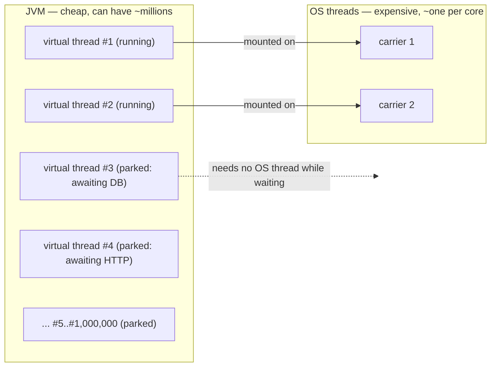
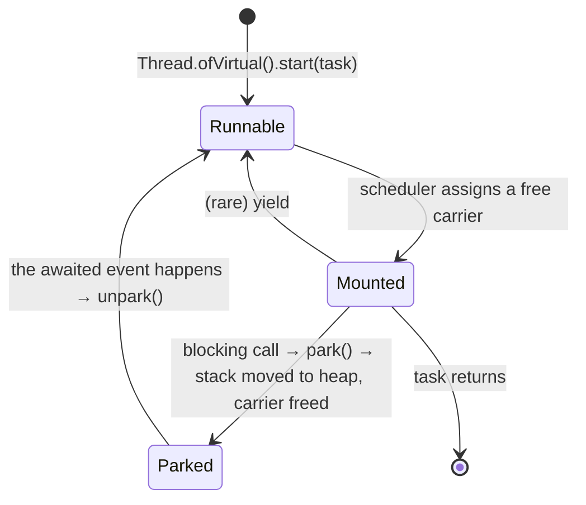
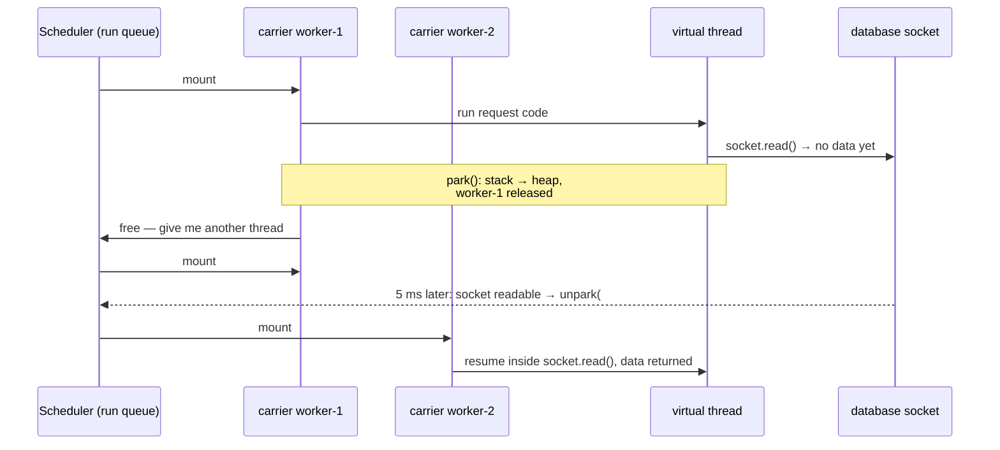
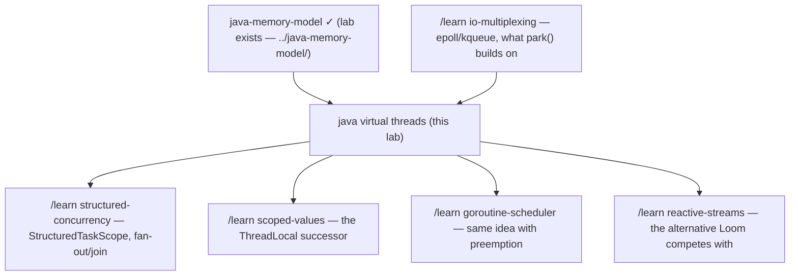

# Java Virtual Threads — a learning lab

*A complete path from "never heard of it" to production-level understanding.
Everything here runs on this machine (JDK 25) via `./run.sh`. The numbers
quoted below are real outputs from these demos on this laptop (16 cores).*

---

## 1. Why does this exist?

Most server programs spend most of their time **waiting** — for a database
answer, for another service's HTTP response, for a file. In Java, the thing
that waits is a thread, and threads were expensive: each one costs the
operating system real memory and effort. So Java programs could not afford
enough threads to wait on many things at once, and enormous engineering pain
(thread pools, callbacks, reactive frameworks) grew around rationing them.
Virtual threads exist to make threads so cheap that you never have to ration
them again.

## 2. The problem, as a story

Imagine a restaurant where the rule is: **one waiter serves one table, start
to finish**. The waiter takes your order, walks it to the kitchen — and then
stands at the kitchen window doing nothing for twenty minutes while your food
cooks. Then he brings the plate, and waits by your table while you eat, in
case you want dessert.

The restaurant has 200 tables but can only afford 8 waiters. So at any moment
8 tables are being served and 192 tables sit ignored — not because the
kitchen is slow, but because every waiter is *standing still, waiting*.

That is a classic Java web server. Table = incoming request. Waiter = thread.
Standing at the kitchen window = a blocked call like
`resultSet = statement.executeQuery(...)`. The kitchen (database) could
handle far more orders — the bottleneck is the number of waiters.

## 3. The naive solution: hire more waiters

Just create more threads! One thread per request, as many as needed. This is
in fact how servlet containers always wanted to work — "thread per request"
is the simplest possible programming model: your code reads top to bottom,
blocks when it needs to wait, and each request's state lives comfortably in
local variables on its own stack.

## 4. Why that fails

A Java thread was, until 2023, a thin wrapper around an **operating system
thread**, and OS threads are costly in three ways:

1. **Memory.** Each OS thread reserves a fixed stack — around 1 MB. 10,000
   threads ≈ 10 GB of address space reserved for stacks alone.
2. **Creation cost and hard limits.** The OS caps how many threads a process
   may have. Demo 1 in this lab tries to create 5,000 plain threads on this
   Mac and the OS **refuses at #4,044** with `unable to create native
   thread`. The 100,000 virtual threads created moments earlier ran fine.
3. **Scheduling cost.** The OS scheduler juggles threads by interrupting
   them and switching between them (a "context switch", ~microseconds each).
   With tens of thousands of mostly-idle threads, the OS wastes serious CPU
   just deciding whom to run.

So the industry compromised: keep a small **thread pool** (e.g. 8–200
threads) and queue the rest of the work. That caps concurrency at the pool
size — our 8 waiters. The escape hatch was **asynchronous / reactive
programming**: never block; when you need to wait, register a callback and
give the thread back. It works, and it scales — but you pay with your
programming model: code becomes chains of `thenCompose(...)`, stack traces
stop making sense, debuggers and profilers show you framework plumbing
instead of your logic, and `ThreadLocal`-based tools break. Java essentially
asked developers to choose: **simple code or scalability, pick one.**

## 5. The key idea

**Make the thread itself cheap, so blocking becomes harmless.** A virtual
thread is a thread implemented by the JVM instead of the OS: its stack lives
on the heap and starts at a few hundred bytes. When a virtual thread blocks,
the JVM *detaches it* from the OS thread it was running on and lets another
virtual thread use that OS thread. Waiting no longer occupies an OS thread —
so you can have a million waiters, and write plain blocking code again.

In the restaurant: when table 12's order goes to the kitchen, the waiter
clips the order pad to table 12's rail and **walks away to serve other
tables**. When the kitchen bell rings for table 12, *any* free waiter grabs
that pad — everything needed to resume is written on it — and continues
exactly where the last waiter left off. 8 waiters now serve 200 tables,
because waiters only ever do work, never waiting.

## 6. The vocabulary (now that you can see what it names)

| Term | Plain-English meaning |
|---|---|
| **Platform thread** | The old kind of `java.lang.Thread`: a 1-to-1 wrapper around one OS thread for its whole life. |
| **Virtual thread** | A `java.lang.Thread` implemented by the JVM: cheap, heap-allocated, not tied to any one OS thread. |
| **Carrier thread** | The platform thread a virtual thread is currently riding on. The "waiter". |
| **Mount / unmount** | Attach a virtual thread to a carrier to run it / detach it (typically because it blocked). |
| **Park / unpark** | Park = "this thread has nothing to do until X happens" (it unmounts). Unpark = "X happened, make it runnable again". |
| **Continuation** | The saved "order pad": the virtual thread's stack frames, stored on the heap while it is unmounted. (JVM-internal; you never touch it.) |
| **Scheduler** | The JVM component that decides which runnable virtual thread mounts which free carrier. A `ForkJoinPool` with (by default) one carrier per CPU core. |
| **Pinning** | A failure mode: a virtual thread blocks but *cannot* unmount, so it holds its carrier hostage. |
| **Thread-per-task** | The programming style virtual threads enable: create a brand-new thread for every task; never pool or reuse them. |

## 7. The mental model to carry around

> **A virtual thread is not a magic fast thread — it is a cheap bookmark.**
> The JVM runs M virtual threads on N carrier OS threads (M can be a
> million; N ≈ your core count, 16 here). Code that is *running* always
> occupies a carrier. Code that is *waiting* occupies nothing but a small
> heap object. Virtual threads therefore multiply how much your program can
> **wait**, and change nothing about how much it can **compute**.



## 8. See it move

Two ways to watch the mechanism, both in this directory:

- **`visualization.html`** — an interactive simulator: virtual threads
  mounting and unmounting on carriers, a run queue, a waiting room, and
  switches to recreate the pre-JDK-24 pinning bug and the CPU-hogging trap.
  Open the file in a browser, or use the published copy:
  <https://claude.ai/code/artifact/5ad0f406-8934-49ed-8f7d-2349e4973380>.
  Try its "Play a story for me" buttons first.
- **Demo 2** (`./run.sh carriers`) — real virtual threads printing which
  carrier they are on. Actual output on this machine (6 threads, 2 carriers):

```
  vthread-2  : started         : mounted on ForkJoinPool-1-worker-2
  ...
  vthread-2  : woke from sleep : mounted on ForkJoinPool-1-worker-1   <- hopped!
  vthread-1  : woke from sleep : mounted on ForkJoinPool-1-worker-2   <- hopped!
```

A thread went to sleep on `worker-2` and woke up on `worker-1` — and its own
code cannot tell. That hop *is* unmount/remount.

## 9. The actual mechanism, step by step

The lifecycle of one virtual thread:



Walk one concrete request through it. Setup: 2 carriers (`worker-1`,
`worker-2`), and virtual thread **#21** is handling an HTTP request that
queries a database. Virtual thread **#22** is runnable, waiting its turn.

1. **Mount.** The scheduler (a `ForkJoinPool` dedicated to virtual threads)
   sees `worker-1` free and #21 runnable. It mounts #21 on `worker-1`:
   `worker-1` starts executing #21's code, with #21's stack frames.
2. **Run.** #21 parses the request, builds a SQL query — normal execution,
   fully occupying `worker-1`, at full native speed.
3. **Block → unmount.** #21 calls `socket.read()` to wait for the DB reply.
   Every blocking operation in the JDK (socket reads, `Thread.sleep`, locks,
   queues...) was retrofitted for Loom: instead of blocking the OS thread,
   it registers interest in the event ("tell me when this socket has data" —
   via the OS's readiness mechanism, kqueue on this Mac) and calls
   **`park()`**. Park copies #21's live stack frames into a heap object (the
   continuation) and returns `worker-1` to the scheduler. Cost: roughly a
   microsecond — comparable to an OS context switch, but done in Java, in
   user space.
4. **Carrier reuse.** `worker-1` immediately mounts #22. The DB takes 5 ms
   to answer; in that time `worker-1` can run dozens of other virtual
   threads. *This is the entire trick.*
5. **Event → unpark.** The DB reply arrives; the JDK's internal poller sees
   the socket is readable and calls **`unpark(#21)`**: #21 goes back on the
   scheduler's run queue.
6. **Remount — possibly elsewhere.** The next free carrier — say `worker-2`
   this time — mounts #21: copies its frames back from the heap and resumes
   *inside* `socket.read()`, which now returns the data. #21 never knows it
   moved. Same `Thread` object, same thread-id, same `ThreadLocal`s (the
   scenario test `thread_identity_is_stable_across_unmount_and_remount`
   proves this).



How you create them — all of these produce ordinary `java.lang.Thread`
objects that happen to be virtual:

```java
Thread.startVirtualThread(task);                       // fire-and-go
Thread t = Thread.ofVirtual().name("req-42").start(task);
try (var ex = Executors.newVirtualThreadPerTaskExecutor()) {
    ex.submit(task);                                   // one NEW thread per task
}   // close() waits for all tasks — the normal server idiom
```

Scheduler facts worth knowing: parallelism (carrier count) defaults to your
core count and is tunable with `-Djdk.virtualThreadScheduler.parallelism=N`
(this lab's experiments set it to 1 or 2 to make effects visible); the pool
can temporarily grow beyond that (default cap 256) to *compensate* when
carriers get stuck in operations that cannot unmount, such as file I/O.

## 10. Failure scenarios — where this bites

**(a) Pinning.** Some operations block the carrier itself because the JVM
cannot safely unmount there. Then a carrier is hostage; with few carriers and
much pinning, throughput collapses — in the worst pre-fix cases, programs
deadlocked with all carriers pinned waiting for a lock that only an unmounted
thread could release. History matters here:

- **JDK 21–23:** blocking inside *any* `synchronized` block/method (or
  `Object.wait()`) pinned the carrier. This was THE virtual-threads gotcha;
  whole libraries rewrote `synchronized` into `ReentrantLock` to cope.
- **JDK 24+ (JEP 491), including your JDK 25:** `synchronized` no longer
  pins. What still pins: blocking while a **native frame** (JNI / FFM
  call) is on the stack, and blocking inside a **class initializer**.
  Diagnosis: the JFR event `jdk.VirtualThreadPinned`.

Demo 4 (`./run.sh pinning`) measures it: 8 threads sleep 200 ms inside
`synchronized` blocks with only **one carrier**. Real output here:
`Elapsed: 208 ms` — they overlapped; nothing pinned. On JDK 21 the same
program takes ~1,600 ms because each sleeper serially holds the lone carrier.

**(b) Carrier monopolization.** The scheduler does not preempt: a virtual
thread that computes in a tight loop keeps its carrier until it blocks or
finishes. N long CPU loops freeze all N carriers and every other virtual
thread starves. (Try it in the visualization: "CPU hog" mode.)

**(c) `ThreadLocal` at scale.** ThreadLocals *work* on virtual threads (test
`thread_locals_stay_isolated_per_virtual_thread` passes), but the old idiom
of caching a heavy object per pooled thread ("500 threads × 1 buffer each")
explodes when threads number a million and live for one request. Prefer
`ScopedValue` (final in JDK 25) for request context, and share stateless
objects outright.

**(d) Pooling virtual threads.** An anti-pattern that silently reintroduces
the old ceiling: a pool of 200 virtual threads is exactly as limiting as a
pool of 200 platform threads. Never reuse virtual threads; to *limit*
concurrent access to a scarce resource, use a `Semaphore` around the call.

**(e) Downstream stampede.** Virtual threads remove *your* concurrency cap —
not the database's. The thread pool was, accidentally, a rate limiter; with
100,000 requests genuinely in flight you can exhaust DB connections or DDoS
your own services. Cap explicitly (semaphores, connection pool sizes,
bulkheads) at each scarce resource.

**(f) File I/O.** Ordinary file reads/writes still block the carrier (OS
readiness APIs cover sockets, not files); the scheduler compensates by
temporarily adding carriers, so it works, but a million concurrent file
operations won't scale the way sockets do.

## 11. What is guaranteed, and what is not

**Guaranteed — semantics are unchanged.** A virtual thread is a real
`java.lang.Thread`: same Java Memory Model, same happens-before rules, same
`interrupt()` behavior (test `interruption_works_exactly_like_platform_threads`),
same `ThreadLocal` semantics, same debugger/stack-trace experience. Correct
concurrent code stays correct. (The memory-model rules themselves are the
[java-memory-model](../java-memory-model/) lab next door.)

**Not guaranteed / traded away:**
- **No speedup for computation** — parallelism is still bounded by cores
  (Demo 5: 16 CPU tasks, platform pool 215 ms vs virtual 190 ms — noise).
- **No scheduling fairness** — no time slices, no guarantee a runnable
  virtual thread runs "soon" if others compute; thread priorities ignored.
- **Always daemon** — virtual threads never keep the JVM alive; you must
  join/await them (that's why the executor's `close()` idiom matters).
- **Cheap ≠ free** — creation is ~microseconds and stacks are heap objects;
  a million *simultaneously deep* stacks is still gigabytes.

The deliberate trade: Loom gives up OS-enforced preemption and per-thread OS
services in exchange for making *blocking* nearly free — betting that server
workloads are dominated by waiting, which they overwhelmingly are.

## 12. The code in this lab

| File | What it proves |
|---|---|
| `src/CheapThreads.java` | 100,000 virtual threads: fine (7.5 µs each). 5,000 platform threads: OS refuses at #4,044. |
| `src/CarrierHopping.java` | 6 virtual threads share 2 carriers; wake up on different carriers than they slept on. |
| `src/ThroughputRace.java` | 600 blocking tasks: pool-of-8 = 3,977 ms; virtual = 70 ms (57×). |
| `src/PinningStory.java` | `synchronized` + 1 carrier: 208 ms on JDK 25 (no pinning); would be ~1,600 ms on JDK 21. |
| `src/CpuBoundTrap.java` | CPU-bound work: virtual threads give no speedup. |
| `src/ScenarioTests.java` | 8 scenario tests, run on ONE carrier so the claims are genuinely exercised. |

## 13. Run the experiments

```bash
./run.sh cheap        # demo 1 — thread cost & the OS limit
./run.sh carriers     # demo 2 — carrier hopping (2 carriers)
./run.sh throughput   # demo 3 — 600 blocking tasks (try: ./run.sh throughput 5000 100)
./run.sh pinning      # demo 4 — synchronized on 1 carrier (JEP 491)
./run.sh cpu          # demo 5 — the CPU-bound trap
./run.sh test         # 8 scenario tests on 1 carrier
./run.sh all
```

Things to try (each connects to §10): raise `throughput` to 5,000 tasks and
watch the pool prediction grow linearly while virtual stays flat; run the
`pinning` demo mentally against JDK 21 and check the arithmetic; edit
`CpuBoundTrap` to submit 64 tasks and confirm both columns scale identically.

## 14. From this lab to production

What our demos ignore, and what real deployments do:

- **Enabling it.** Spring Boot 3.2+: `spring.threads.virtual.enabled=true`
  (Tomcat request handling + `@Async` etc. move to virtual threads).
  Helidon 4 and Quarkus have first-class support. Plain JDK: the
  `newVirtualThreadPerTaskExecutor()` idiom.
- **Right workloads.** High-concurrency, I/O-heavy servers and crawlers:
  huge wins. CPU-bound services, or servers already at <1,000 concurrent
  requests: little to gain.
- **Limiting.** Replace "pool as accidental rate limiter" with explicit
  `Semaphore`s and correctly sized connection pools (a JDBC pool of 50 still
  only admits 50 threads — size it to what the DB can take, not thread count).
- **Old JDKs.** On 21–23, audit for blocking inside `synchronized`
  (`-Djdk.tracePinnedThreads=full` there; the property is gone in 24+ where
  JFR's `jdk.VirtualThreadPinned` remains).
- **Observability.** Millions of threads break thread-dump habits: use
  `jcmd <pid> Thread.dump_to_file -format=json <file>` (includes virtual
  threads), JFR events `jdk.VirtualThreadStart/End/Pinned`, and beware
  metrics libraries that assume few, long-lived threads.
- **Context.** Migrate request-scoped `ThreadLocal`s toward `ScopedValue`
  (JDK 25) and fan-out/join code toward **structured concurrency**
  (`StructuredTaskScope`, still preview in 25).

## 15. Exercises

See [`EXERCISES.md`](EXERCISES.md) — predict outputs, break the demos, hunt
a planted bug. Attempt before opening [`SOLUTIONS.md`](SOLUTIONS.md).

## 16. Virtual threads vs. the neighbors

| | Java virtual threads | Go goroutines | Kotlin coroutines | Reactive (WebFlux/Reactor) |
|---|---|---|---|---|
| What blocks | nothing (JVM unmounts) | nothing (runtime parks) | only at `suspend` points | you must never block |
| Code style | plain blocking Java | plain blocking Go | needs `suspend` coloring | operator chains |
| Preemption | none (runs until it blocks) | yes (~10 ms slices) | none | n/a |
| Retrofit old code | usually just works | n/a (built in) | requires rewrite | requires rewrite |

Rules of thumb: existing blocking Java codebase that needs concurrency →
virtual threads. Need *streaming* semantics (backpressure, windowing,
composition of event flows) → reactive still earns its complexity. Kotlin
shop → coroutines interop well and now sit on solid ground since JEP 491.

## 17. Where to go next



*Read next from the source: JEP 444 (virtual threads), JEP 491 (synchronize
without pinning), JEP 505 (structured concurrency), JEP 506 (scoped values).*
