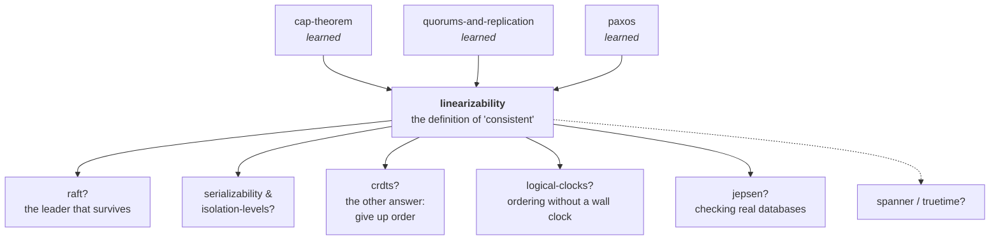

# Linearizability

> **What this lab is.** Every distributed store advertises that it is
> "consistent". This lab is about the one precise thing that word can mean, why
> it is the version worth wanting, and — the part almost nobody does — how to
> *check* whether a system actually delivered it. You will build a real
> linearizability checker, point it at six replication designs, and watch it
> convict four of them.
>
> **Run it:**
> ```bash
> java src/Tests.java                    # 41 scenario checks
> java src/Experiments.java              # list the ten measured experiments
> java src/Experiments.java stores       # the headline: seven designs, judged
> java src/Experiments.java writeback    # the one-line fix, isolated
> open visualization.html                # or the published link below
> ```
>
> **Interactive checker:** <https://claude.ai/code/artifact/01a5e2be-a55e-470a-b3a9-ce07e3d479b1>

> **⚠️ This lab exists because of a sentence in your last one.**
> The [quorums-and-replication](../quorums-and-replication/) lab ended with:
> *"R + W > N is **not** linearizability: no global order, concurrent writes
> unordered, two concurrent readers can disagree."* You measured that R=W=2 on
> N=3 gave **0** stale reads over 4,000 rounds — and that number was honest.
> This lab shows you the thing those 4,000 rounds could not see, why R+W>N does
> not catch it, and the extra half-round-trip that fixes it. If quorums were
> about *not missing a write*, this is about *time not running backwards*.

---

## How deep this goes

| Layer | Stages | You will be able to… |
|---|---|---|
| **Beginner model** | 1–9 | say what "the system behaves like one copy" means, and spot a violation on a timeline |
| **Intermediate model** | 10 | run the checking algorithm by hand, and explain the one rule that makes it strict |
| **Engineering model** | 11–14 | say which designs provide it, which fail and how often, and prove it with code |
| **Production model** | 15 | read etcd, ZooKeeper, Spanner and DynamoDB consistency docs and know exactly what each is promising |

---

# 1 · WHY — the problem this exists to solve

You already know that copies of data can disagree, and you know the counting
trick that stops a reader from missing a write. So here is a different
question, and it is the one that actually bites in production:

**When is a storage system allowed to be called correct?**

That sounds like philosophy until you have to answer it for real. Someone
reports a bug: "I updated the setting, my colleague refreshed, and she saw the
old one." Is that a bug in your service, a bug in the database, or the
documented behaviour of the database you chose? You cannot answer without a
precise definition of what the database promised. And "eventually consistent"
does not help — *eventually* has no deadline, and *consistent* is doing no work
in that sentence at all.

Without a precise definition, three things happen. You cannot write a test that
would fail. You cannot compare two databases. And you cannot tell a real
incident from someone misremembering.

---

# 2 · PROBLEM — Meera and her father

Meera is waiting for her exam results. The university publishes them on a
website, which is served from three machines so it does not fall over on
results day.

At 10:00 the results are published. Meera refreshes, sees **PASS**, and
immediately phones her father.

> "It's up. Go and look."

Her father — call him Raghu — puts down the phone, opens the same page, and
sees **not yet published**.

Nothing has broken. No machine has crashed, no error was logged, nobody was
lied to on purpose. Meera hit machine A, which had the new page. Raghu hit
machine C, which had not received it yet. Both machines answered honestly.

Here is what makes this the interesting case rather than an ordinary staleness
complaint: **Raghu looked strictly after Meera was already told the answer.**
There is no way to arrange these two events on a single timeline such that a
single noticeboard could have produced both. Meera's phone call is the proof.
Something that had already happened, un-happened.

> **🔮 Predict:** Ignore the machines for a moment. What is the smallest number
> of facts you need to know about these two page loads to be sure something is
> wrong — without knowing anything about how the website is built?
>
> <details><summary>Reveal</summary>
>
> Four: when each page load **started**, when each one **finished**, and what
> each one **returned**. Nothing else. You never need to know how many machines
> there are, how they replicate, or what happened inside.
>
> That is the whole idea this lab is built on. Correctness here is a property of
> what an outside observer can see — the requests and their answers, laid on a
> clock. Not a property of the implementation.
> </details>

---

# 3 · NAIVE SOLUTION — "make sure the copies catch up"

The obvious reading of this bug is "machine C was behind". So the obvious fix
is to make it not be behind: replicate faster, replicate synchronously, add
health checks that pull a lagging machine out of rotation.

This is what most teams try first, and it is not stupid. It genuinely reduces
how often the problem appears.

---

# 4 · FAILURE — faster does not mean never, and "never" is the whole point

Three things go wrong with "just replicate faster".

**It has no stopping condition.** How fast is fast enough? There is no number
you can put in a ticket. "Usually within 50ms" is not a guarantee; it is a
description of a good day. Meera's phone call takes two seconds.

**The second fix is worse.** The next idea is usually "make every user always
read from the same machine" — sticky routing. That does fix Meera reading her
*own* writes. It does nothing for Raghu, because Raghu is a different person on
a different machine. And the moment that machine restarts, the guarantee
silently disappears with it.

**And the failure is invisible.** No error is raised. Your dashboards are
green. This is the killer: you cannot alert on a condition you have not
defined.

> **🔮 Predict:** Suppose you make replication perfectly synchronous — a write
> is not acknowledged until all three machines have it. Is Meera's bug gone for
> good?
>
> <details><summary>Reveal</summary>
>
> That specific bug, yes. But now try this: the write is **still in flight**. It
> has reached machine A and not yet B or C. Meera reads, hits A, sees PASS.
> Raghu reads a second later, hits C, sees nothing. The write has still not
> finished, so nobody has broken the "wait for all three" rule.
>
> The problem was never lag. The problem is that **while an operation is in
> progress, different observers can be shown different pasts, and the system
> never reconciles them.** Making the window smaller does not make it a
> different kind of thing.
>
> This is exactly the case the last lab's counting rule cannot see, and you will
> measure it in stage 14.
> </details>

---

# 5 · THE REAL REQUIREMENT — one copy, or a convincing impersonation of one

Step back from mechanisms and say what we actually want. Not "copies agree
quickly". This:

> **The system must be indistinguishable, from outside, from a system that has
> exactly one copy of the data and handles one request at a time.**

Read that again, because two words are carrying everything.

**Indistinguishable** — we are not asking for one copy. We are asking that no
sequence of requests and answers could ever prove there is more than one. The
implementation may have five hundred machines.

**From outside** — the only evidence admissible is what clients asked, when
they asked, when they were answered, and what they were told. If the internals
are a mess but no client can catch it, the requirement is met.

Everything else in this lab is either a way to check this, or a way to build it.

---

# 6 · KEY IDEA — give every operation one instant

Here is the invention, and it fits in two sentences.

A request is not an instant — it is a *stretch* of time, from when the client
sent it to when the client was answered. But if the system really were one
copy handling one request at a time, then somewhere inside that stretch there
would be a single moment when the operation actually took effect.

> **Pick one instant inside each request's stretch. If you can pick them such
> that reading the requests in instant-order tells a sensible one-copy story,
> the system's impersonation held. If no such choice exists, it did not.**

That is the entire concept. Everything after this is vocabulary, algorithms,
and consequences.

Notice what makes it powerful: **overlapping requests are free**. If Meera's
read and the publish overlap in time, both answers are defensible — the instant
could have fallen on either side. It is only when a request *finishes* before
another one *starts* that the order is nailed down and cannot be argued with.

---

# 7 · TERMINOLOGY — now the words

Every term below is earned by something you have just seen.

### history

- **Plain meaning:** the recording of what happened, as seen from outside.
- **Technical meaning:** the list of operations, each with the time its client
  sent it, the time its client was answered, and the answer it got.
- **Why the term exists:** to name the *only* evidence that is admissible.
  Everything about internals is deliberately excluded, which is what makes the
  property checkable against any system, including one you did not write.
- **Example:** `C1 put(1) [0,4]` and `C2 get()→0 [6,10]` is a two-operation
  history. Meera and Raghu's page loads are a two-operation history.
- **Connects to:** this is the input to everything in this lab. The Java class
  is literally called [`History`](src/History.java).

### invocation and response · concurrent · sequential

- **Plain meaning:** the two ends of a request's bar — "asked" and "was told".
- **Technical meaning:** the invocation is the moment the request left the
  client; the response is the moment the answer arrived back. Two operations
  are **concurrent** if their stretches overlap. A history is **sequential** if
  no two operations overlap at all — everything happened one at a time.
- **Why these terms exist:** because the gap between them is where all the
  interesting behaviour hides. A system is only ever caught out by what it does
  *during* an operation.
- **Example:** `put [0,24]` and `get [2,8]` are concurrent. `put [0,4]` and
  `get [6,10]` are not — the put finished before the get began.
- **Connects to:** concurrency is *permission*. The more operations overlap, the
  more orders are defensible, and the harder the system is to catch.

### linearization point

- **Plain meaning:** the single instant an operation took effect.
- **Technical meaning:** a chosen point inside `[invocation, response]` for each
  operation, such that ordering operations by their points produces a legal
  one-copy execution.
- **Why the term exists:** to separate *when an operation took effect* from
  *how long the request took*. The point is a claim about the outcome, not
  about anything the code does. It is often nowhere near the middle.
- **Example:** in `put(1) [0,24]`, `get()→0 [2,8]`, `get()→1 [12,18]`, the
  put's point must sit somewhere between 8 and 12 — after the read that missed
  it, before the read that saw it. The put took 24 units of wall clock; its
  point is a four-unit window inside that.
- **Connects to:** in the visualization, this is the black dot you can drag.

### sequential specification (the "one-copy story")

- **Plain meaning:** the rules the thing would obey if there were only one of
  it, used by one person at a time.
- **Technical meaning:** for a register: `put(v)` sets the value to `v`;
  `get()` returns the current value; `cas(a,b)` sets the value to `b` and
  returns success only if the value was `a`. A sequential history is **legal**
  if it obeys these.
- **Why the term exists:** because "correct" is meaningless without saying
  correct *at what*. The specification is the single-copy behaviour you are
  claiming to imitate; it is chosen, not discovered.
- **Example:** `put(1), get()→1` is legal. `put(1), get()→0` is not.
- **Connects to:** in the code it is twelve lines —
  [`Checker.apply`](src/Checker.java), the method named `apply`.

### real-time order

- **Plain meaning:** if one request was already answered before another was
  sent, the first one really did come first, and no story may claim otherwise.
- **Technical meaning:** if `response(a) ≤ invocation(b)` then `a` must precede
  `b` in the chosen order. Operations that overlap have no such constraint.
- **Why the term exists:** this is the *only* thing separating the guarantee we
  want from the weaker one below it, and it is the thing that makes Meera's
  phone call count as evidence. Without it, "Raghu saw the old page" is
  perfectly acceptable behaviour.
- **Example:** Meera's read was answered at 10:00:02; Raghu's began at
  10:00:05. Any explanation must put Meera's read first. Since it returned
  PASS, Raghu's must too.
- **Connects to:** it is one `if` in the checker — the method
  [`Checker.candidates`](src/Checker.java) — and you can switch it off and
  watch the verdicts change.

### linearizable · linearizability

- **Plain meaning:** the single-copy impersonation held.
- **Technical meaning:** a history is **linearizable** if there exists a choice
  of linearization points — one inside each operation — such that the resulting
  sequential history is legal and respects real-time order. A *system* is
  linearizable if every history it can produce is. (For operations that never
  got an answer, see below.)
- **Why the term exists:** Herlihy and Wing coined it in 1990 to give
  concurrent objects the same kind of specification single-threaded ones have.
  The name means: the concurrent execution can be *linearized* — flattened onto
  a line — without anyone noticing.
- **Example:** `put(1)[0,4]`, `get()→0[6,10]` is not linearizable. Widen the put
  to `[0,24]` and it becomes linearizable, with no change to a single answer.
  Time is data.
- **Connects to:** this is the `C` in the CAP theorem you learned in
  [cap-theorem](../cap-theorem/). CAP's consistency is precisely this, and
  nothing weaker.

### pending (indeterminate) operation

- **Plain meaning:** the client timed out and never learned what happened.
- **Technical meaning:** an operation with an invocation and no response. The
  definition allows it to be either linearized at any point (with any result)
  or discarded entirely.
- **Why the term exists:** because it is the honest model of a timeout. A
  timed-out write is not "failed" — it is *unknown*, and it may become visible
  later. Any definition that could not express this would be useless in
  practice.
- **Example:** stage 11's scenario F. A write times out; two later reads see
  its value. Perfectly linearizable — it simply happened.
- **Connects to:** the quorums lab measured 500/500 "failed" writes that were
  readable afterwards. This is the formal name for that situation, and the
  reason **writes must be idempotent** is that a retry of a pending operation
  might be its second execution.

### sequential consistency

- **Plain meaning:** the same idea with the clock thrown away.
- **Technical meaning:** there must exist *some* total order producing the
  observed answers, respecting each client's own order of requests — but not
  real time. Every linearizable history is sequentially consistent; the reverse
  is not true.
- **Why the term exists:** Lamport defined it in 1979 for shared-memory
  multiprocessors, where "real time" between two CPUs is not observable. It is
  the natural weakening, and it is the exact thing most "eventually consistent
  but ordered" systems actually give you.
- **Example:** Meera and Raghu's history is sequentially consistent — order it
  as *Raghu's read, then the publish, then Meera's read* and every answer is
  correct. It is only the phone call — real time — that convicts it. Measured
  in [experiment 4](#14--experiments): **52 of 600** histories from an
  asynchronous-replica design were sequentially consistent and still not
  linearizable, and for a design with a client cache in front, **560 of 600**
  were.
- **Connects to:** you already know its consequences under other names.
  *Monotonic reads* and *read-your-own-writes* are what you ask for when you
  cannot afford linearizability but need some order to survive.

### serializability · strict serializability

- **Plain meaning:** the transaction version of the same question.
- **Technical meaning:** **serializability** says a set of multi-operation
  transactions produces the same result as *some* serial order of them. It has
  no real-time requirement. **Strict serializability** adds it back.
- **Why these terms exist:** they come from databases, where the unit is a
  transaction over many keys; linearizability comes from concurrent
  programming, where the unit is one operation on one object. Keeping them
  apart matters: linearizability says nothing about grouping operations, and
  serializability says nothing about time.
- **Example:** a serializable database may commit your transaction and then
  serve a later transaction an order in which yours had not happened yet — that
  is legal serializability and would be an obvious bug to a user. Spanner's
  "external consistency" is strict serializability.
- **Connects to:** **linearizability is strict serializability where every
  transaction is a single operation on a single object.** That one sentence
  places all four terms on one map.

### locality (composability)

- **Plain meaning:** if every key behaves, the whole store behaves.
- **Technical meaning:** a history over many objects is linearizable **if and
  only if** its restriction to each object is linearizable.
- **Why the term exists:** because it is not obvious and it is not true of the
  alternatives. It means you can make each shard, each key, each object
  linearizable independently, with no coordination between them, and get a
  linearizable system for free.
- **Example:** measured in [experiment 10](#14--experiments) — 300 of 300
  merged pairs of independently-linearizable histories were linearizable
  together. The same experiment shows two *sequentially consistent* objects
  combining into a history that is not sequentially consistent.
- **Connects to:** this is the reason linearizability, and not sequential
  consistency, is the property real systems chase. It is the only one that
  scales with sharding.

---

# 8 · MENTAL MODELS — carry two, and know where each stops

### The simple model: the notebook

There is one notebook. Requests queue up. Each one, when its turn comes,
reads or writes the notebook and steps away. That's all.

Your job as a judge is: given the bars on a timeline, **can I place a dot
inside every bar such that reading them left-to-right against one notebook
produces exactly the answers the clients were given?**

### The engineering model

A history `H` is a set of operations, each with `(client, op, args, result,
invocation, response)`. Define a partial order on `H`: `a <ᴴ b` iff
`response(a) ≤ invocation(b)`.

`H` is linearizable iff it can be extended (by giving responses to some pending
operations, discarding the rest) to a history `H'` such that:

- **L1** — `H'` is equivalent to some sequential history `S` that is legal
  under the object's sequential specification, and
- **L2** — `<ᴴ ⊆ <ˢ`; every real-time precedence in `H` survives in `S`.

`S` is the *linearization*. The point inside each operation is where it sits
in `S`.

### Mapping between the two

| Notebook picture | Engineering model | On the screen |
|---|---|---|
| the notebook | the object's sequential specification | the "single notebook" replay strip |
| a request | an operation with invocation and response | a bar |
| "the moment it took effect" | its position in `S` | the black dot |
| requests that overlap | operations unordered by `<ᴴ` | overlapping bars |
| "this one had definitely finished" | `a <ᴴ b` | a gap between two bars |
| "one order that explains everything" | the linearization `S` | the numbered dots, left to right |
| "no order explains it" | no legal `S` with `<ᴴ ⊆ <ˢ` | red bars, no replay |

### Where the analogy breaks

Three places. Each one is a mistake that is easy to make and expensive to hold.

**1 · The dot is not a real event.** Nothing in the system happens at the
linearization point. There is no line of code, no log entry, no lock
acquisition there. The dot is an *existence claim* made by an outside judge
after the fact: "you behaved as if there were a moment here." Two different
valid linearizations of the same history can put the dots in different places,
and both are correct answers. Chasing "where is the linearization point in my
code?" is often a real and useful design question — but the property does not
require you to be able to answer it.

**2 · There is no notebook, so a request may have no place at all.** If a
client times out, its operation is *pending*: it might have taken effect, it
might not, and the judge is allowed to choose whichever explanation makes the
history work. The notebook picture makes it feel as though every request must
land somewhere. It does not.

**3 · One notebook per key, not one notebook.** Linearizability is defined per
object. Two separate keys are two separate notebooks, and the guarantee says
nothing whatsoever about them being read together — no snapshot, no atomic
multi-key update. The single-notebook image over-promises here, and locality is
what makes the under-promise safe: per-key correctness composes into whole-store
correctness *for the per-key guarantee*, not into transactions.

---

# 9 · VISUALIZATION — the checker you can drag

Open **<https://claude.ai/code/artifact/01a5e2be-a55e-470a-b3a9-ce07e3d479b1>**
(or `open visualization.html`). Before the mechanism, spend five minutes here —
everything after this stage will be easier.

**What to look at first.** Each bar is one request, drawn from "asked" to "was
told". Situation **A** is loaded: one write, then one read. Answer the
prediction question at the top, then read the verdict.

**Then do these four things, in order.**

1. **Load situation B.** This is Meera and Raghu. Note the verdict, then
   **drag the read's left edge leftwards** until the bars overlap. The verdict
   flips to acceptable — with *no answer changed*. That is the single most
   important thing on the page: the same answers are a bug or not a bug
   depending only on the clock.
2. **Load situation D** — the one you will meet again in stage 10 as a real
   quorum bug — and turn **off** the real-time rule in the controls. The
   verdict flips. You have just switched from linearizability to sequential
   consistency and seen exactly what the difference buys.
3. **Drag the dots.** In any acceptable situation, grab a black dot and slide
   it. The notebook replay below re-runs live; push a dot past the point where
   the story still works and the offending step turns red and tells you what
   the notebook said versus what the client was told.
4. **Generate a real run.** In "Generate from a real design", pick *"Quorum:
   write 2 of 3, read 2 of 3"*, set hiccups to *occasional*, and press **Run
   120 & count**, then **Find a broken run**. The number of runs it had to
   search is the lesson: a design with no guarantee at all behaves perfectly
   for dozens of runs in a row.

---

## ✅ Checkpoint — end of the beginner model

You can now say what it means for a system to behave like a single copy, read a
history off a timeline, and tell a genuine violation from a stale-looking but
defensible one. That is enough to argue correctly in a design review.

**Next:** how a machine decides this, mechanically, on a history it has never
seen — and the one rule inside that algorithm that everything depends on.

---

# 10 · ACTUAL MECHANISM — how to decide it

## 10.1 · The checker, version 1 — and why it fails

The obvious algorithm: walk the history in time order and check that every read
returns the most recent write.

Try it on this history and watch it fall apart:

```
  C1  [------------------ put(1) ------------------]
  C2       [-- get()→0 --]
  C3                          [-- get()→1 --]
```

What is "the most recent write" at the moment of C2's read? The write has
started and not finished. Version 1 has no answer. If it says "the write
counts", C2's `get()→0` is a violation — but it obviously is not, the write
was still in flight. If it says "the write does not count yet", then C3's
`get()→1` is a violation — but it obviously is not either.

The bug in version 1 is that it assumed **the order is given**. It is not. The
order is the thing we are looking for.

## 10.2 · The checker, version 2 — search for the order

So: search. Try to build the order one operation at a time.

```
place(remaining operations, notebook value):
    if nothing remains:                       we found an order — accept
    for each operation that is ALLOWED to go next:
        run it against the notebook
        if the notebook's answer ≠ the answer the client actually got:
            skip it — this branch is impossible
        otherwise: place it, and recurse
    if every candidate failed:                back up and try something else
```

The entire content of the algorithm is the phrase **"allowed to go next"**, and
that is where the real-time rule lives:

> An operation may go next if and only if **no still-unplaced operation had
> already been answered before this one was sent.**

Or in code — this is [`Checker.candidates`](src/Checker.java):

```java
long minResp = Long.MAX_VALUE;
for (int i = 0; i < ops.size(); i++)
    if (remaining(i)) minResp = Math.min(minResp, ops.get(i).resp());
for (int i = 0; i < ops.size(); i++)
    if (remaining(i) && ops.get(i).invoke < minResp) out.add(i);
    //                 ^^^^^^^^^^^^^^^^^^^^^^^^^^^^ the whole guarantee, one comparison
```

Delete that comparison — let every unplaced operation be a candidate — and you
have a **sequential consistency** checker. That is not an analogy; it is the
same file with one option flipped, and both checkers are in
[`Checker.java`](src/Checker.java) as `Opts.linearizable()` and
`Opts.sequential()`.

## 10.3 · Worked example, with real values

History (times are ticks on one clock):

```
  C1  [----------------- put(1) ---------------------]     [0, 24]
  C2      [--- get()→1 ---]                                [2, 8]
  C3                            [--- get()→0 ---]          [12, 18]
```

Run the search:

- **Step 1.** Remaining = {put, get→1, get→0}. The earliest response among them
  is C2's, at 8. Which operations started before 8? `put` (started 0) and
  `get()→1` (started 2). C3's read started at 12, after C2 was already
  answered — so it is **not** allowed to go next.
- Try `get()→1` first. Notebook is 0, so a `get` returns 0. The client was told
  1. **Contradiction — skip.**
- Try `put(1)`. Notebook becomes 1. Recurse.
- **Step 2.** Remaining = {get→1, get→0}. Earliest response is 8, so only
  `get()→1` may go next. Notebook is 1, the client was told 1. **Fits.**
- **Step 3.** Remaining = {get→0}. Notebook is 1, the client was told 0.
  **Contradiction.** No candidates left.
- Back up to step 1. The only other branch was `get()→1` first, already dead.
- **No order exists. Not linearizable.**

Now change one number: make C3's read `[6, 18]` instead of `[12, 18]`, so it
overlaps C2's read. Re-run: at step 1, C3's read is now allowed to go first,
the notebook is still 0, it returns 0, and the rest follows. **Linearizable.**
Nothing about the answers changed. The clock did.

> **🔮 Predict:** the search above tried at most a handful of branches. How does
> its cost grow as the history gets longer?
>
> <details><summary>Reveal</summary>
>
> Badly, and it depends entirely on how much things overlap. If operations are
> nicely separated, only one is ever "allowed to go next" and the search is a
> straight line. If everything overlaps everything, every remaining operation is
> a candidate at every step, and you are enumerating permutations.
>
> Deciding linearizability of a history is **NP-hard in general** (Gibbons and
> Korach, 1997). Measured in [experiment 9](#14--experiments) on histories where
> every operation overlaps every other: at 18 operations the plain search
> explores **79,457,057** states. Adding a memo table — "I have already failed
> from exactly this position with exactly this notebook value" — takes the same
> history to **239,506**, a 330× cut, and the verdict is identical.
>
> Keep the two apart: **being** linearizable is cheap; **proving** a history was
> is expensive. That asymmetry is why Jepsen chops a run into one small history
> per key before checking, and why nobody checks linearizability in production.
> </details>

## 10.4 · The other half: how do you *provide* it?

Checking is one half. Building is the other, and it is a short story with one
twist.

**Attempt 1 — one machine.** One copy, one request at a time, is linearizable
by construction: the moment the machine executes a request *is* the
linearization point. Measured: **0 violations in 600 histories**. It is also
useless, because the machine dies and takes your data with it.

**Attempt 2 — one leader, several copies.** Keep three copies for durability,
but send *every* request — reads included — to one designated machine, which
serializes them. Also linearizable, also **0 violations in 600**. And this is
genuinely how most linearizable systems work.

The cost is that the leader must be *the* leader. If two machines both believe
they lead, you have two notebooks. Making sure exactly one leader exists, and
that its ordering survives its death, is the problem you already solved in the
[paxos](../paxos/) lab: **consensus is the machinery that makes a single
ordering authority survive the loss of the authority.** That is the cleanest
one-line statement of why consensus exists at all.

**Attempt 3 — no leader at all.** Now the interesting one. Can you get the
single-copy illusion out of a plain quorum, with no machine in charge?

You already have R + W > N from the last lab. Write to 2 of 3, read from 2 of
3, take the highest timestamp. The read set and the write set must intersect,
so a read cannot miss a completed write. Surely that is enough?

> **🔮 Predict:** R = W = 2, N = 3, timestamps handed out correctly. A write is
> **still in flight** — it has reached replica A but not B or C. Reader X reads
> {A, B} and is told the new value. Reader Y starts *after X was answered* and
> reads {B, C}. What is Y told?
>
> <details><summary>Reveal</summary>
>
> **The old value.** B and C have not seen the write. Y's read set is a perfectly
> legal quorum. R + W > N is satisfied at every step. Nobody did anything wrong.
>
> And it is a violation: X was already answered "new" before Y was even sent, so
> any explanation must put X first — and once it does, Y must also say "new".
>
> The counting rule guarantees you cannot miss a **completed** write. It says
> nothing about an **in-flight** one, and it says nothing about two readers
> agreeing with each other. That is precisely the gap the last lab's map entry
> named and this stage measures.
> </details>

Here is that violation, found by the checker in a real simulated run and then
shrunk to its smallest broken piece — this is verbatim output from
`java src/Experiments.java writeback`:

```
  seed 41 — shrunk from 20 operations to 3:
  QUORUM_NAIVE N=3 R=2 W=2 (minimised)   (time runs left to right)
  C0  [-----------------------------------------------------------]
                                 put(1)
  C1                            [-----------]
                                  get()->0
  C3                 [------]
                    get()->1
```

C3 was told **1** and finished. C1, starting later, was told **0**. The write
is still in flight across both.

**The fix, and it is one extra round trip.** Before a reader returns a value, it
**writes that value back** to a quorum. Then the value it just revealed is
durable on enough replicas that no later reader can fail to see it. A read
becomes: ask a quorum, then tell a quorum, then answer.

This is the ABD algorithm (Attiya, Bar-Noy and Dolev, 1995), and the write-back
is the entire difference. Measured, same seeds, only that phase added or
removed:

| message hiccup rate | quorum, no write-back | quorum with write-back |
|---|---|---|
| 0% | 0 (0.0%) | 0 (0.0%) |
| 5% | 3 (0.5%) | 0 (0.0%) |
| 15% | 36 (6.0%) | 0 (0.0%) |
| 25% | 72 (12.0%) | 0 (0.0%) |
| 40% | 109 (18.2%) | 0 (0.0%) |

Look at the top row before the rest. **On a calm network the broken design is
indistinguishable from the correct one.** Zero violations in 600 histories from
a design with no guarantee whatsoever. This is the shape of every consistency
bug that reaches production: it passes staging, and it fires during the
incident, when the pager is already going off for another reason.

**One more piece the writer needs.** With more than one writer, a writer cannot
invent its own timestamp either — it must ask a quorum for the highest one and
use *that* plus one, tagged with its own id. Two writers that ask at the same
moment get the same answer and pick the same number; the id is what breaks the
tie the same way on every replica. Drop the tie-break and different replicas
end up holding **different values under the same timestamp** — the register
quietly splits in two. That is a planted bug in this lab
(`Sim.noTiebreak`) and the test `dropping_the_writer_tiebreak_breaks_it`
catches it.

---

## ✅ Checkpoint — end of the intermediate model

You can now run the checking algorithm by hand, name the one comparison that
distinguishes linearizability from sequential consistency, and explain why a
quorum needs a second round trip on reads to provide the guarantee at all.

**Next:** the six ways this breaks in real systems, what each one costs, and
what linearizability still does not give you even when it holds.

---

# 11 · FAILURE SCENARIOS

Each of these is reproducible. `<lab>` commands are runnable; the visualization
situations are the letters in the "Show me" list.

### F1 · Reading from a replica that is behind

**Create it:** `java src/Experiments.java stores`, row `ASYNC`. Or in the
visualization: *Generate from a real design → "read any of them"*.
**Watch:** almost every history is convicted — **587 of 600 (97.8%)**.
**Why:** the leader acknowledges a write before the followers have it; a read
routed to a follower sees the past. **Response:** none — the system does not
know. **Intact:** durability, and the write is never lost. **Lost:** any
ordering guarantee at all; even *sequential consistency* fails in 535 of 600,
because a single client bouncing between replicas sees the value go backwards.
**In production:** this is `Postgres read replica`, `MySQL read replica`,
`Cassandra with CL=ONE`, and every "we added read replicas to reduce load"
project. It is not a bug in those systems; it is what you asked for.

### F2 · A quorum read with no write-back

**Create it:** `java src/Experiments.java writeback`.
**Watch:** **36 of 600 (6.0%)** at a 15% hiccup rate, **0 of 600 on a calm
network**. **Why:** an in-flight write sits on one replica; two reads with
different quorums disagree, and the later one goes backwards. **Response:**
none. **Intact:** you still never miss a *completed* write — R+W>N is doing its
job exactly as advertised. **Lost:** the real-time ordering between two reads.
**In production:** Cassandra `QUORUM` reads without `read_repair` in the read
path, and any hand-rolled "read from a majority and take the newest" cache
layer. Cassandra's answer when you actually need the guarantee is a *lightweight
transaction* — a Paxos round per operation, at roughly 4× the latency.

### F3 · A deposed leader that has not noticed

**Create it:** visualization → situation B, then read the story below.
**Watch:** identical shape to Meera and Raghu, which is the point.
**Why:** a partition makes the cluster elect a new leader. The old leader is
still up, still holding client connections, and still happily answering reads
from its own memory. It has no way to know it was replaced — nobody can tell
it, because it is on the wrong side of the partition. **Response:** it finds out
when the partition heals, and steps down. **Intact:** writes are safe; the old
leader cannot get a quorum, so it commits nothing. **Lost:** reads. This is why
**stale reads are the classic split-brain symptom and lost writes are not.**
**In production:** the fix is a **lease** — the leader holds a time-bounded
grant and must stop serving reads when it expires, before the new leader's term
can begin. etcd and TiKV do this; it is why a leader lease is tied to a clock
bound and why clock skew is a correctness input, not an ops detail.

### F4 · A cache in front of a correct store

**Create it:** `java src/Experiments.java cache`.
**Watch:** the store underneath is linearizable at **0 of 600** for every TTL.
Put a client cache in front and it is **560 of 600 (93.3%)** — at a TTL of
**10 ticks**, already 555. **Why:** the cache answers without asking, so the
client is shown a value from before someone else's write. **Response:** none.
**Intact:** every guarantee of the store itself. **Lost:** the guarantee the
client experiences. **The lesson is the important part:** linearizability is a
property of *what a client can observe*, not of a component. Your Redis-in-front
-of-Postgres architecture is exactly this experiment. And note the column in
experiment 4 — **560 of 560 of these violations are still sequentially
consistent**, which is why they feel harmless in testing.

### F5 · Ordering writes by a wall clock

**Create it:** `java src/Experiments.java clock`.
**Watch:** with the read protocol, the write-back and the quorum unchanged, and
the *only* difference being that writes take their position in the order from a
local clock: 0 violations at zero skew, **112 of 600 (18.7%) at 20 ticks of
skew**, **270 of 600 (45.0%) at 60**. **Why:** the order is now decided by a
number nobody agreed on. **Intact:** nothing meaningful. **Lost:** everything —
this is the last lab's *"your clock IS the conflict-resolution algorithm"*,
restated as an ordering failure rather than a lost-update one. **In
production:** last-write-wins by timestamp, everywhere it appears. Spanner's
answer is not "better clocks" but **explicitly bounded uncertainty**: TrueTime
returns an interval, and a transaction *waits out* the interval before
committing, buying the ordering with latency rather than hoping.

### F6 · A lock that expires while you are still using it

**Create it:** not simulated here — flagged as unverified in this lab.
**Why it belongs:** a distributed lock with a TTL is sold as mutual exclusion,
which is a linearizable guarantee. It is not one. Your process acquires the
lock, gets stopped by a GC pause or a scheduler hiccup for longer than the TTL,
the lock expires, someone else takes it, and then your process wakes up and
continues — believing it still holds a lock that is now held by someone else.
**Intact:** nothing. **Lost:** mutual exclusion, silently. **In production:**
this is the core of the Redlock critique. The standard mitigation is a **fencing
token** — a monotonically increasing number issued with the lock, which the
*storage* checks and rejects if it is stale. Note what that does: it moves the
guarantee from the lock service to the resource, where it can actually be
enforced.

---

# 12 · CORRECTNESS — what you get, what you don't, what it costs

## What is guaranteed

- **Every operation appears atomic** — it takes effect once, at one instant
  between its invocation and its response.
- **Real time is respected** — anything already answered before your request was
  sent is visible to you. This is what "no stale reads" actually means, and it
  is a stronger statement than it sounds: it holds across *different clients*,
  not just for one client's own writes.
- **It composes.** Per-object linearizability gives whole-system
  linearizability, with no coordination between objects. Measured: 300 of 300.
- **It is non-blocking.** A pending operation never *forces* another operation
  to wait for it in the definition. (An implementation may still block for other
  reasons — this is a property of the specification, not a promise about your
  p99.)

## What is explicitly not guaranteed

- **Not transactions.** Read-then-write is two operations, and anything can
  happen between them. `java src/Experiments.java lostupdate` makes this
  physical: `AtomicInteger` is a linearizable register shipped by the JDK, and
  two virtual threads doing 20,000 `get`-then-`set` increments each produce
  **20,112 of 40,000**. Eight threads produce **21,051 of 160,000** — 87% of the
  updates simply gone. The same loop with `compareAndSet` produces exactly
  40,000 and 160,000. Nothing was violated. The register was linearizable
  throughout.
- **Not a multi-key snapshot.** Two linearizable keys read one after the other
  can straddle someone else's update. That needs a transaction.
- **No say in who wins.** Two concurrent writes get *an* order, not the order
  you wanted. If the second overwrites the first, that is legal.
- **No liveness.** The definition constrains what may be answered, never that
  anything will be. A system that never responds is vacuously linearizable —
  which is the formal reason the CP corner of CAP is allowed to refuse service.

## What it costs

- **At least one round trip that cannot be skipped.** Measured mean read
  latency: leader read 14.8 ticks, one-round-trip quorum read 11.7, and
  write-back quorum read **24.4** — roughly double, because it is two round
  trips instead of one. This is why "strongly consistent read" is a per-request
  option in DynamoDB and a billing line rather than a default.
- **A theoretical floor, not just an implementation cost.** Attiya and Welch
  showed that in a network with message-delay uncertainty `u`, a linearizable
  read cannot beat a bound proportional to `u` — you cannot engineer this away
  with a faster protocol. *(Cited, not measured in this lab.)*
- **Availability under partition.** This is CAP, and CAP's `C` is exactly this
  property. On the minority side of a partition, a linearizable system must
  refuse to answer. That is not a bug and not a tuning failure — it is the
  theorem.

## The invariants a linearizable design must hold

1. Every operation has exactly one position in one global order per object.
2. That order extends real-time precedence.
3. A read returns the value of the most recent write *in that order*.
4. A completed write is never invisible to a later operation.
5. Once a value has been returned to any client, it can never be un-returned.
   *(This is the one the naive quorum breaks, and the one write-back restores.)*

---

# 13 · CODE — what is in `src/` and what to read

Seven files, no dependencies, no build tool. `java src/Tests.java` compiles and
runs the lot.

| File | What it is |
|---|---|
| [`Op.java`](src/Op.java) | one operation: client, what it did, what it was told, invocation and response |
| [`History.java`](src/History.java) | a list of operations, plus the ASCII timeline renderer used throughout |
| [`Checker.java`](src/Checker.java) | **the heart of the lab** — the search, the real-time rule, memoisation, and the violation minimiser |
| [`Sim.java`](src/Sim.java) | seven replication designs, simulated with virtual time, jittery messages and per-replica timestamps |
| [`Scenarios.java`](src/Scenarios.java) | the ten hand-built teaching histories, one point each |
| [`Tests.java`](src/Tests.java) | 41 scenario checks |
| [`Experiments.java`](src/Experiments.java) | the ten measured experiments |

**The lines that carry the guarantee.** Read these four and you have read the
lab:

1. `Checker.candidates` — `if (o.invoke < minResp)`. The real-time rule, one
   comparison. Remove it and you have a sequential-consistency checker.
2. `Checker.search` — `if (!op.pending && r[1] != op.ret) continue;`. The
   contradiction test: the notebook's answer against the client's answer.
3. `Sim.addQuorumPhases` — `if (secondPhase) task.phases.add(new Phase(true,
   p1.decideT, w, all));`. The read's write-back. One line, and the difference
   between 36 violations and 0.
4. `Sim` event loop — `p.wTs > ts[j] || (p.wTs == ts[j] && p.wWid > wid[j])`.
   The `(timestamp, writer)` tie-break that keeps two concurrent writers from
   splitting the register. Turn it off with `Sim.noTiebreak` and watch two
   replicas end up holding different values under the same timestamp.

**Two switches worth knowing about.** `Sim.noTiebreak` and
`Checker.Opts.dropPending` are planted bugs, each disabling exactly one
invariant, and each is caught by a named test. `Sim.lazyWriteBack` is not a
bug — it is a real optimisation (skip the reader's write-back when the whole
read quorum already agreed) that is correct under one condition and silently
incorrect otherwise. Finding that condition is exercise 7.2.

**One deliberate simplification, flagged.** The simulator's message delays are
random but never *infinite* — there are no permanent partitions and no crashed
replicas. That is on purpose: this lab is about ordering, and adding
partitions would mix in the availability half of CAP, which the
[cap-theorem](../cap-theorem/) lab already covers. What the simulator does model
honestly is the thing that actually causes these bugs in the field: **variable
latency**.

---

# 14 · EXPERIMENTS

`java src/Experiments.java` lists them; `java src/Experiments.java all` runs
everything. Each one is predict-first.

| # | Command | Question | What you should see |
|---|---|---|---|
| 1 | `stores` | which designs actually provide it? | SINGLE 0, LEADER 0, ABD 0 · ASYNC 587/600, CACHED 560/600, naive quorum 36/600 |
| 2 | `jitter` | does a calm network prove anything? | naive quorum: 0 violations at 0% hiccups, 109/600 at 40%. ABD: 0 at every level |
| 3 | `writeback` | what does the fix actually fix? | a real violation, shrunk from 20 operations to 3, printed as a timeline |
| 4 | `realtime` | what does the real-time rule catch? | 52 asynchronous-replica histories and **560** cached histories that are sequentially consistent and still not linearizable |
| 5 | `cost` | what does it cost? | read latency 11.7 → 24.4 ticks when you add the write-back |
| 6 | `cache` | is it a property of the store? | store 0/600 at every TTL; with a 10-tick client cache, 555/600 |
| 7 | `clock` | can a wall clock order writes? | 0 at zero skew, 112/600 at 20 ticks, 270/600 at 60 |
| 8 | `lostupdate` | is a linearizable register enough? | `AtomicInteger`: 21,051 of 160,000 increments survive with get-then-set; 160,000 with compare-and-set |
| 9 | `checkercost` | why is checking hard? | 18 fully-concurrent operations: 79,457,057 states without memoisation, 239,506 with |
| 10 | `locality` | does it compose? | 300/300 merged pairs stay linearizable; sequential consistency does not compose |

> **🔮 Predict, before running experiment 2:** you have a design with no
> ordering guarantee at all. You run it 600 times on a healthy network. How many
> violations do you expect the checker to find?
>
> <details><summary>Reveal</summary>
>
> **Zero.** Not "few" — zero, in 600 runs at 0% and at 2% hiccups.
>
> The violation needs a specific coincidence: a write in flight, two reads
> separated in real time, and the reads' quorums covering different replicas. On
> a network where every message arrives promptly, the window between the write
> reaching its first replica and its second is a couple of milliseconds, and no
> pair of reads fits inside it.
>
> Take the operational lesson seriously: **a green test run against a
> consistency guarantee is close to worthless unless you injected latency.** It
> is why Jepsen's entire method is "introduce partitions and pauses, *then*
> check", and why the visualization's *Find a broken run* button reports how many
> runs it had to search.
> </details>

---

## ✅ Checkpoint — end of the engineering model

You can now name which designs provide the guarantee and which do not, quantify
how often the broken ones actually misbehave, explain why that number is
terrifyingly low on a healthy network, and state precisely what linearizability
still does not give you.

**Next:** what the systems on your CV are actually promising, in their own
words.

---

# 15 · PRODUCTION — from this lab to the systems you use

## The chain

**Toy → real → architecture → operations.**

The `LEADER` mode in `Sim.java` is, structurally, how a real linearizable store
works: one machine decides the order. Everything a real system adds is there to
survive that machine dying.

- **This lab:** a leader chosen at startup, ordering requests by arrival.
- **Real:** the leader is elected by consensus, its ordering is a **replicated
  log**, and a new leader may only serve once it has caught up on that log.
  That is [paxos](../paxos/) and Raft.
- **Architecture:** clients discover the leader, a **lease** bounds how long a
  deposed leader may keep answering, and reads use a **read-index** — the leader
  confirms with a quorum that it is still leader, then answers from local state
  without writing anything to the log. That is one round trip for a read
  instead of a full log append, and it is what makes linearizable reads
  affordable.
- **Operations:** you watch leader-election rate, lease expiries, the read-index
  round-trip time, and clock skew across the cluster. **Clock skew is a
  correctness metric in a leased system, not a hygiene metric.**

## What the real systems promise, precisely

| System | What it actually says |
|---|---|
| **etcd** | Linearizable reads **by default** (via read-index). `--consistency=s` opts down to serializable reads served from the local member — faster, and stale. |
| **ZooKeeper** | Writes are linearizable; **reads are not**. Reads are served locally and may be arbitrarily stale; you get FIFO order per client. Calling `sync()` before a read is what makes that read linearizable. This surprises people constantly. |
| **Spanner** | **External consistency** = strict serializability, i.e. linearizability generalised to multi-key transactions. Bought with TrueTime: commits *wait out* the clock uncertainty interval, trading latency for ordering. |
| **DynamoDB** | Eventually consistent reads by default; `ConsistentRead=true` gives a linearizable read at double the read-capacity cost. Transactions are a separate API. |
| **Cassandra** | `QUORUM` gives you R+W>N, not linearizability — exactly the gap in stage 10.4. Lightweight transactions (`IF NOT EXISTS`, `IF <condition>`) run Paxos per operation and *are* linearizable, at roughly 4× the latency. |
| **Kafka** | A partition's log is a total order, which is the ordering half. `acks=all` with `min.insync.replicas=2` on RF 3 is the durability half. Consumers only see up to the high watermark, so they never see a record that could still be lost. |
| **Redis** | A single node executes commands one at a time, so a single node is linearizable for its commands. Replication is asynchronous, so a failover **can lose acknowledged writes**; `WAIT` bounds that but does not close it. Redlock is not a safe lock across pauses. |
| **PostgreSQL** | The primary is linearizable. A streaming replica is not. `synchronous_commit = remote_apply` makes the primary wait until a named standby has *applied* the commit — which is the write-back idea in a different costume, and it only helps reads routed to that standby. |

## What this educational version leaves out

| Omitted | What real systems do |
|---|---|
| **Persistence** | replicas here are in memory; real ones fsync before acknowledging, or the guarantee dies with the power |
| **Membership change** | adding or removing a replica changes what a quorum *is*; real systems use joint consensus or a two-phase reconfiguration so the old and new quorums always intersect |
| **Leases and clock bounds** | the `LEADER` mode assumes exactly one leader forever; real leaders hold time-bounded grants |
| **Read-index / lease reads** | this lab's leader reads are free; real ones need a quorum confirmation or a valid lease |
| **Partitions and crashes** | the simulator delays messages but never drops them permanently |
| **Batching and pipelining** | every operation here is one round trip; real systems amortise consensus across batches |
| **Multi-key transactions** | out of scope by definition — that is serializability, not linearizability |

## What an on-call engineer actually sees

Linearizability violations do not page you. They arrive as **user reports that
sound like user error**: "I saved it and it didn't save", "it showed the old
value and then the new one", "two people got the same seat". The tell is
*non-monotonic* observation — a value going backwards — because that is the
only symptom a stale cache and a stale replica cannot disguise.

The practical toolkit is:

1. **Know your reads.** For every read path, write down which node answered and
   what that node's guarantee is. Most violations are a routing decision nobody
   documented.
2. **Test with latency injected.** Experiment 2 is the argument: a clean run on
   a healthy network is not evidence.
3. **Use the real tool when you need proof.** Jepsen's checkers (Knossos,
   Porcupine, and Elle for transactional histories) are this lab's `Checker`
   grown up, and they are how the field discovered that many databases did not
   provide what they claimed.

---

## ✅ Checkpoint — end of the production model

You can now read a consistency section in a database's documentation and say
exactly what it promises, what it costs, and which of the six failure modes it
leaves open.

---

# 16 · EXERCISES

See [EXERCISES.md](EXERCISES.md) — eight rungs from "say it back in your own
words" to "design the ledger read path for a payments system across three
regions". Answers in [SOLUTIONS.md](SOLUTIONS.md); attempt first.

---

# 17 · KNOWLEDGE MAP & NEXT STEPS



**What this built on**

- **[cap-theorem](../cap-theorem/)** — you now know what CAP's `C` *is*. Gilbert
  and Lynch's formal statement of the theorem is about linearizability
  specifically, which is why "we're AP so we don't need CAP's C" is a coherent
  sentence and "we're eventually consistent, which is a kind of consistency" is
  not.
- **[quorums-and-replication](../quorums-and-replication/)** — R+W>N stops you
  missing a *completed* write. This lab found the in-flight write it cannot see,
  measured it at 6%, and added the write-back that closes it. Your version
  vectors, read repair and anti-entropy are all *convergence* mechanisms; none
  of them is an *ordering* mechanism.
- **[paxos](../paxos/)** — now has a purpose statement: consensus exists to make
  a single ordering authority survive the death of the authority.
- **[java-memory-model](../java-memory-model/)** — `AtomicInteger` and `volatile`
  are linearizable objects, and the JMM's `happens-before` is this same idea
  inside one machine. Experiment 8 is that connection made physical.
- **[caching](../caching/) and [redis](../redis/)** — experiment 6 is why a cache
  in front of a correct store gives you an incorrect system.
- **[event-sourcing](../event-sourcing/)** — `expected-version` is a
  compare-and-set, which is exactly the tool experiment 8 shows you need when a
  linearizable register is not enough.

**Where to go next**

```
/learn raft                    # the leader-based design this lab keeps pointing at
/learn logical-clocks          # ordering without trusting a wall clock (F5's real fix)
/learn isolation-levels        # the transaction axis: serializable, snapshot, read-committed
/learn crdts                   # the opposite bet: abandon global order, converge anyway
/learn jepsen                  # how this lab's checker is used on real databases
```

**Commonly confused with — the one sentence that separates each**

| Confused with | The distinction |
|---|---|
| **serializability** | serializability orders *transactions* and ignores real time; linearizability orders *single operations on one object* and enforces real time |
| **strict serializability** | that is linearizability generalised to multi-operation transactions — the same real-time rule, a bigger unit |
| **sequential consistency** | drop the real-time rule and you have it; it is also not composable, which is why nobody builds on it |
| **eventual consistency** | a promise about the *limit* with no promise at any moment; linearizability is a promise at every moment |
| **read-your-own-writes** | one client's own operations only; linearizability holds across *different* clients, which is the hard part |
| **atomicity (the A in ACID)** | all-or-nothing across failures; linearizability is about ordering and visibility. Confusingly, the literature also calls linearizable registers "atomic registers" |
| **consensus** | consensus is a *mechanism* (agree on one value); linearizability is a *property* (behave like one copy). Consensus is the usual way to get it, not the same thing |

---

# 18 · GLOSSARY

In order of appearance.

| Term | One line |
|---|---|
| **history** | the list of operations with their start times, end times and answers — the only admissible evidence |
| **invocation** | the moment a client sent a request |
| **response** | the moment the client was told the answer |
| **concurrent** | two operations whose stretches overlap; neither is ordered before the other |
| **sequential history** | a history where no two operations overlap |
| **linearization point** | the single instant, inside an operation's stretch, at which it took effect |
| **sequential specification** | the rules the object would follow if there were one of it, used one request at a time |
| **legal** | a sequential history that obeys the sequential specification |
| **real-time order** | if `a` was answered before `b` was sent, `a` must come first in any explanation |
| **linearizable** | a history that has a legal sequential explanation respecting real-time order |
| **linearization** | the specific order that explains a linearizable history |
| **pending / indeterminate operation** | a request with no response; may be treated as having happened, or not |
| **sequential consistency** | the same idea without the real-time rule; per-client order only |
| **serializability** | *some* serial order of multi-operation transactions produces the observed result; no real-time rule |
| **strict serializability** | serializability plus the real-time rule |
| **locality (composability)** | a multi-object history is linearizable exactly when each object's is |
| **non-blocking** | a pending operation never forces another to wait, by the definition |
| **write-back (ABD)** | a reader pushes what it read to a quorum before returning it, so no later reader can miss it |
| **ABD** | Attiya–Bar-Noy–Dolev: a linearizable register from message-passing quorums, with no leader |
| **(timestamp, writer) tie-break** | ordering equal timestamps by writer id so every replica breaks the tie identically |
| **lease** | a time-bounded grant of leadership; the deposed leader must stop answering when it expires |
| **read-index** | a leader confirming with a quorum that it is still leader, then answering a read locally |
| **fencing token** | a monotonically increasing number issued with a lock and checked by the resource |
| **external consistency** | Spanner's name for strict serializability |
| **memoisation (in the checker)** | remembering "this set of remaining operations with this value already failed" — the difference between 79M states and 240K |
| **violation minimiser** | shrinking a broken history to the smallest still-broken subset, so a human can read it |
