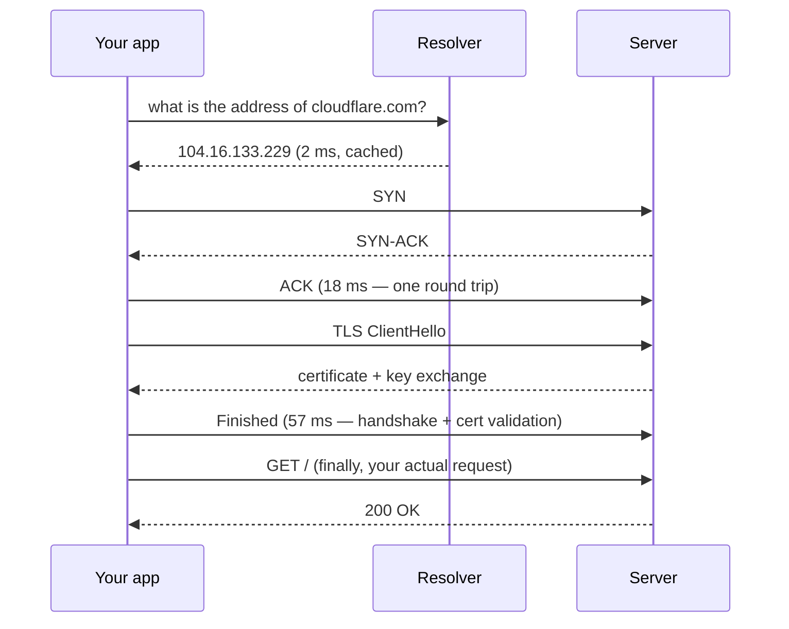
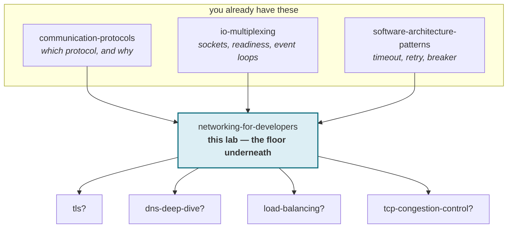

# Networking for developers

**What actually happens between `httpClient.send(request)` and a response — and
how to tell, from the symptom alone, which layer broke and whether retrying will
help.**

> Lab contents: this README, `visualization.html` (a diagnostic trainer, also at
> [claude.ai/code/artifact/cf035459](https://claude.ai/code/artifact/cf035459-a3d8-4a72-9111-1c6680ba8605)),
> `NetLab.java` + `Server.java` + `Probe.java` (six runnable experiments),
> `BrokenClient.java` (a planted bug), `EXERCISES.md`, `SOLUTIONS.md`.
>
> **Every number in this document was measured on this machine while writing
> it.** Timings vary a few percent between runs, so treat the quoted milliseconds
> as one representative run and the *ratios* as the durable finding. Where
> something is modelled rather than measured, it says so on the spot.

### Where this sits relative to what you already know

You already did [communication-protocols](../communication-protocols/README.md)
(HTTP, gRPC, WebSocket, framing, RTT, head-of-line blocking) and
[io-multiplexing](../io-multiplexing/README.md) (sockets, file descriptors,
readiness, event loops). Both of those are about **choosing and serving a
protocol**.

This lab is the floor underneath them. It answers a different question — not
*"which protocol should I use?"* but ***"it's broken, and where?"*** So there is
no reteaching of sockets, framing or RTT here; they are used as known vocabulary,
and stage 6's experiment on framing exists only to show the socket-level reason
behind something you already accepted as a rule.

---

## Depth map

| Layer | Stages | You will be able to |
|---|---|---|
| **BEGINNER** | 1–9 | Name the six systems in the path and say what each one can break |
| **INTERMEDIATE** | 10 | Walk one request phase by phase, with real timings |
| **ENGINEERING** | 11–14 | Diagnose nine failures from their symptoms, and measure them |
| **PRODUCTION** | 15 | Set timeouts and pools deliberately, and know what to watch |

---

# BEGINNER MODEL

## 1. WHY — the problem this solves

You write one line:

```java
HttpResponse<String> res = client.send(request, ofString());
```

Between that line and a response, at least six independent systems each take a
turn. Any one of them can fail. Almost all of them fail in a way that reaches
your code as either a generic exception or — worse — as nothing at all, just a
thread that never comes back.

The cost of not understanding this is a specific, recognisable kind of
stuckness: an incident where the app team says "the network is flaky", the
network team says "nothing is wrong", and both are correct, because neither can
see the layer that actually broke. Meanwhile the retry you added to be safe is
making it worse.

## 2. PROBLEM — Priya sends a parcel

Priya wants to send a parcel to Arjun, who lives in another city.

She knows his **name**. She does not know his address. So first she has to look
it up — and the directory she uses might be out of date, or slow, or might
simply not answer.

Once she has an address, the parcel goes through several pairs of hands: the
local post office, a sorting centre, a truck, a delivery office in Arjun's city,
finally a courier at his door. She sees none of this.

Now the important part. When things go wrong, she gets one of three
experiences:

- The parcel comes back stamped **"no such address"**. Annoying, but she
  *learned something* — the address is wrong.
- The courier reports **"nobody home"**. Also useful — the building exists, the
  person wasn't in.
- **Nothing happens at all.** No parcel, no return, no message. Weeks pass.

That third case is the one that ruins her week, and it is the one that maps most
directly onto network debugging. And here is the thing worth holding onto:
**those three outcomes have completely different causes and completely different
right responses** — but if Priya only checks "did Arjun reply?", all three look
identical.

## 3. NAIVE SOLUTION — "just send it, and retry if nothing comes back"

The obvious approach, and the one most code ships with:

```java
for (int attempt = 0; attempt < 3; attempt++) {
    try { return client.send(request, ofString()); }
    catch (Exception e) { /* try again */ }
}
```

Send it. If it fails, send it again. Networks are unreliable; retrying is what
you do about unreliable things. This is not stupid — it is genuinely correct for
one whole class of problem.

## 4. FAILURE — the retry that made it worse

Walk it through with real behaviour, measured in this lab.

**Case A — a machine that is up, with nothing listening on your port.** Measured
in experiment 2: the failure arrives in **under 5 ms**. Three retries cost you nothing
and all fail identically.

**Case B — a firewall dropping your packets.** Measured: the failure arrives in
**3,001 ms** with a 3-second timeout. Your three retries now take **9 seconds**,
and every one of them fails for exactly the same permanent reason.

Same code, same catch block, same log line. One retry loop is free; the other
holds a thread for nine seconds and achieves nothing.

**And case C is worse than both.** Measured in experiment 3: a server that
accepts your connection and then never answers. The retry loop never even runs,
because the first attempt *never throws*. There is no exception to catch. The
thread simply stops, on a connection that is genuinely healthy and open.

> **🔮 Predict:** In case C the code did set a timeout — 2 seconds, on opening
> the connection. The connection opened in about 1 ms. So why did the request
> still hang forever instead of giving up at 2 seconds?
>
> <details><summary>Reveal</summary>
>
> **Because that timeout had already succeeded.** The setting is called a
> **connect timeout**, and the name is exact: it bounds the *handshake* and
> nothing else. The moment the connection is established it has done its job and
> is spent. It never applies to anything that happens afterwards.
>
> Everything after the handshake — sending the request, waiting for the server to
> think, receiving the response — is unbounded unless you bound it separately.
> Most code does not, because "I set a timeout" feels like it covers the call.
>
> Measured in experiment 3: with only a connect timeout, the request was **still
> waiting when the lab's 4-second watchdog gave up**, and would have waited
> forever. With an 800 ms read timeout on the identical server, it failed in
> **801 ms**.
> </details>

So the naive fix fails in three distinct ways, and they point at one shared
cause: **the code cannot tell the difference between "refused", "ignored", and
"accepted then abandoned"** — so it applies one response to three different
problems.

## 5. THE REAL REQUIREMENT

What we actually need, for any failed or slow request:

1. **Which layer broke** — names, routing, the connection, trust, or the
   application at the far end.
2. **Whether retrying can possibly help** — because retrying a permanent failure
   is not neutral, it is expensive.
3. **A guaranteed upper bound on how long we wait**, even when nothing fails and
   nothing errors.

The rest of this lesson is those three.

## 6. KEY IDEA

> The path is **layered**: each layer provides one guarantee to the layer above
> and hides everything below it. That hiding is what makes one line of code
> possible — and it is exactly what makes failures hard to read.
>
> But the layers leak in a useful way. **How a request fails — how long it took,
> and which exception type came back — identifies the layer that broke**, because
> each layer fails with a different signature.

Read the signature, and you skip the guessing.

## 7. TERMINOLOGY

### Name resolution (DNS)

- **Plain meaning:** turning a name you can read into an address the network can
  route to.
- **Technical meaning:** your machine asks a configured resolver for records
  attached to a hostname — an `A` record for an IPv4 address, `AAAA` for IPv6 —
  and caches the answer for the time-to-live the answer carries.
- **Why the term exists:** to separate *identity* from *location*. Servers move
  and multiply; the name stays. Everything about deploys, failover and
  blue-green rests on that separation.
- **Concrete, measured here:** `api.github.com` resolves to `20.207.73.85`, with
  a TTL of 56 seconds, meaning your machine may reuse that answer for 56 seconds
  before asking again.
- **Connects to:** this happens entirely *before* any of the protocol knowledge
  from your communication-protocols lab applies. No socket exists yet.

### IP address and port

- **Plain meaning:** which machine, and which door on it.
- **Technical meaning:** the address routes a packet to a network interface; the
  port selects which listening process on that machine receives it.
- **Why both exist:** one machine runs many services. The address gets you to the
  building; the port gets you to the right room.
- **Concrete:** `20.207.73.85:443` — the machine, and the door where TLS-wrapped
  HTTP is expected.

### Round trip time (RTT)

You know this one — one message there and back. It is repeated here only because
this lab makes it the *unit of account*: every connection cost below is quoted in
RTTs, not milliseconds, because that is what stays true when you move regions.

**Measured on this machine:** loopback **0.117 ms**, a well-connected internet
host (`8.8.8.8`) **16.2 ms** across 8 hops. That is a **138× difference**, and it
is not a defect — it is distance.

### The three-way handshake

- **Plain meaning:** the short "are you there? / yes / good" exchange that opens a
  connection.
- **Technical meaning:** client sends `SYN`, server replies `SYN-ACK`, client
  sends `ACK`. Costs **one round trip** before any of your data can move.
- **Why the term exists:** because it is the moment where *reachability* is
  established and where its failure carries the most diagnostic information — see
  the next two terms.
- **Concrete:** at the 16 ms RTT measured here, the handshake alone costs ~16 ms
  before your request has begun.

### Refused (RST) versus dropped

**This is the single most useful distinction in this lab.** Two failures that
look the same in your logs:

- **Refused** — the machine received your handshake and actively answered with a
  reset packet: *"I'm here, nothing is listening on that port."* Your code sees a
  `ConnectException`, and it arrives **in about one round trip**.
- **Dropped** — a firewall or a wrong route discarded your packets. Nobody
  answered anything. Your code sees a `SocketTimeoutException`, and it arrives
  **exactly when your timeout expires**.

- **Why this distinction exists:** a refusal is a *reply*. It proves the network
  path works and the problem is the process or the port. Silence proves nothing
  reached anything, and points at routing or a firewall.
- **Concrete, measured in experiment 2:** refused in **0–4 ms**; dropped in
  **3,001 ms** against a 3,000 ms timeout.
- **The tell:** when elapsed time equals your configured timeout almost exactly,
  nobody answered you.

### The TLS handshake

- **Plain meaning:** agreeing on encryption and checking the server is who it
  claims.
- **Technical meaning:** on top of the established TCP connection, the two sides
  negotiate a cipher and the client validates the server's certificate chain
  against its trust store. Roughly one further round trip with TLS 1.3.
- **Why it matters here:** it happens *after* a successful connection, so its
  failures are never connectivity problems — however much `SSLHandshakeException`
  looks like one.
- **Concrete, measured:** `cloudflare.com` **46 ms**, `www.google.com` **456 ms**
  in one run. Both connected in under 31 ms — the difference is handshake and
  certificate work, not distance.

### Connect timeout, read timeout, and why one is not enough

- **Plain meaning:** two separate stopwatches for two separate waits.
- **Technical meaning:** the connect timeout bounds the handshake only. A read
  timeout (`SO_TIMEOUT`) bounds *each individual read* — not the whole request.
- **Why both terms exist:** because they fail independently, and because the gap
  between them is where services hang. Note the sharp edge in the second one:
  a 30-second read timeout does **not** mean the request takes at most 30
  seconds. A server sending one byte every 29 seconds keeps it alive forever.
- **Concrete, measured in experiment 3:** connect timeout only → still blocked
  when the 4-second watchdog fired, and would wait forever. With an 800 ms read timeout → failed in
  801 ms.

### Connection reuse (keep-alive) and the connection pool

- **Plain meaning:** keeping the connection open so the next request skips the
  setup.
- **Technical meaning:** the client holds established connections in a pool
  between requests; a request that finds an idle one skips name resolution and
  both handshakes.
- **Why it matters:** setup is a per-*connection* cost, not a per-*request* one,
  so reuse converts a fixed cost into an amortised one.
- **Concrete, measured in experiment 4:** 20 requests took **682 ms over 20 new
  connections** versus **38 ms over 1 reused connection** — **17.9× faster** for
  identical work.

### Middlebox

- **Plain meaning:** something in the path that is neither you nor the server but
  holds state about your connection anyway.
- **Technical meaning:** NAT gateways, load balancers, firewalls. They track
  active connections in a table, and **evict entries that have been idle too
  long, silently.**
- **Why the term exists:** to name the thing that breaks the mental model where a
  connection involves only two parties. There is a third party, it has an
  opinion, and it will not tell you.
- **Concrete:** typical idle timeouts are 350 seconds on AWS NLB, 60 seconds on
  many ALB configs, 5 minutes on lots of NAT hardware.

## 8. TWO MENTAL MODELS

### The simple model — the postal service

Priya's parcel. A directory lookup, then a chain of handlers, each of which
knows only the next hop, and three distinguishable outcomes: returned to sender,
delivered, or vanished.

### The engineering model — six systems, each with one job

| # | System | Its one job | How it fails |
|---|---|---|---|
| 1 | Your process | Make the call, bound the wait | Blocks forever with no timeout |
| 2 | Resolver | Name → address | Wrong answer, no answer, or a slow one |
| 3 | Router / NAT | Private address → public, and back | Forgets idle connections |
| 4 | Firewall | Allow, reject, or drop | Drops (silence) instead of rejecting |
| 5 | Load balancer | Pick a healthy server | Own idle timeouts, own health view |
| 6 | The server | Do the work | Accepts and then never answers |

### Mapping

| Postal | Network | Fails as |
|---|---|---|
| Looking up Arjun's address | Name resolution | `UnknownHostException`, or a slow lookup |
| The address itself | IP address | Routes nowhere → silence |
| The flat number | Port | Wrong one → refused |
| "No such address", returned | TCP reset | `ConnectException`, ~1 RTT |
| Parcel vanishes, no word | Dropped packets | `SocketTimeoutException` at your timeout |
| Checking Arjun's ID at the door | TLS handshake | `SSLHandshakeException` |
| Arjun takes the parcel, never opens it | Server accepts, never replies | **no exception at all** |

### Where the analogy breaks

**Three places, and each one matters.**

**The post always eventually tells you something; the network often does not.**
A postal service has no equivalent of a DROP rule. This is the single biggest
gap, and it is why "no news" is the hardest network failure to reason about
rather than the mildest.

**A parcel is one object; TCP is a stream with no parcels in it.** You already
know framing from io-multiplexing — this is why. There is no envelope. Measured
in experiment 6: three separate writes of `ALPHA`, `BETA`, `GAMMA` arrive
regrouped — one run gave two reads (`ALPHABETA`, then `GAMMA`), another gave a
single read of `ALPHABETAGAMMA`. **Run it several times: the grouping changes.**
Your write boundaries are not preserved, and they are not even deterministic.

**Delivery is not the same as being acted upon, and TCP only promises delivery.**
When TCP acknowledges your bytes, it means the *operating system* at the far end
received them. It does not mean the application read them, or processed them, or
survived doing so. This is precisely the gap the idempotency key from your
communication-protocols lab exists to cover — and stage 12 returns to it.

## 9. VISUALIZATION — break each layer and read the symptom

Open **[Why The Request Hung](https://claude.ai/code/artifact/cf035459-a3d8-4a72-9111-1c6680ba8605)**
(or `visualization.html`, which works offline).

What to do, in this order:

1. **Press "Send request" once with nothing broken.** Look at the waterfall:
   notice how much of the total elapsed before "Send request" — that is setup
   cost, and you paid it before your data moved at all.
2. **Press it again.** The first three phases go grey and the total collapses.
   That is connection reuse, and it is experiment 4 in one picture.
3. **Now break things**, one at a time, from the "What is wrong today?" menu.
   For each, read three panels together: *the path* (where it broke), *the
   waterfall* (how long it took to break), and *what your code sees* (the actual
   exception, or its absence).
4. **The one to spend time on** is "the server accepts, then never answers" with
   the default read timeout of *none*. Then set a read timeout and send again.
   One dropdown converts a hang into an error.

Three faults pause and ask you to predict first. Take the guess.

The RTT slider is worth dragging: at 1 ms nothing matters, at 250 ms the two
handshakes dominate everything and connection reuse stops being an optimisation
and becomes the whole design.

---

> ### ✅ Checkpoint — end of the beginner model
>
> You can now name the six systems in the path, and you know the most valuable
> distinction in the lab: a fast failure means something answered you; a slow one
> means nothing did.
>
> Next: one request, phase by phase, with the real numbers — and why the naive
> version of "just make the call" is slower than it needs to be.

---

# INTERMEDIATE MODEL

## 10. THE ACTUAL MECHANISM

### Mechanism v1 — the honest version of one HTTPS request

Here is what `client.send(request)` performs, in order. Measured on this machine
against `cloudflare.com`:



Read that as three separate systems, not one call. And note the ordering
consequence: **your request bytes are the fourth thing to move, not the first.**

| Phase | cloudflare.com | www.google.com | What it is |
|---|---:|---:|---|
| Name lookup | 2 ms | 18 ms | configuration, not distance |
| TCP handshake | 18 ms | 31 ms | ~1 round trip — distance |
| TLS handshake | 57 ms | 456 ms | ~1 round trip + certificate work |

> **🔮 Predict:** Same table, same machine, same run — but `api.github.com` and
> `github.com` both showed a name lookup of just over **5,000 ms**, while their
> TCP and TLS phases were normal. Distance can't explain it. What can?
>
> <details><summary>Reveal</summary>
>
> **A timeout.** 5,000 ms is not a duration anything *takes* — it is a duration
> something *waits* before giving up. A suspiciously round number is nearly always
> a configured limit rather than a measurement.
>
> This turned out to be a real fault on this machine, and stage 11 walks the whole
> diagnosis. The short version: the router at `192.168.1.1` answers IPv6 address
> questions only when the answer is *yes*. When a hostname has no IPv6 address, it
> stays completely silent instead of replying "none" — and the resolver waits a
> full 5 seconds before falling back to the IPv4 answer it already had.
>
> The application is blameless, the server is blameless, and nothing in the code
> can see it. Every IPv4-only host costs 5 extra seconds on every cold lookup.
> </details>

### Mechanism v2 — reuse the connection

v1 pays name lookup, TCP handshake and TLS handshake **for every request**. At
16 ms RTT that is roughly 2 round trips of pure setup before any useful byte
moves.

The fix is to stop closing the connection. Measured in experiment 4, 20 identical
requests:

| | Time | Connections opened | Per request |
|---|---:|---:|---:|
| New connection each time | 682 ms | 20 | 34 ms |
| One connection reused | 38 ms | 1 | 1 ms |

**17.9× faster for identical work.** This is why every HTTP client you have used
keeps a pool, and why constructing a client inside a request handler is a
performance bug rather than a style question — it discards the pool and pays the
handshakes again every time.

> **🔮 Predict:** You now hold connections open in a pool. What new failure have
> you just created that did not exist in v1?
>
> <details><summary>Reveal</summary>
>
> **Connections can die while you are not using them, and you will not be told.**
>
> A NAT gateway or load balancer between you and the server keeps a table of
> active connections and evicts entries that have been idle too long. It sends
> nothing to either end. Your socket still reports `isConnected() == true`,
> because that method reports whether this socket was *ever* connected, not
> whether the peer is still there. TCP has no dial tone.
>
> Measured in experiment 5: request 1 succeeded, the connection sat idle for
> 900 ms past a 600 ms idle timeout, the socket still reported
> `isConnected=true isClosed=false`, and request 2 failed with **Connection
> reset**.
>
> The cruel part is *when* you find out: on the next request, which means the
> failure lands on a random unlucky user rather than during the idle period that
> caused it. That is why these errors correlate with traffic *gaps* rather than
> with load, and look maddeningly random.
> </details>

### Mechanism v3 — bound every wait, not just the first

v2 is fast and reuses connections. It still hangs forever against a server that
accepts and goes quiet, because the connect timeout was spent at the handshake.

The fix is a **hierarchy** of bounds, outermost first:

| Bound | What it covers | If you omit it |
|---|---|---|
| Connect timeout | The handshake only | You inherit the OS default — minutes |
| Read timeout | Each individual read | The call can block forever |
| **Request timeout** | The whole call, end to end | Slow-drip responses evade the read timeout |
| Pool idle-eviction | How long a connection may sit unused | Middleboxes kill it first, and you find out on a user's request |

The third row is the subtle one and the reason v3 exists rather than stopping at
v2. A read timeout of 30 seconds resets on *every* read. A server that sends one
byte every 29 seconds keeps the connection alive indefinitely while never
completing the response. Only a bound on the whole operation catches that — in
Java, `HttpClient.Builder.connectTimeout()` plus `HttpRequest.Builder.timeout()`,
which are two different settings for exactly this reason.

**The rule that ties it together:** every timeout must be shorter than the
timeout of whatever is calling you. If your caller gives up at 5 seconds and you
wait 30, you are holding a thread doing work nobody will ever read.

---

> ### ✅ Checkpoint — end of the intermediate model
>
> You can walk one request phase by phase, explain why connection reuse exists,
> and name the four separate bounds a call needs.
>
> Next: the nine failures, each with the symptom that identifies it — and the
> guarantees TCP does and does not give you.

---

# ENGINEERING MODEL

## 11. FAILURE SCENARIOS

Nine failures. For each: how to reproduce it, what your code sees, why, and the
**tell** — the observable that identifies it without guessing.

### 1 — A resolver that answers only half the question *(a real fault, diagnosed here)*

This one is worth the space because it is real, it was found while writing this
lab, and it demonstrates the whole method.

**The symptom.** `curl` to `api.github.com` took 5.39 s total, of which
`time_namelookup` was **5.03 s**. Three warm runs in a row: 5.004, 5.005, 5.011.
Java agreed — `InetAddress.getAllByName("api.github.com")` took **5,027 ms**,
while `www.google.com` took **12 ms** on the same machine, same second.

**The diagnosis, in four steps:**

1. *A round number is a timeout, not a measurement.* 5.00 s is the classic
   resolver timeout.
2. *Is it the name, or the resolver?* Querying `8.8.8.8` directly returned the
   answer in 0.24 s. So the name is fine — the configured resolver
   (`192.168.1.1`, the home router) is the problem.
3. *Which query is hanging?* macOS asks for IPv4 (`A`) and IPv6 (`AAAA`) records
   together. Against the router: `A` returned in **0.24 s**; `AAAA` **timed out
   entirely** — no response at all.
4. *Falsify it.* If the theory were "this router hates github", it should hold
   only for github. The actual theory was "this router stays silent when a
   hostname has **no** IPv6 address instead of replying 'none'." So: test six
   hostnames, three with IPv6 records and three without.

| Hostname | Has IPv6? | Router's answer |
|---|---|---|
| `api.github.com` | no | **timeout (7.02 s)** |
| `github.com` | no | **timeout (7.02 s)** |
| `api.stripe.com` | no | **timeout (7.02 s)** |
| `registry.npmjs.org` | yes | answered, 0.03 s |
| `www.google.com` | yes | answered, 0.02 s |
| `cloudflare.com` | yes | answered, 0.02 s |

**Six for six.** The split is perfectly along "does this name have an IPv6
record", not along which company owns it.

**What it means in practice:** on this network, *every IPv4-only host costs a flat
5 seconds on every cold lookup*. That is `git push`, `npm install`, a Stripe API
call, and any service of yours that happens to be IPv4-only. Nothing in the
application is wrong and no amount of profiling application code would ever find
it.

*Guarantee kept:* correctness — you eventually get the right address.
*Lost:* latency, invisibly, and only on cold lookups, which makes it look
intermittent.
*In production:* the same shape appears as a misconfigured search domain turning
one lookup into five, or a resolver whose secondary is dead. **The tell:** a
suspiciously round number in the DNS phase.

### 2 — Refused

*Reproduce:* `java NetLab.java 2`, case A.
*Your code sees:* `ConnectException: Connection refused`, in **under 5 ms** (0–4 ms across runs).
*Why:* the machine is reachable and answered with a reset. Nothing is listening
on that port — wrong port, or the process is down.
*Retry?* Only helps if the process is restarting; it fails fast and cheaply.
*The tell:* **fast**, and an exception that names refusal. Something answered you,
so the network path is fine. This is an application problem wearing a network
costume.

### 3 — Dropped

*Reproduce:* `java NetLab.java 2`, case B (connects to `10.255.255.1`, which
routes nowhere).
*Your code sees:* `SocketTimeoutException`, in **3,001 ms** against a 3,000 ms
timeout.
*Why:* a firewall or security group set to DROP, or an address that routes
nowhere. Nobody answered anything.
*Retry?* Pointless while the rule stands, and each attempt costs a full timeout.
*The tell:* **elapsed ≈ your configured timeout**. That is the fingerprint of
silence.

### 4 — Accepted, then silence

*Reproduce:* `java NetLab.java 3`.
*Your code sees:* with connect timeout only — **nothing**. Still blocked when the
lab's 4-second watchdog gives up, and it would block forever. With an 800 ms read
timeout — `SocketTimeoutException` in 801 ms.
*Why:* the connection is genuinely healthy. The application at the far end is
wedged.
*Response:* a read timeout, and above it a whole-request timeout.
*Guarantee kept:* everything below the application worked perfectly.
*Lost:* your thread, permanently.
*In production:* **this is how a service dies without a single error in its
logs.** Threads accumulate on healthy sockets, the pool drains, and your error
dashboard stays green throughout. *The tell:* no exception, rising thread count,
flat error rate.

### 5 — Trust failure

*Reproduce:* visualization → "the certificate does not match the name".
*Your code sees:* `SSLHandshakeException`, shortly *after* a successful connect.
*Why:* expired certificate, wrong hostname, or a private CA the JVM does not
trust.
*Retry?* **Never.** Perfectly deterministic until a certificate or trust store
changes.
*The tell:* the TCP connection succeeded first. Any failure after a successful
connect is not a connectivity problem, whatever it looks like.

### 6 — The idle connection that died

*Reproduce:* `java NetLab.java 5`.
*Your code sees:* `SocketException: Connection reset` on the *next* request —
while `isConnected()` returned `true` moments earlier.
*Why:* a middlebox evicted its connection-table entry and told nobody.
*Response:* pool idle-eviction set **below** the shortest idle timeout in the
path; retry-on-fresh-connection for idempotent requests.
*Retry?* Yes, on a new connection, and only if idempotent — you cannot know
whether the server processed it.
*The tell:* errors correlate with quiet periods rather than with load.

### 7 — The MTU black hole

*Reproduce:* visualization → "big requests vanish, small ones work", with a large
body.
*Your code sees:* a hang, or a read timeout — but only for large payloads.
*Why:* something in the path cannot carry full-size packets and should reply
"too big, split it" — but that reply is itself blocked, so your machine never
learns and retransmits forever.
*The tell:* **small requests work, large ones hang, on the same connection.**
That pattern has essentially one cause. Classic on VPNs and tunnels.

### 8 — The retry storm

*Reproduce:* combine failure 3 with the naive retry loop from stage 3.
*What happens:* every attempt costs a full timeout; three retries turn a 3-second
failure into 9 seconds of held thread. Under load, retries multiply the offered
load against a service that is already struggling.
*Response:* retry budgets, exponential backoff **with jitter**, and circuit
breakers — all of which you met in your
[software-architecture-patterns](../software-architecture-patterns/README.md) lab
under resilience patterns. This is the concrete network-level reason they exist.
*The tell:* load *increases* after a dependency degrades.

### 9 — Not enough ports

*Reproduce:* not reproduced here — flagged as unmeasured.
*What happens:* a client opening many short-lived connections exhausts ephemeral
ports, since each closed connection sits in `TIME_WAIT` for around 60 seconds
before its port can be reused. New connections then fail on a machine with no
other problem.
*Response:* connection reuse, which is failure 6's cause and this one's cure — the
same mechanism, two opposite risks.
*The tell:* failures scale with connection *rate*, not with concurrency or
payload size.

## 12. CORRECTNESS — what TCP actually promises

Worth being precise, because the gap between what people assume and what is
guaranteed is where distributed-systems bugs live.

**TCP guarantees, between the two operating systems:**

- Bytes arrive **in the order sent**.
- Bytes arrive **without corruption** (checksummed) and **without duplication**.
- Lost segments are **retransmitted** until acknowledged or the connection fails.
- Flow control stops a fast sender overwhelming a slow receiver.

**TCP does not guarantee:**

- **Message boundaries.** Measured in experiment 6: three writes arrive as one
  or two reads, and the split differs between runs of identical code. Framing is
  your job, always.
- **That the application read your bytes.** An acknowledgement comes from the
  *kernel*. The process may never have called `read()`, and may have crashed
  immediately after the ACK.
- **That the application acted on them.** Delivered ≠ processed.
- **Timeliness.** Nothing bounds how long delivery takes. That is entirely on you
  — hence stage 10's timeout hierarchy.
- **That an idle connection is alive.** Failure 6.
- **Privacy or identity.** That is TLS, a separate layer with separate failures.

**The consequence that matters most.** When a request fails after the connection
was established, you are in a genuine state of ignorance: the server may have
processed it completely, partially, or not at all. There is no protocol-level way
to find out.

This is exactly the gap the **idempotency key** from your communication-protocols
lab fills, and this lab is *why* it is not optional: a retried non-idempotent
request over TCP is a coin flip on double execution. It is also why the
[transactional-outbox](../transactional-outbox/README.md) lab's at-least-once
delivery is the honest default — exactly-once is not something a network can
offer you.

**What was traded away.** Reliability and ordering cost you latency (a handshake
before any data), head-of-line blocking (one lost segment stalls everything
behind it — the reason QUIC exists, from your communication-protocols lab), and
per-connection state on every box in the path (the reason middleboxes forget you).

## 13. CODE

```bash
cd ~/Documents/Learning/networking-for-developers
java NetLab.java          # all six experiments
java NetLab.java 2 5      # just experiments 2 and 5
java BrokenClient.java    # the planted bug
```

JDK 25, no build tool, no dependencies. Experiment 1 uses the internet; the rest
run against a deliberately broken server inside the same JVM.

| File | What it is |
|---|---|
| `Server.java` | A server that misbehaves on purpose: `ECHO`, `SILENT`, `SLOW`, `CLOSE_IDLE` |
| `Probe.java` | Times each phase separately, and maps every exception to a layer and a retry verdict |
| `NetLab.java` | The six experiments |
| `BrokenClient.java` | One bug — exercise 6 |

**The load-bearing code is the diagnosis table in `Probe.java`.** Everything else
is scaffolding to produce inputs for it:

```java
if (e instanceof ConnectException) {
    // Fast + ConnectException = the host actively said "no".
    return new Diagnosis("Connection (TCP) — REFUSED",
        "The host was reached and it answered immediately with a refusal (a TCP RST)...",
        "Retrying helps only if the process is restarting...");
}
if (e instanceof SocketTimeoutException) {
    boolean atLimit = elapsedMs >= timeoutMs * 0.9;
    // The elapsed time is the evidence. At the limit means nobody answered.
    ...
}
```

Note the second branch: it uses **elapsed time as evidence**, not just the
exception type. That is the whole method of this lab expressed in three lines.

And in `Server.java`, the one line that produces the nastiest failure:

```java
if (mode == Mode.SILENT) {
    in.readLine();
    Thread.sleep(Long.MAX_VALUE);   // connection stays OPEN — that's the point
    return;
}
```

The connection is never closed. A closed connection would give the client an
`EOFException` — an *error*, something to act on. Staying open gives it nothing.

## 14. EXPERIMENTS

Predict first, then run.

**1 · Where did the time go?** — `java NetLab.java 1`
*Expect:* TCP and TLS track distance; DNS is small.
*Observed:* cloudflare 2/18/57 ms. `api.github.com` **5,027 ms** in DNS alone.
*Proves:* phases fail and slow down independently, and the DNS column is
configuration rather than physics.

**2 · Refused or ignored?** — `java NetLab.java 2`
*Expect:* both fail.
*Observed:* **0–4 ms** vs **3,001 ms**, stable across repeated runs.
*Proves:* elapsed time alone separates "something answered" from "nothing did" —
the highest-value diagnostic in the lab.

**3 · The connection succeeded and the request still hung** — `java NetLab.java 3`
*Expect:* the connect timeout protects you.
*Observed:* still blocked when the 4-second watchdog fired; with an 800 ms read
timeout, failed at 801 ms.
*Proves:* a connect timeout bounds the handshake and nothing else.

**4 · The price of a new connection** — `java NetLab.java 4`
*Observed:* 682 ms / 20 connections vs 38 ms / 1 connection — **17.9×**.
*Proves:* setup is a per-connection cost. (Uses the measured 16 ms RTT to make
loopback honest — flagged as modelled, not captured.)

**5 · The idle connection that died** — `java NetLab.java 5`
*Expect:* the socket reports the problem.
*Observed:* `isConnected=true isClosed=false`, then **Connection reset** on the
next request.
*Proves:* `isConnected()` answers a question you did not ask.

**6 · Three writes, how many reads?** — `java NetLab.java 6`
*Observed:* varies. `ALPHABETA` + `GAMMA` on one run, a single
`ALPHABETAGAMMA` on the next. Exercise 4.4 runs it five times and gets three
different groupings.
*Proves:* write boundaries are not preserved **and not deterministic** — so a
parser that works because messages happened to arrive whole is a latent bug.

---

> ### ✅ Checkpoint — end of the engineering model
>
> You can diagnose nine failures from their symptoms and state what TCP does and
> does not promise.
>
> Next: what changes in a real production path, what to configure deliberately,
> and what to watch.

---

# PRODUCTION MODEL

## 15. FROM THIS LAB TO A REAL SYSTEM

### The chain

**This lab** runs a client and a deliberately broken server in one JVM on
loopback, plus a handful of real internet measurements.

**A real path** adds a service mesh sidecar, a cloud load balancer, security
groups, a NAT gateway, and often a VPN — each a middlebox with **its own idle
timeout, its own health checks, and its own failure modes**, and each capable of
turning a REJECT into a DROP.

**Production** is mostly about the numbers you chose in advance: timeouts, pool
sizes, retry budgets. Every one of them is a bet about the failure modes above.

### What this lab leaves out

| Omitted | What real systems do |
|---|---|
| TLS session resumption | Cuts a repeat handshake to ~0 RTT; makes reconnects far cheaper than measured here |
| HTTP/2 multiplexing | Many concurrent requests over one connection, which changes what "pool size" even means |
| TCP slow start | A new connection does not get full bandwidth immediately — another hidden cost of not reusing |
| IPv6 dual-stack (Happy Eyeballs) | Racing A and AAAA to avoid exactly failure 1 |
| DNS TTL vs failover | A cached record survives a failover; TTL is your outage floor |
| Service mesh | mTLS and retries move into a sidecar — with its own timeouts to align |
| Bandwidth and congestion | This lab treats latency only |

### What to configure deliberately

1. **Four bounds, always:** connect, read, whole-request, pool idle-eviction.
2. **Pool idle-eviction below the shortest idle timeout in the path.** Find the
   real number — the ALB's, the NAT gateway's — do not guess.
3. **Timeout budgets that shrink inward.** If your caller waits 5 s, you cannot
   wait 30.
4. **Retry only what is idempotent, with a budget, backoff, and jitter.** Failure
   8 is what happens otherwise.
5. **Never construct an HTTP client per request.**

### What to watch

- **Latency percentiles per phase**, not just totals. A p99 that is exactly
  1,000 ms or 5,000 ms is a timeout, not a slow server.
- **Connection-establishment rate.** Rising while request rate is flat means the
  pool is being thrown away.
- **Errors bucketed by exception type**, never lumped as "network error".
  `ConnectException` and `SocketTimeoutException` are opposite problems, and
  merging them destroys the one signal that separates them.
- **Thread pool utilisation.** Failure 4 shows up here and *nowhere else*.
- **DNS lookup latency.** Almost nobody instruments it, and failure 1 is
  invisible without it.

### The on-call version

| Symptom | Most likely | First check |
|---|---|---|
| Fails instantly, `ConnectException` | Process down / wrong port | Is it listening? `nc -vz host port` |
| Fails at exactly your timeout | Firewall DROP, wrong route | Security groups; `traceroute` |
| Hangs, no exception, threads climbing | Server accepted and wedged | Set a read timeout, then look upstream |
| Fails after connecting, TLS error | Certificate or trust store | `openssl s_client -connect host:443` |
| Random resets, correlate with quiet | Middlebox idle timeout | Pool idle-eviction vs LB idle timeout |
| Small requests fine, large hang | MTU black hole | Test with increasing payload sizes |
| Slow, suspiciously round number | A timeout somewhere | `curl -w` phase timings |

### Honest limits of this lab

The failure modes, exception types and symptom-to-cause mappings are real and
tested. The **millisecond values in the visualization are modelled**, not
captured. Experiment 4's RTT is simulated with `Thread.sleep`, so it shows the
*shape* of the handshake cost rather than a packet capture. Failure 9 (port
exhaustion) is described but **not reproduced here**. And every internet
measurement is from one machine on one home connection in one city — the
*ratios* transfer, the absolute numbers do not.

---

## 16. EXERCISES

`EXERCISES.md`, eight rungs. Answers in `SOLUTIONS.md`.

---

## 17. KNOWLEDGE MAP & NEXT STEPS



**Builds on.**

- **communication-protocols** — that lab chose *between* protocols; this one is
  what every one of them sits on. Its idempotency-key rule gets its justification
  here in stage 12: TCP cannot tell you whether a request was processed.
- **io-multiplexing** — you knew sockets and framing; experiment 6 shows the
  socket-level reason framing is unavoidable.
- **software-architecture-patterns** — its resilience family (timeout, retry,
  backoff, circuit breaker) is abstract until you have watched failure 8. This is
  the concrete network behind those patterns.

**Commonly confused.**

- **Latency vs bandwidth.** Latency is delay, bandwidth is width. Handshakes cost
  latency, and no amount of bandwidth fixes them. Measured: 0.117 ms loopback vs
  16.2 ms internet, on the same machine and the same fibre link.
- **`ConnectException` vs `SocketTimeoutException`.** Opposite problems. Merging
  them in a log destroys the most useful signal you have.
- **Connection closed vs connection idle.** TCP cannot distinguish them without
  sending something. Failure 6.
- **Delivered vs processed.** TCP promises the first and says nothing about the
  second.

**Suggested next.**

```
/learn tls
/learn load-balancing
/learn tcp-congestion-control
```

`tls` was already flagged as a "next" in your communication-protocols lab and is
the natural follow-on — stage 7 here treats the handshake as one opaque round
trip, and that is exactly the box to open. `load-balancing` is the middlebox from
failure 6, taken seriously. `tcp-congestion-control` explains slow start, the
cost this lab acknowledges but does not measure.

---

## 18. GLOSSARY

| Term | In one line |
|---|---|
| **Name resolution (DNS)** | Turning a hostname into an address, with a cached time-to-live |
| **A / AAAA record** | The IPv4 and IPv6 address records for a name |
| **TTL** | How long an answer may be reused before asking again |
| **IP address** | Which machine a packet is routed to |
| **Port** | Which listening process on that machine receives it |
| **Round trip time (RTT)** | One message there and back — the unit all connection costs are quoted in |
| **Three-way handshake** | SYN / SYN-ACK / ACK — one round trip to open a connection |
| **RST (refused)** | An active "nothing is listening here" reply; fast, and proves the path works |
| **Dropped** | Packets silently discarded; no reply at all, so you learn only that time passed |
| **TLS handshake** | Agreeing encryption and validating the certificate, after TCP connects |
| **Connect timeout** | Bounds the handshake only, and is spent once it succeeds |
| **Read timeout** | Bounds each individual read — not the whole request |
| **Request timeout** | Bounds the entire call; the only one a slow drip cannot evade |
| **Keep-alive / connection reuse** | Holding a connection open so later requests skip setup |
| **Connection pool** | The client's set of reusable connections |
| **Middlebox** | NAT, firewall or load balancer that holds state about your connection |
| **Idle timeout** | How long a middlebox keeps that state before silently discarding it |
| **MTU** | The largest packet a link can carry without fragmenting |
| **MTU black hole** | A path that drops oversized packets *and* the message saying so |
| **Ephemeral port / TIME_WAIT** | The client-side port pool, and the ~60 s wait before reuse |
| **Head-of-line blocking** | One lost segment stalls everything behind it (from communication-protocols) |
