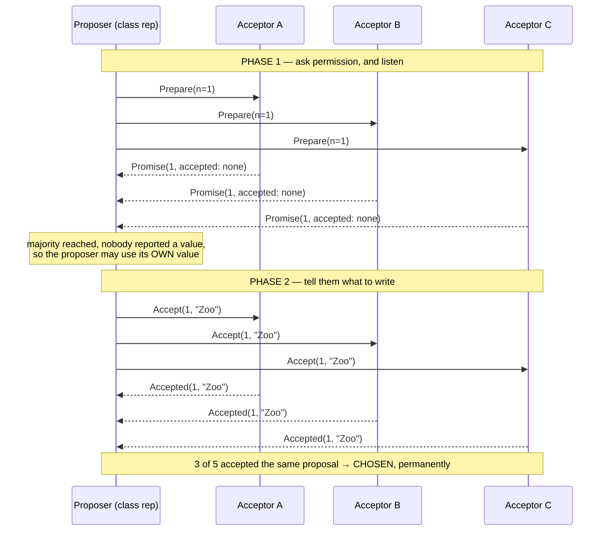
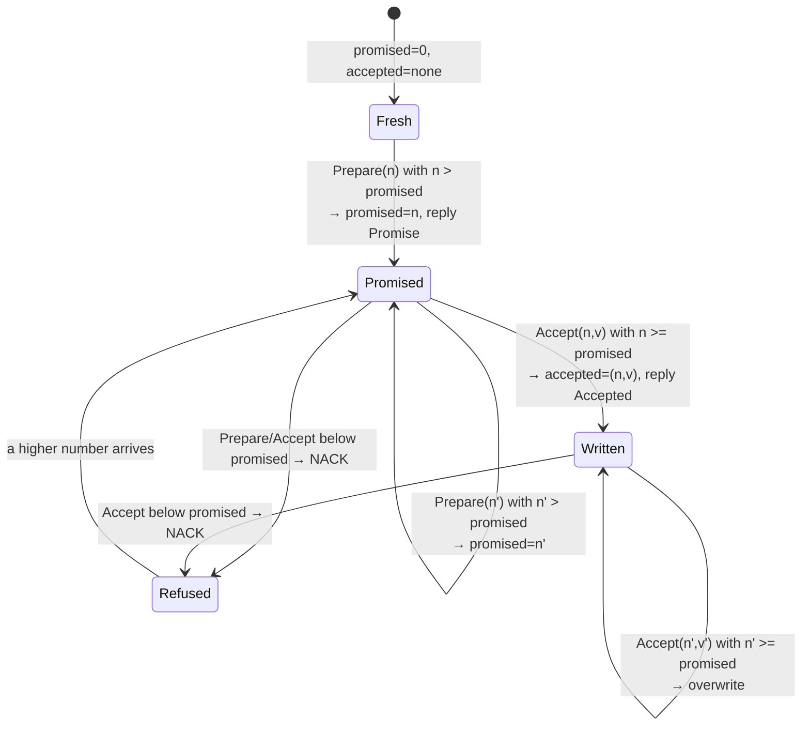
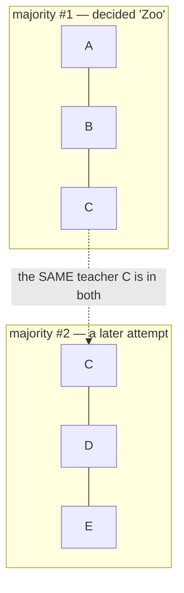
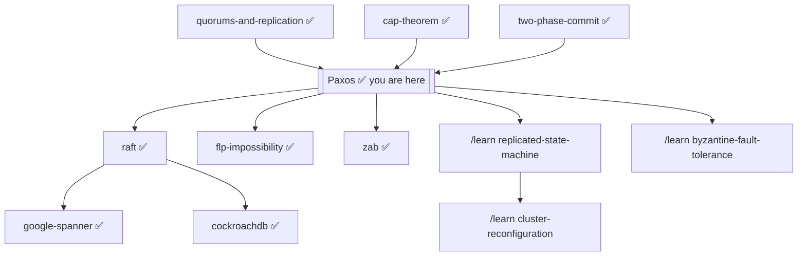

# Paxos — how a school that never holds a meeting picks one trip, forever

> **Tell a friend:** Five teachers must agree on one school trip, but they
> are never in the building together, so everything goes by mailbox notes
> that get lost or arrive late, while two class reps campaign for different
> places at once. Paxos is the set of rules that still gets the school to
> exactly one destination, never changed, however badly the mail behaves.
> The trick: before asking for anything, ask a majority of teachers what is
> already written down, and if they tell you something, campaign for *that*
> instead of your own idea. Paxos promises the school will never book two
> trips. It does *not* promise it will ever book one, and that missing half
> is why every real system puts a leader on top.

This lab covers **single-decree Paxos**, also called *basic Paxos* or *the
Synod algorithm*: agreeing on **one** value. Agreeing on a whole *sequence* of
values is Multi-Paxos, and section 15 gets there. What the lab is made of, and
where its numbers come from, is in section 21 at the end.

---

## 1. Why does this problem exist at all?

> **In one breath:** One computer can lose your data. Several computers can
> *disagree* about your data, which is worse. Paxos is the smallest set of
> rules that stops them disagreeing.

Put important data on one computer, and one power supply can lose it. So you
put it on several. Now you have a new problem, and it is far nastier than it
sounds: the machines must agree on what the data *is*.

Why can't they simply vote? Because some of them will be switched off at the
moment of the vote. Some messages will vanish. Some will arrive an hour late,
looking perfectly fresh.

Between 1978 and 1998, people kept writing "obviously correct" agreement
protocols. Each one turned out to decide two different things under some
unlucky ordering of messages. Losing a bank transfer, or booking a seat twice,
is the kind of bug you cannot patch after the fact.

Leslie Lamport's answer was to find the smallest set of rules that is
*provably* immune to every possible ordering. Paxos is that set.

## 2. The school trip: how do you decide when nobody can meet?

> **In one breath:** Five teachers, one trip, one coach company that needs a
> single answer. Nobody is ever in the same room. All you have is mailboxes.

Five teachers must agree on one destination for the school trip. It has to be
exactly one. The coach company needs a single answer, and once they have been
paid, the answer can never change.

The awkward part: **the teachers are never all in school at once**, and they
**never talk to each other**. You cannot get them in a room. All you can do is
leave a note in a teacher's mailbox and hope for a reply.

Notes sometimes get lost. Notes sometimes sit in a bag for two days and then
get read. Teachers sometimes go off sick for a week.

You are a class rep and you want the Zoo. Priya is another class rep, doing
exactly the same thing at exactly the same time, and she wants the Museum.
Neither of you knows the other is doing it.

Get the school to commit to one destination, forever.

**Where this lab takes you.** Stop at any checkpoint and you still have
something whole.

| Layer | Sections | After it you can… |
|---|---|---|
| Beginner | 1–8 | tell the school-trip story, and say why "just tell everyone" fails |
| Intermediate | 9 | run one round in your head, note by note, and tell "written down" from "decided" |
| Engineering | 10–13 | reason about every failure, prove nothing can be decided twice, apply both rules by hand |
| Production | 14–16 | say what a real system adds, how one decision becomes a log, and which wrong ideas to watch for |

## 3. Why not just tell everyone?

> **In one breath:** Five notes saying "Zoo", one in each mailbox. Done? Not
> even close.

Write "Zoo" on five notes, put one in each mailbox, done.

> **🔮 Predict:** *Your five "Zoo" notes and Priya's five "Museum" notes are
> all in the mail at the same time. What do the teachers end up believing?*
> <details><summary>Reveal</summary>
> There is no single answer, and that is the problem. Depending on delivery
> order, some teachers believe "Zoo", some "Museum", and some nothing at all.
> No rule exists to say which belief is *the* decision. No moment exists where
> anyone could safely tell the coach company an answer. If you said "whoever's
> notes land first wins", ask yourself: who is watching the mailboxes to
> declare it? Section 4 walks three concrete versions of this disaster.
> </details>

## 4. Three ways "tell everyone" falls apart. Which one is subtle?

> **In one breath:** First-note-wins has no finish line. All-five-must-agree
> stops the moment one teacher is off sick. Majority-wins is nearly right, and
> "nearly" is where the interesting bug lives.

**Attempt 1: tell everyone; first note wins.**
Your Zoo notes reach teachers A and B first. Priya's Museum notes reach D and
E first. C is off sick. Now A and B believe "Zoo", D and E believe "Museum",
and nobody believes anything in particular. Worse, *there is no moment where
anyone can say the decision is made*. You cannot tell "everyone agrees" from
"everyone I have heard from agrees."

**Attempt 2: require all five to agree.**
Now there is a clear rule. But C has been off sick for a week, so nothing can
ever be decided. One absent teacher out of five stops the school. That is not
fault tolerance. That is the opposite.

**Attempt 3: majority wins. Get 3 of 5 and call it decided.**
This is much better, and it is nearly right.

> **🔮 Predict:** *You get three teachers to write down "Zoo" and go home
> happy. Can Priya still get the school to book the Museum a week later,
> with every teacher following the majority rule exactly?*
> <details><summary>Reveal</summary>
> Yes. Watch it break below. The clue is that "3 of 5" and "3 of 5" can be
> two different threes, and the teacher they share has nothing stopping her
> from changing her mind.
> </details>

Watch it break:

1. You get A, B and E to write down "Zoo". That is 3 of 5. **Decided: Zoo.**
   You go home happy.
2. A week later Priya, who never heard about any of this, gets C, D and E to
   write down "Museum". E already had "Zoo" written down. Under these naive
   rules E just crosses it out and writes the new one. That is also 3 of 5.
   **Decided: Museum.**

Two different decisions, both by a legitimate majority. The coach company has
been told two different things. Notice that *nobody misbehaved*. Every teacher
followed the rule as written. The rule itself is broken.

What each attempt taught, in one line each:

| Attempt | What broke | What it teaches |
|---|---|---|
| First note wins | no finish line | a decision needs a *definition*, not just a winner |
| All five agree | one absentee blocks everyone | tolerance means surviving missing teachers |
| Majority wins, naively | E crossed out Zoo | majorities overlap, and the overlap must *remember* |

## 5. What two facts fix everything?

> **In one breath:** Any two groups of three teachers share at least one
> teacher. So ask three teachers what they already wrote *before* you propose
> anything, and if you hear an answer, campaign for that.

Two facts, and Paxos is just their consequence:

1. **Any two majorities of the same group always share at least one member.**
   With 5 teachers, any 3 and any other 3 must overlap. There is no way to
   pick two groups of 3 out of 5 that miss each other.
2. **So make every new attempt ask a majority what has already happened,
   before it proposes anything. If it learns of an existing entry, it must
   abandon its own idea and re-propose that one.**

Rule 1 guarantees the asker cannot miss an existing decision. Rule 2 turns
that knowledge into safety. Priya, in the story above, would have heard "Zoo"
from E. She would then have campaigned for the Zoo, not the Museum.

That is the whole algorithm. Everything below is detail.

## 6. What do engineers call all these things?

> **In one breath:** Three roles, five kinds of note, and a handful of words
> for "what state is the school in". Every one of them is something you have
> already watched happen.

Now the professional words. The whole set is small. Paxos has five message
types and three roles. Each table below points back at the moment in the
story where you met the thing.

**The people.**

| In the story | Engineers say | Where you met it |
|---|---|---|
| A class rep trying to get a trip agreed. Any number may run at once. | **Proposer** | you and Priya, section 2 |
| A teacher: a voter who remembers things. Teachers never talk to each other, only to class reps. | **Acceptor** | teachers A–E, section 2 |
| The coach company: anyone who just wants to find out the result. | **Learner** | "the coach company needs a single answer", section 2 |

**The notes.**

| In the story | Engineers say | Where you met it |
|---|---|---|
| "May I have ticket number *n*, and what have you already written down?" | **Prepare(n)** — phase 1 request | the "ask first" idea, section 5 |
| "Ticket *n* is yours. I will now ignore anything numbered below *n*. Here is the last thing I wrote, if any." | **Promise(n, …)** — phase 1 reply | E telling Priya "Zoo", section 5 |
| "Write down value *v* under ticket *n*." | **Accept(n, v)** — phase 2 request | your five "Zoo" notes, section 3 |
| "Written." | **Accepted(n, v)** — phase 2 reply | a teacher writing Zoo on her page, section 4 |
| "No. I already promised a higher ticket number." | **NACK** | not yet; it arrives in section 10 |

**The words for states.**

| In the story | Engineers say | Where you met it |
|---|---|---|
| More than half the teachers, 3 of 5. Any two such groups share a member. | **Quorum / majority** | fact 1, section 5 |
| The ticket number on one attempt. Unique per class rep and always increasing. In this lab it is `round × 10 + rank`, so proposer 1 uses 11, 21, 31… and proposer 2 uses 12, 22, 32… They can never collide. | **Proposal number** (a.k.a. *ballot number*, *round number*) | "a week later Priya…", section 4 |
| One teacher has written the value on her page. **This is not a decision.** | **Accepted** (by one acceptor) | A and B holding Zoo, attempt 1, section 4 |
| A *majority* of teachers have written down the *same* value under the *same* ticket number. Permanent. | **Chosen / decided** | 3 of 5 wrote Zoo, attempt 3, section 4 |
| "Nothing bad ever happens": at most one value is ever chosen, for all time. | **Safety** | the coach company told two things, section 4 |
| "Something good eventually happens": some value eventually gets chosen. | **Liveness** | C off sick for a week, attempt 2, section 4 |

The single most common misunderstanding in this whole topic is the difference
between **accepted** and **chosen**: *written down by somebody* is not
*decided*. Experiment 3 exists purely to hammer that in.

## 7. What picture should you carry in your head?

> **In one breath:** A class rep is not an author. She is a courier. She asks
> permission to speak, and the price of permission is repeating what she was
> told.

Carry this: **Paxos is a protocol for asking permission to speak, where the
price of permission is having to repeat what you were told.**

A proposer does not get to be the author of the value. It is more like a
courier. It asks a majority "may I go next, and what did I miss?". If the
answer contains any news at all, it is obliged to carry that news forward
instead of its own message. Only when a majority tells it "nothing has ever
happened here" is it allowed to introduce its own value.

That is why Paxos can never change its mind. After a value is chosen, *every*
majority contains someone who will report it. So every future proposer
becomes a courier for that same value.

**The teacher's notebook.** Every teacher keeps one notebook page with three
lines on it.

| Line | What she writes there | Engineers call it |
|---|---|---|
| 1 | the highest ticket number she has promised to honour | `promised_n` |
| 2 | the ticket number of the last note she actually wrote down | `accepted_n` |
| 3 | what that note said (Zoo or Museum) | `accepted_value` |

That page is the whole of Paxos's memory. Everything the protocol does is
either a question about this page or a change to it.

**The engineering model.** The same machine, stated precisely. The entire
system is three kinds of state plus one rule:

- each **acceptor** (teacher) holds exactly three durable numbers: the page
  above, `promised_n`, `accepted_n` and `accepted_value`;
- each **proposer** (class rep) holds its current ticket number `n`, which
  phase it is in, and the set of promises and acceptances it has collected;
- the **network** (the mailboxes) is a bag of messages that can be delayed,
  dropped, or duplicated. Never trusted, never ordered.

There is one rule, and it is the invariant everything defends. In words:
*once a majority has written a value under some ticket, every later ticket
that gets as far as asking teachers to write must ask for that same value.*
In symbols: *if any majority has accepted `(n, v)`, then every proposal
numbered above `n` that ever reaches phase 2 carries value `v`.* Phase 1
exists to make that rule enforceable.

**Mapping the two models.** People and things:

| Story | Engineering |
|---|---|
| Teacher | Acceptor |
| Class rep | Proposer |
| Coach company | Learner |
| Note in a mailbox | Message in flight (loss, delay and duplication all allowed) |

Numbers and events:

| Story | Engineering |
|---|---|
| Ticket number on a note | Proposal number `n` |
| "Ticket *n* is yours, and here's my old entry" | `Promise(n, accepted_n, accepted_value)`, plus an update of `promised_n` |
| The teacher's notebook page | Durable `(accepted_n, accepted_value)` on disk |
| 3 of 5 teachers wrote the same thing under the same ticket | A quorum accepted the same `(n, v)`: chosen |

**Where the story lies to you.** Carry these corrections with it:

1. **Teachers sound sequential; acceptors are concurrent.** Notes feel like
   they arrive over days, one at a time. Real messages interleave at
   microsecond scale in adversarial orders. The reason the rules must be
   airtight is precisely that no human is watching the mailboxes.
2. **A teacher's memory is exactly the bug.** In the story, remembering is
   effortless. In the machine, "remembering" means writing to disk *before*
   replying. An acceptor that answers first and persists later is the safety
   violation of experiment 5, not a minor optimization.
3. **Notes are unique; messages are not.** A physical note exists once. A
   network message can arrive twice, late, or out of order. That is why every
   operation is built to be idempotent: accepting `(n, v)` twice equals
   accepting it once.
4. **Nobody announces the result.** The story tempts you to imagine a moment
   where someone declares "it's the Zoo!". In the machine, *chosen* is a
   global fact that can be true while no single participant knows it. That is
   why learners exist as a separate role.

## 8. Can you watch it happen?

> **In one breath:** Yes. The simulator lets you deliver each note by hand,
> lose notes on purpose, knock teachers out, and rewind.

The interactive simulator is [`visualization.html`](visualization.html)
(published copy:
<https://claude.ai/code/artifact/15ceaedd-feba-4cbb-9aaf-f2e220ce46cb>).
Open it and drive the protocol yourself. **You choose which note is delivered
next**, so you can construct an exact race rather than hoping to stumble into
one. It shows every teacher's promised ticket and written entry, every note in
flight, and a running safety light. Five guided experiments **ask you to
predict the outcome first**, then play themselves and settle your prediction.
The **Undo** button takes back any step, so you can rewind a race and replay
it differently.

The two phases, as a conversation between one class rep and three teachers.
Read the two `Note over` bars: the first phase is *asking*, the second is
*telling*.



A teacher's whole life, as a state machine. Each arrow is one note arriving
and what she does to her page. Watch for the two arrows into *Refused*: those
are the NACKs.



Why quorum overlap is the whole game. Two groups of three out of five, and
the one teacher who is in both:



> **CHECKPOINT — beginner → intermediate.** You can now explain *why* Paxos
> exists, what "chosen" means, and why every new attempt must consult a
> majority first. Stopping here you could follow a design review. Next: the
> actual messages, with real ticket numbers, and the two situations that look
> identical but aren't.
>
> **Say it back.** Without using the words *prepare*, *promise* or *quorum*,
> explain to a friend why the second class rep ends up campaigning for the
> Zoo she never wanted.
> <details><summary>A good answer sounds like</summary>
> "She had to ask three teachers before she could ask for anything. Any three
> teachers include at least one who already wrote down Zoo. That teacher tells
> her, and the rule says she has to carry what she was told."
> </details>

## 9. What does one round actually look like, note by note?

> **In one breath:** Ask three teachers for a ticket and for their old entry.
> If anyone reports an entry, propose that. Otherwise propose your own. When
> three teachers have written the same thing under the same ticket, it is
> decided.

First, the round as a conversation. Then the same round as rules.

**Phase 1, in the story.** You pick a ticket number nobody has used, say 1.
You mail three teachers: "May I have ticket 1? And what have you already
written down?" Each teacher looks at her page. If ticket 1 is higher than the
number on line 1, she writes 1 on line 1 and replies: "Ticket 1 is yours. My
page is blank." If not, she replies "No, I already promised a higher ticket."

**Phase 2, in the story.** You have three replies. If any of them reported an
old entry, you must propose that entry, whichever one carries the highest
ticket number. If all three said "blank", you may propose the Zoo. You mail
the three teachers: "Write Zoo under ticket 1." Each one checks line 1 again.
If 1 is still at least as high as what she promised, she writes it down and
replies "Written." Three "Written" replies under the same ticket, and the Zoo
is decided.

Now the same thing as the engineer writes it.

**Phase 1 (Prepare / Promise).**
1. The proposer picks a proposal number `n` that is unique and higher than any
   it has used, and sends `Prepare(n)` to all acceptors.
2. An acceptor receiving `Prepare(n)`:
   - if `n > promised_n` (the ticket is higher than line 1): set
     `promised_n = n` and reply `Promise(n, accepted_n, accepted_value)`,
     including the last thing it accepted, or "nothing";
   - otherwise: refuse (NACK).
3. The proposer waits for promises from a **majority**.

**Phase 2 (Accept / Accepted).**
4. The proposer now picks the value it will propose:
   - if any promise reported an accepted value, it **must** use the one with
     the **highest** `accepted_n` among them, not its own;
   - only if *no* promise reported any value may it use its own.
5. It sends `Accept(n, v)` to the acceptors.
6. An acceptor receiving `Accept(n, v)`: if `n >= promised_n`, record
   `accepted_n = n`, `accepted_value = v`, reply `Accepted`. Otherwise NACK.
7. When a **majority** has accepted the **same** `n`, the value is **chosen**.
   Note that no single participant necessarily knows this at the moment it
   happens. That is why learners exist.

### Worked example A — the decision sticks

Five teachers A–E (acceptors), majority = 3. Class rep P1 wants "Zoo", class
rep P2 wants "Museum". Read the third column as the teachers' notebook pages
after each step.

| Step | What happens | Notebook pages afterwards |
|---|---|---|
| 1 | P1 sends `Prepare(1)` to A, B, C | — |
| 2 | All three reply `Promise(1, accepted: none)` | A, B, C: line 1 says 1 (`promised=1`) |
| 3 | No value reported, so P1 may use its own | P1 proposes "Zoo" |
| 4 | P1 sends `Accept(1, "Zoo")`; A, B, C all accept | A, B, C: wrote Zoo under ticket 1 (`accepted=(1,"Zoo")`) |
| 5 | 3 of 5 accepted proposal 1 | **CHOSEN: "Zoo"** |
| 6 | P2 sends `Prepare(2)` to **C, D, E** | — |
| 7 | C replies `Promise(2, accepted: (1,"Zoo"))`; D and E report nothing | C, D, E: line 1 says 2 (`promised=2`) |
| 8 | **A value was reported, so P2 must abandon "Museum"** | P2 proposes **"Zoo"** |
| 9 | C, D, E accept `(2, "Zoo")` | **Still "Zoo"** |

C was in both majorities. It could not be avoided, and it remembered.

This is **experiment 2** in the simulator. Run it and watch the narration at
step 7: C is the teacher who gets the amber *witness* outline. Its final
state, page by page:

| Teacher | Promised ticket | Wrote | In words |
|---|---|---|---|
| A | 1 | Zoo under ticket 1 | never heard from P2 |
| B | 1 | Zoo under ticket 1 | never heard from P2 |
| C | 2 | Zoo under ticket 2 | the witness: told P2 about Zoo, then wrote it again under the new ticket |
| D | 2 | Zoo under ticket 2 | recruited by the Museum campaign, holding the Zoo |
| E | 2 | Zoo under ticket 2 | recruited by the Museum campaign, holding the Zoo |

Chosen: `["Zoo"]`.

Look at D and E. They had never heard of the Zoo. They were recruited by the
proposer who wanted the Museum, and they are now holding the Zoo. The rival
round did not fail. It succeeded, at carrying somebody else's value.

### Worked example B — the same start, one lost note

Same start, but at step 4 only **A and B** receive the `Accept`. C's note is
lost.

> **🔮 Predict:** *Only A and B have "Zoo" written down. P2 now runs its
> round with C, D, E. Does the Zoo survive? And if the Museum wins, has the
> never-change rule been broken?*
> <details><summary>Reveal</summary>
> The Museum can win, and no rule is broken. Two of five was never a
> decision: "accepted by somebody" is not "chosen". P2's majority C, D, E
> contains no witness of the Zoo, reports nothing, and P2 is free to use its
> own value. If you said "the Zoo must survive because two teachers hold it",
> you are treating two votes as a decision. The walk-through below shows why
> they are not one.
> </details>

- 2 of 5 have written "Zoo". **2 is not a majority, so nothing is chosen.**
- P2 now prepares with C, D, E. None of them has accepted anything (C's note
  never arrived), so all three report "nothing".
- P2 is therefore free to use its own value, and "Museum" becomes chosen.

"Zoo" was overwritten, and no rule was broken, because "Zoo" was never
*chosen*. If you take one thing from this lab, take the difference between
example A and example B.

> **CHECKPOINT — intermediate → engineering.** You can now run the happy path
> in your head, message by message, and tell "accepted by somebody" from
> "chosen". Next: everything that can go wrong, each failure created, watched,
> and tied to the guarantee it bends.
>
> **Say it back.** Examples A and B start the same way. Say, in two sentences,
> what the one difference was and why it changed the ending.
> <details><summary>A good answer sounds like</summary>
> "In A, three teachers wrote Zoo, so any later group of three had to include
> one of them. In B, only two did, so Priya could find three teachers who had
> never heard of the Zoo, and nothing had been decided for her to overturn."
> </details>

## 10. What can go wrong, and what survives each time?

> **In one breath:** Crashes stall the school or change nothing. Late and
> duplicated notes are shrugged off by ticket numbers. Two rival class reps
> can argue forever. Only one failure breaks the never-two-trips promise: a
> teacher who forgets her page.

**A minority of teachers is off sick.** 2 of 5 down, 3 alive: a majority still
exists, so everything works normally. This is the whole point of majorities.
You buy tolerance of `⌊(N−1)/2⌋` failures. It is also why clusters use **odd**
sizes. With 4 acceptors a 2–2 split means *nobody* has a majority. You paid
for an extra machine and got zero extra tolerance plus a new stall mode.

**A majority is off sick.** No quorum can form; nothing is ever decided. The
system **stalls but stays correct**. It never invents an answer. Losing
liveness is survivable; losing safety is not.

**A class rep gives up half way.** Nothing special happens. Its half-finished
proposal simply sits there. Another proposer picks a higher number, discovers
whatever was accepted, and carries it forward. There is no cleanup, no
timeout-based rollback, no "abort" message. Paxos has no notion of a
transaction that needs undoing.

**A note sits in a bag and arrives very late.** This is the dangerous one,
and it is handled by proposal numbers. An `Accept(1, "Zoo")` that arrives
after the teacher has promised ticket 2 is refused outright:

| What arrives at teacher A | Line 1 of A's page says | A's reply |
|---|---|---|
| `Accept(n=1, "Zoo")`, delayed | 2 (already promised to P2) | `NACK(n=1; already promised 2)` |

**A note is delivered twice.** Harmless. Accepting `(n, v)` twice is the same
as accepting it once. The operations are idempotent by construction.
Proposers track promises and acceptances in sets, so a duplicate never counts
twice toward a majority. (The simulator confirms this: re-delivering an
already-delivered `ACCEPT` leaves every acceptor byte-identical and produces
no second decision event.)

**The school splits in two.** A network partition. Paxos treats it as "some
acceptors are unreachable." The side holding a majority continues; the side
without one stalls. Compare this with the CAP theorem's CP corner in the
sibling lab [`../cap-theorem/`](../cap-theorem/README.md), where this exact
behaviour is the thing being traded for.

> **🔮 Predict:** *Two class reps keep out-numbering each other. No crash, no
> lost note. Which property fails: safety, liveness, or both?*
> <details><summary>Reveal</summary>
> Liveness only. Nothing wrong is ever decided (safety holds perfectly);
> nothing is decided at all (liveness fails). If you said "both", notice that
> no teacher ever writes anything down, so there is nothing to be wrong
> about. The trace below shows the mechanism, and why the fix is a leader,
> not a rule change.
> </details>

**Two class reps duel: livelock.** No crashes, no lost messages, and yet
nothing is ever decided:

```
  round 1: P1 prepared n=1, P2 gazumped with n=2, P1's ACCEPT(n=1) refused -> chosen so far: (nothing)
  round 2: P1 prepared n=3, P2 gazumped with n=4, P1's ACCEPT(n=3) refused -> chosen so far: (nothing)
  round 3: P1 prepared n=5, P2 gazumped with n=6, P1's ACCEPT(n=5) refused -> chosen so far: (nothing)
  ...
```

("Gazumped" is the estate-agent's word: outbid at the last moment.) Each
proposer invalidates the other's promise just before it can finish. This can
in principle go on forever. It is not a bug in Paxos; it is a consequence of
the FLP result (section 11).

Driving four such rounds in the simulator leaves the school here:

| Teacher | Promised ticket | Wrote | In words |
|---|---|---|---|
| A | 8 | nothing | eight promises, not one note written |
| B | 8 | nothing | same |
| C | 8 | nothing | same |
| D | 0 | nothing | never asked |
| E | 0 | nothing | never asked |

Chosen: `[]`. Promises climbed to 8. **Not one teacher ever wrote anything
down.** No note was lost, no teacher failed, and after eight healthy rounds of
perfect networking the school has no destination.

> **🔮 Predict:** *Teachers keep promises only in their heads. The Zoo is
> decided by A, B, C. Then those three reboot, blank. What can happen next: a
> stall, or something worse?*
> <details><summary>Reveal</summary>
> Something worse: a second, different decision. The safety proof leans
> entirely on teachers remembering what they promised and accepted. Amnesia
> deletes the witness from the majority overlap, and A, B, C will cheerfully
> tell the next class rep "nothing ever happened here". If you said "a
> stall", you were thinking of the crash case above; a crash that *remembers*
> stalls, a crash that *forgets* lies. This is the only failure in this lab
> that breaks safety itself, and why real acceptors flush to disk before
> replying.
> </details>

**A teacher forgets after a reboot.** The worst one, because everything looks
fine. Covered in section 11 and demonstrated in experiment 5.

All of them side by side:

| Failure | What survives | What is lost | Where you meet it |
|---|---|---|---|
| minority crashes | safety and liveness | nothing | normal operations, every day |
| majority crashes | safety | liveness, until they return | a bad outage |
| proposer crashes | safety and liveness | one attempt's effort | any restart |
| late or duplicated note | safety and liveness | nothing | any real network |
| partition | safety; liveness on the majority side | liveness on the minority side | the CAP moment |
| duelling proposers | safety | liveness, possibly forever | experiment 4 |
| acceptor forgets | **nothing: safety breaks** | the whole guarantee | experiment 5 |

## 11. Why can it never choose two trips, and why might it choose none?

> **In one breath:** Two decisions would need two groups of three teachers
> that share nobody, and there are only five teachers. Deciding *nothing* is
> always possible, and no protocol can fix that.

**The proof, as a story.** Why can the school never end up with two
destinations? Try to build it. Pick any three teachers who wrote down Zoo.
Now pick any three teachers for a later attempt. You cannot do it without
reusing at least one teacher: there are only five. That shared teacher still
has Zoo on her page. The rule says she must report it, and the rule says the
new class rep must carry what she reports. So the later attempt proposes Zoo
too. Repeat that for every later attempt and there is never a second
destination.

That paragraph *is* the proof. Written the way papers write it:

> If a value `v` has been chosen, then every proposal issued afterwards with a
> higher number also has value `v`.

Chain the reasoning. A value is chosen when a majority `M1` (the first three
teachers) accepts it at number `n1`. Any later proposal `n2 > n1` must first
collect promises from some majority `M2` (the later three). "At least one
shared teacher" is `M1 ∩ M2 ≠ ∅`. So at least one acceptor in `M2` accepted
`(n1, v)`. Because it promised `n2` *after* accepting, and promising means
refusing everything lower, it reports `v`. The proposer is then forced by the
phase-2 rule to propose `v`.

Repeat inductively for every higher number. Hence **at most one value is
ever chosen.** That is Lamport's `P2c`.

**Safety (guaranteed, unconditionally):** at most one value is chosen. This
holds under *any* pattern of message loss, delay, reordering, duplication,
and crash.

That last sentence is a proof, not a measurement. But the measurement is
worth having, because it is the shape of what you would run against a real
implementation. This lab's own simulator was driven through **500 randomly
scheduled runs of 60 steps each**. Proposals started at random moments from
two competing class reps. Every step was chosen at random from: deliver a
random in-flight note, drop one, duplicate one, crash or restart a random
teacher.

| What the soak did | Count |
|---|---|
| runs × steps | 500 × 60 |
| messages delivered | 14,751 |
| messages dropped | 3,300 |
| duplicates injected | 2,835 |
| crash / restart events | 1,782 |
| highest proposal number reached | 33 |

| What the soak found | Count | Meaning |
|---|---|---|
| runs that reached a decision | **36 / 500** | liveness collapsed to 7% under competition and loss |
| runs that chose TWO different values | **0 / 500** | safety survived everything the schedule threw at it |

Read the two result lines together, because their contrast *is* the lesson.
Zero safety violations across 14,751 adversarial deliveries. And only 36 of
500 runs decided anything at all. That is not a broken simulator. That is
Paxos.

A soak like this is evidence that the lesson's model behaves as the proof
says. It is *not* a proof: a soak can only ever fail to find a counterexample.
And it is not a statement about any production implementation. The proof
above is the reason to believe safety. The soak is the reason to believe this
lab is not lying to you about the proof.

**Liveness (NOT guaranteed):** Paxos may never decide. The livelock above is
the everyday version. The formal statement is the **FLP impossibility result**
(Fischer, Lynch, Paterson, 1985): in an asynchronous system where even one
process may crash, *no* deterministic protocol can guarantee both safety and
termination. You have a whole lab on this,
[`../flp-impossibility/`](../flp-impossibility/README.md), whose adversary
scheduler defeats rotating-coordinator Paxos for 5,000 steps without dropping
a single message.

Every consensus system alive today makes the same choice Paxos does. Keep
safety absolutely, and get liveness in practice by assuming
the network is *usually* well behaved (partial synchrony), plus timeouts and
randomized backoff.

**How much is a leader actually worth?** Re-run the identical soak: same
seed, same loss, same crashes. Change one thing. A single class rep owns
every attempt, and waits for her own round to settle before starting another:

| Who proposes | Runs that decided | Safety violations |
|---|---|---|
| Two proposers duelling | **36 / 500** | 0 |
| One leader, rounds not overlapping | **220 / 500** | 0 |

**Six times the decision rate, from changing nothing but who is allowed to
speak.** Safety was never the problem, and a leader does not improve it. This
one table is the entire argument for Multi-Paxos, Raft, ZAB and every other
leader-based system you will meet. It is why "bolt a leader on top" is an
engineering decision about *throughput*, not about *correctness*.

**What Paxos assumes.** Non-Byzantine failures: nodes may crash, sleep, or
lose messages, but they do not lie or forge messages. A malicious acceptor
breaks everything. That is the domain of PBFT and friends, not Paxos.

**The obligation Paxos places on you: durability.** A teacher must write her
page to disk before she replies. In engineering terms, an acceptor must write
`promised_n`, `accepted_n` and `accepted_value` to stable storage **before**
replying. An acceptor that keeps them in memory only and then reboots will
re-promise as if it had never voted. The quorum-overlap argument collapses,
because the overlapping member no longer remembers. Experiment 5 in the
simulator shows two different values being chosen with every node obeying the
protocol:

| Teacher | Promised ticket | Wrote | In words |
|---|---|---|---|
| A | 2 | Museum under ticket 2 | rebooted blank, then wrote the Museum |
| B | 2 | Museum under ticket 2 | same |
| C | 2 | Museum under ticket 2 | same |
| D | 0 | nothing | never asked |
| E | 0 | nothing | never asked |

Chosen: `["Zoo", "Museum"]`. **Safety violated.** That is not a flaw in
Paxos; it is Paxos being used incorrectly.

> **🔮 Predict:** *Switch durability off for the whole 500-run soak, so every
> teacher forgets on restart. There were 1,782 crashes and restarts. How many
> runs will choose two values?*
> <details><summary>Reveal</summary>
> Zero. Not because the bug is gone, but because random chaos almost never
> reaches the state where it matters. If you said "lots", you assumed random
> testing finds bugs in proportion to how bad they are. It finds them in
> proportion to how often the schedule stumbles into them.
> </details>

And here is the part that should genuinely worry you. Re-run the 500-schedule
soak with durability switched **off**, so acceptors forget everything on
restart:

| Who proposes | Durability | Runs that decided | Safety violations |
|---|---|---|---|
| Two proposers duelling | off | 36 / 500 | 0 |
| One leader, rounds not overlapping | off | 220 / 500 | 0 |

**Identical to the durable runs. Zero violations.** Random chaos did not find
the bug. Breaking safety this way needs *two* decisions in the same run, and
decisions are rare under loss. The bug is trivially reproducible the moment
you aim at it (experiment 5, six deliberate steps) and nearly invisible when
you do not.

That is the production lesson, and it is bigger than Paxos: **a randomized
soak that comes back green is not evidence that your durability is correct.**
It is evidence that your soak rarely reaches the state where durability
matters. This is precisely the failure mode the
[`../jepsen/`](../jepsen/README.md) lab exists to attack. A fault schedule has
to be *aimed*, not merely random, and the checker has to assert on a property
that the workload actually exercises. Compare its warning that a pass on an
empty dataset is the most dangerous green there is.

## 12. Which two rules do all the work?

> **In one breath:** Rule A: propose the reported value with the highest
> ticket, or your own if nobody reported anything. Rule B: it is chosen when
> three teachers wrote the same value under the same ticket. Delete either
> and the school books two trips.

Everything in Paxos is plumbing except two decision rules. Both are pure
functions: no state, no messages, no timing. If you can apply these two by
hand to an arbitrary set of promises, you understand Paxos.

**Rule A — the phase-2 value rule.** *You have a majority of promises. What
do you propose?*

```
  among the promises you collected, look at those reporting an accepted value
    none report a value            ->  propose your OWN value
    some report a value            ->  propose the one with the HIGHEST
                                       accepted_n among them
```

Note what is *not* in that rule. Not the most common value. Not the first one
you heard. Not the one from the teacher you trust most. The **highest
`accepted_n`**, full stop. It does not matter how many teachers report it. One
teacher reporting `(n=7, "Zoo")` beats any number of teachers reporting
`(n=3, "Museum")`.

> **🔮 Predict:** *Three teachers reply. One says "I wrote Zoo under ticket
> 4". Two say "I wrote Museum under ticket 2". What do you propose?*
> <details><summary>Reveal</summary>
> Zoo. Ticket 4 is the highest ticket reported, and that is the whole rule.
> If you said Museum because two teachers outvote one, the "majority of
> reports wins" model is in your head. It is the most common wrong version of
> this rule, and the fourth row below is its counterexample.
> </details>

Apply it by hand. Four promise sets, each a majority of 5; what does the
class rep send in phase 2?

| Promises collected | Proposed value | Why |
|---|---|---|
| A: none · B: none · C: none | **its own** | Nobody has ever accepted anything, so the proposer is genuinely free |
| A: `(1,"Zoo")` · B: none · C: none | **Zoo** | A single report is enough: `(1,"Zoo")` might already be chosen by a majority the proposer cannot see |
| A: `(1,"Zoo")` · C: `(2,"Museum")` · D: `(2,"Museum")` | **Museum** | Highest `accepted_n` = 2. The count (2 vs 1) is a coincidence, not the reason |
| A: `(4,"Zoo")` · C: `(2,"Museum")` · D: `(2,"Museum")` | **Zoo** | Same counts, opposite answer. `n=4` is the highest, and 1-vs-2 is irrelevant |

The last two rows are the same shape with the numbers swapped, and they give
opposite answers. If you got the fourth row wrong, the "majority of reports
wins" model is still in your head. Section 16 comes back to it.

**Rule B — the decision rule.** *When is something chosen?*

```
  a value v is CHOSEN when a majority of acceptors have accepted
  the SAME (n, v) pair
```

Not "a majority hold value `v`". The same `n` **and** the same `v`. Three
teachers holding `"Zoo"` under three *different* ticket numbers is not a
decision. Experiment 3's aftermath shows the shape: A and B sit holding Zoo
under ticket 1 forever, while the Museum under ticket 2 is the value that was
actually chosen.

**What happens when you delete each rule.** Each row below was produced by
taking this lab's simulator, changing exactly one thing in its protocol
engine, and driving a fixed schedule through it. Under each row is the same
outcome in plain words.

| Change | Schedule | Outcome |
|---|---|---|
| **Quorum = N/2** (2 of 5) instead of a majority | `{A,B}` accept Zoo, then `{D,E}` accept Museum | `chosen = ["Zoo", "Museum"]`. The two deciding groups share **nobody**, so the overlap argument has nothing to stand on |
| **Rule A deleted**: proposer always uses its own value | Zoo chosen by `{A,B,C}`, then P2 runs with `{C,D,E}` | `chosen = ["Zoo", "Museum"]`. Witness C *did* report Zoo; the proposer simply ignored it. Overlap without adoption buys you nothing |
| **Rule A inverted**: adopt the *lowest* `accepted_n` | A holds Zoo under ticket 1 (minority, never chosen); `{C,D,E}` choose Museum under ticket 2; a third attempt at `n=3` asks `{A,C,D}` and sees `{Zoo@1, Museum@2, Museum@2}` | Proposes **Zoo**, so `chosen = ["Museum", "Zoo"]`. A value that was *never chosen* is resurrected on top of one that was |
| **Phase 1 skipped entirely**: send `Accept(n, own_value)` with a big `n` | Blind `Accept(5,"Zoo")` to `{A,B,C}`, then blind `Accept(9,"Museum")` to `{C,D,E}` | `chosen = ["Zoo", "Museum"]`. C accepts the Museum because `9 >= 5`, and `{C,D,E}` is a second majority. This is the single most commonly proposed Paxos "optimization" |
| **Accept condition `n > promised_n`** instead of `n >=` | One proposer, no faults, all five acceptors reachable | `chosen = []`, **5 NACKs**. Every proposer is refused by *its own* phase-1 promise. Safety intact, liveness dead on arrival |

The same five rows in the school's words:

1. Two teachers is not enough to guarantee a shared witness.
2. A witness you ignore is no witness.
3. Picking the oldest report digs up a trip that was never booked.
4. Skipping the asking step means never hearing about the first trip.
5. A teacher who refuses her own ticket refuses everyone.

Four of those five break **safety** and produce two decisions on a five-node
cluster with no Byzantine behaviour and nobody breaking the rules as written.
The fifth breaks **liveness** so completely the system can never decide
anything at all. That is the sense in which Paxos is minimal: there is
nothing in it you can remove.

> The Java implementation this lab originally shipped with, acceptors,
> proposers, a controllable in-memory network, and its test suite, is kept
> for reference in [`_java-original/`](_java-original/) (and the earlier
> Python in [`_python-original/`](_python-original/)). It is an appendix, not
> the lab. The protocol you should reason about is the one in the simulator
> and in the two rules above.

## 13. What do the five experiments prove?

> **In one breath:** One clean decision, one decision that survives a rival,
> one near-miss that is correctly overturned, one endless duel, and one
> forgetful teacher who breaks the whole promise.

Open [`visualization.html`](visualization.html) and run these in order. Each
one **asks you to predict first**, then plays itself out and settles your
prediction. Commit to an answer before clicking. A prediction you got wrong
teaches roughly ten times what a demonstration you watched passively does.

| # | What it does | What it proves |
|---|---|---|
| **1** | One class rep, no failures | **The decision is 3 of 5, not 5 of 5.** D and E never even received a note, and the trip is booked regardless |
| **2** | Zoo decided by A, B, C, then a rival runs on C, D, E | **The rival's own value never gets sent.** Witness C reported Zoo; D and E, who knew nothing, end up holding Zoo too |
| **3** | Zoo reaches only A and B (2 of 5), then a rival runs on C, D, E | **Nothing was overturned**, because 2 of 5 was never a decision. A and B sit holding a value that will never be chosen, forever, and that is *correct* |
| **4** | Two class reps alternating, no crashes, no lost notes | Promises escalated to 8 and **not one teacher ever wrote anything down.** Safety perfect, liveness zero |
| **5** | Durability off; Zoo decided by A, B, C; those three reboot blank | **The only run in this lab that breaks safety**, and every participant followed the protocol |

The final states, in the simulator's shorthand. Section 21 explains the
notation. In short: `p=` is the promised ticket, `wrote=` is the value, and
`@n` is the ticket it was written under.

| # | Final state | Chosen |
|---|---|---|
| **1** | `A[p=1 Zoo@1] B[p=1 Zoo@1] C[p=1 Zoo@1] D[p=0 -] E[p=0 -]` | `["Zoo"]` |
| **2** | `A[p=1 Zoo@1] B[p=1 Zoo@1] C[p=2 Zoo@2] D[p=2 Zoo@2] E[p=2 Zoo@2]` | `["Zoo"]` |
| **3** | `A[p=1 Zoo@1] B[p=1 Zoo@1] C[p=2 Museum@2] D[p=2 Museum@2] E[p=2 Museum@2]` | `["Museum"]` |
| **4** | `A[p=8 wrote=-] B[p=8 wrote=-] C[p=8 wrote=-] D[p=0 -] E[p=0 -]` | `[]` |
| **5** | `A[p=2 Museum@2] B[p=2 Museum@2] C[p=2 Museum@2]` | `["Zoo","Museum"]` |

Compare rows 2 and 3 side by side; they are the heart of the lab. The
starting moves are nearly identical and the outcomes are opposite. The only
difference is whether the first value reached **three** teachers or **two**.
Row 4 is worth staring at as well: `wrote=-` on every teacher after eight
rounds of perfectly healthy networking.

Then drive it yourself. The controls that teach the most:

- **Deliver the notes one at a time**, out of order, to build an exact race
  rather than hoping to stumble into one.
- **The `lose` button on any note in flight.** Construct experiment 3 by hand
  and confirm you can, then try to build the same thing with 3 of 5 and
  confirm you cannot.
- **Click a teacher to knock them out**, with the durability checkbox on and
  then off, and watch the same crash be harmless in one case and fatal in the
  other.
- **Undo** rewinds any step, so you can rewind a race and replay it
  differently. That is the only honest way to convince yourself that a
  particular outcome was caused by the *ordering* and not by luck.

> **CHECKPOINT — engineering → production.** You can now reason about every
> single-decree failure mode, state the invariant that survives them all, and
> apply both decision rules by hand. What is still missing is enormous: this
> whole lab decides **one** value. A real system decides millions, in order,
> for years. That is the next two sections.
>
> **Say it back.** A colleague proposes skipping phase 1 "because we always
> use a big enough ticket number". In three sentences, tell them which
> experiment they are about to reproduce and why.
> <details><summary>A good answer sounds like</summary>
> "Phase 1 is not there to win the ticket. It is there to find out what the
> teachers already wrote. Skip it and a second majority can write the Museum
> on top of a booked Zoo, which is the fourth row of the delete-a-rule table
> and the same double booking as experiment 5."
> </details>

## 14. What does a real system add on top?

> **In one breath:** Disk writes that are not optional, a leader, learners
> who actually get told, a way to change the teachers, and a log instead of
> one decision.

In the story, the school books one trip and stops. A real system is a school
that books a trip every minute for years, whose teachers are replaced while
it runs, and whose coach company must actually be told the Zoo was chosen.
Everything in the first table below is one of those gaps.

**What this lab deliberately omits:**

| Omitted here | What production does |
|---|---|
| **Durability** (a checkbox here) | Mandatory `fsync` of `promised_n`/`accepted_n`/`accepted_value` before every reply. Non-negotiable, and, per the soak above, not something a random test will catch you missing. |
| **Deciding a *sequence*** | Real systems need a replicated *log*, not one value. That is **Multi-Paxos**, section 15. |
| **Leader election** | A stable distinguished proposer, chosen by lease or by a separate election, to avoid the duel. Worth 6× the decision rate in the measurement above. |
| **Learner propagation** | Here an omniscient observer notices a majority. Real systems either have acceptors broadcast `Accepted` to all learners, or use a distinguished learner that then informs the rest. |
| **Membership changes** | Adding or removing acceptors is itself decided *through* the log (reconfiguration). Changing quorum membership underneath a running protocol is exactly how you break overlap. |
| **Log compaction / snapshots** | A log that only grows is not deployable; state snapshots plus truncation are standard. |
| **Batching & pipelining** | Batching many commands per round and pipelining slots is the difference between hundreds and hundreds of thousands of ops/sec. |
| **Read optimizations** | Reads through the log are safe but slow. Leader leases let reads skip consensus while remaining linearizable, at the cost of betting on bounded clock drift. |
| **Timeouts, retries, backoff** | Randomized backoff on NACK, so duelling proposers separate instead of resonating. |
| **Transport security and identity** | Paxos assumes non-Byzantine peers, which in practice means mutual TLS and a closed membership list. See [`../tls/`](../tls/README.md). |

**Where you actually meet it:**

| System | How Paxos shows up |
|---|---|
| **Google Chubby** | The lock service that made Paxos famous in industry. Its paper *"Paxos Made Live"* is a catalogue of everything the original paper leaves out, and is the best single thing to read after this lab. |
| **Google Spanner** | A Paxos group per shard, replicating the write-ahead log across regions. You have the [`../google-spanner/`](../google-spanner/README.md) lab: its TrueTime work sits *on top of* the Paxos groups, not instead of them. |
| **Apache ZooKeeper** | ZAB, a Paxos-family protocol with a stronger leader and strict log order. Your [`../zab/`](../zab/README.md) lab is the detailed comparison. |
| **etcd, Consul, CockroachDB, TiKV** | Raft, a re-design of Multi-Paxos for understandability. See [`../raft/`](../raft/README.md) and [`../cockroachdb/`](../cockroachdb/README.md). |
| **Apache Cassandra** | Lightweight transactions (`IF NOT EXISTS`, compare-and-set) run *actual basic Paxos* per partition key: the single-decree algorithm in this lab, not Multi-Paxos. Each one costs several extra round trips. This is the one place you are most likely to meet basic Paxos in a job. |
| **Neo4j, Megastore, Ceph monitors** | Paxos or a close variant for cluster metadata. |

The cost of that Cassandra lightweight transaction, since it is the number
people quote:

| Operation | Commonly quoted cost | Caveat |
|---|---|---|
| normal Cassandra write | 1× | — |
| lightweight transaction (basic Paxos per key) | around 4× | check your version's docs for the current figure rather than trusting this one |

## 15. How does one decision become a whole log?

> **In one breath:** The school now needs a decision every month. Run one
> Paxos per month, and let a class rep who has already been promised keep
> her promise for every future month. That is Multi-Paxos, and the class rep
> is what everyone calls the leader.

Everything so far decides **one** value, once, forever. No production system
wants that. A database wants to decide `command #1`, then `command #2`, then
`command #3`: an ordered, unbounded sequence that every replica applies in
the same order. That is a **replicated state machine**, and the sequence is a
**log**. In the story: the school does not need one trip, it needs a trip
every month, and every teacher's calendar must list them in the same order.

> **🔮 Predict:** *You have working single-decree Paxos. The obvious way to
> get a log is to run one independent instance of it per log position. What
> is wrong with that?*
> <details><summary>Reveal</summary>
> Nothing is wrong with its <em>safety</em>. It is perfectly correct, and it
> is genuinely how Multi-Paxos is defined. The problem is cost: every single
> command now pays two round trips and risks its own private duel. On a
> 50 ms link that is 100 ms per command, and two clients writing at once can
> livelock any individual slot. If you said "it's unsafe", go back to
> section 11: nothing about running it many times touches the proof. The
> refinement below removes the first round trip in the common case without
> touching safety.
> </details>

**Version 1: one Paxos instance per slot.** Slot 1 decides the first
command, slot 2 the second, and so on. Each slot has its own proposal
numbers, its own promises, its own accepted values. Safety per slot is
exactly the theorem you already have. Cost: **two round trips per command**,
and a duel is possible on every slot independently.

**Break version 1.** Two clients submit at the same instant. Both proposers
try slot 5. They duel. Experiment 4, but now it can happen on every slot of
every write, forever, in production, at 50 ms per round trip.

**The refinement: phase 1 once, for all slots.** Here is the observation that
turns Paxos into a usable system. `Prepare(n)` asks a teacher to promise she
will refuse anything below `n`. There is no reason that promise has to be
about *one* month. Let `Prepare(n)` mean "I claim number `n` for slot `k`
**and every slot after it**".

Now a proposer that completes phase 1 once holds a standing promise covering
all future slots. For each new command it skips straight to
`Accept(n, command)`: **one round trip per command**. Phase 1 runs again only
when the leadership changes.

That proposer is what everyone calls **the leader**, and notice what it is:
not a role granted by an election protocol, but simply *the proposer that
currently holds phase-1 promises from a majority*. Leadership in Paxos is a
consequence of the algorithm, not an addition to it.

| | Basic Paxos, per command | Multi-Paxos, stable leader |
|---|---|---|
| Round trips per command | 2 | **1** |
| Phase 1 runs | every command | only on leader change |
| Duelling possible | on every slot | only during a leader handover |
| Where the cost went | — | into the leader being a bottleneck and a failure point |

**What the leader does not buy you.** Re-read the soak table in section
11: a leader took decisions from 36/500 to 220/500 and safety violations from
0 to 0. It is a **liveness and throughput** optimization. If the leader is
wrong, duplicated, or partitioned away, safety still holds. Two proposers
both believing they are leader is exactly the duel, which is slow, not
incorrect. This is the same result your
[`../split-brain/`](../split-brain/README.md) lab reaches from the other
direction: the goal is never to prevent two leaders, it is to make the loser
**harmless**.

**The part that surprises people: holes.** Multi-Paxos slots are independent,
so a leader can have slot 7 chosen while slot 6 is still undecided. That is a
**gap** in the log. It may also accept commands **out of order**. Both are
legal and both are used: they are what lets a leader pipeline many slots
concurrently instead of waiting for each one.

The price is that a gap must be filled before the state machine can apply
anything past it, since a state machine must apply commands in order. A new
leader therefore begins by running phase 1 over the tail of the log to
discover which slots are decided. It proposes a harmless **no-op** into any
hole it finds so the log can move forward.

> **This is the single biggest structural difference from Raft**, and you have
> the [`../raft/`](../raft/README.md) lab to compare against. Raft **forbids**
> holes. Its log is contiguous by construction. A follower's log is either a
> prefix of the leader's, or it gets truncated. That one restriction is most
> of why Raft is easier to reason about and to implement. Multi-Paxos
> trades that simplicity for out-of-order pipelining. Raft's **term** is
> Paxos's proposal number spent on *shifts* rather than on individual values.
> Raft's mandatory no-op on winning an election is the *same mechanism* as
> the hole-filling no-op above, applied to a different rule.

**What still has to happen per slot.** Even with a stable leader, three
things do not change:

- each command still needs a majority to accept it (that is the durability
  of the write, and it is irreducible);
- each slot's decision is still permanent;
- every acceptor still writes to disk before replying.

The leader optimization removes a round trip. It removes nothing from the
safety argument.

## 16. Which wrong ideas feel right?

> **In one breath:** Nine beliefs that survive a first reading and then fail
> in a design review. Each one is stated, made tempting, and then killed with
> the smallest counterexample.

These are the mental models most likely to survive this lab and then be wrong
in a design review. Each is stated as the belief, why it is tempting, and the
smallest thing that kills it.

**"Chosen means someone announced it."**
Tempting because every human decision has a moment of announcement. But
*chosen* is a **global property of the acceptors' state**, and it can be true
while no participant on earth knows it. The proposer may have crashed before
any `Accepted` reply reached it. Smallest counterexample: three teachers write
`(1,"Zoo")`, then the class rep goes home sick. Zoo is chosen. Nobody knows.
Any future proposer will discover it and be forced to carry it. This is why
*learner* is a separate role, and why a client that times out cannot conclude
its write failed.

**"A majority holding the same value means it is chosen."**
Tempting because it is nearly true. But the rule is a majority accepting the
same `(n, v)` **pair**. Three teachers holding `"Zoo"` under numbers 1, 3 and
7 is not a decision, because no single proposal ever achieved a majority. (In
practice you rarely construct this, but the distinction is what makes the
induction in the safety proof work at all.)

**"The proposer with the highest number wins."**
Tempting because higher numbers do beat lower ones at the acceptors. But
winning the *right to propose* is not winning the *choice of value*. A
proposer with `n = 9,000,000` that discovers `(3,"Zoo")` in a single promise
must propose `"Zoo"`. Proposal numbers order **attempts**, never values. The
whole point is that you cannot buy your way past history with a big number.
That is exactly what a naive "just use a bigger timestamp" scheme gets wrong.

**"The value chosen is the one most acceptors reported."**
This is the wrong version of Rule A, and it is the most dangerous one because
it agrees with the correct rule most of the time. Row 4 of the table in
section 12 is the counterexample: one report of `(4,"Zoo")` beats two reports
of `(2,"Museum")`. The consequence of getting this backwards is shown in the
same section: a never-chosen value resurrected on top of a chosen one.

**"Phase 1 is how the proposer gets permission."**
Half true, and it hides the important half. Permission (`promised_n`) is the
*mechanism*. The **purpose** of phase 1 is to **learn what has already been
accepted**. Delete the learning and keep the permission, which is variant B
in section 12, and you get two decisions on a healthy cluster. If you
remember phase 1 as "asking permission" you will eventually agree to a design
that skips it as an optimization.

**"Paxos elects a leader."**
It does not. Basic Paxos has no leader and no election. Any number of
proposers may run at once and the protocol is correct regardless. A leader is
something you *add* (section 15) to escape the duel, and two simultaneous
leaders are a performance problem, not a correctness one. When someone says
"we use Paxos for leader election", they mean they used Paxos to **decide the
value** `"the leader is node 3"`. That is consensus on a value. The value then
gets *interpreted* as leadership, usually with a lease attached.

**"Paxos is 2PC with more steps."**
Both have two phases and a coordinating role, so the confusion is
understandable, and your
[`../two-phase-commit/`](../two-phase-commit/README.md) lab is the direct
comparison. They solve different problems and fail differently.

2PC solves
**atomic commitment**: all participants agree to commit one transaction,
every participant has a veto, and if the coordinator dies after the votes the
participants **block forever** holding locks. Paxos solves **consensus**: a
majority is enough, no participant has a veto, and if the proposer dies any
other proposer completes the work by picking a higher number. 2PC needs
everyone; Paxos needs half plus one.

**"Paxos makes the system available."**
It makes the *majority side* available. The minority side refuses service.
That is the entire point, and it is CAP's CP corner made concrete
([`../cap-theorem/`](../cap-theorem/README.md)). A Paxos group is strictly
*less* available than a single node for writes when you count the partition
cases. What you bought was that it never disagrees with itself.

**"More acceptors means more throughput."**
The opposite. Every additional acceptor adds a machine that must be waited on
by some quorum and adds nothing to write capacity. Five acceptors tolerate two
failures; seven tolerate three and are slower. Scaling out means **many Paxos
groups**, one per shard. That is the same conclusion your
[`../raft/`](../raft/README.md) lab reaches as multi-raft, and why
[`../consistent-hashing/`](../consistent-hashing/README.md) turns up next to
consensus in every real design.

## 17. Where are the exercises?

[`EXERCISES.md`](EXERCISES.md) is an eight-part ladder: explain and identify,
predict, modify, trace by hand, spot the flaw, handle a failure, reason about
Multi-Paxos, and design a production deployment. Every rung is reasoning,
tracing or simulator work; none of it asks you to write code. The first rung
asks you to retell the Zoo-and-Museum story without any protocol words, which
is the same test as the Say-it-back boxes above. Answers in
[`SOLUTIONS.md`](SOLUTIONS.md); commit to yours before looking.

## 18. What else does this connect to?

Ordered by how much they change what you now believe.

- **[`../raft/`](../raft/README.md)** — the direct sequel, and the answer to
  this lab's closing line. Raft *is* "bolt a leader on top", designed on
  purpose, with holes forbidden and understandability as the stated research
  goal. Read section 15 above and then Raft's log-matching rule back to back.
- **[`../flp-impossibility/`](../flp-impossibility/README.md)** — why the
  missing liveness guarantee is permanent rather than a gap someone will
  eventually close. Its adversary is experiment 4 promoted from bad luck to a
  deliberate strategy.
- **[`../quorums-and-replication/`](../quorums-and-replication/README.md)** —
  the overlap property this entire lab rests on, generalized. Note the
  distinction it draws: a **consensus quorum decides**, whereas a read/write
  quorum merely *intersects*. Paxos is emphatically the first kind.
- **[`../two-phase-commit/`](../two-phase-commit/README.md)** — the protocol
  Paxos is most often confused with, and the one whose blocking problem Paxos
  cures. They compose in practice: real distributed databases run 2PC
  *across* shards, with each shard replicated by Paxos or Raft.
- **[`../zab/`](../zab/README.md)** — ZooKeeper's protocol; a Paxos-family
  design with a stronger leader and strict log ordering. Useful as the third
  data point after Paxos and Raft.
- **[`../split-brain/`](../split-brain/README.md)** — what the minority side
  experiences, and why "prevent two leaders" is the wrong goal.
- **[`../cap-theorem/`](../cap-theorem/README.md)** and
  **[`../pacelc/`](../pacelc/README.md)** — the tradeoff Paxos is buying you,
  and what it costs when the network is *fine*.
- **[`../linearizability/`](../linearizability/README.md)** — the consistency
  model a Paxos-replicated register provides, and why reads need their own
  mechanism (ReadIndex or a lease) to get it.
- **[`../google-spanner/`](../google-spanner/README.md)**,
  **[`../cockroachdb/`](../cockroachdb/README.md)** — Paxos and Raft groups
  per shard, in production, with the clock machinery layered on top.
- **[`../jepsen/`](../jepsen/README.md)** — how you would actually test a
  consensus implementation, and why the green soak in section 11 is not the
  reassurance it looks like.
- **Viewstamped Replication** (Oki & Liskov, 1988) — invented independently
  and remarkably close to Raft. Worth knowing it exists as evidence that the
  design space has one strong attractor.

## 19. What should you do next?



Almost everything downstream of this lab already exists in your workspace.
That means the highest-value move is **re-reading in a new order**, not
learning something new:

1. **Re-read [`../raft/`](../raft/README.md) section by section against
   section 15 here.** You now have the Multi-Paxos version of the log. Raft's
   rules will read as a list of deliberate restrictions rather than arbitrary
   details.
2. **Re-read [`../two-phase-commit/`](../two-phase-commit/README.md)'s
   blocking scenario.** It is the proposer-crash case that Paxos shrugs off,
   and seeing them adjacent is what makes "consensus ≠ atomic commitment"
   stick.
3. `/learn replicated-state-machine` — the missing formal middle between a
   consensus log and an actual database. Not yet a lab.
4. `/learn byzantine-fault-tolerance` — what changes when acceptors are
   allowed to lie, and why the quorum arithmetic moves from `N/2+1` to
   `2N/3+1`. Not yet a lab.
5. `/learn cluster-reconfiguration` — how a running consensus group safely
   changes its own membership, which is where quorum overlap gets genuinely
   hard. Not yet a lab.

**Primary sources, now that you can read them.** Lamport's *The Part-Time
Parliament* (1998) is the famous one and the hardest. *Paxos Made Simple*
(2001) is fourteen pages and, having done this lab, readable in an evening.
Chandra, Griesemer & Redstone's *Paxos Made Live* (2007) is the engineering
account from Chubby, and is the one that will change how you think about
shipping this.

## 20. Glossary

Every term this lab introduced, one line each, in order of appearance.

| Term | One-line meaning |
|---|---|
| **Consensus** | Getting a group of unreliable machines to agree on one value, forever. |
| **Atomic commitment** | The *different* problem 2PC solves: all-or-nothing agreement to commit, where every participant has a veto. |
| **Proposer** | The role trying to get a value agreed (the class rep). Any number may run concurrently. |
| **Acceptor** | The voting, remembering role (the teacher); holds `promised_n`, `accepted_n`, `accepted_value`. |
| **Learner** | The role that only wants to discover the outcome (the coach company). |
| **Quorum / majority** | More than half the acceptors; any two quorums always share a member. |
| **Proposal number `n`** | The unique, increasing ticket for one attempt. Orders *attempts*, never values. |
| **Prepare(n)** | Phase-1 request: claim number `n`, and ask what has already been accepted. |
| **Promise(n, …)** | Phase-1 reply: granted, lower numbers refused from now on, last accepted entry attached. |
| **Accept(n, v)** | Phase-2 request: write value `v` under number `n`. |
| **Accepted(n, v)** | Phase-2 reply: written down. |
| **NACK** | Refusal, because a higher number was already promised. |
| **Accepted (by one acceptor)** | One acceptor wrote it — **not** a decision. |
| **Chosen / decided** | A majority accepted the same `(n, v)` — permanent, even if nobody knows yet. |
| **Rule A (the value rule)** | With a majority of promises: propose the reported value with the highest `accepted_n`, or your own if none reported anything. |
| **Rule B (the decision rule)** | A value is chosen when a majority have accepted the same `(n, v)` pair. |
| **Safety** | At most one value is ever chosen — holds under every message ordering. |
| **Liveness** | Some value eventually gets chosen — *not* guaranteed (duelling proposers, FLP). |
| **Adoption** | A proposer abandoning its own value for the highest-numbered accepted value phase 1 revealed. |
| **Witness** | The overlap member of two majorities — the acceptor whose report forces adoption (amber outline in the simulator). |
| **Livelock** | Proposers endlessly invalidating each other's promises; safe but never done. |
| **Stable (durable) storage** | Disk-flushed acceptor state; answering before flushing is the amnesia bug. |
| **Single-decree Paxos** | Agreement on exactly one value — sections 1–14 of this lab. |
| **Multi-Paxos** | One Paxos instance per log slot, with a stable leader whose single phase 1 covers all future slots — one round trip per command. |
| **Slot** | One position in the replicated log; one independent Paxos instance. |
| **Hole / gap** | A slot decided later than a slot after it; legal in Multi-Paxos, forbidden in Raft, filled with a no-op. |
| **No-op** | A harmless command proposed into a hole so the state machine can move past it. |
| **Leader** | In Paxos, simply the proposer currently holding phase-1 promises from a majority. Not elected by the protocol; worth ~6× the decision rate in this lab's measurement. |
| **Replicated state machine** | Every replica applying the same commands in the same order — what a consensus log is *for*. |
| **Partial synchrony** | The practical assumption that the network is usually well behaved, which is where real liveness comes from. |
| **FLP impossibility** | The proof that no deterministic asynchronous consensus can guarantee liveness. |
| **Byzantine failure** | A node that lies rather than merely crashing — outside Paxos's assumptions entirely. |

## 21. About this lab

**What it is made of.** A document (this file), an interactive simulator you
drive yourself ([`visualization.html`](visualization.html), published at
<https://claude.ai/code/artifact/15ceaedd-feba-4cbb-9aaf-f2e220ce46cb>), and an
exercise ladder ([`EXERCISES.md`](EXERCISES.md), [`SOLUTIONS.md`](SOLUTIONS.md)).
There is nothing to install and nothing to run. The original Java and Python
implementations are archived in [`_java-original/`](_java-original/) and
[`_python-original/`](_python-original/); they are not part of the lesson.

**Where the numbers come from.** Every numbered result in this document was
produced by driving the simulator's own protocol engine, and is reproducible
by clicking the same buttons. The 500-run soaks in section 11 and the
delete-a-rule counterfactuals in section 12 were produced by running that
same engine headlessly, with one change at a time to its rules. The duplicate
delivery claim in section 10 was verified the same way: re-delivering an
already-delivered `ACCEPT` leaves every acceptor's state byte-identical and
produces no second decision event.

**What the measurements are and are not.** A soak is evidence that the
lesson's model behaves as the proof says under adversarial schedules. It is
not a proof, and it is not a statement about any production implementation.

**The simulator's shorthand.** The compact state strings used in section 13
and in `EXERCISES.md` read like this:

| Fragment | Meaning |
|---|---|
| `A[p=2 wrote=Zoo@1]` | teacher A has promised ticket 2, and has written Zoo, which she accepted under ticket 1 |
| `A[p=2 Zoo@1]` | the same, with `wrote=` left out |
| `wrote=-` or `-` | she has written nothing |
| `chosen = ["Zoo"]` | the set of values that have been chosen; two entries means safety is broken |
