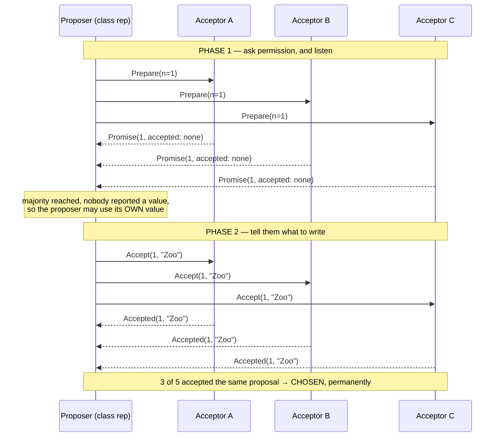
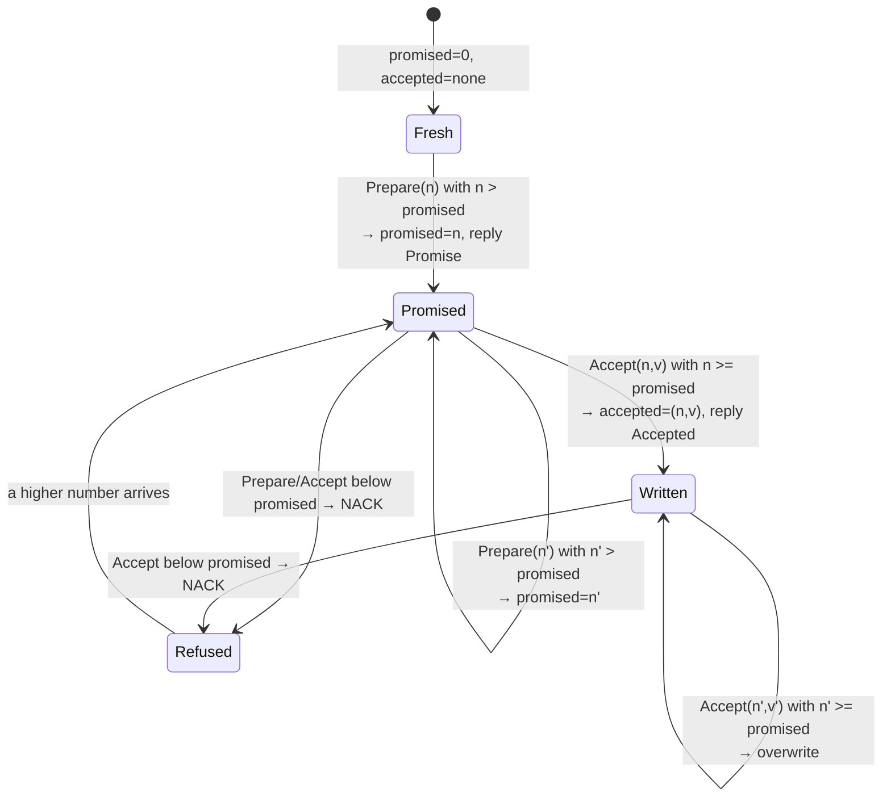
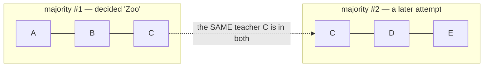
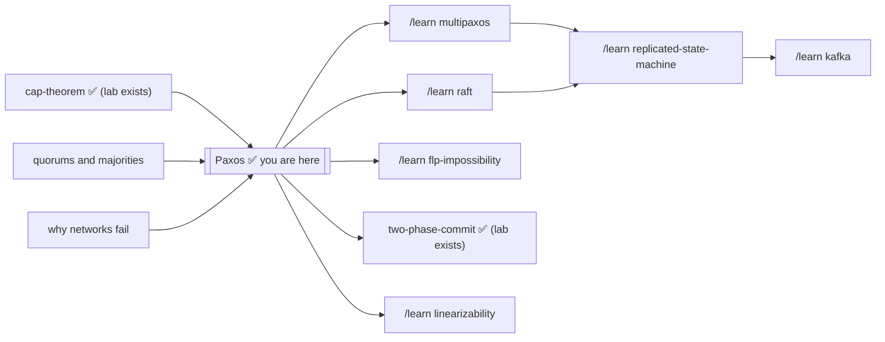

# Paxos — A Learning Lab

> **The three-sentence version:** Paxos is how a group of computers agrees on
> exactly one value even though machines crash and messages are lost, delayed
> or duplicated. It works by making every attempt ask a majority for
> permission first, and forcing each new attempt to abandon its own idea and
> re-propose anything it discovers was already accepted — because any two
> majorities always share a member, the past can never hide. It guarantees it
> will never decide two different things; it does *not* guarantee it will ever
> decide at all, and that missing half is why real systems bolt a leader on
> top.

This lab covers **single-decree Paxos** (also called *basic Paxos* or *the
Synod algorithm*): getting agreement on **one** value. Agreeing on a whole
*sequence* of values is Multi-Paxos, covered in stage 14.

---

## 1. WHY — why does this thing exist?

Put important data on one computer and one power supply can lose it. Put it on
several and you have a new problem that is far worse than it sounds: the
machines must agree on what the data *is*. They cannot simply vote, because
some of them will be switched off at the moment of the vote, some messages
will vanish, and some will arrive an hour late looking perfectly fresh. Paxos
exists because between 1978 and 1998 people kept writing "obviously correct"
agreement protocols that turned out to decide two different things under some
unlucky ordering of messages — and losing a bank transfer, or booking a seat
twice, is the kind of bug you cannot patch after the fact. Leslie Lamport's
answer was to find the smallest set of rules that is *provably* immune to
every possible ordering, and Paxos is that set.

## 2. PROBLEM — the school trip

Five teachers must agree on one destination for the school trip. It has to be
exactly one — the coach company needs a single answer, and once they have been
paid the answer can never change.

The awkward part: **the teachers are never all in school at once**, and they
**never talk to each other**. You cannot get them in a room. All you can do is
leave a note in a teacher's mailbox and hope for a reply. Notes sometimes get
lost. Notes sometimes sit in a bag for two days and then get read. Teachers
sometimes go off sick for a week.

You are a class rep and you want the Zoo. Priya is another class rep, doing
exactly the same thing at exactly the same time, and she wants the Museum.
Neither of you knows the other is doing it.

Get the school to commit to one destination, forever.

## 3. NAIVE SOLUTION — "just tell everyone"

Write "Zoo" on five notes, put one in each mailbox, done.

> **🔮 Predict:** *Your five "Zoo" notes and Priya's five "Museum" notes are
> all in the mail at the same time. What do the teachers end up believing?*
> <details><summary>Reveal</summary>
> There is no single answer — and that is the problem. Depending on delivery
> order, some teachers believe "Zoo", some "Museum", and some nothing at
> all; no rule exists to say which belief is *the* decision, and no moment
> exists where anyone could safely tell the coach company an answer.
> Section 4 walks three concrete versions of this disaster.
> </details>

## 4. FAILURE — three ways that falls apart

**Attempt 1: tell everyone; first note wins.**
Your Zoo notes reach teachers A and B first. Priya's Museum notes reach D and
E first. C is off sick. Now A and B believe "Zoo", D and E believe "Museum",
and nobody believes anything in particular. Worse, *there is no moment where
anyone can say the decision is made* — you cannot tell "everyone agrees" from
"everyone I have heard from agrees."

**Attempt 2: require all five to agree.**
Now there is a clear rule. But C has been off sick for a week, so nothing can
ever be decided. One absent teacher out of five stops the school. That is not
fault tolerance; that is the opposite.

**Attempt 3: majority wins — get 3 of 5 and call it decided.**
This is much better, and it is nearly right. Watch it break:

1. You get A, B and E to write down "Zoo". That is 3 of 5. **Decided: Zoo.**
   You go home happy.
2. A week later Priya, who never heard about any of this, gets C, D and E to
   write down "Museum". E already had "Zoo" written down, but under these
   naive rules E just crosses it out and writes the new one. That is also
   3 of 5. **Decided: Museum.**

Two different decisions, both by a legitimate majority. The coach company has
been told two different things. Notice that *nobody misbehaved* — every
teacher followed the rule as written. The rule itself is broken.

## 5. KEY IDEA

Two facts, and Paxos is just their consequence:

1. **Any two majorities of the same group always share at least one member.**
   With 5 teachers, any 3 and any other 3 must overlap — there is no way to
   pick two groups of 3 out of 5 that miss each other.
2. **So make every new attempt ask a majority what has already happened,
   before it proposes anything — and if it learns of an existing entry, it
   must abandon its own idea and re-propose that one.**

Rule 1 guarantees the asker cannot miss an existing decision. Rule 2 turns
that knowledge into safety. Priya, in the story above, would have heard "Zoo"
from E — and would then have campaigned for the Zoo, not the Museum.

That is the whole algorithm. Everything below is detail.

## 6. TERMINOLOGY

Now the professional words. Each is defined at first use, and the whole set
is small — Paxos has five message types and three roles.

| Term | Plain-English meaning |
|---|---|
| **Proposer** | Someone trying to get a value agreed (a class rep). Any number may run at once. |
| **Acceptor** | A voter that remembers things (a teacher). Acceptors never talk to each other — only to proposers. |
| **Learner** | Anyone who just wants to find out the result (the coach company). |
| **Quorum / majority** | More than half the acceptors — 3 of 5. The critical property: **any two quorums share at least one member.** |
| **Proposal number** (a.k.a. *ballot number*, *round number*) | A ticket number for one attempt. Must be unique per proposer and increasing — in this lab, `round × 10 + rank`, so proposer 1 uses 11, 21, 31… and proposer 2 uses 12, 22, 32… They can never collide. |
| **Prepare(n)** | Phase 1 request: "may I have slot *n*, and what have you already written down?" |
| **Promise(n, …)** | Phase 1 reply: "slot *n* is yours, I will now ignore anything numbered below *n* — and here is the last thing I accepted, if any." |
| **Accept(n, v)** | Phase 2 request: "write down value *v* under slot *n*." |
| **Accepted(n, v)** | Phase 2 reply: "written." |
| **NACK** | A refusal, because the acceptor has already promised a higher number. |
| **Accepted (by one acceptor)** | One acceptor has written the value down. **This is not a decision.** |
| **Chosen / decided** | A *majority* of acceptors have accepted the *same proposal number*. This is permanent. |
| **Safety** | "Nothing bad ever happens" — here: at most one value is ever chosen, for all time. |
| **Liveness** | "Something good eventually happens" — here: some value eventually gets chosen. |

The single most common misunderstanding in this whole topic is the difference
between the last two rows: **accepted by somebody ≠ chosen.** Experiment 3
exists purely to hammer that in.

## 7. MENTAL MODEL

Carry this: **Paxos is a protocol for asking permission to speak, where the
price of permission is having to repeat what you were told.**

A proposer does not get to be the author of the value. It is more like a
courier. It asks a majority "may I go next, and what did I miss?", and if the
answer contains any news at all, it is obliged to carry that news forward
instead of its own message. Only when a majority tells it "nothing has ever
happened here" is it allowed to introduce its own value.

That is why Paxos can never change its mind: after a value is chosen, *every*
majority contains someone who will report it, so every future proposer becomes
a courier for that same value.

**The engineering model** — the same machine, stated precisely. The entire
system is three kinds of state plus one rule:

- each **acceptor** holds exactly three durable numbers:
  `promised_n` (highest slot it has promised), and `accepted_n` /
  `accepted_value` (the last thing it wrote down);
- each **proposer** holds its current `n`, its phase, and the set of
  promises/acceptances it has collected;
- the **network** is a bag of messages that can be delayed, dropped, or
  duplicated — never trusted, never ordered.

The one rule (the invariant everything defends): *if any majority has
accepted `(n, v)`, then every proposal numbered above `n` that ever reaches
phase 2 carries value `v`.* Phase 1 exists to make that rule enforceable.

**Mapping the two models:**

| Story | Engineering |
|---|---|
| Teacher | Acceptor |
| Class rep | Proposer |
| Coach company | Learner |
| Note in a mailbox | Message in flight (loss/delay/duplication all allowed) |
| Slot number on a note | Proposal number `n` |
| "Slot #n is yours, and here's my old entry" | `Promise(n, accepted_n, accepted_value)` + update of `promised_n` |
| The teacher's notebook | Durable `(accepted_n, accepted_value)` on disk |
| 3 of 5 teachers wrote the same thing | A quorum accepted the same `(n, v)` — chosen |

**Where the analogy breaks** — carry these corrections with the story:

1. **Teachers sound sequential; acceptors are concurrent.** Notes feel like
   they arrive over days, one at a time. Real messages interleave at
   microsecond scale in adversarial orders — the reason the rules must be
   airtight is precisely that no human is watching the mailboxes.
2. **A teacher's memory is exactly the bug.** In the story, remembering is
   effortless. In the machine, "remembering" means fsync-to-disk *before*
   replying — an acceptor that answers first and persists later is the
   safety violation of experiment 5, not a minor optimization.
3. **Notes are unique; messages are not.** A physical note exists once. A
   network message can arrive twice, late, or out of order — which is why
   every operation is built to be idempotent (accepting `(n,v)` twice equals
   accepting it once).
4. **Nobody announces the result.** The story tempts you to imagine a
   moment where someone declares "it's the Zoo!". In the machine, *chosen*
   is a global fact that can be true while no single participant knows it —
   that is why learners exist as a separate role.

## 8. VISUALIZATION

The interactive simulator is [`visualization.html`](visualization.html)
(published copy:
<https://claude.ai/code/artifact/15ceaedd-feba-4cbb-9aaf-f2e220ce46cb>) —
open it and drive the protocol yourself. **You choose which note is delivered
next**, so you can construct an exact race rather than hoping to stumble into
one. It shows every teacher's promised slot and written entry, every note in
flight, and a running safety light. Five guided experiments **ask you to
predict the outcome first**, then play themselves and settle your prediction;
the **Undo** button takes back any step, so you can rewind a race and replay
it differently.

The two phases:



An acceptor's whole life, as a state machine:



Why quorum overlap is the whole game:



> **CHECKPOINT — beginner → intermediate.** You can now explain *why* Paxos
> exists, what "chosen" means, and why every new attempt must consult a
> majority first. Stopping here you could follow a design review. Next: the
> actual messages, with real slot numbers — and the two situations that look
> identical but aren't.

## 9. ACTUAL MECHANISM — with real numbers

**Phase 1 (Prepare / Promise).**
1. The proposer picks a proposal number `n` that is unique and higher than any
   it has used, and sends `Prepare(n)` to all acceptors.
2. An acceptor receiving `Prepare(n)`:
   - if `n > promised_n`: set `promised_n = n` and reply
     `Promise(n, accepted_n, accepted_value)` — including the last thing it
     accepted, or "nothing";
   - otherwise: refuse (NACK).
3. The proposer waits for promises from a **majority**.

**Phase 2 (Accept / Accepted).**
4. The proposer now picks the value it will propose:
   - if any promise reported an accepted value, it **must** use the one with
     the **highest** `accepted_n` among them — not its own;
   - only if *no* promise reported any value may it use its own.
5. It sends `Accept(n, v)` to the acceptors.
6. An acceptor receiving `Accept(n, v)`: if `n >= promised_n`, record
   `accepted_n = n`, `accepted_value = v`, reply `Accepted`. Otherwise NACK.
7. When a **majority** has accepted the **same** `n`, the value is **chosen**.
   Note that no single participant necessarily knows this at the moment it
   happens — which is why learners exist.

### Worked example A — the decision sticks

Five acceptors A–E, majority = 3. P1 wants "Zoo", P2 wants "Museum".

| Step | What happens | State afterwards |
|---|---|---|
| 1 | P1 sends `Prepare(1)` to A, B, C | — |
| 2 | All three reply `Promise(1, accepted: none)` | A,B,C: promised=1 |
| 3 | No value reported → P1 may use its own | P1 proposes "Zoo" |
| 4 | P1 sends `Accept(1, "Zoo")`; A, B, C all accept | A,B,C: accepted=(1,"Zoo") |
| 5 | 3 of 5 accepted proposal 1 | **CHOSEN: "Zoo"** |
| 6 | P2 sends `Prepare(2)` to **C, D, E** | — |
| 7 | C replies `Promise(2, accepted: (1,"Zoo"))`; D and E report nothing | C,D,E: promised=2 |
| 8 | **A value was reported, so P2 must abandon "Museum"** | P2 proposes **"Zoo"** |
| 9 | C, D, E accept `(2, "Zoo")` | **Still "Zoo"** |

C was in both majorities. It could not be avoided, and it remembered. This is
`experiment 2`, and the actual program output is:

```
  -> C->P2  PROMISE(n=2) [already accepted (n=1, 'Zoo')]
  -> D->P2  PROMISE(n=2) [nothing accepted yet]
  -> E->P2  PROMISE(n=2) [nothing accepted yet]

  C is in BOTH majorities: ['A', 'B', 'C'] and {C,D,E}.
  C reported it had already accepted 'Zoo' at n=1.
  P2 wanted 'Museum' but is forced to propose 'Zoo'.
```

### Worked example B — the same start, one lost note

Same start, but at step 4 only **A and B** receive the `Accept` — C's note is
lost.

> **🔮 Predict:** *Only A and B have "Zoo" written down. P2 now runs its
> round with C, D, E. Does the Zoo survive — and if the Museum wins, has the
> never-change rule been broken?*
> <details><summary>Reveal</summary>
> The Museum can win, and no rule is broken. Two of five was never a
> decision — "accepted by somebody" is not "chosen". P2's majority C, D, E
> contains no witness of the Zoo, reports nothing, and P2 is free to use its
> own value. The walk-through below shows it step by step.
> </details>

- 2 of 5 have written "Zoo". **2 is not a majority, so nothing is chosen.**
- P2 now prepares with C, D, E. None of them has accepted anything (C's note
  never arrived), so all three report "nothing".
- P2 is therefore free to use its own value, and "Museum" becomes chosen.

"Zoo" was overwritten — and no rule was broken, because "Zoo" was never
*chosen*. If you take one thing from this lab, take the difference between
example A and example B.

> **CHECKPOINT — intermediate → engineering.** You can now run the happy
> path in your head, message by message, and tell "accepted by somebody"
> from "chosen". Next: everything that can go wrong — each failure created,
> watched, and tied to the guarantee it bends.

## 10. FAILURE SCENARIOS

**A minority of acceptors crashes.** 2 of 5 down, 3 alive: a majority still
exists, so everything works normally. This is the whole point of majorities —
you buy tolerance of `⌊(N−1)/2⌋` failures. It is also why clusters use **odd**
sizes: with 4 acceptors a 2–2 split means *nobody* has a majority, so you paid
for an extra machine and got zero extra tolerance plus a new stall mode.

**A majority crashes.** No quorum can form; nothing is ever decided. The
system **stalls but stays correct** — it never invents an answer. Losing
liveness is survivable; losing safety is not.

**A proposer crashes mid-way.** Nothing special happens. Its half-finished
proposal simply sits there. Another proposer picks a higher number, discovers
whatever was accepted, and carries it forward. There is no cleanup, no
timeout-based rollback, no "abort" message — Paxos has no notion of a
transaction that needs undoing.

**A message is delayed and arrives very late.** This is the dangerous one, and
it is handled by proposal numbers. An `Accept(1, "Zoo")` that arrives after
the acceptor has promised slot 2 is refused outright. In the lab:

```
  -> P1->A  ACCEPT(n=1, 'Zoo')     ...arrives after A promised n=2
     A replies NACK(n=1; already promised 2)
```

**A message is duplicated.** Harmless. Accepting `(n, v)` twice is the same as
accepting it once — the operations are idempotent by construction. Proposers
track promises and acceptances in sets, so a duplicate never counts twice
toward a majority. (`test_duplicate_messages_change_nothing`.)

**A network partition.** Paxos treats it as "some acceptors are unreachable."
The side holding a majority continues; the side without one stalls. Compare
this with the CAP theorem's CP corner — see the sibling lab
[`../cap-theorem/`](../cap-theorem/README.md), where this exact behaviour is
the thing being traded for.

> **🔮 Predict:** *Two proposers keep out-numbering each other — no crash,
> no lost note. Which property fails: safety, liveness, or both?*
> <details><summary>Reveal</summary>
> Liveness only. Nothing wrong is ever decided (safety holds perfectly);
> nothing is decided at all (liveness fails). The trace below shows the
> mechanism — and why the fix is a leader, not a rule change.
> </details>

**Two proposers duel — livelock.** No crashes, no lost messages, and yet
nothing is ever decided:

```
  round 1: P1 prepared n=1, P2 gazumped with n=2, P1's ACCEPT(n=1) refused -> chosen so far: (nothing)
  round 2: P1 prepared n=3, P2 gazumped with n=4, P1's ACCEPT(n=3) refused -> chosen so far: (nothing)
  round 3: P1 prepared n=5, P2 gazumped with n=6, P1's ACCEPT(n=5) refused -> chosen so far: (nothing)
  ...
```

Each proposer invalidates the other's promise just before it can finish. This
can in principle go on forever. It is not a bug in Paxos; it is a consequence
of the FLP result (stage 11).

> **🔮 Predict:** *Teachers keep promises only in their heads. The Zoo is
> decided by A, B, C — then those three reboot, blank. What can happen next:
> a stall, or something worse?*
> <details><summary>Reveal</summary>
> Something worse: a second, different decision. The safety proof leans
> entirely on acceptors remembering what they promised and accepted; amnesia
> deletes the witness from the majority overlap, and A, B, C will cheerfully
> tell the next proposer "nothing ever happened here". This is the only
> failure in this lab that breaks safety itself — and why real acceptors
> flush to disk before replying.
> </details>

**An acceptor forgets after a reboot.** The worst one, because everything
looks fine. Covered in stage 11 and demonstrated in experiment 5.

## 11. CORRECTNESS — what is and is not guaranteed

**The invariant Paxos maintains:**

> If a value `v` has been chosen, then every proposal issued afterwards with a
> higher number also has value `v`.

Chain the reasoning: a value is chosen when a majority `M1` accepts it at
number `n1`. Any later proposal `n2 > n1` must first collect promises from
some majority `M2`. `M1 ∩ M2 ≠ ∅`, so at least one acceptor in `M2` accepted
`(n1, v)` and — because it promised `n2` *after* accepting, and promising
means refusing everything lower — it reports `v`. The proposer is then forced
by the phase-2 rule to propose `v`. Repeat inductively for every higher
number. Hence **at most one value is ever chosen.** That is Lamport's `P2c`.

**Safety (guaranteed, unconditionally):** at most one value is chosen. This
holds under *any* pattern of message loss, delay, reordering, duplication, and
crash. The lab tests this rather than assuming it —
`test_safety_survives_hundreds_of_random_schedules` runs 300 randomized
schedules with 25% message loss, 15% duplication, and random crashes, and
asserts that no run ever chooses two values.

**Liveness (NOT guaranteed):** Paxos may never decide. The livelock above is
the everyday version; the formal statement is the **FLP impossibility result**
(Fischer, Lynch, Paterson, 1985) — in an asynchronous system where even one
process may crash, *no* deterministic protocol can guarantee both safety and
termination. Every consensus system alive today makes the same choice Paxos
does: keep safety absolutely, and get liveness in practice by assuming the
network is *usually* well behaved (partial synchrony) plus timeouts and
randomized backoff.

**What Paxos assumes.** Non-Byzantine failures: nodes may crash, sleep, or
lose messages, but they do not lie or forge messages. A malicious acceptor
breaks everything — that is the domain of PBFT and friends, not Paxos.

**The obligation Paxos places on you: durability.** An acceptor must write
`promised_n`, `accepted_n` and `accepted_value` to stable storage **before**
replying. An acceptor that keeps them in memory only and then reboots will
re-promise as if it had never voted — and the quorum-overlap argument
collapses, because the overlapping member no longer remembers. Experiment 5
shows two different values being chosen with every node obeying the protocol:

```
 chosen value(s): {'Museum', 'Zoo'}
 safety holds (at most one value ever chosen): False
```

That is not a flaw in Paxos; it is Paxos being used incorrectly. It is also
the single most common way real implementations get it wrong, which is why
this lab has a test asserting the failure
(`test_an_acceptor_that_forgets_after_a_crash_breaks_consensus`).

## 12. CODE

- [`Paxos.java`](Paxos.java) — acceptors, proposers, and an in-memory network
  whose **schedule you control**. ~570 lines, no dependencies.
- [`PaxosTest.java`](PaxosTest.java) — 17 tests named after scenarios.
- [`Experiments.java`](Experiments.java) — five narrated failure experiments.

Run them:

```bash
cd ~/Documents/Learning/paxos
java PaxosTest.java                   # 17 tests, all pass
java Experiments.java                 # all five experiments
java Experiments.java 2               # just one
```

The heart of the implementation is a dozen lines — everything else is plumbing:

```java
private Object pickValue() {
    int bestN = 0;
    Object bestValue = null;
    for (Promise p : promises.values()) {
        if (p.lastValue() != null && p.lastN() > bestN) {
            bestN = p.lastN();
            bestValue = p.lastValue();
        }
    }
    if (bestValue == null) {
        return ownValue;            // nobody had accepted anything: free choice
    }
    adoptedFrom = bestN;            // somebody had: we must carry THEIR value
    return bestValue;
}
```

Delete the `if (bestValue == null)` branch's guard — i.e. let a proposer always
use its own value — and you have written the broken "Attempt 3" from stage 4.

## 13. EXPERIMENT

```bash
java Experiments.java
```

| # | What it does | What it proves |
|---|---|---|
| 1 | Clean run, one proposer | What the two phases look like with nothing broken |
| 2 | Decision made, then a rival proposer with a different majority | Quorum overlap forces the rival to carry the existing value |
| 3 | Accept reaches only 2 of 5, then a rival runs | "Accepted by some" is not "chosen"; replacing it is correct |
| 4 | Two proposers alternating | Livelock: safety intact, liveness lost |
| 5 | Non-durable acceptors reboot | **Safety broken** — two values chosen, nobody misbehaving |

Then go and break it yourself: in `Experiments.java`, change which acceptors
receive each message, or set `c.dropRate = 0.4;`, and watch which invariants
bend and which do not.

> **CHECKPOINT — engineering → production.** You can now reason about every
> single-decree failure mode and state the invariant that survives them all.
> Next: what changes when this runs for years in a real fleet — logs,
> leaders, and what the on-call engineer actually sees.

## 14. PRODUCTION — from this lab to a real system

**What this implementation deliberately omits:**

| Omitted here | What production does |
|---|---|
| **Durability** (optional flag) | Mandatory `fsync` of `promised_n`/`accepted_n`/`accepted_value` before every reply. Non-negotiable. |
| **Deciding a *sequence*** | Real systems need a replicated *log*, not one value → **Multi-Paxos** (below). |
| **Leader election** | A stable distinguished proposer, chosen by lease or by a separate election, to avoid livelock. |
| **Learner propagation** | Here an omniscient observer notices a majority. Real systems either have acceptors broadcast `Accepted` to all learners, or use a distinguished learner that then informs the rest. |
| **Membership changes** | Adding/removing acceptors is itself decided *through* the log (reconfiguration), because changing quorum membership underneath a running protocol is exactly how you break overlap. |
| **Log compaction / snapshots** | A log that only grows is not deployable; state snapshots plus truncation are standard. |
| **Batching & pipelining** | Batching many commands per round and pipelining slots is the difference between hundreds and hundreds of thousands of ops/sec. |
| **Read optimizations** | Reads through the log are safe but slow; leader leases let reads skip consensus while remaining linearizable. |
| **Timeouts, retries, backoff** | Randomized backoff on NACK, so duelling proposers separate instead of resonating. |

**Multi-Paxos, in one paragraph.** Run one instance of the algorithm per log
slot: slot 1 decides the first command, slot 2 the second, and so on. The key
optimization: once a proposer has completed phase 1 with proposal number `n`,
that promise covers *all future slots* for that number, so a stable leader can
skip phase 1 entirely and go straight to `Accept` for each new command —
**one round trip per command** instead of two. Phase 1 only runs again when
the leader changes. That is the protocol behind essentially every
strongly-consistent datastore.

**Where you actually meet it:**

| System | How Paxos shows up |
|---|---|
| **Google Chubby** | The lock service that made Paxos famous in industry; its paper *"Paxos Made Live"* is a catalogue of everything the original paper leaves out. |
| **Google Spanner** | A Paxos group per shard, replicating the write-ahead log across regions. |
| **Apache ZooKeeper** | ZAB, a Paxos-family protocol with a stronger leader and log-order guarantees. |
| **etcd, Consul, CockroachDB, TiKV** | Raft — a re-design of Multi-Paxos for understandability (stage 16). |
| **Apache Cassandra** | Lightweight transactions (`IF NOT EXISTS`, compare-and-set) run *actual basic Paxos* per partition key — which is why they are roughly 4× the cost of a normal write. |
| **Neo4j, Megastore, Ceph monitors** | Paxos or a close variant for cluster metadata. |

## 15. EXERCISES

[`EXERCISES.md`](EXERCISES.md) — an eight-rung ladder: explain, identify,
predict, modify, implement (against real tests in
`ImplExerciseTest.java`), debug, handle a failure, and design a production
deployment. Answers in [`SOLUTIONS.md`](SOLUTIONS.md); commit to yours
first.

## 16. RELATED CONCEPTS

- **Raft** — same guarantees, deliberately re-designed to be teachable: a
  strong leader (only the leader appends), an explicit election with
  randomized timeouts (which structurally prevents the livelock you saw in
  experiment 4), and a log-contiguity rule. Where Paxos gives you a kit of
  parts, Raft gives you an assembled system. Choose Raft unless you have a
  specific reason not to; choose Paxos when you need its flexibility
  (e.g. out-of-order commits, or the Cassandra-style per-key CAS).
- **Multi-Paxos** — Paxos per log slot with a stable leader; the practical
  form of the algorithm and the thing Raft is competing against.
- **Viewstamped Replication** — invented independently (1988) and remarkably
  close to Raft; useful to read as evidence that the design space has one
  strong attractor.
- **Two-phase commit (2PC)** — also has "phases" and is constantly confused
  with Paxos, but solves a *different* problem: it makes all participants
  agree to commit **one transaction**, and it **blocks forever** if the
  coordinator dies mid-way. Paxos tolerates the failure of any minority,
  including the proposer. 2PC is atomic commitment; Paxos is consensus.
  You have the [`two-phase-commit`](../two-phase-commit/README.md) lab: its
  blocking problem — everyone stuck holding locks because one referee died —
  is precisely the disease Paxos's "any majority can finish anyone's work"
  cures.
- **CAP theorem** — Paxos is the machinery that implements CAP's "CP" choice:
  the majority side keeps working, the minority side refuses. The sibling lab
  [`../cap-theorem/`](../cap-theorem/README.md) covers the tradeoff Paxos is
  buying you.
- **FLP impossibility** — the proof that Paxos's missing liveness guarantee is
  not laziness; no deterministic protocol can have it.

## 17. NEXT STEPS



**Prerequisites, if any of stage 5 felt shaky:** `/learn quorum`.
You already have the [`cap-theorem`](../cap-theorem/README.md) lab, which
explains *why* a system would want the behaviour Paxos provides.

**Best next steps, in order:**
1. `/learn multipaxos` — how one decision becomes a replicated log, and where
   the second round trip goes.
2. `/learn raft` — the same problem solved for humans; the direct comparison
   will sharpen both.
3. `/learn flp-impossibility` — why the liveness gap is permanent.
4. Revisit [`../two-phase-commit/`](../two-phase-commit/README.md) — the
   protocol Paxos is most often confused with; re-read its blocking scenario
   now and notice it is exactly the proposer-crash scenario Paxos shrugs off.

## 18. GLOSSARY

Every term this lab introduced, one line each, in order of appearance.

| Term | One-line meaning |
|---|---|
| **Consensus** | Getting a group of unreliable machines to agree on one value, forever. |
| **Proposer** | The role trying to get a value agreed (the class rep). Any number may run concurrently. |
| **Acceptor** | The voting, remembering role (the teacher); holds `promised_n`, `accepted_n`, `accepted_value`. |
| **Learner** | The role that only wants to discover the outcome (the coach company). |
| **Quorum / majority** | More than half the acceptors; any two quorums always share a member. |
| **Proposal number `n`** | The unique, increasing ticket for one attempt (here `round × 10 + rank`). |
| **Prepare(n)** | Phase-1 request: claim slot `n`, ask what has already been accepted. |
| **Promise(n, …)** | Phase-1 reply: slot granted, lower numbers refused from now on, last accepted entry attached. |
| **Accept(n, v)** | Phase-2 request: write value `v` under slot `n`. |
| **Accepted(n, v)** | Phase-2 reply: written down. |
| **NACK** | Refusal because a higher slot number was already promised. |
| **Accepted (by one acceptor)** | One acceptor wrote it — **not** a decision. |
| **Chosen / decided** | A majority accepted the same `(n, v)` — permanent, even if nobody knows yet. |
| **Safety** | At most one value is ever chosen — holds under every message ordering. |
| **Liveness** | Some value eventually gets chosen — *not* guaranteed (dueling proposers, FLP). |
| **Adoption** | A proposer abandoning its own value for the highest-numbered accepted value phase 1 revealed. |
| **Livelock** | Proposers endlessly invalidating each other's promises; safe but never done. |
| **Witness** | The overlap member of two majorities — the acceptor whose report forces adoption (amber outline in the simulator). |
| **Stable (durable) storage** | Disk-flushed acceptor state; answering before flushing is the amnesia bug. |
| **Single-decree Paxos** | Agreement on exactly one value — this lab. |
| **Multi-Paxos** | One agreed value per log slot with a stable leader skipping phase 1 — the practical form. |
| **Leader** | The one distinguished proposer real systems elect to end dueling. |
| **FLP impossibility** | The proof that no deterministic asynchronous consensus can guarantee liveness. |
