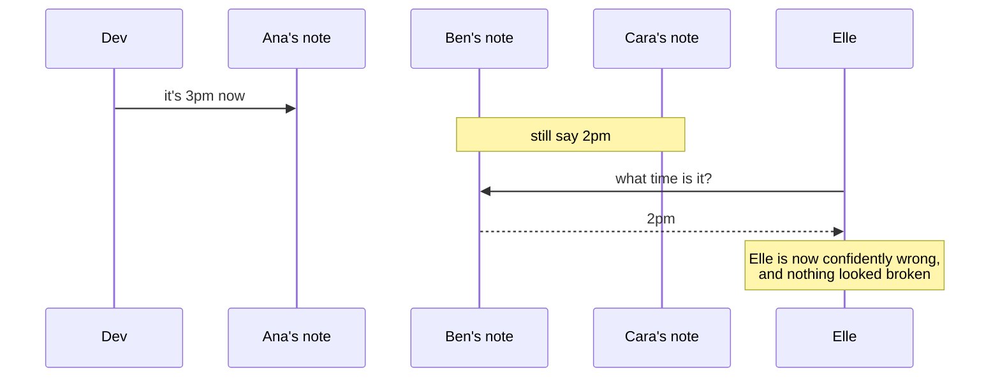
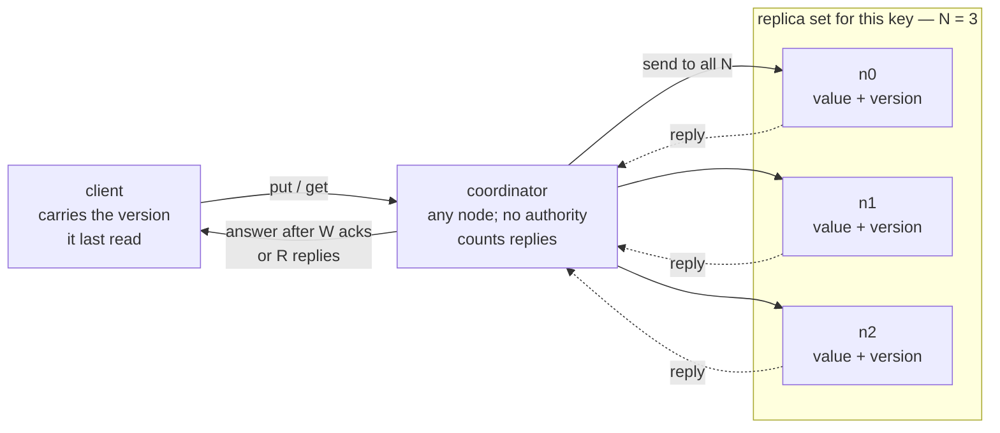
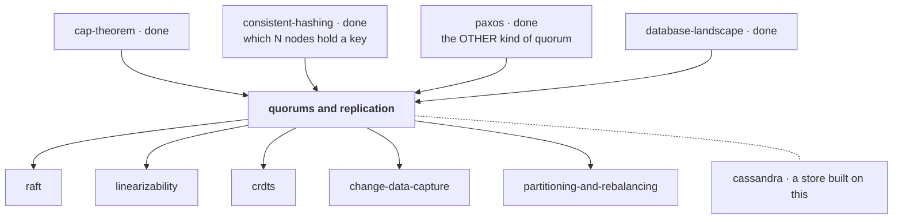

# Quorums and replication

> **What this lab is.** Keeping more than one copy of your data is the first
> thing every distributed system does, and the moment you do it the copies can
> disagree — silently, with no error anywhere. This lab builds the rule that
> tames that disagreement, then spends most of its time on the five situations
> where the rule quietly stops applying while the arithmetic still looks fine.
>
> **Run it:**
> ```bash
> java src/Tests.java                  # 42 scenario checks
> java src/Experiments.java            # list the ten measured experiments
> java src/Experiments.java overlap    # the headline measurement
> open visualization.html              # or the published link below
> ```
>
> **Interactive simulator:** <https://claude.ai/code/artifact/d1e569b2-2338-4c35-9ad0-81417b750086>

> **⚠️ A word you already know, used for something else.**
> In the [paxos](../paxos/) lab, *quorum* meant a **majority**, and it was used
> to make a group of machines **agree** on one value. This lab is about a
> different thing that shares the name: a read/write quorum, which makes two
> groups **overlap** so that a reader cannot miss a writer. It looks like the
> same idea. It guarantees dramatically less. Keeping them apart is the single
> most valuable thing you can take from this lesson, so the lab avoids the word
> entirely until stage 7, where both meanings are put side by side.

---

## How deep this goes

| Layer | Stages | You will be able to… |
|---|---|---|
| **Beginner model** | 1–9 | say why copies disagree, and derive the overlap rule yourself |
| **Intermediate model** | 10 | walk a write and a read replica by replica, and name what each knob buys |
| **Engineering model** | 11–14 | reason about the five ways the rule stops holding, and measure them |
| **Production model** | 15 | set Cassandra, Kafka, Postgres and MongoDB knobs on purpose, and monitor the right things |

---

# 1 · WHY — the problem this exists to solve

A machine holding your data will fail. Not "might" — a disk dies, a rack loses
power, a kernel panics, someone reboots the wrong host. If there is one copy,
that is the end of the data.

So you keep several copies on several machines. That solves losing the data,
and it also lets you serve more readers and put a copy near your users. But it
creates a new problem that is much harder to see: **the copies can disagree**,
and nothing anywhere raises an error when they do. A user updates their
address, reloads the page, and sees the old one. A balance check returns a
number that was true four seconds ago. No exception is thrown, no alert fires,
and the logs look perfect.

---

# 2 · PROBLEM — three friends and a meeting time

Ana, Ben and Cara are organising a trip. The departure time is written down in
three places: each of them keeps a note of it. Right now all three notes say
**2pm**.

Dev needs to move it to **3pm**. Elle, later, needs to know what time it is.

The awkward question, and the whole lab is the answer to it:

**How many of the three does Dev have to tell, and how many does Elle have to
ask, for Elle to be certain she gets 3pm?**

Notice what makes this hard. Dev cannot always reach all three — Cara's phone
is off. Elle cannot always reach all three either. And crucially, **if Elle
asks Ben and Ben says "2pm", Ben is not lying and Elle has no way to tell she
has an old answer.** A wrong answer here is indistinguishable from a right one.

---

# 3 · NAIVE SOLUTION — tell everybody

The obvious rule: Dev tells all three. Then Elle can ask any one of them, and
whoever she asks will say 3pm.

This is genuinely correct. It is also what most people sketch first, and it is
what "just replicate it everywhere" means in practice.

> **🔮 Predict:** Cara's phone is off for an hour. Under "tell everybody",
> what happens when Dev tries to change the time?
>
> <details><summary>Reveal</summary>
>
> **Nothing can be changed at all.** Dev cannot complete the rule, so the
> update is refused. One person being unreachable has stopped the entire
> system from accepting any change.
>
> And this gets worse, not better, as you add copies for safety: with five
> copies, the chance that at least one is unreachable at any moment is higher
> than with three. **Under "tell everybody", every copy you add to improve
> durability makes writes less available.** That is the trade this whole lab
> is about, and it appears at the very first step.
> </details>

---

# 4 · FAILURE — and the second attempt fails differently

So "tell everybody" is too fragile. The obvious repair: **Dev tells just one
person, and they pass it on when they can.**

Now writes always work — someone is always reachable. But watch Elle:



Two separate things went wrong, and they are worth naming apart:

**Elle got an old answer and could not tell.** Ben answered instantly and
correctly reported what he knew. There is no error to catch, no timeout, no
warning.

**And the change is one accident from never having happened.** Only Ana has
3pm. If Ana loses her note before passing it on, the update Dev believed had
succeeded simply ceases to exist.

So the two extremes both fail, in opposite directions:

| Rule | Writes | Reads |
|---|---|---|
| tell all three | fragile — one absent person blocks everything | always correct |
| tell one | always works | can silently be wrong, and the write can vanish |

The interesting design is not at either end. It is somewhere in the middle —
and the question is exactly *where*, and *why that point and not another*.

---

# 5 · THE REAL REQUIREMENT — stated plainly

We want, in this order:

1. **A later reader must see the last change that was accepted.** Not "usually"
   — always, or the guarantee is worthless, because you cannot tell the good
   answers from the bad ones.
2. **Neither writing nor reading may require every copy to be reachable**, or
   one sleeping machine stops the system.
3. **When something genuinely cannot be guaranteed, say so** rather than
   returning a confident wrong answer.

Requirement 1 and requirement 2 sound like they are in direct conflict. The
next stage is why they are not.

---

# 6 · KEY IDEA — two groups that cannot avoid each other

Dev does not have to tell everybody, and Elle does not have to ask everybody.
They only have to be sure that **the group Dev tells and the group Elle asks
share at least one person.**

Count it. There are 3 friends. If Dev tells 2 of them and Elle asks 2 of them,
can those groups be completely different? That would need 2 + 2 = 4 different
people, and there are only 3. So no — they *must* share someone, and that
someone has the new time.

That is the entire idea, and it is nothing more than the pigeonhole principle:

> **Tell `W` of them, ask `R` of them, out of `N` total.
> If `R + W > N`, the two groups cannot miss each other.**

Everything else in this lab is either a consequence of that inequality or one
of the situations where it stops applying.

Here it is with real people. Dev tells Ana and Ben (W=2). Elle can ask any two:

| Elle asks | Does she reach someone Dev told? |
|---|---|
| Ana, Ben | yes — both |
| Ana, Cara | yes — Ana |
| Ben, Cara | yes — Ben |

There is no fourth option. That exhaustive little table *is* the proof.

---

# 7 · TERMINOLOGY — the words, now that the idea is yours

### Replica
- **Plain:** one of the copies.
- **Technical:** a machine holding a full copy of a given piece of data. Note
  it is per-key, not per-cluster: in a 100-machine cluster each key typically
  lives on 3 of them.
- **Why the word:** to separate "a machine" from "a copy of this particular
  thing". The same machine is a replica for some keys and irrelevant for others.
- **Concrete:** in this lab, `n0`, `n1`, `n2` are the replicas of key `k`.
- **Connects to:** which machines hold which keys is the placement problem you
  solved in [consistent-hashing](../consistent-hashing/) — "the next N nodes
  clockwise" *is* the replica set.

### Replication factor (N)
- **Plain:** how many copies you keep.
- **Technical:** the number of replicas per key. Chosen once per keyspace, not
  per request.
- **Why the word:** because it is the only one of the three numbers that is a
  property of the *data*; R and W are properties of each individual *request*.
- **Concrete:** `N = 3` in this lab. Cassandra's `replication_factor: 3`.

### W and R
- **Plain:** how many copies you insist on writing to; how many you insist on
  hearing from.
- **Technical:** the number of replica acknowledgements before a write is
  reported successful, and the number of replica responses before a read is
  answered. Both are chosen **per request**, which is the point — the same data
  can be read cheaply in one code path and carefully in another.
- **Why the words exist separately:** because they buy different things. W buys
  durability and costs write availability; R buys freshness and costs read
  availability. Only their *sum* relative to N decides the overlap.
- **Concrete:** `W=2, R=2, N=3`. Cassandra spells this `QUORUM`.

### Coordinator
- **Plain:** whichever machine your client happened to talk to.
- **Technical:** the node that receives a request, forwards it to the replicas,
  counts responses, and answers. In a leaderless system it is *any* node and it
  is different every request.
- **Why the word:** to distinguish it from a **leader**. A leader is elected and
  has authority; a coordinator is just whoever picked up the phone, and has none.
- **Connects to:** the coordinator in [two-phase-commit](../two-phase-commit/)
  had authority and its death blocked everyone. This one has none, so its death
  costs one retry.

### Quorum — **two different meanings, and this is the important entry**

| | **Consensus quorum** (what you learned in [paxos](../paxos/)) | **Read/write quorum** (this lab) |
|---|---|---|
| What it is | a **majority** of the nodes | any R or W nodes with `R + W > N` |
| What it is for | making nodes **agree** on one value and one order | making a reader and a writer **overlap** |
| Guarantees | one decision, globally ordered, never contradicted | your read sees the last successful write's value |
| Does NOT guarantee | — | any ordering between concurrent writes, or that two clients agree on what happened |
| Costs | a round of messages per decision, a leader in practice | one round, no leader, no agreement at all |
| Where you meet it | etcd, ZooKeeper, Raft, Kafka's controller | Cassandra, DynamoDB, Riak, Kafka's `acks` |

- **The sentence to remember:** *a consensus quorum decides; a read/write
  quorum merely intersects.* Overlap tells you a reader will *see* a value. It
  says nothing about two writers agreeing which of them won — and stage 10
  shows that gap opening up.
- **Concrete:** `R=2, W=2, N=3` and a majority of 3 are both "2 of 3", which is
  exactly why the two ideas get confused. At `R=3, W=1, N=3` they are obviously
  not the same thing, and the overlap rule still holds.

### Read repair
- **Plain:** while answering a question, quietly correct whoever was wrong.
- **Technical:** when a read finds replicas holding different versions, the
  coordinator pushes the winning version back to the ones that were behind.
- **Why the word:** because it names *when* the fix happens — during a read,
  paid for by a client request, and therefore only for data somebody reads.
- **Concrete:** measured below — after a replica misses 200 keys, reading half
  of them repairs exactly 100.

### Anti-entropy
- **Plain:** a background job that compares the copies and fixes differences.
- **Technical:** replicas periodically exchange compact summaries (Merkle trees
  in Cassandra and Riak) and stream across only what differs.
- **Why the word exists as well as "read repair":** because read repair cannot
  fix what nobody reads, and the keys nobody reads are exactly the ones whose
  staleness you find out about at the worst moment.

### Hinted handoff and sloppy quorum
- **Plain:** if the right person is unreachable, leave a message with someone
  else and ask them to pass it on.
- **Technical:** *sloppy quorum* = count acknowledgements from nodes outside the
  key's replica set so the write can succeed during a partition. *Hinted
  handoff* = those nodes hold the value as a "hint" and deliver it to the real
  replica when it returns.
- **Why the words exist:** because "sloppy" is a warning label. It is not a
  quorum: the write set is no longer a subset of the replicas a read will ask,
  so `R + W > N` becomes arithmetic about a set the write never touched.
- **Concrete:** measured below — 300 of 300 writes accepted during a partition,
  and only 200 of 300 visible to a strict read afterwards.

### Version vector, sibling, last-write-wins
- **Plain:** a way to tell "this is newer" apart from "these two happened at
  the same time and neither knows about the other".
- **Technical:** a version vector keeps one counter per writer. If one vector
  contains the other, there is a real ordering. If neither contains the other,
  the writes are **concurrent** and both values are kept as **siblings** for the
  application to merge. **Last-write-wins** skips all this and keeps whichever
  value carries the higher timestamp.
- **Why the words exist:** because a single counter or a timestamp cannot
  express "no ordering exists". LWW does not detect conflicts — it *conceals*
  them by always producing an answer.
- **Concrete:** Ana writes with `{ana:1}`, Ben writes with `{ben:1}`; neither
  contains the other, so both survive. Measured below: over 1000 concurrent
  pairs, LWW silently discarded 1000 writes and version vectors discarded 0.
- **Connects to:** the expected-version check in
  [event-sourcing](../event-sourcing/) solved the same problem by *refusing*
  the second write. Here nobody is in a position to refuse, so the conflict is
  preserved instead.

### Leader, follower, and replication lag
- **Plain:** one machine takes all the changes and the others copy it; how far
  behind they run is the lag.
- **Technical:** in single-leader replication all writes go to the leader and
  followers apply its change stream. Lag is the backlog of not-yet-applied
  changes — measured in entries, bytes or seconds.
- **Why the words exist:** to separate this whole family from the leaderless one
  above. They answer the same question — "how many copies must have it before I
  say yes?" — with completely different machinery.
- **Concrete:** measured below — when the leader accepts 2 writes for every 1
  the follower applies, the backlog after 300 rounds is 300 and growing.

---

# 8 · MENTAL MODELS — carry two, and know where they part

### The simple model: the three friends

Ana, Ben and Cara each keep a note. You tell some of them and ask some of them,
and if the two groups are big enough to be forced to share a person, the answer
you get is current.

### The engineering model



The two things this picture is trying to make obvious:

1. **The coordinator sends to all N and waits for only W (or R).** The gap
   between "sent to" and "waited for" is where most of this lab's surprises
   live.
2. **Nothing in the middle decides anything.** There is no agreement step, no
   commit point, no leader. The correctness comes entirely from set arithmetic.

### Mapping the two

| Three friends | Engineering |
|---|---|
| a friend with a note | a replica |
| how many friends have notes | replication factor N |
| how many Dev tells | W |
| how many Elle asks | R |
| the friend in both groups | the intersection that carries the newest value |
| "I heard it from Ana" | version vector — where a value came from |
| Dev and a second organiser both changing the time | concurrent writes |
| leaving word with a neighbour | hinted handoff |
| the friends comparing notes over coffee | anti-entropy |

### Where the analogy breaks

1. **Friends do not half-hear you.** A write that the coordinator reports as
   *failed* may still have reached some replicas, and there is no rollback.
   Stage 10 measures it at 100%.
2. **Two people cannot change the time at the exact same instant, but two
   clients can.** When they do, no "later" exists, and the overlap rule is
   silent about who wins — it only guarantees you will *see* something.
3. **A friend cannot be replaced by a new friend with an empty notebook, and a
   replica can.** A rebuilt or restored replica answers confidently with
   nothing, and it can make up a perfectly valid R.
4. **Friends who agree to compare notes actually do it.** Replicas only converge
   if something makes them: a read that touches them, or a scheduled background
   comparison that somebody remembered to run.
5. **Most importantly: the friends are not voting.** No decision is being made
   and no majority is being formed. This is the difference from
   [paxos](../paxos/), and it is why this design cannot give you the ordering
   guarantees consensus does.

---

# 9 · VISUALIZATION — set the sliders before you read the mechanism

**→ <https://claude.ai/code/artifact/d1e569b2-2338-4c35-9ad0-81417b750086>**
(also `visualization.html` here; works offline)

The layout is the diagram above turned into an instrument: a **write-set band**
across the top, the replicas as columns, a **read-set band** across the bottom.
Replicas in the write set turn blue, replicas in the read set turn magenta, and
replicas in **both** turn violet — the colour is literally the blend, because
that overlap is the whole guarantee.

**Four things to do, in order.** Each is a stage of the mechanism below:

1. Leave it at N=3, W=2, R=2. Press **Ana writes**, then **Step** repeatedly.
   Watch the acknowledgement count climb and note the exact step where the
   client is told "success" — then notice the remaining replicas still get
   written to afterwards. Press **Read** and find the violet column.
2. Drag **W** and **R** to 1. The banner at the top flips from green to red and
   tells you why. Kill a replica (double-click it), write, revive it, and read —
   using **asks first** to point the read at the replica that missed the write.
3. Press **Ben writes** straight after **Ana writes**, then read. Two values
   come back. Switch **Conflicts** to *newest timestamp wins* and repeat: one
   value comes back and the other is gone with no record.
4. Turn **Sloppy quorum** on, **Cut the network**, write, heal, read. The
   arithmetic at the top still says `R + W > N`, and the read is stale anyway.
   That is stage 10.4 and it is the most important thing on the page.

Each of the four cards at the bottom asks you to **commit to a prediction**
before it runs. Answer first.

---

> ### ✅ Checkpoint — you now have the BEGINNER MODEL
> You can explain why copies disagree, derive `R + W > N` from counting alone,
> and say what each of the three numbers costs you. **Next:** the same idea
> operation by operation — and the five situations where the inequality still
> holds and the guarantee does not.

---

# 10 · ACTUAL MECHANISM — the rule, then the five ways it stops applying

## 10.0 · The rule, measured

Stage 6 argued the overlap rule by counting. Here it is measured. Each round of
the experiment fails each replica independently with 20% probability, attempts
one write, then does one read from a rotating coordinator. A **stale read** is a
read that succeeded and returned something older than the newest write the
client had been *told* succeeded. Read repair is off, so the raw property is
what is measured.

```bash
java src/Experiments.java overlap
```
```
N = 3
   R    W   R+W>N   writes ok   reads ok   STALE READS
   1    1   false       99.2%      99.2%     784  <-- lost the guarantee
   2    1   false       99.2%      89.4%     119  <-- lost the guarantee
   3    1   true        99.2%      50.3%       0
   1    2   false       89.6%      99.2%     558  <-- lost the guarantee
   2    2   true        89.6%      89.4%       0
   3    2   true        89.6%      50.3%       0
   1    3   true        51.2%      99.2%       0
   2    3   true        51.2%      89.4%       0
   3    3   true        51.2%      50.3%       0
```

Three things to read out of that table, in order:

**The boundary is exact.** Every row where `R + W > N` has *zero* stale reads
in 4,000 rounds. Every row where it does not has some. There is no gradient at
the boundary — the guarantee is on or off.

**"Nearly enough" is a trap, not a compromise.** Look at `R=2, W=1`: 119 stale
reads out of 4,000, about 3%. That configuration is fast, highly available, and
correct 97% of the time — which is exactly why it ships. The 3% is not a
performance problem; it is a correctness problem that will be reported as "the
site sometimes shows old data" and will never reproduce on a developer's laptop.

**The availability columns are the price list.** Read down them: `W=1` writes
succeed 99.2% of the time, `W=3` only 51.2%. `R=1` reads succeed 99.2%, `R=3`
only 50.3%. Every step toward the guarantee is paid for in availability, and the
table lets you pick the cheapest configuration that still crosses the line —
which is why `R=W=2` at `N=3` is the near-universal default rather than
`R=W=3`.

The `N=5` half of the same output shows the boundary again with more room to
manoeuvre, and shows why bigger N is usually the better answer than bigger
R and W:

```
   R    W   R+W>N   writes ok   reads ok   STALE READS
   2    2   false       99.5%      99.4%     126  <-- lost the guarantee
   3    3   true        94.4%      94.0%       0
   1    5   true        33.9%     100.0%       0
   5    1   true       100.0%      32.3%       0
```

`R=3, W=3` at `N=5` gives the same guarantee as `R=2, W=2` at `N=3` while
tolerating two dead replicas instead of one.

> **🔮 Predict:** at `N=3, W=2, R=2` a write succeeds. Immediately afterwards,
> a *different* replica dies — one that had acknowledged the write. Is the next
> read still guaranteed to see it?
>
> <details><summary>Reveal</summary>
>
> **Yes, but only just, and only because of what R does when it cannot be met.**
> Two replicas had it. One is now dead, so one live replica has it and one live
> replica does not. A read of R=2 must ask both survivors, so it reaches the one
> that has it.
>
> Now kill a second replica. Only one is alive, so an R=2 read **cannot be
> answered at all** — and this is the good outcome. The system refuses rather
> than answering from the single reachable replica, which might be the one that
> missed the write. Refusing is how it keeps the promise. Availability is what
> you gave up in exchange, and it is the same [cap-theorem](../cap-theorem/)
> trade you have seen before, here with a dial rather than a switch.
> </details>

## 10.1 · Break one — the write that failed and happened anyway

The rule is about *successful* writes. What about the others?

A write needs W=3 acknowledgements. One replica is slow: it stores the value
but its reply arrives after the coordinator has given up. The client is told
the write **failed**.

> **🔮 Predict:** the client got an error. Is the value in the database?
>
> <details><summary>Reveal</summary>
>
> Yes. `java src/Experiments.java partial`:
> ```
> failed writes that are readable afterwards: 500 / 500  (100%)
> ```
> Every single one. There is no rollback in this design and there cannot be —
> the coordinator does not know which replicas eventually applied the write, and
> there is no transaction to undo. **"Write failed" means "not enough replicas
> confirmed", never "nothing happened".**
>
> The consequences are practical and constant:
> - A client that retries after an error may be retrying something that already
>   succeeded, so **every write must be idempotent** — the same discipline as the
>   idempotent consumer in [transactional-outbox](../transactional-outbox/).
> - A failed write may become visible later, so "I got an error, therefore the
>   old value is still there" is false.
> - A read-modify-write built on a failed write is building on sand.
> </details>

## 10.2 · Break two — two writers at the same instant

The overlap rule guarantees a reader *sees* the latest successful write. Now
have two clients write at the same time, both having read the same earlier state.

> **🔮 Predict:** `R + W > N` holds. Ana writes "book", Ben writes "milk", both
> without seeing the other. What should a read return?
>
> <details><summary>Reveal</summary>
>
> The overlap rule has nothing to say here, and that is the point. It guarantees
> the read set touches the write set — but *both* writes reached overlapping
> sets, and neither is "the latest" in any meaningful sense. There is no clock
> either of them shares, and no ordering exists to discover.
>
> There are only two honest options, and `java src/Experiments.java concurrent`
> measures both over 1,000 pairs:
> ```
> last-write-wins   conflicts surfaced to the app:    0   updates silently discarded: 1000
> version vectors   conflicts surfaced to the app: 1000   updates silently discarded:    0
> ```
> </details>

**Last-write-wins** compares timestamps and keeps the higher one. It requires no
application code, always converges, and destroys one of every pair of concurrent
writes with no record that they existed. For a "last seen at" field that is
perfectly fine. For a shopping cart it means a customer's item silently vanishes.

**Version vectors** keep one counter per writer, so "newer" and "concurrent" are
different answers. Concurrent values are returned together as **siblings** and
the application merges them — a cart merges by union, a counter by addition, a
document by whatever its own rules are. Nothing is lost, and the price is that
the application must be written to expect it.

The version-vector rule is the load-bearing code in `Node.write`:

```java
switch (v.vv().compare(incoming.vv())) {
    case AFTER, EQUAL -> { next.add(v); dominated = true; }  // we already have this or better
    case BEFORE       -> { }                                 // superseded: drop it
    case CONCURRENT   -> next.add(v);                        // a real conflict: keep both
}
```

### The corollary nobody expects: your clock is your conflict resolver

If you chose last-write-wins, the timestamp is not an implementation detail —
**it is the algorithm**. `java src/Experiments.java clockskew` puts one node's
clock 60 seconds fast:

```
genuinely-newer writes thrown away: 1000 / 1000
```

Every race that node enters, it wins, for as long as its clock is ahead, and the
database reports success throughout. A single host with broken NTP becomes a
silent data-destruction machine. This is why Cassandra lets the *client* supply
the write timestamp when it has a better source of ordering, and it is the
strongest single argument for version vectors.

> ### 🐛 A bug this lab actually hit, and what it teaches
> The first version of the `overlap` experiment reported stale reads for *every*
> configuration, including the ones that cannot have them. The cause: it passed
> an **empty version context** to every write, so every write was `{cli:1}` —
> identical, and therefore `EQUAL` to the previous one. `Node.write` correctly
> treated each new write as one it already had and **ignored it**.
>
> The measurement was wrong, but the bug is the real lesson: in a
> version-vector store, **a client that writes without carrying forward the
> version it read is not writing "the newest value" — it is writing something
> the database cannot distinguish from a stale retry.** Read-before-write is not
> a performance quirk of Dynamo-style stores; it is how a write acquires its
> place in the order.

## 10.3 · Break three — a replica that lost its memory

`R + W > N` assumes something the arithmetic never states: that the N replicas
are **the same N replicas**, and that a replica that once had the value still
has it.

Restore a replica from a two-day-old backup, or rebuild it from an empty disk
after a hardware swap, and it answers confidently with old data or none at all.
Two such replicas can satisfy an R=2 read between them:

```
PASS  empty replicas: the read succeeds -- R responses arrived
PASS  empty replicas: and returns NOTHING, though R + W > N
```

The write is not gone — the third replica still has it — but the read never
asked it, because R was already satisfied. **The overlap argument counts
replicas, not copies of the data**, and a replica that has been reset is a
replica that lies by omission.

In production this is why replacing a node is a *streaming* operation with its
own state machine — Cassandra calls it **bootstrapping**: a joining replica
copies its share of the data in before it is allowed to answer reads. It is also
why "just restore the box from backup and put it back in the ring" is a
genuinely dangerous instruction.

## 10.4 · Break four — the sloppy quorum

Now the failure that matters most, because it is a *feature* people enable on
purpose without reading the small print.

A partition cuts the coordinator off from two of the three replicas that own the
key. Under the strict rule, W=2 cannot be met and the write is refused. That is
correct, and it is also an outage.

So Dynamo-style systems offer an escape: accept acknowledgements from **any**
reachable node, not just the ones that own the key. The write succeeds. The
extra nodes hold the value as a *hint* and pass it on later.

> **🔮 Predict:** `N=3, R=2, W=2`, so `R + W > N` still holds, and the write was
> acknowledged by two nodes. Is it guaranteed visible to the next strict read?
>
> <details><summary>Reveal</summary>
>
> **No, and the arithmetic was never the guarantee.** `R + W > N` is a statement
> about two sets being forced to intersect. A sloppy quorum collects its
> acknowledgements from *outside* the set a read will ask, so there is nothing
> for the read set to intersect with. `java src/Experiments.java sloppy`:
> ```
> hinted handoff OFF :  writes accepted 300/300   visible to a strict read afterwards 200/300
> hinted handoff ON  :  writes accepted 300/300   visible to a strict read afterwards 300/300
> ```
> A third of the writes are invisible until the hints are delivered. **A sloppy
> quorum is not a quorum** — it is an eventually-consistent write wearing a
> quorum's clothes, and during that window you have a different database than
> the one you configured.
> </details>

Hinted handoff repairs it, and is worth being precise about: the hint sits on a
node that does not own the key and **may itself die while holding the only
recent copy**. Hinted handoff is a best-effort mechanism, not a durability one,
which is why it is paired with anti-entropy rather than trusted alone.

## 10.5 · Break five — nothing converges on its own

A replica that was down during a write comes back holding stale data. Nothing in
the protocol has told it so, and nothing will, unless one of two mechanisms
runs.

```bash
java src/Experiments.java repair
```
```
straight after it returns, n2 holds 0 of 200 keys
after reading the hot half, n2 holds 100 of 200  (read repair fixed 100)
after a background comparison sweep, n2 holds 200 of 200
```

**Read repair** fixes exactly what somebody reads — a hundred of two hundred
keys, because a hundred were read. It is free (it rides on requests you were
already serving) and it is proportional to traffic, which means the keys most
likely to be stale are the ones nobody looks at.

**Anti-entropy** is the background comparison that fixes the rest. Real systems
do it with Merkle trees so replicas can find their differences without shipping
everything. It is the process people forget to schedule until an incident
teaches them, and in Cassandra it has a name and a deadline: repair must
complete within `gc_grace_seconds`, or deleted data can come back to life.

## 10.6 · The other family — one leader, and when it says "done"

Everything so far has been **leaderless**: any node coordinates, no node has
authority. The other family puts one node in charge and has the rest copy it.
The interesting question is identical — *how many copies must have it before I
say yes?* — and here it has a name: the **replication mode**.

> **🔮 Predict:** in fully synchronous mode ("wait for all live followers"), both
> followers are unreachable. How many of 100 writes are refused?
>
> <details><summary>Reveal</summary>
>
> **None.** `java src/Experiments.java leader`:
> ```
>   mode         acked   lost on failover   refused 1 down   refused 2 down   refused 2 down + floor
>   ASYNC         100                100                0                0                    100
>   SEMI_SYNC     100                  0                0              100                    100
>   SYNC          100                  0                0                0                    100
> ```
> "Wait for all *live* followers" quietly becomes "wait for nobody" at precisely
> the moment there is nobody left to wait for. The setting chosen for safety
> degrades into the least safe one exactly when safety matters, and reports
> success throughout.
>
> The last column is the fix: a **floor** on how many replicas must be in sync
> before a write is permitted at all. Kafka spells it `min.insync.replicas`, and
> this is the reason `acks=all` on its own is not a durability setting — it is
> only a durability setting *with* the floor.
> </details>

Read the three rows as three products:

- **Async** never refuses a write and loses whatever had not been copied when the
  leader died: 100 acknowledged writes, gone. That column is not a failover bug;
  it is the bill for saying "done" early.
- **Sync** loses nothing and stalls behind the slowest follower — and carries the
  degradation trap above.
- **Semi-sync with a floor** — wait for one follower, refuse if fewer than two
  replicas are in sync — is what most people should actually run, and roughly
  what `W=2, N=3` gives you in the leaderless world.

**The equivalence worth carrying:** `W` in a leaderless store and the
acknowledgement count in a leader-based one are the same knob. `acks=all` with
`min.insync.replicas=2` on a 3-replica Kafka topic *is* `W=2, N=3`.

## 10.7 · Replication lag is a queue, not a number

The last piece of the leader-based family. `java src/Experiments.java lag`:

```
  writes in   applied out   final backlog   user cannot see own change
          1             3               0            0 / 300
          1             1               0            0 / 300
          2             1             300          300 / 300
          5             1            1200          300 / 300
```

Lag is not a property you tune; it is the backlog of a queue. While the
follower's apply rate is at or above the leader's write rate, lag hovers near
zero and nobody notices. The moment it drops below — a big batch job, a slow
disk, a schema change holding a lock — **the backlog grows without bound** and
every read from that follower is arbitrarily far in the past.

The user-visible symptom is the classic bug report: *"I saved my profile and it
still shows the old name."* Nothing is broken; every one of those reads is a
correct read of a correct replica. The fixes are all **routing** rules, not
storage changes:

- **Read-your-own-writes:** route a user's reads to the leader for a few seconds
  after they write, or to a replica known to be caught up.
- **Monotonic reads:** pin a user to one replica so they never move *backwards*
  in time by hopping to a laggier one.
- **Consistent prefix:** make sure causally-related writes are not seen out of
  order, which matters most in partitioned or multi-leader setups.

Those three names describe the three ways a user notices lag, and they are worth
memorising because they are what a design review will ask you about.

## 10.8 · What none of this gives you

Worth stating plainly, because it is the most common overclaim about quorums:

**`R + W > N` does not give you linearizability.** It guarantees a read sees the
last *successful* write's value. It does not give a single global order, does not
make concurrent writes resolvable, does not stop a failed-but-applied write from
appearing later, and does not stop two concurrent reads from seeing different
values while a write is in flight (one may catch it, one may not, and read repair
makes which one wins depend on timing).

If you need "everyone agrees on one order", you need consensus — the
[paxos](../paxos/) machinery, or Raft, or a single leader with a commit quorum.
That is a different, more expensive tool. Dynamo-style quorums are what you use
when you have decided you do not need it.

---

> ### ✅ Checkpoint — you now have the INTERMEDIATE MODEL
> You can walk a write and a read replica by replica, derive and defend
> `R + W > N`, and name the five situations that suspend it: an unrolled-back
> failed write, concurrent writers, a replica that lost its data, a sloppy
> quorum, and the absence of repair. **Next:** each of those as a failure you
> create and watch, and exactly which guarantee each one bends.

---

# 11 · FAILURE SCENARIOS — created, watched, explained

Pattern for each: **make it happen → watch it → what broke → why → how the
system responds → what still holds → what does not → what production does.**

### F1 · One replica is down during a write

**Make it:** `java src/Experiments.java overlap` · visualization: double-click a
replica, then write.

At `W=2, N=3` the write still succeeds; the dead replica simply misses it. On
return it holds stale data and is not told so.
**Kept:** the read guarantee, because two replicas have the value and any R=2
read must touch one of them. **Lost:** nothing yet — but the cluster is now one
failure away from losing it. **Production:** this is the normal state of a large
cluster, not an incident; something is always down. It is why anti-entropy is a
scheduled job rather than an emergency procedure.

### F2 · Enough replicas down that R or W cannot be met

**Make it:** kill two replicas at `N=3, R=2, W=2`.

Both reads and writes are **refused**. This is the system working correctly:
refusing is how it keeps its promise, because answering from the single
reachable replica might return a value that missed the last write.
**Kept:** correctness. **Lost:** availability, completely, for those keys.
**Production:** the [cap-theorem](../cap-theorem/) choice made per request. This
is precisely why Cassandra exposes the consistency level per query — the same
cluster serves `ONE` for a metrics dashboard and `QUORUM` for a balance, and the
dashboard stays up during an outage that stops the balance.

### F3 · A write that fails and applies anyway

**Make it:** `java src/Experiments.java partial` (500/500 readable afterwards).

**Why:** the coordinator gives up counting before the slow replica replies, but
the replica had already stored the value. There is no rollback and no
transaction. **Kept:** nothing is corrupted. **Lost:** the meaning of the error.
"Failed" tells you only that confirmation did not arrive.
**Production:** this is why every write must be idempotent, why retry-on-error
is safe only for idempotent writes, and why read-modify-write against a
Dynamo-style store needs a compare-and-set (Cassandra's lightweight
transactions, DynamoDB's conditional writes) rather than a bare retry.

### F4 · Two clients write concurrently

**Make it:** `java src/Experiments.java concurrent` · visualization: **Ana
writes**, then **Ben writes**, then **Read**.

**Kept, with version vectors:** no write is lost; the conflict is surfaced.
**Lost, with last-write-wins:** one of every pair, silently — 1000 of 1000
measured. **Production:** Riak returns siblings and expects the application to
merge; Cassandra is last-write-wins by design and pushes you toward data types
that cannot conflict (its counters and collections, or CRDTs generally);
DynamoDB gives you conditional writes so you can refuse instead of merging.

### F5 · One machine's clock is wrong

**Make it:** `java src/Experiments.java clockskew` (1000/1000 newer writes
discarded).

**Why:** under last-write-wins the timestamp *is* the resolution rule, so a fast
clock wins every race. **Kept:** convergence — every replica agrees on the wrong
value. **Lost:** the newer write, with no error and no record.
**Production:** monitor clock skew as a first-class metric; prefer
client-supplied timestamps where the client has a better order; and treat
"replicas disagree about time" as the reason last-write-wins is a data-model
decision rather than a configuration one.

### F6 · A replica is rebuilt or restored from backup

**Make it:** the `rebuiltEmptyReplicas_canSatisfyAQuorumWithNothing` test.

**Why:** `R + W > N` counts replicas, not copies of the data. Two reset replicas
can satisfy an R=2 read between them and return nothing.
**Kept:** the data still exists on the third replica. **Lost:** the read
guarantee, for as long as the reset replicas are in the ring.
**Production:** a replacement node must **bootstrap** — stream its data in
before it is allowed to serve reads. Cassandra does this explicitly, and
`auto_bootstrap: false` on a replacement node is a well-known way to cause
exactly this incident.

### F7 · A partition, with sloppy quorums enabled

**Make it:** `java src/Experiments.java sloppy` · visualization: sloppy on, cut
the network, write, heal, read.

**Kept:** availability — 300 of 300 writes accepted. **Lost:** the read
guarantee, for 100 of 300 keys, until hints are delivered.
**Production:** this is Dynamo's deliberate AP choice. The operational
consequences are a **hinted handoff queue** you must monitor (it can grow
without bound during a long partition, and it is *not* durable — the holder may
die) and a repair job that must complete afterwards.

### F8 · A leader dies before replication catches up

**Make it:** `java src/Experiments.java leader` (async: 100 acknowledged writes
lost).

**Kept:** availability throughout. **Lost:** acknowledged writes — the worst
category of loss, because the client was told it succeeded.
**Production:** this is what `synchronous_commit` in Postgres,
semi-synchronous replication in MySQL, and `acks` in Kafka are all about. The
question to ask about any system is not "does it replicate?" but **"at what
point does it say yes?"**

### F9 · Synchronous replication silently degrading

**Make it:** the SYNC row of `leader` with two followers down: 0 writes refused.

**Why:** "wait for all live followers" is vacuous when none are live.
**Kept:** availability. **Lost:** all redundancy, invisibly — the system reports
healthy while running on one copy.
**Production:** the fix is a floor (`min.insync.replicas` in Kafka,
`synchronous_standby_names` with a count in Postgres). Monitor the **size of the
in-sync set**, not just whether writes succeed. A green write-success graph is
compatible with having exactly one copy of your data.

### F10 · Replication lag outgrows the follower

**Make it:** `java src/Experiments.java lag` (backlog 300 and growing at 2:1).

**Kept:** correctness — every stale read is a correct read of a correct replica.
**Lost:** the user's model of a single database.
**Production:** alert on lag *in seconds* and on its **derivative** — a backlog
that is growing is a different incident from one that is merely large. Route
read-your-writes traffic to the leader. Remember that a lagging follower is also
a failover risk: promoting it makes its lag into permanent data loss.

---

# 12 · CORRECTNESS — the promises, precisely

### Invariants the design maintains

1. **A write is reported successful only when W replicas that own the key have
   acknowledged it.** An acknowledgement from anything else is not a W.
2. **A read is answered only when R replicas that own the key have replied**,
   or it is refused.
3. **A value is never discarded because it looks older unless it is provably
   older** — under version vectors, `BEFORE` is a proof, and `CONCURRENT` is not.
4. **Concurrent values are preserved, not resolved**, unless you explicitly
   chose last-write-wins.
5. **A write is applied to every replica the coordinator can reach**, regardless
   of whether W was met — which is why "failed" never means "did not happen".

### Guaranteed

- If `R + W > N`, and the replica set is intact, and the quorum is strict, **a
  read returns the value of the most recent successful write** (or a value that
  supersedes it).
- **Convergence**: given repair and enough time without new writes, all replicas
  end up holding the same thing.
- **No lost updates under version vectors**: every write is either superseded by
  one that saw it, or preserved as a sibling.
- **Tunability per request**: the same data can be read cheaply or carefully.

### Explicitly NOT guaranteed

- **Linearizability.** No single global order. Two concurrent reads can disagree.
- **Any resolution of concurrent writes.** The overlap rule is silent; you get a
  conflict, a guess, or a merge, depending on what you configured.
- **That a failed write did not happen.**
- **Freshness under a sloppy quorum**, for the duration of the partition plus
  the handoff.
- **Anything at all if replicas lose data** — the argument assumes the replica
  set is intact.
- **Read-your-own-writes** in the leader-based family without extra routing.
- **Bounded staleness** without anti-entropy actually running.

### What was traded away, and for what

| Given up | Bought |
|---|---|
| Linearizability | No coordination on the write path — no leader, no consensus round, no commit point |
| Automatic conflict resolution | Either honesty (siblings) or simplicity (LWW) — you pick which |
| Rollback of failed writes | A design with no distributed transaction in it at all |
| Full availability (at strict R/W) | The read guarantee, refused rather than faked |
| The read guarantee (at sloppy) | Availability during a partition |
| A single fixed consistency level | Per-request tuning, so one cluster serves both a dashboard and a balance |

**The through-line:** this design buys enormous availability and operational
simplicity by refusing to make any decision. Its entire correctness is one
counting argument, and every failure in stage 11 is a situation where the thing
being counted is not what you thought.

---

# 13 · CODE — the lines that carry the design

No build tool, no dependencies (`java src/Tests.java` compiles the directory in
place — JDK 25).

| File | What it is |
|---|---|
| [`src/VersionVector.java`](src/VersionVector.java) | one counter per writer, and the `BEFORE / AFTER / CONCURRENT / EQUAL` comparison the whole conflict story rests on |
| [`src/Val.java`](src/Val.java) | a stored value: content, version vector, and the timestamp last-write-wins uses |
| [`src/Node.java`](src/Node.java) | one replica. Deliberately dumb: it merges what it is given and never talks to another replica |
| [`src/Cluster.java`](src/Cluster.java) | the leaderless store: placement, `put`, `get`, read repair, anti-entropy, hinted handoff, and every fault knob |
| [`src/LeaderCluster.java`](src/LeaderCluster.java) | the other family: async / semi-sync / sync, `minInSync`, replication lag, failover |
| [`src/Tests.java`](src/Tests.java) | 42 scenario checks, readable as documentation |
| [`src/Experiments.java`](src/Experiments.java) | the ten measured experiments |
| [`src/Broken.java`](src/Broken.java) | three planted bugs for exercise rung 6 |

**The five load-bearing places**, each commented in the source with the rule it
enforces:

1. **`Cluster.put`, the two loops.** Every reachable replica is written; only
   the timely ones are counted. The gap between those two facts is failure F3.
2. **`Node.write`'s `CONCURRENT -> next.add(v)`.** Three words that are the
   difference between preserving a conflict and silently destroying a write.
3. **`Cluster.get`'s `if (responders.size() >= R) break;`** — the read stops at
   R and does not wait for the rest. This is where the freshness/availability
   trade physically lives.
4. **`Cluster.put`'s sloppy branch.** Acknowledgements from nodes that do not
   own the key, with a comment saying exactly why a strict reader will never
   look there.
5. **`LeaderCluster.write`'s `live < minInSync`** — the floor that stops
   "wait for all live followers" from degrading to "wait for nobody".

---

# 14 · EXPERIMENTS — predict first, then run

```bash
java src/Experiments.java        # lists all ten
```

| # | Command | Predict before running |
|---|---|---|
| 1 | `overlap` | At which (R,W) pairs does the stale-read count become exactly zero? |
| 2 | `availability` | At `R=W=2, N=3`, how many replicas may be down before reads stop? |
| 3 | `partial` | The client got an error. What fraction of those values are readable afterwards? |
| 4 | `concurrent` | 1,000 concurrent write pairs. How many updates does each mode lose? |
| 5 | `clockskew` | One node's clock is 60 s fast. How many newer writes survive? |
| 6 | `sloppy` | `R+W>N` holds throughout. What fraction of writes is a strict read able to see? |
| 7 | `repair` | A replica missed 200 keys and half are then read. How many does it end up with? |
| 8 | `leader` | In fully-synchronous mode with both followers down, how many writes are refused? |
| 9 | `lag` | The leader takes 2 writes for every 1 the follower applies. Where does the backlog settle? |
| 10 | `latency` | Waiting for all 3 replicas instead of 2 — what fraction of requests gets slow? |

Experiment 10 is the one people do not expect, so here it is in full. Each
replica answers in 5 ms normally, but one request in ten hits a 200 ms stall:

```
wait for 1 of 3:  p50 = 5 ms   p99 =   5 ms   requests that hit a stall:  0.09%
wait for 2 of 3:  p50 = 5 ms   p99 = 200 ms   requests that hit a stall:  2.85%
wait for 3 of 3:  p50 = 5 ms   p99 = 200 ms   requests that hit a stall: 27.31%
```

Waiting for all three means every replica's bad moment becomes *your* bad
moment: 27% of requests are slow, from replicas that are individually healthy
90% of the time. Waiting for two lets you ignore whichever replica is
garbage-collecting right now. **A quorum is a tail-latency device as much as a
durability one**, and it is the same trick as hedged requests.

---

> ### ✅ Checkpoint — you now have the ENGINEERING MODEL
> You can state the invariants, name what each failure bends, and measure all of
> it. **Next:** the knobs these ideas are actually called in Cassandra, Kafka,
> Postgres and MongoDB, and what to put on a dashboard.

---

# 15 · PRODUCTION — the same three numbers, under other names

## 15.1 The knob translation table

Everything in this lab exists in the systems you actually run; only the spelling
changes. *(Defaults move between versions — check the docs for yours. The
mapping is what matters.)*

| This lab | Cassandra | Kafka | Postgres | MongoDB | DynamoDB / Riak |
|---|---|---|---|---|---|
| **N** | `replication_factor` | `replication.factor` | number of standbys | replica set size | `n_val` (Riak); fixed at 3 (DynamoDB) |
| **W** | consistency level on the write (`ONE`, `QUORUM`, `ALL`) | `acks=0 / 1 / all` | `synchronous_commit` + `synchronous_standby_names` | `writeConcern: {w: 1 \| "majority"}` | `w`, `pw` (Riak) |
| **R** | consistency level on the read | consumers read the leader | route to primary or standby | `readConcern` + `readPreference` | consistent-read flag (DynamoDB); `r` (Riak) |
| **the floor** | — (implied by CL) | **`min.insync.replicas`** | `ANY 2 (s1,s2,s3)` | `w: "majority"` | — |
| **conflict rule** | last-write-wins on cell timestamps | single leader, no conflicts | single leader, no conflicts | single leader, no conflicts | LWW (DynamoDB global tables); siblings with `allow_mult` (Riak) |
| **hinted handoff** | yes, `max_hint_window_in_ms` | — | — | — | yes (Riak) |
| **anti-entropy** | `nodetool repair` (Merkle trees) | — | — | — | active anti-entropy (Riak) |

Two entries deserve their own paragraph.

**`min.insync.replicas` is the single most under-set option in the table.** As
measured in 10.6, `acks=all` alone degrades to `acks=1` when the in-sync set
shrinks to the leader, silently. `acks=all` **plus** `min.insync.replicas=2` on a
3-replica topic is `W=2, N=3` and refuses rather than degrading. Configuring the
first without the second is the most common way to believe you have durability
you do not have.

**`LOCAL_QUORUM` is what makes multi-datacentre Cassandra usable.** A plain
`QUORUM` across two datacentres 80 ms apart means every write waits for a
cross-ocean round trip and a datacentre outage stops writes. `LOCAL_QUORUM`
requires a quorum *within the local datacentre* — fast, survives losing the
remote one, and consciously gives up the cross-datacentre read guarantee.
`EACH_QUORUM` is the strict version, and its latency is why almost nobody
uses it for reads.

## 15.2 What the toy leaves out

| Omitted here | What production does |
|---|---|
| **Real storage** | replicas are `HashMap`s; real ones are LSM trees with a commit log ([btree-and-lsm](../btree-and-lsm/)), and durability includes whether the write was fsynced (`j: true`, `synchronous_commit = remote_apply`) |
| **Real placement** | this lab uses "the first N nodes"; production hashes keys onto a ring ([consistent-hashing](../consistent-hashing/)) and adds rack/datacentre awareness so the N replicas are not in one failure domain |
| **Deletes** | a delete is a **tombstone**, a write like any other. It must outlive any replica that could resurrect the value, which is what `gc_grace_seconds` is: purge too early and a replica that was down comes back and un-deletes the row |
| **Merkle trees** | anti-entropy here compares full values; real repair compares hash trees so only differences are streamed |
| **Coordinator-side latency** | real reads send a full data request to one replica and cheap digest requests to the others, so R replies do not mean R full copies on the wire |
| **Compare-and-set** | this lab cannot express "write only if unchanged". Cassandra's lightweight transactions do it with Paxos — *per operation*, and roughly an order of magnitude slower, which is the price of borrowing the other kind of quorum |
| **Bootstrap** | a joining or replacement node must stream its data before serving reads (failure F6) |
| **Backpressure and hint limits** | hint queues are bounded; past the window, hints are dropped and repair is the only path |

## 15.3 What an on-call engineer watches

Not "is the database up". These:

- **Replication lag in seconds, and its derivative.** A backlog that is *growing*
  is a different incident from one that is merely large (10.7).
- **In-sync replica count / size of the healthy replica set**, per partition.
  This is the metric that catches the silent degradation in F9, and a green
  write-success graph will not.
- **Hinted handoff queue depth and age.** Growing means a node has been away too
  long; past the hint window, hints are dropped and you now *need* repair.
- **Repair completion time against `gc_grace_seconds`.** If repair takes longer
  than the grace period, deleted data can come back. This is a correctness
  deadline hiding in an operations schedule.
- **Read/write timeouts and unavailable-exception rates split by consistency
  level.** A rise in `QUORUM` failures while `ONE` is fine tells you exactly how
  many replicas you have lost.
- **Clock skew across nodes**, if anything in your stack is last-write-wins (F5).
- **Sibling counts**, if you use version vectors. A key whose sibling count grows
  without bound means the application is reading and writing without merging.

**The pager you least want:** *"writes succeeding, `min.insync.replicas` not
set, in-sync set size = 1"*. Everything is green and you have one copy.

## 15.4 Choosing the numbers

A short decision guide, in the order the questions actually arise:

1. **Do you need a single agreed order** (leader election, locking, unique
   constraints, "exactly one of these may succeed")? Then you do not want this
   chapter's tool at all — you want consensus: etcd, ZooKeeper, a Raft group, or
   a single-leader database. See [paxos](../paxos/).
2. **Otherwise start at `N=3, R=2, W=2`** (or `acks=all` + `min.insync=2`). It
   crosses the overlap line at the lowest availability cost, and it is the
   default for a reason.
3. **Write-heavy and can tolerate stale reads?** `W=1, R=1` is legitimate for
   metrics, logs, caches and last-seen timestamps — as long as somebody has
   written down that staleness is accepted, because the measured 3–20% will
   otherwise arrive as a bug report.
4. **Need more failure tolerance rather than more consistency?** Raise N, not R
   and W. `N=5, R=3, W=3` tolerates two dead replicas with the same guarantee.
5. **Multi-datacentre?** Use the local-quorum variant unless you can articulate
   why a cross-region round trip on every write is acceptable.
6. **Concurrent writes to the same key are expected?** Decide the conflict rule
   *as a data-modelling decision*: conflict-free types where possible, siblings
   where the application can merge, last-write-wins only where losing one of two
   simultaneous writes is genuinely harmless.

## 15.5 If this comes up in an interview

The four sentences that show you actually understand it:

1. *"`R + W > N` guarantees the read set and the write set intersect, so a read
   sees the last successful write — it is a pigeonhole argument, not a protocol."*
2. *"It is not linearizability. Concurrent writes are unordered, and a failed
   write is never rolled back, so I need idempotent writes and a conflict rule."*
3. *"`acks=all` without `min.insync.replicas` degrades silently to `acks=1`."*
4. *"Read repair only fixes what is read; anti-entropy is what bounds staleness,
   and it has a deadline set by the tombstone grace period."*

And the question that most often separates candidates: *"you have `R+W>N` — name
three situations where you can still read stale data."* The answers are in stage
10: a sloppy quorum, a replica that lost its data, and a write that failed but
applied (plus concurrent writes, where "stale" is not even the right word).

---

# 16 · EXERCISES

[EXERCISES.md](EXERCISES.md) — eight rungs, from explaining the overlap rule in
your own words to designing a three-datacentre configuration and deciding what a
payment ledger may and may not use quorums for. Attempt before opening
[SOLUTIONS.md](SOLUTIONS.md).

---

# 17 · KNOWLEDGE MAP & NEXT STEPS



**Builds directly on:** [paxos](../paxos/) (the consensus quorum this one is
constantly confused with — and the tool you reach for when overlap is not
enough), [cap-theorem](../cap-theorem/) (R and W turn the CP/AP switch into a
dial you set per request), [consistent-hashing](../consistent-hashing/) (which N
machines are the replicas in the first place, and why its 1/n disagreement
window matters here — two clients briefly disagreeing about the replica set are
two clients whose quorums may not intersect),
[database-landscape](../database-landscape/) (masterless stores and the
consistency window, now with the mechanism underneath),
[event-sourcing](../event-sourcing/) (expected-version conflict detection — the
same problem solved by *refusing* rather than preserving),
[btree-and-lsm](../btree-and-lsm/) (what a replica actually is underneath,
tombstones included), [transactional-outbox](../transactional-outbox/)
(idempotent writes, which failure F3 makes mandatory),
[two-phase-commit](../two-phase-commit/) (a coordinator with authority whose
death blocks everyone — contrast with the coordinator here, whose death costs a
retry), [caching](../caching/) (a stale replica and a stale cache entry are the
same object with different names).

**Closest neighbour:** [gossip-protocols](../gossip-protocols/) — this lab
assumes every node already knows which replicas own a key and which of them are
alive. Gossip is how that knowledge spreads, and it is also the transport
anti-entropy rides on. Read it right after this one.

**Sibling system-design labs that use this:**
[whatsapp-system-design](../whatsapp-system-design/) (its mailbox store is
exactly this kind of replicated store, and its "store before you acknowledge"
rule is `W ≥ 1` stated in words), [uber-system-design](../uber-system-design/)
(its geo index is AP and its driver claim is CP — the two halves of this lab in
one product).

**Commonly confused with:**
- **Consensus quorum (Paxos/Raft)** — decides an order; this one only intersects.
  Same word, different guarantee. If you need "exactly one winner", you need that
  one.
- **Two-phase commit** — makes several systems commit atomically; has a
  coordinator with authority and blocks when it dies. Nothing here is atomic
  across keys.
- **Sharding / partitioning** — *which* machines hold a key, not *how many
  copies*. Orthogonal: you shard and then replicate each shard.
- **Read replicas for scale** — the same machinery aimed at throughput rather
  than durability, which is why lag surprises people who set them up for
  performance reasons.
- **Backups** — a replica is not a backup. Replication faithfully copies your
  `DELETE FROM` to every replica in milliseconds.

**Suggested next lessons, in the order I would take them:**
```
/learn raft                        # the consensus quorum done properly, and the contrast that makes this lab click
/learn linearizability             # what "strong consistency" actually means, and why R+W>N is not it
/learn crdts                       # conflict resolution that needs no siblings and no guessing
/learn partitioning-and-rebalancing # the other half of scaling data: which node, not how many copies
/learn change-data-capture         # how replication becomes an integration tool
```

---

# 18 · GLOSSARY

In order of appearance.

| Term | One line |
|---|---|
| **Replica** | one machine's copy of a given key's data |
| **Replication factor (N)** | how many replicas each key has |
| **W** | replica acknowledgements required before a write is called a success |
| **R** | replica responses required before a read is answered |
| **Coordinator** | whichever node received the request and counts the replies; no authority |
| **Consensus quorum** | a majority, used to make nodes *agree* — the [paxos](../paxos/) sense |
| **Read/write quorum** | any R and W with `R + W > N`, used to make two sets *overlap* |
| **Overlap rule** | `R + W > N` ⇒ every read set shares a replica with every write set |
| **Stale read** | a successful read that returned data older than the last successful write |
| **Partial write** | a write reported failed that nevertheless applied to some replicas; never rolled back |
| **Concurrent writes** | two writes neither of which saw the other; no ordering exists between them |
| **Version vector** | one counter per writer, so "newer" and "concurrent" are distinguishable |
| **Sibling** | one of several concurrent values kept side by side for the application to merge |
| **Last-write-wins (LWW)** | resolve conflicts by highest timestamp; always converges, always loses one write |
| **Read repair** | pushing the winning value back to replicas found behind during a read |
| **Anti-entropy** | background comparison of replicas that fixes differences nobody read |
| **Merkle tree** | the hash tree that lets anti-entropy find differences without shipping everything |
| **Sloppy quorum** | counting acknowledgements from nodes outside the key's replica set; not a quorum |
| **Hinted handoff** | those nodes holding the value and delivering it home later; best-effort, not durable |
| **Leader / follower** | one node takes all writes; the others copy its change stream |
| **Synchronous replication** | the leader waits for followers before saying "done" |
| **Asynchronous replication** | the leader says "done" immediately and copies later; loses writes on failover |
| **Semi-synchronous** | wait for *k* followers — the practical middle, and W's leader-based twin |
| **In-sync replicas (ISR)** | the followers currently keeping up; `acks=all` means all of *these* |
| **min.insync.replicas** | the floor that stops `acks=all` degrading to `acks=1` |
| **Replication lag** | the follower's backlog; a queue, so it grows without bound if apply < write rate |
| **Read-your-own-writes** | a user always sees their own change; a routing property, not a storage one |
| **Monotonic reads** | a user never moves backwards in time by hopping to a laggier replica |
| **Consistent prefix** | causally-related writes are never seen out of order |
| **Bootstrap** | streaming data into a joining replica before it is allowed to serve reads |
| **Tombstone** | a delete recorded as a write, which must outlive any replica that could resurrect the row |
| **`gc_grace_seconds`** | how long tombstones are kept; repair must finish inside it or deletes come back |
| **LOCAL_QUORUM** | a quorum within one datacentre — fast, survives losing the remote one |
| **Linearizability** | a single global order every reader agrees on; what `R + W > N` does *not* give you |
