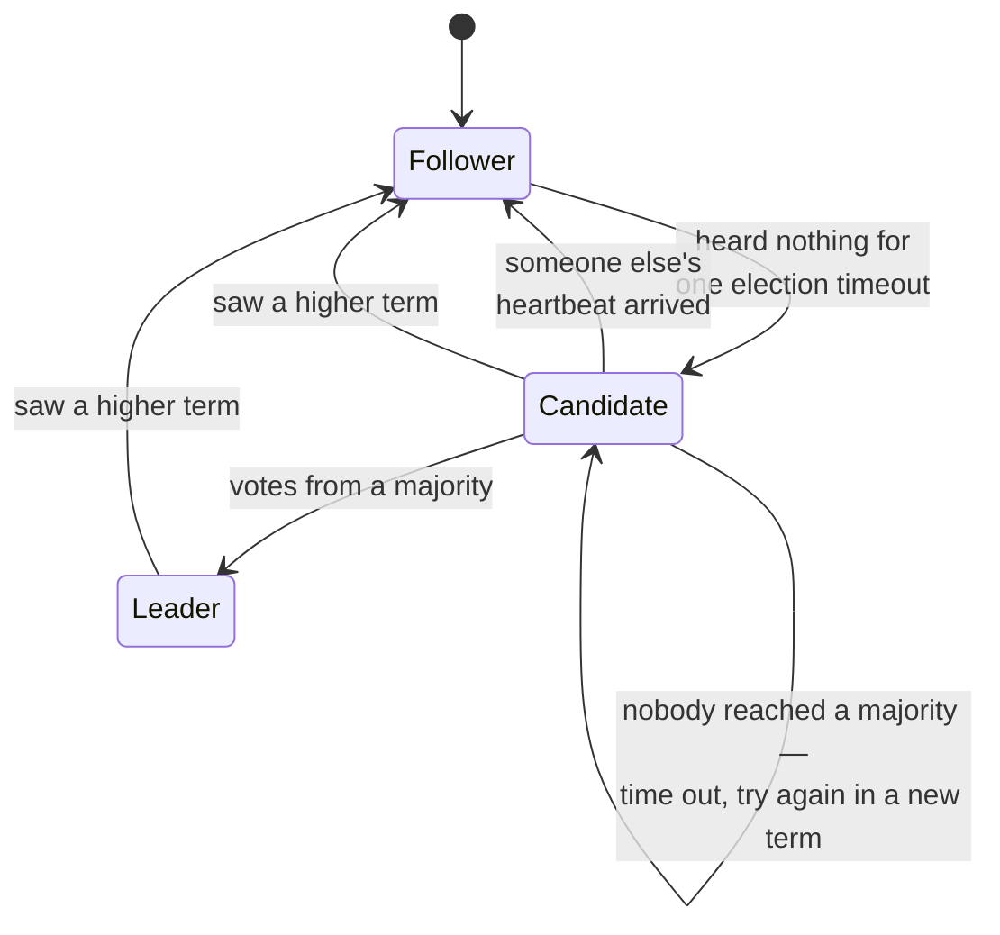
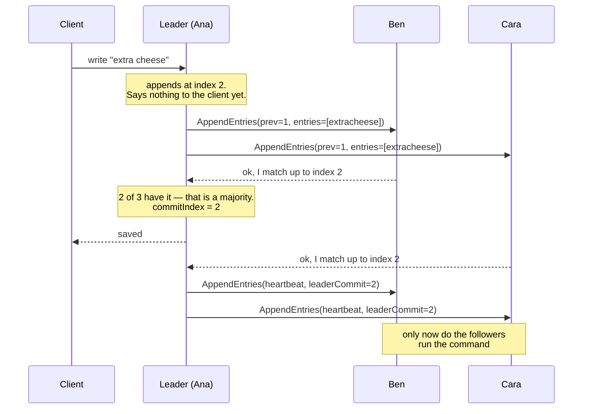
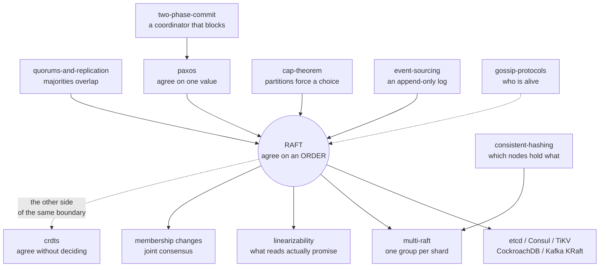

# Raft — A Learning Lab

> **The three-sentence version:** Raft keeps several machines holding the *same
> list of changes in the same order*, by electing one of them leader for a
> stretch of time and making every write flow through it. A write becomes
> permanent the moment a **majority** of machines have written it down, and the
> only servers allowed to win the next election are those whose list is at least
> as complete as the majority's — which is what makes a permanent write
> impossible to lose. Everything else in Raft, including the parts that look
> arbitrary, is a scar from a specific way that simpler version broke.

**You already know the ending.** The [`paxos`](../paxos/) lab finished on this
note: *"it guarantees it will never decide two different things; it does not
guarantee it will ever decide at all, which is why real systems bolt a leader on
top."* Raft **is** that leader, designed on purpose rather than bolted on. Diego
Ongaro and John Ousterhout's 2014 paper is literally subtitled *"In Search of an
Understandable Consensus Algorithm"* — its research goal was that people like
you could hold it in your head. This lab is the test of that claim.

**Run it:**

```bash
cd raft
java src/Tests.java             # 56 scenario checks, ~2s
java src/Experiments.java       # 11 measured failure experiments
java src/ImplExerciseTest.java  # write three rules yourself (rung 5)
java src/DebugMeTest.java       # find three planted bugs (rung 6)
open visualization.html         # the interactive cluster
```

No build tool, no dependencies, JDK 22+.
**Interactive version:** [The Raft Log Grid](https://claude.ai/code/artifact/9e9cab79-30ef-4665-b9e5-6dec2dcab932)

---

## 1. WHY — why does this thing exist?

Anything important lives on more than one machine, because one machine dies. The
moment you have copies, you have a new problem that is much nastier than losing a
machine: **the copies can disagree about what happened, and about what happened
first.**

A balance of £100 with two changes in flight — "add £50" and "take 20%" — is
£130 or £120 depending on the order. If two copies of your database apply them in
different orders, both are internally consistent, both look healthy, and they
disagree by £10 forever. Nothing crashes. No alarm fires. You discover it when a
customer does.

Raft exists so that a group of machines can agree, permanently, on **one ordered
list of changes**, while machines crash and restart and the network loses,
delays, duplicates and reorders messages. Every system that has to keep exactly
one answer — which node owns which shard, who holds the lock, what the current
config is, where the leader lives — has one of these underneath it.

## 2. PROBLEM — the pizza shop

A pizza shop takes orders by phone. Five people work there: **Ana, Ben, Cara,
Dev and Eve**. Each keeps their own order book, and every book has to end up with
the same orders written in the same numbered slots, because the orders refer to
each other: slot 1 "table 4 wants a margherita", slot 2 "table 4 — make that
extra cheese", slot 3 "table 4 — cancel". Apply those in a different order and
you either deliver a pizza nobody wanted or throw away one someone is waiting
for.

The awkward parts:

- **People leave without warning.** Ana's shift ends, Ben's phone dies mid-call.
- **Nobody can see anyone else's book.** They can only shout messages across a
  noisy kitchen, and shouts get lost, arrive late, or arrive twice.
- **You cannot wait for everyone.** If the rule is "write it down only when all
  five have confirmed", one person in the walk-in freezer stops the shop.

Get all five books to hold the same orders in the same slots, forever, even
though people vanish mid-sentence.

> **🔮 Predict:** *Why is "just have everyone write down whatever they hear"
> not good enough?*
> <details><summary>Reveal</summary>
> Because two phones can ring at the same time. Ana hears "margherita" and Cara
> hears "pepperoni", and both write into slot 1. Neither did anything wrong.
> Their books now differ at slot 1 and every slot after it, and there is no rule
> anywhere that says which one was "really" first — because there is no such
> thing as *really first* in a system with no shared clock.
> </details>

## 3. NAIVE SOLUTION — "everyone writes down what they hear"

The obvious design: whoever answers the phone writes the order in the next free
slot and shouts it to the other four, who copy it into the same slot.

It is simple, it needs no coordination, and it is fast — nobody waits for
anybody.

## 4. FAILURE — two phones ring at once

Ana takes "margherita" and writes it in slot 1. At the same moment Cara takes
"pepperoni" and writes it in slot 1. Each shouts. Ben hears Ana first and writes
margherita; Dev hears Cara first and writes pepperoni.

Now the shop has two different slot 1s and no way to pick. Worse, everything
after slot 1 is built on top of a slot that means different things to different
people — "table 4, extra cheese" in slot 2 modifies a *different pizza*
depending on whose book you read.

The obvious patch — "before writing, ask the other four whether slot 1 is free"
— fails in two ways at once. If two people ask simultaneously they can both hear
"free". And if two people are away, you never get four answers, so the shop stops
even though three perfectly good people are standing there.

**The deeper problem the failure reveals.** This is not really about *who writes
slot 1*. It is that a group with no shared clock has no notion of "first", and
any rule that needs unanimity is hostage to its slowest member. You cannot patch
your way out; you need a rule that manufactures an ordering and that only ever
needs *most* of the group.

## 5. THE REAL REQUIREMENT — what we actually need

Say it in plain words, because everything after this is the pursuit of exactly
these five sentences:

1. **One order per slot, forever.** Once anyone has been told "slot 3 is
   settled", no book may ever hold anything else at slot 3.
2. **Same order everywhere.** Any two books that both have slot 3 filled in
   agree on slots 1 and 2 as well.
3. **A minority can be away.** The shop keeps working with two of five people
   missing.
4. **Coming back is automatic.** Someone who returns after an hour catches up
   with no human involved.
5. **Being wrong is never allowed; being stuck is allowed.** If too many people
   are away, the shop must *refuse* orders rather than guess.

Point 5 is the trade, and it is worth stopping on. You already met it in the
[`cap-theorem`](../cap-theorem/) lab as the CP corner: when the group is split,
the side that cannot reach a majority refuses to answer instead of answering
possibly-wrong. Raft is that choice made concrete.

## 6. KEY IDEA — the invention

> **Elect one person to be in charge for a while. Only that person writes into
> the books, so slots have exactly one meaning. An order counts as settled the
> moment *most* people have copied it down. And you are only allowed to become
> the next person in charge if your book is at least as complete as most
> people's.**

That is the whole of Raft. Four sentences. Every remaining page is either an
explanation of one of them, or a repair to a version of one of them that broke.

The last sentence is the clever one and the easiest to skip past. Hold onto it:
*being in charge is a privilege you have to qualify for by already knowing
everything that was settled.*

## 7. TERMINOLOGY — the words, now that you need them

You have met two of these before. The rest are new.

### Log, entry, index — *the order book*

- **Plain meaning:** the numbered list of changes.
- **Technical meaning:** an append-only sequence. Each **entry** holds a command
  and the term it was created in. Its position is its **index**, counting from 1.
- **Why the word exists:** to separate the *record of changes* from the *result
  of applying them*. Two servers may hold the same log and be part-way through
  applying it; the log is the truth, the result is a replay of the log.
- **Concrete:** Ana's log is `[margherita@t1, extracheese@t1, cancel@t2]`. Index
  2 holds `extracheese`, created while term 1 was in force.
- **Connects to:** exactly the event stream from
  [`event-sourcing`](../event-sourcing/) — an immutable append-only sequence
  folded into current state. Raft is that idea with the *replication* problem
  solved.

### State machine — *the pizzas, not the order book*

- **Plain meaning:** whatever the log is a list of instructions *for*.
- **Technical meaning:** a deterministic program fed the committed entries in
  order. Same log, same starting point ⇒ same result, on every server. Raft is
  formally a **replicated state machine** protocol: it does not replicate *data*,
  it replicates *the sequence of changes*, and each server derives its own copy.
- **Why the word exists:** to make the correctness argument tiny. If the state
  machine is deterministic, then agreeing on the log is *sufficient* — you never
  have to compare the resulting states at all.
- **Concrete:** the log `[set x=1, set y=2, set x=3]` applied to an empty map gives
  `{x:3, y:2}` on every server, always.
- **Connects to:** the fold in [`event-sourcing`](../event-sourcing/). Identical
  idea; Raft supplies the part that lab assumed — getting every replica the same
  stream.

### Term — *"whose shift is this?"*

- **Plain meaning:** a numbered stretch of time with at most one person in charge.
- **Technical meaning:** a monotonically increasing integer. Every attempt to
  become leader starts a new term. Every message carries the sender's term, and
  **a bigger term always wins**: any server that sees one immediately becomes a
  follower and adopts it.
- **Why the word exists:** it is a logical clock that costs one integer.
  Distributed systems cannot order events by wall clock, but they *can* order
  them by "which leadership attempt was this part of". Term comparison replaces
  time comparison everywhere in Raft.
- **Concrete:** Cara is on term 3 and receives a message stamped term 5. She
  does not argue, does not check anything else — she sets her term to 5 and
  becomes a follower.
- **Connects to:** the **proposal number** from [`paxos`](../paxos/). Same job —
  a total order over attempts — but Raft spends it on *shifts* rather than on
  individual values, which is why one term covers thousands of writes.

### Leader, follower, candidate — *the three things a server can be*

- **Follower** (the default): answers messages, never initiates. **Leader**: the
  only server that accepts client writes. **Candidate**: a follower that got
  bored of waiting and is asking for votes.
- **Why three and not two:** the middle state exists so that "I am trying to be
  leader" is a real, visible condition with its own rules, rather than a
  half-finished leader. A candidate has no authority at all.
- **Concrete:** Dev has heard nothing for 200 ms, becomes a candidate for term 4,
  and asks the other four to vote for him.

### Majority (quorum) — *"most of us"*

- **Plain meaning:** more than half — 3 of 5, 2 of 3, 4 of 7.
- **You already know why this number:** the
  [`quorums-and-replication`](../quorums-and-replication/) lab is entirely about
  the fact that **any two majorities must share at least one member**. That
  overlap is the load-bearing fact in Raft too, used twice: once so two people
  cannot both win the same term, and once so a new leader cannot be missing a
  settled entry.
- **The distinction that lab drew, and it matters here:** *a consensus quorum
  decides; a read/write quorum merely intersects.* Raft's majority is the first
  kind. `R+W>N` is not what is happening here.

### Committed — *"settled, and you can say so out loud"*

- **Plain meaning:** written down by enough people that it can never be undone.
- **Technical meaning:** an entry is committed once the leader has stored it on a
  majority **and** the entry was created in the leader's own current term.
- **Why the word exists:** to name the exact boundary between "in the leader's
  book" and "safe to tell the customer". Before it, the entry can legally vanish.
  After it, no future leader may remove it. Almost every real Raft bug lives at
  this line.
- **Concrete:** a leader with `[a, b, c]` and `commitIndex = 2` is saying: *a and
  b can never change; c might still disappear.*
- **Where the second half of the rule comes from:** stage 10.4. It is the least
  obvious rule in Raft and it exists because of one specific disaster.

### Election timeout & heartbeat — *"is anyone in charge?"*

- **Election timeout:** how long a follower waits, hearing nothing, before
  declaring itself a candidate. Randomised per server, per attempt (this lab:
  150–300 ticks).
- **Heartbeat:** an empty write the leader sends on a fixed interval (this lab:
  every 50 ticks) purely so followers keep resetting their timers.
- **Why these exist:** they are Raft's entire failure detector. There is no
  health check, no monitor, no separate protocol — *silence is the failure
  signal*, and the heartbeat is how a living leader keeps proving it is alive.

### `AppendEntries` & `RequestVote` — *the only two things Raft says*

Two remote calls, each with a reply. `RequestVote` runs elections.
`AppendEntries` does everything else: replicating entries, repairing a wrong log,
telling followers what is committed, and — with an empty entry list — the
heartbeat. That is the entire protocol surface.

## 8. MENTAL MODELS — two pictures, and where the first one lies

### The simple model (carry this around)

The pizza shop. One person in charge per shift. They write the order book, shout
each order to the others, and once most people have copied it down the order is
real. When the person in charge goes quiet, whoever notices first asks to take
over — but only someone whose book is already as complete as most people's is
allowed to.

### The engineering model (this is what the code does)



Each server holds: `currentTerm`, `votedFor`, `log[]` (these three survive a
crash), plus `commitIndex`, plus — if it is the leader — two numbers about every
other server: `nextIndex[i]`, a **guess** at where to send next, and
`matchIndex[i]`, a **fact** about how far that server has actually got.

### The mapping

| Pizza shop | Raft | In the code |
|---|---|---|
| the order book | the log | `RaftNode.log` |
| slot number | index | position in `log` |
| whose shift it is | term | `currentTerm` |
| person in charge | leader | `role == LEADER` |
| shouting an order | `AppendEntries` | `sendAppend()` |
| "still here!" every few seconds | heartbeat | `AppendEntries` with no entries |
| most people have copied it | committed | `advanceCommit()` |
| "can I take over?" | `RequestVote` | `startElection()` |
| "not with a book like that" | refusing a candidate whose book is behind | `candidateUpToDate()` |

### Where the analogy breaks — read this before you trust it

1. **The shop has one room; Raft has no room.** Ana cannot see that Cara is
   holding up her hand. Every fact one server has about another arrived as a
   message that may be *minutes old and describe a world that no longer exists*.
   This is why every message carries a term: it is the only way to notice you are
   acting on stale news.
2. **Nobody hands over.** In the shop you imagine Ana saying "Ben, you're in
   charge". That never happens in Raft. Ana usually does not know she has stopped
   being leader. Two people genuinely believe they are in charge at the same
   time, routinely — and Raft is *fine with that*, because the older one can
   never assemble a majority. **"Only one leader" is false. "Only one leader per
   term, and only the newest can commit" is true.**
3. **Copying is not one-directional.** A follower whose book is wrong does not
   politely append — it **deletes its own entries** to match the leader. The shop
   analogy makes this feel like vandalism. In Raft it is legal precisely because
   only *uncommitted* entries can ever be deleted.
4. **There is no "settled" ceremony.** Nobody announces a commit. The leader just
   notices that a majority replied, and mentions the new commit point on the next
   ordinary message. Followers find out *later*, and that lag is normal.

## 9. VISUALIZATION — see it before you read the rules

Open **[The Raft Log Grid](https://claude.ai/code/artifact/9e9cab79-30ef-4665-b9e5-6dec2dcab932)**
(also saved as `visualization.html`).

**What to look at, in this order.** Each row is one server; each column is one
slot in the log — so the same column across five rows is *the same slot on five
machines*, and disagreement shows up as two different colours stacked in one
column. Colour = the term an entry was created in. A **solid** cell is committed
and can never change; a **dashed** cell is written down but still deletable.

Three things to try before reading on:

1. Press **Play** and watch nothing happen for a moment — then one server's timer
   runs out and the election takes about three exchanges.
2. Press **Send a write to the leader**, and watch the gap between *the leader
   has it* (dashed) and *it is committed* (solid). That gap is the entire
   difference between "saved" and "probably saved".
3. Set **Tear the network** to `S1 and S2 (2 | 3)` and watch the small side
   accept writes it can never finish, while the big side elects a newer leader
   and carries on.

The **Guess first, then watch** cards at the bottom each ask a question, take
your answer, and then run the scenario. Being wrong on those is the fastest part
of this lesson.

Here is the same message flow as a sequence, for one successful write:



> **✅ BEGINNER MODEL — checkpoint**
>
> You can now explain what Raft is for, why one leader per numbered shift is the
> trick, and why "a majority has it" is the moment a write becomes real. That is
> enough to follow a design discussion and to read an etcd outage postmortem.
>
> **Next:** the actual mechanism, message by message — and the four places where
> the obvious version of it is subtly, catastrophically wrong.

---

## 10. ACTUAL MECHANISM — built four times, broken three

We will build Raft the way you would build it: the obvious version first, then
watch it break, then fix it. **Every rule in Raft that looks arbitrary is a scar
from one of these breaks.** If you only remember the finished rules you will
forget them; if you remember the disasters, the rules are obvious.

### 10.1 — Elections, v1: "first to notice takes over"

The rule: a follower that has heard nothing for a while declares itself
candidate, increments the term, votes for itself, and asks everyone else. A
majority of votes makes it leader.

Concretely, five servers boot at once with empty logs. Nobody is leader, so
nobody sends heartbeats, so eventually somebody's timer fires:

```
t=172   S0 starts an election for term 1 (its log ends at index 0, term 0)
t=173   S4 steps down to follower, term 0 -> 1
t=176   S1 steps down to follower, term 0 -> 1
t=180   S0 WINS the election for term 1 with 3/5 votes [0, 1, 4]
```

Twelve messages, eight of them delivered, one leader. (`java src/Experiments.java
election`.)

> **🔮 Predict:** *Everyone boots at the same instant and everyone's timer is
> the same length. What happens?*
> <details><summary>Reveal</summary>
> All five time out on the same tick. All five become candidates for term 1. All
> five vote for themselves. Each has exactly 1 of 5 votes; nobody reaches 3. They
> all time out again, together, in term 2. And term 3. Measured over 6000 ticks
> with identical timeouts: <b>term 40 reached, leader elected: NEVER, safety
> violations: 0</b>. The cluster is perfectly correct and completely useless.
> </details>

**The fix: randomise the timeout.** Each server picks a fresh random wait in a
range (150–300 ticks here) *every time it resets*. One server almost always wakes
noticeably before the others, wins before anyone else even starts, and its
heartbeat resets everybody.

Measured over 200 cold starts (`java src/Experiments.java split-vote`):

| | identical timeouts | random 150–300 |
|---|---|---|
| leader elected | **never**, in 6000 ticks | **200 / 200** |
| terms burned | 40 and climbing | 1 in 199 runs, 2 in 1 run |
| time to first leader | — | 155 / 174 / 332 ticks (min/median/max) |
| safety violations | 0 | 0 |

Note what randomisation does *not* do: it does not make split votes impossible.
It makes them **self-correcting** — each retry re-rolls the dice, so the chance
of n consecutive collisions vanishes. One of the 200 runs did split, and resolved
on the next term.

This is your first sighting of the distinction that runs through the rest of the
lesson: the identical-timeout cluster never did anything *wrong*. It just never
did anything. **Safety** and **liveness** fail in completely different ways.

### 10.2 — Replication, v1: "send the new entry to everyone"

The leader appends the client's command to its own log and sends it out. A
follower appends what it receives. When a majority have it, the leader marks it
committed and tells the client "saved".

This works beautifully — right up to the first server that misses a message.

> **🔮 Predict:** *Cara was switched off while entries 1, 2 and 3 were written.
> She comes back. The leader — who has no idea she was away — sends her entry 4.
> She appends it. What is in her book?*
> <details><summary>Reveal</summary>
> <code>[_, _, _, entry4]</code> — with entry 4 sitting at index <b>1</b>, because
> that was her next free slot. Her book now says slot 1 is entry 4. Every other
> book says slot 1 is entry 1. Nothing has crashed, no error was returned, and
> the leader believes Cara is fully caught up. The two books will never agree
> again.
> </details>

**The fix: never accept an entry without proving the prefix already matches.**
Every `AppendEntries` carries the index and term of the entry *immediately
before* the ones being sent — `prevLogIndex` and `prevLogTerm`. The follower
accepts only if its own log has that exact (index, term) pair. Otherwise it
rejects.

Why one comparison is enough for the whole prefix — this is the **Log Matching
Property**, and it is the most elegant thing in Raft:

> If two logs contain an entry with the same index and the same term, then the
> logs are **identical in every entry up through that index**.

It holds by induction. A leader never changes an entry it has already written, so
an (index, term) pair identifies one specific entry, created once, by one
specific leader. And that entry was only ever accepted by a follower that had
already proved *its* predecessor matched. So agreement at index *i* certifies
agreement at *i−1*, which certifies *i−2*, all the way down. **One integer
comparison certifies unlimited history.** No checksums, no diffing, no Merkle
trees.

When you turn this check off (`Bugs.noLogMatchCheck`), the follower says yes to
everything, tells the leader "I'm at index 3" while holding nothing, and the
leader believes it:

```
with the prefix check ON   : S2 log = [w1@t1 w2@t1 w3@t1 w4@t1 w5@t1 w6@t1]   (repaired)
with the prefix check OFF  : S2 log = [d@t2]                                   (a hole, forever)
                             LOG MATCHING broken: S1 and S2 agree on slot 1 but differ...
```

### 10.3 — Voting, v1: "a higher term wins the vote"

A candidate has a bigger term than you, so you step down and vote for it. Simple,
and it is what a term is *for*.

> **🔮 Predict:** *Ana and Ben have committed "transfer £500" — a majority of
> three, so the customer has been told it succeeded. Ana then dies. Cara, who was
> switched off for the whole thing and has an empty book, comes back and asks to
> be leader with a higher term. Ben votes yes. What happens to the £500?*
> <details><summary>Reveal</summary>
> It is deleted. Cara becomes leader with an empty log. The first entry she
> writes goes into slot 1. Ben's slot 1 currently holds the transfer, with a
> different term — a conflict — so Ben <b>deletes his own entry</b> and takes
> Cara's. A transaction that was acknowledged to a customer no longer exists on
> any machine. Measured, with the check disabled:
> <code>S1's log afterwards: [overwrite@t2]</code> and
> <code>STATE MACHINE SAFETY broken: index 1 was committed as committed-write@t1</code>.
> </details>

**The fix: a term is not a qualification.** Before granting a vote, compare the
candidate's *last log entry* with your own, and refuse if yours is more complete:

```java
boolean candidateUpToDate(int candLastIndex, int candLastTerm) {
    if (candLastTerm != lastLogTerm()) return candLastTerm > lastLogTerm();
    return candLastIndex >= lastLogIndex();
}
```

Later **term** wins; if the terms tie, the longer log wins. Term is compared
first — a short log ending in term 5 beats a long log ending in term 4, because
term 5 happened later and everything in it supersedes.

**Why this one function is the whole safety argument.** A committed entry sits on
a majority. A candidate needs votes from a majority. Two majorities always
overlap (the fact from the [`quorums-and-replication`](../quorums-and-replication/)
lab), so **at least one voter holds the committed entry** — and that voter
refuses anyone who does not. Therefore every leader that ever wins already has
every committed entry. This is the **Leader Completeness Property**, and it is
why Raft never needs to copy anything *backwards* from followers to a new leader.

Measured over 200 leader crashes: **0 new leaders were missing the committed
write** (`java src/Experiments.java leader-crash`).

### 10.4 — Committing, v1: "a majority has it, so it's safe"

The last of the four, and the one nobody guesses. The rule looks self-evident:
count how many servers have index *N*; if it is a majority, index *N* is
committed.

> **🔮 Predict:** *Entry `OLD` was created in term 1. It is now sitting on four
> of five servers — a clear majority — and the current leader can see that. Is
> it safe to tell the client `OLD` succeeded?*
> <details><summary>Reveal</summary>
> <b>No.</b> This is Figure 8 of the Raft paper, and it is the single most
> surprising thing in the algorithm. A fifth server that was offline can hold a
> <i>different</i> entry at that same index, created in term <b>2</b>. Because
> term 2 is later than term 1, that server's log counts as more up to date, so it
> can still win an election — and when it does, it overwrites the index on all
> four others. "A majority has it" and "it can never be removed" are <b>not the
> same statement</b>.
> </details>

`java src/Experiments.java figure8` drives that exact history by hand. With the
naive count-the-replicas rule:

```
own-term commit rule OFF (bug)
  S0 DEAD      term=3  commit=1  log=[OLD@t1]  applied=[OLD]
  S1 FOLLOWER  term=4  commit=1  log=[NEW@t2]  applied=[OLD]
  S4 LEADER    term=4  commit=1  log=[NEW@t2]  applied=[NEW]
  !! STATE MACHINE SAFETY broken: index 1 was committed as OLD@t1 but S1 has committed NEW@t2 there
  !! STATE MACHINES DIVERGED: at position 0 S0 applied "OLD" but S4 applied "NEW"
```

Four servers were told `OLD` was permanent. It is gone.

**The fix, in five words: only commit your own term.** A leader may only mark
index *N* committed when `log[N].term == currentTerm`.

```java
boolean ownTerm = log.get(n).term() == currentTerm;
if (count >= majority() && ownTerm) { commitIndex = n; }
```

Why that closes it: an entry from the leader's *current* term can only be
overwritten by a leader of a *later* term, and any such leader needed a majority
of votes, and a majority contains someone holding this entry, and the up-to-date
check makes that someone refuse. The old-term entry had no such protection,
because a competing entry at the same index could carry a *higher* term and still
look fresher.

And old entries are not stranded: **they get committed for free, underneath.**
The moment the new leader commits one entry of its own, everything below it in
the log is committed by the Log Matching Property. In practice a real leader
appends a **no-op** entry immediately on winning, precisely to trigger this.

With the same history and the rule switched on:

```
own-term commit rule ON (real Raft)
  S1 FOLLOWER  term=4  commit=0  log=[NEW@t2]  applied=[]
  S4 LEADER    term=4  commit=0  log=[NEW@t2]  applied=[]
  violations: none
```

Nothing was committed, so nothing was lost. `OLD` vanishing is now *correct* —
nobody was ever told it succeeded.

### 10.5 — Repair: how a wrong log gets fixed

The leader keeps two numbers per follower: `matchIndex[i]`, the highest index it
*knows* that follower has, and `nextIndex[i]`, the index it will *try* next. On
winning an election it optimistically sets every `nextIndex` to its own log end.

Then it probes. Each rejection means "we don't agree that far back", so it
decrements `nextIndex` and tries again. Once the follower says yes, the leader
sends everything above that point, and the follower deletes any of its own
entries that conflict.

**The leader never diffs the logs.** The follower's yes/no on `(prevLogIndex,
prevLogTerm)` is an oracle, and the leader walks it backwards until it hits
agreement.

Two measured cases (`java src/Experiments.java log-repair`), because how far it
walks is not obvious:

```
CASE A — follower far behind (missed six writes; new leader holds all six)
  S1 optimistically sets nextIndex[S2] = 7
  rejections before the logs agreed : 6     (7,6,5,4,3,2,1)
  messages spent on the repair      : 47

CASE B — follower divergent (five entries that were never committed)
  nextIndex[S0] on the new leader = 2   <-- frozen at election time, when its log was short
  rejections before the logs agreed : 0
  messages spent on the repair      : 40
  repaired S0 log: [keep@t1 real-1@t2 real-2@t2]   -- five ghost entries deleted in one message
```

Case B surprises people: five wrong entries were removed with **zero**
rejections, because a single conflicting entry causes the follower to truncate
its whole tail. And case A is the expensive one even though nothing was *wrong* —
being behind costs a round trip per missing entry. Real Raft fixes exactly this
by returning the conflicting **term** in the rejection so the leader can skip a
whole term per round trip.

### 10.6 — One more thing that looks like a bug and is not

After a leader change, a follower's leftover **uncommitted** entries are *not*
deleted straight away. They survive until the new leader appends something of its
own. `Tests.noOpLessonTest` demonstrates it:

```
an_uncommitted_entry_is_NOT_deleted_just_because_a_new_leader_appeared   PASS
that_divergence_is_safe_because_nothing_was_ever_committed_there         PASS
the_new_leaders_first_own_write_is_what_finally_deletes_it               PASS
```

Two logs genuinely disagree, for a while, and it is fine — nobody was ever told
those entries were safe. But it is untidy, and it delays the commit of everything
inherited from the previous term. Which is the second reason real systems append
a no-op on election.

> **✅ INTERMEDIATE MODEL — checkpoint**
>
> You can now walk through a Raft election and a Raft write message by message,
> and you can explain the four rules that look arbitrary — randomised timeouts,
> the prefix check, the up-to-date check, and the own-term commit rule — by
> naming the specific disaster each one prevents. That is enough to read the
> paper.
>
> **Next:** what actually happens under each kind of failure, which guarantee
> bends, and which one never does.

---

## 11. FAILURE SCENARIOS — every one, made and watched

Each of these is reproducible. "Watch it" gives the visualization control or the
experiment command; the last two columns are the point — **which promise still
holds, and which one is temporarily suspended.**

### 11.1 The leader crashes

**Make it:** click a leader row in the visualization → *Crash it*; or
`java src/Experiments.java leader-crash`.
**What happens:** heartbeats stop. Followers' election timers run down. The first
to expire becomes a candidate in a new term and — because of the up-to-date check
— can only win if it already holds everything committed. Measured over 200 runs:
recovery in **154 / 182 / 243 / 488** ticks (min/p50/p95/max), **0** failures to
recover, **0** new leaders missing the committed write.
**Why that shape:** the gap is *one election timeout plus one round trip*, not
"timeout × retries", because the winner is decided in a single exchange.
**Holds:** nothing committed is lost; no two servers disagree.
**Suspended:** availability. For those ~180 ticks the cluster answers nothing.
**In production:** this is the visible outage in every etcd/Consul incident — a
sub-second write stall on leader failover. You tune it with the election timeout,
and the tuning is a straight trade against false failovers.

### 11.2 A follower crashes, or just falls behind

**Make it:** crash any non-leader.
**What happens:** nothing, as long as a majority survives. The leader keeps
committing on the remaining majority; `nextIndex` for the dead server stops
moving. On restart it is repaired automatically (stage 10.5).
**Holds:** everything.
**Suspended:** nothing — except your margin. At 5 servers you tolerate 2 failures;
with one already down, the next one costs you the cluster.
**In production:** the number to watch is not "is it up" but **how far behind**.
A follower far enough behind that the leader has already discarded the entries it
needs must instead be sent a copy of the whole current state — a **snapshot**
(stage 15).

### 11.3 The network splits, and the old leader is on the small side

**Make it:** visualization → *Tear the network between S1 and S2 (2 | 3)*; or
`java src/Experiments.java partition`.
**What happens:** the old leader keeps accepting writes and can never commit
them — its `commitIndex` freezes. The three-server side elects a new leader in a
higher term and carries on committing. **Two leaders exist at the same moment**,
in different terms.
**Why it is safe:** committing requires a majority, and the small side does not
have one. Its writes pile up unacknowledged.
**Holds:** every safety property, without exception. Measured: `safety violations
so far: 0` throughout the split.
**Suspended:** availability *on the minority side*, and only there.
**In production:** clients talking to the old leader hang or time out; they must
not treat a timeout as failure, because the write may still commit if the
partition heals in time. This is the CP choice from
[`cap-theorem`](../cap-theorem/), and this is exactly what it costs.

### 11.4 The partition heals and the old leader comes back

**Make it:** set the tear back to *nowhere*, in the same run.
**What happens:**

```
t=637  S1 steps down to follower, term 1 -> 2 (saw a higher term from leader S2)
t=637  S1 deletes its own entries from index 2 (had ghost-1@t1, leader says real-1@t2)
t=638  S0 steps down to follower, term 1 -> 2
t=638  S0 deletes its own entries from index 2
```

The old leader learns of the higher term from the very first message and steps
down without argument. Its unacknowledged writes are deleted.
**Holds:** everything — deletion only ever touches uncommitted entries.
**Suspended:** nothing, but *this is where a client can be hurt*. A client whose
write was accepted and then deleted got no error at any point; it simply never
got a success either. **Timeouts are not failures. A retry must be idempotent.**
That is the same conclusion the
[`transactional-outbox`](../transactional-outbox/) and
[`quorums-and-replication`](../quorums-and-replication/) labs reached from two
other directions.

### 11.5 Messages are lost

**Make it:** the *Drop* slider; or `java src/Experiments.java loss`.
**What happens** (30 seeds per row):

| drop rate | elected a leader | avg final term | writes committed | safety violations |
|---|---|---|---|---|
| 0 % | 30/30 | 1 | 30/30 | 0 |
| 10 % | 30/30 | 1 | 30/30 | 0 |
| 20 % | 30/30 | 2 | 30/30 | 0 |
| 30 % | 30/30 | 5 | 30/30 | 0 |
| 50 % | 30/30 | 23 | **7/30** | 0 |
| 70 % | 26/30 | 40 | 0/30 | 0 |
| 90 % | **0/30** | 54 | 0/30 | 0 |

**Why that shape:** loss does not corrupt anything, it only makes leaders fail to
land heartbeats inside one election timeout. Past ~50% the cluster spends all its
time re-electing.
**Holds:** every safety property, at every loss rate, including 90%.
**Suspended:** liveness, smoothly and then completely.
**In production:** the observable symptom is **leader elections per minute
climbing** — the single most useful Raft alarm there is. It means "the network is
sick", never "the data is wrong".

### 11.6 Messages are duplicated or arrive late

**Make it:** the *Message delay* slider; `Tests.chaosTests` runs a 50% duplication
rate.
**What happens:** nothing. Every handler is idempotent by construction — a vote
reply from an old term is ignored because `r.term() != currentTerm`; a duplicated
`AppendEntries` re-appends entries the follower already has, which the term check
turns into a no-op. Measured: with every other message duplicated, the command
`only-once` was applied **exactly once** on every server.
**Holds:** everything.
**Suspended:** nothing.
**In production:** this is why Raft can run over a plain unreliable transport with
retries and no deduplication layer.

### 11.7 A split vote

**Make it:** switch the visualization to *Identical* timeouts and press Reset,
Play.
**What happens:** with identical timeouts, forever (term 40+ and climbing, no
leader, 0 violations). With random timeouts, once in 200 cold starts, resolved on
the next term.
**Holds:** safety, completely.
**Suspended:** liveness — and this is the clean demonstration that the two are
independent.
**In production:** the equivalent is a cluster whose timeouts are too tight for
its network. The fix is the same: more spread, longer timeouts.

### 11.8 A server restarts

**Make it:** crash then restart any server.
**What happens:** it comes back with `currentTerm`, `votedFor` and its `log`
intact, and with `commitIndex` and its state machine at zero. It rebuilds by
replaying its log as the leader tells it what is committed.
**Why exactly those three survive:** they are precisely the state real Raft
`fsync`s before replying to any message. Losing `votedFor` would let a server vote
twice in one term across a crash — two leaders in one term. Losing `currentTerm`
would let it accept an old leader.
**Holds:** everything. `no_safety_violation_across_a_crash_and_a_restart` passes.
**Suspended:** nothing.
**In production:** this is the line where a "fast" Raft implementation becomes an
unsafe one. Buffering the vote instead of flushing it is a real, shipped bug
class.

### 11.9 The heartbeat is too slow for the timeout

**Make it:** `java src/Experiments.java heartbeat`.

| heartbeat interval | election timeout | terms burned in 10k ticks | stable? |
|---|---|---|---|
| 10 | 150–300 | 0 | yes |
| 50 | 150–300 | 0 | yes |
| 100 | 150–300 | 0 | yes |
| 140 | 150–300 | 0 | yes |
| 200 | 150–300 | 48 | **no — churning** |
| 400 | 150–300 | 52 | **no — churning** |

**Why:** once one heartbeat interval approaches the *minimum* election timeout,
followers start timing out on a perfectly healthy leader, and the cluster spends
its life re-electing.
**Holds:** safety.
**Suspended:** all useful work.
**In production:** the paper's rule of thumb is `broadcastTime ≪ electionTimeout ≪
MTBF`. etcd ships 100 ms heartbeat against a 1000 ms election timeout — a 10×
margin — and its docs warn specifically about raising the heartbeat for
cross-datacentre clusters without raising the timeout too.

### 11.10 Everything at once

`java src/Experiments.java soak` — 20 clusters × 300 rounds of random crashes,
restarts, partitions and writes, with 5% packet loss throughout:

```
client writes accepted by a leader : 898
elections held (sum of final terms): 2550
SAFETY VIOLATIONS                  : 0
```

Checked *after every single tick*, not at the end.

## 12. CORRECTNESS — what is guaranteed, and what is not

### The five properties (each earned above)

| Property | What it says | Enforced by |
|---|---|---|
| **Election Safety** | at most one leader per term | one vote per term (`votedFor`) |
| **Leader Append-Only** | a leader never overwrites or deletes its own entries | `clientRequest` only appends |
| **Log Matching** | same (index, term) ⇒ identical prefixes | the `prevLogIndex`/`prevLogTerm` check |
| **Leader Completeness** | a committed entry is present in every future leader | the up-to-date vote check |
| **State Machine Safety** | no two servers apply different commands at the same index | Leader Completeness + the own-term commit rule |

`Cluster.checkSafety()` asserts all five after every tick of every test and
experiment in this lab.

### Safety versus liveness — the distinction to take away

**Safety** = nothing wrong ever happens. Raft's safety does **not** depend on
timing at all. Clocks can be arbitrarily wrong, messages arbitrarily delayed,
reordered, duplicated or lost — safety holds. Every experiment above confirms it,
including the ones where the cluster does nothing useful for 6000 ticks.

**Liveness** = something eventually happens. This *does* depend on timing, and
Raft makes no promise about it. It cannot: FLP (met in the
[`paxos`](../paxos/) lab) proves no protocol can guarantee both in an
asynchronous network with even one crash. Raft's answer is the same as
Multi-Paxos's — be always safe, and be live whenever the network behaves.

The cleanest demonstration in this lab is the pair of identical-timeout runs:
turn off randomisation and liveness dies with safety untouched; additionally turn
off the one-vote-per-term rule and you get **five leaders in one term**, safety
in ruins, while liveness looks great.

### What Raft explicitly does NOT give you

- **Fast or even correct reads, for free.** Reading from the leader's state
  machine can return stale data, because a partitioned old leader does not know
  it has been replaced. Linearizable reads need an extra mechanism: route the
  read through the log, or confirm leadership with a heartbeat round first
  (`ReadIndex`), or hold a time-based lease. Reading from a *follower* is stale by
  default. **This is the single most common misunderstanding of Raft in
  production.**
- **Protection against lying servers.** The failure model is crash-stop and
  network faults. A server that sends deliberately false terms or logs breaks
  everything. Byzantine fault tolerance is a different family of protocols.
- **Scale-out for writes.** Every write goes through one leader and lands on a
  majority. Adding servers makes you *more fault tolerant and slower*, never
  faster. Scaling writes means multiple Raft groups (one per shard) — which is
  exactly what TiKV, CockroachDB and etcd-at-scale do, and where
  [`consistent-hashing`](../consistent-hashing/) comes back in.
- **Progress with fewer than a majority alive.** 2 of 5 servers can do nothing at
  all, by design. This is not a bug to route around.

### Cost, in one table

| | |
|---|---|
| messages per committed write | 2 × (N−1): one `AppendEntries` and one reply per follower |
| round trips to commit | 1 (leader → majority → leader) |
| failures tolerated | ⌊(N−1)/2⌋ — 1 of 3, 2 of 5, 3 of 7 |
| latency floor | one round trip to the *median* follower, not the slowest |
| cost of a leader failure | one election timeout + one round trip |

That "median, not slowest" line is worth keeping: it is the same tail-latency
argument the [`quorums-and-replication`](../quorums-and-replication/) lab measured
— waiting for a majority rather than everyone is what keeps a slow replica from
setting your p99.

## 13. CODE — the eight lines that are the algorithm

The implementation is ~250 lines in [`src/RaftNode.java`](src/RaftNode.java).
Almost all of it is bookkeeping. These are the load-bearing lines, each marked
`// INVARIANT:` in the source.

**1. A vote is a one-shot resource per term** — `onRequestVote`:

```java
boolean voteFree = votedFor == -1 || votedFor == rv.candidateId();
```

Without it: two candidates both reach a majority in the same term. With
`Bugs.voteTwice` and identical timeouts, all five servers become leader of term 1
simultaneously.

**2. Being newer is not enough; you must be complete** — `candidateUpToDate`:

```java
if (candLastTerm != lastLogTerm()) return candLastTerm > lastLogTerm();
return candLastIndex >= lastLogIndex();
```

Without it: a committed write is deleted (stage 10.3).

**3. One comparison certifies the whole prefix** — `onAppendEntries`:

```java
matches = ae.prevLogIndex() <= lastLogIndex()
       && log.get(ae.prevLogIndex()).term() == ae.prevLogTerm();
```

Without it: holes and permanent divergence (stage 10.2).

**4. Followers delete their own work** — also `onAppendEntries`:

```java
if (log.get(idx).term() != e.term()) {
    while (lastLogIndex() >= idx) log.remove(log.size() - 1);
    log.add(e);
}
```

This looks dangerous and is not: by Leader Completeness, anything a leader
overwrites was never committed.

**5. Count replicas, but only for your own term** — `advanceCommit`:

```java
boolean ownTerm = log.get(n).term() == currentTerm;
if (count >= majority() && ownTerm) commitIndex = n;
```

Without it: Figure 8 (stage 10.4).

**6. A bigger term always wins, everywhere** — `stepDown`, called from all four
handlers:

```java
currentTerm = newTerm; role = Role.FOLLOWER; votedFor = -1;
```

This one rule replaces every "am I still the leader?" check you would otherwise
have to write.

**7. Randomise on every reset, not once** — `resetElectionTimer`:

```java
int spread = bugs.fixedTimeout ? 0 : cluster.rng.nextInt(ELECTION_MAX - ELECTION_MIN + 1);
```

**8. A heartbeat is just an empty write** — `tick`:

```java
if (now >= heartbeatDeadline) { for (int p : peers) if (p != id) sendAppend(p); }
```

There is no separate liveness protocol. The thing that replicates data is the
same thing that proves the leader is alive.

The rest of the lab: [`Cluster.java`](src/Cluster.java) is the clock, the fault
injection and the safety checker; [`Network.java`](src/Network.java) is the
abusable network; [`Bugs.java`](src/Bugs.java) is the five switches that turn each
rule off.

## 14. EXPERIMENTS — break it yourself

Each is `java src/Experiments.java <name>`, and each is framed as a question.

| | question | what you should see |
|---|---|---|
| `election` | how does one of five become leader? | one timer fires first; 3 votes; 12 messages total |
| `replication` | when exactly is a write safe? | the gap between *leader has it* and *majority has it* |
| `leader-crash` | how long is the cluster down? | 154 / 182 / 243 / 488 ticks over 200 runs; 0 lost writes |
| `split-vote` | why randomise timeouts? | identical → no leader in 6000 ticks; random → 200/200 |
| `partition` | which side of a 2\|3 split works? | two leaders coexist; only the majority commits; ghosts deleted |
| `log-repair` | how does a wrong log get fixed? | 6 rejections when behind, 0 when merely divergent |
| `loss` | how much loss can it take? | safety at 90% loss; liveness gone past 50% |
| `stale-candidate` | can a server that missed a write lead? | rule on → refused; rule off → the write is erased |
| `figure8` | is a majority enough to commit? | **no** — with the naive rule, 12 safety violations |
| `heartbeat` | what if heartbeats are too slow? | stable to 140, churning at 200 |
| `soak` | does any of this ever break safety? | 898 writes, 2550 elections, **0** violations |

Then go further: edit `RaftNode.ELECTION_MIN/MAX/HEARTBEAT`, set
`net.dropRate`/`duplicateRate`, or flip a flag in `Bugs` and re-run
`java src/Tests.java` to see exactly which named scenario catches it.

> **✅ ENGINEERING MODEL — checkpoint**
>
> You can now name every failure mode, say which guarantee bends under it, point
> at the line of code that holds the others up, and prove any of it by running
> something. That is the level at which you can review someone's Raft-based design
> and debug a real cluster.
>
> **Next:** everything this toy leaves out, and what real implementations do
> instead.

---

## 15. PRODUCTION — from this toy to etcd

### The chain

**This lab** → five objects passing messages through an in-memory network you can
delay, drop and partition, on a logical clock.
**A real implementation** → the same state machine, plus disk, plus snapshots,
plus a way to change the membership, plus batching, wrapped in a library
(`etcd-io/raft` in Go, `tikv/raft-rs` in Rust, `hashicorp/raft`).
**A production system** → that library under a key-value store, replicated across
availability zones, with clients that retry idempotently and monitoring that
watches election rate.

### What this lab leaves out, and how real systems handle it

| Omitted here | Why it matters | What real Raft does |
|---|---|---|
| **Disk persistence** | we keep `currentTerm`, `votedFor` and the log in memory | `fsync` all three *before* replying to any RPC. This is usually the latency floor of the whole system; group commit and batching exist to amortise it |
| **Log compaction** | our log grows forever | periodic **snapshots** of the state machine, then discard the log prefix. A follower too far behind gets `InstallSnapshot` instead of entries |
| **Membership changes** | our cluster is fixed at 5 | changing membership naively can produce two disjoint majorities. Raft's answer is **single-server changes** (add or remove one at a time, so old and new majorities always overlap) or **joint consensus** for bigger moves |
| **Batching & pipelining** | one entry per round trip here | real leaders send many entries per `AppendEntries` and keep several in flight per follower. This is where the throughput is |
| **Linearizable reads** | we do not implement reads at all | **ReadIndex** (confirm leadership with a heartbeat round, then read at the committed index) or a **leader lease** (cheaper, but relies on bounded clock drift) |
| **Pre-vote** | a rejoining server with an inflated term disrupts a healthy leader | run a "would you vote for me?" round *without* incrementing the term; only start a real election if a majority says yes |
| **Leadership transfer** | our leaders die, they never resign | a leader being drained for maintenance can hand over: catch the target up, then tell it to start an election immediately |
| **Client dedup / exactly-once** | our client never retries | clients attach a session id and sequence number; the state machine remembers the last result per session, so a retried write is answered, not re-applied. Same conclusion as [`transactional-outbox`](../transactional-outbox/) |
| **Faster log repair** | we back up one index per round trip | rejections carry the follower's conflicting term and its first index for that term, so the leader skips a whole term per round trip |
| **Learners / non-voting members** | every server votes here | new replicas join as learners and catch up without affecting the majority size |
| **Transport security** | messages are plain objects | mutual TLS between peers — see [`tls`](../tls/) |

### What an on-call engineer actually watches

- **Leader elections per minute.** The single best Raft health signal. Steady
  state is ~0. Anything sustained means the network, the disk, or the timeouts.
- **fsync / WAL write latency.** A slow disk on the leader looks exactly like a
  slow network: heartbeats land late, followers time out, the cluster churns.
  This is the most common real cause of "etcd is unstable".
- **Commit index lag per follower.** Catches the replica that is quietly falling
  behind and is about to need a snapshot.
- **Proposal latency and failed proposals.** A proposal that fails because the
  leader changed mid-flight is normal and must be retried idempotently.
- **Database size vs quota.** etcd refuses writes when its backend hits the quota,
  and the symptom is a cluster that elects fine and commits nothing.

### The trade-offs, stated plainly

Raft buys you *one ordered history that survives a minority failing*, and it pays
for it with:

- **a write round trip to a majority** — you cannot beat the speed of light to
  your second availability zone;
- **no write scaling** — more servers means more fault tolerance and more
  latency, never more throughput;
- **an outage on every leader change**, measured in one election timeout;
- **an absolute refusal to serve a minority**, which is a feature until the day
  you lose a whole datacentre and want the survivors to keep working.

Choose it for the things that must be exactly one — configuration, membership,
locks, shard ownership, leader identity, sequence allocation. Do not choose it for
bulk data: put the *decisions* in Raft and the *data* wherever it belongs. That
is precisely why etcd is small and Kubernetes is large.

> **✅ PRODUCTION MODEL — checkpoint**
>
> You can now say what a real Raft implementation contains that this one does
> not, why each of those pieces exists, and what you would monitor and tune. You
> can read the etcd operations guide and the Raft paper's sections 6–8 without
> anything being new.

## 16. EXERCISES

[`EXERCISES.md`](EXERCISES.md) — eight rungs, from "say it back in your own
words" to "design a config store across three datacentres". Answers in
[`SOLUTIONS.md`](SOLUTIONS.md); try first.

Two of the rungs are code:

```bash
java src/ImplExerciseTest.java   # rung 5: implement three rules yourself (8 of 16 fail at the start)
java src/DebugMeTest.java        # rung 6: three planted bugs, one per method (3 of 16 fail)
```

## 17. KNOWLEDGE MAP & NEXT STEPS



**Where this sits.** [`paxos`](../paxos/) answers *"can a group agree on one
value?"*. Raft answers *"can a group agree on an unbounded ordered sequence of
values, and can a human understand how?"*. [`two-phase-commit`](../two-phase-commit/)
had a coordinator whose death blocked everyone; Raft's leader dies routinely and
costs one election timeout, because leadership is a *lease decided by vote*, not
an appointment.

**Commonly confused with — the one sentence that separates each:**

- **Raft vs Paxos.** Same guarantees. Raft restricts the design (a strong leader,
  logs that only ever grow forward, elections that only complete-log candidates
  can win) to trade some flexibility for a protocol you can hold in your head.
- **Raft vs Multi-Paxos.** Practically the same algorithm. Multi-Paxos permits
  holes in the log and out-of-order commits; Raft forbids both, which is most of
  why it is easier.
- **Raft's majority vs a read/write quorum.** A consensus quorum **decides** an
  order; `R+W>N` merely guarantees two sets **intersect**. They coincide at
  "2 of 3", which is why they get merged in people's heads — see
  [`quorums-and-replication`](../quorums-and-replication/).
- **Raft vs primary-backup replication.** Both have one writer. Only Raft can
  *choose a new one safely* without an external arbiter — that is the entire
  difference, and it is why "just use a leader" is not an answer.
- **Raft vs 2PC.** 2PC makes *different* systems commit *one* transaction
  atomically. Raft makes *identical* replicas agree on *every* transaction's
  order. They compose: real distributed databases run 2PC across shards, with
  each shard's participants replicated by Raft.
- **Raft vs gossip.** Gossip spreads facts that will eventually agree, cheaply,
  with no leader. Raft decides facts that must agree *immediately and forever*,
  expensively. See [`gossip-protocols`](../gossip-protocols/).
- **Raft vs CRDTs.** You already have the sentence from the
  [`crdts`](../crdts/) lab: *CRDTs guarantee that everyone ends up agreeing; they
  do not guarantee that what everyone agrees on was ever allowed.* Raft is what
  you buy when the invariant matters — `stock >= 0`, one owner per shard, a
  balance that cannot go negative. CRDTs let both sides keep writing during a
  partition; Raft makes the minority stop. **That is the same boundary seen from
  its two sides**, and choosing between them is choosing whether your invariant
  or your availability is negotiable.
- **Committed vs applied.** Committed means "can never change". Applied means
  "the state machine has run it". Applied always lags, and a read that ignores the
  difference returns stale data.

**Suggested next:**

```
/learn linearizability          # what "strongly consistent" actually promises, and why leader reads can be stale
/learn multi-raft               # one Raft group per shard: how TiKV and CockroachDB scale writes
/learn raft-membership-changes  # joint consensus, and how adding a node can split a cluster in two
/learn kafka                    # KRaft is Raft; also the ISR model, which is not
/learn flp-impossibility        # why no protocol can promise both safety and liveness
```

## 18. GLOSSARY

Every term in this lesson, in the order it first appears.

| Term | In one line |
|---|---|
| **log** | the numbered, append-only list of commands every server must end up with |
| **entry** | one command in the log, stamped with the term it was created in |
| **index** | an entry's position in the log, counting from 1 |
| **state machine** | the thing that runs the commands; its state is a fold over the committed log |
| **term** | a numbered stretch of time with at most one leader; a logical clock costing one integer |
| **follower** | the default role: answers messages, never initiates |
| **leader** | the one server that accepts client writes during a term |
| **candidate** | a follower currently asking to become leader |
| **majority / quorum** | more than half the servers; any two majorities share a member |
| **committed** | stored on a majority *and* created in the current leader's term — can never change |
| **commitIndex** | the highest index a server knows is committed |
| **applied / lastApplied** | how far the state machine has actually run; always ≤ commitIndex |
| **election timeout** | how long a follower waits in silence before running for leader; randomised per reset |
| **heartbeat** | an empty `AppendEntries` sent on a fixed interval to stop elections |
| **RequestVote** | the message a candidate sends asking for a vote |
| **AppendEntries** | the message that replicates entries, repairs logs, carries the commit point, and doubles as the heartbeat |
| **votedFor** | who this server voted for in its current term; at most one per term |
| **prevLogIndex / prevLogTerm** | the (index, term) the leader claims the follower already has; the whole consistency check |
| **nextIndex** | the leader's *guess* at where to send next for each follower |
| **matchIndex** | the leader's *knowledge* of the highest index each follower actually has |
| **Log Matching Property** | same (index, term) on two servers ⇒ identical logs up to that index |
| **Election Safety** | at most one leader per term |
| **Leader Append-Only** | a leader never overwrites or deletes entries in its own log |
| **Leader Completeness** | every committed entry is present in every future leader's log |
| **State Machine Safety** | no two servers ever apply different commands at the same index |
| **up-to-date check** | the vote rule comparing last (term, index); the reason committed entries survive |
| **own-term commit rule** | a leader may only commit entries from its own term; the fix for Figure 8 |
| **Figure 8** | the paper's scenario where an entry on a majority is still not safe |
| **split vote** | an election where nobody reaches a majority; fixed by randomised timeouts |
| **safety** | nothing wrong ever happens; independent of timing |
| **liveness** | something eventually happens; depends entirely on timing |
| **no-op entry** | an empty entry a new leader appends to commit its predecessors' entries |
| **pre-vote** | a trial election that avoids disrupting a healthy leader with an inflated term |
| **ReadIndex / lease read** | the two ways to make a read from the leader linearizable |
| **snapshot / InstallSnapshot** | compacting the log, and the RPC that ships the result to a far-behind follower |
| **joint consensus** | the safe way to change cluster membership without two disjoint majorities |
| **learner** | a non-voting member that catches up before joining the majority arithmetic |
