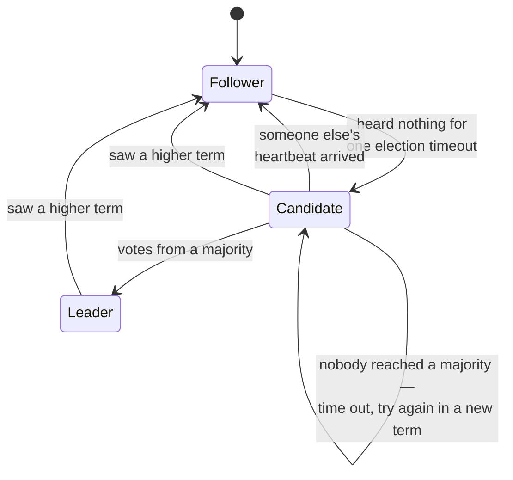
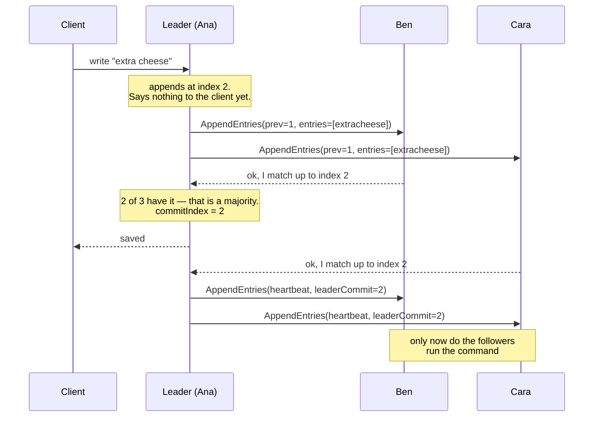
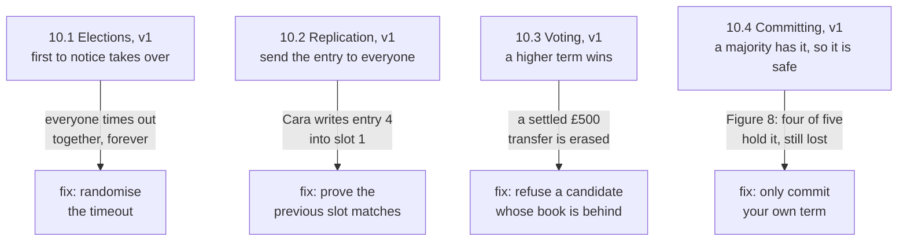
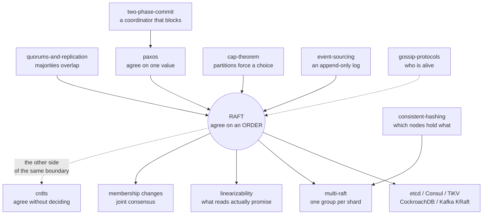

# Raft — how five people keep one order book

> **Tell a friend:** Ana, Ben, Cara, Dev and Eve run a pizza shop, and each
> keeps an order book. All five books must say the same orders in the same
> numbered slots, even though people vanish mid-shift and shouts across the
> kitchen get lost. Raft's trick is to put one person in charge for a numbered
> stretch of time, let only that person write, and call an order "settled" the
> moment most of the five have copied it down. The only people allowed to take
> charge next are those whose book already holds everything that was settled,
> which is why a settled order can never be lost. Every rule in Raft that looks
> odd is a scar from one specific way a simpler version of the shop broke.

The interactive version is [The Raft Log Grid](https://claude.ai/code/artifact/9e9cab79-30ef-4665-b9e5-6dec2dcab932),
also saved as [`visualization.html`](visualization.html). How to run the Java,
where this lab sits among your other labs, and how the numbers were made are
all in [section 19](#19-about-this-lab) at the end.

---

# BEGINNER MODEL

## 1. Why does this thing exist?

> **In one breath:** Anything important is kept on more than one machine,
> because one machine dies. But copies can disagree about what happened and in
> what order, and nothing rings an alarm when they do.

Anything important lives on more than one machine. Why? Because one machine
dies. The moment you have copies, you have a new problem, and it is much
nastier than losing a machine. **The copies can disagree about what happened,
and about what happened first.**

Here is the shape of it. A balance of £100 has two changes in flight: "add
£50" and "take 20%". Apply them in one order and you get £120. Apply them the
other way and you get £130. Now imagine two copies of your database apply them
in different orders. Both copies are internally consistent. Both look healthy.
And they disagree by £10 forever. Nothing crashes. No alarm fires. You discover
it when a customer does.

| Order the changes were applied | Balance | What it means |
|---|---|---|
| add £50, then take 20% | £120 | one copy's honest answer |
| take 20%, then add £50 | £130 | the other copy's honest answer |
| each copy picked a different order | a £10 gap, forever | neither copy is "wrong" on its own; the *group* is |

Raft exists so that a group of machines can agree, permanently, on **one
ordered list of changes**. It keeps that agreement while machines crash and
restart. It keeps it while the network loses, delays, duplicates and reorders
messages. Every system that has to keep exactly one answer has one of these
underneath it: which node owns which shard, who holds the lock, what the
current config is, where the leader lives.

## 2. What is the problem? The pizza shop

> **In one breath:** Five people take phone orders and each keeps an order
> book. All five books must end up with the same orders in the same numbered
> slots, even though people leave without warning and shouts get lost.

A pizza shop takes orders by phone. Five people work there: **Ana, Ben, Cara,
Dev and Eve**. Each keeps their own order book. Every book has to end up with
the same orders written in the same numbered slots. Why so strict? Because the
orders refer to each other.

| Slot | What is written | Why the order matters |
|---|---|---|
| 1 | "table 4 wants a margherita" | the pizza everything else is about |
| 2 | "table 4 — make that extra cheese" | changes slot 1 |
| 3 | "table 4 — cancel" | undoes slots 1 and 2 |

Apply those in a different order and you either deliver a pizza nobody wanted
or throw away one someone is waiting for.

The awkward parts:

- **People leave without warning.** Ana's shift ends. Ben's phone dies
  mid-call.
- **Nobody can see anyone else's book.** They can only shout messages across
  a noisy kitchen. Shouts get lost, arrive late, or arrive twice.
- **You cannot wait for everyone.** Suppose the rule is "write it down only
  when all five have confirmed". Then one person in the walk-in freezer stops
  the shop.

The job: get all five books to hold the same orders in the same slots,
forever, even though people vanish mid-sentence.

> **🔮 Predict:** *Why is "just have everyone write down whatever they hear"
> not good enough?*
>
> <details><summary>Reveal</summary>
>
> **Because two phones can ring at the same time.** Ana hears "margherita" and
> Cara hears "pepperoni", and both write into slot 1. Neither did anything
> wrong. Their books now differ at slot 1 and at every slot after it. And there
> is no rule anywhere that says which one was "really" first. In a system with
> no shared clock there is no such thing as *really first*.
>
> If you said "whoever picked up the phone first wins", ask: first by whose
> watch? Ana's kitchen clock and Cara's phone clock disagree, and nobody can
> prove which one rang first.
> </details>

Here is how far the lab goes, and what you can do after each layer:

| Layer | Sections | After it you can… |
|---|---|---|
| **Beginner** | 1–9 | tell the shop story, and say why "a majority has it" is the moment a write becomes real |
| **Intermediate** | 10 | walk an election and a write message by message, and name the disaster behind each of the four odd rules |
| **Engineering** | 11–14 | say which promise bends under each failure, point at the line of code that holds the rest up, and prove it by running something |
| **Production** | 15 | say what etcd adds to this toy, and what the on-call engineer watches |

## 3. Why not just have everyone write down what they hear?

> **In one breath:** The obvious design has no coordination at all. Whoever
> answers the phone writes the order in the next free slot and shouts it. It is
> simple and fast, and it is about to break.

The naive solution, and the one that needs no rules: whoever answers the phone
writes the order in the next free slot and shouts it to the other four. The
other four copy it into the same slot.

It is simple. It needs no coordination. It is fast, because nobody waits for
anybody. This is not a stupid design. So what is wrong with it?

## 4. What goes wrong when two phones ring at once?

> **In one breath:** Two people fill slot 1 with different orders at the same
> moment. Now every later slot means different things in different books. And
> the obvious patch, "ask first", fails too.

Ana takes "margherita" and writes it in slot 1. At the same moment Cara takes
"pepperoni" and writes it in slot 1. Each shouts. Ben hears Ana first and
writes margherita. Dev hears Cara first and writes pepperoni.

Now the shop has two different slot 1s and no way to pick. Worse, everything
after slot 1 is built on top of a slot that means different things to
different people. "Table 4, extra cheese" in slot 2 modifies a *different
pizza* depending on whose book you read.

Here is the shop one second after the two phones rang. Read the last column:
it is what each person honestly believes.

| Book | Slot 1 | What that person believes |
|---|---|---|
| Ana | margherita | table 4 gets a margherita |
| Cara | pepperoni | table 4 gets a pepperoni |
| Ben | margherita | Ana's shout arrived first |
| Dev | pepperoni | Cara's shout arrived first |
| Eve | whichever shout arrived first | a coin toss |

> **🔮 Predict:** *The obvious patch: before writing, ask the other four "is
> slot 1 free?" and only write if they all say yes. Does that fix it?*
>
> <details><summary>Reveal</summary>
>
> **No, and it fails in two ways at once.** If Ana and Cara ask at the same
> moment, both can hear "free" from everyone, and both write. And if two people
> are away, you never get four answers. So the shop stops even though three
> perfectly good people are standing there.
>
> If you said "well, it fixes the first problem at least", look again. Asking
> is just another shout. Two questions can cross in the air exactly like the two
> orders did.
> </details>

**The deeper problem this failure reveals.** This is not really about *who
writes slot 1*. A group with no shared clock has no notion of "first". And any
rule that needs everyone to answer is hostage to its slowest member. You
cannot patch your way out. You need a rule that *manufactures* an ordering,
and that only ever needs *most* of the group.

## 5. What do we actually need?

> **In one breath:** Five plain promises. One order per slot, the same order
> everywhere, keep working with two people missing, catch up automatically,
> and refuse rather than guess.

Say it in plain words, because everything after this is the pursuit of exactly
these five sentences. This is the real requirement:

1. **One order per slot, forever.** Once anyone has been told "slot 3 is
   settled", no book may ever hold anything else at slot 3.
2. **Same order everywhere.** Any two books that both have slot 3 filled in
   agree on slots 1 and 2 as well.
3. **A minority can be away.** The shop keeps working with two of five people
   missing.
4. **Coming back is automatic.** Someone who returns after an hour catches up
   with no human involved.
5. **Being wrong is never allowed; being stuck is allowed.** If too many
   people are away, the shop must *refuse* orders rather than guess.

Point 5 is the trade, and it is worth stopping on. You already met it in the
[`cap-theorem`](../cap-theorem/) lab as the CP corner. When the group is
split, the side that cannot reach a majority refuses to answer instead of
answering possibly-wrong. Raft is that choice made concrete. Ana would rather
send a customer away than promise a pizza the shop might not agree on.

## 6. What is the key idea?

> **In one breath:** Put one person in charge for a while. Only they write. An
> order is settled when most people have copied it. And you may only take
> charge next if your book is already as complete as most people's.

Here is the invention, in four sentences:

> **Elect one person to be in charge for a while. Only that person writes
> into the books, so slots have exactly one meaning. An order counts as
> settled the moment *most* people have copied it down. And you are only
> allowed to become the next person in charge if your book is at least as
> complete as most people's.**

That is the whole of Raft. Every remaining page is either an explanation of
one of those sentences, or a repair to a version of one of them that broke.

The last sentence is the clever one and the easiest to skip past. Hold onto
it: *being in charge is a privilege you have to qualify for by already knowing
everything that was settled.* Eve cannot take over the shop just because she
shouted loudest. She has to show that her book is as complete as most
people's first.

## 7. Which words do you need now?

> **In one breath:** Every Raft word is a thing in the shop you have already
> seen: the book, its slots, the shift, the person in charge, "most of us",
> and "settled". Here each one is earned in the story, then collected in two
> small tables.

You have met two of these ideas before, in other labs. The rest are new. This
is the lab's terminology, but each word arrives the same way: the thing in the
shop first, then a plain sentence, then the engineer's name for it.

### The order book, its lines, and the line numbers

Ana's order book is a numbered list of changes. Engineers call the whole book
the **log**. One line in it is an **entry**: a command plus the shift it was
written in. The line number is its **index**, counting from 1. The log is
append-only: you write at the end, never in the middle.

Why a separate word for the book, rather than "the pizzas"? To separate the
*record of changes* from the *result of applying them*. Two servers may hold
the same log and be part-way through applying it. The log is the truth; the
result is a replay of the log. This is exactly the event stream from
[`event-sourcing`](../event-sourcing/): an immutable append-only sequence
folded into current state. Raft is that idea with the *replication* problem
solved.

Here is Ana's book at one moment, in the shop's words and in the code's
notation. Read the "in words" column first.

| Ana's book | In the code | In words |
|---|---|---|
| slot 1: margherita, written in shift 1 | `margherita@t1` | index 1 holds `margherita`, created while term 1 was in force |
| slot 2: extra cheese, written in shift 1 | `extracheese@t1` | index 2 holds `extracheese`, created while term 1 was in force |
| slot 3: cancel, written in shift 2 | `cancel@t2` | index 3 holds `cancel`, created in term 2 |
| the whole book | `[margherita@t1, extracheese@t1, cancel@t2]` | Ana's log, oldest entry first |

### The pizzas: what the book is instructions *for*

The book is not the pizzas. The book is a list of instructions; the pizzas are
what you get by following it. Engineers call the thing that follows the
instructions the **state machine**. It is a deterministic program fed the
committed entries in order. Same log, same starting point, same result, on
every server.

This is why Raft is formally a **replicated state machine** protocol. It does
not replicate *data*. It replicates *the sequence of changes*, and each server
derives its own copy. Why bother with the distinction? It makes the
correctness argument tiny. If the state machine is deterministic, then
agreeing on the log is *sufficient*. You never have to compare the resulting
states at all.

| The log | Applied to | Result on every server |
|---|---|---|
| `[set x=1, set y=2, set x=3]` | an empty map | `{x:3, y:2}`, always |

That is the fold in [`event-sourcing`](../event-sourcing/). Identical idea.
Raft supplies the part that lab assumed: getting every replica the same
stream.

### The shift: "whose turn is it to be in charge?"

The shop runs in shifts. Each shift has a number, and at most one person is in
charge during it. Engineers call a shift a **term**. A term is a whole number
that only ever goes up. Every attempt to become leader starts a new term.
Every message carries the sender's term. And **a bigger term always wins**:
any server that sees one immediately becomes a follower and adopts it.

Watch Cara do it. Cara is on term 3 and receives a message stamped term 5.
She does not argue. She does not check anything else. She sets her term to 5
and becomes a follower.

Why does the word exist? Because a term is a logical clock that costs one
integer. Distributed systems cannot order events by wall clock. But they *can*
order them by "which leadership attempt was this part of". Term comparison
replaces time comparison everywhere in Raft.

You met the same job in [`paxos`](../paxos/) as the **proposal number**: a
total order over attempts. Raft spends it on *shifts* rather than on
individual values. That is why one term covers thousands of writes.

### The three things a person can be

At any moment each of the five is one of three things.

- A **follower** is the default. Followers answer messages and never start
  anything.
- The **leader** is the only server that accepts client writes.
- A **candidate** is a follower that got bored of waiting and is asking for
  votes.

Dev has heard nothing for 200 ms. He becomes a candidate for term 4 and asks
the other four to vote for him.

Why three states and not two? The middle state exists so that "I am trying to
be leader" is a real, visible condition with its own rules. It is not a
half-finished leader. A candidate has no authority at all.

### "Most of us"

More than half: 3 of 5, 2 of 3, 4 of 7. Engineers call it a **majority**, or a
**quorum**. You already know why this number. The
[`quorums-and-replication`](../quorums-and-replication/) lab is entirely
about one fact: **any two majorities must share at least one member**. That
overlap is the load-bearing fact in Raft too, and it is used twice. Once so
two people cannot both win the same term. Once so a new leader cannot be
missing a settled entry.

That lab drew a distinction, and it matters here. *A consensus quorum
decides; a read/write quorum merely intersects.* Raft's majority is the first
kind. The read/write formula from that lab is not what is happening here.

| Formula | In words | Is this Raft? |
|---|---|---|
| `R+W>N` | a read set and a write set large enough that they must overlap | no; it only guarantees two sets touch |
| majority vote | more than half agree, so any two such groups share a member | yes; a majority *decides* |

### "Settled, and you can say so out loud"

An order is settled once enough people have written it down that it can never
be undone. Engineers say the entry is **committed**. Precisely: an entry is
committed once the leader has stored it on a majority **and** the entry was
created in the leader's own current term.

Why a word for this? To name the exact boundary between "in the leader's
book" and "safe to tell the customer". Before it, the entry can legally
vanish. After it, no future leader may remove it. Almost every real Raft bug
lives at this line.

Each server keeps one number for how far the settled region reaches. In words:
the highest index it knows is committed. In the code it is the **commit
index**, `commitIndex`. Read the table row by row.

| The leader's book | Its commit index | In words |
|---|---|---|
| `[a, b, c]` | `commitIndex = 2` | *a and b can never change; c might still disappear* |

Where does the second half of the rule, "created in the leader's own term",
come from? Stage 10.4. It is the least obvious rule in Raft, and it exists
because of one specific disaster.

### "Is anyone in charge?"

How does Ben know Ana is still there? She keeps shouting "still here!". If Ben
hears nothing for a while, he assumes she is gone and asks to take over.

The wait is the **election timeout**: how long a follower waits, hearing
nothing, before declaring itself a candidate. It is randomised per server, per
attempt. The shout is the **heartbeat**: an empty write the leader sends on a
fixed interval, purely so followers keep resetting their timers.

| Setting | This lab | In words |
|---|---|---|
| election timeout | 150–300 ticks | a fresh random wait, picked every time the timer resets |
| heartbeat | every 50 ticks | an empty "still here" from the leader |

Why do these exist? They are Raft's entire failure detector. There is no
health check, no monitor, no separate protocol. *Silence is the failure
signal*, and the heartbeat is how a living leader keeps proving it is alive.

### The only two things Raft ever says

Across the whole shop only two kinds of shout exist: "can I take over?" and
"write this down". Engineers call them two remote calls, each with a reply.
`RequestVote` runs elections. `AppendEntries` does everything else:
replicating entries, repairing a wrong log, telling followers what is
committed, and, with an empty entry list, the heartbeat. That is the entire
protocol surface.

### The words, mapped back to the shop

Two small tables, split by theme. The last column says where in this lab you
watch each one happen.

| Thing | In the shop | Engineers say | Where it happens |
|---|---|---|---|
| log, entry, index | the order book, one line in it, its slot number | `log`, entry, index | section 2; repaired in stage 10.5 |
| state machine | the pizzas the book is instructions for | replicated state machine | section 12, State Machine Safety |
| term | the numbered shift | `currentTerm` | stage 10.1, elections |
| committed | settled; safe to tell the customer | `commitIndex` | stage 10.4, the own-term rule |
| election timeout | how long you wait before asking to take over | 150–300 ticks | stage 10.1, split votes |
| heartbeat | "still here!" every few seconds | empty `AppendEntries` | scenario 11.9 |

| Person or message | In the shop | Engineers say | Where it happens |
|---|---|---|---|
| follower | copies what the person in charge shouts | follower | every section from here on |
| leader | the one person in charge this shift | leader | stage 10.2, replication |
| candidate | someone asking "can I take over?" | candidate | stage 10.1 |
| majority | most of us: 3 of 5 | quorum | stage 10.3, the overlap argument |
| "can I take over?" | asking for votes | `RequestVote` | stage 10.3 |
| "write this down" | shouting an order | `AppendEntries` | stage 10.2 |

## 8. What are the two pictures to keep in your head?

> **In one breath:** Carry the pizza shop for intuition, and one state
> diagram plus one page of numbers for precision. Then learn the four places
> the shop lies to you.

These are the two mental models. The first you carry around; the second is
what the code does.

### The simple picture: the pizza shop

One person in charge per shift. They write the order book, shout each order to
the others, and once most people have copied it down the order is real. When
the person in charge goes quiet, whoever notices first asks to take over. But
only someone whose book is already as complete as most people's is allowed
to.

### The engineer's picture: three roles and one page of numbers

Read the arrows as "what makes a server change role".



Each server keeps one page of numbers. Three of them survive a crash; the rest
are rebuilt. Read the "in words" column first.

| What the server keeps | In the code | In words | Survives a crash? |
|---|---|---|---|
| which shift it is | `currentTerm` | the highest term it has seen | yes |
| who it voted for this shift | `votedFor` | at most one candidate per term | yes |
| the order book | `log[]` | every entry it holds | yes |
| how far is settled | `commitIndex` | the highest index it knows is committed | no |
| where to send next (leader only, one per follower) | `nextIndex[i]` | a **guess** at the next index to send server *i* | no |
| how far each has got (leader only, one per follower) | `matchIndex[i]` | a **fact** about the highest index server *i* actually has | no |

### How the two pictures line up

In this lab's code and pictures the five are numbered S0 to S4. Whenever you
see a server number, read Ana as S0, Ben as S1, Cara as S2, Dev as S3 and Eve
as S4.

| Pizza shop | Raft | In the code |
|---|---|---|
| the order book | the log | `RaftNode.log` |
| slot number | index | position in `log` |
| whose shift it is | term | `currentTerm` |
| person in charge | leader | `role == LEADER` |
| shouting an order | `AppendEntries` | `sendAppend()` |
| "still here!" every few seconds | heartbeat | `AppendEntries` with no entries |
| most people have copied it | committed | `advanceCommit()` |
| "can I take over?" | `RequestVote` | `startElection()` |
| "not with a book like that" | refusing a candidate whose book is behind | `candidateUpToDate()` |

### Where the story lies to you

Four places. Read this before you trust the shop.

1. **The shop has one room; Raft has no room.** Ana cannot see that Cara is
   holding up her hand. Every fact one server has about another arrived as a
   message. That message may be *minutes old and describe a world that no
   longer exists*. This is why every message carries a term. It is the only
   way to notice you are acting on stale news.
2. **Nobody hands over.** In the shop you imagine Ana saying "Ben, you're in
   charge". That never happens in Raft. Ana usually does not know she has
   stopped being leader. Two people genuinely believe they are in charge at
   the same time, routinely. Raft is *fine with that*, because the older one
   can never assemble a majority. **"Only one leader" is false. "Only one
   leader per term, and only the newest can commit" is true.**
3. **Copying is not one-directional.** A follower whose book is wrong does
   not politely append. It **deletes its own entries** to match the leader.
   The shop analogy makes this feel like vandalism. In Raft it is legal
   precisely because only *uncommitted* entries can ever be deleted.
4. **There is no "settled" ceremony.** Nobody announces a commit. The leader
   just notices that a majority replied, and mentions the new commit point on
   the next ordinary message. Followers find out *later*, and that lag is
   normal.

## 9. Where can you see it before you read the rules?

> **In one breath:** Open the grid. Each row is one of the five, each column
> is one slot. Press Play, send a write, tear the network, and watch the gap
> between "written down" and "settled".

Open **[The Raft Log Grid](https://claude.ai/code/artifact/9e9cab79-30ef-4665-b9e5-6dec2dcab932)**
(also saved as `visualization.html`). It is the shop with every book laid
open. This is the visualization to watch before you read a single rule.

What to look at, in this order. Each row is one server; each column is one
slot in the log. So the same column across five rows is *the same slot on
five machines*. Disagreement shows up as two different colours stacked in one
column. Colour is the term an entry was created in. A **solid** cell is
committed and can never change. A **dashed** cell is written down but still
deletable.

Three things to try before reading on:

1. Press **Play** and watch nothing happen for a moment. Then one server's
   timer runs out and the election takes about three exchanges.
2. Press **Send a write to the leader**, and watch the gap between *the leader
   has it* (dashed) and *it is committed* (solid). That gap is the entire
   difference between "saved" and "probably saved".
3. Set **Tear the network** to `S1 and S2 (2 | 3)`. Watch the small side
   accept writes it can never finish, while the big side elects a newer leader
   and carries on.

The **Guess first, then watch** cards at the bottom each ask a question, take
your answer, and then run the scenario. Being wrong on those is the fastest
part of this lesson.

Here is one successful write as a sequence. Ana (the leader) takes the order;
Ben and Cara are followers. Read the notes on the right: the client is told
"saved" before the followers have run anything.



In words: Ana appends "extra cheese" at index 2 and says nothing yet. She
shouts it to Ben and Cara. Ben answers first. Two of three is a majority, so
Ana moves her commit index to 2 and tells the client "saved". Cara's answer
arrives later. Only on the next heartbeat do Ben and Cara learn that index 2
is committed, and only then do they run the command.

---

> ### ✅ Checkpoint: end of the beginner model
>
> You can now explain what Raft is for, why one leader per numbered shift is
> the trick, and why "a majority has it" is the moment a write becomes real.
> That is enough to follow a design discussion and to read an etcd outage
> postmortem.
>
> **Say it back.** Without using the words *term*, *commit* or *quorum*,
> explain to a friend why Ana can tell a customer "your order is safe" before
> Cara has even heard about it.
> <details><summary>A good answer sounds like</summary>
> "Ana only needs most of the five to have copied the order down. Once three
> books hold it, anyone who takes charge later has to have a book as complete
> as most people's, and any three books include at least one that has the
> order. So it cannot be lost, even if Cara only hears about it later."
> </details>
>
> **Next:** the actual mechanism, message by message, and the four places
> where the obvious version of it is subtly, catastrophically wrong.

---

# INTERMEDIATE MODEL

## 10. How does the actual mechanism work? Built four times, broken three

> **In one breath:** We build Raft the obvious way, watch it break, and fix
> it, four times over. Every rule that looks arbitrary is the scar from one of
> those breaks.

We will build Raft the way you would build it: the obvious version first,
then watch it break, then fix it. **Every rule in Raft that looks arbitrary is
a scar from one of these breaks.** If you only remember the finished rules you
will forget them. If you remember the disasters, the rules are obvious.

Here is the map of the four builds. Each row is one subsection below.



### 10.1 — Elections, v1: what if the first to notice takes over?

The rule: a follower that has heard nothing for a while declares itself
candidate, adds one to the term, votes for itself, and asks everyone else. A
majority of votes makes it leader.

Concretely, five servers boot at once with empty logs. Nobody is leader, so
nobody sends heartbeats, so eventually somebody's timer fires. Here is the
trace from `java src/Experiments.java election`. Read S0 as Ana, S1 as Ben,
S4 as Eve.

```
t=172   S0 starts an election for term 1 (its log ends at index 0, term 0)
t=173   S4 steps down to follower, term 0 -> 1
t=176   S1 steps down to follower, term 0 -> 1
t=180   S0 WINS the election for term 1 with 3/5 votes [0, 1, 4]
```

In words: Ana's timer fires first, at tick 172. She asks for votes in term 1.
Eve and Ben hear a bigger term and adopt it. Eight ticks later Ana has three
of five votes, her own plus Ben's and Eve's, and she is leader.

| What the run shows | Count | What it means |
|---|---|---|
| messages sent | 12 | every vote request, reply and first heartbeat Ana's election produced |
| messages delivered | 8 | enough of them arrived for three votes; the rest were not needed |
| leaders | 1 | one timer fired first, and that was the whole election |

> **🔮 Predict:** *Everyone boots at the same instant and everyone's timer is
> the same length. What happens?*
>
> <details><summary>Reveal</summary>
>
> **Nobody is ever elected.** All five time out on the same tick. All five
> become candidates for term 1. All five vote for themselves. Each has exactly
> 1 of 5 votes; nobody reaches 3. They all time out again, together, in term
> 2. And term 3. Over 6000 ticks with identical timeouts: **term 40 reached,
> leader elected: NEVER, safety violations: 0**. The cluster is perfectly
> correct and completely useless.
>
> If you said "one of them wins eventually", you are assuming something breaks
> the tie. Nothing does. Same timers, same tick, same result, every term.
> </details>

**The fix: randomise the timeout.** Each server picks a fresh random wait in a
range (150–300 ticks here) *every time it resets*. One server almost always
wakes noticeably before the others. It wins before anyone else even starts,
and its heartbeat resets everybody.

Here is what 200 cold starts look like each way, from
`java src/Experiments.java split-vote`. Read the last column for what each
row proves.

| | identical timeouts | random 150–300 | What it means |
|---|---|---|---|
| leader elected | **never**, in 6000 ticks | **200 / 200** | randomness is the only thing breaking the tie |
| terms burned | 40 and climbing | 1 in 199 runs, 2 in 1 run | one collision in 200, and it healed itself |
| time to first leader | — | 155 / 174 / 332 ticks (min/median/max) | roughly one timeout plus one exchange |
| safety violations | 0 | 0 | the broken cluster was never *wrong*; it was only stuck |

Note what randomisation does *not* do. It does not make split votes
impossible. It makes them **self-correcting**. Each retry re-rolls the dice,
so the chance of n consecutive collisions vanishes. One of the 200 runs did
split, and resolved on the next term.

This is your first sighting of the distinction that runs through the rest of
the lesson. The identical-timeout cluster never did anything *wrong*. It just
never did anything. **Safety** and **liveness** fail in completely different
ways.

### 10.2 — Replication, v1: what if the leader just sends each new entry to everyone?

Ana (the leader) appends the client's command to her own log and sends it out.
A follower appends what it receives. When a majority have it, Ana marks it
committed and tells the client "saved".

This works beautifully, right up to the first server that misses a message.

> **🔮 Predict:** *Cara was switched off while entries 1, 2 and 3 were
> written. She comes back. Ana, who has no idea Cara was away, sends her entry
> 4. Cara appends it. What is in her book?*
>
> <details><summary>Reveal</summary>
>
> **Entry 4 is sitting in slot 1.** That was Cara's next free slot, so that is
> where "append" put it. Her book now says slot 1 is entry 4. Every other book
> says slot 1 is entry 1. Nothing has crashed, no error was returned, and Ana
> believes Cara is fully caught up. The two books will never agree again.
>
> | Cara's book | In words |
> |---|---|
> | `[_, _, _, entry4]` is what Ana *thinks* Cara has | three entries then entry 4 |
> | entry 4 at index **1** is what Cara *actually* has | one entry, in the wrong slot |
>
> If you said "she has a gap at 1, 2 and 3", notice that a log cannot have
> gaps. Append means "next free slot", and Cara's next free slot was 1.
> </details>

**The fix: never accept an entry without proving the prefix already
matches.** Every shout now names the slot just before the ones being sent: its
number and the shift it was written in. In the code these are the previous
log index and the previous log term, `prevLogIndex` and `prevLogTerm`. The
follower accepts only if its own log has that exact (index, term) pair.
Otherwise it rejects.

Why is one comparison enough for the whole prefix? This is the **Log Matching
Property**, and it is the most elegant thing in Raft:

> If two logs contain an entry with the same index and the same term, then the
> logs are **identical in every entry up through that index**.

It holds by induction. A leader never changes an entry it has already written.
So an (index, term) pair identifies one specific entry, created once, by one
specific leader. And that entry was only ever accepted by a follower that had
already proved *its* predecessor matched. So agreement at index *i* certifies
agreement at *i−1*, which certifies *i−2*, all the way down. **One integer
comparison certifies unlimited history.** No checksums, no diffing, no Merkle
trees.

When you turn this check off (`Bugs.noLogMatchCheck`), the follower says yes
to everything. It tells the leader "I'm at index 3" while holding nothing, and
the leader believes it. Read S2 as Cara, S1 as Ben.

```
with the prefix check ON   : S2 log = [w1@t1 w2@t1 w3@t1 w4@t1 w5@t1 w6@t1]   (repaired)
with the prefix check OFF  : S2 log = [d@t2]                                   (a hole, forever)
                             LOG MATCHING broken: S1 and S2 agree on slot 1 but differ...
```

In words: with the check on, Cara ends up with all six writes. With it off,
Cara holds one entry from term 2 and nothing else, and the checker reports
that Ben and Cara claim to agree on slot 1 while holding different things.

### 10.3 — Voting, v1: what if a higher term wins the vote?

A candidate has a bigger term than you, so you step down and vote for it.
Simple, and it is what a term is *for*.

> **🔮 Predict:** *Ana and Ben have committed "transfer £500". That is a
> majority of three, so the customer has been told it succeeded. Ana then
> dies. Cara, who was switched off for the whole thing and has an empty book,
> comes back and asks to be leader with a higher term. Ben votes yes. What
> happens to the £500?*
>
> <details><summary>Reveal</summary>
>
> **It is deleted.** Cara becomes leader with an empty log. The first entry
> she writes goes into slot 1. Ben's slot 1 currently holds the transfer, with
> a different term. That is a conflict, so Ben **deletes his own entry** and
> takes Cara's. A transaction that was acknowledged to a customer no longer
> exists on any machine.
>
> With the check disabled, the lab prints two lines. Read S1 as Ben.
>
> | What the lab prints | In words |
> |---|---|
> | `S1's log afterwards: [overwrite@t2]` | Ben's book now holds only Cara's term-2 write |
> | `STATE MACHINE SAFETY broken: index 1 was committed as committed-write@t1` | slot 1 was settled as the transfer, and is now something else |
>
> If you said "Ben keeps the transfer because he already committed it",
> remember lie number 3 from section 8: followers delete to match the leader,
> and nothing in v1 stops Cara from being that leader.
> </details>

**The fix: a term is not a qualification.** Before granting a vote, compare
the candidate's *last log entry* with your own, and refuse if yours is more
complete:

```java
boolean candidateUpToDate(int candLastIndex, int candLastTerm) {
    if (candLastTerm != lastLogTerm()) return candLastTerm > lastLogTerm();
    return candLastIndex >= lastLogIndex();
}
```

In words: later **term** wins; if the terms tie, the longer log wins. Term is
compared first. A short log ending in term 5 beats a long log ending in term
4, because term 5 happened later and everything in it supersedes.

**Why this one function is the whole safety argument.** Try to build a leader
that is missing a settled entry. The settled entry sits on a majority: say Ana,
Ben and Dev. A candidate needs votes from a majority, so three of the five.
You cannot pick three people without picking at least one of Ana, Ben or Dev.
There are only five. That shared person still holds the entry, and the rule
says they refuse anyone whose book is behind. So the candidate cannot win.

That paragraph *is* the proof. Two majorities always overlap, the fact from
the [`quorums-and-replication`](../quorums-and-replication/) lab, so **at
least one voter holds the committed entry**, and that voter refuses anyone
who does not. Therefore every leader that ever wins already has every
committed entry. This is the **Leader Completeness Property**, and it is why
Raft never needs to copy anything *backwards* from followers to a new leader.

| Over 200 leader crashes (`java src/Experiments.java leader-crash`) | Count | What it means |
|---|---|---|
| new leaders missing the committed write | **0** | the overlap argument held every single time |

### 10.4 — Committing, v1: is "a majority has it" enough?

The last of the four, and the one nobody guesses. The rule looks
self-evident: count how many servers have index *N*; if it is a majority,
index *N* is committed.

> **🔮 Predict:** *Entry `OLD` was created in term 1. It is now sitting on
> four of five servers, a clear majority, and the current leader can see that.
> Is it safe to tell the client `OLD` succeeded?*
>
> <details><summary>Reveal</summary>
>
> **No.** This is Figure 8 of the Raft paper, and it is the single most
> surprising thing in the algorithm. A fifth server that was offline can hold
> a *different* entry at that same index, created in term **2**. Because term
> 2 is later than term 1, that server's log counts as more up to date. So it
> can still win an election, and when it does, it overwrites the index on all
> four others. "A majority has it" and "it can never be removed" are **not
> the same statement**.
>
> If you said "yes, four of five is more than enough", you are counting
> copies. The up-to-date check does not count copies. It compares terms, and a
> single copy with a later term beats four copies with an earlier one.
> </details>

`java src/Experiments.java figure8` drives that exact history by hand. With
the naive count-the-replicas rule, the lab prints this. Read S0 as Ana, S1 as
Ben, S4 as Eve.

```
own-term commit rule OFF (bug)
  S0 DEAD      term=3  commit=1  log=[OLD@t1]  applied=[OLD]
  S1 FOLLOWER  term=4  commit=1  log=[NEW@t2]  applied=[OLD]
  S4 LEADER    term=4  commit=1  log=[NEW@t2]  applied=[NEW]
  !! STATE MACHINE SAFETY broken: index 1 was committed as OLD@t1 but S1 has committed NEW@t2 there
  !! STATE MACHINES DIVERGED: at position 0 S0 applied "OLD" but S4 applied "NEW"
```

In words: Ana is dead, still believing slot 1 is `OLD` and having made that
pizza. Ben now has `NEW` in slot 1 but already made `OLD`. Eve, the leader,
has `NEW` and made `NEW`. Four servers were told `OLD` was permanent. It is
gone.

**The fix, in five words: only commit your own term.** A leader may only mark
index *N* committed when the entry at *N* was created in the leader's current
term. In the code, `log[N].term == currentTerm`:

```java
boolean ownTerm = log.get(n).term() == currentTerm;
if (count >= majority() && ownTerm) { commitIndex = n; }
```

Why does that close it? An entry from the leader's *current* term can only be
overwritten by a leader of a *later* term. Any such leader needed a majority
of votes. A majority contains someone holding this entry, and the up-to-date
check makes that someone refuse. The old-term entry had no such protection,
because a competing entry at the same index could carry a *higher* term and
still look fresher.

And old entries are not stranded: **they get committed for free,
underneath.** The moment the new leader commits one entry of its own,
everything below it in the log is committed by the Log Matching Property. In
practice a real leader appends a **no-op** entry immediately on winning,
precisely to trigger this.

With the same history and the rule switched on:

```
own-term commit rule ON (real Raft)
  S1 FOLLOWER  term=4  commit=0  log=[NEW@t2]  applied=[]
  S4 LEADER    term=4  commit=0  log=[NEW@t2]  applied=[]
  violations: none
```

Nothing was committed, so nothing was lost. Ben and Eve hold `NEW`, nobody
has made a pizza, and no promise was broken. `OLD` vanishing is now
*correct*: nobody was ever told it succeeded.

### 10.5 — Repair: how does a wrong log get fixed?

Ana (the leader) keeps two numbers per follower. One is what she *knows*: the
highest index that follower definitely has, `matchIndex[i]`. The other is what
she will *try* next, `nextIndex[i]`. On winning an election she optimistically
sets every next-index to her own log end.

Then she probes. Each rejection means "we don't agree that far back", so she
takes one off the next-index and tries again. Once the follower says yes, she
sends everything above that point, and the follower deletes any of its own
entries that conflict.

**The leader never diffs the logs.** The follower's yes/no on the previous
slot, the (prevLogIndex, prevLogTerm) pair, is an oracle. The leader walks it
backwards until it hits agreement.

> **🔮 Predict:** *Two followers need repair. Cara is merely behind: she
> missed six writes, and the leader holds all six. Ana holds five entries that
> were never committed, left over from a shift that ended badly. Which repair
> costs more rejections?*
>
> <details><summary>Reveal</summary>
>
> **Cara's, by six to zero.** Being behind costs one rejection per missing
> entry, because the leader's guess starts at its own log end and walks back
> one slot at a time. Ana's five ghost entries were removed with zero
> rejections, because the leader's guess for her was frozen at election time,
> when its own log was short. One conflicting entry made Ana truncate her
> whole tail in one message.
>
> If you said "Ana's, because five wrong entries must each be found and
> deleted", you are imagining a diff. There is no diff. One mismatch deletes
> everything above it.
> </details>

Here are the two runs from `java src/Experiments.java log-repair`. Read S1 as
Ben (the new leader in case A), S2 as Cara, S0 as Ana.

```
CASE A — follower far behind (missed six writes; new leader holds all six)
  S1 optimistically sets nextIndex[S2] = 7
  rejections before the logs agreed : 6     (7,6,5,4,3,2,1)
  messages spent on the repair      : 47

CASE B — follower divergent (five entries that were never committed)
  nextIndex[S0] on the new leader = 2   <-- frozen at election time, when its log was short
  rejections before the logs agreed : 0
  messages spent on the repair      : 40
  repaired S0 log: [keep@t1 real-1@t2 real-2@t2]   -- five ghost entries deleted in one message
```

| Case | Rejections | Messages | What it means |
|---|---|---|---|
| A: Cara missed six writes | 6 (the guess walked 7,6,5,4,3,2,1) | 47 | being *behind* costs one round trip per missing entry |
| B: Ana holds five ghost entries | 0 | 40 | being *wrong* was free: one mismatch truncated the whole tail |

Case B surprises people. Five wrong entries were removed with **zero**
rejections, because a single conflicting entry causes the follower to
truncate its whole tail. And case A is the expensive one even though nothing
was *wrong*. Real Raft fixes exactly this by returning the conflicting
**term** in the rejection, so the leader can skip a whole term per round trip.

### 10.6 — Why does this look like a bug and isn't?

After a leader change, a follower's leftover **uncommitted** entries are
*not* deleted straight away. They survive until the new leader appends
something of its own. `Tests.noOpLessonTest` demonstrates it:

```
an_uncommitted_entry_is_NOT_deleted_just_because_a_new_leader_appeared   PASS
that_divergence_is_safe_because_nothing_was_ever_committed_there         PASS
the_new_leaders_first_own_write_is_what_finally_deletes_it               PASS
```

Two logs genuinely disagree, for a while, and it is fine. Nobody was ever told
those entries were safe. But it is untidy, and it delays the commit of
everything inherited from the previous term. Which is the second reason real
systems append a no-op on election.

---

> ### ✅ Checkpoint: end of the intermediate model
>
> You can now walk through a Raft election and a Raft write message by
> message. You can explain the four rules that look arbitrary, randomised
> timeouts, the prefix check, the up-to-date check, and the own-term commit
> rule, by naming the specific disaster each one prevents. That is enough to
> read the paper.
>
> **Say it back.** Four of the five books hold an order. In two sentences,
> and without the word *term*, explain to Ben why the shop still cannot tell
> the customer it is safe.
> <details><summary>A good answer sounds like</summary>
> "The fifth book might hold a different order in that slot from a later
> shift, and a later shift beats an earlier one when people vote. So that
> fifth person could still take charge and make everyone else cross the order
> out, four copies or not."
> </details>
>
> **Next:** what actually happens under each kind of failure, which guarantee
> bends, and which one never does.

---

# ENGINEERING MODEL

## 11. What happens under each failure?

> **In one breath:** Ten failure scenarios, each one made on purpose and
> watched. Every story ends with the same two questions: which promise still
> holds, and which one is temporarily suspended.

You can make every one of these happen yourself. Each story names the
visualization control or the experiment command. The point of every scenario
is the pair of questions at its end: **which promise still holds, and which
one is temporarily suspended.** The comparison table after scenario 11.10
holds all ten answers side by side.

### 11.1 The leader crashes

Ana (the leader, S0) is mid-shift when her phone dies. Her "still here!"
shouts stop. Ben, Cara, Dev and Eve each have a timer running. The first timer
to run out belongs to whoever asks to take over, in a new term. And because of
the up-to-date check, only someone whose book already holds everything
settled can win.

To make it happen, click a leader row in the visualization and choose *Crash
it*, or run `java src/Experiments.java leader-crash`.

Over 200 runs the shop found a new leader every time. Read the last column for
what each number means.

| Recovery time, 200 runs | Ticks | What it means |
|---|---|---|
| fastest (min) | 154 | one short timeout plus one exchange |
| typical (p50) | 182 | the number to plan around |
| slow (p95) | 243 | a longer random timeout, still one exchange |
| worst (max) | 488 | a split vote, then a second round |
| failures to recover | 0 | the shop never stayed leaderless |
| new leaders missing the committed write | 0 | the overlap argument held every time |

Why that shape? The gap is *one election timeout plus one round trip*, not
"timeout × retries", because the winner is decided in a single exchange.

What holds: nothing committed is lost, and no two servers disagree. What is
suspended: availability. For those ~180 ticks the cluster answers nothing.

In production this is the visible outage in every etcd/Consul incident: a
sub-second write stall on leader failover. You tune it with the election
timeout, and the tuning is a straight trade against false failovers.

### 11.2 A follower crashes, or just falls behind

Dev (a follower, S3) goes into the freezer. Nothing happens, as long as a
majority survives. Ana keeps committing on the remaining majority. Her guess
for Dev, his `nextIndex`, simply stops moving. When Dev comes back he is
repaired automatically, exactly as stage 10.5 showed.

To make it happen, crash any non-leader.

What holds: everything. What is suspended: nothing, except your margin. At 5
servers you tolerate 2 failures. With one already down, the next one costs
you the cluster.

In production the number to watch is not "is it up" but **how far behind**. A
follower can fall so far behind that the leader has already discarded the
entries it needs. That follower must instead be sent a copy of the whole
current state, a **snapshot** (stage 15).

### 11.3 The network splits, and the old leader is on the small side

The kitchen wall goes up. Ben (the old leader, S1) and Ana (S0) are on the
small side. Cara (S2), Dev (S3) and Eve (S4) are on the big side, and cannot
hear Ben at all.

To make it happen, set the visualization to *Tear the network between S1 and
S2 (2 | 3)*, or run `java src/Experiments.java partition`.

> **🔮 Predict:** *Ben is still taking phone orders on the small side. Does he
> know he has stopped being leader? Do any of his new orders ever get
> settled?*
>
> <details><summary>Reveal</summary>
>
> **No, and no.** Ben keeps accepting writes and can never commit them, because
> committing needs three books and he can only reach two. His commit index
> freezes. Meanwhile the three-server side elects a new leader in a higher
> term and carries on committing. **Two leaders exist at the same moment**, in
> different terms.
>
> If you said "someone tells Ben he is out", remember lie number 2 from
> section 8: nobody hands over. Ben finds out only when the wall comes down.
> </details>

Why is it safe? Committing requires a majority, and the small side does not
have one. Its writes pile up unacknowledged. What holds: every safety
property, without exception. The checker's counter reads
`safety violations so far: 0` throughout the split. What is suspended:
availability *on the minority side*, and only there.

In production, clients talking to the old leader hang or time out. They must
not treat a timeout as failure, because the write may still commit if the
partition heals in time. This is the CP choice from
[`cap-theorem`](../cap-theorem/), and this is exactly what it costs.

### 11.4 The partition heals and the old leader comes back

The wall comes down, in the same run. Set the tear back to *nowhere*. Here is
what the lab prints. Read S1 as Ben, S2 as Cara, S0 as Ana.

```
t=637  S1 steps down to follower, term 1 -> 2 (saw a higher term from leader S2)
t=637  S1 deletes its own entries from index 2 (had ghost-1@t1, leader says real-1@t2)
t=638  S0 steps down to follower, term 1 -> 2
t=638  S0 deletes its own entries from index 2
```

In words: the very first message Ben hears carries Cara's higher term. Ben
steps down without argument. His slot 2 held an order from his own term that
nobody settled; Cara's slot 2 holds a real one, so Ben crosses his out. One
tick later Ana does the same.

What holds: everything, because deletion only ever touches uncommitted
entries. What is suspended: nothing. But *this is where a client can be
hurt*. A client whose write was accepted and then deleted got no error at any
point. It simply never got a success either. **Timeouts are not failures. A
retry must be idempotent.** That is the same conclusion the
[`transactional-outbox`](../transactional-outbox/) and
[`quorums-and-replication`](../quorums-and-replication/) labs reached from
two other directions.

### 11.5 Messages are lost

Shouts across the kitchen start going missing. To make it happen, drag the
*Drop* slider, or run `java src/Experiments.java loss`.

> **🔮 Predict:** *Half of all messages are lost. Does the shop still find a
> leader? Do writes still get settled? Does anything ever become wrong?*
>
> <details><summary>Reveal</summary>
>
> **Yes, mostly no, and never.** At 50% loss a leader is elected in every one
> of 30 runs, but only 7 of the 30 manage to commit their writes, and the
> cluster burns 23 terms on average getting there. Safety violations: 0, at
> every loss rate, including 90%.
>
> If you said "half the messages lost means half the writes lost", loss does
> not delete anything. It only stops heartbeats landing in time, so the shop
> spends its life re-electing instead of writing.
> </details>

Thirty seeds per row. The first table is what the cluster managed; the second
is what it cost and what it means.

| Drop rate | Elected a leader | Writes committed |
|---|---|---|
| 0 % | 30/30 | 30/30 |
| 10 % | 30/30 | 30/30 |
| 20 % | 30/30 | 30/30 |
| 30 % | 30/30 | 30/30 |
| 50 % | 30/30 | **7/30** |
| 70 % | 26/30 | 0/30 |
| 90 % | **0/30** | 0/30 |

| Drop rate | Avg final term | Safety violations | What it means |
|---|---|---|---|
| 0 % | 1 | 0 | one shift, no drama |
| 10 % | 1 | 0 | a lost shout is re-sent on the next heartbeat |
| 20 % | 2 | 0 | an occasional re-election |
| 30 % | 5 | 0 | elections are getting frequent |
| 50 % | 23 | 0 | the shop mostly holds elections now |
| 70 % | 40 | 0 | some runs never find a leader at all |
| 90 % | 54 | 0 | nothing useful happens, and nothing wrong happens |

Why that shape? Loss does not corrupt anything. It only makes leaders fail to
land heartbeats inside one election timeout. Past ~50% the cluster spends all
its time re-electing. What holds: every safety property, at every loss rate,
including 90%. What is suspended: liveness, smoothly and then completely.

In production the observable symptom is **leader elections per minute
climbing**. It is the single most useful Raft alarm there is. It means "the
network is sick", never "the data is wrong".

### 11.6 Messages are duplicated or arrive late

Ben hears the same shout twice, or hears it a minute late. To make it happen,
drag the *Message delay* slider; `Tests.chaosTests` runs a 50% duplication
rate.

What happens: nothing. Every handler is idempotent by construction. A vote
reply from an old term is ignored, because the code checks
`r.term() != currentTerm` and drops it. A duplicated `AppendEntries`
re-appends entries the follower already has, which the term check turns into
a no-op. With every other message duplicated, the command `only-once` was
applied **exactly once** on every server.

What holds: everything. What is suspended: nothing. In production this is why
Raft can run over a plain unreliable transport with retries and no
deduplication layer.

### 11.7 A split vote

Two people ask to take over at the same moment, and the votes split. To make
it happen, switch the visualization to *Identical* timeouts and press Reset,
then Play.

With identical timeouts it lasts forever: term 40+ and climbing, no leader, 0
violations. With random timeouts it happened once in 200 cold starts, and
resolved on the next term.

What holds: safety, completely. What is suspended: liveness. This is the clean
demonstration that the two are independent. In production the equivalent is a
cluster whose timeouts are too tight for its network. The fix is the same:
more spread, longer timeouts.

### 11.8 A server restarts

Eve (S4) drops her book, picks it up, and comes back. To make it happen, crash
and then restart any server.

> **🔮 Predict:** *Eve's page of numbers from section 8 has six lines. Which
> of them must survive her restart, and what goes wrong if one is lost?*
>
> <details><summary>Reveal</summary>
>
> **Exactly three: her term, who she voted for, and her log.** She comes back
> with `currentTerm`, `votedFor` and her `log` intact, and with `commitIndex`
> and her state machine at zero. She rebuilds by replaying her log as the
> leader tells her what is committed.
>
> Losing `votedFor` would let her vote twice in one term across a crash: two
> leaders in one term. Losing `currentTerm` would let her accept an old
> leader.
>
> If you said "the commit index too, or she loses settled orders", no: the
> settled orders are in her log, and the leader will tell her again how far is
> settled. The commit index is a fact she can relearn; a vote is not.
> </details>

Why exactly those three survive: they are precisely the state real Raft
`fsync`s before replying to any message. What holds: everything. The test
`no_safety_violation_across_a_crash_and_a_restart` passes. What is suspended:
nothing.

In production this is the line where a "fast" Raft implementation becomes an
unsafe one. Buffering the vote instead of flushing it is a real, shipped bug
class.

### 11.9 The heartbeat is too slow for the timeout

Ana shouts "still here!" less often than Ben is willing to wait. To make it
happen, run `java src/Experiments.java heartbeat`.

| Heartbeat interval | Election timeout | Terms burned in 10k ticks | What it means |
|---|---|---|---|
| 10 | 150–300 | 0 | stable |
| 50 | 150–300 | 0 | stable; this lab's default |
| 100 | 150–300 | 0 | stable |
| 140 | 150–300 | 0 | stable, but with almost no margin |
| 200 | 150–300 | 48 | **no — churning**: followers time out on a healthy leader |
| 400 | 150–300 | 52 | **no — churning**: every heartbeat arrives after an election |

Why? Once one heartbeat interval approaches the *minimum* election timeout,
followers start timing out on a perfectly healthy leader. The cluster spends
its life re-electing. What holds: safety. What is suspended: all useful work.

In production the paper's rule of thumb is a chain of three inequalities.
Here it is in words, then as the formula.

| Rule | In words |
|---|---|
| `broadcastTime ≪ electionTimeout ≪ MTBF` | a heartbeat round trip must be far shorter than the timeout, and the timeout far shorter than the time between server failures |

| etcd's shipped defaults | Value | What it means |
|---|---|---|
| heartbeat | 100 ms | how often the leader proves it is alive |
| election timeout | 1000 ms | how long a follower waits in silence |
| margin | 10× | ten missed heartbeats before anyone doubts the leader |

etcd's docs warn specifically about raising the heartbeat for
cross-datacentre clusters without raising the timeout too.

### 11.10 Everything at once

Run `java src/Experiments.java soak`: 20 clusters × 300 rounds of random
crashes, restarts, partitions and writes, with 5% packet loss throughout.

```
client writes accepted by a leader : 898
elections held (sum of final terms): 2550
SAFETY VIOLATIONS                  : 0
```

| Soak result | Count | What it means |
|---|---|---|
| client writes accepted by a leader | 898 | the shop kept taking orders through all of it |
| elections held (sum of final terms) | 2550 | leadership changed hands constantly |
| safety violations | 0 | not one settled order was ever contradicted |

The checker ran *after every single tick*, not at the end.

### The ten failures side by side

The same answers, in one place, so you can compare down the columns.

| # | Failure | What still holds | What is suspended | What production sees |
|---|---|---|---|---|
| 11.1 | leader crashes | nothing committed is lost | availability, for ~180 ticks | a sub-second write stall on failover |
| 11.2 | follower crashes or falls behind | everything | only your margin | commit-index lag; eventually a snapshot |
| 11.3 | split, old leader on the small side | every safety property | availability on the minority side | clients of the old leader time out |
| 11.4 | partition heals | everything | nothing; but unacknowledged writes vanish | a timed-out write that never "failed" |
| 11.5 | messages lost | safety, even at 90% loss | liveness, smoothly then completely | elections per minute climbing |
| 11.6 | duplicated or late | everything | nothing | nothing; handlers are idempotent |
| 11.7 | split vote | safety | liveness, until the dice differ | timeouts too tight for the network |
| 11.8 | server restarts | everything | nothing | an unflushed vote is a shipped bug class |
| 11.9 | heartbeat too slow | safety | all useful work | churn on a healthy cluster |
| 11.10 | everything at once | safety, checked every tick | liveness, intermittently | 0 violations across 2550 elections |

## 12. What is guaranteed, and what is not?

> **In one breath:** Five promises about the books, each one already earned
> above. Safety never depends on timing; liveness always does. And four things
> people wrongly expect from Raft.

### The five properties, each earned above

Every promise the shop makes is one of these five. Read the last column: it
is the rule that enforces each one.

| Property | What it says | Enforced by |
|---|---|---|
| **Election Safety** | at most one leader per term | one vote per term (`votedFor`) |
| **Leader Append-Only** | a leader never overwrites or deletes its own entries | `clientRequest` only appends |
| **Log Matching** | same (index, term) ⇒ identical prefixes | the `prevLogIndex`/`prevLogTerm` check |
| **Leader Completeness** | a committed entry is present in every future leader | the up-to-date vote check |
| **State Machine Safety** | no two servers apply different commands at the same index | Leader Completeness + the own-term commit rule |

`Cluster.checkSafety()` asserts all five after every tick of every test and
experiment in this lab. In the shop's words: no shift ever had two people in
charge; Ana never crossed out her own line; two books agreeing on one line
agree on everything above it; whoever takes charge already has every settled
order; and no two people ever made different pizzas for the same slot.

### Safety versus liveness: the distinction to take away

**Safety** means nothing wrong ever happens. Raft's safety does **not** depend
on timing at all. Clocks can be arbitrarily wrong. Messages can be arbitrarily
delayed, reordered, duplicated or lost. Safety holds. Every scenario in
section 11 confirms it, including the ones where the cluster does nothing
useful for 6000 ticks.

**Liveness** means something eventually happens. This *does* depend on
timing, and Raft makes no promise about it. It cannot. FLP, which you met in
the [`paxos`](../paxos/) lab, proves no protocol can guarantee both in an
asynchronous network with even one crash. Raft's answer is the same as
Multi-Paxos's: be always safe, and be live whenever the network behaves.

The cleanest demonstration in this lab is the pair of identical-timeout runs.
Turn off randomisation and liveness dies with safety untouched. Additionally
turn off the one-vote-per-term rule and you get **five leaders in one term**.
Safety in ruins, while liveness looks great.

### What Raft explicitly does NOT give you

> **🔮 Predict:** *Ana is cut off on the small side of a split and still
> believes she is leader. A client asks her, not for a write, but to read the
> current balance. Is her answer correct?*
>
> <details><summary>Reveal</summary>
>
> **Not necessarily.** The big side may have elected Cara and committed new
> writes that Ana has never heard of. Ana's state machine is honest about what
> Ana knows, and Ana knows stale news. A read from a leader is only correct if
> the leader first proves it is still the leader.
>
> If you said "yes, she is the leader and leaders have everything", that is
> Leader Completeness, and it is about *committed writes at election time*. It
> says nothing about a leader who has since been replaced without knowing.
> </details>

- **Fast or even correct reads, for free.** Reading from the leader's state
  machine can return stale data, because a partitioned old leader does not
  know it has been replaced. Linearizable reads need an extra mechanism:
  route the read through the log, or confirm leadership with a heartbeat
  round first (`ReadIndex`), or hold a time-based lease. Reading from a
  *follower* is stale by default. **This is the single most common
  misunderstanding of Raft in production.**
- **Protection against lying servers.** The failure model is crash-stop and
  network faults. A server that sends deliberately false terms or logs breaks
  everything. Byzantine fault tolerance is a different family of protocols.
- **Scale-out for writes.** Every write goes through one leader and lands on
  a majority. Adding servers makes you *more fault tolerant and slower*,
  never faster. Scaling writes means multiple Raft groups, one per shard.
  That is exactly what TiKV, CockroachDB and etcd-at-scale do, and where
  [`consistent-hashing`](../consistent-hashing/) comes back in.
- **Progress with fewer than a majority alive.** 2 of 5 servers can do
  nothing at all, by design. This is not a bug to route around.

### Cost, in one table

Read the last column: it is what each line costs Ana's shop.

| Cost | Value | What it means |
|---|---|---|
| messages per committed write | 2 × (N−1): one `AppendEntries` and one reply per follower | one shout and one answer per colleague |
| round trips to commit | 1 (leader → majority → leader) | Ana waits for one round of answers, not a conversation |
| failures tolerated | ⌊(N−1)/2⌋ — 1 of 3, 2 of 5, 3 of 7 | two of the five can be in the freezer |
| latency floor | one round trip to the *median* follower, not the slowest | the slowest colleague never sets the pace |
| cost of a leader failure | one election timeout + one round trip | the ~180-tick gap from scenario 11.1 |

That "median, not slowest" line is worth keeping. It is the same tail-latency
argument the [`quorums-and-replication`](../quorums-and-replication/) lab
worked through. Waiting for a majority rather than everyone is what keeps a
slow replica from setting your p99.

## 13. Which eight lines are the algorithm?

> **In one breath:** The implementation is about 250 lines, and almost all of
> it is bookkeeping. Eight lines carry the rules. Each one is a scar from
> section 10, and each one is marked in the source.

The implementation is ~250 lines in [`src/RaftNode.java`](src/RaftNode.java).
Almost all of it is bookkeeping. These are the load-bearing lines, each
marked `// INVARIANT:` in the source. Read each one as a rule of Ana's shop
first, then as code.

**1. A vote is a one-shot resource per term.** Ben can vote once per shift,
and a repeat request from the same candidate gets the same answer. In
`onRequestVote`:

```java
boolean voteFree = votedFor == -1 || votedFor == rv.candidateId();
```

Without it: two candidates both reach a majority in the same term. With
`Bugs.voteTwice` and identical timeouts, all five servers become leader of
term 1 simultaneously.

**2. Being newer is not enough; you must be complete.** "Not with a book like
that." In `candidateUpToDate`:

```java
if (candLastTerm != lastLogTerm()) return candLastTerm > lastLogTerm();
return candLastIndex >= lastLogIndex();
```

Without it: a committed write is deleted (stage 10.3).

**3. One comparison certifies the whole prefix.** Cara checks the slot before
the ones being sent. In `onAppendEntries`:

```java
matches = ae.prevLogIndex() <= lastLogIndex()
       && log.get(ae.prevLogIndex()).term() == ae.prevLogTerm();
```

Without it: holes and permanent divergence (stage 10.2).

**4. Followers delete their own work.** Ben crosses out his ghost entries to
match the leader. Also in `onAppendEntries`:

```java
if (log.get(idx).term() != e.term()) {
    while (lastLogIndex() >= idx) log.remove(log.size() - 1);
    log.add(e);
}
```

This looks dangerous and is not. By Leader Completeness, anything a leader
overwrites was never committed.

**5. Count replicas, but only for your own term.** Ana counts books, but only
for orders from her own shift. In `advanceCommit`:

```java
boolean ownTerm = log.get(n).term() == currentTerm;
if (count >= majority() && ownTerm) commitIndex = n;
```

Without it: Figure 8 (stage 10.4).

**6. A bigger term always wins, everywhere.** Cara sees term 5 and adopts it
without argument. In `stepDown`, called from all four handlers:

```java
currentTerm = newTerm; role = Role.FOLLOWER; votedFor = -1;
```

This one rule replaces every "am I still the leader?" check you would
otherwise have to write.

**7. Randomise on every reset, not once.** Every time Dev resets his timer he
rolls the dice again. In `resetElectionTimer`:

```java
int spread = bugs.fixedTimeout ? 0 : cluster.rng.nextInt(ELECTION_MAX - ELECTION_MIN + 1);
```

**8. A heartbeat is just an empty write.** "Still here!" is an order with
nothing in it. In `tick`:

```java
if (now >= heartbeatDeadline) { for (int p : peers) if (p != id) sendAppend(p); }
```

There is no separate liveness protocol. The thing that replicates data is the
same thing that proves the leader is alive.

The rest of the lab: [`Cluster.java`](src/Cluster.java) is the clock, the
fault injection and the safety checker. [`Network.java`](src/Network.java) is
the abusable network. [`Bugs.java`](src/Bugs.java) is the five switches that
turn each rule off.

## 14. Which experiments let you break it yourself?

> **In one breath:** Eleven experiments, each framed as a question. Guess the
> answer, run it, and compare.

Each is `java src/Experiments.java <name>`. Read the last column as what you
should see, and check your guess against it before you run.

| | question | what you should see |
|---|---|---|
| `election` | how does one of five become leader? | one timer fires first; 3 votes; 12 messages total |
| `replication` | when exactly is a write safe? | the gap between *leader has it* and *majority has it* |
| `leader-crash` | how long is the cluster down? | 154 / 182 / 243 / 488 ticks over 200 runs; 0 lost writes |
| `split-vote` | why randomise timeouts? | identical → no leader in 6000 ticks; random → 200/200 |
| `partition` | which side of a 2\|3 split works? | two leaders coexist; only the majority commits; ghosts deleted |
| `log-repair` | how does a wrong log get fixed? | 6 rejections when behind, 0 when merely divergent |
| `loss` | how much loss can it take? | safety at 90% loss; liveness gone past 50% |
| `stale-candidate` | can a server that missed a write lead? | rule on → refused; rule off → the write is erased |
| `figure8` | is a majority enough to commit? | **no** — with the naive rule, 12 safety violations |
| `heartbeat` | what if heartbeats are too slow? | stable to 140, churning at 200 |
| `soak` | does any of this ever break safety? | 898 writes, 2550 elections, **0** violations |

Then go further. Edit `RaftNode.ELECTION_MIN/MAX/HEARTBEAT`, set
`net.dropRate`/`duplicateRate`, or flip a flag in `Bugs`. Re-run
`java src/Tests.java` to see exactly which named scenario catches it. Each
flag is one of Ana's rules switched off.

---

> ### ✅ Checkpoint: end of the engineering model
>
> You can now name every failure mode, say which guarantee bends under it,
> point at the line of code that holds the others up, and prove any of it by
> running something. That is the level at which you can review someone's
> Raft-based design and debug a real cluster.
>
> **Say it back.** A colleague's dashboard shows leader elections climbing
> and writes timing out. Without using the words *safety* or *liveness*, say
> whether the shop's books can have gone wrong, and what kind of problem this
> is.
> <details><summary>A good answer sounds like</summary>
> "The books are fine. Nothing in Raft ever writes a wrong order because of
> timing; it just stops writing. Elections climbing means the 'still here'
> shouts are not landing in time, so this is a lateness problem: the network,
> the disk, or the timeouts."
> </details>
>
> **Next:** everything this toy leaves out, and what real implementations do
> instead.

---

# PRODUCTION MODEL

## 15. What changes between this toy and etcd?

> **In one breath:** A real Raft adds disk, snapshots, membership changes,
> batching and correct reads around the same state machine. Production is
> mostly the numbers you chose in advance, and one alarm: elections per
> minute.

### The chain from here to there

**This lab** is five objects passing messages through an in-memory network
you can delay, drop and partition, on a logical clock.

**A real implementation** is the same state machine, plus disk, plus
snapshots, plus a way to change the membership, plus batching, wrapped in a
library (`etcd-io/raft` in Go, `tikv/raft-rs` in Rust, `hashicorp/raft`).

**A production system** is that library under a key-value store, replicated
across availability zones, with clients that retry idempotently and
monitoring that watches election rate.

In the shop's words: Ana (the leader) now writes every line to a paper book
that survives a power cut before she answers anyone. She throws away old pages
once everyone has a photocopy of the current state. New staff join without a
vote at first. And she batches ten orders into one shout.

### What this lab leaves out, and how real systems handle it

Read the last column: it is what the real system does about each gap.

| Omitted here | Why it matters | What real Raft does |
|---|---|---|
| **Disk persistence** | we keep `currentTerm`, `votedFor` and the log in memory | `fsync` all three *before* replying to any RPC. This is usually the latency floor of the whole system; group commit and batching exist to amortise it |
| **Log compaction** | our log grows forever | periodic **snapshots** of the state machine, then discard the log prefix. A follower too far behind gets `InstallSnapshot` instead of entries |
| **Membership changes** | our cluster is fixed at 5 | changing membership naively can produce two disjoint majorities. Raft's answer is **single-server changes** (add or remove one at a time, so old and new majorities always overlap) or **joint consensus** for bigger moves |
| **Batching & pipelining** | one entry per round trip here | real leaders send many entries per `AppendEntries` and keep several in flight per follower. This is where the throughput is |
| **Linearizable reads** | we do not implement reads at all | **ReadIndex** (confirm leadership with a heartbeat round, then read at the committed index) or a **leader lease** (cheaper, but relies on bounded clock drift) |
| **Pre-vote** | a rejoining server with an inflated term disrupts a healthy leader | run a "would you vote for me?" round *without* incrementing the term; only start a real election if a majority says yes |
| **Leadership transfer** | our leaders die, they never resign | a leader being drained for maintenance can hand over: catch the target up, then tell it to start an election immediately |
| **Client dedup / exactly-once** | our client never retries | clients attach a session id and sequence number; the state machine remembers the last result per session, so a retried write is answered, not re-applied. Same conclusion as [`transactional-outbox`](../transactional-outbox/) |
| **Faster log repair** | we back up one index per round trip | rejections carry the follower's conflicting term and its first index for that term, so the leader skips a whole term per round trip |
| **Learners / non-voting members** | every server votes here | new replicas join as learners and catch up without affecting the majority size |
| **Transport security** | messages are plain objects | mutual TLS between peers — see [`tls`](../tls/) |

### What does an on-call engineer actually watch?

- **Leader elections per minute.** The single best Raft health signal. Steady
  state is ~0. Anything sustained means the network, the disk, or the
  timeouts.
- **fsync / WAL write latency.** A slow disk on the leader looks exactly like
  a slow network. Heartbeats land late, followers time out, the cluster
  churns. This is the most common real cause of "etcd is unstable". It is
  Ana's pen running dry: she is fine, but her "still here!" comes late.
- **Commit index lag per follower.** Catches the replica that is quietly
  falling behind and is about to need a snapshot.
- **Proposal latency and failed proposals.** A proposal that fails because
  the leader changed mid-flight is normal and must be retried idempotently.
- **Database size vs quota.** etcd refuses writes when its backend hits the
  quota. The symptom is a cluster that elects fine and commits nothing.

### The trade-offs, stated plainly

Raft buys you *one ordered history that survives a minority failing*, and it
pays for it with:

- **a write round trip to a majority**, because you cannot beat the speed of
  light to your second availability zone;
- **no write scaling**, because more servers means more fault tolerance and
  more latency, never more throughput;
- **an outage on every leader change**, measured in one election timeout;
- **an absolute refusal to serve a minority**, which is a feature until the
  day you lose a whole datacentre and want the survivors to keep working.

Choose it for the things that must be exactly one: configuration, membership,
locks, shard ownership, leader identity, sequence allocation. Do not choose it
for bulk data. Put the *decisions* in Raft and the *data* wherever it belongs.
That is precisely why etcd is small and Kubernetes is large.

---

> ### ✅ Checkpoint: end of the production model
>
> You can now say what a real Raft implementation contains that this one
> does not, why each of those pieces exists, and what you would monitor and
> tune. You can read the etcd operations guide and the Raft paper's sections
> 6–8 without anything being new.
>
> **Say it back.** In two sentences, explain to Ana why writing each order to
> the paper book before answering makes the shop slower, and why she must do
> it anyway.
> <details><summary>A good answer sounds like</summary>
> "Every answer now waits for the pen, so the pen is the slowest step in the
> whole shop. But if she answered first and the lights went out, she could
> come back and vote twice in one shift, or forget who is in charge, and then
> two people could be in charge at once."
> </details>

---

## 16. Exercises — where do you practise?

[`EXERCISES.md`](EXERCISES.md) has eight rungs, from "say it back in your own
words" to "design a config store across three datacentres". Answers are in
[`SOLUTIONS.md`](SOLUTIONS.md); try first. Ana's shop is in every rung.

Two of the rungs are code:

```bash
java src/ImplExerciseTest.java   # rung 5: implement three rules yourself (8 of 16 fail at the start)
java src/DebugMeTest.java        # rung 6: three planted bugs, one per method (3 of 16 fail)
```

## 17. Where does this sit, and what comes next?

> **In one breath:** Paxos agrees on one value; Raft agrees on an order, and
> a human can hold it in their head. Everything you learned about majorities,
> partitions and append-only logs feeds in, and several labs open out of it.

This is the knowledge map. Read the arrows as "feeds into".



**Where this sits.** [`paxos`](../paxos/) answers *"can a group agree on one
value?"*. Raft answers *"can a group agree on an unbounded ordered sequence
of values, and can a human understand how?"*.
[`two-phase-commit`](../two-phase-commit/) had a coordinator whose death
blocked everyone. Raft's leader dies routinely and costs one election
timeout, because leadership is a *lease decided by vote*, not an appointment.
Ana was voted in; she was never appointed.

**Commonly confused with. The one sentence that separates each:**

- **Raft vs Paxos.** Same guarantees. Raft restricts the design (a strong
  leader, logs that only ever grow forward, elections that only complete-log
  candidates can win) to trade some flexibility for a protocol you can hold
  in your head.
- **Raft vs Multi-Paxos.** Practically the same algorithm. Multi-Paxos
  permits holes in the log and out-of-order commits; Raft forbids both, which
  is most of why it is easier.
- **Raft's majority vs a read/write quorum.** A consensus quorum **decides**
  an order; `R+W>N` merely guarantees two sets **intersect**. They coincide
  at "2 of 3", which is why they get merged in people's heads. See
  [`quorums-and-replication`](../quorums-and-replication/).
- **Raft vs primary-backup replication.** Both have one writer. Only Raft can
  *choose a new one safely* without an external arbiter. That is the entire
  difference, and it is why "just use a leader" is not an answer.
- **Raft vs 2PC.** 2PC makes *different* systems commit *one* transaction
  atomically. Raft makes *identical* replicas agree on *every* transaction's
  order. They compose: real distributed databases run 2PC across shards, with
  each shard's participants replicated by Raft.
- **Raft vs gossip.** Gossip spreads facts that will eventually agree,
  cheaply, with no leader. Raft decides facts that must agree *immediately
  and forever*, expensively. See [`gossip-protocols`](../gossip-protocols/).
- **Raft vs CRDTs.** You already have the sentence from the
  [`crdts`](../crdts/) lab: *CRDTs guarantee that everyone ends up agreeing;
  they do not guarantee that what everyone agrees on was ever allowed.* Raft
  is what you buy when the invariant matters: `stock >= 0`, one owner per
  shard, a balance that cannot go negative. CRDTs let both sides keep writing
  during a partition; Raft makes the minority stop. **That is the same
  boundary seen from its two sides.** Choosing between them is choosing
  whether your invariant or your availability is negotiable.
- **Committed vs applied.** Committed means "can never change". Applied means
  "the state machine has run it". Applied always lags, and a read that ignores
  the difference returns stale data.

**Suggested next steps:**

```
/learn linearizability          # what "strongly consistent" actually promises, and why leader reads can be stale
/learn multi-raft               # one Raft group per shard: how TiKV and CockroachDB scale writes
/learn raft-membership-changes  # joint consensus, and how adding a node can split a cluster in two
/learn kafka                    # KRaft is Raft; also the ISR model, which is not
/learn flp-impossibility        # why no protocol can promise both safety and liveness
```

## 18. Glossary

Which word means what? Every term in this lesson, in the order it first
appears, with Ana's shop still in mind.

| Term | In one line |
|---|---|
| **log** | the numbered, append-only list of commands every server must end up with |
| **entry** | one command in the log, stamped with the term it was created in |
| **index** | an entry's position in the log, counting from 1 |
| **state machine** | the thing that runs the commands; its state is a fold over the committed log |
| **term** | a numbered stretch of time with at most one leader; a logical clock costing one integer |
| **follower** | the default role: answers messages, never initiates |
| **leader** | the one server that accepts client writes during a term |
| **candidate** | a follower currently asking to become leader |
| **majority / quorum** | more than half the servers; any two majorities share a member |
| **committed** | stored on a majority *and* created in the current leader's term — can never change |
| **commitIndex** | the highest index a server knows is committed |
| **applied / lastApplied** | how far the state machine has actually run; always ≤ commitIndex |
| **election timeout** | how long a follower waits in silence before running for leader; randomised per reset |
| **heartbeat** | an empty `AppendEntries` sent on a fixed interval to stop elections |
| **RequestVote** | the message a candidate sends asking for a vote |
| **AppendEntries** | the message that replicates entries, repairs logs, carries the commit point, and doubles as the heartbeat |
| **votedFor** | who this server voted for in its current term; at most one per term |
| **prevLogIndex / prevLogTerm** | the (index, term) the leader claims the follower already has; the whole consistency check |
| **nextIndex** | the leader's *guess* at where to send next for each follower |
| **matchIndex** | the leader's *knowledge* of the highest index each follower actually has |
| **Log Matching Property** | same (index, term) on two servers ⇒ identical logs up to that index |
| **Election Safety** | at most one leader per term |
| **Leader Append-Only** | a leader never overwrites or deletes entries in its own log |
| **Leader Completeness** | every committed entry is present in every future leader's log |
| **State Machine Safety** | no two servers ever apply different commands at the same index |
| **up-to-date check** | the vote rule comparing last (term, index); the reason committed entries survive |
| **own-term commit rule** | a leader may only commit entries from its own term; the fix for Figure 8 |
| **Figure 8** | the paper's scenario where an entry on a majority is still not safe |
| **split vote** | an election where nobody reaches a majority; fixed by randomised timeouts |
| **safety** | nothing wrong ever happens; independent of timing |
| **liveness** | something eventually happens; depends entirely on timing |
| **no-op entry** | an empty entry a new leader appends to commit its predecessors' entries |
| **pre-vote** | a trial election that avoids disrupting a healthy leader with an inflated term |
| **ReadIndex / lease read** | the two ways to make a read from the leader linearizable |
| **snapshot / InstallSnapshot** | compacting the log, and the RPC that ships the result to a far-behind follower |
| **joint consensus** | the safe way to change cluster membership without two disjoint majorities |
| **learner** | a non-voting member that catches up before joining the majority arithmetic |

---

## 19. About this lab

What is in the folder, how do you run it, and where did the numbers come from?

### How do you run it?

```bash
cd raft
java src/Tests.java             # 56 scenario checks, ~2s
java src/Experiments.java       # 11 measured failure experiments
java src/ImplExerciseTest.java  # write three rules yourself (rung 5)
java src/DebugMeTest.java       # find three planted bugs (rung 6)
open visualization.html         # the interactive cluster
```

No build tool, no dependencies, JDK 22+.

### What is in the folder?

| File | What it is |
|---|---|
| `README.md` | this document: 18 sections plus this appendix |
| `visualization.html` | The Raft Log Grid, also published at [claude.ai/code/artifact/9e9cab79](https://claude.ai/code/artifact/9e9cab79-30ef-4665-b9e5-6dec2dcab932) |
| `src/RaftNode.java` | the algorithm, ~250 lines, with every load-bearing line marked `// INVARIANT:` |
| `src/Cluster.java`, `src/Network.java`, `src/Bugs.java` | the logical clock and safety checker, the abusable network, and the five rule-off switches |
| `src/Tests.java`, `src/Experiments.java` | 56 scenario checks and 11 failure experiments |
| `src/ImplExercise.java`, `src/DebugMe.java` and their tests | rungs 5 and 6 of the exercises |
| `EXERCISES.md`, `SOLUTIONS.md` | eight rungs and their answers |

### Where does it sit among your other labs?

**You already know the ending.** The [`paxos`](../paxos/) lab finished on
this note: *"it guarantees it will never decide two different things; it does
not guarantee it will ever decide at all, which is why real systems bolt a
leader on top."* Raft **is** that leader, designed on purpose rather than
bolted on. Diego Ongaro and John Ousterhout's 2014 paper is literally
subtitled *"In Search of an Understandable Consensus Algorithm"*. Its
research goal was that people like you could hold it in your head. This lab
is the test of that claim, and Ana's shop is the way it makes the claim
testable.

The knowledge map in section 17 shows the labs that feed in
(`quorums-and-replication`, `paxos`, `cap-theorem`, `event-sourcing`) and the
ones that open out (`linearizability`, `multi-raft`, membership changes).

### How were the numbers made?

Every number in this document was measured by running the Java in this
folder. The simulator runs on a logical clock, so a "tick" is one step of
`Cluster`, not a millisecond. Ticks are comparable with each other and with
the lab's own timeouts (150–300 for elections, 50 for heartbeats), never with
wall-clock figures such as etcd's 100 ms heartbeat.

| Figure | How it was produced |
|---|---|
| single traces (the election at t=172, the heal at t=637, the Figure 8 history) | one representative run, printed verbatim; a different random seed gives different tick numbers and the same shape |
| counts over runs (200 cold starts, 200 leader crashes, 30 seeds per loss rate, 20 clusters × 300 soak rounds) | every run in the batch, with min / median / p95 / max reported where timing matters |
| "0 safety violations" | `Cluster.checkSafety()` asserts all five properties after every tick, not at the end |
| the eleven experiments | each verified against the same checker; `java src/Experiments.java` reproduces all of them in one go |
| the etcd figures (100 ms heartbeat, 1000 ms election timeout) | etcd's shipped defaults and documentation, not this lab |

The ratios and the shapes are the durable findings: one timeout plus one
exchange to recover, six rejections when behind and zero when wrong, safety
untouched at 90% loss. The exact tick counts are one machine's dice.
