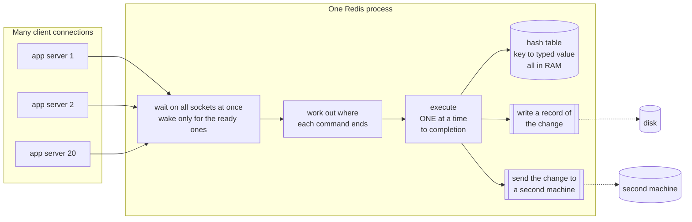
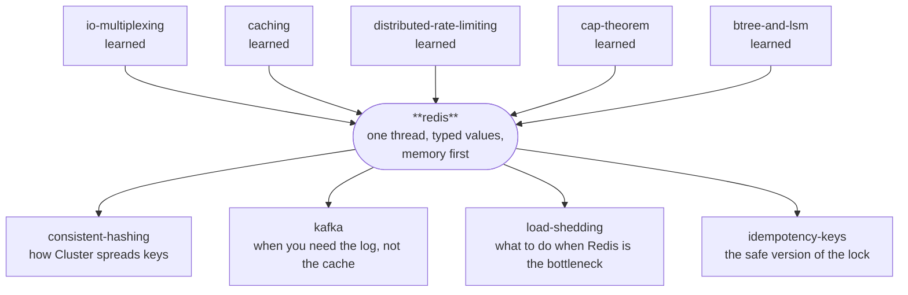

# Redis — the database that does one thing at a time

> **What this is.** A lab that teaches Redis by building one. Everything below is
> demonstrated by a working TCP server in `src/` that runs commands one at a time, and every number
> quoted was measured by running it on this machine.
>
> **Depth layers.** BEGINNER MODEL (§1–9) → INTERMEDIATE MODEL (§10) →
> ENGINEERING MODEL (§11–14) → PRODUCTION MODEL (§15). There is a checkpoint at
> each transition telling you what stopping there leaves you with.

---

## 1. Why this exists

Your application does not run on one machine. It runs on twenty, behind a load
balancer, and any request can land on any of them.

Most of the time that is fine, because most facts live in your database. But some
facts are **shared, change constantly, and are needed in microseconds**: how many
requests this API key has made in the last minute, what is in this shopper's
basket, which worker currently owns this job, who is in the top ten this week.

Put such a fact in one server's memory and the other nineteen cannot see it. Put
it in your main database and every read and write becomes a trip through machinery
built to make facts *permanent and correct forever* — indexes, transactions, row
locks, disk flushes — which is not what you need here and is exactly what makes it
slow. Worse, under contention those row locks make your twenty servers queue up
behind each other.

If nobody solves this, you get the concrete failures you have already met: a rate
limiter that lets through twenty times its limit, a shopping basket that loses an
item when two tabs are open, a job picked up twice by two workers.

Redis is the thing that fills that hole. What follows is how, and — more usefully —
what it costs.

---

## 2. The problem, without any jargon

A school has a tuck shop. Along one wall stand labelled jars:

- a jar holding **one number** — how many samosas have been sold today
- a jar holding **tokens in the order they were dropped in** — the queue for the
  sandwich toaster
- a jar holding **names with scores** — this week's chess ladder

Twenty children need to change what is in those jars, constantly, all day. Arjun
sells a samosa and the count must go up. Bina joins the toaster queue. Chetan wins
a chess game and their score must go up by one.

The jars must be in the room where everyone can reach them, and getting to them
must take a second, not a minute.

---

## 3. What a reasonable person tries first

Open shelves. No counter, no shopkeeper. Any child walks up, takes the jar down,
changes what is inside, and puts it back.

This is fast, it is simple, and everyone can do it at once. It is also what your
code does every time it reads a value from a shared store, changes it, and writes
it back.

---

## 4. Why that breaks

Arjun and Bina each sell a samosa at the same moment. The jar says **5**.

| time | Arjun | Bina | the jar says |
|---|---|---|---|
| 1 | takes the jar down, reads **5** | | 5 |
| 2 | | takes the jar down, reads **5** | 5 |
| 3 | writes **6**, puts it back | | 6 |
| 4 | | writes **6**, puts it back | 6 |

> **🔮 Predict:** two samosas were sold. What does the jar say, and who finds out
> that anything went wrong?
>
> <details><summary>Reveal</summary>
>
> The jar says **6**. One sale has vanished.
>
> And the answer to the second half is the genuinely alarming part: **nobody finds
> out**. There is no error, no exception, no conflict, no log line. Both children
> did exactly what they were told to do and both believe they succeeded. The only
> evidence is that the number is quietly wrong, and it will stay quietly wrong
> forever.
>
> This is called a **lost update**, and you met it in the
> [distributed-rate-limiting](../distributed-rate-limiting/) lab as the reason
> twenty uncoordinated gateways turn "100 per minute" into 2,000 per minute.
> </details>

**The obvious fix, and why it is not good enough.** Put a padlock on the shelf. A
child takes the key, does their business, returns the key. Now nothing is lost.

But look at what the padlock cost:

- **Three trips instead of one.** Get the key, read-and-write, return the key. If
  the shelf is across a field, you just tripled the walking.
- **One child at a time, for the whole shelf.** Bina wants the chess jar and Arjun
  has the samosa jar — irrelevant, there is one padlock.
- **A child who takes the key and goes home stops the shop forever.** Someone must
  now decide how long is too long to hold a key, and be wrong about it. (You saw
  this exact shape in [two-phase-commit](../two-phase-commit/): after voting yes, a
  participant holds its locks and cannot decide alone if the coordinator dies.)

So the padlock trades one silent bug for three loud problems.

---

## 5. What we actually need to guarantee

Stated plainly, before any solution:

> Any of the twenty children must be able to change a shared jar such that
> **(a)** no change can ever be silently lost, **(b)** the child does not have to
> hold a key or make three trips, and **(c)** the whole thing takes about as long
> as shouting across a room.

Everything in the rest of this lesson is the pursuit of those three, and every
strange detail of Redis's design is a scar from something that went wrong on the
way.

---

## 6. The key idea

Put **one shopkeeper** behind a counter. The children never touch the jars again.

Instead a child shouts an **instruction** — *"add one to the samosa jar"* — and the
shopkeeper does the whole thing alone: takes the jar down, reads 5, writes 6, puts
it back, and calls out "6". Only *then* does the shopkeeper start the next
instruction.

Two separate inventions are hiding in that paragraph, and it is worth separating
them because people usually only notice the first:

1. **The instruction says what you want done, not "give me the jar".** That is only
   possible because the shopkeeper knows what *kind* of thing is in each jar — you
   can say "add one" about the samosa jar and "add a token to the end" about the
   queue jar.
2. **There is exactly one shopkeeper, finishing each instruction before starting
   the next.**

The second one is what makes Arjun and Bina's lost sale *impossible*. Not a
padlock — an absence of simultaneity. There is no gap between the read and the
write for anyone to slip into, because during that gap the shopkeeper is not
listening to anyone.

This is Redis. Everything else in this document is a consequence of that sentence,
including all the bad parts.

---

## 7. Now the vocabulary

You have earned all of these. Each one names something you have already felt.

### key–value store

**Plain meaning:** a very large box of labelled jars. You put a thing in under a
name; you get it back by that name.

**Technical meaning:** a store whose only index is the primary key. There is no
query planner, no `WHERE`, no join. `GET user:42` is the entire query language.

**Why the term exists:** to distinguish it from a *relational* store, which lets you
ask questions the designer never anticipated, and pays for that flexibility on
every single operation. A key–value store gives that up on purpose. The
[database-landscape](../database-landscape/) lab called this "an opinionated bet on
one access pattern" — Redis's bet is *"you already know the key."*

**Concrete:** `SET cart:7 "3 items"` then `GET cart:7`. There is no way to ask
"which carts have 3 items" without looking at every key.

### in-memory

**Plain meaning:** the jars are on the shelf in the room, not in the basement
warehouse.

**Technical meaning:** the entire working dataset lives in RAM. Disk is used only
to *recover* after a restart, never to serve a read.

**Why the term exists:** to mark the sharpest difference from every disk-based
database. Postgres keeps a cache in RAM and the truth on disk; Redis keeps the
truth in RAM and a *recovery record* on disk. This is why Redis is fast and why
your dataset must fit in memory — and why "how much RAM" is the first question
anyone asks about a Redis deployment.

**Connects to:** [caching](../caching/) taught that a cache is a bounded copy whose
truth lives elsewhere. **Redis is not, by definition, a cache** — it is frequently
*used* as one, but it can equally be the source of truth for data you would be sad
to lose. Which of the two it is for you is a decision you make, not a property of
the software, and you make it by choosing the persistence settings in §11.

### single-threaded command execution

**Plain meaning:** one shopkeeper, one instruction at a time, finished before the
next begins.

**Technical meaning:** all commands are executed on one thread, each running to
completion before the next is dequeued.

**Why the term exists:** the careful phrase is *command execution*, and the
precision matters, because "Redis is single-threaded" is the most over-simplified
sentence in the field. Modern Redis uses other threads for several things — flushing
to disk, freeing large values, and since version 6 optionally reading and writing
sockets. What has never been parallel, and is the thing being claimed, is the part
that **touches your data**.

**Connects to:** [io-multiplexing](../io-multiplexing/). That lab taught you how one
thread can serve thousands of connections by handing the whole set to the kernel and
sleeping until something is ready. Redis is that lesson applied to a database — the
same `epoll`/`kqueue` loop you built, with a hash table behind it.

### atomic (in the Redis sense)

**Plain meaning:** it either fully happened or it did not, and nobody ever saw it
half-done.

**Technical meaning:** a single Redis command is indivisible with respect to other
commands. No other command can observe or interleave with its intermediate state.

**Why the term exists — and this one genuinely trips people up**, because you already
know two *different* things called atomicity:

| | what it promises | how it is achieved |
|---|---|---|
| **Redis atomicity** | no other **command** interleaves | there is one thread |
| **ACID atomicity** (databases) | all-or-nothing across a **transaction**, with rollback | undo logs |
| **JMM atomicity** ([java-memory-model](../java-memory-model/)) | no other **thread** sees a torn read | CPU instructions, `volatile`, `AtomicLong` |

Redis gives you the first. It does **not** give you the second — a Redis
"transaction" cannot roll back, which §12 covers in detail. Confusing the two is the
single most common Redis mistake in production code.

**Concrete:** `INCR visits` reads 5, computes 6, writes 6. Between the read and the
write, no other client's command runs. That is the whole guarantee, and it is
enough to make Arjun and Bina's lost sale impossible.

### data type

**Plain meaning:** the shopkeeper knows the samosa jar holds a number and the
toaster jar holds a queue.

**Technical meaning:** each value has a server-known type — string, list, hash, set,
sorted set (plus stream, bitmap, HyperLogLog, and geo in real Redis) — and each type
has commands that only make sense for it.

**Why the term exists:** this is the whole difference between Redis and a plain
cache like memcached. Memcached stores opaque bytes, so "add one to the counter"
*must* be get-modify-set in your client, with the gap that loses updates. Because
Redis knows the value is a number, `INCR` can exist as one command, and the gap
disappears. **The data types are not a convenience feature. They are the mechanism
by which the atomicity guarantee is delivered to you.**

**Concrete:** `LPUSH jobs "email"` on a list, `ZINCRBY leaderboard 1 chetan` on a
sorted set. Try `GET` on a list and the server refuses with `WRONGTYPE` — verified
by the test `wrong_type_operation_is_refused`.

### round trip, and pipelining

**Plain meaning:** shouting the instruction across the room and waiting to hear the
answer takes far longer than the shopkeeper's actual work.

**Technical meaning:** a **round trip** is one request travelling to the server plus
one reply travelling back. **Pipelining** is sending many requests without waiting
for each reply, then collecting the replies in order.

**Why the term exists:** because Redis commands are so fast that the network
dominates, and this reverses the usual intuition about what to optimise. You know
this from [communication-protocols](../communication-protocols/) as RTT dominance;
in Redis it is unusually stark. Experiment 3 measures it: 10,000 `INCR`s took
**277 ms** one at a time and **12 ms** pipelined. Identical commands, identical
server work — the client just stopped waiting.

---

## 8. Two mental models, and the map between them

### The simple model (carry this around)

One shopkeeper. One counter. A wall of labelled jars, each of a known kind. Children
shout instructions; the shopkeeper does them one at a time, out loud, and answers.

### The engineering model (this is what is actually running)



- **State:** one hash table `key → typed value`, plus a second table
  `key → deadline` for the keys that have one.
- **Loop:** wake on ready sockets → read bytes → work out where each command ends →
  execute each to completion → write replies → tidy up (drop keys past their
  deadline, make room if memory is full, record changes to disk and to the second
  machine). Every one of those tidy-up steps gets its own section below.
- **Invariant that everything rests on:** exactly one thread is ever inside the hash
  table.

### The map between them

| tuck shop | Redis | where it is in the code |
|---|---|---|
| the shopkeeper | the command-execution thread | `MiniRedis.loop()` |
| shouting an instruction | one command sent over the network | `Resp.parse()` |
| the shopkeeper knows each jar's kind | typed values | `Store.Value.type` |
| finishing one instruction before the next | atomicity | `MiniRedis.execute()` |
| the wall of jars | the keyspace in RAM | `Store.dict` |

The shop has four more features — notes on jars saying "throw this out at 4pm", a
shelf that runs out of room, the shopkeeper's notebook, and a second shop copying
that notebook. Each of those names a real Redis mechanism, and each gets earned in
§10 and §11; the table is completed at the end of §11.

### Where the analogy breaks

Never let an analogy quietly mislead you. Here is exactly where this one stops
being true:

1. **The shopkeeper would tell you if a jar had been thrown away.** Redis throws
   keys away silently when memory runs out (§10). Your next read is simply a miss,
   indistinguishable from a key you never set. Nothing is logged to your client.
2. **The shopkeeper does everything, including writing the notebook.** Real Redis
   does *not*. Flushing to disk, taking snapshots (via `fork()`), freeing very large
   values, and — since Redis 6 — reading and writing sockets can all happen on other
   threads. "Single-threaded" is a claim about command execution only. Get this
   wrong and you will mispredict performance.
3. **The shop is one room.** Redis Cluster is many shops, and each jar lives in
   exactly one of them — which is why a command touching two jars may be refused
   outright (§15).
4. **Shouting is instant.** The network is not. On a real deployment the round trip
   is usually larger than the command, which is why §14's experiment 3 matters more
   in practice than anything about the command itself.
5. **The jars are still there in the morning.** Redis's memory is not. Without
   persistence turned on, a restart is an empty shop — and even *with* it, the
   recovery is not complete (§11, F4).

---

## 9. Watch it move

Before the mechanism in detail, spend five minutes here — the rest of the document
is much easier once you have seen the thread do its thing.

**→ [The One Thread](https://claude.ai/code/artifact/492e3d97-6221-482d-847c-8ee9302ece13)** *(also saved locally as `visualization.html`)*

The page is the pipeline in the diagram above, laid out the same way left to right:
four clients, the waiting line, the one thread, the keyspace. Send commands and step
through tick by tick — forwards *and backwards*.

The single most valuable thing on the page is the **thread-count switch**. Run the
"two clients add 1 to the same counter" scenario on one thread, then flip to four and
run it again. The commands are identical. On one thread the answer is 7; on four an
increment silently disappears and the log tells you exactly which read went stale.
That is §4's lost sale, live.

Five predict-then-watch scenarios cover the surprises: atomicity, one slow command
freezing everybody, a key's deadline passing without its memory coming back, a
full shelf picking a
victim by sampling, and a machine dying so that its stand-in takes over — losing
writes that had already been acknowledged to the client.

---

> ### ✅ CHECKPOINT — end of the BEGINNER MODEL
>
> You can now explain *why* Redis exists, what problem the single thread solves,
> and why "the server knows the type" is the mechanism rather than a convenience.
> If you stop here you can hold a sensible conversation about Redis and you will not
> make the lost-update mistake.
>
> **What the next layer adds:** how a command actually gets from a socket to the
> hash table, and why each awkward-looking detail of that path is the scar of
> something that broke.

---

## 10. The mechanism, told as the story of its own design

We will build the server the way a smart person would build it, and let each version
break.

### v1 — the loop

```
forever:
    wait for a client to say something
    read the bytes
    work out which command it is
    do it
    write the reply
```

That really is the shape of `MiniRedis.loop()`. Now let us break it four times.

### Break 1: "the socket is readable" is not "a command arrived"

A client sends `SET name Redis`. Your `read()` returns 11 bytes. Is that a command?

> **🔮 Predict:** TCP is a stream of bytes, not a stream of messages. What happens
> if the client's `SET name Redis` arrives in two packets and the server executes
> whatever it has when the first one lands?
>
> <details><summary>Reveal</summary>
>
> You execute `SET name Re`, which either stores the wrong value or is a parse
> error — and then the remaining bytes `dis` arrive and get interpreted as the start
> of a *new* command. One split packet corrupts the connection permanently.
>
> This is the **framing** problem from [io-multiplexing](../io-multiplexing/), where
> you measured one 512 KB message arriving as 76 separate readiness events.
> </details>

**The fix, and it is why RESP looks the way it does.** Every message declares its own
length before its content, so a reader always knows exactly how many more bytes it
needs and never has to guess. This is what a client actually sends:

```
*3\r\n$3\r\nSET\r\n$4\r\nname\r\n$5\r\nRedis\r\n
 |     |                                          
 |     $4 = "the next argument is 4 bytes long"
 *3 = "this command has 3 parts"
```

Five reply types, each identified by its first byte:

| first byte | means | example |
|---|---|---|
| `+` | a short status | `+OK\r\n` |
| `-` | an error | `-WRONGTYPE Operation against...\r\n` |
| `:` | an integer | `:6\r\n` |
| `$` | a length-prefixed string (`$-1` = nothing there) | `$5\r\nRedis\r\n` |
| `*` | an array of the above | `*2\r\n$3\r\nfoo\r\n$3\r\nbar\r\n` |

The parser in `src/Resp.java` returns `null` when the bytes on hand are not yet a
complete command — never partially consuming — and the test
`resp_frames_a_command_split_across_two_tcp_writes` sends a deliberately truncated
command, checks nothing happened, then sends the rest and checks it did.

**And notice the payoff you get for free:** if framing is length-prefixed, a client
can put *ten thousand* commands into one write and the server will find all of them.
That is pipelining, and it is the 23× speedup in experiment 3. It is not a feature
anybody added; it fell out of fixing the framing bug.

### Break 2: one slow client would starve everyone — so, threads?

The obvious next move is a thread per connection, so a slow client cannot hold up the
others.

> **🔮 Predict:** you switch to a thread per connection. The command code does not
> change at all. What have you just lost?
>
> <details><summary>Reveal</summary>
>
> Atomicity. `INCR` is read-modify-write; with several threads inside the hash table
> the read of one can land between the read and the write of another, and you are
> back to Arjun and Bina.
>
> Experiment 1 measures precisely this. Eight clients, 2,000 increments each, on
> exactly the same command code:
>
> ```
> expected                                : 16,000
> single-threaded server                  : 16,000   -> 0 lost
> same commands on many threads           : 11,124   -> 4,876 lost (30.5%)
> ```
>
> Nearly a third of the work vanished, silently. You could get it back with a lock
> per key — that is what most databases do — but then you have paid for locks on
> every operation, and you own every deadlock you create.
> </details>

**The fix is to refuse the choice.** Keep one thread for execution, and solve the
slow-client problem a different way: never block on a socket. Hand the whole
connection set to the kernel, sleep, and get woken with only the ready ones. That is
exactly the `Selector` loop you built in the io-multiplexing lab, and it is why Redis
can hold tens of thousands of connections on one thread.

**This is the trade at the heart of Redis, stated honestly:** one thread means
perfect isolation between commands and zero lock overhead, at the price that
*everything shares one fate*. Which brings us straight to the next break.

### Break 3: memory fills up

RAM is finite. When the keyspace outgrows it, something has to go.

The obvious answer is least-recently-used: throw out whatever has gone longest
without being touched. To do that exactly, you keep every key in a linked list and
move it to the front on every access.

> **🔮 Predict:** exact LRU costs two pointers per key — on 10 million keys, roughly
> 160 MB of pure bookkeeping. Redis refuses to spend that and **samples** instead:
> pick 5 keys at random, evict the oldest of those, repeat. How much hit ratio does
> that shortcut cost?
>
> <details><summary>Reveal</summary>
>
> Almost none. Experiment 5, 200,000 requests over 20,000 keys with 80% of traffic
> on the hot 20%:
>
> ```
> policy                      hit ratio   evictions
> allkeys-exactlru                75.7%       48,639
> allkeys-lru (samples=5)         73.7%       52,545     <- what Redis actually does
> allkeys-lru (samples=10)        74.9%       50,204
> allkeys-random                  66.6%       66,864
> ```
>
> Sampling five costs **1.9 percentage points** against perfect LRU. Having a policy
> at all is worth **7.1** against random. So Redis buys 79% of the available benefit
> for zero per-key memory, and `maxmemory-samples 10` buys back another chunk if you
> want to pay a little CPU for it.
>
> This is a good thing to internalise generally: an approximation that costs nothing
> per item often beats an exact algorithm that costs something per item.
> </details>

The policies you actually choose between (`maxmemory-policy`):

| policy | evicts | use when |
|---|---|---|
| `noeviction` | nothing — writes fail with an error | Redis is your source of truth and silent data loss is unacceptable |
| `allkeys-lru` | least recently used, sampled | pure cache — the standard choice |
| `allkeys-lfu` | least *frequently* used, sampled | cache with a stable hot set that scans would otherwise pollute |
| `volatile-lru` / `-lfu` / `-ttl` / `-random` | only among keys that have a deadline | mixed instance: some keys are cache, some are truth |

The `volatile-*` family is how you run one instance holding both disposable and
precious data — but it has a nasty edge: if *nothing* has a TTL, there is no
candidate, and writes fail exactly as if you had chosen `noeviction`.

### Break 4: a note that says "throw this out at 4pm"

Sessions expire, caches go stale, locks must not be held forever. So keys need
deadlines — a **TTL** (time to live).

The obvious implementation is a timer per key. On 10 million keys that is 10 million
timers, and the cost is per key again.

> **🔮 Predict:** Redis will not pay that. So: you set 50,000 keys with a 1-second
> TTL. Two seconds later, nobody has read any of them. How much memory has come back?
>
> <details><summary>Reveal</summary>
>
> With only lazy expiry, **none at all**. Experiment 4:
>
> ```
> 50,000 keys, TTL 1s   DBSIZE=50000  used_memory=15,077,780 bytes
> 3 seconds later:
>   DBSIZE (residency)      : 50000      <- unchanged
>   logically alive         : 0
> ```
>
> Every one of those keys is dead and every one is still occupying memory.
> </details>

Redis finds dead keys two ways, and you need both in your head:

- **Lazy expiry.** When anything touches a key, the server checks the deadline first;
  if it has passed, the key is deleted right then and the caller is told the key does
  not exist. This is `Store.lookup()`. It costs nothing — but it only ever finds keys
  somebody asks for.
- **Active expiry.** Ten times a second, sample 20 keys *that have a deadline*,
  delete the dead ones, and if more than a quarter of the sample was dead, go round
  again immediately. This is `Store.activeExpireCycle()`, faithful to the real
  algorithm. It is probabilistic, not exhaustive, and deliberately bounded so it can
  never monopolise the one thread. Experiment 4 needed **157 sweep invocations** to
  clear 50,000 dead keys — at the real ten-per-second rate, about fifteen seconds.

**Two consequences worth writing on a sticky note:**

1. `DBSIZE` counts keys that are **resident**, not keys that are **alive**. This is
   faithful to real Redis and it is why "my TTLs expired but `DBSIZE` didn't move" is
   a support question rather than a bug. The test
   `expired_key_is_invisible_but_can_still_be_resident` pins the behaviour.
2. An instance can sit pressed against its `maxmemory` limit holding nothing but
   corpses, evicting *live* keys to make room, because the dead ones have not been
   sampled yet.

---

> ### ✅ CHECKPOINT — end of the INTERMEDIATE MODEL
>
> You can now follow a command from socket bytes to hash table and back, and explain
> why RESP is length-prefixed, why execution is single-threaded, why eviction samples,
> and why expiry is lazy. Each of those is a scar from a break you just watched.
>
> **What the next layer adds:** what happens when things go wrong — the process dies,
> the machine dies, the network splits, a client stalls holding a lock — and exactly
> which promises survive each one.

---

## 11. Failure scenarios

Each of these is real, each is runnable, and each bends a specific promise.

### F1 — One slow command freezes every client

**Create it:** `java src/Experiments.java 2`, or the "list every key" scenario in the
visualization.

**What happens:** twenty clients doing tiny `GET`s on unrelated keys, while one other
client runs `KEYS user:session:1*` over 200,000 keys.

```
the KEYS command itself took            : 245 ms
innocent GETs measured before it        : p99 =   1,011 us
innocent GETs measured during it        : p99 = 191,661 us, max = 191,715 us
```

**Why:** there is one thread and it runs each command to completion. The twenty
clients were not competing for a key — they were competing for the thread. A **190×**
p99 collapse caused entirely by somebody else's connection.

**What survives / what is lost:** every guarantee about correctness holds — no data is
wrong. What is lost is **liveness**: the system stops making timely progress. Safety
intact, liveness gone, exactly the distinction from [paxos](../paxos/).

**In production:** this is the single most common Redis outage. `KEYS *` is the
famous one, but `SMEMBERS` on a million-member set, `HGETALL` on a huge hash,
`LRANGE key 0 -1`, a `DEL` of a multi-gigabyte value, and a slow Lua script all do
it. You find it in `SLOWLOG GET` afterwards and in `INFO commandstats`. The fixes:
`SCAN` instead of `KEYS` (bounded work per call), `UNLINK` instead of `DEL` (frees on
a background thread), and never letting one key grow unbounded — a single key
holding a huge collection is called a **big key**, and it is dangerous precisely
because every O(n) command on it is an outage for everybody else.

### F2 — Memory fills and Redis throws out something you needed

**Create it:** set `maxmemory` low, `maxmemory-policy allkeys-lru`, keep writing —
the test `maxmemory_with_lru_policy_evicts_down_to_the_limit`, or the eviction
scenario in the visualization.

**Why:** the capacity invariant must hold, so on each write that would exceed
`maxmemory`, victims are sampled and dropped until it fits.

**What survives / what is lost:** if Redis is a cache, nothing of value is lost — a
miss just costs a trip to the source. **If Redis is your source of truth, this is
silent permanent data loss**, and nothing in your client will tell you. That is why
`noeviction` exists, and why the choice of policy is really a declaration of what the
instance *is*.

**In production:** watch `evicted_keys` in `INFO`. A non-zero rate on an instance you
think of as a database is an emergency. Also note the trap: `used_memory` counts what
Redis asked for, `used_memory_rss` counts what the OS gave it, and the ratio between
them is fragmentation — a Redis at 80% of `maxmemory` can still be at 100% of the
machine.

### F3 — The TTLs passed and the memory did not come back

**Create it:** `java src/Experiments.java 4`.

**Why:** §10 break 4 — expiry is lazy plus sampled, never exhaustive and never prompt.

**What survives / what is lost:** correctness is fine (a dead key is never visible).
What is lost is your ability to reason about memory from TTLs alone.

**In production:** the graph to look at is `expired_keys` rate against your own write
rate. If you are creating keys with TTLs faster than the sweep reclaims them, memory
climbs until eviction starts throwing out *live* keys. Real Redis lets you tune the
sweep's aggressiveness with `hz` (and `dynamic-hz`).

### F4 — The process dies

> **🔮 Predict:** Redis is running with `appendfsync no`, so it has not forced
> anything to disk in ages. You run `kill -9` on it. How much acknowledged data do
> you lose?
>
> <details><summary>Reveal</summary>
>
> **Nothing.** Experiment 6 Part A does this for real, with a real separate process
> and a real `kill -9`:
>
> ```
> acknowledged writes : 5,000
> survived kill -9    : 5,000   -> 0 lost
> ```
>
> Redis had already called `write()`, so the bytes were in the **operating system's
> page cache**. Killing a process does not empty the kernel's memory. `appendfsync`
> protects you from the *machine* dying, not from the *process* dying — and those are
> very different events with very different frequencies.
>
> If this surprised you, it is because "flushed to disk" quietly conflates three
> separate moments: appended to Redis's own buffer, `write()`n to the OS, and
> `fsync()`ed to the physical device. Only the third survives a power cut.
> </details>

**F4b — the machine loses power.** Now the page cache is gone too. Experiment 6
Part B:

```
appendfsync   acknowledged    durable       lost  lost as traffic   writes/sec
always              40,144     40,144          0             0 ms        8,920
everysec           137,121    120,949     16,172           530 ms       30,471
no                 153,137          0    153,137         4,500 ms       34,030
```

Read the loss as a **duration**, not a quantity: `everysec` lost everything written
since its last fsync — the crash landed 500 ms into the 1,000 ms window, so 530 ms of
traffic went. That is Redis's real durability promise stated honestly: *your write is
acknowledged now and becomes durable up to a second from now.*

And look at the throughput column, because that is why `everysec` is the default:
`always` bought the zero at **3.4× lower throughput**.

**Two persistence mechanisms, and you should know which does what:**

| | **RDB** (snapshot) | **AOF** (append-only file) |
|---|---|---|
| what it is | a compact binary point-in-time dump of the whole dataset | every write command, appended in order |
| written by | a `fork()`ed child process | the main process, buffered, fsynced per policy |
| recovery | fast — load one file | slower — replay every command |
| loses | everything since the last snapshot (minutes) | up to your fsync window (a second) |
| file size | small | grows forever unless rewritten |

You have seen this pair before. It is exactly the write-ahead log plus checkpoint
from [btree-and-lsm](../btree-and-lsm/), and the event log plus snapshot from
[event-sourcing](../event-sourcing/) — same idea, third context. Production usually
runs **both**: AOF for a tight loss window, RDB for fast restarts and backups. Redis
7 unified them into a "multi-part AOF" (a base RDB plus incremental files).

**One production hazard specific to snapshots:** `BGSAVE` calls `fork()`. The child
shares the parent's memory copy-on-write, so every page the parent *writes* while the
snapshot runs gets duplicated. On a write-heavy instance the process can approach
**twice** its dataset size in RSS for the duration. Sizing a box at exactly your
dataset size is how you get killed by the OOM killer during a backup.

### F5 — The machine dies and a replica takes over

> **🔮 Predict:** the master acknowledged 500 writes to their clients, then died. A
> replica is promoted. How many of the 500 are on the new master?
>
> <details><summary>Reveal</summary>
>
> However many happened to have arrived — which you do not control. Experiment 7:
>
> ```
> replication lag     0 ms  ->  acked 500, on the promoted replica 500, LOST 0
> replication lag 1,500 ms  ->  acked 500, on the promoted replica   0, LOST 500
> ```
>
> Both rows are the same code with the same guarantees. The only variable is how far
> behind the replica happened to be.
> </details>

**Why:** Redis replication is **asynchronous**. The master replies to the client and
streams to replicas as two independent acts, in that order. So *"Redis said OK"* and
*"this write will survive a failover"* are different statements, and the gap between
them is the replication lag.

**What survives / what is lost:** availability survives — there is a working master
within seconds. **Durability of acknowledged writes does not.** This is the AP corner
of [cap-theorem](../cap-theorem/), and it is the product, not a misconfiguration.

**`WAIT` does not fix this,** and it is worth being precise about why. `WAIT
numreplicas timeout` tells you how many replicas already have your write. It cannot
un-acknowledge one that they don't — by the time `WAIT` returns a disappointing
number, your client already has its `OK`, and Redis has no rollback. `WAIT` narrows
the window you are exposed to; it does not close it.

**In production:** monitor `master_repl_offset` on the master against each replica's
offset. Configure `min-replicas-to-write` / `min-replicas-max-lag` so a master with
no healthy replicas refuses writes rather than accepting ones it cannot protect —
that is you choosing CP for that instance. And if a write must not be lost, it must
not live *only* in Redis.

### F6 — Split brain: two masters at once

**Create it:** partition the network so that the failover machinery — Sentinel, the
component that watches a master and promotes a replica when it stops answering
(§15) — promotes a replica while the old master is still up and still reachable by
some clients.

**Why:** the old master has not crashed — it just cannot see the majority. It keeps
accepting writes from the clients that can still reach it, while the new master
accepts different writes from everyone else.

**What survives / what is lost:** both halves keep serving (availability), and their
data diverges (consistency). When the partition heals, the old master is
reconfigured as a replica of the new one and **discards its own divergent writes** —
they are gone, and no client that received an `OK` was ever told.

**In production:** the mitigation is the same `min-replicas-to-write` setting: a
master that cannot see enough replicas stops accepting writes and the minority side
goes read-only. For Cluster there is `cluster-require-full-coverage`. This is the
CAP dial, and Redis lets you turn it — the default position is AP.

### F7 — The distributed lock that lets two clients in

Almost every Redis deployment eventually grows this pattern:

```java
// take the lock: set it only if absent, with a deadline, in ONE command
SET lock:invoice:42 <random-token> NX PX 30000
   ... do the work ...
// release it only if we still own it (this must be a Lua script -- see below)
```

The `NX PX` combination in one command matters: `SETNX` followed by a separate
`EXPIRE` can crash in between and leave a lock with no deadline, held forever. The
test `set_nx_px_grants_the_lock_to_exactly_one_client` confirms exactly one of 20
concurrent clients wins.

> **🔮 Predict:** client A takes the lock with a 200 ms deadline, then stalls for
> 500 ms in a garbage-collection pause. How many clients believe they hold the lock?
>
> <details><summary>Reveal</summary>
>
> **Two.** Experiment 8:
>
> ```
> A: acquired the lock, deadline 200 ms
> B: acquired the lock (A's had expired) -> writing
> A: woke up, still believes it holds the lock -> writing
> writers that entered the critical section: 2  [B, A]
> ```
>
> Redis did nothing wrong. It granted one lock, expired it on schedule, and granted
> it again. The lock was lost by A **without A being told** — because nothing can
> tell A; A was not running.
>
> And you cannot escape by removing the deadline, because a lock with no deadline
> deadlocks permanently the first time a holder dies. Every lock with a timeout has
> this hole.
> </details>

**The fix does not live in Redis. It lives at the resource.** Each acquisition takes
a strictly increasing number — a **fencing token** — and the protected resource
refuses any write carrying a token lower than the highest it has already honoured:

```
B: accepted with token 2
A: REJECTED by the resource -- token 1 is stale
with fencing tokens, writers accepted: 1  [B]
```

The lock still failed identically; both clients still believed they held it. What
changed is that the *resource* can now tell which belief is stale.

**What survives / what is lost:** mutual exclusion is **not** guaranteed. What you
actually get is a strong probability that two workers will not do the same job at the
same time — which is worth a lot, and is not the same thing.

**In production:** use a Redis lock to stop duplicate work (efficiency). Do not use
one as the only thing standing between you and a correctness violation. **Redlock**
(the multi-instance algorithm) does not change this conclusion; Martin Kleppmann's
critique and antirez's reply are both worth reading in full, and the durable takeaway
is the fencing token. Also note that a correct *release* must check the token and
delete in one atomic step, which needs a Lua script — a plain `GET` then `DEL` can
delete somebody else's lock in between.

### F8 — A hot key: one key gets all the traffic

**Why:** a **hot key** is one key taking a large share of all traffic. A Redis
Cluster spreads *keys* across shards. A single key lives on exactly
one shard, so a key that is 40% of your traffic puts 40% of your traffic on one
thread on one machine, and adding shards does nothing at all.

**What survives / what is lost:** correctness is fine. Your ability to scale that
particular workload horizontally is gone.

**In production:** this is the [distributed-rate-limiting](../distributed-rate-limiting/)
lab's hot-key problem in its native habitat, and the same remedies apply: split the
key (`counter:{id}:0..9` and sum), put a short-TTL local cache in front of it, or
route by a different dimension. Find them with `redis-cli --hotkeys` and
`--bigkeys`.

### F9 — Pub/Sub silently drops messages

**Create it:** the test `pubsub_reaches_only_clients_connected_right_now`. Publish
with nobody subscribed; the message is delivered to zero clients and is gone forever.

**Why:** Redis Pub/Sub is fire-and-forget. There is no queue, no backlog, no retry,
no replay. A subscriber that was disconnected — or merely reconnecting — misses
everything sent in that window.

**What survives / what is lost:** at-most-once delivery. No durability whatsoever.

**In production:** if losing a message is acceptable (cache invalidation broadcasts,
live dashboards) Pub/Sub is perfect and very cheap. If it is not, use **Redis
Streams** (`XADD` / `XREADGROUP`), which keep a persistent log with consumer groups
and explicit acknowledgement — the "queue vs log" distinction from
[database-landscape](../database-landscape/), inside one product.

### The rest of the map

§8 left four rows of the tuck-shop map unfilled because the words had not been
earned yet. They have been now:

| tuck shop | Redis | where it is in the code |
|---|---|---|
| a note on a jar saying "throw this out at 4pm" | a **TTL**, found lazily and by sampling | `Store.expires`, `Store.activeExpireCycle()` |
| the shelf running out of room | **`maxmemory`** plus an **eviction policy**, sampled | `Store.evictIfNeeded()` |
| the shopkeeper's notebook of every instruction | the **AOF**, made durable per `appendfsync` | `MiniRedis.appendAof()` |
| a second shop copying the notebook, always slightly behind | an **asynchronous replica**, and that "slightly behind" is your failover data-loss window | `MiniRedis.propagate()` |

---

## 12. What is guaranteed, what is not, and what it cost

### Invariants the design actually maintains

1. **One command at a time.** No command observes another's intermediate state. This
   is the source of everything good here.
2. **Commands are ordered.** Every client, every replica and the AOF see the same
   sequence. There is one thread, so there is one order.
3. **An expired key is never visible**, even if it is still resident.
4. **`used_memory` ≤ `maxmemory`**, unless the policy is `noeviction` — in which case
   writes are refused instead.
5. **Only real effects propagate.** A `SET NX` that lost the race changes nothing, so
   it is never written to the AOF and never sent to a replica.
6. **Propagation is deterministic.** Non-deterministic commands are *rewritten*
   before they leave the server, because a replica replaying them would diverge:
   `EXPIRE` (relative) becomes `PEXPIREAT` (absolute), `SPOP` (random) becomes the
   concrete `SREM` of the member actually removed. Both are pinned by tests.

### What Redis does NOT guarantee, in order of how often it bites people

- **Durability of an acknowledged write.** Acknowledgement precedes both `fsync` and
  replication. Up to one second locally (F4), and unboundedly on failover (F5).
- **That a "transaction" can be rolled back.** `MULTI`/`EXEC` runs a batch with
  nothing interleaved. It does **not** undo. If command 3 of 5 fails at run time,
  commands 1, 2, 4 and 5 still happened. Pinned by
  `multi_exec_does_not_roll_back_after_a_failed_command`:

  ```
  MULTI; INCR good; INCR text(<- fails); INCR good; EXEC
  -> [1, error, 2]   and `good` is 2.
  ```

  Redis's own documentation is explicit that this is a deliberate choice: errors
  inside `EXEC` are programming bugs, and supporting rollback would cost every
  transaction speed to protect against them.
- **Mutual exclusion from a lock** (F7).
- **Message delivery from Pub/Sub** (F9).
- **That a key you wrote is still there.** Eviction and expiry both remove keys
  silently.
- **Isolation across multiple keys, when the data is spread over several machines.**
  A multi-key command whose keys live on different shards is refused outright (§15).

### What the single thread bought, and what it cost

| bought | cost |
|---|---|
| every command atomic, with no locks anywhere | one slow command blocks everything (F1) |
| no lock contention, no deadlocks, no lost updates | one CPU core per instance for command work |
| one total order of operations, for free | vertical scaling of a single key is impossible (F8) |
| a dramatically simpler codebase, hence very few concurrency bugs | you must reason about command complexity yourself |

**The rule that falls out of this table** and is worth carrying into your own code:
*know the big-O of every command you send.* `GET`, `SET`, `INCR`, `LPUSH`, `HGET`,
`SADD` are O(1). `ZADD` is O(log n). `LRANGE` is O(offset + count). `KEYS`,
`SMEMBERS`, `HGETALL`, `SORT`, and `DEL` of a large collection are O(n) — and on one
thread, O(n) is not "slow for that caller", it is "slow for everyone".

### Optimistic concurrency, when one command is not enough

Sometimes the change you want depends on a value in a way no single command captures.
`WATCH` is Redis's answer: it does not lock anything, it *remembers a version*, and
`EXEC` refuses if the version moved.

```
WATCH balance          <- remember the version
GET balance            -> 100
MULTI
SET balance 90         <- queued, not run
EXEC                   -> nil, if anybody touched `balance` in between
```

This is the expected-version check from [event-sourcing](../event-sourcing/), applied
per key. And like all optimism it degrades with contention. Experiment 9, twelve
clients incrementing one key:

```
WATCH/MULTI/EXEC : result=2400  694 ms, 11,606 aborted attempts (4.8 per success)
INCR             : result=2400   23 ms,      0 aborted attempts
```

Both correct; one is **30× faster** and cannot fail. **If a single command already
expresses what you want, use it.** Reach for `WATCH` only when none does — and for a
Lua script when even that costs too many round trips.

---

## 13. The code

Six files, no build tool, no dependencies. `java src/MiniRedis.java 6380` starts a
real TCP server on port 6380.

| file | what it is |
|---|---|
| `src/Resp.java` | the wire protocol — the framing fix from §10 break 1 |
| `src/Store.java` | the keyspace, expiry, eviction, versions for `WATCH` |
| `src/Commands.java` | the command table — read it asking "why is this a *server* command?" |
| `src/MiniRedis.java` | the event loop, persistence, replication |
| `src/Cli.java` | a small `redis-cli`, and the client the tests drive |
| `src/Tests.java` | 25 scenario-named tests |
| `src/Experiments.java` | the nine experiments in §14 |
| `src/BrokenRedis.java` | three planted bugs, for the debug exercise |

**The load-bearing lines**, which are worth reading in this order:

1. **`MiniRedis.loop()`** — accept, read, execute, reply, housekeep. Note what is
   *absent*: no `synchronized`, no locks, no atomics around the store. There cannot
   be a race because there is only ever one thread inside it.
2. **`Commands.incrBy()`** — read, modify, write, with no possibility of
   interleaving. This is the entire atomicity guarantee, and it is four lines with no
   concurrency machinery in them at all.
3. **`Store.lookup()`** — lazy expiry. A key past its deadline must never be
   *visible*, but may still be *resident*.
4. **`Store.evictIfNeeded()` / `pickVictim()`** — sampling rather than an exact LRU
   order, and the measurement of what that costs.
5. **`MiniRedis.execute()`, the propagation block** — effects propagate, requests do
   not. Plus the `EXPIRE → PEXPIREAT` rewrite that keeps replicas deterministic.
6. **`Commands.run()`, the `SET` case** — the sharpest example of "propagate the
   effect, not the request": both the `NX` condition and the relative `PX` deadline
   are stripped before the command leaves the server, because re-deciding a condition
   later against a different clock can reach the opposite answer. `BrokenRedis` bug 3
   turns this off and shows the live server and the recovered server disagreeing about
   who holds a lock.
7. **`MiniRedis.appendAof()` / `flushAof()`** — the three distinct moments (buffer,
   `write()`, `fsync()`) whose conflation causes the F4 surprise.

**Run it:**

```bash
cd ~/Documents/Learning/redis

java src/Tests.java                 # 25 scenario tests, ~20s
java src/Experiments.java           # all nine experiments, ~5 min
java src/Experiments.java 1 7       # just experiments 1 and 7
java src/BrokenRedis.java           # three planted bugs, each one real

# or talk to it by hand
java src/MiniRedis.java 6380 &
java src/Cli.java 6380
  127.0.0.1:6380> SET name Redis
  127.0.0.1:6380> INCR visits
  127.0.0.1:6380> OBJECT ENCODING visits
  127.0.0.1:6380> INFO
```

`nc 127.0.0.1 6380` works too — the server accepts plain typed lines as well as RESP
arrays, exactly as real Redis does.

> **Not verified:** I have not pointed a real `redis-cli` at this server, because
> Redis is not installed on this machine. The protocol implementation follows RESP2
> faithfully and *should* work; if you want to check, run `brew install redis` and
> then `redis-cli -p 6380 ping`.

---

## 14. The experiments

Each is framed the way you should approach any experiment: predict, then run, then
reconcile.

| # | question to answer before running | command |
|---|---|---|
| 1 | 8 clients × 2,000 `INCR`, no locks. Final value? | `java src/Experiments.java 1` |
| 2 | 20 clients doing `GET`s; one runs `KEYS *`. What happens to the 20? | `... 2` |
| 3 | 10,000 increments four ways. Which is fastest, and which is *wrong*? | `... 3` |
| 4 | 50,000 keys expire and nobody reads them. How much memory returns? | `... 4` |
| 5 | Redis samples 5 keys instead of tracking exact LRU. What does that cost? | `... 5` |
| 6 | `kill -9` with `appendfsync no`. How much is lost? | `... 6` |
| 7 | 500 writes acknowledged, then the master dies. How many survive? | `... 7` |
| 8 | A locks for 200 ms, then stalls 500 ms. How many hold the lock? | `... 8` |
| 9 | `WATCH` loop vs `INCR`, 12 contending clients. Same answer — same cost? | `... 9` |

Every measured figure quoted in this document came from these runs, on this machine.

**Your numbers will not match mine exactly, and that is not a problem — but read the
variance carefully, because it is itself informative.** Across repeated runs the lost
updates in experiment 1 ranged from 26.6% to 30.5%, and experiment 2's p99 under load
from 191 ms to 287 ms. Notice *which* numbers move and which do not: the single
thread loses **exactly zero** every time, and experiment 7 loses **exactly all 500**
every time, because those two are consequences of the design rather than of the
machine. The wobbly numbers are the ones measuring how bad something is; the fixed
ones are measuring whether it happens at all. When a figure here differs from yours by
a factor rather than a fraction, that is worth investigating; when it differs by 20%,
that is your laptop.

---

> ### ✅ CHECKPOINT — end of the ENGINEERING MODEL
>
> You can now reason about Redis failures the way an on-call engineer has to: which
> promise each one bends, whether safety or liveness is lost, and what the mitigation
> actually is.
>
> **What the last layer adds:** the bridge from this toy to a real deployment — what
> MiniRedis leaves out, how production Redis fills each gap, and what you actually
> watch and tune.

---

## 15. From this toy to production

### The chain

**MiniRedis → real Redis.** Same architecture: one execution thread, an event loop
over non-blocking sockets, a hash table of typed values, a second table of deadlines,
lazy plus sampled expiry, sampled eviction, an append-only log, asynchronous
replication. If you understand this lab, you understand the shape of the real thing.

**What MiniRedis deliberately leaves out, and how Redis handles each:**

| omitted here | what real Redis does |
|---|---|
| binary RDB format | a compact binary snapshot written by a `fork()`ed child; ours writes commands |
| AOF rewrite | the log would grow forever; Redis periodically rewrites it to a minimal form (Redis 7: a base RDB + incremental files) |
| Lua scripting / Functions | `EVAL` and `FUNCTION` run a whole script atomically on the one thread. Ours fakes one case as a native `RATELIMIT` command |
| Redis Cluster | 16,384 hash slots, `CRC16(key) mod 16384`, `MOVED`/`ASK` redirects, hash tags `{...}` to force keys together |
| Sentinel | monitors a non-clustered master, elects a new one, tells clients |
| Streams, bitmaps, HyperLogLog, geo, vector sets | more types, same execution model |
| blocking commands (`BLPOP`, `BRPOPLPUSH`) | the client is parked without blocking the thread |
| memory encodings | `listpack` / `intset` / `skiplist` / `embstr` — a small hash is a flat array, not a hash table. Ours reports the encoding it *would* pick (test: `object_encoding_changes_when_a_collection_grows`) |
| ACLs, TLS, `protected-mode` | authentication and per-user command permissions |
| client-side caching, RESP3 | the server invalidates a client's local cache by push message |
| active defragmentation, I/O threads | `activedefrag`, `io-threads` |
| keyspace notifications | events when keys change or expire |

### Deployment shapes, in the order you should consider them

1. **One instance, one replica, Sentinel.** Correct for the overwhelming majority of
   workloads. One Redis on decent hardware handles well over 100,000 operations per
   second on one core.
2. **Redis Cluster.** Only when your dataset genuinely does not fit in one machine's
   RAM, or one core is genuinely the bottleneck. It costs you: no multi-key commands
   across slots, no `MULTI` across slots, a cluster-aware client, and resharding as
   an operation. **Do not start here.**
3. **Managed** — AWS ElastiCache, MemoryDB (which is Redis-compatible *with* durable
   multi-AZ writes, a genuinely different durability posture), Redis Cloud, GCP
   Memorystore.

### What an on-call engineer actually watches

```
INFO memory       used_memory, used_memory_rss, mem_fragmentation_ratio, maxmemory
INFO stats        evicted_keys, expired_keys, keyspace_hits/misses, rejected_connections
INFO replication  master_repl_offset vs each replica's offset  (the F5 exposure window)
INFO persistence  rdb_last_bgsave_status, aof_last_write_status, aof_rewrite_in_progress
INFO clients      connected_clients, blocked_clients
SLOWLOG GET       the F1 culprit, after the fact
LATENCY DOCTOR    Redis's own analysis of its latency spikes
redis-cli --latency / --bigkeys / --hotkeys / --memkeys
```

The three alerts that earn their place: **`evicted_keys > 0` on an instance you treat
as a database**, **replication offset lag above your tolerated data-loss window**, and
**`used_memory_rss` approaching machine memory** (remember `fork()` can nearly double
it during a snapshot).

### If you are wiring this into Spring Boot

- **Spring Data Redis** with the **Lettuce** driver is the default and the right
  choice — it is Netty-based and one connection multiplexes safely across threads.
  Jedis needs a connection pool because its connections are not thread-safe.
- `RedisTemplate` / `StringRedisTemplate` for direct commands;
  `@Cacheable`/`@CacheEvict` via `RedisCacheManager` when you want the cache-aside
  pattern generated for you. **Always set a TTL on cache entries** — an unbounded
  `@Cacheable` region is F2 waiting to happen.
- **Spring Session** puts HTTP sessions in Redis, which is what makes your twenty app
  servers interchangeable. Note the durability consequence: a Redis failover can log
  everybody out, so decide whether that is acceptable before it happens.
- **Serialization matters more than people expect.** The default
  `JdkSerializationRedisSerializer` produces large, Java-only, refactoring-fragile
  blobs. Use `GenericJackson2JsonRedisSerializer` or a String serializer.
- **Timeouts.** A Redis call is a network call. Set command timeouts, and decide
  per call site whether a Redis failure should fail the request or fall through to
  the source — the fail-open/fail-closed choice from
  [distributed-rate-limiting](../distributed-rate-limiting/), made per call.
- `@Transactional` on a Spring `RedisTemplate` does **not** give you database
  transaction semantics. It maps to `MULTI`/`EXEC`, which — as §12 established — has
  no rollback.

### When NOT to use Redis

- The data does not fit in RAM, or would be far cheaper on disk.
- You need queries you cannot express as "I know the key".
- You cannot tolerate losing a second of acknowledged writes and cannot tolerate
  losing more on failover. (MemoryDB is the exception built for exactly this.)
- You need real multi-key transactions with rollback.
- You are reaching for it as a message queue and you need delivery guarantees — use
  Streams deliberately, or Kafka.

### One thing to know before you deploy in 2026

Redis's licence changed twice. It left BSD in March 2024 for RSALv2/SSPLv1
(source-available, not open source); AWS and Google forked the last BSD version as
**Valkey**, now under the Linux Foundation. Redis 8.0 (May 2025) then added AGPLv3,
so Redis now ships under a tri-licence — AGPLv3, SSPLv1 or RSALv2 — with the line at
Redis 8.8 as of May 2026. Valkey is BSD-3, wire-compatible, on its own cadence
(9.1 in May 2026), and is the default on AWS ElastiCache and MemoryDB.

Practically: everything in this lab applies identically to both. The choice is a
licensing and ecosystem decision, not a technical one — but check which one your
managed provider is actually giving you. *(My training data ends in May 2026, and
this area has moved fast, so verify the current state before it matters to a
contract.)*

---

## 16. Exercises

**[EXERCISES.md](EXERCISES.md)** — eight rungs from "explain it back" to "design the
session store for three datacentres". Answers in **[SOLUTIONS.md](SOLUTIONS.md)**;
try first.

If you only do one, do **6.5**. `java src/BrokenRedis.java` runs three planted bugs,
each a mistake somebody has shipped. Two are caught by the test suite. One passes all
25 tests — and it is the one that would do the most damage. Finding out which, and
working out what *shape* of test the suite is missing, is worth more than the other
seven rungs combined.

---

## 17. Where this sits, and what to learn next



**Commonly confused with Redis — the one sentence that separates each:**

- **Memcached** — stores opaque bytes, so compound operations must happen in your
  client, with the gap that loses updates. Redis knows the type, so they happen on
  the server.
- **A cache** — Redis is often used as one, but a cache is defined by *deleting it
  costs only speed*. Configure Redis as a source of truth and that stops being true.
- **Redis Cluster vs Sentinel** — Cluster shards data across machines; Sentinel keeps
  one unsharded master highly available. Different problems.
- **Redis Streams vs Pub/Sub** — Streams keep a persistent log with consumer groups
  and acknowledgements; Pub/Sub keeps nothing and forgets instantly.
- **`MULTI`/`EXEC` vs an ACID transaction** — the first batches commands so nothing
  interleaves; the second can roll back. Redis has no rollback.
- **Redis vs Valkey** — the same software forked over licensing in 2024, still wire-
  compatible.

**Next:**

```
/learn consistent-hashing      # how Cluster's 16,384 slots actually place a key -- the
                               # one prerequisite this lab had to leave as a black box
/learn kafka                   # the durable log, where Pub/Sub's guarantees run out
/learn idempotency-keys        # the correct answer to "did that job already run?" --
                               # the one the F7 lock only approximates
/learn load-shedding           # the sibling of rate limiting, for when Redis is the
                               # thing that is overloaded
```

---

## 18. Glossary

In order of first appearance.

| term | in one line |
|---|---|
| **lost update** | two clients read the same value and both write back a change; one silently disappears |
| **key–value store** | a store whose only index is the primary key — no queries, no joins |
| **in-memory** | the working dataset lives in RAM; disk is only for recovery |
| **single-threaded command execution** | all commands run on one thread, each to completion — not a claim about the whole process |
| **atomic (Redis sense)** | no other command interleaves; achieved by having one thread, not by locking |
| **data type** | the server knows a value is a number/list/hash/set/sorted set, which is what allows server-side compound operations |
| **round trip (RTT)** | one request out plus one reply back; usually costs more than the command |
| **pipelining** | sending many commands without waiting for each reply |
| **RESP** | Redis's wire protocol; every message declares its own length so commands can be framed out of a byte stream |
| **framing** | recovering message boundaries from a TCP byte stream |
| **event loop** | one thread waiting on many sockets at once via `epoll`/`kqueue`, woken only for ready ones |
| **TTL** | a per-key deadline after which the key stops being visible |
| **lazy expiry** | a dead key is deleted when something touches it |
| **active expiry** | a background sweep samples ~20 keys with deadlines, ~10×/sec, repeating while >25% of a sample is dead |
| **resident vs alive** | a key past its deadline is invisible but may still occupy memory; `DBSIZE` counts resident |
| **`maxmemory`** | the memory ceiling at which eviction (or refusal) begins |
| **eviction policy** | which key to discard when full: `noeviction`, `allkeys-lru`, `allkeys-lfu`, `volatile-*` |
| **sampled LRU** | approximate LRU by sampling N keys and evicting the oldest — measured at 1.9 points below exact |
| **AOF** | append-only file: every write command, replayed to recover |
| **`appendfsync`** | how often the AOF is forced to physical disk: `always`, `everysec`, `no` |
| **page cache** | the OS's copy of written-but-not-fsynced data; survives `kill -9`, not a power cut |
| **RDB** | a compact binary point-in-time snapshot, written by a forked child |
| **copy-on-write** | why `fork()` for a snapshot can nearly double memory on a write-heavy instance |
| **replica** | a second instance receiving a live stream of the master's changes |
| **asynchronous replication** | the master acknowledges the client before the replica has the write |
| **replication lag** | the gap between acknowledged and replicated — exactly your failover data-loss window |
| **failover** | promoting a replica to master; loses whatever had not replicated |
| **`WAIT`** | reports how many replicas have your write; narrows the window, cannot close it |
| **split brain** | a partition leaves two masters accepting divergent writes; the loser's writes are discarded on heal |
| **`MULTI`/`EXEC`** | run a batch of queued commands with nothing interleaved — **no rollback** |
| **`WATCH`** | optimistic concurrency: remember a key's version, abort `EXEC` if it moved |
| **fencing token** | a strictly increasing number per lock acquisition, checked by the *resource*, which is what makes a lock safe |
| **Redlock** | the multi-instance Redis lock algorithm; still needs fencing for correctness |
| **hot key** | one key taking a large share of traffic; sharding cannot help it |
| **big key** | one key holding a huge collection, so O(n) commands on it block everyone |
| **hash slot** | one of Cluster's 16,384 buckets; `CRC16(key) mod 16384` decides which shard holds a key |
| **hash tag** | `{...}` in a key name, forcing related keys onto the same slot |
| **Sentinel** | monitors a non-clustered master and orchestrates failover |
| **Pub/Sub** | fire-and-forget broadcast; no queue, no replay, no delivery guarantee |
| **Streams** | a persistent append-only log with consumer groups and acknowledgements |
| **encoding** | the physical layout Redis picks for a value (`listpack`, `intset`, `skiplist`, `embstr`), visible via `OBJECT ENCODING` |
| **Valkey** | the BSD-licensed fork of Redis created in 2024, wire-compatible |
