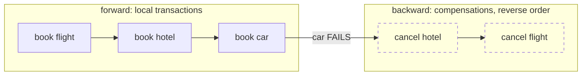
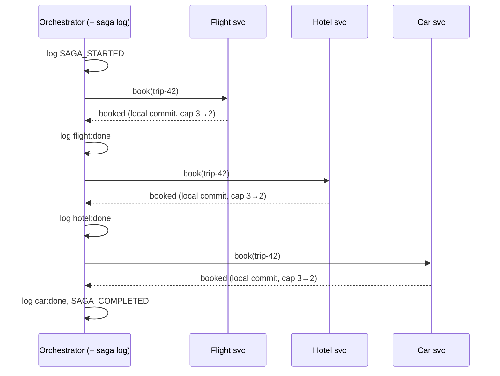
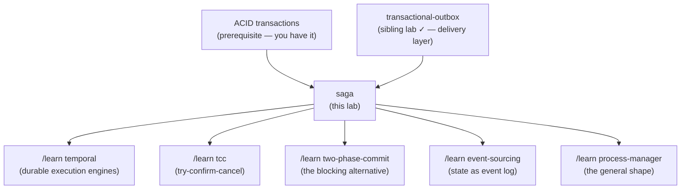

# The Saga Pattern — a learning lab

*Audience: a backend engineer who has never met this pattern. By the end you
should be able to design a saga, argue orchestration vs choreography in a
design review, name the isolation anomalies, and read the Temporal /
microservices.io / Garcia-Molina material fluently.*

**Lab contents**

| File | What it is |
|---|---|
| `README.md` | This document — the full story |
| `visualization.html` | Interactive simulator — fail any step, crash the coordinator, watch compensations run backwards |
| `SagaLab.java` | Runnable simulation: orchestrator + saga log + idempotent services + choreography variant |
| `SagaTest.java` | 11 scenario-named tests, `java SagaTest.java` |
| `EXERCISES.md` / `SOLUTIONS.md` | Predict / modify / debug exercises, answers separate |

Sibling lab: [`../transactional-outbox/`](../transactional-outbox/README.md) —
how each saga participant *reliably publishes* its events. This lab assumes
messages get delivered and focuses on the layer above: coordinating many
steps. The two patterns are almost always deployed together.

---

## 1. WHY does this exist?

One business action often spans several services, each with its **own**
database: "book a trip" touches flights, hotels, and car rentals. A database
transaction can make several writes inside *one* database all-or-nothing, but
nothing built into databases makes writes across *three different services'
databases* all-or-nothing. The saga pattern exists to get the *effect* of
all-or-nothing across services — without any shared transaction.

## 2. THE PROBLEM, as a story

You run a travel agency. A customer wants a package trip: a flight, a hotel
room, and a rental car — **all three or none**. Half a trip (flight but no
hotel) is worse than no trip: the customer pays for a flight to a city where
they'll sleep in the airport.

The airline, the hotel, and the car-rental company are three separate
businesses. Each has its own booking book, its own phone line, its own
policies. There is no planet on which all three slam their books shut and
write your booking in perfect unison. You book with one phone call at a
time — and between calls, the world can go wrong: the car office can be sold
out, your own office can lose power mid-way, a fax can arrive twice.

## 3. THE NAIVE SOLUTIONS

**Naive #1 — "just use one transaction."** Wrap all three bookings in one
`@Transactional` method. Doesn't exist: a transaction is a promise made by
*one* database about *its own* writes. Three services, three databases, three
independent commits. The annotation covers whichever database you're
connected to and silently ignores the two network calls.

**Naive #2 — "then make all three promise together"** (this one has a real
name: *two-phase commit*, 2PC). A coordinator asks all three: "prepared to
commit?" — everyone locks their row and says yes — then "commit!". This
genuinely gives atomicity, and it is exactly what the
[outbox lab](../transactional-outbox/README.md#16-related-concepts--and-when-to-choose-which)
called "the road not taken", for the same reasons: every participant must
speak the protocol (most SaaS APIs, message brokers, and NoSQL stores
don't), everyone holds **locks while waiting** on the slowest participant,
and if the coordinator dies after "prepare", participants sit **blocked**,
rows locked, unable to decide, until it returns. Availability of the whole
is the product of the availability of everyone. Across microservices —
let alone across a real airline's API — 2PC is a non-starter.

**Naive #3 — "just call them one by one and hope."** Book flight, book
hotel, book car. Works until the car call fails — and now you hold a flight
and a hotel you never asked to keep, with no plan for getting rid of them.

## 4. WHY NAIVE #3 FAILS, concretely

Flight booked (₹8,000 charged). Hotel booked (₹5,000 charged). Car: "sold
out." The code throws an exception, returns HTTP 500 — and the flight and
hotel bookings **stay**. They were separate commits in other services; your
exception rolls back nothing anywhere else. The customer is charged ₹13,000
for a trip that doesn't exist. Retrying later double-books the flight.
Naive #3 isn't wrong about calling one at a time — that part is forced by
physics. It's wrong because it has **no plan for partial success**.

## 5. THE KEY IDEA

**Accept that the steps commit one at a time — and prepare, for every step,
an explicit "undo" action. Run the steps in order; if one fails, run the
undo actions of every completed step in reverse order.** You can't roll back
another service's committed transaction, but you *can* cancel a hotel room.
All-or-nothing stops being a database guarantee and becomes a *choreographed
sequence of ordinary transactions* — forward to the end, or backward to the
start.

## 6. TERMINOLOGY

- **Saga** — a sequence of *local transactions* where each step has a
  defined undo; on failure, completed steps are undone in reverse. (The name
  comes from a 1987 paper by Garcia-Molina & Salem about long-running
  transactions in a single database; microservices adopted it wholesale.)
- **Local transaction** — an ordinary ACID transaction inside ONE service's
  own database (hotel writes its own `bookings` row).
- **Compensating transaction (compensation)** — the explicit undo for a
  step: `cancelBooking` compensates `book`. A *new forward transaction* that
  reverses the business effect — not a database rollback.
- **Orchestration** — one coordinator (the *orchestrator*) tells each
  service what to do next and decides when to compensate. Flow lives in one
  place.
- **Choreography** — no coordinator: each service reacts to the previous
  service's events ("HotelBooked" → car service books). Flow is distributed
  across subscriptions.
- **Saga log** — the orchestrator's durable record of which steps have
  completed, so a crashed orchestrator can resume where it left off.
- **Compensatable / pivot / retryable steps** — the three roles a step can
  play: *compensatable* (has an undo, runs before the point of no return),
  the **pivot** (the go/no-go step — once it commits, the saga must finish),
  and *retryable* (after the pivot; cannot fail permanently, only be
  retried until they succeed).
- **Semantic lock** — marking mid-saga state explicitly (`status=PENDING`
  instead of `BOOKED`) so other transactions know it's provisional — a
  business-level substitute for the isolation sagas don't have.
- **Idempotent** — safe to apply twice (see the
  [outbox lab](../transactional-outbox/README.md), section 6 — same word,
  same reason: retries are everywhere).

## 7. MENTAL MODEL

Carry this picture: **a saga is a two-way staircase.** Each stair is a
committed local transaction. You climb one stair at a time; at every stair
you can still walk back down, because each stair has a matching "down"
action. Somewhere there is a landing — the pivot — after which there is no
down staircase, only up: the remaining stairs *must* eventually be climbed.
And crucially, the staircase is **in public**: anyone can see you standing
mid-way, holding bookings that might be gone tomorrow.



## 8. SEE IT MOVE — the interactive simulator

Open **`visualization.html`** (also published as an artifact). It shows the
trip saga as a live itinerary — orchestrator, the three services with their
own capacity counters and booking tables, and the saga log — and lets you:

- step through the saga one action at a time,
- choose **which step fails** and watch compensations run backwards,
- **crash the orchestrator mid-saga** and restart it to see log-based
  recovery (and why the hotel isn't double-charged),
- make a compensation fail and watch it retried,
- switch to **choreography** and watch the same flow as an event chain,
- peek as a **second customer** mid-saga to see the isolation anomaly,
- or press **"run the story for me"** for a narrated tour of all of it.

The verdict banner always states the trip's current truth in one plain
sentence. Play first; the next section explains what you saw.

## 9. THE ACTUAL MECHANISM, step by step (orchestration)

Concrete case: `trip-42`, each service starts with capacity 3.

**Step 0 — start.** The orchestrator writes `SAGA_STARTED` for `trip-42` to
its **saga log** (a durable table in the orchestrator's own database), then
begins.

**Step 1 — flight.** Orchestrator → flight service: `book(trip-42)`. The
flight service, in one local ACID transaction of its own, checks capacity,
decrements 3→2, records `trip-42: BOOKED`. Orchestrator appends
`flight:done` to the log.

**Step 2 — hotel.** Same shape: hotel books, capacity 3→2, log gets
`hotel:done`.

**Step 3 — car.** Same shape; on success the log gets `car:done` and then
`SAGA_COMPLETED`. Trip exists. Notice what never existed: any distributed
transaction, any cross-service lock, any moment where two databases had to
agree simultaneously.

The failure path (car sold out) is section 10(a). The lab implements
exactly this: `Orchestrator.run` and `SagaLog` in `SagaLab.java`.



**The same saga as choreography** has no orchestrator and no saga log;
the flow lives in subscriptions: the flight service listens for
`TripRequested`, books, and publishes `FlightBooked`; the hotel listens for
`FlightBooked`; the car listens for `HotelBooked`. Failure events
(`CarFailed`) trigger the cancellation chain backwards
(`HotelCancelled` → flight cancels). Where do those events travel, and how
does "book + publish event" stay atomic inside each service? **That is
literally the [transactional outbox](../transactional-outbox/README.md)** —
each participant writes its booking and its event in one local transaction,
and a relay delivers it. Saga on top, outbox underneath.

## 10. FAILURE SCENARIOS — walk each one

**(a) A middle/late step fails (car sold out).** The orchestrator reads its
log — `flight:done`, `hotel:done` — and runs compensations **in reverse
order**: `hotel.cancel(trip-42)` (capacity 2→3), then `flight.cancel`
(2→3), then logs `SAGA_ABORTED`. Reverse order matters when steps depend on
each other (you release the hotel booked *for those flight dates* before
releasing the flight). Run: `java SagaLab.java car-fails-compensate`.

```text
    car.book(trip-2) -> FAILED: car: sold out
    COMPENSATE hotel.cancel(trip-2) -> cancelled (capacity back to 3)
    COMPENSATE flight.cancel(trip-2) -> cancelled (capacity back to 3)
    saga trip-2: ABORTED (all completed steps undone)
```

**(b) The orchestrator crashes mid-saga.** ⚠️ The important one. Say it dies
*after* `hotel.book()` succeeded but *before* writing `hotel:done` to the
log. A new orchestrator starts, reads the log for `trip-42`: `flight:done`
— skip flight; nothing about hotel — **call `hotel.book(trip-42)` again**.
The hotel service sees `trip-42` already in its bookings table and answers
"already booked" without charging again. This is the same lesson as the
outbox relay's gap, one layer up: *a durable log tells the coordinator where
it roughly was; participant **idempotency** absorbs the uncertainty of
"did my last command land?"*. A saga whose participants aren't idempotent
double-books on every recovery. Run:
`java SagaLab.java orchestrator-crash-recovery`.

**(c) A compensation fails.** The hotel's cancel endpoint times out while the
saga is aborting. The orchestrator cannot shrug — the saga is half-undone —
so it **retries the compensation until it succeeds** (with backoff in real
life, and a human-alert escape hatch after N attempts). This is why
compensations must be *retryable and idempotent*, and must be designed to
always eventually succeed (a cancel can't be "sold out"). Run:
`java SagaLab.java compensation-retry`.

**(d) A command or event is delivered twice.** Broker redelivery, relay
crash (outbox lab, scenario d) — the hotel receives `book(trip-42)` twice.
Same answer as always: idempotency by saga id. Every arrow in the sequence
diagram must tolerate duplication.

**(e) The isolation anomaly — the one ACID letter sagas drop.** While
`trip-42` is mid-flight, hotel capacity already reads 0. Another customer
asks "any rooms?" and is told **sold out**. Then the car step fails, the
saga aborts, the room comes back. That customer read state that was later
undone — a business-level **dirty read**. Related anomaly, the **lost
update**: a second transaction changes the same row mid-saga, and the
compensation later stomps on it. Sagas do not prevent these; you must
*manage* them with **countermeasures**:
  - **Semantic lock** — write `status=PENDING_TRIP_42` instead of silently
    taking the room; other transactions can then decide to wait, warn, or
    treat pending as unavailable-but-explainable.
  - **Commutative updates** — design updates so order doesn't matter
    (reserve/release counters rather than absolute writes).
  - **Reread value / version check** — compensation verifies the row is
    still what it wrote before undoing it.
Run: `java SagaLab.java dirty-read`.

**(f) Choreography-specific failure: the invisible flow.** Nothing "fails,"
yet nobody can say where `trip-6b` is stuck, because the flow exists only as
subscriptions scattered across services — and a cancellation chain is easy
to wire wrong (miss one event type and hotels leak). Run:
`java SagaLab.java choreography` and read the event chains.

## 11. CORRECTNESS — what is and isn't guaranteed

**Guaranteed (if you build it right):**
- **Eventual atomicity-in-effect**: every saga eventually ends in exactly one
  of two states — all steps done (`COMPLETED`) or all completed steps
  compensated (`ABORTED`). Nothing stays half-done *forever*.
- **Durability of progress**: the saga log survives coordinator crashes;
  recovery resumes, never restarts from scratch.

**Explicitly NOT guaranteed:**
- **Isolation.** The "I" of ACID is gone — mid-saga state is visible to
  everyone (scenario e). ACD, not ACID. This is the pattern's defining cost,
  and the reason the countermeasures vocabulary exists.
- **Instant atomicity.** Between first commit and last compensation the
  system *is* inconsistent; the guarantee is only that it converges.
- **Rollback.** Compensation is a business undo, not a time machine: the
  charge happened and was refunded (two ledger lines, maybe an email and a
  fee) — not erased. Some actions are *un-compensatable* (an email cannot be
  unsent; a mug already shipped can only be recalled) — those must be
  sequenced **after the pivot**, as retryable steps.

**Traded away:** simultaneous consistency and isolation — in exchange for no
distributed locks, no blocking protocol, participation by anything that can
process a request (including third-party APIs), and availability that
doesn't multiply failure probabilities across services.

## 12. THE CODE

`SagaLab.java`, ~250 lines of mechanism:

- `Service` — one per business; own state, `book`/`cancel`, both idempotent
  by booking id; knobs to force failures.
- `SagaLog` — durable append-only record per saga id.
- `Orchestrator.run` — the forward loop: skip logged steps, book, log,
  handle `StepFailed` by calling `compensate` (reverse order, retry
  `ConnectionError` forever). Crash injection sits in the
  book-succeeded-but-not-logged gap.
- `Bus` + `wireChoreography` — the same saga as pure event reactions,
  compensation chain included.

What one orchestration step looks like in a production Java stack
(illustrative, not part of the lab):

```java
// inside the orchestrator, on receiving BookHotelReply.success
sagaLog.append(sagaId, HOTEL_DONE);                 // durable first
commandBus.send(new BookCar(sagaId, dates));        // then next command
// on BookCarReply.failure:
for (Step s : completedStepsInReverse(sagaId))
    commandBus.send(s.compensationCommand(sagaId)); // cancel hotel, flight
```

(Real frameworks — section 14 — generate this loop from a declarative
definition; the mechanism underneath is exactly the lab's.)

## 13. EXPERIMENTS — break it yourself

```bash
java SagaLab.java happy-path                   # three local commits, glued
java SagaLab.java car-fails-compensate         # backward staircase
java SagaLab.java orchestrator-crash-recovery  # log + idempotency
java SagaLab.java compensation-retry           # undo is not allowed to quit
java SagaLab.java dirty-read                   # the missing I
java SagaLab.java choreography                 # same saga, no coordinator
java SagaTest.java                             # all 11 scenarios as tests
```

Each maps to a scenario in section 10 and prints a verdict paragraph.

## 14. PRODUCTION — what the lab omits and how real systems do it

| Lab simplification | Production reality |
|---|---|
| Commands are direct method calls | Commands/replies and events go through a broker, and each participant publishes via a **transactional outbox** (your other lab) so "commit my booking + emit my event" is atomic. |
| Saga log is a list in memory that we keep alive | A real table (or the workflow engine's event-sourced history). Writing the log entry and the orchestrator's own state change is — again — a local-transaction-plus-outbox problem. |
| Retry loop is `while True` | Backoff + max attempts + **dead-letter / human escalation**: a compensation that fails for hours becomes a support ticket, not an infinite loop. Timeouts are first-class: "hotel hasn't replied in 30s" is itself a failure that triggers compensation. |
| One orchestrator instance | Frameworks do the heavy lifting: **Temporal** (durable workflow code — your saga is literally a function whose every await is checkpointed), **Camunda/Zeebe** (BPMN-modeled), **AWS Step Functions**, **Axon / Eventuate Tram** (JVM saga orchestrators), **MassTransit / NServiceBus** (.NET). Rolling your own is reasonable at small scale — it's this lab plus persistence. |
| Steps in a fixed list | Real definitions mark each step compensatable / **pivot** / retryable, and put un-compensatable effects (send email, ship goods) after the pivot. |
| Capacity counters visible to all | Semantic locks (`PENDING` states), commutative reserve/release operations, version checks — the countermeasures of section 10(e), plus explicit UX for "provisional" (your airline seat "held for 20 minutes" is a semantic lock you have met in real life). |
| Nobody watches | Observability is *the* operational pain: every saga gets a correlation id carried through every command/event; dashboards show sagas by state; alerts fire on sagas stuck in one state too long. Orchestration makes this dramatically easier than choreography — one place knows every saga's state. |

**Orchestration vs choreography, the honest rule of thumb:** choreography is
fine for 2–3 steps with trivial failure handling; the moment the flow has
branches, timeouts, or someone asks "where is order 4711 stuck?", you want
orchestration. Modern practice (and Temporal's existence) leans strongly
orchestration for anything non-trivial — with the orchestrator kept to
*coordination only* (no business logic), so it doesn't become a god-service.

## 15. EXERCISES

See `EXERCISES.md` — predict / modify / debug tiers, answers in
`SOLUTIONS.md`. The debug tier hides a compensation-ordering bug and an
un-compensatable-step design flaw.

## 16. RELATED CONCEPTS — and when to choose which

- **Two-phase commit (2PC/XA)** — true atomicity + isolation, at the price
  of blocking, locks, and universal protocol support; dead across
  microservices and third-party APIs. Saga = availability over isolation;
  2PC = the reverse. (Longer comparison in the
  [outbox lab](../transactional-outbox/README.md#16-related-concepts--and-when-to-choose-which).)
- **Transactional outbox** — the layer *below*: reliable delivery of one
  participant's events. Saga assumes it; nearly every real saga rides on it.
- **TCC (Try-Confirm-Cancel)** — a cousin: every service exposes a *reserve*
  ("try": hold the room, don't book it), then the coordinator confirms or
  cancels all holds. Buys back some isolation (holds are invisible-ish)
  at the price of every participant implementing three operations and
  holds needing expiry. Think "application-level 2PC with timeouts".
- **Process manager / workflow engine** — the orchestrator generalized: a
  state machine reacting to events with commands. A saga orchestrator *is*
  a process manager whose specialty is compensation; Temporal/Camunda are
  process managers you rent.
- **Event sourcing** — orthogonal storage choice; pairs naturally (the saga
  log becomes just another event stream), but neither requires the other.

Rule of thumb: **one business action, several services' databases, and
"undo" is expressible in business terms ⇒ saga** (orchestrated, on top of
outboxes). If undo is *not* expressible and the steps can't be reordered
behind a pivot — reconsider the service boundaries; that pain usually means
one service should own the whole invariant.

## 17. NEXT STEPS — knowledge map



Suggested order: two-phase-commit next (**sibling lab:
[`../two-phase-commit/`](../two-phase-commit/README.md)** — you know *both*
of its replacements, outbox for delivery and saga for coordination, so its
tradeoffs will land), then `/learn temporal` to see sagas as they're
actually shipped in 2026, then `/learn event-sourcing`.

---

**Glossary recap:** saga · local transaction · compensating transaction ·
orchestration · choreography · saga log · pivot / compensatable / retryable
step · semantic lock · countermeasures · TCC. All defined in section 6 and
10(e).
